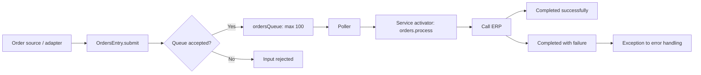
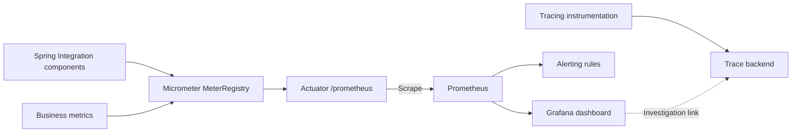

# Dashboards for integration flows

## 1. Objectives and scope

In the **Metrics and observability** chapter of the **SPRING_INTEGRATION_CORE** module, a dashboard connects knowledge of `Message`, `MessageChannel`, endpoints, gateways, and Java DSL to operating a real integration flow. On-call engineers need to know where messages are flowing, where they are slowing down, and what business outcomes they reached.

After this lesson, you will be able to:

- Define measurement boundaries for a synchronous or asynchronous integration flow.
- Combine Spring Integration's built-in metrics with custom business metrics.
- Design a dashboard covering traffic, errors, latency, and backlog depth.
- Write PromQL that aggregates accurately when an application runs multiple instances.
- Pivot from an anomalous panel to the endpoint, logs, or traces to investigate.
- Build alerts with traffic conditions and clear response steps.

The lesson uses a scenario receiving orders into a `QueueChannel`, after which a service activator forwards orders to an ERP system. Code examples target Spring Boot 3.5.x, Spring Integration 6.5.x, and Java 17 or higher; library versions are managed by Spring Boot dependency management. Configuration snippets are hands-on material and do not require creating a separate dashboard JSON file.

## 2. Start from operational questions

A useful dashboard must answer concrete questions:

| Question | Signal to inspect | Next action |
| --- | --- | --- |
| Is the flow accepting orders? | Successful queue admission rate | Cross-check schedules and upstream producers |
| Are orders finishing processing? | Completion rate split by success and failure | Check backlog if ingress exceeds egress |
| How long are users waiting? | Latency from intake to final outcome | Separate queue wait time from processing time |
| Which step has a problem? | Duration and errors per handler | Open logs or traces for that endpoint |
| Are resources sufficient? | Queue saturation, executor, CPU, JVM | Investigate consumer and target system limits |
| Can these panels be trusted? | Scrape status, data gaps | Fix the collection pipeline before drawing conclusions |

A low CPU panel does not prove a flow is healthy. Consumers may have stopped while the queue keeps growing. Conversely, a queue of 0 might mean upstream stopped sending.

## 3. Define measurement boundaries before charting

### 3.1. Sample flow



Milestones that must stay distinct:

1. **Admitted to the flow:** `send()` to the queue returns `true`.
2. **Processing started:** consumer takes the message from the queue and invokes the handler.
3. **Completed successfully:** the ERP operation completes per the business contract.
4. **Completed with failure:** the message finishes without fulfilling that contract.
5. **Rejected at intake:** the queue could not accept the message; it is not part of the admitted set.

In this flow, a one-way gateway returning success or a channel send succeeding confirms only handoff. The final outcome appears later at the consumer. With a request-reply gateway, reply wait time may sit closer to the business boundary, yet you still must clarify whether the reply represents intake acknowledgment or final processing outcome.

### 3.2. Example metric contract

| Custom Micrometer name | Type | When updated | Custom labels |
| --- | --- | --- | --- |
| `integration.flow.admitted` | Counter | Queue accepted the order | `flow` |
| `integration.flow.rejected` | Counter | Queue rejected because full | `flow` |
| `integration.flow.completed` | Counter | Order finished at processor | `flow`, `outcome` |
| `integration.flow.duration` | Timer | At the same completion moment | `flow`, `outcome` |

In this lesson, `flow="orders"`; `outcome` takes only `success` or `failure`. Names starting with `integration.flow.*` in the table are **application-defined**, not automatically generated by Spring Integration.

Duration is measured from right before sending to the queue until the processor finishes. Only admitted messages produce completion latency samples. Each sample includes enqueue time, queue wait time, and ERP processing; it excludes time the order existed in the upstream source system.

At a steady instant in the same process, with no lost messages, no retries, and no branching:

```text
admitted = completed_success + completed_failure + queued + processing
```

This is a data-sanity relationship, not an exact transactional reconciliation across scrape samples. Counters and gauges may be sampled at slightly different instants.

When adding a splitter, one order can produce multiple child messages. When adding an aggregator, multiple child messages can yield a single result. Therefore, define the unit of measurement as **orders**, **child messages**, or **groups**, and title panels with that exact unit.

## 4. Collection architecture and the two instrumentation mechanisms



Spring Boot Actuator together with the Prometheus registry provides the metrics export path. The `metrics` endpoint aids meter discovery; the `prometheus` endpoint serves scrape data. See [Spring Boot: Metrics](https://docs.spring.io/spring-boot/3.5/reference/actuator/metrics.html) and [Actuator endpoints](https://docs.spring.io/spring-boot/3.5/reference/actuator/endpoints.html).

### 4.1. Standard metrics vs. Observation

In the standard metrics mechanism, notable meters include:

| Micrometer meter | Meaning |
| --- | --- |
| `spring.integration.send` | Timer for channel or handler; distinguished by `type` |
| `spring.integration.receive` | Counter for receives from pollable channels or sources |
| `spring.integration.channel.queue.size` | Messages currently waiting in QueueChannel |
| `spring.integration.channel.queue.remaining.capacity` | Remaining slots in QueueChannel |

The send timer carries tags such as `name`, `type`, `result`, and `exception`. When using Observation for components, meters shift to families like `spring.integration.handler`, `spring.integration.producer`, and `spring.integration.gateway`, with a different tag convention. Enabling Observation requires a registry and selecting components via `observationPatterns`. See [Spring Integration 6.5: Metrics and Management](https://docs.spring.io/spring-integration/reference/6.5/metrics.html).

**The main example uses standard metrics**, without configuring `observationPatterns`. PromQL for built-in meters later applies to this choice. Custom business metrics keep their contract even if you switch the instrumentation mechanism.

Before importing a dashboard from another project, inspect actual meters. Do not rename queries by guesswork or sum both legacy meters and Observation meters for the same work.

### 4.2. Micrometer names vs. Prometheus names

In configuration and Actuator `metrics`, dot-separated names are used. When exported through the Prometheus registry with default naming conventions, the lesson examples look like:

| In application | In Prometheus |
| --- | --- |
| Counter `integration.flow.admitted` | `integration_flow_admitted_total` |
| Counter `integration.flow.completed` | `integration_flow_completed_total` |
| Timer `integration.flow.duration` | `integration_flow_duration_seconds_count`, `_sum`, `_bucket` |
| Gauge `spring.integration.channel.queue.size` | `spring_integration_channel_queue_size` |

Cross-check `/actuator/prometheus` output directly if you customized naming conventions. Timers inherently have counts and total duration; histograms add buckets when enabled. See [Micrometer: Timers](https://docs.micrometer.io/micrometer/reference/concepts/timers.html).

## 5. Practice application configuration

### 5.1. Dependencies

Add these dependencies to an application that already has a Spring Boot parent or BOM. The web dependency provides HTTP endpoints for Actuator.

```xml
<dependencies>
    <dependency>
        <groupId>org.springframework.boot</groupId>
        <artifactId>spring-boot-starter-integration</artifactId>
    </dependency>
    <dependency>
        <groupId>org.springframework.boot</groupId>
        <artifactId>spring-boot-starter-actuator</artifactId>
    </dependency>
    <dependency>
        <groupId>org.springframework.boot</groupId>
        <artifactId>spring-boot-starter-web</artifactId>
    </dependency>
    <dependency>
        <groupId>io.micrometer</groupId>
        <artifactId>micrometer-registry-prometheus</artifactId>
        <scope>runtime</scope>
    </dependency>
</dependencies>
```

### 5.2. Actuator and histogram configuration

```yaml
spring:
  application:
    name: orders-integration

management:
  endpoints:
    web:
      exposure:
        include: health,metrics,prometheus,integrationgraph
  metrics:
    tags:
      application: orders-integration
      env: local
    distribution:
      percentiles-histogram:
        "integration.flow.duration": true
      minimum-expected-value:
        "integration.flow.duration": 1ms
      maximum-expected-value:
        "integration.flow.duration": 30s
      slo:
        "integration.flow.duration": 500ms,2s,10s
```

The thresholds are choices for the lab. Tune them to your system's real timing requirements. `maximum-expected-value` adjusts histogram range; it does not impose a timeout on the flow.

Histograms allow computing percentiles after aggregating multiple instances. Precomputed per-instance percentiles cannot be averaged to infer a system-wide percentile. See [Micrometer: Histograms and Percentiles](https://docs.micrometer.io/micrometer/reference/concepts/histogram-quantiles.html).

Allow only monitoring systems and operators to access management endpoints. The `integrationgraph` endpoint helps inspect structure and component names; the structural graph itself does not show rate, latency, or business outcomes.

### 5.3. Flow and metrics at business boundaries

The class below contains configuration and supporting types in a single example. Place it in a package scanned by the Spring Boot application. An inbound adapter or controller calls the `OrdersEntry` bean; the example does not depend on a specific inbound protocol.

```java
import java.util.concurrent.TimeUnit;

import io.micrometer.core.instrument.Counter;
import io.micrometer.core.instrument.MeterRegistry;
import io.micrometer.core.instrument.Timer;

import org.springframework.context.annotation.Bean;
import org.springframework.context.annotation.Configuration;
import org.springframework.integration.channel.QueueChannel;
import org.springframework.integration.config.EnableIntegration;
import org.springframework.integration.config.EnableIntegrationManagement;
import org.springframework.integration.dsl.IntegrationFlow;
import org.springframework.integration.dsl.Pollers;
import org.springframework.messaging.Message;
import org.springframework.messaging.support.MessageBuilder;

@Configuration(proxyBeanMethods = false)
@EnableIntegration
@EnableIntegrationManagement
public class FlowDashboardConfig {

    private static final String FLOW = "orders";
    private static final String STARTED_AT = "flowStartedNanos";

    public record Order(String orderId) {
    }

    @Bean
    public QueueChannel ordersQueue() {
        return new QueueChannel(100);
    }

    @Bean
    public OrdersMetrics ordersMetrics(MeterRegistry registry) {
        return new OrdersMetrics(registry);
    }

    @Bean
    public OrdersEntry ordersEntry(
            QueueChannel ordersQueue, OrdersMetrics metrics) {
        return new OrdersEntry(ordersQueue, metrics);
    }

    @Bean
    public OrderProcessor orderProcessor(OrdersMetrics metrics) {
        return new OrderProcessor(metrics);
    }

    @Bean
    public IntegrationFlow ordersFlow(
            QueueChannel ordersQueue, OrderProcessor orderProcessor) {
        return IntegrationFlow.from(ordersQueue)
                .handle(orderProcessor, "process", endpoint -> endpoint
                        .id("orders.process")
                        .poller(Pollers.fixedDelay(100)
                                .maxMessagesPerPoll(10)))
                .get();
    }

    public static final class OrdersEntry {

        private final QueueChannel input;
        private final OrdersMetrics metrics;

        public OrdersEntry(QueueChannel input, OrdersMetrics metrics) {
            this.input = input;
            this.metrics = metrics;
        }

        public boolean submit(Order order) {
            Message<Order> message = MessageBuilder.withPayload(order)
                    .setHeader(STARTED_AT, System.nanoTime())
                    .build();

            // Timeout 0: do not wait if the queue is already full.
            boolean accepted = this.input.send(message, 0);

            if (accepted) {
                this.metrics.admitted.increment();
            }
            else {
                this.metrics.rejected.increment();
            }

            return accepted;
        }
    }

    public static final class OrdersMetrics {

        private final Counter admitted;
        private final Counter rejected;
        private final Counter completedSuccess;
        private final Counter completedFailure;
        private final Timer successDuration;
        private final Timer failureDuration;

        public OrdersMetrics(MeterRegistry registry) {
            this.admitted = Counter.builder("integration.flow.admitted")
                    .tag("flow", FLOW)
                    .register(registry);
            this.rejected = Counter.builder("integration.flow.rejected")
                    .tag("flow", FLOW)
                    .register(registry);
            this.completedSuccess = Counter
                    .builder("integration.flow.completed")
                    .tags("flow", FLOW, "outcome", "success")
                    .register(registry);
            this.completedFailure = Counter
                    .builder("integration.flow.completed")
                    .tags("flow", FLOW, "outcome", "failure")
                    .register(registry);
            this.successDuration = Timer
                    .builder("integration.flow.duration")
                    .tags("flow", FLOW, "outcome", "success")
                    .register(registry);
            this.failureDuration = Timer
                    .builder("integration.flow.duration")
                    .tags("flow", FLOW, "outcome", "failure")
                    .register(registry);
        }

        public void finished(boolean successful, long startedNanos) {
            Timer duration = successful
                    ? this.successDuration : this.failureDuration;
            Counter completed = successful
                    ? this.completedSuccess : this.completedFailure;

            duration.record(
                    System.nanoTime() - startedNanos,
                    TimeUnit.NANOSECONDS);
            completed.increment();
        }
    }

    public static final class OrderProcessor {

        private final OrdersMetrics metrics;

        public OrderProcessor(OrdersMetrics metrics) {
            this.metrics = metrics;
        }

        public void process(Message<Order> message) {
            long startedNanos =
                    (Long) message.getHeaders().get(STARTED_AT);
            boolean successful = false;

            try {
                callErp(message.getPayload());
                successful = true;
            }
            finally {
                this.metrics.finished(successful, startedNanos);
            }
        }

        private void callErp(Order order) {
            // Simulate ERP outcome; replace with a real adapter during practice.
            if (order.orderId().startsWith("FAIL-")) {
                throw new IllegalStateException("ERP demo failure");
            }
        }
    }
}
```

The poller is attached to the endpoint consuming `QueueChannel`. `maxMessagesPerPoll(10)` sets the maximum messages per poll cycle; it does not spawn ten parallel consumers. See [Spring Integration: Pollers](https://docs.spring.io/spring-integration/reference/dsl/java-pollers.html).

Decisions in the example:

- `submit()` returning `true` means the queue accepted it; the caller still must track downstream business outcomes arriving later.
- The `FAIL-` prefix triggers a simulated error to observe `outcome="failure"`.
- `finally` records the outcome and lets the exception keep propagating. With a polling endpoint, the exception proceeds to the poller's error handler; the example does not turn errors into successes.
- Each message is processed once with no retry. Thus, one processor failure counts as the message's final failure in this example.
- Counters for both outcomes are created upfront, so a failure series can exist at value 0 before any error occurs.
- `System.nanoTime()` is only valid for elapsed time differences inside the same JVM. Never ship this value across a broker to another process to compute latency.
- The queue in the example is in-memory. When a process stops, metrics before and after restart cannot prove zero lost orders; systems needing durable delivery require corresponding persistence and reconciliation.

Example calls at an inbound adapter injected with `OrdersEntry`:

```java
boolean accepted = ordersEntry.submit(
        new FlowDashboardConfig.Order("ORDER-001"));

boolean acceptedButWillFail = ordersEntry.submit(
        new FlowDashboardConfig.Order("FAIL-002"));
```

Both calls can return `true`. Once the consumer runs, their final outcomes differ.

Because the Timer already provides `count`, the `completed` counter in the example is a choice to make the business contract explicit. You may use the timer count instead of this counter if you preserve the exact same definition and filters. Never sum those two sources together.

### 5.4. When the flow includes more EIP components

The short lab only needs a queue and a service activator. When extending with other core components, add signals matching their contracts:

| Component | Signal to add | Common misconception |
| --- | --- | --- |
| Transformer | Transformation duration, data errors | Completing transformation does not mean ERP send completed |
| Filter | Accepted and discarded counts by bounded reason | Rule-based discards are not necessarily technical errors |
| Router | Per-branch rate with stable branch names | A branch with zero data may simply reflect routing conditions |
| Splitter and aggregator | Child message count, waiting groups, expired groups | Do not compare child messages with original orders using the same unit |
| Retry advice | Attempt count, retry count, final outcome count | A failed attempt may still recover on the next try |
| Error flow | Recovery count, dead-letter count, errors in the error handler itself | Logging an exception does not guarantee the message finished processing |

If you add retries wrapping the processor, move the `completed_failure` increment to where retries are exhausted or recovery confirms the final outcome. Do not keep the example's increment placement and label every failed attempt a final failed order.

## 6. Inspecting data before building panels

After generating traffic, you can inspect via PowerShell:

```powershell
Invoke-RestMethod 'http://localhost:8080/actuator/metrics'

Invoke-RestMethod 'http://localhost:8080/actuator/metrics/integration.flow.completed'

Invoke-RestMethod 'http://localhost:8080/actuator/metrics/spring.integration.send?tag=type:handler'

(Invoke-WebRequest 'http://localhost:8080/actuator/prometheus').Content

Invoke-RestMethod 'http://localhost:8080/actuator/integrationgraph'
```

Verify one by one:

1. Business meters appear with `application`, `env`, `flow`, and `outcome` tags matching the contract.
2. Prometheus output includes `_count`, `_sum`, and `_bucket` for histogram-enabled timers.
3. Queue meters carry `name="ordersQueue"`.
4. What actual `name` tag the handler has; endpoint ID and framework-managed handler name should not be assumed always identical.
5. After a `FAIL-` order, the failure completion counter increments alongside error info for investigation.

Some component meters appear only after the component is used. Not seeing a time series right after startup is not enough to conclude instrumentation is broken.

Values in the Actuator `metrics` endpoint help diagnose inside a single application. Windowed rates and cross-instance aggregations should be computed in Prometheus.

## 7. Designing dashboard layout

A three-row dashboard layout is recommended:

| Row | Panel | Display and unit |
| --- | --- | --- |
| Overview | Admitted inputs, successful/failed completions | Time series, orders/second |
| Overview | Final failure ratio | Stat and time series, percentage |
| Overview | p95 latency of successful orders | Time series, seconds |
| Backlog | Queue depth per instance | Time series, messages |
| Backlog | Queue saturation per instance | Gauge or time series, percentage |
| Diagnostics | Mean processing duration per handler | Time series, seconds |
| Diagnostics | Endpoint error rate | Time series, calls/second |
| Diagnostics | Scrape health, CPU, JVM, executor if present | Status and time series |

Place input and output panels side by side using the same time window. Place backlog directly below to explain any gap. Each panel needs a short description of its unit, measurement boundary, and what enters the denominator.

### 7.1. Filters and component names

Create dashboard variables:

- `application`: application to inspect.
- `env`: environment.
- `flow`: business flow.
- `instance`: optional, to investigate a single process.
- `component`: optional for the handler row, populated from actual meter `name` tags.

Query-type variables can fetch label values from the data source; later variables can chain from earlier ones. See [Grafana: Add variables](https://grafana.com/docs/grafana/latest/visualizations/dashboards/variables/add-template-variables/).

The queries below assume `application`, `env`, and `flow` select **a single value**. When enabling multi-select or All, switch appropriate selectors to regex and check cross-flow aggregations.

Business metrics carry the `flow` tag because the application attaches it. Default Spring Integration meters do not automatically carry this business tag. The example's queue panel uses a fixed mapping `orders → ordersQueue`; multi-flow dashboards need a queue-name variable or an explicitly managed mapping.

### 7.2. Label conventions

Use finite, stable values such as `flow=orders`, `outcome=success|failure`, `route=erp|manual`. Put `orderId`, `messageId`, `traceId`, exception messages, and URLs containing identifiers in logs or traces.

For example, 8 flows × 2 outcomes × 6 instances create 96 combinations before adding other labels and histogram series. Adding hundreds of thousands of `orderId` values makes combinations grow with order volume; dashboards become expensive and slow to query.

Component names must also remain stable across deployments. Never generate endpoint names from order codes or runtime timestamps.

## 8. PromQL for the primary panels

Prometheus can scrape the application with a minimal configuration:

```yaml
global:
  scrape_interval: 15s

scrape_configs:
  - job_name: spring-integration
    metrics_path: /actuator/prometheus
    static_configs:
      - targets:
          - localhost:8080
```

`localhost` here works only when Prometheus can reach the application on the same machine. In containers or clusters, use an address reachable from Prometheus. See [Prometheus: Configuration](https://prometheus.io/docs/prometheus/latest/configuration/configuration/).

Examples below use a `[5m]` window. With a 15-second scrape interval, this span holds enough samples to observe trends. You can switch to Grafana's dynamic interval once the baseline dashboard is accurate.

### 8.1. Admitted input rate

```promql
sum by (flow) (
  rate(integration_flow_admitted_total{
    application="$application", env="$env", flow="$flow"
  }[5m])
)
```

The unit is admitted orders/second. Attempted sends rejected by the queue do not appear on this line.

### 8.2. Completion rate by outcome

```promql
sum by (flow, outcome) (
  rate(integration_flow_completed_total{
    application="$application", env="$env", flow="$flow"
  }[5m])
)
```

Use legend `{{flow}} / {{outcome}}`. The sum of both lines is total completion rate; only the `success` line represents outputs achieving business completion.

Apply `rate()` to each counter first before aggregating so per-instance resets are handled. See [Prometheus: Query functions](https://prometheus.io/docs/prometheus/latest/querying/functions/).

### 8.3. Final failure ratio

```promql
100 *
sum by (flow) (
  rate(integration_flow_completed_total{
    application="$application", env="$env",
    flow="$flow", outcome="failure"
  }[5m])
)
/
sum by (flow) (
  rate(integration_flow_completed_total{
    application="$application", env="$env", flow="$flow"
  }[5m])
)
```

The denominator is **completed** orders, sharing the exact same boundary as the numerator. Do not divide consumer failures by ingress arrivals in the same window and treat that as an accurate outcome ratio: admitted orders may still be waiting.

When there are no completed orders, division can return `NaN`. Display an insufficient-data state; avoid turning it into a healthy 0%. With low sample counts, always inspect the number of completed orders in the window as well.

### 8.4. p95 latency of successful orders

```promql
histogram_quantile(
  0.95,
  sum by (le, flow) (
    rate(integration_flow_duration_seconds_bucket{
      application="$application", env="$env",
      flow="$flow", outcome="success"
    }[5m])
  )
)
```

Preserve the `le` label when aggregating classic histograms. p95 is estimated from buckets and can lose precision when samples are sparse. Never average per-instance p95 values. See [Prometheus: Histograms and summaries](https://prometheus.io/docs/practices/histograms/).

This panel considers only successful orders. Place failure ratio right beside it, because fast failures can make combined latency look better while business outcomes deteriorate.

Using the configured 2-second SLO bucket, the percentage of successful orders completing within 2 seconds out of all completed orders is:

```promql
100 *
sum by (flow) (
  rate(integration_flow_duration_seconds_bucket{
    application="$application", env="$env", flow="$flow",
    outcome="success", le="2.0"
  }[5m])
)
/
sum by (flow) (
  rate(integration_flow_completed_total{
    application="$application", env="$env", flow="$flow"
  }[5m])
)
```

Check the `le` label value in exported output; if the registry formats the bucket as `"2"`, adjust the selector accordingly. This metric covers **completed orders** in the window, excluding still-hanging orders. For an SLA across all admitted orders, also monitor the age of unfinished orders and define arrival-time cohorts.

### 8.5. Waiting messages per instance

```promql
max by (instance, name) (
  spring_integration_channel_queue_size{
    application="$application", env="$env", name="ordersQueue"
  }
)
```

Each instance owns its own in-memory queue. Summing across instances fits asking how many are waiting system-wide; viewing per instance fits spotting uneven load distribution.

Queue size excludes messages already dequeued by a consumer and currently processing. Nor does it show the age of the oldest message. If processing deadlines matter, add order age or queue-wait measurements at the dequeue boundary.

### 8.6. Queue fill ratio per instance

```promql
100 *
max by (instance, name) (
  spring_integration_channel_queue_size{
    application="$application", env="$env", name="ordersQueue"
  }
)
/
(
  max by (instance, name) (
    spring_integration_channel_queue_size{
      application="$application", env="$env", name="ordersQueue"
    }
  )
  +
  max by (instance, name) (
    spring_integration_channel_queue_remaining_capacity{
      application="$application", env="$env", name="ordersQueue"
    }
  )
)
```

In the bounded queue example, `size + remaining capacity = 100`. This ratio is not a useful capacity signal for a virtually unbounded queue.

If the application shows low queue size while `integration_flow_rejected_total` still climbs, inspect per-instance and finer time resolution: brief queue-full spikes may not appear on every scrape.

### 8.7. Mean duration and errors per handler

With the standard metrics mechanism, mean duration is:

```promql
sum by (name) (
  rate(spring_integration_send_seconds_sum{
    application="$application", env="$env", type="handler"
  }[5m])
)
/
sum by (name) (
  rate(spring_integration_send_seconds_count{
    application="$application", env="$env", type="handler"
  }[5m])
)
```

Rate of failed handler executions:

```promql
sum by (name) (
  rate(spring_integration_send_seconds_count{
    application="$application", env="$env",
    type="handler", result="failure"
  }[5m])
)
```

Do not drop `type="handler"` and treat the sum of channels and handlers as unique orders. One message can pass through multiple components.

With `DirectChannel`, synchronous calls can include downstream processing time. Thus summing durations across multiple channels and handlers can double-count the same intervals. With queue or executor channels, measuring send duration likewise does not cover asynchronous processing. See channel characteristics in [Spring Integration: Message Channel Implementations](https://docs.spring.io/spring-integration/reference/channel/implementations.html).

The handler queries above cover all handlers in the selected application. When an application hosts multiple flows, add a component-name selector from the flow's mapping so diagnostic rows do not mix flows.

### 8.8. Collection health

```promql
up{job="spring-integration"}
```

`up` is a Prometheus-generated target metric. It does not inherit `application` or `env` tags attached inside `MeterRegistry`. With the lesson's scrape config, filter `up` by `job` and `instance`.

`up=1` confirms the scrape succeeded, not that business work is progressing. Targets disappearing from service discovery also need missing-target detection against an expected target list; `up == 0` alone does not cover that case.

## 9. From dashboards to alerts

The practice thresholds below are examples, not default Spring Integration SLOs:

- Sustained final failure ratio above 5%.
- Evaluate the ratio only when at least 100 orders completed in 5 minutes.
- Scrape failing continuously for 2 minutes.
- For queues, consider alerting when saturation exceeds 80% for 5 minutes, combined with message age or consumer health.

Example rule file configured via Prometheus `rule_files`:

```yaml
groups:
  - name: orders-integration-flow
    rules:
      - alert: IntegrationFlowFailureRatioHigh
        expr: |
          (
            sum by (application, env, flow) (
              rate(integration_flow_completed_total{
                application="orders-integration",
                outcome="failure"
              }[5m])
            )
            /
            sum by (application, env, flow) (
              rate(integration_flow_completed_total{
                application="orders-integration"
              }[5m])
            )
            > 0.05
          )
          and on (application, env, flow)
          (
            sum by (application, env, flow) (
              increase(integration_flow_completed_total{
                application="orders-integration"
              }[5m])
            ) >= 100
          )
        for: 10m
        labels:
          severity: warning
        annotations:
          summary: "Flow {{ $labels.flow }} has a high failure ratio"
          description: "Open dashboard by application, env, and flow; check ERP, handler, and error logs."

      - alert: IntegrationMetricsScrapeFailed
        expr: up{job="spring-integration"} == 0
        for: 2m
        labels:
          severity: critical
        annotations:
          summary: "Cannot scrape {{ $labels.instance }}"
          description: "Check target, network connectivity, and Actuator endpoint before interpreting panels."
```

`for` requires the condition to hold continuously before an alert transitions to firing. The `[5m]` window and `for: 10m` serve different roles: one computes the signal, the other requires the signal to persist. See [Prometheus: Alerting rules](https://prometheus.io/docs/prometheus/latest/configuration/alerting_rules/).

No-traffic alerts must account for operating schedules. A batch file-processing flow may stay quiet for hours by design. Flows expecting continuous load should compare upstream input against downstream progress.

Every alert needs an owner, a linked dashboard, and a first investigation step. Delivering notifications also requires Alertmanager or your platform's alerting configuration.

## 10. Investigating an incident through the dashboard

Suppose illustrative numbers appear:

| Time | Admitted | Completed success | Queue | Successful p95 |
| --- | --- | --- | --- | --- |
| 09:00 | 20 orders/s | 20 orders/s | 3 | 0.4 s |
| 09:05 | 20 orders/s | 6 orders/s | 90 | 8 s |
| 09:08 | 3 orders/s | 3 orders/s | 100 | 16 s |

At 09:08, the queue admission rate dropped because the queue filled up; the source's **attempted send** rate may still be 20 orders/s. Check `rejected` and upstream metrics to avoid concluding demand fell.

A sound investigation order:

1. Confirm scraping is healthy and panels match the same environment, flow, and time window.
2. Inspect per-instance queues to see whether backlog is system-wide or isolated to one consumer.
3. Inspect handler duration and ERP call traces. Growing queue alongside rising ERP call duration points to a slow target system.
4. If the handler stays fast while the queue grows, check whether the endpoint is running, the poller, polling schedule, executor if any, and load balancing.
5. Check outcomes and retry behavior. Aggressive retries can burn resources without increasing final completions.
6. Verify timeouts, connection limits, and ERP load capacity before increasing concurrency.
7. After mitigation, watch completion rate exceed admission rate while draining backlog and verify queue depth steadily falls.

Never conclude root cause from a single panel correlation. For instance, low CPU alongside a growing queue can stem from I/O waits, a stopped consumer, or a throttled poller.

### Linking metrics with logs and traces

A completion log should include fields such as `flow`, `endpoint`, `orderId`, `messageId`, `outcome`, and `traceId` if tracing is enabled. When opening a panel by handler, pivot to logs for the same application, instance, and time range.

Do not assume calling `MeterRegistry` creates traces automatically. If enabling tracing and Observation, verify propagation across channels, executors, gateways, and brokers. Update dashboard queries to match the new mechanism's meters. Business correlation IDs and trace IDs serve two different needs; keep both in their proper diagnostic tools.

## 11. Scenario-based practice

These scenarios help learners verify the dashboard after deploying the example:

| Scenario | How to trigger | What to observe |
| --- | --- | --- |
| Normal flow | Send `ORDER-` codes at low load | `admitted` and `completed` success stay close, queue low |
| ERP errors | Mix in a fraction of `FAIL-` codes | `completed` failure rises in matching proportion |
| Slow ERP | Use an ERP stub with controlled latency | Handler duration rises; then queue and end-to-end latency rise |
| Full queue | Send faster than processing capacity long enough | Queue hits 100, `rejected` rises, `admitted` drops below attempted sends |
| Stopped consumer | Stop the `orders.process` endpoint in the lab | Queue grows, `completed` stops, `up` may still equal 1 |
| Multiple instances | Run two instances and distribute input | Total throughput scales with load; queue remains separated per instance |
| One instance restarts | Restart in the lab environment | Counters reset; rates still handle resets given enough samples |
| Source stops sending | Pause order generation | Input drops; queue drains and then output drops |

The stopped-consumer scenario is useful only in a lab where you can restart the endpoint. If data disappears from panels, distinguish zero events, missing series, and failed scrapes.

### Self-implementation exercises

1. Create the panels from section 8 and write a measurement-boundary description for each panel.
2. Add a queue-wait metric when the processor receives a message; compare it against full-flow latency.
3. Add a filter rejecting orders by a business rule. Decide upfront whether rejected orders belong in `completed` or a separate outcome group.
4. Add bounded retries for transient ERP errors. Separate failed attempts from final failed orders.
5. If adding an aggregator, build panels for unreleased groups and timed-out groups without using `orderId` as a label.
6. Write a short runbook note for a full queue with low CPU.

## 12. Mistakes to avoid

| Mistake | Consequence | Fix |
| --- | --- | --- |
| Treating channel send success as business completion | Dashboard looks green even if ERP failed | Measure at final outcome |
| Summing invocations across all channels and handlers | Counts one order multiple times | Pick one business boundary or one specific component |
| Mixing standard meters with Observation meters | Wrong query names or double-counting | Discover actual meters and pin one mechanism per panel |
| Summing durations across synchronous steps | Double-counts downstream processing | Use full-flow timers and traces to break down time |
| Averaging per-instance percentiles | Aggregated p95 is wrong | Aggregate buckets first, then compute quantiles |
| Taking `rate()` of queue size | Loses meaning of waiting message count | Use the gauge directly; inspect trends separately if needed |
| Ignoring hanging orders when reading latency | Latency looks good despite large backlog | Place queue depth and order age next to latency |
| Using message IDs as metric labels | Cardinality explodes with event volume | Put identifiers in logs or traces |
| Treating missing data as 0 errors | Hides collection failures or missing samples | Display missing-data states distinctly |
| Scaling consumers immediately when queue grows | Can overload ERP further | Identify actual bottlenecks before raising concurrency |

## 13. Dashboard completion criteria

A dashboard meets operational goals when viewers can:

- Distinguish admitted, rejected, and completed counts.
- State the unit of every panel and the denominator semantics of every ratio.
- View full-flow latency alongside backlog rather than handler duration alone.
- Slice by instance while still computing accurate flow-wide totals.
- Identify actual endpoint names and pivot to logs or traces.
- Separate flow failures from monitoring-pipeline failures.
- Understand how filters, routers, splitters, aggregators, and retries affect counts.
- Know which alert requires action and what first investigation step to take.

A dashboard's value lies in the decisions it supports: spotting stalled progress, pinpointing slow boundaries, and verifying recovery. Charts are trustworthy only when their measurement contracts match how the integration flow actually processes messages.
