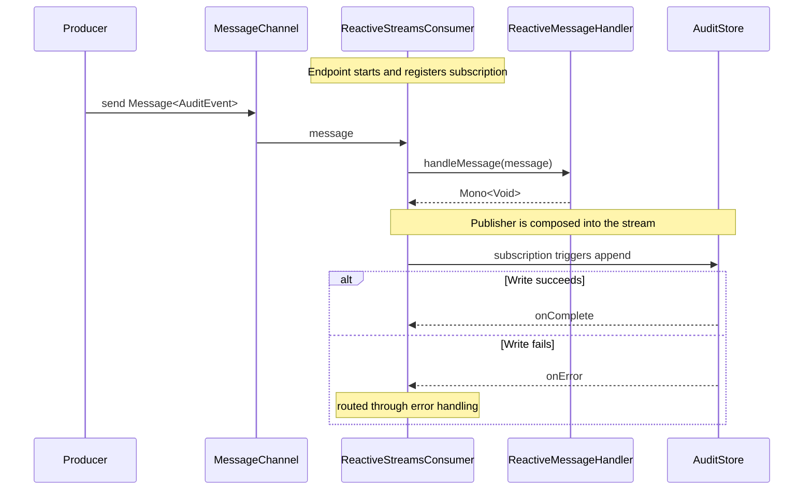

# ReactiveMessageHandler

## 1. Objectives and Role in Spring Integration Core

In the **Reactive support** chapter of the **SPRING_INTEGRATION_CORE** module, this lesson explains how to use `ReactiveMessageHandler` to process a `Message<?>` with a reactive operation that emits a completion signal without producing a reply message.

After this lesson, you can:

- Accurately read the `Mono<Void> handleMessage(Message<?> message)` contract.
- Write handlers that preserve the I/O operation lifecycle within the returned publisher.
- Connect handlers to `MessageChannel` and endpoints using Java DSL.
- Distinguish between message acceptance, processing completion, and business acknowledgment.
- Design error paths, retries, idempotency, and subscription tests.

You should understand `Message` structure including payload and headers, the roles of channels and endpoints, and basic operators `Mono.defer`, `then`, and `onErrorMap`. The examples use Java 17 or later and Spring Integration 6.1 or later because they use `handleReactive(...)`; let your project BOM manage compatible Spring and Reactor versions. This DSL API was added in Spring Integration 6.1. [Reactive Streams Support Documentation](https://docs.spring.io/spring-integration/reference/reactive-streams.html).

### Running Example

An order system needs to persist an audit event after an order is confirmed:

```text
Message<AuditEvent>
    → auditInput
    → auditWriter endpoint
    → AuditMessageHandler
    → AuditStore.append(event)
    → complete or report error
```

The payload contains the audit data; headers carry information such as `traceId` and `errorChannel`. The audit destination only needs to know whether the write operation succeeded or failed. It does not need to produce a new payload for a transformer or router to process further. This is a good fit for a handler that terminates an integration branch.

If the caller needs to receive a receipt code or an updated order object, design a request–reply step with explicit reply data. `ReactiveMessageHandler` serves the completion contract of a one-way operation.

## 2. The ReactiveMessageHandler Contract

This interface belongs to **Spring Messaging**:

```java
import org.springframework.messaging.Message;
import org.springframework.messaging.ReactiveMessageHandler;
import reactor.core.publisher.Mono;

// Interface method signature:
Mono<Void> handleMessage(Message<?> message);
```

This is a functional interface, so it can be implemented as a class, lambda, or method reference. The return value represents the completion result of handling the message. [ReactiveMessageHandler Javadoc](https://docs.spring.io/spring-framework/docs/current/javadoc-api/org/springframework/messaging/ReactiveMessageHandler.html).

| Element | Meaning |
| --- | --- |
| `Message<?>` | The full message, including payload and headers |
| `Mono<Void>` | A publisher representing completion or error, emitting no business data |
| `onComplete` | The operation represented by the handler succeeded according to its contract |
| `onError` | The operation failed |
| Cancellation | The subscriber canceled observation or canceled the work; not a success signal |
| No terminal signal | The operation is still pending or hung |

Reactor does not use `null` as an emitted element. `Mono<Void>` succeeds by completing without emitting a value; `Mono.empty()` is a valid publisher, whereas returning `null` from a handler violates the contract. [Mono Javadoc](https://projectreactor.io/docs/core/release/api/reactor/core/publisher/Mono.html).

### 2.1. Mono<Void> Still Carries Important Information

Having no returned data does not mean having no result:

```text
onSubscribe → request execution → write operation succeeds → onComplete
onSubscribe → request execution → write operation fails    → onError
```

For an audit store, `onComplete` must mean that `append` has succeeded at the level guaranteed by the store. If the store merely enqueues work onto another queue and completes, that signal only confirms enqueueing. The boundary of success must be defined in the `AuditStore` contract.

### 2.2. then() Preserves Completion Timing While Discarding Data

A reactive repository may return the saved entity:

```java
// repository.save(event) has type Mono<AuditEvent>.
return repository.save(event).then();
```

`then()` discards the entity value while still waiting for the source publisher to terminate and propagating errors from the source. Therefore, the handler does not need to call `subscribe()` itself to execute the operation. [Reactor: Choosing an Operator](https://projectreactor.io/docs/core/release/reference/apdx-operatorChoice.html).

Conversely, `map` or `flatMap`, which rely on an emitted value, will not be invoked when the source is an empty-completing `Mono<Void>`. To run a subsequent task after the write finishes, use:

```java
return store.append(event)
        .then(Mono.defer(() -> anotherStore.append(event)));
```

Here, the completion contract covers both operations in sequence. If the first operation fails, the second one does not run.

## 3. Handler, Endpoint, and Subscription Have Distinct Roles

Three components are often confused:

| Component | Responsibility |
| --- | --- |
| `ReactiveMessageHandler` | Creates a publisher representing the processing of a single message |
| `ReactiveStreamsConsumer` | Connects the message source to reactive processing and manages the endpoint subscription |
| `ReactiveMessageHandlerAdapter` | Adapts a reactive handler into the `void`-returning `MessageHandler` contract |

`ReactiveMessageHandlerAdapter` is a bridge to the imperative API. When the adapter is called directly under the `MessageHandler` contract, it subscribes to the publisher returned by its delegate. When reactive streams can be composed, the framework can unwrap the delegate from the adapter to compose it into the stream. Thus, being called an "adapter for synchronous invocation" does not mean it waits for I/O to complete. [ReactiveMessageHandlerAdapter Javadoc](https://docs.spring.io/spring-integration/api/org/springframework/integration/handler/ReactiveMessageHandlerAdapter.html).

In standard Spring Integration 6.1 endpoint configuration, the factory recognizes this adapter and creates a `ReactiveStreamsConsumer`, even when the input is not a `FluxMessageChannel`. Therefore, do not assume that every flow using a `DirectChannel` subscribes to each operation independently. [ConsumerEndpointFactoryBean 6.1.4 Source](https://github.com/spring-projects/spring-integration/blob/v6.1.4/spring-integration-core/src/main/java/org/springframework/integration/config/ConsumerEndpointFactoryBean.java).

### Lifecycle in a Reactive Configuration



This is a logical diagram and does not assert that each step uses a separate thread. A reactive chain can run on the current thread until it encounters a source or operator that switches the execution scheduler.

Inside a handler, return the publisher to the framework. Subscribing internally detaches the operation from the completion signal the endpoint is tracking; errors, cancellation, and demand coordination also become hard to manage.

## 4. Building a Self-Contained Audit Example

The Java classes below all belong to the `demo.audit` package. Place each `public` class or interface in a Java file of the same name when practicing. This is illustrative code to add to an application and requires no external services.

Required dependencies in a Maven project with a compatible BOM configured:

```xml
<dependencies>
    <dependency>
        <groupId>org.springframework.integration</groupId>
        <artifactId>spring-integration-core</artifactId>
    </dependency>
    <dependency>
        <groupId>io.projectreactor</groupId>
        <artifactId>reactor-core</artifactId>
    </dependency>
    <dependency>
        <groupId>io.projectreactor</groupId>
        <artifactId>reactor-test</artifactId>
        <scope>test</scope>
    </dependency>
    <dependency>
        <groupId>org.junit.jupiter</groupId>
        <artifactId>junit-jupiter</artifactId>
        <scope>test</scope>
    </dependency>
</dependencies>
```

The dependency snippets omit versions because they assume your project BOM already manages them. Projects without dependency management should configure that first.

### 4.1. Payload and Storage Contract

```java
package demo.audit;

public record AuditEvent(
        String eventId,
        String orderId,
        String action) {
}
```

```java
package demo.audit;

import reactor.core.publisher.Mono;

public interface AuditStore {

    // Completes when the store has accepted the write according to its contract.
    // The publisher must preserve errors and the write operation lifecycle.
    Mono<Void> append(AuditEvent event);
}
```

`eventId` is a stable business key used to identify the same event across redeliveries. `orderId` correlates the event with an order. `action` describes the change, such as `ORDER_CONFIRMED`.

### 4.2. In-Memory Store for Demonstration

```java
package demo.audit;

import java.util.concurrent.ConcurrentHashMap;
import java.util.concurrent.ConcurrentMap;
import reactor.core.publisher.Mono;

public final class InMemoryAuditStore implements AuditStore {

    private final ConcurrentMap<String, AuditEvent> events =
            new ConcurrentHashMap<>();

    @Override
    public Mono<Void> append(AuditEvent event) {
        return Mono.fromRunnable(() ->
                events.compute(event.eventId(), (key, existing) -> {
                    if (existing != null && !existing.equals(event)) {
                        throw new IllegalStateException(
                                "eventId already exists with different content");
                    }
                    return event;
                }));
    }

    public AuditEvent find(String eventId) {
        return events.get(eventId);
    }
}
```

The store only modifies the map upon subscription. Resending the same `eventId` with equivalent content does not create a new record; reusing the key with different content raises an error. `compute` makes the per-key check-and-update atomic in this demonstration store.

This data is lost when the process terminates and is not shared across multiple application instances. With a real database, an equivalent mechanism based on unique constraints and atomic writes is required; simply checking existence before inserting can introduce a race condition.

### 4.3. Handler Validating Data and Preserving the Original Message on Error

```java
package demo.audit;

import java.util.Objects;
import org.springframework.messaging.Message;
import org.springframework.messaging.MessageHandlingException;
import org.springframework.messaging.MessagingException;
import org.springframework.messaging.ReactiveMessageHandler;
import reactor.core.publisher.Mono;

public final class AuditMessageHandler implements ReactiveMessageHandler {

    private final AuditStore store;

    public AuditMessageHandler(AuditStore store) {
        this.store = Objects.requireNonNull(store);
    }

    @Override
    public Mono<Void> handleMessage(Message<?> message) {
        return Mono.<Void>defer(() -> {
            if (!(message.getPayload() instanceof AuditEvent event)) {
                return Mono.error(new IllegalArgumentException(
                        "Payload must be AuditEvent"));
            }

            if (isBlank(event.eventId())
                    || isBlank(event.orderId())
                    || isBlank(event.action())) {
                return Mono.error(new IllegalArgumentException(
                        "eventId, orderId, and action must not be blank"));
            }

            return store.append(event);
        }).onErrorMap(error ->
                error instanceof MessagingException
                        ? error
                        : new MessageHandlingException(
                                message, "Unable to write audit event", error));
    }

    private static boolean isBlank(String value) {
        return value == null || value.isBlank();
    }
}
```

`Mono.defer` defers both payload validation and the `store.append` call until subscription time. Any exception thrown while constructing the store's publisher also becomes a reactive error. Each subscription recreates the corresponding work; do not subscribe multiple times unless re-execution is intentional.

`onErrorMap` adds context via `MessageHandlingException`, including the failed message and the underlying cause. If an exception is already a `MessagingException`, this example preserves it instead of wrapping it again. This assumes the exception from the lower layer already describes its own context accurately.

The handler does not store a "currently processing message" field. A single bean may process multiple messages concurrently; per-message state must reside in local variables or inside the publisher chain.

## 5. Wiring with Java DSL

### 5.1. Configuring the Flow and Error Channel

```java
package demo.audit;

import org.springframework.context.annotation.Bean;
import org.springframework.context.annotation.Configuration;
import org.springframework.integration.channel.FluxMessageChannel;
import org.springframework.integration.channel.QueueChannel;
import org.springframework.integration.config.EnableIntegration;
import org.springframework.integration.dsl.IntegrationFlow;

@Configuration
@EnableIntegration
public class AuditIntegrationConfiguration {

    @Bean
    public FluxMessageChannel auditInput() {
        return new FluxMessageChannel();
    }

    @Bean
    public QueueChannel auditErrors() {
        return new QueueChannel(100);
    }

    @Bean
    public AuditStore auditStore() {
        return new InMemoryAuditStore();
    }

    @Bean
    public AuditMessageHandler auditMessageHandler(AuditStore auditStore) {
        return new AuditMessageHandler(auditStore);
    }

    @Bean
    public IntegrationFlow auditFlow(
            FluxMessageChannel auditInput,
            AuditMessageHandler auditMessageHandler) {

        return IntegrationFlow.from(auditInput)
                .handleReactive(
                        auditMessageHandler,
                        endpoint -> endpoint
                                .id("auditWriter")
                                .reactive());
    }
}
```

`handleReactive(...)` terminates the flow definition and returns an `IntegrationFlow`. Do not chain `.get()`, `.channel(...)`, or a transformer after it. The second overload allows configuring the endpoint wrapping the handler. [Java DSL 6.1.4 Source](https://github.com/spring-projects/spring-integration/blob/v6.1.4/spring-integration-core/src/main/java/org/springframework/integration/dsl/BaseIntegrationFlowDefinition.java).

`endpoint.reactive()` explicitly expresses the intent to use a reactive consumer. With `FluxMessageChannel` and this handler, the framework already has enough information to choose that consumer; calling it is not the sole mandatory condition for reactive execution. The option also lets you configure a reactive consumer independently of the input channel type. [ConsumerEndpointSpec.reactive Javadoc](https://docs.spring.io/spring-integration/api/org/springframework/integration/dsl/ConsumerEndpointSpec.html).

`FluxMessageChannel` acts as a `Publisher` for downstream consumers and can accept a publisher source via `subscribeTo(...)`. Choosing a reactive channel preserves demand propagation across that stream segment. However, a reactive channel alone does not turn blocking steps or imperative producers into an end-to-end backpressured chain. [Message Channel Implementations Documentation](https://docs.spring.io/spring-integration/reference/channel/implementations.html#flux-message-channel).

### 5.2. Sending a Message and Observing the Outcome

In the following snippet, `auditInput` is the channel bean obtained from a started application context:

```java
import org.springframework.messaging.Message;
import org.springframework.messaging.support.MessageBuilder;

AuditEvent event =
        new AuditEvent("evt-1001", "order-42", "ORDER_CONFIRMED");

Message<AuditEvent> message = MessageBuilder.withPayload(event)
        .setHeader("traceId", "trace-42")
        .setErrorChannelName("auditErrors")
        .build();

boolean accepted = auditInput.send(message);
```

`accepted` describes the result of sending to the channel. Do not treat this value as general proof that an asynchronous write operation has finished. The in-memory example may finish immediately on the same thread, whereas a real store may still have I/O pending when `send` returns.

If you need to wait for a business outcome, establish a separate reply contract or tracking mechanism, such as an `AuditRecorded` event with a correlation ID. Simply attaching a `replyChannel` to the input does not make this handler generate a reply.

### 5.3. When Reading Legacy DSL Code

A conceptually equivalent way to wire the handler uses an explicit adapter:

```java
import org.springframework.integration.dsl.IntegrationFlow;
import org.springframework.integration.handler.ReactiveMessageHandlerAdapter;

IntegrationFlow flow = IntegrationFlow.from("legacyAuditInput")
        .handle(
                new ReactiveMessageHandlerAdapter(auditMessageHandler),
                endpoint -> endpoint.reactive())
        .get();
```

This is an alternative configuration style, not something to register in parallel with the main flow for the same source. In this pattern, `.handle(...)` still returns a builder, so `.get()` is required. Distinguish it from the terminal operator `.handleReactive(...)`.

Do not replace the adapter with a `MessageHandler` lambda containing `store.append(...).subscribe()`. That only hides a reactive handler behind a `void` call and breaks the link between store completion and the message-processing lifecycle.

## 6. Backpressure, Concurrency, and Ordering

### 6.1. Returning a Mono Composes Pending Work into the Stream

When a reactive consumer composes each message's publisher, an incomplete write operation remains part of the work managed by the stream. The 6.1.4 `ReactiveStreamsConsumer` implementation uses `flatMap` for the `ReactiveMessageHandler` path and cancels the subscription when the endpoint stops. [ReactiveStreamsConsumer Source](https://github.com/spring-projects/spring-integration/blob/v6.1.4/spring-integration-core/src/main/java/org/springframework/integration/endpoint/ReactiveStreamsConsumer.java).

This has two design implications:

- Do not assume all write operations execute sequentially.
- Do not assume completion order matches incoming message order.

For example, two events `ORDER_CREATED` and `ORDER_CONFIRMED` for the same order arrive in that order. If the second operation completes first, the destination may observe a write order different from the business order. Idempotency addresses duplicate deliveries of the same event, while ordering between two distinct events requires a separate policy.

### 6.2. Limiting Demand Is Not the Same as Limiting I/O Operations

A source calling `send(...)` in an imperative loop does not automatically slow down just because downstream uses Reactor. You must consider the source's admission mechanism, channel buffering, in-flight operations, and connection pool capacity.

You can estimate pending work as:

```text
average in-flight operations
    ≈ arrival rate per second × average processing time in seconds

Example: 400 messages/second × 0.2 seconds ≈ 80 operations
```

This is a steady-state estimate. When latency spikes or input bursts occur, pending work can grow far beyond this estimate. Resource limits must align with the database and your overload policy.

If you design a dedicated Reactor boundary yourself, you can explicitly choose how to compose operations:

```java
// messages has type Flux<Message<?>>.
// These are two alternatives for a self-managed pipeline.
Mono<Void> atMostEightInFlight =
        messages.flatMap(auditMessageHandler::handleMessage, 8).then();

Mono<Void> sequential =
        messages.concatMap(auditMessageHandler::handleMessage).then();
```

This is not a `concurrency` option on `handleReactive`, nor is it code to run alongside an already-registered consumer. Only one component should own consumption of that pipeline's source. For standard flows, choose appropriate components or a partitioning design if business requirements mandate per-order sequential processing.

Setting `limitRate(1)` on the source is not enough to guarantee only one I/O operation is in flight if downstream still composes with `flatMap`. The concurrency parameter of `flatMap` bounds how many inner publishers are subscribed concurrently, whereas `concatMap` composes sequentially. [Flux Javadoc](https://projectreactor.io/docs/core/release/api/reactor/core/publisher/Flux.html).

### 6.3. Reactive Does Not Automatically Mean Non-Blocking

The following pattern runs a blocking call before creating the publisher:

```java
// Do not use this for a blocking I/O call.
legacyAuditClient.write(event);
return Mono.empty();
```

Simply moving the call into `Mono.defer` does not switch threads either. When a blocking client is unavoidable, you can isolate it:

```java
return Mono.fromRunnable(() -> legacyAuditClient.write(event))
        .subscribeOn(reactor.core.scheduler.Schedulers.boundedElastic())
        .then();
```

`boundedElastic` is suitable for isolating blocking work; it still consumes resources and has bounds. With a truly reactive client, you typically return the client's publisher to leverage the I/O and scheduler mechanisms the client already provides. Having a `Mono` does not create a separate thread on its own. [Reactor: Threading and Schedulers](https://projectreactor.io/docs/core/release/reference/coreFeatures/schedulers.html).

## 7. Errors, Timeouts, and Per-Message Retries

### 7.1. Keeping Errors in the Returned Publisher

A `try/catch` around `auditInput.send(message)` can catch errors raised immediately during the send call, but it is not a mechanism for waiting on I/O errors that occur later.

In the example, the handler wraps errors in `MessageHandlingException`, retaining `failedMessage` along with the cause. The endpoint's error-handling mechanism can use the `errorChannel` header to select `auditErrors`; if the header is absent, the default mechanism uses the global error channel. [Spring Integration: Error Handling](https://docs.spring.io/spring-integration/reference/error-handling.html).

During demonstration runs, you can read the error channel from a test thread:

```java
import org.springframework.messaging.Message;
import org.springframework.messaging.MessagingException;
import org.springframework.messaging.support.ErrorMessage;

Message<?> received = auditErrors.receive(1_000);

if (received instanceof ErrorMessage errorMessage) {
    Throwable failure = errorMessage.getPayload();

    if (failure instanceof MessagingException messagingException) {
        Message<?> failed = messagingException.getFailedMessage();
        // Use failed to retrieve eventId, traceId, and diagnostic information.
    }
}
```

`auditErrors` is a `QueueChannel(100)` intended only for demonstration and testing. Real applications need a consumer continuously handling errors. A full queue can block the error-reporting path; an in-memory queue also does not guarantee preserving errors after the application stops.

Do not assume every error kills the entire stream, or that every error is safely ignored. Behavior depends on the error path, operators, and consumer configuration. The policy for handling a failed message should be clearly specified and tested.

### 7.2. Timeouts Must Cover the Actual Operation

A timeout must be placed on the publisher that actually represents the write. A timeout on a publisher that was detached from the work by an internal `subscribe()` call will not track the operation properly.

A timeout also does not prove the external system did not write anything. For example, if the database committed but the response was lost, the caller still sees a timeout error. Therefore, retrying write operations must be paired with a stable idempotency key.

### 7.3. Retry Decorator for AuditStore

This example retries only `TimeoutException` so the policy is easy to verify:

```java
package demo.audit;

import java.time.Duration;
import java.util.Objects;
import java.util.concurrent.TimeoutException;
import reactor.core.publisher.Mono;
import reactor.util.retry.Retry;

public final class RetryingAuditStore implements AuditStore {

    private final AuditStore delegate;

    public RetryingAuditStore(AuditStore delegate) {
        this.delegate = Objects.requireNonNull(delegate);
    }

    @Override
    public Mono<Void> append(AuditEvent event) {
        return Mono.defer(() -> delegate.append(event))
                .timeout(Duration.ofSeconds(2))
                .retryWhen(
                        Retry.backoff(2, Duration.ofMillis(100))
                                .maxBackoff(Duration.ofSeconds(1))
                                .filter(TimeoutException.class::isInstance)
                                .onRetryExhaustedThrow(
                                        (spec, signal) -> signal.failure()));
    }
}
```

To use the decorator, replace the store instantiation in the `auditStore()` bean with:

```java
return new RetryingAuditStore(new InMemoryAuditStore());
```

The in-memory store typically completes immediately; the decorator illustrates where to attach the policy when swapping in a real storage client. Data validation errors or duplicate keys with different content are excluded from the retry filter.

`Retry.backoff(2, ...)` allows at most two retries after the initial attempt, meaning up to three executions total. `onRetryExhaustedThrow` preserves the final error instead of throwing the default retry-exhausted exception. [RetryBackoffSpec Javadoc](https://projectreactor.io/docs/core/release/api/reactor/util/retry/RetryBackoffSpec.html).

In the chain above, `timeout` sits before `retryWhen`, so it applies individually to each attempt. Total elapsed time can include three waits of up to two seconds plus backoff intervals. To enforce an overall budget, place another timeout after `retryWhen`.

Placing retries inside the per-event publisher limits the scope of re-execution. Retrying the entire message source might re-subscribe to the source or re-run other parts of the flow, depending on whether the source is replayable and how the stream is composed.

### 7.4. Avoid Turning Failures into False Success

```java
// Valid only when business requirements accept ignoring this error.
return store.append(event)
        .onErrorResume(error -> Mono.empty());
```

The publisher above completes successfully even though the audit was not recorded. If you need to route the event to a dead-letter store for later reprocessing, the recovery publisher must await successful persistence to the error store and retain enough data for recovery. A plain log line is not equivalent to durable error persistence.

## 8. Common Implementation Pitfalls

| Approach | Consequence | Fix |
| --- | --- | --- |
| Calling `store.append(event).subscribe()`, then returning `Mono.empty()` | Endpoint sees completion before the write finishes | Return the write publisher itself |
| Calling `block()` inside the handler | Blocks threads and undermines the reactive model | Compose publishers with operators |
| Returning `null` | Violates the publisher contract | Return `Mono.empty()` when there is genuinely no work |
| Using `Mono.just(blockingCall())` | Blocking call runs eagerly when building the publisher | Use lazy sources and an appropriate scheduler |
| Chaining `map` to continue after `Mono<Void>` | No value emitted to trigger the lambda | Use `then(...)` |
| Retrying every exception | Repeats data errors and causes useless load | Filter for recoverable errors |
| Generating a new `eventId` on each retry | Store cannot recognize the same event | Generate the key upfront and keep it across retries |
| Expecting `replyChannel` to receive a result automatically | Caller waits for a reply that never arrives | Design a dedicated request–reply step |
| Storing the current payload in a bean field | Concurrent messages overwrite each other's state | Use local variables and thread-safe components |

If you want to measure processing latency, the start timestamp must be tied to subscription and the end timestamp must sit inside the publisher chain. Timing around the `handleMessage(...)` call only measures publisher assembly time. With `Mono<Void>`, `doOnNext` cannot observe success; use an appropriate completion callback, while tracking errors and cancellations separately.

## 9. Testing the Reactive Contract

Handler tests must prove that the publisher preserves the operation lifecycle. Checking only that the method returns a `Mono` object is not enough.

`reactor-test` provides `StepVerifier` to assert publisher signals; `withVirtualTime` supports time-based scenarios without waiting through real backoff delays. Publishers using time operators should be constructed inside the `withVirtualTime` supplier. [Reactor: Testing](https://projectreactor.io/docs/core/release/reference/testing.html).

### 9.1. Testing the Handler and Retries with JUnit 5

```java
package demo.audit;

import java.time.Duration;
import java.util.concurrent.TimeoutException;
import java.util.concurrent.atomic.AtomicInteger;
import org.junit.jupiter.api.Test;
import org.springframework.messaging.Message;
import org.springframework.messaging.MessageHandlingException;
import org.springframework.messaging.support.MessageBuilder;
import reactor.core.publisher.Mono;
import reactor.core.publisher.Sinks;
import reactor.test.StepVerifier;

import static org.junit.jupiter.api.Assertions.*;

class AuditMessageHandlerTest {

    private static AuditEvent event() {
        return new AuditEvent(
                "evt-test-1", "order-test-1", "ORDER_CONFIRMED");
    }

    @Test
    void startsOnSubscriptionAndWaitsForStoreCompletion() {
        AtomicInteger starts = new AtomicInteger();
        Sinks.Empty<Void> completion = Sinks.empty();

        AuditStore store = event -> Mono.defer(() -> {
            starts.incrementAndGet();
            return completion.asMono();
        });

        AuditMessageHandler handler = new AuditMessageHandler(store);
        Message<AuditEvent> message =
                MessageBuilder.withPayload(event()).build();

        Mono<Void> result = handler.handleMessage(message);

        assertEquals(0, starts.get());

        StepVerifier.create(result)
                .expectSubscription()
                .then(() -> assertEquals(1, starts.get()))
                .expectNoEvent(Duration.ofMillis(20))
                .then(() -> assertEquals(
                        Sinks.EmitResult.OK, completion.tryEmitEmpty()))
                .expectComplete()
                .verify(Duration.ofSeconds(1));
    }

    @Test
    void propagatesFailureWithOriginalMessage() {
        IllegalStateException cause =
                new IllegalStateException("Audit store unavailable");

        AuditMessageHandler handler =
                new AuditMessageHandler(event -> Mono.error(cause));

        Message<AuditEvent> message =
                MessageBuilder.withPayload(event()).build();

        StepVerifier.create(handler.handleMessage(message))
                .expectErrorSatisfies(error -> {
                    MessageHandlingException failure =
                            assertInstanceOf(
                                    MessageHandlingException.class, error);
                    assertSame(message, failure.getFailedMessage());
                    assertSame(cause, failure.getCause());
                })
                .verify(Duration.ofSeconds(1));
    }

    @Test
    void rejectsWrongPayloadBeforeCallingStore() {
        AtomicInteger calls = new AtomicInteger();

        AuditMessageHandler handler =
                new AuditMessageHandler(event -> {
                    calls.incrementAndGet();
                    return Mono.empty();
                });

        Message<String> message =
                MessageBuilder.withPayload("not an audit event").build();

        StepVerifier.create(handler.handleMessage(message))
                .expectErrorSatisfies(error -> {
                    MessageHandlingException failure =
                            assertInstanceOf(
                                    MessageHandlingException.class, error);
                    assertSame(message, failure.getFailedMessage());
                    assertInstanceOf(
                            IllegalArgumentException.class, failure.getCause());
                })
                .verify(Duration.ofSeconds(1));

        assertEquals(0, calls.get());
    }

    @Test
    void retriesTwoTimeoutFailuresThenCompletes() {
        AtomicInteger attempts = new AtomicInteger();

        AuditStore delegate = event -> Mono.defer(() -> {
            if (attempts.incrementAndGet() < 3) {
                return Mono.error(new TimeoutException("Slow response"));
            }
            return Mono.empty();
        });

        RetryingAuditStore store = new RetryingAuditStore(delegate);

        StepVerifier.withVirtualTime(() -> store.append(event()))
                .expectSubscription()
                .thenAwait(Duration.ofSeconds(5))
                .expectComplete()
                .verify(Duration.ofSeconds(1));

        assertEquals(3, attempts.get());
    }
}
```

The first test uses a test-controlled completion source to verify two things: the store does not start when the handler is first invoked, and the result does not complete before the store does. A short `expectNoEvent` window helps catch premature `Mono.empty()` returns.

The error test verifies that both the cause and the original message are preserved. The invalid-payload test verifies that the store is not called. The retry test verifies exactly three executions when the first two attempts emit `TimeoutException`; it does not replace a separate test verifying that a hung client is canceled by the `timeout` operator.

### 9.2. Testing the Real Endpoint and Error Routing

Testing the handler directly does not verify Spring endpoint registration or error-channel selection. The following test uses the configuration from section 5:

```java
package demo.audit;

import org.junit.jupiter.api.Test;
import org.springframework.context.annotation.AnnotationConfigApplicationContext;
import org.springframework.integration.channel.FluxMessageChannel;
import org.springframework.integration.channel.QueueChannel;
import org.springframework.messaging.Message;
import org.springframework.messaging.MessageHandlingException;
import org.springframework.messaging.support.ErrorMessage;
import org.springframework.messaging.support.MessageBuilder;

import static org.junit.jupiter.api.Assertions.*;

class AuditFlowTest {

    @Test
    void routesReactiveFailureToRequestedErrorChannel() {
        try (AnnotationConfigApplicationContext context =
                     new AnnotationConfigApplicationContext(
                             AuditIntegrationConfiguration.class)) {

            FluxMessageChannel input =
                    context.getBean("auditInput", FluxMessageChannel.class);

            QueueChannel errors =
                    context.getBean("auditErrors", QueueChannel.class);

            Message<String> invalid = MessageBuilder
                    .withPayload("wrong payload type")
                    .setHeader("traceId", "trace-invalid-1")
                    .setErrorChannelName("auditErrors")
                    .build();

            assertTrue(input.send(invalid));

            Message<?> received = errors.receive(1_000);
            ErrorMessage error = assertInstanceOf(
                    ErrorMessage.class, received);

            MessageHandlingException failure = assertInstanceOf(
                    MessageHandlingException.class, error.getPayload());

            assertSame(invalid, failure.getFailedMessage());
            assertInstanceOf(
                    IllegalArgumentException.class, failure.getCause());
        }
    }
}
```

The test waits for a specific message with a finite timeout instead of using `Thread.sleep`. The fact that `send` succeeds and an `ErrorMessage` is subsequently received illustrates why the send result cannot represent handler success. The application context is closed after the test to stop the endpoint and release the subscription.

When adopting this in a production project, add scenarios matching operational requirements: the same `eventId` being redelivered, two different payloads sharing the same key, the store being canceled mid-flight, and a valid message following a failed message still being processed according to the chosen policy.

## 10. Integrating the Handler into a Larger Flow

An audit branch typically receives data after other EIP steps:

```text
gateway or inbound adapter
    → transformer normalizes data
    → filter removes invalid records
    → router selects destination
    → audit branch
    → ReactiveMessageHandler
```

The transformer builds `AuditEvent`, the filter applies business rules, the router selects the branch, and the final handler performs the write. If an aggregator is present, clarify whether the aggregated payload is a single event or a collection of events and which type the handler should process. Do not move aggregation or routing responsibilities into the handler just because it has access to the entire message.

A one-way gateway can serve as an entry point for sending audit events. If a gateway has a request–reply contract, ensure there is a step that produces a reply; a terminal branch returning `Mono<Void>` does not automatically generate a reply message for the gateway.

### 10.1. Choosing Component Types by Output

| Need | Design Approach |
| --- | --- |
| Write an event and terminate the branch | `ReactiveMessageHandler` |
| Normalize payload and forward downstream | Transformer |
| Select channel based on event type | Router |
| Accept only certain messages | Filter |
| Call a service and require returned data | Request–reply component supporting appropriate reactive results |
| Combine multiple events into one result | Aggregator before the next processing step |

A lambda returning `Mono<T>` in a standard handling API does not automatically carry the same contract as `ReactiveMessageHandler`. The endpoint type, async mode, and reply handling determine whether the publisher is composed as reactive processing or treated as returned data.

### 10.2. Observability and Operations

When deploying an audit branch, monitor at minimum:

- Duration from subscription to completion, error, or cancellation.
- Number of in-flight operations and queue depth.
- Retry counts, duplicate events, and errors requiring reprocessing.
- `eventId`, `orderId`, and `traceId` to correlate failures with the originating request.

Do not assume `ThreadLocal` values survive thread switches. Message headers are the right place to propagate application identifiers across integration steps; when using tracing or Reactor Context, use context-propagation mechanisms compatible with those boundaries.

Canceling a subscription when stopping an endpoint does not guarantee rolling back external side effects. Verify whether the client supports cancellation, whether shutdown waits for in-flight tasks, and whether the system can recover events with unknown outcomes.

## 11. Extended Practice with Observable Criteria

Use the audit example as a foundation to practice the following steps:

1. Send the same event twice to `InMemoryAuditStore`; verify only one entry exists per `eventId`.
2. Send the same key with a different `action`; verify an error is raised and the offending message can be retrieved.
3. Create a fake store that only completes when the test emits a signal; verify the handler does not complete early.
4. Create a fake store that times out twice before succeeding; verify `eventId` stays unchanged and execution occurs three times.
5. Replace the error source with a data error; verify it is not retried under the current policy.
6. Set two different processing durations for two messages and observe potential out-of-order completion.
7. Write down the desired policy when audit persistence fails: report an error, write to a dead-letter store, or emit a status event.

The expected outcome is a flow with a clear success boundary: the handler returns the work publisher, the endpoint owns the subscription, and the error path preserves enough context for diagnosis or retry. This forms the basis for integrating reactive I/O into Spring Integration Core's `Message`, `MessageChannel`, endpoint, gateway, and Java DSL components.
