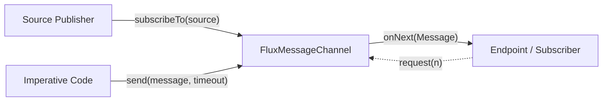

# FluxMessageChannel

## Objectives and Context

In the **Reactive support** chapter of the **SPRING_INTEGRATION_CORE** module, `FluxMessageChannel` bridges Spring Integration's `Message`, `MessageChannel`, and endpoint model with the Reactive Streams protocol. When the order source is a `Publisher`, we need to feed data into transformers, filters, or service activators while still observing downstream consumption demand.

After this lesson, you can:

- Distinguish between sending a `Message` to a channel and subscribing to consume a publisher.
- Declare `FluxMessageChannel` and use it in Java DSL.
- Explain backpressure boundaries between imperative and reactive code.
- Handle blocking work, per-item errors, and subscription lifecycles.
- Write time-bounded tests with `StepVerifier`.

You should already know `Message<T>` structure, headers, how to wire endpoints with Java DSL, and the concepts of `Flux`, `Mono`, and `Subscriber`. The configuration examples below use Java 17 and Spring Integration 6.5 APIs; implementation details are noted by version rather than as guaranteed buffer sizes across all releases.

## 1. Two Sides of the Same Channel

`FluxMessageChannel` is both a `MessageChannel` and a `Publisher<Message<?>>`. It also implements `ReactiveStreamsSubscribableChannel` to accept an input publisher and `Lifecycle` to manage source subscriptions. It does not implement `PollableChannel` or `SubscribableChannel` in the sense of registering a standard `MessageHandler`. [FluxMessageChannel API](https://docs.spring.io/spring-integration/api/org/springframework/integration/channel/FluxMessageChannel.html)

| Operation | Role | Key Point |
| --- | --- | --- |
| `channel.send(message, timeout)` | Pushes a message from imperative code into the channel | Send result is not the business outcome |
| `Flux.from(channel)` | Builds an operator chain over the channel's publisher | Does not create a consumer until subscribed |
| `channel.subscribe(subscriber)` | Registers a Reactive Streams subscriber on the receiving side | Subscriber controls demand via `request(n)` |
| `channel.subscribeTo(source)` | Connects a source publisher to the channel | Source elements must be `Message` instances |
| `start()`, `stop()`, `destroy()` | Controls lifecycle | Let Spring manage this when the channel is a bean |

Two method names are easily confused:

- `subscribe(...)`: the subscriber **receives from** the channel.
- `subscribeTo(...)`: the channel **receives from** the source publisher.

`Flux.from(channel)` does not mean unwrapping payloads into a `Flux`. The element type remains `Message<?>`; to extract the payload, use `map(Message::getPayload)` or an appropriate transformation.

### Message Containing Flux vs. Flux Containing Message

`Message<Flux<Order>>` is a single message whose payload is a publisher. `Flux<Message<Order>>` is a publisher emitting multiple messages. These two structures have different units for headers, identity, and error handling.

For example, three orders entering `subscribeTo` are normally represented as three `Message<Order>` instances, each with its own headers. Do not bundle them into a single `Message<Flux<Order>>` just to make the data look reactive. Endpoints returning a reactive payload and the framework flattening the result is a different mechanism, covered in section 7.

## 2. Data Flow and Demand Flow

`FluxMessageChannel` uses an internal hot source to accept incoming messages; subscribers receive data through the channel's publisher. When an endpoint consumes a reactive channel, Spring Integration uses `ReactiveStreamsConsumer` to bridge message handling with Reactive Streams. [Reactive Streams Support](https://docs.spring.io/spring-integration/reference/reactive-streams.html)



Demand indicates how many more items a subscriber is ready to receive. It is not a thread count, a transaction size, or confirmation that data has been persisted to a database.

For imperative sources, `send` remains a regular Java call. When downstream cannot keep up, wait time and send success depend on channel state and timeout. Do not infer that every `send` call returns immediately just because the channel name contains `Flux`.

### Hot Source, Multiple Subscribers, and Storage Limits

In the Spring Integration 6.5.0 implementation, the channel uses a multicast sink, requires a subscriber for direct sends, and may wait when a message cannot yet be emitted. Therefore, register the receiving side before producers call `send`; do not use the channel as storage while waiting for a consumer to appear. This detail is verified against [FluxMessageChannel 6.5.0 Source](https://raw.githubusercontent.com/spring-projects/spring-integration/v6.5.0/spring-integration-core/src/main/java/org/springframework/integration/channel/FluxMessageChannel.java).

When multiple subscribers are active, design for broadcasting data to active subscriptions. Do not treat this as a competing-consumers model where each order is handled by only one worker. Late subscribers also do not get full history replay by default.

If you need durable storage, message acknowledgment, or replay after process crashes, design an appropriate broker or storage mechanism. `FluxMessageChannel` alone does not solve those requirements.

### Choosing the Right Channel

| Channel | Primary Consumption Model | Best Suited For |
| --- | --- | --- |
| `DirectChannel` | Directly invokes a handler, usually on the sender thread | Simple synchronous flows |
| `QueueChannel` | Consumer calls `receive` or endpoint uses a poller | Queueing and polling-based consumption |
| `ExecutorChannel` | Delegates work to a `TaskExecutor` | Offloading execution via an executor |
| `FluxMessageChannel` | Reactive Streams subscriber requests items | Connecting message flows with reactive publishers and operators |

`DirectChannel` and `ExecutorChannel` provide point-to-point dispatch; `QueueChannel` provides queue send/receive semantics. Replacing them with `FluxMessageChannel` requires reviewing both consumption behavior and multi-subscriber semantics. [Message Channel Implementations](https://docs.spring.io/spring-integration/reference/channel/implementations.html)

## 3. Preparing the Example

The practice project requires the following dependencies:

| Dependency | Purpose |
| --- | --- |
| `org.springframework.integration:spring-integration-core` | Channels, endpoints, and Java DSL |
| `io.projectreactor:reactor-core` | `Flux`, `Mono`, and schedulers |
| `io.projectreactor:reactor-test`, test scope | `StepVerifier` |
| `org.junit.jupiter:junit-jupiter`, test scope | Running JUnit 5 tests |

Use your project's dependency management or BOM to align Spring and Reactor versions. Do not mix arbitrary versions just to make a snippet compile.

The business example receives string order IDs:

1. Trim whitespace and convert to uppercase.
2. Discard blank IDs.
3. Build a packing request prefixed with `PACK:`.
4. Preserve the `source` business header for order origin tracing.

The flow is designed as follows:

```text
rawOrders
    -> transformer
    -> normalizedOrders
    -> filter
    -> acceptedOrders
    -> service activator
    -> packingRequests
```

All four channels in the example are `FluxMessageChannel` instances. Placing reactive channels between endpoints preserves Reactive Streams consumption boundaries; the processing logic itself must also avoid blocking if the flow is to operate non-blockingly.

## 4. Complete Java DSL Configuration

Place the following configuration in the `ReactiveOrderConfiguration` class of your practice project:

```java
import java.util.Locale;

import org.springframework.beans.factory.annotation.Qualifier;
import org.springframework.context.annotation.Bean;
import org.springframework.context.annotation.Configuration;
import org.springframework.integration.channel.FluxMessageChannel;
import org.springframework.integration.config.EnableIntegration;
import org.springframework.integration.dsl.IntegrationFlow;
import org.springframework.messaging.MessageChannel;

@Configuration(proxyBeanMethods = false)
@EnableIntegration
public class ReactiveOrderConfiguration {

    @Bean
    public FluxMessageChannel rawOrders() {
        return new FluxMessageChannel();
    }

    @Bean
    public FluxMessageChannel normalizedOrders() {
        return new FluxMessageChannel();
    }

    @Bean
    public FluxMessageChannel acceptedOrders() {
        return new FluxMessageChannel();
    }

    @Bean
    public FluxMessageChannel packingRequests() {
        return new FluxMessageChannel();
    }

    @Bean
    public IntegrationFlow packingFlow(
            @Qualifier("rawOrders") FluxMessageChannel raw,
            @Qualifier("normalizedOrders") FluxMessageChannel normalized,
            @Qualifier("acceptedOrders") FluxMessageChannel accepted,
            @Qualifier("packingRequests") FluxMessageChannel packing) {

        return IntegrationFlow.from((MessageChannel) raw)
                .<String, String>transform(
                        id -> id.strip().toUpperCase(Locale.ROOT))
                .channel(normalized)
                .<String>filter(
                        id -> !id.isEmpty(),
                        endpoint -> endpoint.discardChannel("nullChannel"))
                .channel(accepted)
                .handle(String.class, (id, headers) -> "PACK:" + id)
                .channel(packing)
                .get();
    }
}
```

The cast `(MessageChannel) raw` is intentional. `FluxMessageChannel` serves both roles while `IntegrationFlow.from` has an overload accepting a channel and an overload accepting a publisher. Specifying the type selects the channel entry point and avoids overload ambiguity. You can use the bean name with `IntegrationFlow.from("rawOrders")` if you prefer referencing by name. [IntegrationFlow 6.5.0 API](https://raw.githubusercontent.com/spring-projects/spring-integration/v6.5.0/spring-integration-core/src/main/java/org/springframework/integration/dsl/IntegrationFlow.java)

The endpoints perform three distinct tasks:

- The transformer changes the payload; business headers are carried over to the resulting message by the endpoint's mechanism.
- The filter lets only valid IDs proceed. `nullChannel` is an intentional discard choice for this exercise.
- The service activator builds the resulting payload; `packingRequests` is where consumers observe the output.

In a real system, replace `nullChannel` with a channel that receives rejected orders to log reasons and metrics. A filter rejecting a message is distinct from a technical error occurring during message processing. [Filter and Discard Channel](https://docs.spring.io/spring-integration/reference/filter.html)

`packingRequests` has no consumer yet in the configuration above. The test subscribes before sending input. In an application, an outbound endpoint or reactive component fills this role.

## 5. Testing the Flow with StepVerifier

No `receive` polling is needed because `FluxMessageChannel` does not implement `PollableChannel`. Instead, we verify the output publisher:

```java
import java.time.Duration;

import org.junit.jupiter.api.Test;
import org.springframework.context.annotation.AnnotationConfigApplicationContext;
import org.springframework.integration.channel.FluxMessageChannel;
import org.springframework.messaging.support.MessageBuilder;
import reactor.core.publisher.Flux;
import reactor.test.StepVerifier;

import static org.junit.jupiter.api.Assertions.assertEquals;
import static org.junit.jupiter.api.Assertions.assertTrue;

class ReactiveOrderFlowTest {

    @Test
    void normalizesFiltersAndPreservesBusinessHeader() {
        try (var context = new AnnotationConfigApplicationContext(
                ReactiveOrderConfiguration.class)) {

            var input = context.getBean(
                    "rawOrders", FluxMessageChannel.class);
            var output = context.getBean(
                    "packingRequests", FluxMessageChannel.class);

            StepVerifier.create(Flux.from(output))
                    .expectSubscription()
                    .then(() -> assertTrue(input.send(
                            MessageBuilder.withPayload("  a-001 ")
                                    .setHeader("source", "web")
                                    .build(),
                            1_000)))
                    .assertNext(message -> {
                        assertEquals("PACK:A-001", message.getPayload());
                        assertEquals(
                                "web", message.getHeaders().get("source"));
                    })
                    .then(() -> assertTrue(input.send(
                            MessageBuilder.withPayload("   ").build(),
                            1_000)))
                    .then(() -> assertTrue(input.send(
                            MessageBuilder.withPayload("b-002").build(),
                            1_000)))
                    .assertNext(message ->
                            assertEquals(
                                    "PACK:B-002", message.getPayload()))
                    .thenCancel()
                    .verify(Duration.ofSeconds(5));
        }
    }
}
```

`verify` triggers the subscription; actions inside `then` execute in the script after subscription. Thus, the producer does not send to an output that lacks a subscriber.

The test also proves that blank IDs do not produce `PACK:`: after the blank input and `b-002`, the next element must be `PACK:B-002`. The `source` header is verified as business data rather than relying on the output message sharing the same `id` or `timestamp` as the input.

Because the channel is a shared source tied to the application lifecycle, the test ends with `thenCancel`. Do not use `verifyComplete` just because a few orders have finished sending. `verify(Duration)` bounds the wait time if the configuration has a mistake. [Testing with StepVerifier](https://projectreactor.io/docs/core/release/reference/testing.html)

## 6. Connecting a Source Publisher with subscribeTo

If the source is already a `Flux`, do not write a loop that manually calls `subscribe` and `send` for each item. Let the channel manage the source subscription:

```java
import java.time.Duration;

import org.junit.jupiter.api.Test;
import org.springframework.integration.channel.FluxMessageChannel;
import org.springframework.messaging.Message;
import org.springframework.messaging.support.MessageBuilder;
import reactor.core.publisher.Flux;
import reactor.test.StepVerifier;

class PublisherBridgeTest {

    @Test
    void receivesMessagesFromPublisher() {
        var channel = new FluxMessageChannel();

        try {
            Flux<Message<?>> source = Flux.just("A-101", "A-102")
                    .map(id -> MessageBuilder.withPayload(id)
                            .setHeader("source", "batch")
                            .build());

            channel.subscribeTo(source);

            StepVerifier.create(
                            Flux.from(channel)
                                    .map(message ->
                                            (String) message.getPayload()))
                    .expectNext("A-101", "A-102")
                    .thenCancel()
                    .verify(Duration.ofSeconds(5));
        }
        finally {
            channel.destroy();
        }
    }
}
```

With this wiring, the framework waits for a receiver before consuming the publisher attached to the channel. However, completion of a source publisher does not mean closing the shared channel's output publisher. The channel can still receive messages from other sources or from `send`; therefore, the example still cancels the subscription after the two expected items. [subscribeTo Implementation in Spring Integration 6.5.0](https://raw.githubusercontent.com/spring-projects/spring-integration/v6.5.0/spring-integration-core/src/main/java/org/springframework/integration/channel/FluxMessageChannel.java)

In Java DSL, `IntegrationFlow.from(publisher)` is the option for starting a flow from a publisher. For flows that need to be consumed as an output publisher, look into `toReactivePublisher`. These are framework-managed connections instead of scattering `subscribe()` calls across services. [Java DSL and Reactive Streams](https://docs.spring.io/spring-integration/reference/reactive-streams.html#reactive-java-dsl)

### Backpressure Must Be Evaluated Across the Whole Flow

A subscriber may request one item, yet upstream operators can still maintain prefetch or internal buffers. Hence, `request(1)` does not mean the entire system holds only one message in memory.

For `send(message, timeout)`:

- `true` means the message was accepted under the channel's send contract.
- `false` must be handled by an explicit policy, such as signaling overload to the caller or routing to an appropriate fallback destination.
- Exceptions caused by missing subscribers or an inactive channel must be distinguished from order business errors.

Concurrency limits must also be placed at resource-intensive asynchronous operations. For example, `flatMap(callRemote, 8)` limits how many inner publishers are active concurrently in that operator; it does not limit the entire system to eight messages. When per-item ordering must be preserved, consider `concatMap`. [Flux API: flatMap and concatMap](https://docs.spring.io/projectreactor/reactor-core/docs/current/api/reactor/core/publisher/Flux.html)

## 7. Threads, Blocking Work, and Reactive Payloads

`FluxMessageChannel` does not create a dedicated thread per message. Operators can continue on the thread emitting the signal; switching execution context depends on schedulers and participating components. `publishOn` affects downstream operators, whereas `subscribeOn` controls the source subscription context. [Threading and Schedulers](https://projectreactor.io/docs/core/release/reference/coreFeatures/schedulers.html)

Therefore, this handler still blocks the thread executing it:

```java
.handle(String.class, (id, headers) -> legacyClient.reserve(id))
```

Suppose `legacyClient.reserve` calls a synchronous API and waits on the network. Switching the channel to `FluxMessageChannel` does not turn that call into non-blocking I/O.

One way to isolate a legacy client is to return a `Mono` with deferred execution:

```java
import java.util.function.Function;

import reactor.core.publisher.Mono;
import reactor.core.scheduler.Schedulers;

public final class LegacyReservationService {

    private final Function<String, String> blockingReservation;

    public LegacyReservationService(
            Function<String, String> blockingReservation) {
        this.blockingReservation = blockingReservation;
    }

    public Mono<String> reserve(String orderId) {
        return Mono.fromCallable(
                        () -> blockingReservation.apply(orderId))
                .subscribeOn(Schedulers.boundedElastic());
    }
}
```

`fromCallable` defers invocation until subscription time. `boundedElastic` schedules the blocking work on a bounded thread pool. This wraps a blocking API; the legacy API's resources still need appropriate timeouts and load limits. [Reactor FAQ: wrapping a blocking call](https://projectreactor.io/docs/core/release/reference/faq.html#faq.wrap-blocking)

When using that service in a flow, the wiring can look like:

```java
.handle(reservationService, "reserve")
.channel(reservationResults)
```

In this snippet, `reservationService` is a registered `LegacyReservationService` bean and `reservationResults` is a `FluxMessageChannel` with a consumer. With a reactive output channel, the reply-producing endpoint can connect the resulting publisher so the framework consumes it on demand; there is no need to call `block()` inside the service to obtain the string. [Asynchronous Service Activator](https://docs.spring.io/spring-integration/reference/service-activator.html#async-service-activator)

Avoid calling `subscribe()` and returning `null` inside `reserve`: that detaches the work from the endpoint's reply, making it hard for the flow to know when the operation completes or how errors are delivered.

## 8. Distinguishing Error Paths

| Origin | Meaning | How to Observe |
| --- | --- | --- |
| `send` call | Failed to deliver to the channel or invalid state | Check return value and exception at the call site |
| Spring Integration-managed handler | Failure processing a message | Inspect endpoint, `ErrorHandler`, and corresponding `ErrorMessage` dispatch |
| Operator in a custom Reactor chain | `onError` signal on that subscription | Use error-handling operators and an error consumer at the subscription boundary |

In Spring Integration's `ErrorMessage` dispatch mechanism, the `errorChannel` header and default error channel participate in routing according to the execution context. Do not assume every exception in any custom Reactor chain automatically lands on the global `errorChannel`. [Error Handling in Spring Integration](https://docs.spring.io/spring-integration/reference/error-handling.html)

`ReactiveStreamsConsumer` has its own handler coordination and error-handling mechanism. Consequently, a business error in a framework-managed handler cannot be reasoned about identically to an error inside a hand-written `Flux.map`. Test against the real endpoint and actual error configuration. [ReactiveStreamsConsumer 6.5.0](https://raw.githubusercontent.com/spring-projects/spring-integration/v6.5.0/spring-integration-core/src/main/java/org/springframework/integration/endpoint/ReactiveStreamsConsumer.java)

### Per-Item Recovery

In Reactor, `onError` terminates the failing sequence. `onErrorResume` replaces the terminated sequence with another publisher. If you only want an invalid order to become a rejected result while continuing to process subsequent orders, place recovery inside each order's inner publisher:

```java
import java.util.function.Function;

import reactor.core.publisher.Flux;
import reactor.core.publisher.Mono;

public final class ReservationPipeline {

    public record Result(
            String orderId, boolean accepted, String reason) {
    }

    public static Flux<Result> reserveEach(
            Flux<String> orderIds,
            Function<String, Mono<Void>> reserve) {

        return orderIds.concatMap(id ->
                Mono.defer(() -> reserve.apply(id))
                        .thenReturn(new Result(id, true, "OK"))
                        .onErrorResume(
                                IllegalArgumentException.class,
                                error -> Mono.just(new Result(
                                        id, false, error.getMessage()))));
    }
}
```

In this example, the local convention is that `IllegalArgumentException` denotes rejected input. Other errors still propagate outward so the component owning the subscription can decide the policy. `Mono.defer` also covers the case where `reserve.apply` throws synchronously when invoked.

Placing `onErrorResume` after the entire `concatMap` has a different meaning: when one order terminates the source sequence, the fallback publisher replaces that sequence and does not automatically resume reading remaining orders. `doOnError` only observes the error without recovering. `retry` triggers a re-subscription, so assess the risk of repeating operations that already had side effects. [Handling Errors in Reactor](https://projectreactor.io/docs/core/release/reference/coreFeatures/error-handling.html)

If errors need to be sent to another flow, design an explicit boundary that translates exceptions into `ErrorMessage` or structured business results with order identifiers. Never just log an error and treat the order as successful.

## 9. Lifecycle and Subscription Ownership

When channels and flows are beans, Spring manages the endpoints and their associated lifecycles. For objects instantiated directly with `new`, such as in `PublisherBridgeTest`, the creating code must explicitly release them.

Distinguish three situations:

- **Subscriber cancels:** that consumer stops receiving data; it does not mean business acknowledgment for every message previously received.
- **Finite source completes:** that source emits no more items; do not treat the shared channel publisher as completed either.
- **Application stops:** stop producers, drain or finish in-flight work according to policy, and release resources.

`FluxMessageChannel`'s `Lifecycle` manages subscriptions to publishers attached via `subscribeTo`, including restart behavior. A restart may re-subscribe to a retained source; consider whether the source is cold, hot, or could replay side effects. [Lifecycle in FluxMessageChannel API](https://docs.spring.io/spring-integration/api/org/springframework/integration/channel/FluxMessageChannel.html)

A `send` call or a `request` does not automatically establish a business transaction spanning across schedulers. If orders require deduplication, use idempotency keys or state persistence appropriate for the business domain.

## 10. Diagnosing Common Issues

| Symptom | What to Check First |
| --- | --- |
| No messages received despite `Flux.from(channel)` | Is there an actual subscriber? Assembling operators does not start consumption |
| Sending reports no subscribers | Did the consumer subscribe and the endpoint start before the producer ran? |
| Cannot call `receive()` | Applying `QueueChannel` contract to a reactive channel |
| Test hangs waiting for completion | Waiting for completion on a shared channel; cancel or limit item count |
| `Flux` is used yet threads still block | Where is the synchronous client, `block`, or waiting call located? |
| An observing subscriber causes side effects twice | Are multiple subscriptions both running processing on a multicast channel? |
| One failed order stops a custom chain from receiving later orders | Is `onErrorResume` placed outside the entire chain? |
| `send` returns `true` but remote work is not finished | Confusing message delivery with business outcome |
| Memory grows under high load | Are prefetch, buffers, concurrency, and source rate bounded? |

To observe the system, track incoming messages, successful outcomes, rejections, processing latency, and in-flight remote calls. These metrics answer different questions; counting successful sends alone is insufficient to evaluate a business flow.

## 11. Extended Practice

1. Replace the filter's `nullChannel` with a channel that receives discarded orders. Verify that blank IDs route to that branch and do not generate packing requests.
2. Write a test for `ReservationPipeline.reserveEach` with three order IDs where the middle one returns `Mono.error(new IllegalArgumentException(...))`. Expect three results in order: accepted, rejected, accepted.
3. Pass a finite `Flux<Message<?>>` source through the normalization flow. Subscribe to the output before activating the source and use a timeout to prevent hanging tests.
4. Try adding an observation-only subscriber to the output channel. Note the difference between observing the same events and deploying competing workers that share events.

During practice, clearly identify who owns the subscription, where the flow terminates, where I/O waits occur, and how errors become observable results. These decisions help use `FluxMessageChannel` in its proper role within Spring Integration flows.