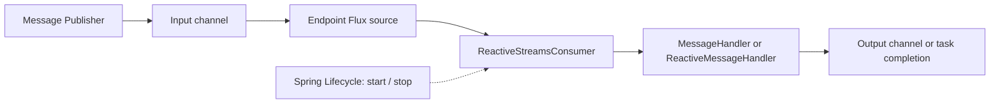

# ReactiveStreamsConsumer

## 1. Objectives and Scope

In the **Reactive support** chapter of **SPRING_INTEGRATION_CORE**, `ReactiveStreamsConsumer` is the endpoint that connects Spring Integration's messaging model to the Reactive Streams subscription mechanism. It allows a handler to consume `Message<?>` from a reactive source while still using familiar components such as channels, transformers, service activators, and Java DSL.

After this lesson, you can:

- Distinguish between channels that transport messages, handlers that execute business logic, and consumers that manage consumption.
- Recognize when Spring Integration creates a `ReactiveStreamsConsumer`.
- Configure endpoints using `FluxMessageChannel`, `.reactive()`, and `@Reactive`.
- Combine `ReactiveMessageHandler` with an asynchronous processing lifecycle.
- Identify backpressure boundaries, choose where to switch schedulers, and observe errors.
- Write tests that verify endpoint type, business output, and error messages.

Examples use Java 17, Spring Integration 6.3.x, and a compatible Reactor dependency set. `reactive()` and `@Reactive` have been available since Spring Integration 5.5; `handleReactive(...)` in the extended section requires Spring Integration 6.1 or later. These are API baselines for reading the examples, not requirements to upgrade or downgrade your project.

You should already know `Message` with payload and headers, the difference between `DirectChannel` and `QueueChannel`, how to declare an `IntegrationFlow`, and the basic meaning of `Mono` and `Flux`.

## 2. Problem: How Should a Handler Participate in a Subscription?

Suppose a service receives order events from a source returning `Flux<Order>`. Then the system normalizes the customer code and sends the result to a storage step.

In an imperative flow, the sender usually calls `channel.send(message)`, and the handler is invoked according to the channel's semantics. In a Reactive Streams chain, a subscriber must subscribe to a publisher; data is emitted according to demand via `Subscription.request(n)`.

Placing a regular handler between these two models requires an endpoint that manages the wiring. `ReactiveStreamsConsumer` fulfills that role. It resides in the package:

```java
org.springframework.integration.endpoint.ReactiveStreamsConsumer
```

Three roles must be kept distinct:

| Component | Responsibility | Example |
| --- | --- | --- |
| Message channel | Transfers or supplies messages to the next step | `FluxMessageChannel` |
| Message handler | Performs transformation or business work | `MessageTransformingHandler`, `ReactiveMessageHandler` |
| Consumer endpoint | Connects the input source to the handler and manages the subscription | `ReactiveStreamsConsumer` |

A reactive endpoint can still wrap a synchronous transformer. Conversely, a method returning `Mono` is not sufficient to conclude that the entire integration flow has end-to-end backpressure. You must inspect the source, channels, handlers, and output boundaries.

According to the [ReactiveStreamsConsumer API](https://docs.spring.io/spring-integration/docs/current/api/org/springframework/integration/endpoint/ReactiveStreamsConsumer.html), this class is an `AbstractEndpoint` dedicated to subscribing to an input channel and consuming messages reactively.

## 3. Execution Model and Lifecycle



The diagram depicts data flow. Demand flows in the opposite direction across segments that adhere to the Reactive Streams contract.

The lifecycle can be pictured as follows:

1. Spring creates the endpoint, wiring the input channel and handler.
2. When the endpoint starts, it builds or uses a `Flux` source from the channel.
3. If a reactive customizer is configured, the endpoint applies it to that source.
4. The endpoint creates a subscription to deliver messages to the handler.
5. When the endpoint stops, the subscription it manages is canceled.

In a Spring application, let the container manage the lifecycle. Declaring an `IntegrationFlow` or messaging annotations is usually sufficient; there is no need to instantiate endpoints manually and call `start()` in business code.

Several constructors accept `MessageHandler`, `Subscriber<Message<?>>`, or `ReactiveMessageHandler`. They serve different integration patterns. Instantiating the class manually requires handling bean initialization, error handlers, and lifecycle, so it is not the first choice for standard configuration.

**Stopping an endpoint does not undo business effects.** If a write request has already been accepted by an external system, cancellation does not automatically roll back the record. For operations with side effects, define idempotency and recovery policies separately.

You can cross-check start, stop, and adaptation mechanics in the [ReactiveStreamsConsumer 6.3.0 Source](https://raw.githubusercontent.com/spring-projects/spring-integration/v6.3.0/spring-integration-core/src/main/java/org/springframework/integration/endpoint/ReactiveStreamsConsumer.java).

## 4. Distinguishing Consumer Types

| Consumer | Typical Input | Triggering Mechanism | Notes |
| --- | --- | --- | --- |
| `EventDrivenConsumer` | `SubscribableChannel` such as `DirectChannel` | Channel dispatches to registered handlers | Can be synchronous or asynchronous depending on the channel |
| `PollingConsumer` | `PollableChannel` such as `QueueChannel` | Poller periodically polls for messages | Requires appropriate poller configuration |
| `ReactiveStreamsConsumer` | Publisher-backed channel or channel adapted to a reactive source | Subscription on a `Flux` source | Demand and buffering still depend on each segment |

Do not use this table to infer that `DirectChannel` can only pair with `EventDrivenConsumer`. When `reactive()` is configured, Spring can use `ReactiveStreamsConsumer` for an endpoint reading from a `DirectChannel`.

According to [IntegrationReactiveUtils 6.3.0](https://raw.githubusercontent.com/spring-projects/spring-integration/v6.3.0/spring-integration-core/src/main/java/org/springframework/integration/util/IntegrationReactiveUtils.java), adapting a channel into a `Flux` follows three main paths:

- Channel is already a `Publisher`: reuse that publisher.
- `SubscribableChannel`: attach a bridge from dispatch mechanics to a reactive source.
- `PollableChannel`: adapt polling receive calls into a reactive source.

This adaptation does not alter the external producer's contract. For example, `boolean send(Message<?>)` still has no demand parameter; a loop calling `send()` does not magically become a source capable of waiting on `request(n)`.

## 5. Three Ways to Introduce ReactiveStreamsConsumer into a Flow

### 5.1. Placing a FluxMessageChannel Before an Endpoint

`FluxMessageChannel` combines the role of a message channel with a message publisher. When an endpoint consumes from this channel, the framework selects the appropriate reactive consumer mechanism.

```java
@Bean
public FluxMessageChannel reactiveInput() {
    return new FluxMessageChannel();
}

@Bean
public IntegrationFlow uppercaseFlow() {
    return IntegrationFlow.from(reactiveInput())
            .transform(String.class, String::toUpperCase,
                    endpoint -> endpoint.id("uppercaseEndpoint"))
            .channel("uppercaseResults")
            .get();
}
```

Place this code in a `@Configuration` class annotated with `@EnableIntegration`. When wiring into an application, provide a consumer for `uppercaseResults`. The complete example in section 6 declares all channels explicitly.

A reactive channel before a transformer changes how the transformer is consumed. It does not move `String::toUpperCase` onto a different thread, nor does it automatically make the output channel reactive.

### 5.2. Selecting Reactive for an Endpoint via Java DSL

When you need to keep an existing input channel, configure `reactive()` on the endpoint:

```java
@Bean
public DirectChannel rawCodes() {
    return new DirectChannel();
}

@Bean
public IntegrationFlow selectedReactiveEndpointFlow() {
    return IntegrationFlow.from(rawCodes())
            .transform(String.class, String::trim,
                    endpoint -> endpoint
                            .id("trimCodeEndpoint")
                            .reactive())
            .channel("trimmedCodes")
            .get();
}
```

This is also a configuration snippet to integrate into an application; `trimmedCodes` needs an appropriate consumer.

`.reactive()` applies to this `transform` step's endpoint. It is not a global switch for all subsequent steps. If the DSL creates intermediate channels by default, inspect the actual channels before drawing conclusions about end-to-end reactivity.

You can customize the input source with a function:

```java
endpoint -> endpoint.reactive(
        flux -> flux.publishOn(Schedulers.parallel(), 16))
```

`16` is the `publishOn` prefetch value in this example. It is not a system-wide limit on orders in flight. The customizer acts on the source before the handler; it does not automatically wrap every publisher created by business logic.

The customizer contract is documented in [Java DSL: reactive() endpoint](https://docs.spring.io/spring-integration/reference/6.3/dsl/java-reactive.html).

### 5.3. Using the @Reactive Annotation

For annotation-based endpoint declarations, reference a customizer bean:

```java
@Bean
public Function<Flux<Message<?>>, Publisher<Message<?>>> cpuBoundary() {
    return flux -> flux.publishOn(Schedulers.parallel(), 16);
}

@ServiceActivator(
        inputChannel = "rawCodes",
        outputChannel = "trimmedCodes",
        reactive = @Reactive("cpuBoundary"))
public String trimCode(String value) {
    return value.trim();
}
```

Related imports:

```java
import java.util.function.Function;
import org.reactivestreams.Publisher;
import org.springframework.integration.annotation.Reactive;
import org.springframework.integration.annotation.ServiceActivator;
import org.springframework.messaging.Message;
import reactor.core.publisher.Flux;
import reactor.core.scheduler.Schedulers;
```

Place the method in a Spring-managed bean, enable `@EnableIntegration`, and declare the referenced channels. This example is an alternative to the DSL configuration, so do not register both endpoints consuming the same `DirectChannel` if you only want single processing.

When no customizer is needed, use `reactive = @Reactive`. The `reactive` and `poller` attributes on the same messaging annotation are mutually exclusive; do not attach `@Poller` to "assist" an endpoint already marked reactive. See [Annotation Support: Using @Reactive](https://docs.spring.io/spring-integration/reference/6.3/configuration/annotations.html#reactive-annotation-support).

## 6. Complete Example: Normalizing Order Customer Codes

### 6.1. Target Behavior

Each `Message<Order>` contains an order ID and a customer code:

- `" acme "` is normalized to `"ACME"`.
- A blank customer code is rejected with a business validation error.
- Valid results go to `normalizedOrders`.
- Processing errors go to `orderErrors` when the message carries the corresponding `errorChannel` header.

The example uses `QueueChannel` at the output for easy observation in demos and tests. This is a boundary back to the imperative model; do not use this example to claim the entire path is backpressured.

Required dependencies in the practice project:

| Scope | Dependency |
| --- | --- |
| Main | `org.springframework.integration:spring-integration-core` |
| Main | `io.projectreactor:reactor-core` |
| Test | `org.junit.jupiter:junit-jupiter` |
| Reactor testing | `io.projectreactor:reactor-test` |

Select aligned versions using your project's dependency management/BOM. With Spring Boot, you can use `spring-boot-starter-integration` and manage dependencies via the matching Boot version. Do not mix Spring Framework, Spring Integration, and Reactor versions arbitrarily.

### 6.2. Flow Configuration

```java
package example.integration.reactive;

import java.util.Locale;

import org.springframework.context.annotation.Bean;
import org.springframework.context.annotation.Configuration;
import org.springframework.integration.channel.FluxMessageChannel;
import org.springframework.integration.channel.QueueChannel;
import org.springframework.integration.config.EnableIntegration;
import org.springframework.integration.dsl.IntegrationFlow;

@Configuration
@EnableIntegration
public class ReactiveOrderConfig {

    public record Order(String orderId, String customerCode) {
    }

    public record NormalizedOrder(String orderId, String customerCode) {
    }

    @Bean
    public FluxMessageChannel orderInput() {
        return new FluxMessageChannel();
    }

    @Bean
    public QueueChannel normalizedOrders() {
        return new QueueChannel(16);
    }

    @Bean
    public QueueChannel orderErrors() {
        return new QueueChannel(16);
    }

    @Bean
    public IntegrationFlow normalizeOrderFlow() {
        return IntegrationFlow.from(orderInput())
                .transform(Order.class, order -> {
                    if (order.customerCode() == null
                            || order.customerCode().isBlank()) {
                        throw new IllegalArgumentException(
                                "customerCode must not be blank");
                    }

                    return new NormalizedOrder(
                            order.orderId(),
                            order.customerCode().trim()
                                    .toUpperCase(Locale.ROOT));
                }, endpoint -> endpoint.id("normalizeOrderEndpoint"))
                .channel(normalizedOrders())
                .get();
    }
}
```

The transformer's input is `orderInput`, a `FluxMessageChannel`, so `normalizeOrderEndpoint` is created as a `ReactiveStreamsConsumer`. There is no need to add `.reactive()` just to re-select that endpoint type.

`Locale.ROOT` ensures deterministic code normalization independent of the machine's default locale. In business domains with different character rules, replace this rule with the agreed policy.

The transformer creates a new payload and the framework constructs the reply message; standard business headers are forwarded unless configured otherwise. Do not rely on the output message's `id` or `timestamp` matching the input message's.

Both queues have a capacity of `16` to give the demo an explicit bound. When a queue is full, send operations may block up to their timeout policy; bounded queues still need consumers and overload handling. `receive(timeout)` in the example below is the receive wait timeout, not the transformer's send timeout.

### 6.3. Feeding a Publisher into a Channel Without Manual Subscription

```java
package example.integration.reactive;

import org.springframework.context.annotation.AnnotationConfigApplicationContext;
import org.springframework.integration.channel.FluxMessageChannel;
import org.springframework.integration.channel.QueueChannel;
import org.springframework.messaging.Message;
import org.springframework.messaging.MessageHeaders;
import org.springframework.messaging.support.MessageBuilder;

import reactor.core.publisher.Flux;

public class ReactiveOrderDemo {

    public static void main(String[] args) {
        try (var context =
                     new AnnotationConfigApplicationContext(
                             ReactiveOrderConfig.class)) {

            var input = context.getBean(
                    "orderInput", FluxMessageChannel.class);
            var output = context.getBean(
                    "normalizedOrders", QueueChannel.class);

            Flux<Message<ReactiveOrderConfig.Order>> source = Flux.just(
                    new ReactiveOrderConfig.Order("O-001", " acme "),
                    new ReactiveOrderConfig.Order("O-002", " beta "))
                    .map(order -> MessageBuilder.withPayload(order)
                            .setHeader(
                                    MessageHeaders.ERROR_CHANNEL,
                                    "orderErrors")
                            .build());

            input.subscribeTo(source);

            for (int i = 0; i < 2; i++) {
                Message<?> result = output.receive(1_000);
                if (result == null) {
                    throw new IllegalStateException(
                            "Did not receive expected result within timeout");
                }
                System.out.println(result.getPayload());
            }
        }
    }
}
```

Expected output:

```text
NormalizedOrder[orderId=O-001, customerCode=ACME]
NormalizedOrder[orderId=O-002, customerCode=BETA]
```

`input.subscribeTo(source)` hands the publisher to the channel so the framework manages the subscription wiring. Do not also call `source.subscribe(...)` for the same work. With a cold publisher, a second subscription can re-execute data reads or external service calls.

`Flux<Message<Order>>` represents multiple messages. It differs from `Message<Flux<Order>>`, which is a single message whose payload is a publisher. When a business source returns `Flux<Order>`, the `map` step in the example is where messages are created and headers added.

The `receive` loop is placed in a demo program running on the main thread. Do not copy this blocking wait into a WebFlux callback or reactive processing thread.

## 7. ReactiveMessageHandler: Representing Task Completion Timing

A synchronous handler has the general contract:

```java
void handleMessage(Message<?> message);
```

`ReactiveMessageHandler` has the contract:

```java
Mono<Void> handleMessage(Message<?> message);
```

`Mono<Void>` represents completion or failure of the task. There is no returned payload to forward like a transformer reply.

Suppose the persistence layer provides an application-specific abstraction:

```java
public interface OrderArchive {
    Mono<Void> store(ReactiveOrderConfig.NormalizedOrder order);
}
```

In another configuration class annotated with `@EnableIntegration`, you can declare:

```java
@Bean
public IntegrationFlow archiveFlow(OrderArchive archive) {
    return IntegrationFlow.from("archiveInput")
            .handleReactive(
                    message -> Mono.defer(() -> archive.store(
                                    (ReactiveOrderConfig.NormalizedOrder)
                                            message.getPayload()))
                            .onErrorMap(error ->
                                    new MessageHandlingException(
                                            message,
                                            "Failed to store order",
                                            error)),
                    endpoint -> endpoint
                            .id("archiveEndpoint")
                            .reactive());
}
```

Additional imports are `org.springframework.messaging.MessageHandlingException` and `reactor.core.publisher.Mono`. The application must provide a concrete `OrderArchive` bean; this interface is not built into Spring Integration.

Three details stand out:

1. `Mono.defer` defers calling `archive.store` until subscription, while also capturing any exception thrown immediately upon method invocation into the reactive chain.
2. `MessageHandlingException` retains the related message, helping error handlers trace the failing order.
3. `handleReactive(...)` is a terminal flow step returning `IntegrationFlow`; do not chain `.get()` after it.

Spring Integration composes the reactive handler's completion publisher into the consumption pipeline. Never call `subscribe()` inside the lambda and return `Mono.empty()`: that causes the endpoint to see "done" before the store operation actually finishes.

Using a reactive handler can result in concurrent execution of multiple tasks depending on composition mechanics. If per-order completion ordering is a business requirement, design and test ordering explicitly.

This mechanism and terminal operator are documented in [Reactive Streams Support: ReactiveMessageHandler](https://docs.spring.io/spring-integration/reference/6.3/reactive-streams.html#reactive-message-handler).

## 8. Backpressure: Determining Its True Scope

Backpressure allows a subscriber to signal demand to a publisher. It cannot make messages already placed in a queue disappear, nor can it stop an external device from emitting data if that device does not support throttling.

For the order example, distinguish each segment:

| Segment | Capability to Evaluate |
| --- | --- |
| Source `Flux` to `FluxMessageChannel` | Does the publisher honor requests and cancellation? |
| Channel to reactive endpoint | How many items do the subscriber and operators request? |
| Business handler | Does the task complete through the composed publisher? |
| Output `QueueChannel` | Capacity, send timeout, and consumer throughput |
| External system | Does it have its own rate limiting, retries, or acknowledgments? |

There is no rule that a `ReactiveStreamsConsumer` processes only `request(1)` at any given time. Actual demand depends on subscribers, prefetch, and operators. A conventionally adapted handler may even request unbounded demand.

Suppose the source injects **2,000 messages/second**, while the external service completes only **200 messages/second**. The deficit is **1,800 messages/second**. If a boundary simply keeps buffering, within ten seconds roughly **18,000 messages** can accumulate even before factoring in load spikes and errors. Renaming a channel to "reactive" does not change that arithmetic.

Design choices must follow business requirements: slow down the source when possible, cap concurrency, bound buffers, reject observably, or offload to durable storage. For financial or order data, dropping elements arbitrarily usually violates business correctness.

`limitRate(n)` adjusts how items are requested along a chain; it is not a rate limiter of `n` messages per second. `publishOn(..., n)` partially controls prefetch at a scheduler boundary, not an application-wide quota.

To connect reactive steps, you can place `FluxMessageChannel` between endpoints. Still, inspect how each handler processes data, especially when splitters, multi-branch routers, or stateful aggregators are involved.

## 9. Schedulers and Blocking Work

`.reactive()` does not create a new thread automatically. In Reactor, when no scheduler is specified, many operators continue running on the thread that emitted the signal. `publishOn` creates an execution boundary for operators downstream of it. See [Reactor Threading and Schedulers](https://projectreactor.io/docs/core/release/reference/coreFeatures/schedulers.html).

For short string normalization, switching threads is usually unnecessary. Every scheduler hop incurs scheduling overhead; have a measurable reason before adding one.

For legacy blocking APIs, such as a `void`-returning `legacyArchive.store(order)` method, use the pattern:

```java
Mono.fromRunnable(() -> legacyArchive.store(order))
        .subscribeOn(Schedulers.boundedElastic());
```

If the blocking method returns a value, use `Mono.fromCallable(...)`. Place the call inside the lambda so it runs upon subscription. This wrapper pattern is explained in [Reactor FAQ: Wrap a Synchronous, Blocking Call](https://projectreactor.io/docs/core/release/reference/faq.html#faq.wrap-blocking).

This isolates wait time on an appropriate worker pool. The underlying driver remains blocking, so throughput still depends on worker count, connection pools, and service latency. When a genuine reactive client is available, prefer composing directly with the publisher returned by the client.

Avoid the following patterns in a reactive handler:

```java
// Blocking wait right inside a callback:
String result = remoteClient.lookup(id).block();

// Detaching the task from the endpoint's lifecycle and error path:
archive.store(order).subscribe();
return Mono.empty();

// Executing eagerly before the Mono is even created:
return Mono.just(legacyClient.lookup(id));
```

On the last line, Java evaluates `legacyClient.lookup(id)` before calling `Mono.just`. Wrapping the result does not defer a call that has already executed.

## 10. Handling Errors at the Right Boundary

### 10.1. Per-Message Processing Errors

In the normalization example, the transformer throws an exception when the customer code is blank. The framework wraps the processing error to retain message context, and the consumer routes errors to the error handler.

With per-message error dispatch, the destination is typically resolved from:

1. The failed message's `MessageHeaders.ERROR_CHANNEL` header, if present.
2. The global `errorChannel` when no dedicated destination is specified and the default error handler configuration is active.

The example sets `"orderErrors"` in the header and declares a queue of the same name. The error message payload is the exception; it is not an `Order` with an error status.

If you run the same business logic behind a standard imperative `DirectChannel`, the exception path may differ. Simply adding an `errorChannel` header does not make every Java call convert exceptions into `ErrorMessage`. Know which endpoint or adapter owns error dispatch. See [Spring Integration Error Handling](https://docs.spring.io/spring-integration/reference/error-handling.html).

### 10.2. Terminal Errors of the Source Publisher

If the data source emits `onError`, that is a terminal signal for the source subscription. It differs from an error while processing one specific message.

A connection failure occurring before message creation may have no `failedMessage` and no `errorChannel` header to inspect. When reconnection is needed, place retry/recovery policies on the source publisher or the adapter owning the connection.

Do not infer that because a handler error was routed successfully, all source errors will also recover automatically. Cancellation, terminal errors, and message-processing errors must be observed separately.

### 10.3. Task-Scoped Retries

Suppose you need to retry the reactive store operation introduced earlier:

```java
Mono.defer(() -> archive.store(order))
        .timeout(Duration.ofSeconds(2))
        .retryWhen(Retry.backoff(2, Duration.ofMillis(100))
                .filter(error -> error instanceof TimeoutException));
```

Imports are `java.time.Duration`, `java.util.concurrent.TimeoutException`, and `reactor.util.retry.Retry`. Place this chain in a handler where `archive` and `order` are in scope.

This example retries up to two times after the initial attempt, only for the selected timeout error class. In a real system, further classify transient client errors and establish an idempotency key before retrying write operations.

`retryWhen` works by re-subscribing upstream within the operator's scope. If retry wraps a source covering multiple operations with side effects, those operations risk being re-executed. If you place `retry()` in a customizer before the handler, do not assume it will catch exceptions handled by the handler beyond that boundary.

Never use `onErrorResume(error -> Mono.empty())` just to silence red logs. After swallowing the error, the endpoint may treat the task as completed normally; monitoring and recovery processes will miss the failure signal. Terminal errors and retries are explained in [Reactor Handling Errors](https://projectreactor.io/docs/core/release/reference/coreFeatures/error-handling.html).

## 11. Testing: Verifying Endpoint Behavior

The examples below are test code to add to your practice project. They separate consumer configuration checks from publisher protocol checks; a test receiving the expected result does not prove the entire flow has backpressure.

### 11.1. Verifying the Endpoint and Normalization Output

```java
package example.integration.reactive;

import org.junit.jupiter.api.Test;
import org.springframework.context.annotation.AnnotationConfigApplicationContext;
import org.springframework.integration.channel.FluxMessageChannel;
import org.springframework.integration.channel.QueueChannel;
import org.springframework.integration.endpoint.ReactiveStreamsConsumer;
import org.springframework.messaging.Message;
import org.springframework.messaging.MessageHeaders;
import org.springframework.messaging.support.MessageBuilder;

import reactor.core.publisher.Flux;

import static org.junit.jupiter.api.Assertions.*;

class ReactiveOrderFlowTest {

    @Test
    void shouldCreateReactiveConsumerAndNormalizeOrder() {
        try (var context =
                     new AnnotationConfigApplicationContext(
                             ReactiveOrderConfig.class)) {

            assertInstanceOf(
                    ReactiveStreamsConsumer.class,
                    context.getBean("normalizeOrderEndpoint"));

            var input = context.getBean(
                    "orderInput", FluxMessageChannel.class);
            var output = context.getBean(
                    "normalizedOrders", QueueChannel.class);
            var errors = context.getBean(
                    "orderErrors", QueueChannel.class);

            Message<ReactiveOrderConfig.Order> request =
                    MessageBuilder.withPayload(
                                    new ReactiveOrderConfig.Order(
                                            "O-001", " acme "))
                            .setHeader(
                                    MessageHeaders.ERROR_CHANNEL,
                                    "orderErrors")
                            .build();

            input.subscribeTo(Flux.just(request));

            Message<?> actual = output.receive(1_000);

            assertNotNull(actual);
            assertEquals(
                    new ReactiveOrderConfig.NormalizedOrder(
                            "O-001", "ACME"),
                    actual.getPayload());
            assertNull(errors.receive(0));
        }
    }
}
```

`assertInstanceOf` checks the endpoint bean provided by the container instead of guessing the consumer type from `Flux` being on the classpath. The receive timeout bounds hang time on misconfiguration; do not use `Thread.sleep` to wait ambiguously for results.

### 11.2. Verifying That Errors Carry the Failed Message

Add the method below to the same test class and import `org.springframework.messaging.MessagingException`:

```java
@Test
void shouldRouteInvalidOrderToErrorChannel() {
    try (var context =
                 new AnnotationConfigApplicationContext(
                         ReactiveOrderConfig.class)) {

        var input = context.getBean(
                "orderInput", FluxMessageChannel.class);
        var output = context.getBean(
                "normalizedOrders", QueueChannel.class);
        var errors = context.getBean(
                "orderErrors", QueueChannel.class);

        var invalidOrder =
                new ReactiveOrderConfig.Order("O-002", " ");

        Message<ReactiveOrderConfig.Order> request =
                MessageBuilder.withPayload(invalidOrder)
                        .setHeader(
                                MessageHeaders.ERROR_CHANNEL,
                                "orderErrors")
                        .build();

        input.subscribeTo(Flux.just(request));

        Message<?> errorMessage = errors.receive(1_000);

        assertNotNull(errorMessage);
        MessagingException failure = assertInstanceOf(
                MessagingException.class, errorMessage.getPayload());
        assertNotNull(failure.getFailedMessage());
        assertEquals(
                invalidOrder,
                failure.getFailedMessage().getPayload());
        assertNull(output.receive(0));
    }
}
```

The test verifies that an invalid request produces no success result and that the error still traces back to the input payload. When upgrading framework versions or changing error handler configuration, this is a contract worth re-verifying.

### 11.3. Checking Publisher Demand with StepVerifier

The standalone example below demonstrates demand control on a finite source:

```java
@Test
void shouldRespectRequestedAmountForSource() {
    Flux<Integer> source = Flux.range(1, 3);

    StepVerifier.create(source, 0)
            .thenRequest(1)
            .expectNext(1)
            .thenRequest(2)
            .expectNext(2, 3)
            .expectComplete()
            .verify(Duration.ofSeconds(1));
}
```

Additional imports are `reactor.test.StepVerifier` and `java.time.Duration`. An initial request of `0` lets the test increase demand explicitly.

This tests the `Flux.range` source, not backpressure of the integration flow in section 6. When testing a real flow, observe requests at the input publisher, hold downstream tasks incomplete with a controlled signal, and verify that the number of started tasks matches the configuration. Do not hardcode `request(1)` without an explicit contract guaranteeing it.

`StepVerifier` supports describing signal sequences and bounding verification time; see [Reactor Testing](https://projectreactor.io/docs/core/release/reference/testing.html).

## 12. Operations and Diagnostics

Give endpoints meaningful IDs, such as `normalizeOrderEndpoint`, to correlate logs, configuration, and test results. Attach `orderId` or a correlation ID to business headers when tracing across steps; avoid relying solely on the message ID as a business key because intermediate steps that create new messages may change the ID.

| Symptom | What to Check |
| --- | --- |
| No results received | Are context and endpoints started; does the channel have a consumer; is the source wired properly? |
| Unexpected endpoint type | Actual input channel, placement of `reactive()`, bean ID being retrieved |
| Data processed twice | Is there a manual subscription alongside the framework; do retries or redeliveries re-run the task? |
| Memory growth under load | Buffers, queues, prefetch, in-flight task count, and source rate |
| External service call still running when flow reports complete | Did the handler call `subscribe()` internally and return `Mono.empty()`? |
| Errors not reaching the dedicated channel | Does the exception retain `failedMessage`; is the header still present; did the error occur in an adapter, source, or handler? |
| Output order changes | Async execution, concurrency level, and order-preserving vs. non-preserving operators |
| External work continues after app shutdown | Are there subscriptions or executors outside container lifecycle management? |

For production traffic, track at least arrival rate, completion rate, latency, error count, queue depth, and in-flight task count. If arrival rate consistently exceeds completion rate, simply increasing buffer sizes only delays overload.

For data that must survive restarts, use a suitable persistent store or broker. In-memory reactive subscriptions and `FluxMessageChannel` do not inherently provide durability or exactly-once guarantees.

## 13. Reinforcement Practice

Practice in a dedicated project based on the example:

1. Send three orders: valid, blank customer code, then valid. Observe the result channel and error channel; verify continuation behavior after a message error under the current configuration.
2. Replace the input with a `DirectChannel` and set `.reactive()` on the transformer. Keep the endpoint bean type assertion to prove the configuration choice.
3. Connect a `FluxMessageChannel` after the transformer and add a simulated reactive storage handler. Observe behavior when the storage publisher has not yet completed to understand when a task is considered finished.
4. Simulate a slow downstream with a bounded number of tasks and measure concurrent in-flight tasks. Experiment with changing prefetch at one boundary and observe its effect rather than assuming it caps the entire flow.
5. Stop the context while tasks are pending. Verify that the framework-owned subscription is canceled and distinguish that from canceling external operations.

The goal is to explain **which endpoint owns the subscription, which publisher represents business completion, and which boundaries interrupt backpressure**.

## 14. Key Takeaways

`ReactiveStreamsConsumer` is the consumer endpoint that brings handlers into Spring Integration's reactive consumption model. `FluxMessageChannel`, `reactive()`, and `@Reactive` are the common configuration mechanisms; `ReactiveMessageHandler` adds an asynchronous completion contract via `Mono<Void>`.

When designing a flow, inspect each channel boundary, demand propagation, scheduler, and error path. Configuring the consumer properly is the first step; load behavior, processing order, and recovery must still be verified against business requirements.