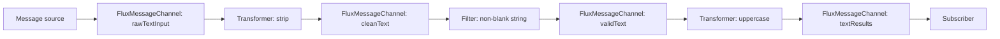

# Reactive Channel Flow

## 1. Objectives and Scope

In the **Reactive support** chapter of the **SPRING_INTEGRATION_CORE** module, this lesson explains how to organize message flows with reactive channels: messages traverse endpoints via Java DSL while data consumption participates in Reactive Streams' subscription and demand mechanisms.

After this lesson, you can:

- Choose where to place `FluxMessageChannel` and identify imperative segments within a flow.
- Connect `Publisher<Message<?>>` with `IntegrationFlow` in both directions.
- Combine transformers, filters, and asynchronous processing while preserving message context.
- Design concurrency limits, error policies, and subscription lifecycles.
- Write tests verifying payloads, headers, demand, and subscription cancellation.

The main example uses a string-command normalization flow to clarify channel structure. The extended example uses order approval to illustrate asynchronous I/O and per-message error outcomes. These techniques build upon the `Message`, `MessageChannel`, endpoint, and gateway model within Spring Integration Core.

The Java DSL examples target **Spring Integration 6.5.x, Java 17 or later**. Snippets using `handleReactive()` require Spring Integration 6.1+. Applications should use compatible dependency management for Spring Integration, Spring Framework, and Reactor; this lesson does not assume a specific Spring Boot version.

## 2. What Does Reactive Channel Flow Change?

### 2.1. Still Messages, Channels, and Endpoints

A message still carries a payload and headers. Transformers alter data; filters decide which messages proceed; routers select branches; endpoints invoke business logic.

What changes is how components exchange data. With reactive channels, the consuming side participates in the Reactive Streams protocol through subscriptions and requested item counts. Spring Integration provides `ReactiveStreamsConsumer` to connect an endpoint to a reactive source. `FluxMessageChannel` simultaneously implements `MessageChannel`, `Publisher<Message<?>>`, and `ReactiveStreamsSubscribableChannel`. [Spring Integration Reactive Streams Documentation](https://docs.spring.io/spring-integration/reference/6.5/reactive-streams.html#fluxmessagechannel-and-reactivestreamsconsumer).



The diagram shows the path of messages. Demand travels in the reverse direction across the respective subscriptions; intermediate operators, buffers, and endpoints can alter how demand propagates upstream.

A Java DSL declaration chain alone does not fully describe the execution model. To evaluate a flow, inspect the registered channel types, how endpoints consume data, and the behavior of external clients.

### 2.2. Distinguishing Four Concepts

| Concept | Question to Answer | Example |
| --- | --- | --- |
| Reactive | Does consumption participate in subscription and demand protocols? | Subscriber calls `request(n)` |
| Asynchronous | Can the result arrive after the initial call returns? | HTTP client returns `Mono<Response>` |
| Non-blocking | Must the execution thread wait on a resource or result? | I/O via a reactive client |
| Concurrency | How many tasks are processed simultaneously? | `flatMap(..., 8)` in a Reactor segment |

A flow with an `ExecutorChannel` can run asynchronously while still calling blocking JDBC. A function returning `Mono` can perform blocking work right before creating the `Mono`. Thus, looking at return types or channel names alone is insufficient to conclude an entire flow is non-blocking.

### 2.3. Choosing Channels by Communication Contract

| Channel | Primary Consumption Model | Key Considerations |
| --- | --- | --- |
| `DirectChannel` | Directly invokes a selected `MessageHandler` | Usually runs on the sender thread |
| `ExecutorChannel` | Dispatches through an executor | Requires managing executor and workload |
| `QueueChannel` | Consumer pulls messages via receive/poll | Requires managing queue capacity, timeouts, and pollers |
| `FluxMessageChannel` | Subscriber receives messages via reactive protocol | Requires managing demand, subscriptions, and imperative boundaries |

`FluxMessageChannel` does not implement `PollableChannel` or `SubscribableChannel`. Do not attach a poller to read it like a queue, and do not register a `MessageHandler` directly via the `DirectChannel` API. To structure a reactive flow across endpoints, the documentation guides placing reactive channels between endpoints. [MessageChannel Implementations](https://docs.spring.io/spring-integration/reference/6.5/channel/implementations.html#fluxmessagechannel).

This choice defines the communication mechanism. Data durability, broker acknowledgments, transactions, and business delivery semantics still require separate design.

## 3. Two Entry Points to FluxMessageChannel

### 3.1. Imperative Sending with send()

You can send a `Message` because `FluxMessageChannel` is also a `MessageChannel`:

```java
Message<String> command = MessageBuilder
        .withPayload("  create-order  ")
        .setHeader("requestId", "req-101")
        .build();

boolean accepted = input.send(command, 1000);

if (!accepted) {
    throw new IllegalStateException("Failed to send command within timeout");
}
```

This code runs inside an application that already has an `input` bean and a registered subscriber. The `1000` argument is the send timeout in milliseconds.

`accepted == true` confirms the send call was accepted by the channel according to its contract. It does not prove an external system updated successfully, confirm a transaction committed, or replace a business reply message.

Attach a consumer before sending. In Spring Integration 6.5.0 source code, `doSend()` checks for subscribers; when emission encounters a full buffer or concurrent emission, the call may wait or retry up to the timeout. Therefore, never assume `send()` always returns immediately or is always safe to call on an event loop. [FluxMessageChannel 6.5.0 Source](https://raw.githubusercontent.com/spring-projects/spring-integration/v6.5.0/spring-integration-core/src/main/java/org/springframework/integration/channel/FluxMessageChannel.java).

If the source is a callback without throttling, decide in advance how to react when sending fails: reject input, persist durably, or apply the source's own flow control. Calling `send()` in a loop does not create a demand contract for that callback.

### 3.2. Connecting a Publisher to a Channel

On the reactive side, a channel can accept a publisher of messages:

```java
Flux<Message<String>> commands = Flux
        .just("create-order", "cancel-order")
        .map(value -> MessageBuilder.withPayload(value).build());

input.subscribeTo(commands);
```

`subscribeTo(...)` means the channel consumes from a source publisher. Conversely, `Flux.from(input)` provides a way to observe the channel from the consumer side. These two operations have opposite data directions. Method signatures and channel lifecycle roles are documented in the [FluxMessageChannel API](https://docs.spring.io/spring-integration/docs/6.5.0/api/org/springframework/integration/channel/FluxMessageChannel.html).

In application configuration, let Spring manage channels and flows instead of manually creating scattered channels, subscriptions, and start/stop calls. In particular, do not call `subscribeTo(source)` and also `source.subscribe(...)` to feed the same data into the flow, unless multiple subscriptions are intentional.

## 4. Java DSL Configuration with Reactive Channels Between Endpoints

### 4.1. Minimal Dependencies

The example uses the following artifacts:

| Artifact | Purpose |
| --- | --- |
| `org.springframework.integration:spring-integration-core` | Channels, endpoints, Java DSL configuration |
| `io.projectreactor:reactor-core` | `Flux`, `Mono`, schedulers |
| `io.projectreactor:reactor-test` | `StepVerifier`, used in tests |
| `org.junit.jupiter:junit-jupiter` | JUnit 5 |

Declare versions via your application's BOM or dependency management. If the application already includes appropriate starters, check which dependencies are already provided before adding redundant declarations.

### 4.2. Complete Configuration

```java
package example.integration;

import java.util.Locale;

import org.springframework.context.annotation.Bean;
import org.springframework.context.annotation.Configuration;
import org.springframework.integration.channel.FluxMessageChannel;
import org.springframework.integration.config.EnableIntegration;
import org.springframework.integration.dsl.IntegrationFlow;

@Configuration
@EnableIntegration
public class ReactiveTextFlowConfig {

    @Bean
    public FluxMessageChannel rawTextInput() {
        return new FluxMessageChannel();
    }

    @Bean
    public FluxMessageChannel cleanText() {
        return new FluxMessageChannel();
    }

    @Bean
    public FluxMessageChannel validText() {
        return new FluxMessageChannel();
    }

    @Bean
    public FluxMessageChannel textResults() {
        return new FluxMessageChannel();
    }

    @Bean
    public IntegrationFlow normalizeTextFlow() {
        return IntegrationFlow.from("rawTextInput")
                .transform(String.class, String::strip)
                .channel("cleanText")
                .filter(String.class, value -> !value.isBlank())
                .channel("validText")
                .transform(String.class,
                        value -> value.toUpperCase(Locale.ROOT))
                .channel("textResults")
                .get();
    }
}
```

The names in `from(...)` and `channel(...)` reference the declared `FluxMessageChannel` beans. As a result, boundaries between the first transformer, the filter, and the second transformer are explicitly defined.

Do not omit intermediate `channel(...)` declarations and assume all Java DSL links stay reactive. The DSL can create implicit channels between endpoints; inspect the actual configuration rather than inferring from reactive input and output types.

Expected data:

| Input Payload | Result |
| --- | --- |
| `"  create-order  "` | `"CREATE-ORDER"` |
| `"  cancel-order "` | `"CANCEL-ORDER"` |
| Whitespace-only string | Dropped by the filter from the output branch |

In the example, the filter intentionally produces no reply for blank strings. For a real request-reply call, return a rejection result or configure another branch so the caller learns the request outcome.

### 4.3. Who Performs the Subscription?

For channels inside the flow, Spring Integration manages the corresponding endpoints and consumers. At the final channel `textResults`, the application needs a consumer: another endpoint, an outbound adapter, or a subscriber in a test.

Do not insert `subscribe()` inside a transformer. A transformer is responsible for producing the transformed result, while flow execution is driven by the subscription managed by the framework or downstream consumer.

If you pass a `FluxMessageChannel` directly to `IntegrationFlow.from(...)`, watch out for overloads accepting `MessageChannel` vs. `Publisher`: this class implements both interfaces. Referencing by bean name as in the example avoids overload ambiguity; alternatively, cast explicitly to `MessageChannel`.

## 5. Connecting Java DSL with Publishers in Both Directions

### 5.1. From Publisher<Message<?>> into a Flow

The source publisher should emit **messages**, because flows also use headers to carry correlation, reply, and tracing context. If the original source is a `Flux<String>`, convert each element into a `Message<String>` before feeding it into the DSL.

The `IntegrationFlow.from(Publisher<? extends Message<?>>)` overload creates an entry point backed by a `FluxMessageChannel` and wires the source publisher into it. [IntegrationFlow.from(Publisher) API](https://docs.spring.io/spring-integration/docs/6.5.0/api/org/springframework/integration/dsl/IntegrationFlow.html#from(org.reactivestreams.Publisher)).

### 5.2. From a Flow Out to Publisher<Message<T>>

The configuration below is independent of the multi-endpoint normalization example above. You can add this method to a `@Configuration` class with Spring Integration enabled:

```java
@Bean
public Publisher<Message<String>> sampleCommands() {
    Flux<Message<String>> source = Flux
            .just(" create-order ", " cancel-order ")
            .map(value -> MessageBuilder.withPayload(value).build());

    return IntegrationFlow.from(source)
            .transform(String.class, String::strip)
            .<String>toReactivePublisher(true);
}
```

Additional imports:

```java
import org.reactivestreams.Publisher;
import reactor.core.publisher.Flux;
import org.springframework.messaging.Message;
import org.springframework.messaging.support.MessageBuilder;
```

`toReactivePublisher(true)` terminates the builder, so do not append `get()`. The `true` flag starts the flow when the resulting publisher receives a subscription rather than auto-starting flow components when the context initializes. [IntegrationFlowBuilder.toReactivePublisher API](https://docs.spring.io/spring-integration/docs/6.5.0/api/org/springframework/integration/dsl/IntegrationFlowBuilder.html#toReactivePublisher(boolean)).

Finite consumption example in a test:

```java
StepVerifier.create(
        Flux.from(sampleCommands)
                .map(Message::getPayload)
                .take(2))
        .expectNext("create-order", "cancel-order")
        .expectComplete()
        .verify(Duration.ofSeconds(5));
```

Here `sampleCommands` is the bean retrieved from the application context. `take(2)` actively completes the observer side after two results and cancels the upstream subscription.

Do not assume the output channel automatically completes just because the upstream `Flux.just(...)` finished emitting its items. A flow over message channels has its own lifecycle; it may stay alive to accept more messages or additional sources. Nor should you assume each late subscriber replays the entire chain: channels are stateful boundaries and do not automatically provide replay to every consumer.

Identify who owns the subscription, when cancellation happens, and how multiple subscribers behave. Canceling a DSL-created publisher also affects the lifecycle of the underlying flow; avoid sharing one publisher as if each caller had an independent pipeline.

## 6. Backpressure, Buffering, and Concurrency

### 6.1. Demand Does Not Equal Business Call Count

Suppose the final subscriber requests one message. Before that result is delivered, upstream endpoints may have already processed items into buffers; operators such as `publishOn` or `flatMap` can prefetch multiple elements ahead of time.

Consequently, these statements are all distinct:

- "The final subscriber has not received more items than it requested."
- "The source has not read more items than requested."
- "No more than eight HTTP requests are currently in flight."
- "The whole flow holds no more than 100 messages in memory."

Each statement must be observed at its specific boundary. A single test checking final output cannot prove all four.

### 6.2. Choosing Operators by Business Requirement

| Operator | Usage Within a Reactor Segment |
| --- | --- |
| `map` | Fast, synchronous transformation without returning an inner publisher |
| `flatMap` | Merges inner publishers, allowing concurrent execution; results may arrive out of order |
| `concatMap` | Processes each inner publisher sequentially, suited when ordering is required in that segment |
| `flatMapSequential` | Allows concurrent execution while emitting results in source order, which may require buffering |
| `publishOn` | Switches execution context for downstream operators, introducing a queue/prefetch boundary |

Concurrency and prefetch parameters apply to the configured operator. They do not act as an application-wide quota across multiple flows or instances. [Flux API and Publisher Composition Operators](https://projectreactor.io/docs/core/release/api/reactor/core/publisher/Flux.html).

For orders requiring per-customer ordering, `concatMap` in a single segment only guarantees ordering within that segment. It is not enough to coordinate multiple sources, partitions, or replicas. When scaling out, define the ordering key and where that contract is enforced.

### 6.3. Estimating Cost When the Source Is Faster Than the Consumer

Suppose an unthrottled source produces 1,200 messages/second while processing completes 600 messages/second. After 20 seconds, the backlog of unprocessed work is roughly:

```text
(1,200 - 600) × 20 = 12,000 messages
```

Assuming each message takes 4 KiB, the buffered data alone is around 47 MiB, excluding queue structures and auxiliary objects. This is an illustrative calculation under stated assumptions, not a benchmark of Spring Integration.

Enlarging buffers only delays hitting the limit. Determine whether the source supports throttling, total buffered capacity, and what action to take when space runs out.

If you bridge callbacks into Reactor via `Sinks`, pick the right sink flavor and handle the `tryEmitNext(...)` result. Ignoring emission failures or using unbounded buffers can mask overload conditions. [Reactor Sinks Documentation](https://projectreactor.io/docs/core/release/reference/coreFeatures/sinks.html).

## 7. Calling Reactive Business Logic with fluxTransform()

### 7.1. When to Use It?

`fluxTransform()` is useful when a flow segment needs Reactor operators to control inner publishers, concurrency, ordering, or error handling. The function's input is `Flux<Message<I>>`; its output can emit payloads or messages. This API establishes `FluxMessageChannel` boundaries for the processing segment. [fluxTransform API](https://docs.spring.io/spring-integration/docs/6.5.0/api/org/springframework/integration/dsl/BaseIntegrationFlowDefinition.html#fluxTransform(java.util.function.Function)).

When constructing result messages inside this segment, preserve headers needed downstream. Simply creating `new GenericMessage<>(result)` discards business context unless you explicitly copy or restore headers.

### 7.2. Order Validation Example with Per-Message Timeout

This is a standalone configuration. The application must provide a bean implementing `OrderClient` with a reactive client; an interface returning `Mono<Boolean>` does not guarantee a non-blocking implementation.

```java
package example.integration;

import java.time.Duration;
import java.util.concurrent.TimeoutException;

import reactor.core.publisher.Mono;

import org.springframework.context.annotation.Bean;
import org.springframework.context.annotation.Configuration;
import org.springframework.integration.channel.FluxMessageChannel;
import org.springframework.integration.config.EnableIntegration;
import org.springframework.integration.dsl.IntegrationFlow;
import org.springframework.messaging.Message;
import org.springframework.messaging.support.MessageBuilder;

@Configuration
@EnableIntegration
public class ReactiveOrderFlowConfig {

    public record OrderCommand(String orderId) {
    }

    public record OrderOutcome(String orderId, String status) {
    }

    public interface OrderClient {
        Mono<Boolean> approve(OrderCommand command);
    }

    @Bean
    public FluxMessageChannel orderRequests() {
        return new FluxMessageChannel();
    }

    @Bean
    public FluxMessageChannel orderResults() {
        return new FluxMessageChannel();
    }

    @Bean
    public IntegrationFlow orderFlow(OrderClient client) {
        return IntegrationFlow.from("orderRequests")
                .<OrderCommand, Message<OrderOutcome>>fluxTransform(messages ->
                        messages.concatMap(message ->
                                Mono.defer(() ->
                                                client.approve(message.getPayload()))
                                        .timeout(Duration.ofMillis(800))
                                        .map(approved -> new OrderOutcome(
                                                message.getPayload().orderId(),
                                                approved ? "APPROVED" : "DECLINED"))
                                        .onErrorResume(TimeoutException.class,
                                                error -> Mono.just(
                                                        new OrderOutcome(
                                                                message.getPayload().orderId(),
                                                                "TIMEOUT")))
                                        .map(outcome ->
                                                MessageBuilder.withPayload(outcome)
                                                        .copyHeaders(message.getHeaders())
                                                        .build()),
                                1))
                .channel("orderResults")
                .get();
    }
}
```

Design decisions in the example:

1. `Mono.defer(...)` defers invoking the business publisher factory until subscription and routes synchronous exceptions thrown during publisher creation into the error signal.
2. `timeout(...)` bounds the wait time for a single order because the operator lives inside that order's inner publisher.
3. `onErrorResume(TimeoutException.class, ...)` converts only timeouts into a business outcome. Other errors still require their own policy.
4. `concatMap(..., 1)` processes sequentially in this segment and sets prefetch to 1; it does not impose a memory limit on the entire flow.
5. `copyHeaders(...)` preserves context such as `requestId`. The new message still gets its own system ID; never use `MessageHeaders.ID` as a substitute for a stable business key.

`OrderClient` has a contract to emit exactly one decision per valid command. If an implementation might return `Mono.empty()`, add `switchIfEmpty(...)` to define the missing-data outcome; otherwise, that order will emit no `OrderOutcome`.

To increase throughput, you can change the composition to `flatMap(..., concurrency, prefetch)`. When doing so, accept or handle out-of-order results and choose limits based on external system capacity.

## 8. Per-Message Errors vs. Stream-Terminating Errors

### 8.1. Placing Recovery at the Right Level

In Reactor, `onError` terminates the sequence it belongs to. Recovery does not resume the failed original sequence; it replaces the failed portion with another sequence. [Reactor Error Handling Mechanism](https://projectreactor.io/docs/core/release/reference/coreFeatures/error-handling.html).

Compare two placements of recovery in a Reactor segment:

```java
// Each message has its own inner publisher and recovery.
messages.concatMap(message ->
        processOne(message)
                .onErrorResume(this::recoverOne));

// A single error can terminate the original messages sequence.
// Fallback applies to the whole segment and does not resume the old source.
messages.concatMap(this::processOne)
        .onErrorResume(this::recoverWholeSequence);
```

This code illustrates operator placement; `processOne` and the recovery functions must return compatible publisher types.

For long-lived event sources, classify per-message errors before allowing them to terminate a shared reactive segment. Expected data errors can become rejection outcomes. Transient connection errors can be boundedly retried. Programming bugs must be surfaced and handled through operational procedures.

### 8.2. Distinguishing ErrorMessage from onError

Spring Integration provides a mechanism to send `ErrorMessage` to an error channel; messages can specify `errorChannel` in headers. Reactor propagates error signals along subscriptions. The two mechanisms must be connected according to concrete endpoint and adapter behavior; declaring a bean named `errorChannel` alone does not bridge them. [Spring Integration Error Handling](https://docs.spring.io/spring-integration/reference/6.5/error-handling.html).

When reading a configuration, determine:

- Did the error arise inside a framework-invoked handler or inside a business publisher?
- Did any segment subscribe manually and detach errors from the flow?
- Is the error converted into a message, returned to a request-reply caller, or terminating a subscription?
- After an error, who is responsible for restarting the source or creating a new subscription?

An output channel publisher does not automatically receive every error from all upstream endpoints. Always test the actual error paths of your configuration.

### 8.3. Retries and Side Effects

Retrying on a single message's publisher can re-invoke an external operation. Retrying around an entire source can create a new subscription, re-read data, or repeat side effects.

For order-creation operations, use a stable business key such as `orderId` or an idempotency key. A timeout only means the caller did not receive a timely response; the external system may have already completed the operation. Canceling a subscription also does not automatically undo a side effect that already happened.

## 9. Threads, Blocking, and Reactive Endpoints

### 9.1. Reactive Channels Do Not Automatically Spawn New Threads

By default, many Reactor operators continue running on the thread emitting signals. `publishOn` and `subscribeOn` take effect at different positions; obtaining a `Mono` or `Flux` does not by itself dictate where work executes. [Reactor Threading and Schedulers](https://projectreactor.io/docs/core/release/reference/coreFeatures/schedulers.html).

Do not place `block()`, `Thread.sleep(...)`, synchronous JDBC queries, or blocking HTTP clients directly inside operators running on an event loop.

When calling a blocking library is unavoidable, isolate that specific call:

```java
import java.util.function.Supplier;

import reactor.core.publisher.Mono;
import reactor.core.scheduler.Schedulers;

Mono<String> invokeLegacy(Supplier<String> blockingLookup) {
    return Mono.fromCallable(blockingLookup::get)
            .subscribeOn(Schedulers.boundedElastic());
}
```

This is a helper method to compose into a business publisher. `blockingLookup` remains blocking; the scheduler merely assigns a more suitable execution pool. Bound both composition concurrency and external resource capacity.

Avoid this wrapper mistake:

```java
// lookup() has already executed before Mono is created.
Mono.just(legacyClient.lookup(command));
```

To defer synchronous work, put the work inside `fromCallable(...)`, not the already-computed result into `just(...)`.

### 9.2. Using reactive() at the Endpoint Level

You can instruct an endpoint to use a reactive consumer even when the input is not yet a `FluxMessageChannel`:

```java
@Bean
public IntegrationFlow reactiveEndpointFlow() {
    return IntegrationFlow.from("legacyInput")
            .handle(String.class,
                    (payload, headers) -> payload.strip(),
                    endpoint -> endpoint.reactive())
            .channel("legacyOutput")
            .get();
}
```

This snippet requires the application to declare `legacyInput` and `legacyOutput` channels. `reactive()` also has an overload accepting a customizer function over `Flux<Message<?>>`. [ConsumerEndpointSpec.reactive API](https://docs.spring.io/spring-integration/docs/6.5.0/api/org/springframework/integration/dsl/ConsumerEndpointSpec.html#reactive()).

This option establishes a reactive consumption boundary. It does not convert a blocking client into a reactive one, nor does it add throttling capabilities to all upstream imperative sources.

## 10. Gateways and End-of-Flow Consumers

### 10.1. Mono Gateways for Request-Reply

A gateway returning `Mono` can be a convenient entry point for a request expecting a single result:

```java
@MessagingGateway
public interface NormalizeGateway {

    @Gateway(requestChannel = "normalizeRequests")
    Mono<String> normalize(String text);
}
```

The application must register the gateway, such as with `@IntegrationComponentScan`, and declare a flow consuming `normalizeRequests`. In the reactive gateway model, request execution is deferred until the returned `Mono` is subscribed. [Messaging Gateways and Reactor Mono](https://docs.spring.io/spring-integration/reference/6.5/gateway.html#reactor-mono).

The flow behind the gateway must produce a reply and preserve the required `replyChannel`. The sample configuration in section 4 routes output to `textResults` for observation, so you cannot simply rename its input and assume it fulfills a full request-reply contract.

If a filter drops a request, define a rejection result or timeout for the caller. A dropped request that emits no reply leaves the caller without the expected business outcome.

### 10.2. handleReactive() for Terminal Side-Effect Tasks Without Replies

When the final step is a side effect whose client returns `Mono<Void>`, use the terminal operator `handleReactive()`:

```java
@Bean
public IntegrationFlow auditFlow(AuditClient auditClient) {
    return IntegrationFlow.from("auditRequests")
            .handleReactive(message ->
                    auditClient.store(message.getPayload()));
}

public interface AuditClient {
    Mono<Void> store(Object event);
}
```

The application must declare the `auditRequests` channel and an `AuditClient` bean. `handleReactive()` returns `IntegrationFlow` directly, so do not chain `get()` afterward. The framework manages the subscription for the `Mono<Void>` returned by the handler. [handleReactive API](https://docs.spring.io/spring-integration/docs/6.5.0/api/org/springframework/integration/dsl/BaseIntegrationFlowDefinition.html#handleReactive(org.springframework.integration.handler.ReactiveMessageHandler)).

The terminal consumer must take clear responsibility for errors, timeouts, and cancellation. Never call `auditClient.store(...).subscribe()` inside the handler and return immediately: that detaches the work lifecycle from the chain managed by the framework.

## 11. Testing Reactive Channel Flows

### 11.1. Verifying Payloads, Headers, and Consumption

The following test uses the exact `ReactiveTextFlowConfig` from section 4. Each test creates its own application context, subscribes to results before sending data, and closes the context upon completion.

```java
package example.integration;

import java.time.Duration;

import org.junit.jupiter.api.Test;

import reactor.core.publisher.Flux;
import reactor.test.StepVerifier;

import org.springframework.context.annotation.AnnotationConfigApplicationContext;
import org.springframework.integration.channel.FluxMessageChannel;
import org.springframework.messaging.Message;
import org.springframework.messaging.support.MessageBuilder;

import static org.junit.jupiter.api.Assertions.assertEquals;
import static org.junit.jupiter.api.Assertions.assertTrue;

class ReactiveTextFlowTest {

    @Test
    void normalizesPayloadAndPreservesRequestId() {
        try (var context = new AnnotationConfigApplicationContext(
                ReactiveTextFlowConfig.class)) {

            var input = context.getBean(
                    "rawTextInput", FluxMessageChannel.class);
            var output = context.getBean(
                    "textResults", FluxMessageChannel.class);

            StepVerifier.create(Flux.from(output), 0)
                    .expectSubscription()
                    .thenRequest(1)
                    .then(() -> assertTrue(input.send(
                            command("  create-order  ", "req-101"), 1000)))
                    .assertNext(message -> {
                        assertEquals("CREATE-ORDER", message.getPayload());
                        assertEquals("req-101",
                                message.getHeaders().get("requestId"));
                    })
                    .thenRequest(1)
                    .then(() -> assertTrue(input.send(
                            command(" cancel-order ", "req-102"), 1000)))
                    .assertNext(message -> {
                        assertEquals("CANCEL-ORDER", message.getPayload());
                        assertEquals("req-102",
                                message.getHeaders().get("requestId"));
                    })
                    .thenCancel()
                    .verify(Duration.ofSeconds(5));
        }
    }

    @Test
    void filtersBlankTextAndStillProcessesTheNextMessage() {
        try (var context = new AnnotationConfigApplicationContext(
                ReactiveTextFlowConfig.class)) {

            var input = context.getBean(
                    "rawTextInput", FluxMessageChannel.class);
            var output = context.getBean(
                    "textResults", FluxMessageChannel.class);

            StepVerifier.create(Flux.from(output), 0)
                    .expectSubscription()
                    .thenRequest(1)
                    .then(() -> assertTrue(input.send(
                            command("   ", "req-blank"), 1000)))
                    .expectNoEvent(Duration.ofMillis(100))
                    .then(() -> assertTrue(input.send(
                            command("  query-order  ", "req-103"), 1000)))
                    .assertNext(message ->
                            assertEquals("QUERY-ORDER", message.getPayload()))
                    .thenCancel()
                    .verify(Duration.ofSeconds(5));
        }
    }

    private static Message<String> command(
            String payload, String requestId) {

        return MessageBuilder.withPayload(payload)
                .setHeader("requestId", requestId)
                .build();
    }
}
```

`thenCancel()` is appropriate because the output is a long-lived channel. The test does not wait for `onComplete` from the channel after sending a finite number of messages.

Tests use explicit timeouts to prevent hanging when no data arrives. `StepVerifier` executes its script only when `verify(...)` or a matching terminal variant is called. [Reactor Testing Guide](https://projectreactor.io/docs/core/release/reference/testing.html).

The `expectNoEvent(...)` window only verifies observation over that duration. Seeing a subsequent valid message pass through verifies that the filter does not break the flow, but it does not turn a finite-time observation into proof for all load scenarios.

### 11.2. Separating Demand Testing from Business Logic Testing

The first test starts with zero demand yet grants demand before sending each message. It tests send/receive coordination and business output, not the scenario where data awaits delivery while demand is zero.

You can add a channel-focused test with a single message:

```java
@Test
void waitsForDemandBeforeDeliveringToTheSubscriber() {
    try (var context = new AnnotationConfigApplicationContext(
            ReactiveTextFlowConfig.class)) {

        var output = context.getBean(
                "textResults", FluxMessageChannel.class);

        StepVerifier.create(Flux.from(output), 0)
                .expectSubscription()
                .then(() -> assertTrue(output.send(
                        command("READY", "req-demand"), 0)))
                .expectNoEvent(Duration.ofMillis(100))
                .thenRequest(1)
                .assertNext(message ->
                        assertEquals("READY", message.getPayload()))
                .thenCancel()
                .verify(Duration.ofSeconds(5));
    }
}
```

Place this method in `ReactiveTextFlowTest` to reuse helpers and imports. It verifies single-item delivery at the final subscription; it does not assert that the entire upstream source stops reading or all upstream HTTP requests pause when the subscriber has not requested yet.

### 11.3. Scenarios to Expand for the Order Flow

| Scenario | Required Observation |
| --- | --- |
| Client emits `true` or `false` | Exact `OrderOutcome` with matching `orderId` |
| Client times out | Current order receives `TIMEOUT`; next order still processes |
| Client emits `Mono.empty()` | Behavior matches chosen missing-data policy |
| Client fails outside recovery group | Error surfaces in the proper observer; appropriate recovery policy applies |
| Concurrent execution | Count in-flight tasks at the client and compare with composition limit |
| Slow or canceled subscriber | Observe in-flight work, buffers, and resource cleanup |
| Unthrottled source | Verify configured rejection, overflow, or durable persistence behavior |

To measure concurrency, use a fake client with a counter incremented when the publisher is actually subscribed and decremented on termination or cancellation. Counting calls to the `Mono`-creating method can be misleading if work has not started at call time.

The test snippets in this lesson are examples for learners to place in a compatible project; they do not represent a test run executed against the current repository.

## 12. Recognizing Common Design Mistakes

| Symptom | What to Check | Remedy |
| --- | --- | --- |
| No output despite declared source | Is there a final subscriber and demand? | Identify who owns the subscription |
| Send fails immediately on startup | Does the channel have a consumer and is it active? | Order lifecycle before receiving data |
| Event loop blocked | Are there waiting `send()`, `block()`, or blocking clients? | Use a reactive client or isolate blocking calls |
| Reactive at both ends but imperative in the middle | Are there implicit channels or executor/queue channels? | Declare and verify all channel boundaries |
| Order produces no reply | Filter dropped it, empty publisher, or lost `replyChannel`? | Define an outcome for every request-reply branch |
| Results arrive out of order | Using `flatMap` with concurrent tasks? | Choose appropriate emission order and business keys |
| One message error stops a flow segment | Is recovery placed outside the entire sequence? | Scope recovery per inner publisher where appropriate |
| Task runs twice | Manual subscribe or source-level retry? | Centralize subscription management and ensure idempotency |
| Memory grows under high load | Total buffers, prefetch, and unthrottled sources? | Set load budgets and overload policies |
| Test hangs forever | Waiting for complete on a long-lived channel? | Assert expected result count, cancel, and set timeout |

If you add a logging subscriber on the same channel, evaluate the impact of adding another consumer. `FluxMessageChannel` is not a work-sharing queue for competing consumers; an extra subscriber also participates in emission structure and demand. For an audit branch requiring load isolation or guaranteed separate persistence, design that integration branch explicitly.

Operational metrics should align with meaningful boundaries: inbound/outbound message counts, processing latency, in-flight tasks, retries, timeouts, failed sends, and active subscriptions. Use `requestId` or a stable business identifier to trace a message across multiple endpoints.

## 13. Applied Practice

1. Put the string normalization configuration and tests into a project with compatible dependencies. Verify payload and `requestId` after each transformation step.
2. Replace one intermediate channel with a `DirectChannel`. Observe the consumer type and execution thread, then describe precisely which segment remains imperative.
3. Implement a fake `OrderClient` that emits results with latency. Send three orders, make the second time out, and verify the third still produces an outcome.
4. Switch from `concatMap` to a bounded `flatMap`. Measure actual concurrency at the client and observe result ordering.
5. Cancel the subscriber while a task is in flight. Note what gets canceled, what has already produced side effects, and how the application tracks that task's outcome.

When describing your final design, specify the message path, channel boundaries, subscription ownership, load-limiting points, and per-message error policy. This information is essential to evaluate whether a reactive channel flow meets business and operational requirements.