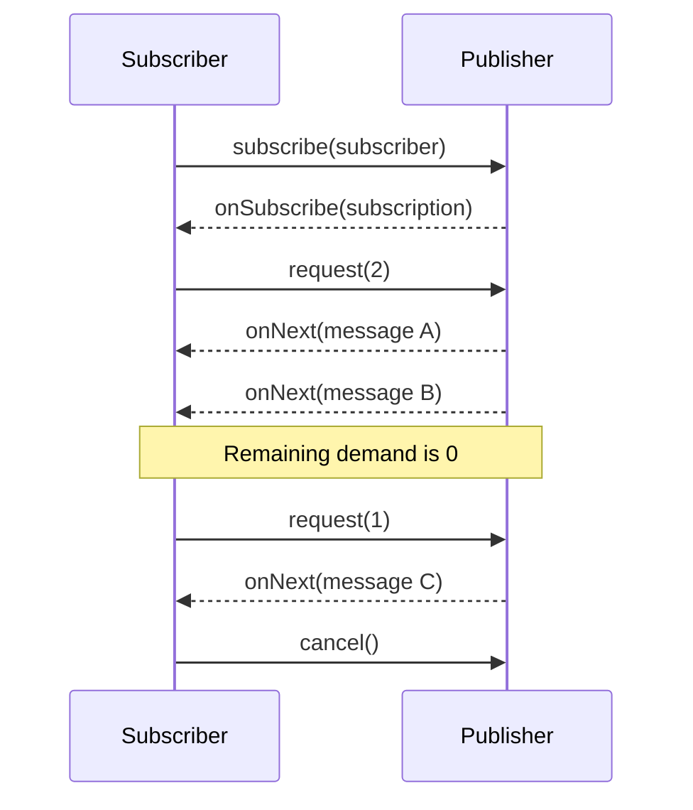

# Backpressure in Reactive Flows

## 1. Objectives and Scenario

In the **Reactive support** chapter of the **SPRING_INTEGRATION_CORE** module, backpressure is the mechanism for designing message flows aligned with the downstream processor's capacity. This lesson focuses on the relationship among `Message`, `MessageChannel`, endpoints, and Reactor operators in Java DSL.

After this lesson, you can:

- Explain demand, `request(n)`, and the difference between accepting an item and completing business work.
- Identify which segments in an integration flow can propagate demand upstream.
- Coordinate concurrency limits, prefetch, and buffers to control load.
- Choose how to handle sources that cannot pause or downstreams that are too slow.
- Write tests that control demand, detect overflow, and verify concurrency limits.

Suppose an order-intake flow receives 1,000 messages/second while the inventory reservation service completes only 200 messages/second. If every message is accepted and queued in memory, the backlog grows roughly at:

```text
Backlog growth rate = arrival rate - completion rate
                    = 1,000 - 200
                    = 800 messages/second
```

At this rate, a queue with 4,000 free slots absorbs only about 5 seconds of excess load, assuming constant rates. Enlarging buffers only delays filling up; the system still needs to throttle intake, scale processing capacity, or apply an overload policy.

This is a design-oriented calculation example, not a performance benchmark of Spring Integration.

## 2. Backpressure Starts with Demand

### 2.1. Protocol Between Publisher and Subscriber

In Reactive Streams, a `Publisher` emits data, a `Subscriber` receives data, and a `Subscription` manages demand and cancellation. The subscriber calls `request(n)` to signal it can accept `n` additional items. Requests are cumulative; the publisher must not emit `onNext` beyond remaining demand. `n` must be positive, and `Long.MAX_VALUE` represents effectively unbounded demand. Terminal signals `onComplete` and `onError` do not require waiting for demand. See the [Subscription Contract](https://www.reactive-streams.org/reactive-streams-1.0.4-javadoc/org/reactivestreams/Subscription.html) and the [Reactive Streams Specification](https://github.com/reactive-streams/reactive-streams-jvm#specification).



In this example, the publisher may emit fewer items than requested if the source runs out of data or fails. Demand permits emission; it does not force the source to materialize data immediately.

Each subscription maintains its own demand state. You cannot treat a single `request(10)` on one branch as a shared budget across all subscribers or all application instances.

### 2.2. Demand Does Not Mean Business Completion

`request(1)` means "ready to accept one more element," not "one order has been successfully persisted."

Consider the following snippet:

```java
// Anti-pattern when trying to bound in-flight calls.
messages.doOnNext(message ->
    inventoryClient.reserve(message.getPayload()).subscribe()
);
```

The inner subscription is detached from the outer chain. `doOnNext` returning only indicates the callback started the work; it does not indicate reservation finished. The outer chain can no longer use each call's completion to free a concurrency slot.

Instead, compose the returned `Mono` into the chain:

```java
messages.flatMap(
    message -> inventoryClient.reserve(message.getPayload()),
    8,
    1
);
```

When each call is represented by a `Mono` that terminates only when the operation finishes, the active inner publisher count becomes an accurate representation of in-flight tasks. This is the foundation for meaningful business concurrency limits.

If the client returns `Mono.empty()` before external work actually completes, or creates internal subscriptions, this assumption no longer holds.

### 2.3. Backpressure vs. Other Controls

| Mechanism | What Does It Control? | Example |
|---|---|---|
| Backpressure | Number of elements downstream is ready to accept via subscription | `request(16)` |
| Concurrency limit | Number of active asynchronous tasks | At most 8 concurrent reservation calls |
| Rate limiting | Number of executions per time window | At most 100 calls/second |
| Bounded buffer | Number of items held at a waiting stage | At most 500 messages |
| Timeout | Wait duration for an operation | Wait at most 2 seconds for response |
| Acknowledgment | Source or broker protocol confirmation | ACK after result is persisted |

A concurrency limit of 8 is not equivalent to 8 requests/second. If each request takes 10 ms, throughput differs dramatically from when each request takes 1 second. Similarly, a 500-item buffer does not dictate when a broker ACK occurs.

## 3. How Demand Flows Through Spring Integration

### 3.1. Role of Channels

Spring Integration structures flows with messages, channels, and endpoints. The channel type heavily dictates how endpoints coordinate.

| Component | Key Load-Design Characteristics |
|---|---|
| `DirectChannel` | Invokes handler synchronously on the sender thread in standard usage; slow handlers slow down the send call |
| `QueueChannel` with capacity | Buffers messages for consumers to poll later; requires configuring capacity and full-queue send behavior |
| `ExecutorChannel` | Dispatches work via an executor; requires checking pool limits, work queues, and rejection policy |
| `FluxMessageChannel` | Connects to Reactive Streams, exposing `Publisher<Message<?>>` and accepting a publisher source via `subscribeTo` |

Blocking the sender thread and signaling subscriber demand are two different mechanisms. Both can coexist in one application, provided the transition boundaries are explicit. Refer to [Spring Integration Message Channels](https://docs.spring.io/spring-integration/reference/channel/implementations.html).

### 3.2. FluxMessageChannel and ReactiveStreamsConsumer

`FluxMessageChannel` supports Reactive Streams consumption. Spring Integration uses `ReactiveStreamsConsumer` to connect reactive channels to eligible endpoints. Java DSL also supports starting a flow from a `Publisher` and using `fluxTransform` to embed a Reactor processing segment into a flow. These mechanisms are documented in [Reactive Streams Support](https://docs.spring.io/spring-integration/reference/reactive-streams.html).

However, seeing `FluxMessageChannel` in a configuration is not enough to conclude the whole system has bounded memory:

- A source publisher may honor demand, while an external callback keeps pushing data.
- An imperative block calling `send(message)` does not automatically become a pull source that defers message creation.
- Each operator or adapter may maintain its own prefetch, queue, and policy.
- An endpoint may call JDBC, synchronous SDKs, or other blocking operations.
- Client libraries may have independent connection pools and pending queues.

Do not conclude "sending to channel succeeded" means "downstream processed successfully." Send outcome and business outcome must remain distinct in your application contract.

### 3.3. Drawing Both Data Flow and Demand Flow

```mermaid
flowchart LR
    A["Demand-aware source"] --> B["Message Publisher"]
    B --> C["Reactive segment in IntegrationFlow"]
    C --> D["flatMap with bounded concurrency"]
    D --> E["I/O client returning Mono"]
    E --> F["Result-receiving endpoint"]
    F -. "demand" .-> E
    E -. "demand across operators" .-> D
    D -. "reshaped request" .-> C
    C -. "request" .-> B
    B -. "read more when capable" .-> A
```



This diagram is a conceptual model. In practice, `flatMap` holds a subscription to the outer source and separate subscriptions for each inner publisher; there is no single demand counter spanning every layer.

If the initial source is a callback from a device emitting 1,000 events/second with no pause API, the demand chain stops at the bridging adapter. Right there, you must make a concrete decision about buffering, rejecting, durable persistence, or dropping data.

## 4. Using Operators for Their Intended Purpose

### 4.1. limitRate: Splitting Upstream Requests

`limitRate(32)` breaks a large downstream request into smaller batches when propagating upstream. The `limitRate(32, 0)` variant uses non-overlapping batches without early low-tide replenishment; a batch may be smaller than 32 if the corresponding demand is smaller. See [Reactor's section on reshaping requests](https://projectreactor.io/docs/core/release/reference/coreFeatures/simple-ways-to-create-a-flux-or-mono-and-subscribe-to-it.html#_on_backpressure_and_ways_to_reshape_requests).

Example:

```java
Flux<Message<Order>> controlled = source
    .doOnRequest(n -> System.out.println("Source received request: " + n))
    .limitRate(32, 0);
```

The name `limitRate` is easily mistaken for time-based rate limiting. This operator does not enforce a "32 messages/second" budget, nor does it cap active HTTP calls. It reshapes data requests at the point where it is placed.

Placing `doOnRequest` before vs. after `limitRate` observes different subscription edges. Do not treat every logged number as the final subscriber's original demand.

### 4.2. flatMap: Composing Async Work with Bounded Concurrency

```java
Flux<ReservationResult> results = source.flatMap(
    message -> inventoryClient.reserve(message.getPayload()),
    8,
    1
);
```

Here:

- `8` caps the number of concurrently subscribed inner publishers.
- `1` is the prefetch per inner publisher.
- Results may appear out of input order.
- For an inner `Mono` emitting at most one result, a prefetch of 1 expresses intent clearly.

`flatMap` does not spawn threads for a synchronous Java function. When the mapper blocks before returning a publisher, configuring concurrency alone does not make that blocking work asynchronous.

If sequential processing is needed, choose `concatMap`. If multiple operations must run concurrently while emitting results in source order, consider `flatMapSequential` and account for results waiting on earlier operations. See [Flux API](https://projectreactor.io/docs/core/release/api/reactor/core/publisher/Flux.html).

### 4.3. publishOn: Switching Execution Context and Creating a Queue Boundary

A common usage:

```java
source.publishOn(Schedulers.parallel(), 16);
```

The prefetch parameter controls lookahead at this boundary. `publishOn` switches the execution context for downstream operators; it does not mean every message is processed in parallel on a separate thread. Creating many such boundaries also introduces additional places where data can queue. See [Threading and Schedulers](https://projectreactor.io/docs/core/release/reference/coreFeatures/schedulers.html).

For blocking work, use the approach in section 7 instead of placing blocking tasks onto a scheduler intended for non-blocking work.

### 4.4. buffer and onBackpressureBuffer Solve Different Problems

`buffer(20)` creates batches: each downstream item becomes a list rather than an individual input message. `onBackpressureBuffer(500)` holds excess items when downstream lacks demand.

Notably, `onBackpressureBuffer`, `onBackpressureDrop`, and `onBackpressureLatest` request unboundedly from upstream and then apply a local policy. Therefore, adding them to a demand-aware source alters how demand affects that source. Details are in [Flux's onBackpressure API group](https://projectreactor.io/docs/core/release/api/reactor/core/publisher/Flux.html#onBackpressureBuffer-int-).

That is why you should not sprinkle `onBackpressureBuffer()` into every flow by default. Know why you buffer, where it sits, how much it holds at most, and what happens when full.

## 5. Java DSL Example: Inventory Reservation with at Most 8 Concurrent Operations

### 5.1. Example Scope

The example below uses Spring Integration 6.x Java DSL, Java 17+, and Reactor. Required dependencies are `spring-integration-core` and `reactor-core`; tests use JUnit Jupiter and `reactor-test`. Manage versions consistently via your application's BOM.

The code is an illustrative configuration to embed in a bootstrapped Spring application. The simulated client uses `Mono.delay` to represent I/O latency. It makes no real reservation requests and provides no durable storage. The tests later in the lesson are practice code, not executed inside this article.

Design goals:

1. Create a finite source of 100 `Message<Order>`.
2. Split demand in the processing segment into batches of at most 16.
3. Keep at most 8 active inner publishers per pipeline subscription.
4. Convert per-order timeouts into a `TIMED_OUT` outcome.
5. Preserve business headers to correlate outcomes with original orders.

### 5.2. Configuration and Pipeline

```java
import java.time.Duration;
import java.util.concurrent.TimeoutException;

import org.springframework.context.annotation.Bean;
import org.springframework.context.annotation.Configuration;
import org.springframework.integration.config.EnableIntegration;
import org.springframework.integration.dsl.IntegrationFlow;
import org.springframework.messaging.Message;
import org.springframework.messaging.support.MessageBuilder;

import reactor.core.publisher.Flux;
import reactor.core.publisher.Mono;

@Configuration
@EnableIntegration
public class BackpressureLesson {

    public record Order(String orderId, String sku, int quantity) {
    }

    public record ReservationResult(String orderId, String status) {
    }

    public interface InventoryClient {
        Mono<ReservationResult> reserve(Order order);
    }

    @Bean
    InventoryClient inventoryClient() {
        return order -> Mono.delay(Duration.ofMillis(100))
            .map(ignored ->
                new ReservationResult(order.orderId(), "RESERVED"));
    }

    @Bean
    IntegrationFlow reservationFlow(InventoryClient client) {
        Flux<Message<Order>> source = Flux.range(1, 100)
            .map(index -> {
                Order order = new Order(
                    "ORDER-" + index, "BOOK-001", 1);

                return MessageBuilder.withPayload(order)
                    .setHeader("orderId", order.orderId())
                    .build();
            });

        return IntegrationFlow.from(source)
            .<Order, Message<ReservationResult>>fluxTransform(
                messages -> reserve(messages, client, 8))
            .handle(ReservationResult.class, (result, headers) -> {
                // Only for observation in the demo.
                System.out.println(
                    headers.get("orderId") + " -> " + result.status());
                return null;
            })
            .get();
    }

    static Flux<Message<ReservationResult>> reserve(
            Flux<Message<Order>> messages,
            InventoryClient client,
            int concurrency) {

        return messages
            .limitRate(16, 0)
            .flatMap(message ->
                Mono.defer(() -> client.reserve(message.getPayload()))
                    .timeout(Duration.ofSeconds(2))
                    .map(result -> reply(message, result))
                    .onErrorResume(TimeoutException.class, error ->
                        Mono.just(reply(
                            message,
                            new ReservationResult(
                                message.getPayload().orderId(),
                                "TIMED_OUT")))),
                concurrency,
                1);
    }

    private static Message<ReservationResult> reply(
            Message<Order> request,
            ReservationResult result) {

        return MessageBuilder.withPayload(result)
            .copyHeaders(request.getHeaders())
            .setHeader("reservationStatus", result.status())
            .build();
    }
}
```

`fluxTransform` accepts a function over `Flux<Message<I>>`, embeds the Reactor segment into the flow, and uses reactive channels on both sides according to the DSL implementation. The example returns individual `Message<ReservationResult>` objects to explicitly preserve headers. Refer to [fluxTransform API](https://docs.spring.io/spring-integration/docs/6.3.1/api/org/springframework/integration/dsl/BaseIntegrationFlowDefinition.html).

### 5.3. Interpreting the Configuration's Guarantees Accurately

The limit of 8 comes from `flatMap` and the client's `Mono` lifecycle. `limitRate(16, 0)` shapes upstream data requests; it is neither a 16-task concurrency limit nor a promise that "the entire application holds only 16 messages."

The limit of 8 applies per pipeline subscription. If multiple pipelines call the same service or multiple instances run concurrently, calculate the total connection and external resource budget. For instance, 4 instances each allowing 8 concurrent slots can generate roughly 32 concurrent operations when all are active.

`Mono.defer` defers invoking the client until the inner publisher is subscribed; synchronous exceptions from that call also become error signals. Still, if the client's body blocks, it occupies the execution thread. `defer` is not a scheduler-switching tool.

`copyHeaders` preserves headers such as `orderId`. The new message gets its own framework ID and timestamp per builder rules; do not use `MessageHeaders.ID` as a deduplication key across the entire business lifecycle.

The final endpoint returns `null` because this is a demo-terminating consumer. `System.out.println` is just for observation; in a real system, the result-persistence step must also be sized for its load capacity. If replaced with an asynchronous call, compose that publisher into the flow rather than calling `subscribe()` manually.

### 5.4. Timeouts and Indeterminate Outcomes

The example only recovers `TimeoutException` into a `TIMED_OUT` payload. Other errors are not silently turned into "success."

A timeout indicates the caller stopped waiting. The inventory service may have already received the request and still complete it later. Hence, a `TIMED_OUT` outcome should lead to a lookup or reconciliation workflow by `orderId`; never assume the reservation definitely did not occur.

If every outcome must be persisted before acknowledging the source, compose the persistence step into the same publisher and ACK only after that step completes. Console logging in the demo does not satisfy this requirement.

## 6. When the Source Cannot Slow Down

### 6.1. Define the Policy Before Choosing an Operator

For callback sources, ask: "When the system is full, where does the next event go?"

| Policy | When Applicable | Additional Design Needed |
|---|---|---|
| Bounded buffer | Short bursts tolerable within latency budget | Capacity, message age, full-buffer behavior |
| Reject intake | Sender can observe rejection and retry | Response codes, backoff, deduplication key |
| Persist durably | Critical data tolerable of delayed processing | Capacity, retention, ACK, and replay |
| Drop | Losing some events is acceptable to business | Count and monitor dropped events |
| Latest | Only the most recent state of a stream matters | State semantics, partition key if applicable |
| Fail with error | Cannot continue within contract | Restart strategy and recovery data source |

A payment order and a dashboard temperature reading have different requirements. Never pick drop just because it keeps memory flat.

### 6.2. Bounded Buffer Failing on Overflow

```java
import reactor.core.publisher.BufferOverflowStrategy;

Flux<Message<Order>> admitted = callbackFlux
    .onBackpressureBuffer(
        500,
        message -> overflowCounter.increment(),
        BufferOverflowStrategy.ERROR);
```

This is an illustrative snippet: `callbackFlux` is supplied by the adapter, and `overflowCounter` is an application metric counter.

This buffer bounds memory only at this operator's position. It does not bound memory inside `callbackFlux`, drivers, upstream channels, or executor queues. If the adapter already buffered unboundedly before reaching this operator, adding a bounded buffer downstream does not cure the upstream problem.

With `BufferOverflowStrategy.ERROR`, the overflow error may be delivered downstream only after existing buffered items are consumed. Do not assume the subscriber receives the error at the exact instant the first excess item exceeds capacity; check the exact overflow contract in use.

The overflow callback should be fast and non-blocking. If you want to spill excess data to alternate storage, design an ingestion path with managed load and error handling; do not perform a slow storage call directly inside the overflow callback and treat it as complete recovery.

### 6.3. Controlling Callback Ingress with Sinks

If you write a custom adapter, you can start with a sink backed by a bounded queue and check emission results:

```java
import java.util.concurrent.ArrayBlockingQueue;

import org.springframework.messaging.Message;
import reactor.core.publisher.Sinks;

Sinks.Many<Message<Order>> ingress = Sinks.many()
    .unicast()
    .onBackpressureBuffer(
        new ArrayBlockingQueue<Message<Order>>(500));

void onExternalEvent(Message<Order> message) {
    Sinks.EmitResult result = ingress.tryEmitNext(message);

    if (result == Sinks.EmitResult.OK) {
        return;
    }

    // Enforce the adapter's rejection or recovery contract.
    // Never ignore failure results.
    handleAdmissionFailure(message, result);
}
```

This snippet illustrates members inside an adapter class; `handleAdmissionFailure` must be implemented by the application. You can expose `ingress.asFlux()` as the input publisher for a flow. A `unicast` sink supports only one subscriber, which fits when an adapter feeds a single reactive consumer directly.

`FAIL_OVERFLOW` requires an overload policy. `FAIL_NON_SERIALIZED` signals unaccepted concurrent emission; `FAIL_CANCELLED` or `FAIL_TERMINATED` relates to sink lifecycle. Never lump all failures into "queue full" and retry infinitely. See [Reactor Sinks Documentation](https://projectreactor.io/docs/core/release/reference/coreFeatures/sinks.html).

A bounded queue on the sink establishes a clear intake boundary, though items already emitted downstream may still sit in buffers or in-flight work elsewhere.

### 6.4. Latest Must Match Data Semantics

`onBackpressureLatest()` retains the latest pending value on a single subscription. It does not automatically retain "the latest value per device" on a multiplexed stream of many devices.

For example, consecutive updates from devices A and B compete for the same single pending slot. If business logic requires latest-per-key, design partitioning or per-key state with bounded key counts and expiration policies.

For order commands, keeping only the latest command usually drops mandatory work. For ephemeral display state, this policy can make sense once requirements are confirmed.

## 7. Wrapping Blocking Libraries While Respecting Load Budgets

Suppose the inventory client only offers a synchronous API. The proper wrapper defers the call and shifts it to a scheduler suited for blocking work:

```java
Flux<ReservationResult> results = messages.flatMap(
    message -> Mono.fromCallable(() ->
            blockingClient.reserve(message.getPayload()))
        .subscribeOn(Schedulers.boundedElastic()),
    8,
    1
);
```

Here `blockingClient.reserve` returns `ReservationResult` directly rather than `Mono`. The `fromCallable` plus `boundedElastic` pattern is documented in [Reactor FAQ on blocking calls](https://projectreactor.io/docs/core/release/reference/faq.html#faq.wrap-blocking).

For this configuration, evaluate simultaneously:

- The pipeline's budget of 8 inner publishers.
- How many connections the JDBC/HTTP/SDK client actually provides.
- Scheduler capacity and other pipelines sharing the same scheduler.
- Pool wait times and the driver's own timeouts.

Suppose the application allocates only 4 connections for this operation; a concurrency of 8 leaves half the tasks waiting for a connection. You cannot equate every subscribed task with an active network request.

When adding `timeout` around a blocking call, the subscription may cancel while the underlying thread or I/O has not yet stopped. If new tasks are admitted after a timeout before old work truly terminates, physical concurrency can exceed estimates based on active subscriptions. Therefore, configure timeouts and cancellation support at the client itself alongside real pool limits.

Also keep the blocking call inside the `fromCallable` supplier. Writing `Mono.just(blockingClient.reserve(order))` executes the call immediately before the `Mono` is created.

## 8. How Transformers, Filters, Routers, and Aggregators Affect Load

Backpressure must be evaluated alongside Enterprise Integration Patterns semantics:

| Component | Load Questions to Answer |
|---|---|
| Transformer | Is the transformation blocking? Is the new payload significantly larger? |
| Filter | After dropping messages, must upstream send more data to satisfy demand? Should dropped messages be recorded? |
| Router | Does each branch have its own limits? Does total traffic to a shared service exceed budget? |
| Splitter | Into how many parts is one message split? Did the source materialize the entire collection beforehand? |
| Aggregator | How many incomplete groups exist? When do they release or expire? Where is group state stored? |
| Gateway | Is the returned publisher composed into the processing lifecycle? What do cancellation or timeout mean to the external caller? |

For example, downstream requests 10 messages through a filter, yet only 1 in 100 messages matches. Upstream may need to inspect far more than 10 messages to yield 10 outputs. Output demand is not a hard cap on how many source messages get inspected.

A splitter emitting items on demand still cannot reduce memory for a one-million-element list already materialized upfront. To save memory at the source, change how those items are read or streamed.

An aggregator holds state across multiple messages. A flow with bounded demand can still accumulate many groups that never satisfy release conditions. Set budgets for open group count, time-to-live, and message store capacity in addition to Reactor buffers.

With a gateway returning `Mono`, returning a reactive type only provides a contract to compose and defer execution appropriately. It does not prove every underlying adapter is non-blocking or that the source protocol supports network-level backpressure.

## 9. Error Handling, Retries, and Subscription Lifecycle

### 9.1. Per-Message Errors vs. Source Errors

Two common design choices exist:

- Convert an expected per-message failure into a business outcome and continue processing subsequent messages.
- Let errors surface out of the publisher so an outer layer or endpoint error mechanism handles them.

In the reservation example, `onErrorResume` sits inside `flatMap`'s mapper and handles only timeouts. Thus, one order's timeout stays scoped to that order. Placing recovery outside the entire `flatMap` replaces the terminated stream; it does not automatically continue reading remaining messages from the old source.

`doOnError` is meant for observing errors, not recovering the stream. When combining with Spring Integration error channels, distinguish errors thrown inside endpoints from errors emitted by publishers, and verify the exact behavior of your adapter/endpoint. Do not assume every `onError` automatically routes to a shared error channel. See [Error Handling in Spring Integration](https://docs.spring.io/spring-integration/reference/error-handling.html).

### 9.2. Retries Consume Processing Capacity Too

If each order attempts up to 3 tries, load on the service depends on both new orders and retries. During a widespread outage, uncontrolled retries can saturate every concurrency slot.

A sound policy must specify retryable error types, retry count limits, backoff, total timeout budget, and idempotency keys. Placing retries around an inner publisher is usually easier to scope per order than placing retries around an entire source that might replay earlier orders.

For reservation commands, `orderId` or a dedicated request key must be enforced by the target service to prevent duplicate execution. Backpressure does not provide exactly-once guarantees.

### 9.3. Cancellation and Application Shutdown

Subscription cancellation is a signal requesting to stop delivery and release resources per the source's contract. It cannot roll back a committed transaction or guarantee undoing a request already accepted by an external system.

During shutdown, enforce rules to stop intake, await in-flight work within a deadline, and handle unfinished items. For custom callback adapters, tie listener registration and deregistration to the adapter lifecycle. If downstream has canceled while a callback source still emits, explicitly handle emission failure outcomes.

## 10. Testing Demand and Overload with StepVerifier

The tests below use `reactor-test` and JUnit Jupiter. Place the test class in the same package as `BackpressureLesson` from section 5 to access `reserve`. These are illustrative practice tests to run in a project with the required dependencies.

### 10.1. Emitting No More Than Subscriber Demand

```java
import static org.junit.jupiter.api.Assertions.assertEquals;
import static org.junit.jupiter.api.Assertions.assertFalse;
import static org.junit.jupiter.api.Assertions.assertTrue;

import java.time.Duration;
import java.util.ArrayList;
import java.util.List;
import java.util.concurrent.atomic.AtomicInteger;

import org.junit.jupiter.api.Test;
import org.springframework.messaging.Message;
import org.springframework.messaging.support.MessageBuilder;

import reactor.core.Exceptions;
import reactor.core.publisher.BufferOverflowStrategy;
import reactor.core.publisher.Flux;
import reactor.core.publisher.Mono;
import reactor.test.StepVerifier;

class BackpressureLessonTest {

    @Test
    void emitsOnlyWhatDownstreamRequests() {
        List<Long> upstreamRequests = new ArrayList<>();
        AtomicInteger delivered = new AtomicInteger();

        Flux<Integer> tested = Flux.range(1, 5)
            .hide()
            .doOnRequest(upstreamRequests::add)
            .limitRate(2, 0)
            .doOnNext(value -> delivered.incrementAndGet());

        StepVerifier.create(tested, 0)
            .expectSubscription()
            .then(() -> assertEquals(0, delivered.get()))
            .thenRequest(2)
            .expectNext(1, 2)
            .then(() -> assertEquals(2, delivered.get()))
            .thenRequest(3)
            .expectNext(3, 4, 5)
            .expectComplete()
            .verify(Duration.ofSeconds(1));

        assertFalse(upstreamRequests.isEmpty());
        assertTrue(upstreamRequests.stream()
            .allMatch(n -> n > 0 && n <= 2));
    }

    @Test
    void startsAtMostThreeUnfinishedCalls() {
        AtomicInteger started = new AtomicInteger();

        BackpressureLesson.InventoryClient neverCompletes = order ->
            Mono.defer(() -> {
                started.incrementAndGet();
                return Mono
                    .<BackpressureLesson.ReservationResult>never();
            });

        Flux<Message<BackpressureLesson.Order>> source =
            Flux.range(1, 20)
                .map(index -> MessageBuilder.withPayload(
                    new BackpressureLesson.Order(
                        "ORDER-" + index, "BOOK-001", 1))
                    .build());

        StepVerifier.create(
                BackpressureLesson.reserve(
                    source, neverCompletes, 3),
                1)
            .expectSubscription()
            .then(() -> assertEquals(3, started.get()))
            .thenCancel()
            .verify(Duration.ofSeconds(1));
    }

    @Test
    void reportsOverflowAfterBufferedValuesAreConsumed() {
        Flux<Integer> tested = Flux.range(1, 5)
            .hide()
            .onBackpressureBuffer(
                2, BufferOverflowStrategy.ERROR);

        StepVerifier.create(tested, 0)
            .expectSubscription()
            .thenRequest(2)
            .expectNext(1, 2)
            .expectErrorMatches(Exceptions::isOverflow)
            .verify(Duration.ofSeconds(1));
    }
}
```

In the first case, `StepVerifier.create(tested, 0)` sets initial demand to 0. While downstream has not requested, it receives no `onNext`. Upstream may still be pre-requested by `limitRate`; that is why the `delivered` counter sits after `limitRate`.

`hide()` is used to make request observation explicit and prevent fusion optimizations from hiding the behavior this exercise inspects. There is no need to add this operator to production code solely to mimic tests.

### 10.2. Interpreting the Concurrency Test Accurately

The fake client in the second test never completes. With 3 concurrency slots, the pipeline starts at most 3 calls before the test cancels. The test ends early, well before the 2-second timeout configured in the pipeline.

This case verifies the cap while inner publishers remain open. It does not verify slot release and reuse, timeouts, retries, or real pool limits. Those requirements need dedicated test cases in your project.

### 10.3. Overflow Can Still Happen with Demand-Compliant Sources

The third case uses `Flux.range`, a demand-compliant source. The buffer operator requests unboundedly from upstream while the final subscriber initially requests nothing. With capacity 2, the source fills the buffer and triggers overflow even though the source itself never violated Reactive Streams.

The test receives the two buffered values before observing the error dictated by the chosen `ERROR` overflow strategy. This distinguishes buffer-policy errors from publishers emitting beyond demand.

`StepVerifier` lets you script requests, emissions, and cancellation; `verify`'s timeout ensures tests do not hang indefinitely. See [Reactor Testing Guide](https://projectreactor.io/docs/core/release/reference/testing.html) and [StepVerifier API](https://projectreactor.io/docs/test/release/api/reactor/test/StepVerifier.html).

## 11. Sizing Capacity and Concurrency with Concrete Budgets

Do not start by asking "how big should the buffer be?" Start from your system's hard limits.

Suppose the inventory service allows at most 20 connections from the application, of which 4 must be reserved for other tasks. The remaining budget is 16. If two pipelines share the same pool, setting concurrency to 16 on each creates contention; allocate from the shared total or enforce a shared limiter.

If steady-state arrival rate is around 80 messages/second and average operation latency is 100 ms, average in-flight operations can be estimated as:

```text
L = λ × W
  = 80 × 0.1
  = 8 operations
```

This applies Little's Law to a stable boundary with consistently measured quantities. It gives an initial hypothesis for load testing, not a guarantee that concurrency 8 meets percentile latency targets under traffic spikes or service slowdowns. This relationship is presented in [MIT's Queueing Theory Notes](https://web.mit.edu/course/other/urban_or_book/www/book/chapter4/4.4.html).

When estimating burst buffers, you can use:

```text
Additional backlog ≈ max(0, λ_in - λ_out) × burst duration

Approximate queued memory
    ≈ total retained messages × average message size
      + overhead of objects, queues, and processing state
```

For example, a burst adding 300 messages/second for 2 seconds creates roughly 600 queued messages if downstream throughput stays constant. If deadlines allow waiting only 200 ms, a 600-message buffer may not be the right choice; messages may expire before their turn.

Average payload size alone is also insufficient to budget heap when a few messages are huge. Bound message sizes or measure size distributions and concurrently retained segments.

## 12. Observing the Right Signs of System Overload

Track metrics that carry meaning for the flow itself:

- Counts of accepted, completed, failed, and rejected messages.
- In-flight task count, active connections, and tasks waiting for resources.
- Depth of each application-managed queue and age of the oldest message.
- Counts of overflows, drops, timeouts, retries, and completion latency.
- Active, canceled, and error-terminated subscriptions.

Not every internal buffer exposes a standard gauge. Measure where appropriate APIs or instrumentation exist; if exact capacity management is needed, introduce explicit intake boundaries such as adapters with bounded queues.

A flow with stable heap can still fail business SLAs if messages wait too long, drops go unrecorded, or every concurrency slot is tied up in retries. Therefore, inspect message age and completion rates alongside memory.

You can add `doOnRequest` during learning and diagnostics to observe demand. Under heavy load, avoid logging a line per signal; logging itself consumes resources and can skew the load behavior you are measuring.

## 13. Common Mistakes

| Practice | Consequence | Correction |
|---|---|---|
| Adding `FluxMessageChannel` and assuming all sources slow down | Overlooks push callbacks and other queues | Identify exact boundaries capable of propagating demand |
| Using `limitRate(10)` to limit 10 requests/second | Confuses demand batching with time-based rate limiting | Add a dedicated rate limiter if needed |
| Calling `subscribe()` inside the handler per message | Detaches task lifecycle from the flow | Compose publishers and bound concurrency |
| Wrapping a blocking call in `Mono.just` | Call runs eagerly before creating the publisher | Use `fromCallable` and an appropriate scheduler |
| Using unbounded `onBackpressureBuffer()` under sustained load | Backlog can grow without bound | Set capacity limits and an overload policy |
| Using latest for every message type | Drops mandatory business commands | Pick policies matching data semantics |
| ACKing immediately upon queueing in memory | Risk losing work if the process stops | ACK at agreed durable persistence or completion checkpoints |
| Raising concurrency to fix every timeout | Increases contention on services or pools | Measure bottlenecks before scaling concurrency |
| Limiting per flow while ignoring multiple instances | Aggregate load exceeds external system budget | Allocate budgets at the appropriate system level |

## 14. Practice Exercise

Use the reservation pipeline from section 5 and work through these steps in order:

1. Lower concurrency from 8 to 2 while keeping the simulated client at 100 ms; observe active operation counts and total completion time for 100 orders.
2. Keep concurrency at 2 and increase client latency to 500 ms; explain why raising `limitRate` alone does not increase client completion throughput.
3. Replace the finite source with a small-capacity sink; let the producer emit rapidly, inspect `EmitResult`, and document your full-queue policy.
4. Inject an intentional error for one `orderId`; handle that error inside the mapper while preserving order correlation context.
5. Replace console printing with an asynchronous persistence client; compose the persistence step and test the point considered complete.
6. Simulate a client that never completes; verify timeouts produce a state requiring reconciliation rather than assuming the operation definitely did not run.
7. Add a filter or splitter; distinguish source message count, messages passing the filter, and task count at the inventory service.
8. Run a load test in your project, measuring throughput, latency, message age, in-flight count, and rejection count over the same time window.

Your results should explain for every boundary: when a message is accepted, how many messages can wait, how many tasks run concurrently, when work is considered done, and what happens when intake capacity is exhausted.

Backpressure works when task lifecycles are composed into the reactive chain and sources can honor demand. Wherever those conditions do not hold, the flow needs an explicit intake and overload contract suited to the business data.