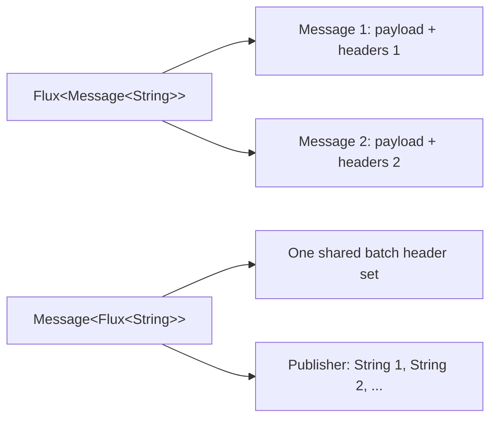

# Flux and Message

## 1. Objectives and Scope

In the **Reactive support** chapter of the **SPRING_INTEGRATION_CORE** module, this lesson bridges two models: Spring Integration messages and Project Reactor data streams. The goal is to design integration flows where data, headers, consumption demand, and errors all have clear boundaries.

After this lesson, you can:

- Distinguish among `Flux<T>`, `Message<T>`, `Flux<Message<T>>`, and `Message<Flux<T>>`.
- Transform payloads inside a Reactor stream while preserving business metadata.
- Use `FluxMessageChannel` and Java DSL to connect endpoints.
- Choose the right place to split a publisher into multiple messages, register subscriptions, and handle errors.
- Write tests for both Reactor transformations and Spring Integration flows.

Examples use Java 17 or later, Spring Integration 6.5 APIs, and Reactor. Required libraries are `spring-integration-core` and `reactor-core`; tests use `reactor-test` and JUnit Jupiter. Align library versions via your application's BOM. The examples here require no HTTP server or WebFlux module.

## 2. Two Layers of Responsibility: Element and Envelope

`Message<T>` is a message consisting of a payload of type `T` and headers. It does not schedule execution on its own, has no `request(n)` operation, and does not represent a subscription. It is the data contract exchanged by endpoints and channels. See [Spring Framework Message API](https://docs.spring.io/spring-framework/docs/current/javadoc-api/org/springframework/messaging/Message.html).

`Flux<T>` is a `Publisher<T>` that can emit zero to many elements. The stream can complete normally, terminate with an error, or remain open if the source does not finish. The type parameter `T` specifies the type of **each element**, not the type of the entire dataset. See [Flux API](https://projectreactor.io/docs/core/release/api/reactor/core/publisher/Flux.html).

| Type | Unit Being Described | Example Meaning |
| --- | --- | --- |
| `Message<String>` | One envelope containing a string | A single order ID and tenant info |
| `Flux<String>` | Stream of strings | Order IDs emitted over time |
| `Flux<Message<String>>` | Stream of independent envelopes | Each order has its own headers |
| `Message<Flux<String>>` | One envelope containing a publisher | A batch processing request whose order list arrives over time |
| `Mono<Message<String>>` | Reactive result with at most one message | One reply for one request |

Nesting the two types in different orders changes the processing contract. During design, write down the exact type at every boundary before selecting operators or endpoints.

### 2.1. A Stream of Multiple Messages

```java
import org.springframework.messaging.Message;
import org.springframework.messaging.support.MessageBuilder;
import reactor.core.publisher.Flux;

Flux<Message<String>> orders = Flux.just(
    MessageBuilder.withPayload(" order-001 ")
        .setHeader("tenantId", "tenant-a")
        .setHeader("traceId", "trace-001")
        .build(),
    MessageBuilder.withPayload(" order-002 ")
        .setHeader("tenantId", "tenant-b")
        .setHeader("traceId", "trace-002")
        .build()
);
```

The subscriber receives `onNext` twice, each time with a `Message<String>`. A router can inspect each message's `tenantId`; a filter can drop an order; result tracking can also correlate via each `traceId`.

### 2.2. A Single Message Containing a Stream

```java
Message<Flux<String>> batch = MessageBuilder
    .withPayload(Flux.just("order-001", "order-002"))
    .setHeader("batchId", "batch-2026-11-19")
    .setHeader("tenantId", "tenant-a")
    .build();
```

At a standard message-sending boundary, this is **one** message whose payload is `Flux<String>`. `batch.getPayload()` merely returns the publisher object; it does not immediately return a list of strings.

The two inner strings do not yet have individual envelopes. If you want to route or retry per order, split them into child messages at an explicitly defined step. A regular channel does not automatically assume every publisher inside a payload must be unwrapped. Certain endpoints have dedicated reactive reply handling contracts; evaluate that endpoint's specific contract.



## 3. Subscription, Demand, and Execution Timing

An operator chain is a description of processing. With a cold source, data is generated per subscription; a hot source can emit independently of when a subscriber joins. Therefore, you cannot apply the rule "nothing happens until subscribed" universally to every source. Refer to [Reactor Hot versus Cold](https://projectreactor.io/docs/core/release/reference/advancedFeatures/reactor-hotCold.html).

The basic interaction cycle is:

```text
Subscriber -- subscribe --> Publisher
Subscriber <-- onSubscribe(Subscription) -- Publisher
Subscriber -- request(n) --> Subscription
Subscriber <-- onNext(message), up to demand -- Publisher
Subscriber <-- onComplete or onError -- Publisher
Subscriber -- cancel --> Subscription, if stopping early
```

`request(n)` expresses how many more items the subscriber can receive; demand is cumulative. `cancel()` asks the source to stop and release resources, though it does not undo side effects already performed. `onComplete` and `onError` are terminal signals, not data messages. See [Subscription Contract](https://www.reactive-streams.org/reactive-streams-1.0.4-javadoc/org/reactivestreams/Subscription.html).

In `Flux<Message<String>>`, the counted items are messages. In the inner publisher of `Message<Flux<String>>`, the counted items are strings. These two demand layers do not automatically link together simply because the Java type nests `Flux`.

A successfully sent message also does not prove all business side effects have finished. For instance, a channel may have accepted the message while a downstream subscriber is still writing data. If the caller needs the final outcome, define an appropriate reply or completion contract.

## 4. Transforming Payloads and Preserving Headers

Suppose you need to normalize order IDs by trimming whitespace and converting to uppercase. In plain Reactor, you can keep `Message` as the unit of processing:

```java
import java.util.Locale;

import org.springframework.messaging.Message;
import org.springframework.messaging.support.MessageBuilder;
import reactor.core.publisher.Flux;

public final class OrderMessages {

    private OrderMessages() {
    }

    public static Message<String> normalize(Message<String> input) {
        String normalized = input.getPayload()
            .strip()
            .toUpperCase(Locale.ROOT);

        return MessageBuilder.withPayload(normalized)
            .copyHeaders(input.getHeaders())
            .setHeader("normalized", true)
            .build();
    }

    public static Flux<Message<String>> normalizeAll(
            Flux<Message<String>> source) {

        return source
            .filter(message -> !message.getPayload().isBlank())
            .map(OrderMessages::normalize);
    }
}
```

The result of `normalizeAll(orders)` still has type `Flux<Message<String>>`. The `tenantId` and `traceId` headers travel with the result rather than being stripped from the payload.

`MessageBuilder.withPayload(...)` creates a new envelope; `copyHeaders(...)` copies copyable headers from the source message. `id` and `timestamp` are framework-managed headers; do not rely on them as business keys that must stay constant across all transformations. Use headers like `traceId`, `orderId`, or `batchId` for that purpose. See [MessageBuilder API](https://docs.spring.io/spring-framework/docs/current/javadoc-api/org/springframework/messaging/support/MessageBuilder.html).

`MessageHeaders` prohibits direct mutation through operations like `put`. That does not make the payload object itself immutable. Using `String`, records, or immutable domain types reduces shared-state risks across branching flows. See [MessageHeaders API](https://docs.spring.io/spring-framework/docs/current/javadoc-api/org/springframework/messaging/MessageHeaders.html).

### 4.1. Two `map` Calls That Easily Break the Contract

```java
Flux<String> payloadsOnly = orders.map(Message::getPayload);

Flux<Message<String>> rebuiltWithoutBusinessHeaders = payloadsOnly
    .map(value -> MessageBuilder.withPayload(value).build());
```

The first `map` is valid if downstream only needs strings. However, the second `map` cannot automatically recover the discarded `tenantId` or `traceId`.

Another mistake is using `map` when the function returns a publisher:

```java
// normalizeAsync has signature: Mono<Message<String>> normalizeAsync(Message<String> m)
// orders.map(service::normalizeAsync)       -> Flux<Mono<Message<String>>>
// orders.concatMap(service::normalizeAsync) -> Flux<Message<String>>
```

These lines illustrate result types rather than declaring a concrete service. Once asynchronous processing is chosen, decide on concurrency level and output ordering at the same time.

| Need | Suitable Operator | Considerations |
| --- | --- | --- |
| One input to one synchronous result | `map` | Function must return an item, never `null` |
| One input to publisher, sequential processing | `concatMap` | A slow task blocks subsequent tasks |
| Multiple publishers processed concurrently | `flatMap` | Bound concurrency; results may interleave |
| Concurrent processing emitting in source order | `flatMapSequential` | May buffer completed results waiting for earlier items |

Ordering and concurrency contracts are documented in [Flux Operators API](https://projectreactor.io/docs/core/release/api/reactor/core/publisher/Flux.html).

## 5. Bringing Message Streams into Spring Integration

### 5.1. Role of FluxMessageChannel

`FluxMessageChannel` is both a `MessageChannel` and a `Publisher<Message<?>>`. It also accepts source publishers via the `ReactiveStreamsSubscribableChannel` contract. Its reactive consumer is a `Subscriber`, unlike registering a `MessageHandler` directly on a `SubscribableChannel`.

For boundaries between endpoints to keep participating in reactive processing, select an appropriate channel at each boundary. Replacing only the first channel is insufficient to conclude the entire flow has backpressure. See [FluxMessageChannel in the Channels Documentation](https://docs.spring.io/spring-integration/reference/channel/implementations.html#channel-implementations-fluxmessagechannel).

| Component | Role in the Example |
| --- | --- |
| Input `FluxMessageChannel` | Receives messages to normalize |
| Filter endpoint | Rejects whitespace-only IDs |
| Intermediate `FluxMessageChannel` | Boundary between filter and transformer |
| Transformer endpoint | Normalizes payload |
| Output `FluxMessageChannel` | Publisher for the result consumer |

`FluxMessageChannel` is not a durable broker or historical replay store. Do not use it in place of a dedicated messaging system's persistence, acknowledgment, and crash-recovery guarantees.

### 5.2. Java DSL Configuration with Full Beans

```java
import java.util.Locale;

import org.springframework.beans.factory.annotation.Qualifier;
import org.springframework.context.annotation.Bean;
import org.springframework.context.annotation.Configuration;
import org.springframework.integration.channel.FluxMessageChannel;
import org.springframework.integration.config.EnableIntegration;
import org.springframework.integration.dsl.IntegrationFlow;

@Configuration
@EnableIntegration
public class OrderFlowConfig {

    @Bean
    public FluxMessageChannel orderInput() {
        return new FluxMessageChannel();
    }

    @Bean
    public FluxMessageChannel acceptedOrders() {
        return new FluxMessageChannel();
    }

    @Bean
    public FluxMessageChannel orderOutput() {
        return new FluxMessageChannel();
    }

    @Bean
    public IntegrationFlow normalizeOrderFlow(
            @Qualifier("orderInput") FluxMessageChannel input,
            @Qualifier("acceptedOrders") FluxMessageChannel accepted,
            @Qualifier("orderOutput") FluxMessageChannel output) {

        return IntegrationFlow.from(input)
            .filter(String.class, value -> !value.isBlank())
            .channel(accepted)
            .transform(String.class,
                value -> value.strip().toUpperCase(Locale.ROOT))
            .channel(output)
            .get();
    }
}
```

`@Qualifier` disambiguates the wired beans because the configuration defines multiple channels of the same type. `.get()` produces the `IntegrationFlow` definition; Spring registers and manages the components when the configuration is part of an application context.

The transformer here accepts only a `String` payload. With payload-level transformation, the framework builds the reply message and copies eligible headers from the request. When a transformer explicitly returns `Message<?>`, envelope construction follows that return contract. See [Transformer Documentation](https://docs.spring.io/spring-integration/reference/6.5/transformer.html).


### 5.3. Two Input Approaches with Different Meanings

For an imperative caller, you can send a message into `orderInput`:

```java
boolean accepted = input.send(
    MessageBuilder.withPayload(" order-001 ")
        .setHeader("tenantId", "tenant-a")
        .setHeader("traceId", "trace-001")
        .build()
);
```

Here `input` is the `orderInput` bean retrieved from the context; attach the result subscriber before emitting data in the example. The return value of `send()` represents the send outcome under the channel contract, not completion of order normalization and persistence.

If the source is already a publisher, attach it via `input.subscribeTo(source)` or use `IntegrationFlow.from(source)`, where `source` emits `Message<?>` instances. Both approaches let the framework manage reactive source wiring; avoid manually iterating a publisher with `block()` and sending items one by one.

Being able to connect a publisher does not guarantee downstream processing speed will throttle every external source. The source must support demand, and boundaries between the source and final task must preserve that contract.

## 6. Starting and Ending DSL with a Publisher

This is a **standalone alternative configuration** to the channel example above. It demonstrates accepting `Flux<Message<String>>` and exposing a message publisher from the DSL:

```java
import java.util.Locale;

import org.reactivestreams.Publisher;
import org.springframework.context.annotation.Bean;
import org.springframework.context.annotation.Configuration;
import org.springframework.integration.config.EnableIntegration;
import org.springframework.integration.dsl.IntegrationFlow;
import org.springframework.messaging.Message;
import org.springframework.messaging.support.MessageBuilder;
import reactor.core.publisher.Flux;

@Configuration
@EnableIntegration
public class PublisherOrderConfig {

    @Bean
    public Publisher<Message<String>> normalizedOrderPublisher() {
        Flux<Message<String>> source = Flux.just(
            MessageBuilder.withPayload(" order-001 ")
                .setHeader("traceId", "trace-001")
                .build(),
            MessageBuilder.withPayload(" order-002 ")
                .setHeader("traceId", "trace-002")
                .build()
        );

        return IntegrationFlow.from(source)
            .transform(String.class,
                value -> value.strip().toUpperCase(Locale.ROOT))
            .toReactivePublisher(true);
    }
}
```

`IntegrationFlow.from(Publisher)` uses a reactive channel as the input bridge. `toReactivePublisher(true)` creates the output publisher and defers starting the flow until subscription time. When the publisher terminates or is canceled, flow lifecycle is handled accordingly. See [Reactive Streams Support, Java DSL section](https://docs.spring.io/spring-integration/reference/6.5/reactive-streams.html#reactive-streams-java-dsl).

This publisher is tied to Spring Integration lifecycle-managed components. Do not assume each subscription creates an isolated brand-new flow, or acts as a fresh cold replay of `source`. With hot sources and multiple subscribers, explicitly design sharing, startup timing, and cancellation.

A finite source emitting two elements also does not imply the output channel of a long-lived flow closes immediately after two items. Tests must match the chosen output contract; if you only need to inspect two messages on an active channel, consume two messages and then cancel the subscription.

## 7. Converting Message<Flux<T>> to Flux<Message<T>>

### 7.1. Splitting in Reactor with Explicit Header Decisions

The following method can be added to the `OrderMessages` class in section 4:

```java
public static Flux<Message<String>> expandBatch(
        Message<Flux<String>> batch) {

    return batch.getPayload()
        .map(value -> MessageBuilder.withPayload(value)
            .setHeader("batchId", batch.getHeaders().get("batchId"))
            .setHeader("tenantId", batch.getHeaders().get("tenantId"))
            .build());
}
```

Here each order ID is wrapped in a new message. Only `batchId` and `tenantId` are selected to propagate downward. Do not blindly copy the batch request's `replyChannel` onto every child message if the caller only expects a single aggregated reply.

If you have a stream of batches:

```java
Flux<Message<Flux<String>>> batches = Flux.just(batch);

Flux<Message<String>> individualOrders = batches
    .concatMap(OrderMessages::expandBatch);
```

`concatMap` finishes the previous batch's publisher before moving to the next batch. If each batch is an infinite stream, subsequent batches will never start with this structure. For continuous event streams, choose interleaving and concurrency suited to the business domain.

### 7.2. Splitting with Spring Integration's Splitter

In Java DSL, `.split()` can split a `Publisher` payload by default. To keep splitting reactive, set the splitter's output to a `ReactiveStreamsSubscribableChannel`, such as `FluxMessageChannel`. If the output is an imperative channel, do not assume splitting remains non-blocking. See [Splitter: Stream and Flux](https://docs.spring.io/spring-integration/reference/6.5/splitter.html#splitter-stream-and-flux).

The following example is an additional bean method; `batchInput` and `batchItems` must be declared as separate `FluxMessageChannel` beans just like in section 5:

```java
@Bean
public IntegrationFlow splitBatchFlow(
        @Qualifier("batchInput") FluxMessageChannel input,
        @Qualifier("batchItems") FluxMessageChannel items,
        @Qualifier("orderOutput") FluxMessageChannel output) {

    return IntegrationFlow.from(input)
        .split()
        .channel(items)
        .transform(String.class,
            value -> value.strip().toUpperCase(Locale.ROOT))
        .channel(output)
        .get();
}
```

The input to this flow is `Message<Flux<String>>`, whereas the transformer after the splitter receives a `String` payload. Splitting does not replace per-order validation; you can add filters and channels at the necessary boundaries.

Do not default to "split a publisher and then aggregate by total item count" when the total count is unknown. For unbounded or unknown-size sources, `sequenceSize` may be `0`; a size-based release strategy is then insufficient. Define business completion criteria, time windows, or an appropriate release strategy. Refer to [Splitter Contract and Sequence Headers](https://docs.spring.io/spring-integration/reference/6.5/splitter.html).

## 8. Backpressure Must Be Evaluated Boundary by Boundary

Suppose a source can emit 10,000 orders per second while the target service processes only 1,000 orders per second. Wrapping payloads in a `Flux` does not eliminate this mismatch.

| Boundary | What to Determine |
| --- | --- |
| Data source | Does the source respond to `request(n)`? |
| Adapter or channel | Does it accept a publisher directly or only `send()` calls? |
| Operator chain | What prefetch, buffers, or concurrency limits exist? |
| External service | What are connection limits and max in-flight requests? |
| Under overload | Wait, reject, drop according to policy, or persist to a durable queue? |

Final subscriber demand can be reshaped by intermediate operators. For instance, an operator with prefetch may pre-request multiple elements; `flatMap` may keep multiple tasks in flight. Therefore, do not use `request(1)` at the output to assert that every upstream stage holds only one message in memory.

### 8.1. send() Is an Imperative Boundary

```java
// Imperative loop: does not wait for demand from the source via Reactive Streams.
for (String code : codes) {
    input.send(MessageBuilder.withPayload(code).build());
}
```

Here `codes` is an existing collection in the application. When a producer calls `send()` repeatedly, inspect intake capacity, failures, and overload policies right at that boundary. Having a subscribable channel downstream does not turn this loop into a demand-throttled source.

Whenever possible, connect a Reactive Streams-capable source to the channel via the publisher contract. For unthrottled sources, choose and measure a buffering or rejection policy rather than defaulting to unbounded in-memory retention.

### 8.2. Reactive Neither Switches Threads Nor Removes Blocking Automatically

`Flux` does not spawn a separate thread per message by default. `publishOn` and `subscribeOn` govern different aspects of execution scheduling. See [Threading and Schedulers](https://projectreactor.io/docs/core/release/reference/coreFeatures/schedulers.html).

If calling a blocking library is unavoidable, wrap the call with `Mono.fromCallable(...).subscribeOn(Schedulers.boundedElastic())`. This moves waiting onto an appropriate scheduler; the underlying library remains blocking and requires concurrency bounds. See [Reactor Guide on Wrapping Blocking Calls](https://projectreactor.io/docs/core/release/reference/faq.html#faq.wrap-blocking).

Do not call `block()` inside a transformer to extract a value from a publisher. That breaks reactive composability, can block event-loop threads, and makes timeouts or cancellation hard to control.

## 9. Error Handling: Stream Errors vs. Per-Message Failure Outcomes

In Reactor, `onError` terminates the active sequence. `onErrorResume` replaces the failed sequence with another publisher; it does not resume the broken original source sequence. Placing recovery at the outermost level can stop subsequent orders from being processed. See [Reactor Handling Errors](https://projectreactor.io/docs/core/release/reference/coreFeatures/error-handling.html).

### 9.1. Stream-Terminating Error Example

```java
Flux<Integer> parsed = Flux.just("10", "bad", "20")
    .map(Integer::parseInt);
```

Upon subscription, the stream emits `10`, then errors on `bad`. It never emits `20`. Writing `parsed.onErrorResume(error -> Flux.empty())` turns the failure into completion of the fallback branch, yet it still does not recover element `20` from the original source sequence.

### 9.2. Converting Expected Per-Order Failures into Data Outcomes

If business rules require processing remaining orders, place recovery inside each message's inner publisher. The standalone example below parses payloads into integers and returns structured outcomes:

```java
import org.springframework.messaging.Message;
import org.springframework.messaging.support.MessageBuilder;
import reactor.core.publisher.Flux;
import reactor.core.publisher.Mono;

public final class ParsingFlow {

    public record ParseResult(String input, Integer value, String error) {
    }

    private ParsingFlow() {
    }

    public static Flux<Message<ParseResult>> parseEach(
            Flux<Message<String>> source) {

        return source.concatMap(message ->
            Mono.fromCallable(() -> new ParseResult(
                    message.getPayload(),
                    Integer.parseInt(message.getPayload()),
                    null))
                .onErrorResume(NumberFormatException.class,
                    error -> Mono.just(new ParseResult(
                        message.getPayload(), null, "INVALID_INTEGER")))
                .map(result -> MessageBuilder.withPayload(result)
                    .copyHeaders(message.getHeaders())
                    .build())
        );
    }
}
```

For three messages with payloads `10`, `bad`, and `20`, the function emits three result messages. The middle item has `error = "INVALID_INTEGER"`; the other two carry successfully parsed integers. The `null` here is a field inside the record, not a `null` element emitted into Reactor.

Only the expected `NumberFormatException` is converted into a data result. Programming bugs or infrastructure failures still require their own policies. Downstream, a router can send failed `ParseResult` items to a business-error handling branch.

### 9.3. ErrorMessage and errorChannel Are a Different Contract

Spring Integration provides `ErrorMessage` and the `errorChannel` mechanism for messaging failures. Error paths also depend on endpoints, channels, adapters, and execution mechanics. Do not assume any `onError` signal from an arbitrary publisher becomes a message on the `errorChannel` bean. See [Spring Integration Error Handling](https://docs.spring.io/spring-integration/reference/6.5/error-handling.html).

During design, clarify whether errors are returned via the publisher, a gateway reply, an `ErrorMessage`, or a business result payload. To trace failed orders, preserve `traceId` or request references at the conversion boundary.

Retries also re-subscribe within their configured scope. If a retry wraps a cold source with write side effects, previously processed orders may re-run. Keep retries tightly scoped to the failing operation, paired with idempotency keys whenever duplicate writes must be prevented.

## 10. Testing the Flux and Message Contract

`StepVerifier` creates a subscription and asserts expected signals. You can start with demand `0`, request items incrementally, assert errors, or cancel explicitly. Setting a duration on `verify(...)` prevents tests from hanging indefinitely. See [Reactor Testing](https://projectreactor.io/docs/core/release/reference/testing.html).

The snippets below are illustrative test code for a project with the dependencies listed in section 1; expected outcomes are explained according to the contract rather than representing a test run report.

### 10.1. Testing Transformations and Headers

This test class uses `OrderMessages` from section 4:

```java
import java.time.Duration;

import org.junit.jupiter.api.Test;
import org.springframework.messaging.Message;
import org.springframework.messaging.support.MessageBuilder;
import reactor.core.publisher.Flux;
import reactor.test.StepVerifier;

import static org.junit.jupiter.api.Assertions.assertEquals;

class OrderMessagesTest {

    @Test
    void normalizesPayloadAndRetainsBusinessHeaders() {
        Message<String> input = MessageBuilder
            .withPayload(" order-001 ")
            .setHeader("tenantId", "tenant-a")
            .setHeader("traceId", "trace-001")
            .build();

        StepVerifier.create(
                OrderMessages.normalizeAll(Flux.just(input)), 0)
            .thenRequest(1)
            .assertNext(message -> {
                assertEquals("ORDER-001", message.getPayload());
                assertEquals("tenant-a",
                    message.getHeaders().get("tenantId"));
                assertEquals("trace-001",
                    message.getHeaders().get("traceId"));
                assertEquals(Boolean.TRUE,
                    message.getHeaders().get("normalized"));
            })
            .expectComplete()
            .verify(Duration.ofSeconds(3));
    }

    @Test
    void filtersBlankPayloads() {
        Flux<Message<String>> source = Flux.just(
            MessageBuilder.withPayload("   ").build());

        StepVerifier.create(OrderMessages.normalizeAll(source))
            .expectComplete()
            .verify(Duration.ofSeconds(3));
    }
}
```

The first test verifies both data and metadata; the second verifies the contract emits no elements when filtered out. Do not compare only payload strings and overlook dropped headers.

### 10.2. Testing the Flow with a Real Application Context

The following test uses `OrderFlowConfig` from section 5. It attaches the output subscriber first, then sends input data. Because the output channel stays alive with the context, the test cancels after receiving the expected messages instead of waiting for the channel to complete on its own.

```java
import java.time.Duration;

import org.junit.jupiter.api.Test;
import org.springframework.context.annotation.AnnotationConfigApplicationContext;
import org.springframework.integration.channel.FluxMessageChannel;
import org.springframework.messaging.Message;
import org.springframework.messaging.support.MessageBuilder;
import reactor.core.publisher.Flux;
import reactor.test.StepVerifier;

import static org.junit.jupiter.api.Assertions.assertEquals;
import static org.junit.jupiter.api.Assertions.assertTrue;

class OrderFlowTest {

    @Test
    void filtersAndTransformsMessagesThroughReactiveChannels() {
        try (var context = new AnnotationConfigApplicationContext(
                OrderFlowConfig.class)) {

            FluxMessageChannel input = context.getBean(
                "orderInput", FluxMessageChannel.class);
            FluxMessageChannel output = context.getBean(
                "orderOutput", FluxMessageChannel.class);

            Message<String> first = MessageBuilder
                .withPayload(" order-001 ")
                .setHeader("traceId", "trace-001")
                .build();

            StepVerifier.create(Flux.from(output), 0)
                .thenRequest(1)
                .then(() -> assertTrue(input.send(first)))
                .assertNext(message -> {
                    assertEquals("ORDER-001", message.getPayload());
                    assertEquals("trace-001",
                        message.getHeaders().get("traceId"));
                })
                .thenRequest(1)
                .then(() -> assertTrue(input.send(
                    MessageBuilder.withPayload("   ").build())))
                .then(() -> assertTrue(input.send(
                    MessageBuilder.withPayload(" order-002 ").build())))
                .assertNext(message ->
                    assertEquals("ORDER-002", message.getPayload()))
                .thenCancel()
                .verify(Duration.ofSeconds(3));
        }
    }
}
```

If the filter stopped working, the whitespace message would become the next element and the assertion for `ORDER-002` would fail. Thus, the test does not rely on `Thread.sleep()` to guess that a message was dropped.

Starting with demand `0` and calling `thenRequest(1)` tests output consumption behavior here. It does not prove a producer calling `send()` is throttled by demand all the way back to the source.

### 10.3. Testing a Reactor Terminal Error

The following snippet can be added as a `@Test` method to a test class that imports `Flux`, `StepVerifier`, `Duration`, and `Test`:

```java
@Test
void parseErrorTerminatesTheSequence() {
    StepVerifier.create(
            Flux.just("10", "bad", "20").map(Integer::parseInt))
        .expectNext(10)
        .expectError(NumberFormatException.class)
        .verify(Duration.ofSeconds(3));
}
```

This test applies to a direct Reactor pipeline. For errors raised inside a Spring Integration endpoint, also verify how the endpoint wraps or routes errors under its specific configuration.

## 11. Managing Subscriptions, Lifecycle, and Metadata

### 11.1. Who Owns the Subscription?

At the outermost edge of the application, one component is responsible for subscribing and canceling on shutdown. In Spring-managed flows, the framework sets up the required consumers. In tests, `StepVerifier` acts as the subscriber.

Avoid calling `subscribe()` inside a `map`, transformer, or service merely to fire off a publisher and return immediately. Doing so detaches the work from the main chain: callers cannot tell when it finishes, errors cannot easily route back to the originating request, and canceling the outer chain may not cancel the inner task.

When the caller genuinely must subscribe at an application boundary, manage the returned subscription handle and error path. Do not attach extra logging subscribers if re-subscribing could re-trigger a cold source; observe inline with `doOnNext` or appropriate observability hooks.

### 11.2. Message Headers and Reactor Context

Headers belong to messages; Reactor `Context` belongs to a subscription. They do not stay synchronized automatically merely because both contain a key named `traceId`. To pass metadata between the two mechanisms, define an explicit bridging rule at the boundary. See [Adding a Context to a Reactive Sequence](https://projectreactor.io/docs/core/release/reference/advancedFeatures/context.html).

A single subscription may process messages from multiple tenants. Therefore, per-order tenant data should keep traveling on each message rather than being inferred from a shared variable or a `ThreadLocal` not propagated across reactive boundaries.

### 11.3. Gateways Do Not Replace Defining the Reply Type

Gateways let callers invoke an application contract instead of manually sending to channels. Still, you must define whether the caller expects a single result, multiple results, or a single message containing a publisher.

Do not assume declaring a method returning `Flux<T>` automatically turns the entire downstream flow into multiple independent replies. Verify which reactive types the gateway and endpoints support, how reply channels are managed, and who subscribes to the returned publisher. In this lesson, the output publisher is shown directly to keep those boundaries clear.

## 12. Common Design Mistakes

| Symptom | Possible Cause | Remedy |
| --- | --- | --- |
| Router receives a `Flux` payload instead of an order ID | Sent `Message<Flux<String>>` without splitting | Add a splitter or explicit expansion step |
| `tenantId` lost after normalization | Extracted payload only and built a fresh message | Preserve message or copy required headers |
| Output items arrive out of order | Used `flatMap` with varying task latencies | Choose `concatMap` or `flatMapSequential` per requirements |
| One error stops processing later orders | Recovery placed at whole-stream level | Convert expected errors into outcomes per message |
| Duplicate writes when retries are enabled | Re-subscribed to a cold source with side effects | Narrow retry scope and implement idempotency |
| Test hangs after receiving all expected messages | Waiting for `onComplete` on a long-lived channel | Cancel after asserting expected items; set verify timeout |
| Unexpected side effects when adding logging | Added another subscription to a cold source | Observe inline within the chain and control subscription count |
| Memory grows despite reactive channels | Push source or unbounded buffers | Inspect every boundary, concurrency, and overload policy |
| `try/catch` around Flux assembly misses errors | Error occurs later at subscription time | Handle inside the chain or at the owning subscriber |
| Reactive code still blocks threads | Blocking I/O or `block()` inside an endpoint | Use a reactive client or isolate blocking calls with bounds |

## 13. Applying to a Business Integration Flow

For a requirement to "ingest many orders, normalize, route, and persist outcomes," define the contract step by step:

1. **Unit of processing:** is each order a `Message<Order>`, or is a batch a `Message<Flux<Order>>`?
2. **Metadata:** which values must travel with each order, such as tenant, trace, and deduplication key?
3. **Output cardinality:** filters may emit zero items; splitters emit many; aggregators need clear completion conditions.
4. **Throttling:** which sources honor demand, where is buffering located, and where do imperative calls remain?
5. **Ordering:** is ordering required globally, per order, or per business key?
6. **Errors:** which errors become per-order failure outcomes, and which must terminate the stream or enter integration error channels?
7. **Lifecycle:** who subscribes, who cancels, and who knows when final business side effects complete?
8. **Testing:** verify payloads, headers, filtered-out items, errors, and subscription cancellation against the exact contract.

The examples in this lesson use strings to keep transformations clear. When substituting an `Order` domain type, the principles remain unchanged: `Flux` drives the stream of elements; `Message` carries the data and metadata of each integration unit. Choosing the right type structure lets transformers, routers, filters, splitters, and error branches compose cleanly without guessing payload meaning.