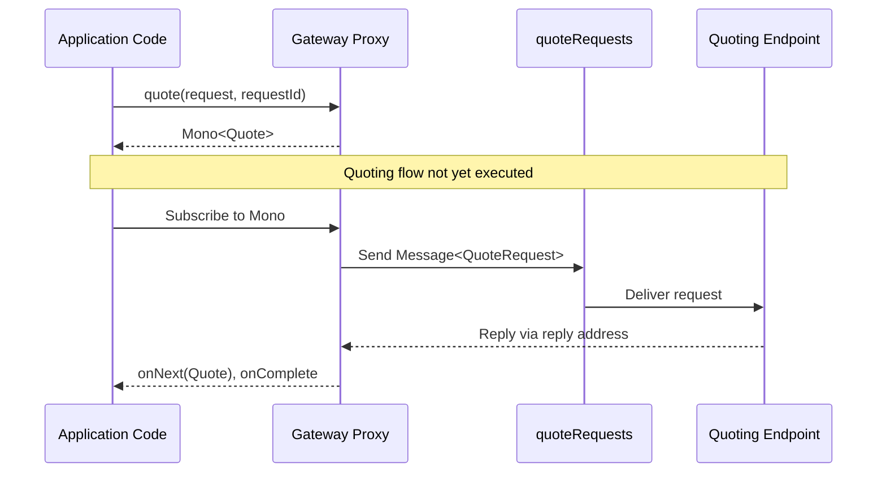

# Reactive Gateway

In the **Reactive support** chapter of the **SPRING_INTEGRATION_CORE** module, a reactive gateway is the bridge between application code using Project Reactor and Spring Integration message flows. Application code invokes a business method; behind that method sit `Message`, `MessageChannel`, endpoints, and the integration flow's reply mechanism.

This lesson builds a quoting flow using Java DSL. Afterward, you will be able to declare a gateway returning `Mono`, pinpoint when messages are sent, compose gateway calls into Reactor chains, and design success paths, error paths, and timeouts for each request.

Examples use Java 17 and Spring Integration 6.5.x APIs. You should already know message structure, `DirectChannel`, service activators, and Reactor's two terminal signals `onComplete` and `onError`. This is a Spring Integration Core example; no HTTP server or external system is required.

## 1. The Reactive Gateway Contract

A gateway hides message sending and receiving APIs behind a Java interface. With a `Mono<T>` return type, flow execution is deferred until subscription. `Mono` supports at most one value; it can also terminate with an error. See [Messaging Gateways](https://docs.spring.io/spring-integration/reference/6.5/gateway.html) and the [Mono Contract](https://projectreactor.io/docs/core/release/api/reactor/core/publisher/Mono.html).

Example business contract:

```java
@MessagingGateway(defaultRequestChannel = "quoteRequests")
public interface QuoteGateway {

    Mono<Quote> quote(
            QuoteRequest request,
            @Header("requestId") String requestId);
}
```

Role of each component in this lesson:

| Component | Role in a Quote Request |
|---|---|
| `QuoteRequest` | Payload containing product SKU and quantity |
| `requestId` | Business header for tracing the same request |
| `quoteRequests` | Channel receiving requests |
| `Mono<Quote>` | Result of one request–reply exchange |
| Quoting endpoint | Validates input and computes result |

`requestId` helps correlate logs and business records. It does not replace the mechanism for routing replies back to the right gateway.

### 1.1. Method Invocation and Request Execution Happen at Different Times

```java
Mono<Quote> pending =
        gateway.quote(new QuoteRequest("BOOK-01", 2), "req-1001");

// No subscriber yet: the quoting flow has not executed.
Mono<Quote> observed = pending.doOnNext(System.out::println);

// doOnNext only adds behavior; observed still must be subscribed.
```

A created-but-unsubscribed publisher is a common reason an application fails to dispatch requests. In reactive applications, return the publisher to the layer managing subscription lifecycles or compose it into a larger publisher.



Do not interpret deferral as a guarantee that all errors happen only after subscription. Creating the proxy, resolving configuration, or mapping arguments can still fail early. When you want to pull the gateway invocation itself into the same signal path, wrap it with `Mono.defer`:

```java
Mono<Quote> result = Mono.defer(() ->
        gateway.quote(new QuoteRequest("BOOK-01", 2), "req-1001"));
```

### 1.2. Where Does the Reply Go?

For request–reply flows, the gateway supplies the reply address in the `replyChannel` header. The final endpoint can use that address when no dedicated output channel is configured. That is why the example needs no `quoteReplies` bean. This mechanism is documented in [Service Activator](https://docs.spring.io/spring-integration/reference/6.5/service-activator.html).

If you manually reconstruct an entire message inside a transformer, preserve essential technical headers. For instance, changing the payload while dropping `replyChannel` causes the endpoint to compute a valid quote yet leaves the caller without a response.

## 2. Building the Quoting Flow with Java DSL

Design of the example:

```text
QuoteGateway
    -> quoteRequests (DirectChannel)
    -> service activator returning Mono<Quote>, async = true
    -> request's replyChannel
    -> caller's Mono<Quote>
```

The pricing service computes prices in memory to keep focus on the gateway. There is no I/O, `sleep`, or blocking call in the calculation.

### 2.1. Dependencies

The project needs the following artifacts:

```xml
<dependency>
    <groupId>org.springframework.integration</groupId>
    <artifactId>spring-integration-core</artifactId>
</dependency>
<dependency>
    <groupId>io.projectreactor</groupId>
    <artifactId>reactor-core</artifactId>
</dependency>

<!-- Used by the test examples below -->
<dependency>
    <groupId>org.springframework</groupId>
    <artifactId>spring-test</artifactId>
    <scope>test</scope>
</dependency>
<dependency>
    <groupId>org.junit.jupiter</groupId>
    <artifactId>junit-jupiter</artifactId>
    <scope>test</scope>
</dependency>
<dependency>
    <groupId>io.projectreactor</groupId>
    <artifactId>reactor-test</artifactId>
    <scope>test</scope>
</dependency>
```

This dependency snippet assumes your project already manages compatible versions via a BOM or dependency management configuration. If not, add explicit versions before running. `reactor-test` provides Reactor testing utilities, as described in [Testing Documentation](https://projectreactor.io/docs/core/release/reference/testing.html).

The Java types below live in package `example.reactive`; each `public` type goes in a file with its own name.

### 2.2. Request and Reply Models

`QuoteRequest.java`:

```java
package example.reactive;

public record QuoteRequest(String sku, int quantity) {
}
```

`Quote.java`:

```java
package example.reactive;

import java.math.BigDecimal;

public record Quote(
        String sku,
        int quantity,
        BigDecimal total,
        String requestId) {
}
```

Unit prices in this exercise are in VND. `BigDecimal` ensures quantity multiplication does not suffer from floating-point representation issues.

### 2.3. Gateway Interface

`QuoteGateway.java`:

```java
package example.reactive;

import org.springframework.integration.annotation.MessagingGateway;
import org.springframework.messaging.handler.annotation.Header;
import reactor.core.publisher.Mono;

@MessagingGateway(defaultRequestChannel = "quoteRequests")
public interface QuoteGateway {

    Mono<Quote> quote(
            QuoteRequest request,
            @Header("requestId") String requestId);
}
```

Callers using `QuoteGateway` only need to understand `QuoteRequest`, `Quote`, and `Mono`. They do not construct `MessageBuilder`, look up channels, or read reply messages manually.

### 2.4. Service Producing Results on Subscription

`PricingService.java`:

```java
package example.reactive;

import java.math.BigDecimal;
import java.util.Locale;
import java.util.Map;
import java.util.concurrent.atomic.AtomicInteger;

import reactor.core.publisher.Mono;

public class PricingService {

    private final Map<String, BigDecimal> prices = Map.of(
            "BOOK-01", new BigDecimal("120000"),
            "PEN-01", new BigDecimal("10000"));

    private final AtomicInteger subscriptionCount = new AtomicInteger();

    public Mono<Quote> quote(QuoteRequest request, String requestId) {
        return Mono.fromSupplier(() -> {
            subscriptionCount.incrementAndGet();

            if (request.sku() == null || request.sku().isBlank()) {
                throw new IllegalArgumentException("SKU must not be blank");
            }
            if (request.quantity() <= 0) {
                throw new IllegalArgumentException("Quantity must be positive");
            }

            String sku = request.sku().trim().toUpperCase(Locale.ROOT);
            BigDecimal unitPrice = prices.get(sku);
            if (unitPrice == null) {
                throw new IllegalArgumentException("Unknown SKU: " + sku);
            }

            BigDecimal total = unitPrice.multiply(
                    BigDecimal.valueOf(request.quantity()));

            return new Quote(sku, request.quantity(), total, requestId);
        });
    }

    public int subscriptions() {
        return subscriptionCount.get();
    }
}
```

The counter is purely for observation in this lesson and tests. Each time the business publisher is subscribed, validation and price calculation run anew.

Placing the work inside a supplier also avoids the following design mistake:

```java
// If calculate() runs eagerly, the work has already happened
// before the Mono is even created.
return Mono.just(calculate(request));

// Version that defers work until subscription.
return Mono.fromSupplier(() -> calculate(request));
```

These two lines are standalone illustrations; `calculate` represents a synchronous calculation function. For blocking I/O, add scheduler handling as covered in section 4.

### 2.5. Spring Integration Configuration

`ReactiveGatewayConfig.java`:

```java
package example.reactive;

import org.springframework.context.annotation.Bean;
import org.springframework.context.annotation.Configuration;
import org.springframework.integration.channel.DirectChannel;
import org.springframework.integration.config.EnableIntegration;
import org.springframework.integration.config.IntegrationComponentScan;
import org.springframework.integration.dsl.IntegrationFlow;
import org.springframework.messaging.MessageChannel;

@Configuration
@EnableIntegration
@IntegrationComponentScan(basePackageClasses = QuoteGateway.class)
public class ReactiveGatewayConfig {

    @Bean
    public MessageChannel quoteRequests() {
        return new DirectChannel();
    }

    @Bean
    public PricingService pricingService() {
        return new PricingService();
    }

    @Bean
    public IntegrationFlow quoteFlow(PricingService pricingService) {
        return IntegrationFlow.from("quoteRequests")
                .handle(
                        QuoteRequest.class,
                        (request, headers) -> pricingService.quote(
                                request,
                                headers.get("requestId", String.class)),
                        endpoint -> endpoint
                                .async(true)
                                .requiresReply(true))
                .get();
    }
}
```

`@IntegrationComponentScan` registers the proxy for the gateway interface. The channel bean name matches `defaultRequestChannel`. The lambda in `.handle(...)` reads payload and headers and invokes the service.

`async(true)` enables handling reactive results from the handler when output/reply uses a regular channel. Returning `Mono` from the service and returning `Mono` from the gateway are two contracts in two different places; you must also configure the endpoint side. See [Reactive Reply Payload](https://docs.spring.io/spring-integration/reference/6.5/reactive-streams.html).

`requiresReply(true)` states that the handler must provide a result. However, do not use it as a substitute for a policy when a publisher completes empty; section 6 explains the difference.

### 2.6. Expected Outcome

For request `new QuoteRequest(" book-01 ", 2)` and header `req-1001`, the business result is:

```text
sku       = BOOK-01
quantity  = 2
total     = 240000
requestId = req-1001
```

You can wrap this publisher in a service layer:

```java
public Mono<Quote> requestQuote(QuoteGateway gateway) {
    return Mono.defer(() ->
                    gateway.quote(
                            new QuoteRequest(" book-01 ", 2),
                            "req-1001"))
            .timeout(java.time.Duration.ofSeconds(2));
}
```

This method returns a publisher to the caller. The test section at the end of the lesson acts as the subscriber to observe the full result.

## 3. Subscription Ownership and Re-Sending Requests

At the application boundary, identify who is responsible for subscribing. For instance, a reactive HTTP layer manages the response publisher; tests use `StepVerifier`; a background worker manages its own subscription and lifecycle.

Inside an endpoint expected to produce a reply, return the publisher to the framework rather than subscribing manually:

```java
// Anti-pattern inside a reply-producing handler.
pricingService.quote(request, requestId).subscribe();
return null;

// Proper approach matching the example's async endpoint.
return pricingService.quote(request, requestId);
```

In the first version, the service's outcome is no longer the handler's return value. Callers struggle to compose results and errors into their own chains, and the gateway lacks a reply.

### 3.1. Two Subscriptions Can Trigger Two Executions

With the gateway publisher in this example, each subscription repeats the exchange. For instance, running `StepVerifier` twice on the same `Mono<Quote>` variable executes pricing twice. Consider this carefully if moving from reading quotes to creating orders.

```java
Mono<Quote> pending =
        gateway.quote(new QuoteRequest("BOOK-01", 2), "req-2001");

// When two independent components subscribe to pending,
// two requests may be executed.
```

For operations with side effects, design business idempotency keys. The `requestId` header only acts as a deduplication key when the processor actually checks and records that key.

`cache()` can share a publisher's signals across later subscribers, yet it also changes data lifetimes and can cache errors too. Never use caching as a default substitute for write-side deduplication. Behavior of `cache` and `retry` is documented in [Mono API](https://projectreactor.io/docs/core/release/api/reactor/core/publisher/Mono.html).

## 4. Thread Execution Model and Blocking Boundaries

A `Mono` does not create a dedicated thread on its own. Reactor lets you control execution placement via schedulers; work can continue on the subscribing thread. Always trace the actual execution path down to the driver or target system. See [Threading and Schedulers](https://projectreactor.io/docs/core/release/reference/coreFeatures/schedulers.html).

In this lesson, `DirectChannel` delivers requests directly to the handler. The map lookup is tiny, making it suitable for demonstration. If replaced with blocking JDBC, synchronous file reads, or a synchronous SDK, returning `Mono` does not eliminate the thread-blocking time of those operations.

For a blocking API that cannot yet be replaced, isolate the call as shown below. This is a hypothetical replacement, not an addition to `PricingService` above:

```java
public Mono<Quote> quote(QuoteRequest request, String requestId) {
    return Mono.fromCallable(() -> legacyClient.quote(request, requestId))
            .subscribeOn(reactor.core.scheduler.Schedulers.boundedElastic());
}
```

`legacyClient` is a synchronous client supplied by the application. The `fromCallable` plus `subscribeOn(boundedElastic())` pattern is recommended by Reactor for wrapping blocking calls in the [FAQ](https://projectreactor.io/docs/core/release/reference/faq.html).

Cap concurrent requests according to downstream resources. For example, raising pending tasks when the connection pool has only a few connections can spike wait times. A scheduler is part of capacity design; it does not change the client's I/O protocol.

Likewise, placing `publishOn(...)` after code that already blocked does not offload the earlier work onto a new thread. The scheduler boundary must wrap the blocking work itself.

## 5. Composing Multiple Gateway Calls in Reactor

Suppose the application receives a list of requests and wants at most eight gateway calls active concurrently:

```java
import java.time.Duration;
import java.util.List;
import java.util.UUID;

import reactor.core.publisher.Flux;

public Flux<Quote> quoteAll(
        QuoteGateway gateway,
        List<QuoteRequest> requests) {

    return Flux.fromIterable(requests)
            .flatMap(
                    request -> gateway.quote(
                                    request,
                                    UUID.randomUUID().toString())
                            .timeout(Duration.ofSeconds(2)),
                    8);
}
```

Here `Flux<Quote>` is produced by composing multiple calls returning `Mono<Quote>`. It does not come from changing the gateway method signature to `Flux<Quote>`.

`flatMap` can emit results out of input order; use `concatMap` for sequential execution, or consider `flatMapSequential` when preserving emission order while still permitting concurrency. See [Flux API](https://projectreactor.io/docs/core/release/api/reactor/core/publisher/Flux.html).

In this example, eight is an illustrative choice. In real integrations, choose based on connection limits, downstream service capacity, and acceptable load.

### 5.1. Gateways Are Not the Entire Backpressure Mechanism

For a single quote request, there is one business reply. Caller-side concurrency limits help bound in-flight requests.

When the data source is a long-lived event stream, also design channels and consumers according to Reactive Streams. Spring Integration provides `FluxMessageChannel` for that wiring; a gateway returning `Mono` at the entry of a flow is not enough to infer all internal endpoints honor backpressure. See [Reactive Streams Support](https://docs.spring.io/spring-integration/reference/6.5/reactive-streams.html).

For example, a flow containing nested gateways, queues, and external writes must be sized at each segment. The concurrency of eight above bounds only the group of calls spawned at that specific operator.

## 6. Choosing Return Types and Designing Empty-Data Cases

| Caller Need | Design Approach |
|---|---|
| Single quote | `Mono<Quote>` with one valid reply |
| Finite set of results returned in one reply | Such as `Mono<List<Quote>>`; endpoint must emit the list payload |
| Multiple independent requests | Compose multiple gateway calls with Reactor |
| Multi-value event stream | Design an appropriate publisher/channel bridge |
| Only observe a one-way send | Consider `Mono<Void>` matching gateway semantics |

This table guides business contract selection. Changing a method's generic type parameter does not make the framework automatically aggregate multiple replies into a list or establish an event stream.

### 6.1. Empty Handler Completion Is Not Equivalent to a "Not Found" Reply

Suppose a handler looks up a price and returns `Mono.empty()` when the SKU does not exist. When an endpoint needs to emit a reply from a publisher's value, completing without a value may produce no reply message at all. The caller can therefore keep waiting.

Do not expect `switchIfEmpty` on the caller side to rescue every such case: it runs only if the caller's publisher actually completes empty.

Choose one of these application contracts instead:

- Return an explicit outcome object, such as `QuoteResult` with status `NOT_FOUND`.
- Emit a business error in the handler's publisher when a quote cannot be produced.
- If the operation is truly one-way, declare the gateway with a one-way send contract.

In the main example, an unknown SKU throws `IllegalArgumentException`, providing an error termination path.

`requiresReply(true)` inspects handler return values under reply-producing handler rules; a `Mono` object itself is non-null. Do not assume it automatically converts every empty publisher into an error. If business logic requires data, enforce it directly on the service publisher:

```java
return repository.findQuote(request)
        .switchIfEmpty(Mono.error(
                new IllegalStateException("Quote not found")));
```

This illustrates a hypothetical reactive repository.

### 6.2. Distinguishing Two Uses of Void

Since Spring Integration 6.0, gateway methods returning `Mono<Void>` support one-way send semantics with a completion or error signal for the send operation. In flows with queues or thread handoffs, send completion does not confirm that all downstream business work has finished. See the asynchronous void section in [Messaging Gateways](https://docs.spring.io/spring-integration/reference/6.5/gateway.html).

If you need to wait for an actual reply and simply discard its value on the caller side, keep the request–reply contract and use:

```java
Mono<Void> finished = gateway
        .quote(new QuoteRequest("BOOK-01", 2), "req-3001")
        .then();
```

This publisher depends on the quote exchange finishing before completing successfully. For order creation commands, the same pattern applies using a reply containing an order ID or business receipt.

## 7. Handling Errors at the Gateway Boundary

In the quoting lesson, separate three application decisions:

| Situation | Appropriate Decision for Example |
|---|---|
| Invalid quantity | Report data error, require caller correction |
| SKU lacks unit price | Report error or business reply indicating not found |
| Pricing system temporarily unavailable | Consider bounded retries |
| Wait timeout exceeded | Report timeout per service contract |
| Channel misconfiguration | Fix configuration, never retry requests indefinitely |

Errors traversing messaging layers may be wrapped in Spring exceptions. When classifying business errors, walk the cause chain rather than checking only the outermost exception class.

To place the invocation and timeout policy inside the same publisher:

```java
import java.time.Duration;
import java.util.concurrent.TimeoutException;

Mono<Quote> result = Mono.defer(() ->
                gateway.quote(
                        new QuoteRequest("BOOK-01", 2),
                        "req-4001"))
        .timeout(Duration.ofSeconds(2))
        .onErrorMap(
                TimeoutException.class,
                cause -> new IllegalStateException(
                        "Timed out waiting for quote", cause));
```

A timeout in this snippet must not be turned into a zero-value quote. Zero could be interpreted by another system as a valid quote.

If the application configures a custom `errorChannel` on the gateway, clarify whether the error flow returns a business reply or re-throws an error. An error flow that only logs may fail to produce the reply the caller expects. Since this lesson focuses on the core contract, the main configuration lets errors propagate to the caller's publisher.

### 7.1. Retries Require Deduplication and Time Budgets

Retrying with Reactor can trigger a new subscription and re-send the request. For quote reads, side effects are typically minor; for payment capture or order creation, enforce idempotency on the receiving side.

Keep the same business key for a logical request across retry attempts. Also separate transient errors from data errors: an invalid SKU will not become valid after three calls.

Timeout placement also expresses policy:

```text
source.timeout(perAttempt).retryWhen(policy)
    -> each attempt has its own deadline

source.retryWhen(policy).timeout(totalBudget)
    -> the entire retry sequence shares one time budget
```

This is a policy choice pattern, not a default retry configuration for the quoting flow. In a real system, the policy must also specify attempt count, backoff intervals, and retryable error classes.

## 8. Timeouts, Cancellation, and Still-Running Work

In Spring Integration 6.5.x's reactive request–reply branch, replies are awaited via `MonoReplyChannel`. Based on how that branch is implemented, do not rely on synchronous gateway `defaultReplyTimeout` to bound `Mono` wait time; place explicit timeouts on the Reactor chain. This observation comes from [MessagingGatewaySupport Source](https://raw.githubusercontent.com/spring-projects/spring-integration/6.5.x/spring-integration-core/src/main/java/org/springframework/integration/gateway/MessagingGatewaySupport.java).

For quote requests, boundaries can be separated as follows:

| Boundary | What to Bound |
|---|---|
| Caller awaiting quote | Time to outcome signal, using `.timeout(...)` |
| Sending to a potentially blocking channel | Send timeout per channel/gateway settings |
| Client calling pricing system | Client's own connect and read timeouts |
| Operations with side effects | Rules for handling when caller stops waiting |

Caller timeout emits an error and cancels the upstream subscription via Reactor mechanics. However, do not conclude from this that a message already placed in a queue is deleted, an external transaction is rolled back, or a blocking call is immediately interrupted.

Practical example: the caller times out after two seconds, yet the order-intake service has already begun persisting data. The caller must look up by request key or apply reconciliation before deciding to resend.

Never use timeouts to mask an incomplete reply contract. If a filter drops messages, a router sends requests to a log-only branch, or an aggregator fails to release a group, fix the corresponding termination path. Raising timeouts only prolongs the symptom.

## 9. Testing the Contract with StepVerifier

The class below uses the types from section 2. Tests focus on observable behavior: requests do not run before subscription, replies are accurate, and errors propagate back. Every `verify` call carries a timeout so tests cannot hang forever.

`QuoteGatewayTest.java`:

```java
package example.reactive;

import java.math.BigDecimal;
import java.time.Duration;

import org.junit.jupiter.api.Test;
import org.springframework.beans.factory.annotation.Autowired;
import org.springframework.test.context.junit.jupiter.SpringJUnitConfig;
import reactor.core.publisher.Mono;
import reactor.test.StepVerifier;

import static org.junit.jupiter.api.Assertions.assertEquals;

@SpringJUnitConfig(ReactiveGatewayConfig.class)
class QuoteGatewayTest {

    @Autowired
    private QuoteGateway gateway;

    @Autowired
    private PricingService pricingService;

    @Test
    void sendsOnlyAfterSubscriptionAndReturnsQuote() {
        int before = pricingService.subscriptions();

        Mono<Quote> pending = gateway.quote(
                new QuoteRequest(" book-01 ", 2), "test-1");

        assertEquals(before, pricingService.subscriptions());

        StepVerifier.create(pending)
                .assertNext(quote -> {
                    assertEquals("BOOK-01", quote.sku());
                    assertEquals(2, quote.quantity());
                    assertEquals(new BigDecimal("240000"), quote.total());
                    assertEquals("test-1", quote.requestId());
                })
                .expectComplete()
                .verify(Duration.ofSeconds(3));

        assertEquals(before + 1, pricingService.subscriptions());
    }

    @Test
    void propagatesBusinessFailure() {
        StepVerifier.create(gateway.quote(
                        new QuoteRequest("MISSING", 1), "test-2"))
                .expectErrorMatches(error -> {
                    Throwable root = rootCause(error);
                    return root instanceof IllegalArgumentException
                            && "Unknown SKU: MISSING".equals(root.getMessage());
                })
                .verify(Duration.ofSeconds(3));
    }

    @Test
    void resubscriptionExecutesAnotherRequest() {
        int before = pricingService.subscriptions();

        Mono<Quote> pending = gateway.quote(
                new QuoteRequest("PEN-01", 3), "test-3");

        StepVerifier.create(pending)
                .expectNextCount(1)
                .expectComplete()
                .verify(Duration.ofSeconds(3));

        StepVerifier.create(pending)
                .expectNextCount(1)
                .expectComplete()
                .verify(Duration.ofSeconds(3));

        assertEquals(before + 2, pricingService.subscriptions());
    }

    private static Throwable rootCause(Throwable error) {
        Throwable current = error;
        while (current.getCause() != null && current.getCause() != current) {
            current = current.getCause();
        }
        return current;
    }
}
```

Counter assertions assume tests sharing this context do not run concurrently. If parallel test execution is enabled, isolate the service instance or context so other requests do not skew the counter.

For variants with real async tasks, add tests for:

- Endpoint emits no reply: caller receives the configured timeout.
- Service returns an empty publisher: application converts it into an error or business outcome per contract.
- Caller cancels subscription: observe downstream task state separately.
- Custom error flow: verify the final outcome returned to the caller.
- Retries enabled: verify send count and idempotency keys.

`StepVerifier` verifies publisher signals. To prove external work was canceled or not duplicated, gather evidence from stubs, adapters, or the target system.

## 10. Diagnosing Common Failures

| Symptom | What to Check |
|---|---|
| Gateway returns `Mono` but service never runs | Was the publisher subscribed or returned to the subscription-owning layer? |
| Unintended double execution | Are there multiple subscribers, `retry`, `repeat`, or extra `subscribe()` calls in a handler? |
| Flow finishes yet caller keeps waiting | Was a reply produced; is `replyChannel` intact; is there a log-only branch? |
| Received a publisher where data was expected | Inspect reactive result handling on the endpoint and reply type |
| Server thread held too long | Is there blocking I/O or `block()` in the processing path? |
| Timeout does not stop data writes | Check client cancellation support and business state independently of subscription |
| Error logged only, caller gets nothing | Does the error flow terminate in accordance with the request–reply contract? |
| Multi-request results arrive out of order | Review choice of `flatMap`, `concatMap`, or `flatMapSequential` |

When expanding the flow with transformers, routers, filters, or aggregators, trace each request to a clear termination point. For quotes, termination must be a business result or error observed by the caller; both the subscriber and caller timeout must also have explicit owners.
