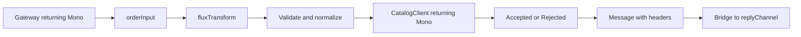

# Reactive Transformer

A reactive transformer organizes message transformation inside a flow that uses Reactive Streams. Transformation may simply normalize data in memory, or it may await a reactive API before producing an outcome. When designing one, clarify the data types flowing across channels, who owns the subscription, and the policy when a message cannot be transformed.

Within the `SPRING_INTEGRATION_CORE` module, this lesson belongs to the **Reactive support** chapter, connecting knowledge of `Message`, `MessageChannel`, endpoints, gateways, and Java DSL with data transformation in Reactor. The practical goal is to build a step that turns incoming order requests into canonical orders, preserves tracing info, bounds concurrent in-flight requests, and returns deliberate failure outcomes.

## 1. Prerequisites and Environment

Learners should understand `Message<T>` payload and headers, the difference between `DirectChannel` and reactive channels, and the semantics of `Mono<T>` and `Flux<T>`. `Mono<T>` represents at most one value; `Flux<T>` represents zero to many values. Both can complete or emit an error signal.

Examples use Java 17 and APIs present in Spring Integration 6.5: `IntegrationFlow.from(...)`, `transformWith(...)`, `fluxTransform(...)`, and `bridge()`. No framework class named `ReactiveTransformer` is needed to implement this pattern; transformation logic can be Java functions composed into a Reactor stream.

In a Spring Boot project whose dependency versions are managed via a parent or BOM, the dependencies for the examples are:

```xml
<dependency>
    <groupId>org.springframework.boot</groupId>
    <artifactId>spring-boot-starter-integration</artifactId>
</dependency>
<dependency>
    <groupId>io.projectreactor</groupId>
    <artifactId>reactor-core</artifactId>
</dependency>
<dependency>
    <groupId>org.springframework.boot</groupId>
    <artifactId>spring-boot-starter-test</artifactId>
    <scope>test</scope>
</dependency>
<dependency>
    <groupId>io.projectreactor</groupId>
    <artifactId>reactor-test</artifactId>
    <scope>test</scope>
</dependency>
```

The class declarations below share package `example.reactive`; place each `public` class in its own matching Java file when practicing. These are illustrative snippets in the lesson, not a requirement to add new files to the module.

## 2. Defining the Right Transformation Contract

Distinguish three data shapes:

| Shape | Meaning | Processing Responsibility |
| --- | --- | --- |
| `Message<OrderRequest>` | One message carrying a concrete request | Endpoint reads request payload and headers |
| `Message<Mono<OrderOutcome>>` | One message carrying a publisher object | Must specify which component subscribes or flattens the payload |
| `Flux<Message<OrderRequest>>` | Stream of independent messages | Can shape demand, compose async processing, and build output messages |

Having a `Mono` in the payload does not prove the entire flow is reactive. How the framework handles reactive replies also depends on the output channel and async configuration. Specifically, an output channel implementing `ReactiveStreamsSubscribableChannel`, such as `FluxMessageChannel`, lets the framework compose the reactive result into downstream flows. For regular channels, inspect async configuration and the returned publisher type. See [Reactive Reply Payload](https://docs.spring.io/spring-integration/reference/reactive-streams.html#reactive-reply-payload).

For a one-input-to-one-output transformation, the business contract should be explicit:

```text
OrderRequest
    -> Accepted when a canonical order is produced
    -> Rejected when hitting an error covered by the contract
    -> onError when hitting an error outside the recovery policy
```

Do not return `null` to skip data. Traditional transformers require a valid result; filtering is the responsibility of a filter. In Reactor, `Mono.empty()` means emitting zero elements, which can leave a reply-awaiting gateway without a reply message. See [Transformer Conventions](https://docs.spring.io/spring-integration/reference/transformer.html).

## 3. Choosing the Spring Integration Wiring Point

### 3.1. `transform()` for Per-Payload Transformations

A short data transformation that waits on no I/O should still be written directly:

```java
@Bean
IntegrationFlow skuNormalizationFlow() {
    return IntegrationFlow.from("sku.input")
            .transform(String.class,
                    value -> value.strip().toUpperCase(Locale.ROOT))
            .channel("sku.output")
            .get();
}
```

This snippet assumes Spring Integration is enabled, `java.util.Locale` is imported, and a consumer exists for `sku.output`. Those channel names and transformations do not automatically establish a reactive flow.

If the endpoint needs to consume input reactively, configure:

```java
.transformWith(spec -> spec
        .<String, String>transformer(
                value -> value.strip().toUpperCase(Locale.ROOT))
        .reactive())
```

`reactive()` selects `ReactiveStreamsConsumer` for the endpoint even when the input channel is not a `FluxMessageChannel`. It does not turn JDBC calls non-blocking or spawn extra threads automatically. Details at [The reactive() Endpoint](https://docs.spring.io/spring-integration/reference/dsl/java-reactive.html).

### 3.2. `fluxTransform()` for a Stream-Wide Transformation Segment

When you need to compose `Mono` calls, control concurrency, or choose output ordering, `fluxTransform()` is a convenient bridge. The input function receives `Flux<Message<I>>`; in this lesson, the function always returns a publisher emitting fully built `Message<O>` instances.

```java
.<OrderRequest, Message<OrderOutcome>>fluxTransform(transformer::apply)
```

The second type argument here is **the element type emitted by the publisher**, so use `Message<OrderOutcome>`, not just `OrderOutcome`. `fluxTransform()` sets up `FluxMessageChannel` boundaries to connect the Reactor segment with the upstream and downstream Integration flow. See [fluxTransform() Java DSL API](https://docs.spring.io/spring-integration/docs/6.5.0/api/org/springframework/integration/dsl/BaseIntegrationFlowDefinition.html#fluxTransform(java.util.function.Function)).

This design also avoids guessing item origins when items reorder or one input spawns multiple outputs: every output carries its corresponding request headers directly.

### 3.3. Choosing APIs by Purpose

| Need | Suitable Expression |
| --- | --- |
| String normalization, DTO mapping, derived fields | `transform()` or `transformWith()` |
| Endpoint consuming input via reactive consumer | Configure `reactive()` on the endpoint |
| Composing message streams with `Mono` calls, capping concurrency | `fluxTransform()` combined with Reactor operators |
| Calling a data-returning business service | Service activator or appropriate outbound gateway |
| Executing a reactive task returning only completion signal | `handleReactive()` at the end of a flow |

`ReactiveMessageHandler` returns `Mono<Void>` and `handleReactive()` is a terminal flow operator; they are not suitable for a step that must return a payload for further transformation. See [ReactiveMessageHandler](https://docs.spring.io/spring-integration/reference/reactive-streams.html#reactive-message-handler).

## 4. Problem: Turning Requests into Canonical Orders

A request contains an order ID, SKU, and quantity. The transformation step must normalize the SKU, fetch the product price from a reactive catalog, and produce an outcome. If quantity is invalid, the product is missing, or the catalog times out, the output is `Rejected` with a specific error code.



This is an example of a transformation needing reference data. In a larger system, lookup can be factored into a service activator, outbound gateway, or content enricher; the data-mapping logic itself can remain a pure function for easy testing.

### 4.1. Data Types

```java
package example.reactive;

import java.math.BigDecimal;
import reactor.core.publisher.Mono;

public final class OrderTypes {

    private OrderTypes() {
    }

    public record OrderRequest(String orderId, String sku, int quantity) {
    }

    public record Product(String sku, BigDecimal unitPrice) {
    }

    public sealed interface OrderOutcome permits Accepted, Rejected {
    }

    public record Accepted(
            String orderId,
            String sku,
            int quantity,
            BigDecimal total) implements OrderOutcome {
    }

    public record Rejected(
            String orderId,
            String code) implements OrderOutcome {
    }

    public interface CatalogClient {
        Mono<Product> findBySku(String sku);
    }
}
```

`Accepted` and `Rejected` are two distinct business outcomes. Never represent a catalog outage as an `Accepted` order with a zero price, as downstream could mistake it for a valid order.

The example assumes the catalog returns products with valid unit prices in a single currency. Currency conversion, taxes, and rounding are outside the scope of this problem.

### 4.2. Reactive Transformer Function

```java
package example.reactive;

import java.math.BigDecimal;
import java.time.Duration;
import java.util.Locale;
import java.util.concurrent.TimeoutException;

import org.springframework.messaging.Message;
import org.springframework.messaging.support.MessageBuilder;

import reactor.core.publisher.Flux;
import reactor.core.publisher.Mono;

import example.reactive.OrderTypes.Accepted;
import example.reactive.OrderTypes.CatalogClient;
import example.reactive.OrderTypes.OrderOutcome;
import example.reactive.OrderTypes.OrderRequest;
import example.reactive.OrderTypes.Rejected;

public final class OrderReactiveTransformer {

    private static final Duration CATALOG_TIMEOUT = Duration.ofMillis(800);
    private static final int MAX_IN_FLIGHT = 8;

    private final CatalogClient catalog;

    public OrderReactiveTransformer(CatalogClient catalog) {
        this.catalog = catalog;
    }

    public Flux<Message<OrderOutcome>> apply(
            Flux<Message<OrderRequest>> requests) {

        return requests.flatMap(this::transformSafely, MAX_IN_FLIGHT);
    }

    public Mono<Message<OrderOutcome>> transformSafely(
            Message<OrderRequest> request) {

        return transformOne(request)
                .onErrorResume(InvalidOrderException.class,
                        error -> reject(request, "INVALID_ORDER"))
                .onErrorResume(ProductNotFoundException.class,
                        error -> reject(request, "PRODUCT_NOT_FOUND"))
                .onErrorResume(TimeoutException.class,
                        error -> reject(request, "CATALOG_TIMEOUT"));
    }

    public Mono<Message<OrderOutcome>> transformOne(
            Message<OrderRequest> request) {

        return Mono.defer(() -> {
            OrderRequest input = request.getPayload();

            if (input.orderId() == null || input.orderId().isBlank()
                    || input.sku() == null || input.sku().isBlank()
                    || input.quantity() <= 0) {
                return Mono.error(new InvalidOrderException());
            }

            String sku = input.sku().strip().toUpperCase(Locale.ROOT);

            return catalog.findBySku(sku)
                    .switchIfEmpty(Mono.error(new ProductNotFoundException()))
                    .timeout(CATALOG_TIMEOUT)
                    .<OrderOutcome>map(product -> new Accepted(
                            input.orderId(),
                            product.sku(),
                            input.quantity(),
                            product.unitPrice().multiply(
                                    BigDecimal.valueOf(input.quantity()))))
                    .map(outcome -> toReply(request, outcome));
        });
    }

    private Mono<Message<OrderOutcome>> reject(
            Message<OrderRequest> request, String code) {

        OrderOutcome result = new Rejected(
                request.getPayload().orderId(), code);
        return Mono.just(toReply(request, result));
    }

    private Message<OrderOutcome> toReply(
            Message<?> request, OrderOutcome outcome) {

        return MessageBuilder.withPayload(outcome)
                .copyHeaders(request.getHeaders())
                .setHeader("canonicalSchema", "order.v1")
                .build();
    }

    private static final class InvalidOrderException
            extends RuntimeException {
    }

    private static final class ProductNotFoundException
            extends RuntimeException {
    }
}
```

Key points to read in the code:

1. `Mono.defer()` defers validation and the catalog call until the publisher is subscribed. Synchronous exceptions thrown inside the supplier also become `Mono` error signals.
2. `switchIfEmpty()` converts a missing product into a specific error so the request still receives a `Rejected` outcome.
3. `timeout()` wraps the catalog lookup per request. The 800 ms duration is illustrative; tune it according to real system response times.
4. `transformSafely()` recovers only the three specified failure types. Programming bugs and unclassified infrastructure failures continue as `onError`.
5. `flatMap(..., 8)` caps concurrently subscribed inner publishers within a single subscription of this segment. It does not mean there are eight threads or that the entire application has only eight HTTP requests.
6. `toReply()` builds a new message for each outcome, carrying the headers of that specific request.

Do not place `subscribe()` or `block()` inside the transformer. The method only builds and returns a publisher; the flow coordinator composes and subscribes to it according to flow lifecycle.

## 5. Wiring the Transformer with a Gateway and Java DSL

### 5.1. Declaring the Gateway

```java
package example.reactive;

import org.springframework.integration.annotation.MessagingGateway;
import org.springframework.messaging.handler.annotation.Header;
import reactor.core.publisher.Mono;

import example.reactive.OrderTypes.OrderOutcome;
import example.reactive.OrderTypes.OrderRequest;

@MessagingGateway(defaultRequestChannel = "orderInput")
public interface OrderGateway {

    Mono<OrderOutcome> prepare(
            OrderRequest request,
            @Header("traceId") String traceId);
}
```

Returning `Mono` lets callers chain operators or hand the result to WebFlux. For reactive gateways, request dispatch is deferred until subscription; this is different from assuming every channel and consumer in the application context is created only when the gateway is called. Flows and endpoints remain lifecycle-managed by Spring. See [Messaging Gateways — Reactor Mono](https://docs.spring.io/spring-integration/reference/gateway.html).

### 5.2. Flow Configuration

```java
package example.reactive;

import java.math.BigDecimal;

import org.springframework.context.annotation.Bean;
import org.springframework.context.annotation.Configuration;
import org.springframework.integration.annotation.IntegrationComponentScan;
import org.springframework.integration.channel.DirectChannel;
import org.springframework.integration.config.EnableIntegration;
import org.springframework.integration.dsl.IntegrationFlow;
import org.springframework.messaging.Message;

import reactor.core.publisher.Mono;

import example.reactive.OrderTypes.CatalogClient;
import example.reactive.OrderTypes.OrderOutcome;
import example.reactive.OrderTypes.OrderRequest;
import example.reactive.OrderTypes.Product;

@Configuration
@EnableIntegration
@IntegrationComponentScan(basePackageClasses = OrderGateway.class)
public class OrderFlowConfig {

    @Bean
    DirectChannel orderInput() {
        return new DirectChannel();
    }

    @Bean
    CatalogClient catalogClient() {
        return sku -> Mono.defer(() -> {
            if ("SKU-01".equals(sku)) {
                return Mono.just(new Product(
                        sku, new BigDecimal("125000")));
            }
            return Mono.empty();
        });
    }

    @Bean
    OrderReactiveTransformer orderReactiveTransformer(CatalogClient client) {
        return new OrderReactiveTransformer(client);
    }

    @Bean
    IntegrationFlow orderFlow(
            DirectChannel orderInput,
            OrderReactiveTransformer transformer) {

        return IntegrationFlow.from(orderInput)
                .<OrderRequest, Message<OrderOutcome>>fluxTransform(
                        transformer::apply)
                .bridge()
                .get();
    }
}
```

The catalog in the example is an in-code stub making no network calls. When swapping in a real client, `findBySku()` must return a non-blocking client's publisher or isolate blocking calls as shown in section 9.

`bridge()` routes the final result back to the address in the request's `replyChannel` when no fixed output channel is configured. The gateway supplies this reply address; hence headers must be preserved across the transformation segment. A direct send to `orderInput` must also include an appropriate reply address to use this configuration unchanged.

Example invocation from a service returning a reactive type:

```java
public Mono<OrderOutcome> prepareOrder(OrderGateway gateway) {
    return gateway.prepare(
                    new OrderRequest("ORD-101", " sku-01 ", 2),
                    "trace-101")
            .timeout(Duration.ofSeconds(2));
}
```

Upon subscription, the expected result is:

```text
Accepted[orderId=ORD-101, sku=SKU-01, quantity=2, total=250000]
```

The outer gateway timeout bounds how long the caller waits; the inner catalog timeout bounds each lookup. The two timeouts have different scopes. Caller subscription cancellation does not prove every task that entered a shared-channel flow is canceled correspondingly.

## 6. Headers Are Part of the Transformation Output

If you emit only new payloads from a concurrently processing stream, do not expect the framework to guess which request produced each payload. The pattern in this lesson always constructs the output `Message` directly inside the branch holding the request.

| Header | Reason to Review |
| --- | --- |
| `replyChannel` | Routes the result back to the gateway caller |
| `errorChannel` | Carries the error-handling address when supported by the component |
| `correlationId` | Associates the message with a group or exchange |
| `sequenceNumber`, `sequenceSize` | Required when downstream has a sequence-based aggregator |
| `traceId`, tenant ID | Preserves tracing and business partitioning info |
| `contentType`, schema version | Must be updated or removed if the new payload format differs |

`MessageBuilder.withPayload(...).copyHeaders(...)` is suited for creating a message with a different payload type. `id` and `timestamp` are framework-managed headers; copying does not preserve them as the old message's identity. To correlate two messages, use correlation or a dedicated business header. See [MessageBuilder.copyHeaders()](https://docs.spring.io/spring-framework/docs/current/javadoc-api/org/springframework/messaging/support/MessageBuilder.html#copyHeaders(java.util.Map)).

Copying all headers in this example suits the internal Java messages in use. When crossing network adapters or changing serialization formats, filter valid headers explicitly; for example, do not retain a JSON `contentType` for a binary payload.

If one input spawns multiple messages, each child message must preserve its link to the input. If you alter item counts within a sequenced group, redesign sequence numbers and aggregator release conditions. Leaving stale sequence numbers after dropping elements can cause an aggregator to wait forever.

## 7. `map`, `flatMap`, and Output Ordering

Suppose `findBySku()` returns `Mono<Product>`:

```java
// Result still nests publishers: Flux<Mono<Product>>.
requests.map(message -> catalog.findBySku(message.getPayload().sku()));

// Flattens each Mono into the stream: Flux<Product>.
requests.flatMap(
        message -> catalog.findBySku(message.getPayload().sku()),
        8);
```

The second snippet illustrates only flattening. In a real flow, still build a `Message` inside that branch to preserve headers as `OrderReactiveTransformer` does.

| Operator | Characteristics | Best Suited For |
| --- | --- | --- |
| `map` | Synchronously transforms one element to one value | Mapping DTOs or computing fields from in-memory data |
| `flatMap` | Subscribes to multiple inner publishers, allowing interleaved results | Independent requests without output ordering requirements |
| `concatMap` | Awaits completion of current inner publisher before starting next | Sequential processing within the same subscription |
| `flatMapSequential` | Executes concurrently while emitting results in source order | Preserving output order while tolerating buffering |

Differences in ordering and subscriptions are documented in [Flux API](https://projectreactor.io/docs/core/release/api/reactor/core/publisher/Flux.html).

In our example, three requests `A`, `B`, `C` may emit results in order `B`, `C`, `A` if the catalog responds more slowly for `A`. `B`'s tracing headers must still accompany `B`'s result—never read headers from a field storing "the latest request."

If business logic demands sequential execution, replace the body of `apply()` with:

```java
return requests.concatMap(this::transformSafely);
```

Preserving emission order does not guarantee side-effect ordering. `flatMapSequential` can still launch inner operations concurrently. Ordering guarantees in this segment also do not automatically extend across other flows, other application instances, or a concurrently processing downstream endpoint.

## 8. Recovery Scope Determines Stream Longevity

An unhandled Reactor error terminates the sequence. `onErrorResume()` replaces the failed sequence with another publisher at the operator's position; it does not resume the failed upstream sequence. See [Handling Errors](https://projectreactor.io/docs/core/release/reference/coreFeatures/error-handling.html).

Hence, these two structures have different meanings:

```java
// Per-request recovery.
requests.flatMap(message ->
        transformOne(message)
                .onErrorResume(ExpectedException.class,
                        error -> fallbackFor(message, error)),
        8);
```

```java
// Recovery after the multi-request sequence has already failed.
requests.flatMap(this::transformOne, 8)
        .onErrorResume(error -> replacementSequence(error));
```

`ExpectedException`, `fallbackFor()`, and `replacementSequence()` above are illustrative names for application-defined policies. `transformSafely()` in the main example is a concrete implementation of the first pattern.

If you want one request's failure to produce `Rejected` while continuing to process other requests, place recovery **inside** the inner publisher. Placing recovery at the outer level can cancel remaining inner publishers when one error escapes, leaving only the fallback sequence.

A `Rejected` outcome is a regular data message, not an `ErrorMessage`. Downstream can use a payload-type router for `Accepted`/`Rejected`, forwarding accepted outcomes onward and routing rejected outcomes to monitoring. Filters can drop one outcome type by policy, though with a request–reply gateway you must decide what the caller receives when no message returns.

Nor is `errorChannel` a catch-all for every Reactor error in every location. Whether errors are thrown back to the caller or turned into `ErrorMessage` depends on endpoints and sync/async boundaries. Errors arising inside `fluxTransform()`'s stream function need an explicit policy in the Reactor chain and flow-level tests. See [Spring Integration Error Handling](https://docs.spring.io/spring-integration/reference/error-handling.html).

In the example, errors outside the three known categories can still terminate the shared stream segment. In deployment, define which error classes become data outcomes, which route to error channels, and how monitoring/recovery restarts a terminated stream. Never assume the next message automatically revives a terminated subscription.

If adding retries, attach them to the per-request call, cap attempt counts, and retry only transient errors. Retrying means re-subscribing to the publisher: any side effects within that scope may re-execute. For write operations, enforce idempotency and define what happens when the target system succeeded yet the caller timed out.

## 9. Backpressure and Blocking Calls

`FluxMessageChannel` bridges to Reactive Streams subscribers; it is not a durable queue or broker. It supports connecting source publishers via `subscribeTo(...)`; end-to-end flow characteristics still depend on surrounding producers, channels, and endpoints. See [FluxMessageChannel](https://docs.spring.io/spring-integration/reference/6.5/channel/implementations.html#flux-message-channel).

In the example, the gateway passes through a `DirectChannel` before reaching `fluxTransform()`. This boundary matters: a producer calling `MessageChannel.send()` in a loop does not automatically become a source honoring downstream demand. To bound system-wide load, also account for intake rate, buffer capacity, connection pools, and overload policies.

`flatMap(..., 8)` bounds concurrent inner publishers in the transformation segment, not buffers across every channel. With multiple application instances, total pending catalog lookups can exceed eight.

A common mistake is:

```java
// Wrong: blocking work executes before Mono is even created.
Mono.just(legacyCatalog.findBySku(sku));
```

If integrating a synchronous API is unavoidable, defer the call and run it on an appropriate scheduler:

```java
Mono.fromCallable(() -> legacyCatalog.findBySku(sku))
        .subscribeOn(Schedulers.boundedElastic());
```

This snippet assumes `reactor.core.scheduler.Schedulers` is imported and `legacyCatalog` is a synchronous client. It isolates waiting from threads serving non-blocking work; the underlying API remains blocking. Bound concurrency and configure timeouts on the target client. Reactor subscription cancellation or timeout does not guarantee stopping a blocking call that ignores interruption. See [Reactor FAQ on wrapping blocking calls](https://projectreactor.io/docs/core/release/reference/faq.html#faq.wrap-blocking).

Adding `publishOn()` only shifts where downstream operators run; it does not change the blocking nature of synchronous JDBC or HTTP clients. For very brief string normalization, switching schedulers rarely pays off compared to context-switch overhead.

## 10. Testing the Reactive Contract with `StepVerifier`

Tests should assert both signals and data: whether the publisher performs work before subscription, emits expected outputs, preserves headers, and isolates per-item failures.

`StepVerifier` lets you declare expected signals, while virtual time tests timeouts with a simulated clock instead of waiting in real time. Operators using timers must be created inside `withVirtualTime()`'s supplier. See [Reactor Testing](https://projectreactor.io/docs/core/release/reference/testing.html).

### 10.1. Testing the Transformer Independently of Spring

```java
package example.reactive;

import static org.assertj.core.api.Assertions.assertThat;

import java.math.BigDecimal;
import java.time.Duration;
import java.util.concurrent.atomic.AtomicInteger;

import org.junit.jupiter.api.Test;
import org.springframework.integration.channel.QueueChannel;
import org.springframework.messaging.Message;
import org.springframework.messaging.support.MessageBuilder;

import reactor.core.publisher.Flux;
import reactor.core.publisher.Mono;
import reactor.test.StepVerifier;

import example.reactive.OrderTypes.Accepted;
import example.reactive.OrderTypes.CatalogClient;
import example.reactive.OrderTypes.OrderRequest;
import example.reactive.OrderTypes.Product;
import example.reactive.OrderTypes.Rejected;

class OrderReactiveTransformerTest {

    @Test
    void defersWorkAndPreservesHeaders() {
        AtomicInteger catalogCalls = new AtomicInteger();
        CatalogClient client = sku -> {
            catalogCalls.incrementAndGet();
            return Mono.just(new Product(sku, new BigDecimal("125000")));
        };
        OrderReactiveTransformer transformer =
                new OrderReactiveTransformer(client);

        QueueChannel replyChannel = new QueueChannel();
        Message<OrderRequest> request = MessageBuilder
                .withPayload(new OrderRequest("ORD-101", " sku-01 ", 2))
                .setHeader("traceId", "trace-101")
                .setHeader("correlationId", "batch-7")
                .setReplyChannel(replyChannel)
                .build();

        var result = transformer.transformSafely(request);
        assertThat(catalogCalls.get()).isZero();

        StepVerifier.create(result)
                .assertNext(reply -> {
                    assertThat(reply.getPayload())
                            .isInstanceOfSatisfying(Accepted.class, order -> {
                                assertThat(order.orderId()).isEqualTo("ORD-101");
                                assertThat(order.sku()).isEqualTo("SKU-01");
                                assertThat(order.quantity()).isEqualTo(2);
                                assertThat(order.total())
                                        .isEqualByComparingTo("250000");
                            });
                    assertThat(reply.getHeaders().get("traceId"))
                            .isEqualTo("trace-101");
                    assertThat(reply.getHeaders().get("correlationId"))
                            .isEqualTo("batch-7");
                    assertThat(reply.getHeaders().getReplyChannel())
                            .isSameAs(replyChannel);
                    assertThat(reply.getHeaders().get("canonicalSchema"))
                            .isEqualTo("order.v1");
                    assertThat(reply.getHeaders().getId())
                            .isNotEqualTo(request.getHeaders().getId());
                })
                .expectComplete()
                .verify(Duration.ofSeconds(2));

        assertThat(catalogCalls.get()).isEqualTo(1);
    }

    @Test
    void oneInvalidRequestDoesNotDiscardTheNextRequest() {
        CatalogClient client = sku ->
                Mono.just(new Product(sku, new BigDecimal("125000")));
        OrderReactiveTransformer transformer =
                new OrderReactiveTransformer(client);

        var input = Flux.just(
                request("ORD-BAD", 0),
                request("ORD-GOOD", 2));

        StepVerifier.create(transformer.apply(input).collectList())
                .assertNext(messages -> {
                    assertThat(messages).hasSize(2);
                    assertThat(messages.stream()
                            .map(Message::getPayload)
                            .toList())
                            .containsExactlyInAnyOrder(
                                    new Rejected("ORD-BAD", "INVALID_ORDER"),
                                    new Accepted("ORD-GOOD", "SKU-01", 2,
                                            new BigDecimal("250000")));
                })
                .expectComplete()
                .verify(Duration.ofSeconds(2));
    }

    @Test
    void timeoutBecomesARejectedResult() {
        CatalogClient client = sku -> Mono.never();
        OrderReactiveTransformer transformer =
                new OrderReactiveTransformer(client);

        StepVerifier.withVirtualTime(() ->
                        transformer.transformSafely(request("ORD-SLOW", 1)))
                .expectSubscription()
                .thenAwait(Duration.ofSeconds(1))
                .assertNext(reply -> assertThat(reply.getPayload())
                        .isEqualTo(new Rejected(
                                "ORD-SLOW", "CATALOG_TIMEOUT")))
                .expectComplete()
                .verify(Duration.ofSeconds(2));
    }

    @Test
    void unexpectedFailureRemainsAnErrorSignal() {
        CatalogClient client = sku ->
                Mono.error(new IllegalStateException("catalog failure"));
        OrderReactiveTransformer transformer =
                new OrderReactiveTransformer(client);

        StepVerifier.create(
                        transformer.transformSafely(request("ORD-FAIL", 1)))
                .expectError(IllegalStateException.class)
                .verify(Duration.ofSeconds(2));
    }

    private static Message<OrderRequest> request(String orderId, int quantity) {
        return MessageBuilder.withPayload(
                        new OrderRequest(orderId, " sku-01 ", quantity))
                .setHeader("traceId", "trace-" + orderId)
                .build();
    }
}
```

`QueueChannel` in the first test serves solely as a reply-address object to verify header copying. The test does not send results through that queue. `collectList()` in the second test is safe because the simulated source is finite with exactly two elements; never collect all items from an unbounded stream.

The second test asserts results regardless of order, matching `flatMap`'s contract. The final test verifies the boundary of the recovery policy, avoiding hiding unexpected errors behind a fake success result.

### 10.2. Testing Flow Wiring and Gateway

Unit-testing the function cannot catch wrong channel names, missing consumers, missing gateway scanning, or lost reply addresses. Add a Spring configuration test:

```java
package example.reactive;

import static org.assertj.core.api.Assertions.assertThat;

import java.math.BigDecimal;
import java.time.Duration;

import org.junit.jupiter.api.Test;
import org.springframework.beans.factory.annotation.Autowired;
import org.springframework.test.context.junit.jupiter.SpringJUnitConfig;

import reactor.test.StepVerifier;

import example.reactive.OrderTypes.Accepted;
import example.reactive.OrderTypes.OrderRequest;

@SpringJUnitConfig(OrderFlowConfig.class)
class OrderFlowTest {

    @Autowired
    private OrderGateway gateway;

    @Test
    void returnsTheCanonicalOrderThroughTheGateway() {
        StepVerifier.create(gateway.prepare(
                        new OrderRequest("ORD-201", " sku-01 ", 2),
                        "trace-201"))
                .assertNext(outcome -> assertThat(outcome).isEqualTo(
                        new Accepted("ORD-201", "SKU-01", 2,
                                new BigDecimal("250000"))))
                .expectComplete()
                .verify(Duration.ofSeconds(2));
    }
}
```

Cases to add when extending the example:

| Test Case | What Must Be Proven |
| --- | --- |
| Catalog returns `Mono.empty()` | Receives `PRODUCT_NOT_FOUND`, no lost reply |
| Multiple requests complete out of order | Payload and headers still match the same request |
| Demand-aware source, small downstream demand | Processing segment emits no more than downstream demand; inspect prefetch separately |
| Slow catalog with many requests | Active inner subscriptions do not exceed segment configuration |
| Subscription cancellation | Simulated source receives cancellation within composed scope |
| Out-of-policy error in shared flow | Flow termination and recovery match design |

Never use `Thread.sleep()` to assume a result has appeared. Use Reactor signals, controllable test sources, and finite test timeouts so failures surface clearly.

## 11. Common Design Mistakes

| Symptom | Possible Cause | Fix |
| --- | --- | --- |
| Consumer receives a `Mono` instead of data | Publisher kept inside payload or nested after `map` | Check output channel, async settings, and flattening point; use proper stream operators |
| Gateway waits without receiving a result | Missing subscription, lost `replyChannel`, empty branch, or filtered message | Test subscription and reply counts per branch |
| Tracing headers get mixed up | Shared mutable state while `flatMap` runs concurrently | Keep request in scope per branch and build output message right there |
| One bad request drops other requests | Error escaped inner publisher to shared sequence | Recover inside each branch when contract permits |
| Data sent yet transformer yields no output | Called `subscribe()` manually and returned before completion | Return publisher for the framework to compose |
| Load spikes exhaust connection pool | Concurrency too high or multiple concurrent layers | Size to target system capacity and measure active operations |
| Reactive thread held too long | `block()`, synchronous I/O, or heavy computation on processing thread | Use a non-blocking client or isolate work properly |
| Aggregator never releases group | Dropped elements while keeping old sequence size | Redefine cardinality and group completion conditions |

Message headers and Reactor `Context` are two distinct mechanisms. When tracing across multiple channel types or protocols, specify which metadata lives in headers and which lives in context. Thread switches also require examining context propagation; never assume `ThreadLocal` values follow a request automatically.

## 12. Extended Practice

1. Inject a nonexistent SKU into the request stream and verify it produces `Rejected` while valid SKUs continue processing.
2. Create a mock catalog with different latencies per SKU; compare `flatMap`, `concatMap`, and `flatMapSequential` on the same request set.
3. Assign distinct `traceId` and `correlationId` values to each request; verify every outcome keeps its matching values even when completion order reverses.
4. Split `Accepted` and `Rejected` outputs with a router; clarify which branch replies to the gateway and which merely records events.
5. If aggregating results across multiple orders, add correlation strategies, timeouts, and release conditions to the aggregator rather than relying on arrival order.

A complete reactive transformer requires a consistent contract for data and signals: knowing how many messages a request produces, who subscribes, which metadata must survive, what concurrency is permitted, and which errors recover locally. These decisions let the transformation step compose cleanly with gateways, routers, filters, and aggregators while keeping flow behavior observable and testable.
