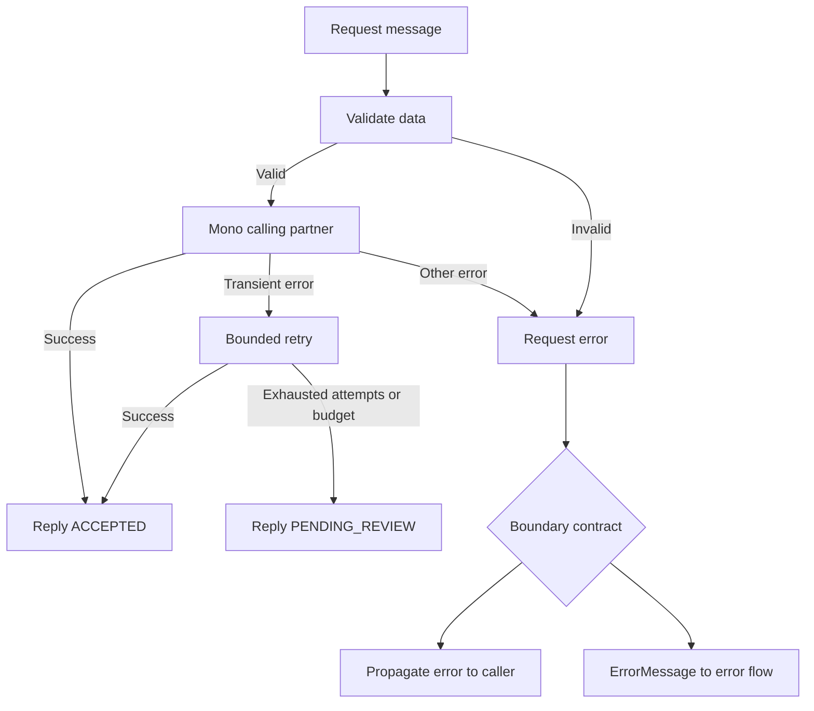

# Reactive Error Handling

## 1. Objectives and Scope

In the **Reactive support** chapter of the **SPRING_INTEGRATION_CORE** module, reactive error handling means designing paths for both results and failures when a message is processed via `Mono` or `Flux`. A complete flow must answer: which message failed, which operation is retried, what the caller receives on failure, and where failure evidence is retained.

After this lesson, you can:

- Distinguish synchronous exceptions, `onError` signals, and `ErrorMessage`.
- Scope fallbacks and retries accurately to a single request or a single message.
- Connect a `Mono`-returning service activator with a messaging gateway via Java DSL.
- Forward errors to a messaging flow with enough context for investigation.
- Design tests for retries, timeouts, business failures, and continuing to process subsequent messages.

Examples use Java 17 or later, Spring Integration **6.5.x**, and Reactor **3.7.x** APIs as baselines. These are API reference baselines, not project upgrade requirements. Test snippets use JUnit Jupiter and `reactor-test`; library versions should be managed by a BOM matching your application.

The running scenario submits orders to a partner: invalid orders are rejected; transient outages are boundedly retried; exhausted budgets yield a pending-review status; programming bugs still surface so they can be fixed.

## 2. Three Error Forms to Distinguish

| Error Form | Where It Occurs | Approach |
| --- | --- | --- |
| Synchronous exception | Immediately upon method call, publisher assembly, or synchronous call chains | Catch at the call boundary; use `Mono.defer` to pull work into the subscription lifecycle |
| `onError` signal | While the publisher is executing | Use reactive operators to retry, substitute, map, or propagate errors |
| `ErrorMessage` | When a messaging component wraps an error into a message | Send across channels, routers, endpoints, or error-logging flows |

A call traversing `DirectChannel` usually runs on the sender's thread, so a synchronous exception can unwind to the sender. With asynchronous execution, the sending thread may have already moved on; use error forwarding aligned with whichever component owns the operation. Do not assume every exception automatically lands on the global `errorChannel`. [Spring Integration — Error Handling](https://docs.spring.io/spring-integration/reference/6.5/error-handling.html)

The following example can throw an exception before constructing a `Mono`:

```java
Mono<OrderResult> submit(OrderCommand command) {
    validate(command);
    return partnerClient.submit(command);
}
```

If the intent is for subscribers to observe both validation errors and partner errors through the same reactive contract:

```java
Mono<OrderResult> submit(OrderCommand command) {
    return Mono.defer(() -> {
        validate(command);
        return partnerClient.submit(command);
    });
}
```

`defer` invokes the supplier per subscription. That also causes the client call to re-execute when this publisher is retried; the client itself must expose an operation safe to re-execute as designed.

## 3. Which Publisher Does an Error Terminate?

Per Reactive Streams, `onError` terminates the sequence emitting that signal. `onErrorResume` replaces the failed upstream portion with another publisher; it does not resume the rest of the old sequence. [Reactor — Handling Errors](https://docs.spring.io/projectreactor/reactor-core/docs/3.7.x/reference/html/coreFeatures/error-handling.html)

Consider a Spring-independent example:

```java
Flux<String> results = Flux.just("A", "B", "C")
        .map(id -> {
            if ("B".equals(id)) {
                throw new IllegalArgumentException("Invalid order B");
            }
            return "OK:" + id;
        })
        .onErrorResume(error -> Flux.just("FALLBACK"));
```

Expected output:

```text
OK:A
FALLBACK
onComplete
```

`C` is never processed because the publisher containing all three elements terminated at `B`.

If orders must be independent, create one publisher per order and place recovery inside:

```java
Flux<String> results = Flux.just("A", "B", "C")
        .concatMap(id ->
                Mono.fromCallable(() -> {
                    if ("B".equals(id)) {
                        throw new IllegalArgumentException("Invalid order B");
                    }
                    return "OK:" + id;
                })
                .onErrorResume(IllegalArgumentException.class,
                        error -> Mono.just("REJECTED:" + id)));
```

Expected output:

```text
OK:A
REJECTED:B
OK:C
onComplete
```

In this example, `B`'s publisher is replaced with a rejection result while the outer publisher continues consuming `C`.

`concatMap` was chosen to make ordering easy to observe. If orders are independent and parallel execution is needed, use `flatMap` with bounded concurrency; result ordering may then vary.

This does not mean "one failed message always kills the entire Spring Integration flow." The framework has its own endpoint boundaries and error dispatch mechanics. For instance, the 6.5.0 `ReactiveStreamsConsumer` implementation has paths forwarding handler errors to an `ErrorHandler`. Distinguish source publisher errors from per-message handling errors. This observation reflects a specific implementation rather than an immutable guarantee across every version. [ReactiveStreamsConsumer 6.5.0 Source](https://raw.githubusercontent.com/spring-projects/spring-integration/v6.5.0/spring-integration-core/src/main/java/org/springframework/integration/endpoint/ReactiveStreamsConsumer.java)

## 4. Choosing Actions by Business Meaning

Before picking operators, decide which outcomes the system is allowed to publish.

| Failure Kind in Order Domain | Recommended Action | What Caller or Ops Sees |
| --- | --- | --- |
| Invalid quantity | Do not call partner, do not retry | Explicit rejection with reason |
| Partner temporarily disconnected | Retry a few times if operation is safely repeatable | Real result if a later attempt succeeds |
| Exhausted retries or wait budget | Transition to degraded state per contract | `PENDING_REVIEW` |
| Partner returns contract-breaking data | Report technical error for investigation | Never fabricate success |
| Unexpected programming bug | Propagate error to responsible boundary | Alert with full context |

A good fallback states what the system knows for certain. Without confirming the partner accepted the order, returning `ACCEPTED` fabricates false information. `PENDING_REVIEW` expresses that the application has no final verdict yet and requires follow-up workflow.

In this lesson, the fallback only creates an in-memory result. It does **not** automatically persist pending orders, open tickets, or provide crash recovery across process restarts. If business rules require those, add durable persistence before reporting acceptance of follow-up responsibility.

### Common Operators

| Operator | Primary Effect | Example Use |
| --- | --- | --- |
| `doOnError` | Observes errors; does not turn failure into success | Record final error metrics |
| `onErrorMap` | Translates error to another type, preserving cause | Normalize SDK errors into application exceptions |
| `onErrorReturn` | Replaces matching errors with a fixed value | Return a static default result |
| `onErrorResume` | Switches to a fallback publisher | Call backup source or build per-request outcome |
| `onErrorComplete` | Converts matching errors into empty completion | Intentionally finish a fire-and-forget task |

These operators offer overloads taking exception classes or predicates. Narrow recoverable errors so programming bugs are not swallowed into normal outcomes. [Reactor Mono API](https://projectreactor.io/docs/core/3.7.6/api/reactor/core/publisher/Mono.html)

Empty completion is also a business decision: it carries no rejection payload. In request–reply, specify how the caller handles "no result."

Do not use `onErrorContinue` as a blanket switch to ignore all errors. That operator requires upstream support and its scope easily leaks into library code. Handling errors on each message's inner publisher clearly identifies which element was rejected and why. [Reactor Flux — onErrorContinue](https://projectreactor.io/docs/core/3.7.6/api/reactor/core/publisher/Flux.html#onErrorContinue-java.util.function.BiConsumer-)

## 5. Designing Retries and Timeouts per Request

### 5.1. Retries Re-Subscribe Upstream

`retryWhen` re-subscribes to its upstream chain. If upstream includes validation, partner invocation, and data writes, all of those can re-run.

Therefore, place retries close to the operation meant to repeat:

```text
validate
  -> [call partner -> per-attempt timeout -> bounded retry]
  -> build result
```

With `Retry.backoff(2, ...)`, the limit is two retries after the first attempt: at most three total calls. `Retry.fixedDelay` uses a fixed interval; `Retry.backoff` provides exponential backoff. [Reactor — Retry API](https://projectreactor.io/docs/core/3.7.6/api/reactor/util/retry/Retry.html)

### 5.2. Distinguishing Per-Attempt Time from Total Budget

These two arrangements have different meanings:

```java
// Each subscription to call() gets at most 2 seconds.
Mono.defer(() -> call())
        .timeout(Duration.ofSeconds(2))
        .retryWhen(retryPolicy);

// All attempts plus retry backoff together get at most 7 seconds.
Mono.defer(() -> call())
        .timeout(Duration.ofSeconds(2))
        .retryWhen(retryPolicy)
        .timeout(Duration.ofSeconds(7));
```

In the second arrangement, the outer timeout sits after retry, so an overall timeout does not feed back into that retry loop. If a fallback sits after the outer timeout, fallback execution time is outside that seven-second budget.

Bound the fallback too if it makes network or database calls. Never publish an SLA by merely summing per-attempt timeouts while ignoring backoff, scheduler queueing, and recovery paths.

### 5.3. Do Not Let the Retry Policy Mask the Final Cause

`RetryBackoffSpec` supports filtering exceptions, capping backoff, configuring jitter, and choosing the exception emitted when attempts run out. By default, exhaustion throws a retry-exhausted exception with the last failure as cause. The example below uses `onRetryExhaustedThrow` to preserve the final failure directly so the fallback predicate matches it cleanly. [Reactor — RetryBackoffSpec API](https://projectreactor.io/docs/core/3.7.6/api/reactor/util/retry/RetryBackoffSpec.html)

Placing a fallback before a retry alters the policy: once the fallback turns an error into a value or empty completion, the downstream retry never sees that error to retry it.

## 6. Example: Order Processor with Clear Error Scopes

This illustrative Java code includes complete data types and handling policies. Place the class in package `example.integration`.

```java
package example.integration;

import java.time.Duration;
import java.util.concurrent.TimeoutException;

import reactor.core.publisher.Mono;
import reactor.util.retry.Retry;

public final class OrderProcessor {

    private final PartnerClient partnerClient;

    public OrderProcessor(PartnerClient partnerClient) {
        this.partnerClient = partnerClient;
    }

    public Mono<OrderResult> process(OrderCommand command) {
        return Mono.defer(() -> {
            if (command.quantity() <= 0) {
                return Mono.error(new InvalidOrderException(
                        "Quantity must be positive: " + command.orderId()));
            }

            return submitWithRetry(command)
                    .onErrorResume(this::isTemporary,
                            error -> Mono.just(new OrderResult(
                                    command.orderId(),
                                    "PENDING_REVIEW",
                                    "DEGRADED")));
        });
    }

    private Mono<OrderResult> submitWithRetry(OrderCommand command) {
        return Mono.defer(() -> partnerClient.submit(command))
                .switchIfEmpty(Mono.error(new EmptyPartnerReplyException(
                        "No reply for order " + command.orderId())))
                .timeout(Duration.ofSeconds(2))
                .retryWhen(Retry.backoff(2, Duration.ofMillis(200))
                        .maxBackoff(Duration.ofSeconds(1))
                        .jitter(0.5)
                        .filter(this::isTemporary)
                        .onRetryExhaustedThrow(
                                (spec, signal) -> signal.failure()))
                .timeout(Duration.ofSeconds(7));
    }

    private boolean isTemporary(Throwable error) {
        return error instanceof TemporaryPartnerException
                || error instanceof TimeoutException;
    }

    public record OrderCommand(String orderId, int quantity) {
    }

    public record OrderResult(String orderId, String state, String source) {
    }

    public interface PartnerClient {
        Mono<OrderResult> submit(OrderCommand command);
    }

    public static final class InvalidOrderException
            extends RuntimeException {

        public InvalidOrderException(String message) {
            super(message);
        }
    }

    public static final class TemporaryPartnerException
            extends RuntimeException {

        public TemporaryPartnerException(String message) {
            super(message);
        }
    }

    public static final class EmptyPartnerReplyException
            extends RuntimeException {

        public EmptyPartnerReplyException(String message) {
            super(message);
        }
    }
}
```

Choices made in the example:

1. Validation sits outside the retry scope. An order with an invalid quantity triggers zero partner calls.
2. Each retry re-invokes `partnerClient.submit(command)` inside `defer` rather than merely re-subscribing to a pre-built result.
3. Both exceptions thrown synchronously on call and errors emitted on subscription pass through that attempt's publisher.
4. `switchIfEmpty` treats an empty reply as a contract violation. This error is excluded from both retry and fallback.
5. Only transient failures and timeouts recover into `PENDING_REVIEW`.
6. Unlisted errors, such as `IllegalStateException`, propagate outward untouched.

Production applications must map concrete HTTP client, database client, or SDK exceptions into their classification. Never equate every HTTP 4xx or 5xx with a transient error; the decision depends on protocol, partner contract, and repeatability safety.

### Retries and Idempotency

Suppose the partner already created the order, yet the network dropped before the application received the response. A timeout only tells the application no result arrived on time. Re-sending could create a second order.

Therefore, for commands with side effects, use a stable business key such as `orderId` or a partner-supported idempotency key. Keep the key identical across retries. When the protocol cannot guarantee idempotency, look up status or route to reconciliation instead of immediately resending.

Similarly, never wrap both payment capture and order recording in a retry if re-subscribing could charge the customer twice.

## 7. Integrating the Processor into Spring Integration with Java DSL

A gateway returning `Mono` lets callers compose request–reply into Reactor chains. The flow behind the gateway starts when the returned `Mono` receives a subscription. Having a reactive return type does not automatically make every internal endpoint non-blocking. [Spring Integration — Reactive Streams Support](https://docs.spring.io/spring-integration/reference/6.5/reactive-streams.html)

### 7.1. Gateway Contract

```java
package example.integration;

import org.springframework.integration.annotation.MessagingGateway;
import reactor.core.publisher.Mono;

import example.integration.OrderProcessor.OrderCommand;
import example.integration.OrderProcessor.OrderResult;

@MessagingGateway(defaultRequestChannel = "orderRequests")
public interface OrderGateway {

    Mono<OrderResult> submit(OrderCommand command);
}
```

### 7.2. Flow Configuration

```java
package example.integration;

import org.springframework.context.annotation.Bean;
import org.springframework.context.annotation.Configuration;
import org.springframework.integration.annotation.IntegrationComponentScan;
import org.springframework.integration.channel.DirectChannel;
import org.springframework.integration.config.EnableIntegration;
import org.springframework.integration.dsl.IntegrationFlow;

import example.integration.OrderProcessor.OrderResult;
import example.integration.OrderProcessor.PartnerClient;

import reactor.core.publisher.Mono;

@Configuration
@EnableIntegration
@IntegrationComponentScan(basePackageClasses = OrderGateway.class)
public class ReactiveOrderConfiguration {

    @Bean
    public DirectChannel orderRequests() {
        return new DirectChannel();
    }

    @Bean
    public PartnerClient partnerClient() {
        // Fake client to illustrate the happy path.
        // Replace with a reactive partner implementation in your app.
        return command -> Mono.just(new OrderResult(
                command.orderId(), "ACCEPTED", "PARTNER"));
    }

    @Bean
    public OrderProcessor orderProcessor(PartnerClient partnerClient) {
        return new OrderProcessor(partnerClient);
    }

    @Bean
    public IntegrationFlow orderSubmissionFlow(OrderProcessor processor) {
        return IntegrationFlow.from("orderRequests")
                .handle(processor, "process",
                        endpoint -> endpoint.async(true))
                .get();
    }
}
```

On this service activator, `async(true)` instructs the framework to handle the handler's asynchronous result. Because no dedicated output channel is configured, replies use the request's `replyChannel`. The framework handles subscribing and routing the result onto the reply path. [Spring Integration — Service Activator](https://docs.spring.io/spring-integration/reference/6.5/service-activator.html#async-service-activator)

The flow above has a `DirectChannel` invocation boundary and `Mono`-based partner processing. It illustrates combining messaging with reactive types, not a proof of end-to-end backpressure across the entire system.

### 7.3. Observing Outcomes on the Caller Side

In a component returning the publisher to an upper layer:

```java
Mono<OrderResult> result =
        gateway.submit(new OrderCommand("ORDER-101", 2))
                .doOnNext(reply ->
                        log.info("order={} state={} source={}",
                                reply.orderId(),
                                reply.state(),
                                reply.source()))
                .doOnError(error ->
                        log.error("Order submission failed", error));
```

This snippet assumes `gateway` and logger `log` are injected or declared. Return `result` to the calling layer so that layer manages the subscription.

Outcome contract for the example:

| Scenario | What Caller Observes |
| --- | --- |
| Partner succeeds | An `OrderResult` with state `ACCEPTED` |
| Transient outage exhausts recovery policy | An `OrderResult` with state `PENDING_REVIEW` |
| Validation fails | Error signal on the request |
| Unexpected technical error | Error signal on the request |

The gateway may unwrap exceptions along the cause chain; if the caller needs to check `MessagingException` or specific exception classes, test that contract against the actual configuration. The gateway also offers an `errorChannel` option to route errors through an error flow and produce a fallback reply. [Spring Integration — Messaging Gateways](https://docs.spring.io/spring-integration/reference/6.5/gateway.html#error-handling)

Never add `subscribe()` inside `OrderProcessor.process`. A self-created subscription detaches the work from the publisher awaited by the gateway, splitting results, cancellation, and errors into separate lifecycles.

## 8. When to Use ReactiveRequestHandlerAdvice?

If multiple endpoints need the same timeout or retry policy on `Mono` replies, move that technical concern into `ReactiveRequestHandlerAdvice`. Java DSL offers `customizeMonoReply` to configure reply customization with the request message as context. [Spring Integration — Reactive Advice](https://docs.spring.io/spring-integration/reference/6.5/handler-advice/reactive.html)

The snippet below is an alternative for a standalone endpoint, assuming `rawPartnerService.submit` returns a `Mono` without embedded retries:

```java
.handle(rawPartnerService, "submit", endpoint -> endpoint
        .async(true)
        .customizeMonoReply((request, reply) ->
                reply.timeout(Duration.ofSeconds(2))
                        .retryWhen(Retry.backoff(
                                        2, Duration.ofMillis(200))
                                .filter(error ->
                                        error instanceof TimeoutException)
                                .onRetryExhaustedThrow(
                                        (spec, signal) -> signal.failure()))))
```

Do not stack this retry snippet on top of `OrderProcessor` written above. If both the service and the advice allow three calls, actual calls can multiply across the two layers.

The advice customizes the reply publisher already returned by the handler. It does not turn exceptions thrown before creating the reply into errors of that publisher, and retrying the reply does not automatically re-invoke the Java method that created the reply. When each subscription must recreate the operation, the service itself should return an appropriately deferred publisher.

This is also why a synchronous retry advice around a method call will not catch late errors emitted by a `Mono`. Choose a boundary that actually wraps when the error occurs.

## 9. Connecting Error Signals to ErrorMessage

### 9.1. Two Intentional Termination Paths



Dispatching errors for monitoring and returning errors to the caller are two separate goals. Both can happen, but specify which action decides the request outcome and which is auxiliary recording.

When a component uses standard error publishing, the error channel can be resolved from the request's `errorChannel` header before falling back to the global `errorChannel`. Adding the header only supplies an address; a component must still detect, wrap, and publish the error. [Spring Integration — Error Handling](https://docs.spring.io/spring-integration/reference/6.5/error-handling.html)

### 9.2. Preserving Failed Message Context

`ErrorMessage` carries a `Throwable` payload. That payload is often a `MessagingException` with `failedMessage`; `originalMessage` is optional info about the message at the point the error message was created. The two can differ if data was transformed before failing. [Spring Framework — ErrorMessage API](https://docs.spring.io/spring-framework/docs/6.2.x/javadoc-api/org/springframework/messaging/support/ErrorMessage.html)

When storing or routing errors, preserve at minimum:

- Stable business key, such as `orderId`.
- The message at the point of failure or data needed to reproduce it.
- Exception type and cause chain.
- Endpoint or stage where failure occurred.
- Attempt count or timestamp if collected by the system.

Do not assume every `ErrorMessage` always carries `failedMessage`. A raw exception or source-level failure may lack a specific message.

### 9.3. An Explicit Bridge for One-Way Flows

The following example shows the application explicitly forwarding errors to a channel. The helper **does not resolve the `errorChannel` header** automatically; the destination is passed explicitly as a parameter.

```java
package example.integration;

import org.springframework.messaging.Message;
import org.springframework.messaging.MessageChannel;
import org.springframework.messaging.MessageDeliveryException;
import org.springframework.messaging.MessageHandlingException;
import org.springframework.messaging.support.ErrorMessage;

import reactor.core.publisher.Mono;

public final class FailureBridge {

    private FailureBridge() {
    }

    public static Mono<Void> forward(
            Message<?> original,
            Throwable cause,
            MessageChannel failureChannel) {

        return Mono.fromRunnable(() -> {
            var failure = new MessageHandlingException(
                    original, "Reactive one-way operation failed", cause);

            var errorMessage = new ErrorMessage(failure, original);

            if (!failureChannel.send(errorMessage, 0)) {
                throw new MessageDeliveryException(
                        original, "Failure channel did not accept error");
            }
        });
    }
}
```

A terminal endpoint can compose the helper as shown below. This configuration requires an implementation of `receiptStore.save(Message<?>)` returning `Mono<Void>` and a `processingFailures` channel bean:

```java
.handleReactive(message ->
        Mono.defer(() -> receiptStore.save(message))
                .onErrorResume(error ->
                        FailureBridge.forward(
                                message, error, processingFailures)))
```

`handleReactive` is a terminal operator for `ReactiveMessageHandler`; the framework manages subscribing to the returned `Mono<Void>`. This is a good fit when no reply is needed to continue the flow. [Spring Integration — ReactiveMessageHandler](https://docs.spring.io/spring-integration/reference/6.5/reactive-streams.html#reactive-message-handler)

Limitations of the example:

- If `processingFailures` is a bounded `QueueChannel`, a send timeout of `0` fails immediately when full rather than waiting for space.
- If the target is a `DirectChannel`, its subscriber runs synchronously; a send timeout of `0` does not make the downstream handler non-blocking.
- If forwarding the error fails, the helper propagates the error onward. Never add an empty fallback to claim error recording succeeded.
- An in-memory channel provides no durable persistence. Call it a dead-letter queue only when backed by matching persistence, reprocessing, and operations.
- Never use the "forward then complete empty" pattern as the sole branch of a request–reply flow: the caller still needs a result or error per contract.

When forwarding error data to a broker or store, map it to an explicit DTO. Do not ship raw Java exceptions and every internal header if the target expects serializable or bounded data.

## 10. Relationship with Transformers, Routers, Filters, and Aggregators

Error handling must fit the remaining Enterprise Integration Patterns in the flow.

| Component | Design Considerations in Reactive Flows |
| --- | --- |
| Transformer | When constructing a new `Message`, preserve headers needed for correlation, reply, and error handling |
| Router | Separate business outcome routing like `ACCEPTED`/`PENDING_REVIEW` from technical exception routing |
| Filter | Explicitly choose discard, rejection outcome, or exception; avoid silently dropping requests expecting a reply |
| Aggregator | If one branch fails, decide whether the group receives a representative failure result or waits until timeout |
| Gateway | Define whether a request finishes with a reply, an error signal, or an accepted empty case |

For example, an order is split into three line items and an aggregator waits for all three results. If one branch uses `onErrorResume(error -> Mono.empty())`, only two results reach the group. Having "no exception" does not mean the business transaction is complete.

One option is to have the failing branch emit a result like `LineResult(lineId, "FAILED")` while retaining the required correlation/sequence metadata. The group still needs a release strategy and timeout aligned with that result's semantics.

When failures stem from source connectivity rather than a single order, per-message recovery branches cannot repair the source. You need a reconnect or restart policy at the source adapter/publisher, plus rules for resume positions and handling potential duplicates.

## 11. Testing Behavior with StepVerifier

Use `StepVerifier` to verify values, errors, and terminal signals. For retries with backoff delays, `withVirtualTime` controls time; the publisher containing time operators must be constructed inside the supplier to pick up the virtual scheduler properly. [Reactor — Testing](https://projectreactor.io/docs/core/snapshot/reference/testing.html)

The class below tests `OrderProcessor` directly without starting a Spring context or making network calls. These are illustrative test snippets to run in a project with compatible dependencies.

```java
package example.integration;

import java.time.Duration;
import java.util.concurrent.atomic.AtomicInteger;

import org.junit.jupiter.api.Test;

import reactor.core.publisher.Flux;
import reactor.core.publisher.Mono;
import reactor.test.StepVerifier;

import example.integration.OrderProcessor.InvalidOrderException;
import example.integration.OrderProcessor.OrderCommand;
import example.integration.OrderProcessor.OrderResult;
import example.integration.OrderProcessor.PartnerClient;
import example.integration.OrderProcessor.TemporaryPartnerException;

import static org.junit.jupiter.api.Assertions.assertEquals;

class OrderProcessorTest {

    @Test
    void retriesTemporaryFailureAndReturnsActualReply() {
        var calls = new AtomicInteger();

        PartnerClient client = command -> {
            if (calls.incrementAndGet() < 3) {
                return Mono.error(
                        new TemporaryPartnerException("Partner unavailable"));
            }
            return Mono.just(new OrderResult(
                    command.orderId(), "ACCEPTED", "PARTNER"));
        };

        var processor = new OrderProcessor(client);

        StepVerifier.withVirtualTime(() ->
                        processor.process(new OrderCommand("ORDER-1", 1)))
                .thenAwait(Duration.ofSeconds(7))
                .expectNext(new OrderResult(
                        "ORDER-1", "ACCEPTED", "PARTNER"))
                .expectComplete()
                .verify(Duration.ofSeconds(2));

        assertEquals(3, calls.get());
    }

    @Test
    void returnsDegradedReplyAfterRetryExhaustion() {
        var calls = new AtomicInteger();

        PartnerClient client = command -> {
            calls.incrementAndGet();
            return Mono.error(
                    new TemporaryPartnerException("Still unavailable"));
        };

        var processor = new OrderProcessor(client);

        StepVerifier.withVirtualTime(() ->
                        processor.process(new OrderCommand("ORDER-2", 1)))
                .thenAwait(Duration.ofSeconds(7))
                .expectNext(new OrderResult(
                        "ORDER-2", "PENDING_REVIEW", "DEGRADED"))
                .expectComplete()
                .verify(Duration.ofSeconds(2));

        assertEquals(3, calls.get());
    }

    @Test
    void rejectsInvalidOrderWithoutCallingPartner() {
        var calls = new AtomicInteger();

        PartnerClient client = command -> {
            calls.incrementAndGet();
            return Mono.just(new OrderResult(
                    command.orderId(), "ACCEPTED", "PARTNER"));
        };

        var processor = new OrderProcessor(client);

        StepVerifier.create(
                        processor.process(new OrderCommand("ORDER-3", 0)))
                .expectError(InvalidOrderException.class)
                .verify(Duration.ofSeconds(2));

        assertEquals(0, calls.get());
    }

    @Test
    void propagatesUnexpectedFailureWithoutRetryOrFallback() {
        var calls = new AtomicInteger();

        PartnerClient client = command -> {
            calls.incrementAndGet();
            return Mono.error(new IllegalStateException("Broken mapping"));
        };

        var processor = new OrderProcessor(client);

        StepVerifier.create(
                        processor.process(new OrderCommand("ORDER-4", 1)))
                .expectError(IllegalStateException.class)
                .verify(Duration.ofSeconds(2));

        assertEquals(1, calls.get());
    }

    @Test
    void continuesWithNextOrderWhenValidationIsRecoveredPerMessage() {
        PartnerClient client = command -> Mono.just(new OrderResult(
                command.orderId(), "ACCEPTED", "PARTNER"));

        var processor = new OrderProcessor(client);

        Flux<OrderResult> results = Flux.just(
                        new OrderCommand("BAD", 0),
                        new OrderCommand("GOOD", 1))
                .concatMap(command -> processor.process(command)
                        .onErrorResume(InvalidOrderException.class,
                                error -> Mono.just(new OrderResult(
                                        command.orderId(),
                                        "REJECTED",
                                        "VALIDATION"))));

        StepVerifier.create(results)
                .expectNext(
                        new OrderResult("BAD", "REJECTED", "VALIDATION"),
                        new OrderResult("GOOD", "ACCEPTED", "PARTNER"))
                .expectComplete()
                .verify(Duration.ofSeconds(2));
    }
}
```

The first two tests advance up to seven **virtual** seconds to cover jittered backoff intervals; they assert call counts and outcomes without pinning exact retry timestamps. If you need to test exact retry schedules, inject a retry policy with `jitter(0)` into the processor in a test-friendly design.

At the integration-test level, add Spring-dependent behaviors:

| Scenario | What Must Be Proven |
| --- | --- |
| Gateway called without subscribing | No partner processing occurs yet |
| Gateway encounters validation or technical error | Caller receives error signal per contract without waiting pointlessly for a reply |
| Error flow receives error | Retains business key and required failed message |
| Rejected message followed by valid message | Endpoint still processes the next message |
| Error channel full or error handler unavailable | Clear secondary failure-reporting path exists |
| Partner never responds | Timeout/retry/fallback execute within chosen budgets |

Unit-testing a bare publisher does not replace testing routing, reply headers, and error channels of the real flow.

## 12. Observability, Cancellation, and Operations

Track three distinct events separately: a single partner call failing, a request exhausting retries, and a request ending with a degraded outcome. Counting only final failures can make dashboards look healthy while the system is hammering retries.

Example of placing meaningful observation points:

```java
Mono.defer(() -> callPartner(command))
        .doOnError(error -> recordAttemptFailure(command, error))
        .retryWhen(retryPolicy)
        .doOnError(error -> recordFinalFailure(command, error))
        .onErrorResume(this::canDegrade,
                error -> degradedReply(command, error));
```

This is an illustrative composition snippet; metrics and policy functions are supplied by the application. Observation callbacks should be lightweight and avoid throwing exceptions that mask the failure being handled.

To measure subscription termination, use `doFinally` and distinguish completion, error, and cancellation. Cancellation means the subscriber stopped waiting; it does not prove external operations were rolled back. [Reactor Mono — doFinally](https://projectreactor.io/docs/core/3.7.6/api/reactor/core/publisher/Mono.html#doFinally-java.util.function.Consumer-)

In operations, correlate logs via business keys or trace IDs. For metrics, prefer low-cardinality tags like error type, endpoint name, and processing outcome; never turn every `orderId` into a metric label.

If you must call blocking libraries, returning `Mono` does not eliminate blocking. Enforce proper scheduler boundaries and resource limits, while verifying errors still flow through the returned publisher. Never call `block()` on an event loop or reactive processing thread just to simplify error paths.

## 13. Common Design Mistakes

| Symptom | Common Cause | Adjustment |
| --- | --- | --- |
| Messages after a failed item are skipped | Fallback sits outside the batch publisher | Put recovery inside each message's inner publisher when items are independent |
| Retries never happen | Error already caught by fallback or turned into empty completion | Order retry before final recovery |
| Validation re-runs multiple times | Retry scope is too broad | Separate validation from the retried operation |
| `Mono` error missed by synchronous advice | Exception emitted after method already returned | Attach policy to the publisher or use reactive advice |
| Partner call count spikes sharply | Multiple stacked retry layers | Designate one layer to own retries and total budget |
| Global `errorChannel` receives no errors | No component publishes errors at that boundary | Identify subscription owner and explicit error forwarding path |
| Caller hangs even though error flow logged | Error branch neither returns a reply nor propagates failure | Complete the request–reply contract |
| Aggregator lacks enough results | One branch turned into an empty publisher | Emit a representative error result or configure release/timeout |
| Duplicate orders created after timeout | Retrying side effects without idempotency | Use a stable key, status lookup, or reconciliation |

## 14. Practice Exercises

Extend the example with the following requirements while keeping the outcome contract explicit:

1. Have `PartnerClient` return `Mono.never()`, using virtual time to prove the request terminates per the timeout policy.
2. Add a permanent partner rejection error class and prove it is not retried.
3. Build an error flow receiving `ErrorMessage`, extracting `orderId` from the failed message, and mapping it to a DTO for persistence.
4. Add a router sending `ACCEPTED` to downstream business continuation and `PENDING_REVIEW` to reconciliation storage.
5. Test a small-capacity error `QueueChannel`; define full-queue behavior and verify the application does not claim error persistence succeeded.
6. For a flow splitting line items and aggregating them, describe and test the outcome when one line item is rejected.

The completion criterion is being able to identify, for each failure type: **which publisher terminates, which messages are affected, which operations may repeat, what the caller receives, and what evidence the system preserves**.