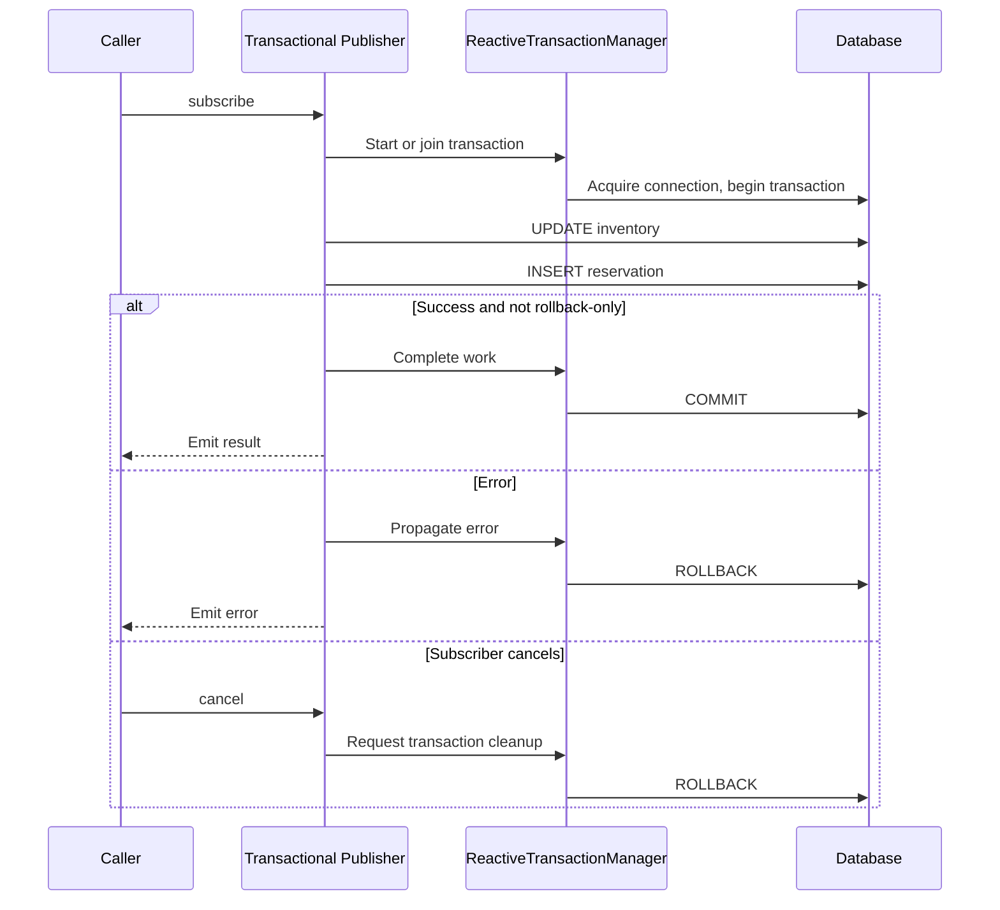

# Reactive Transaction Boundary

## 1. Transaction Boundaries in a Message Flow

In the **Reactive support** chapter of **SPRING_INTEGRATION_CORE**, a reactive transaction boundary is the scope of work protected by a reactive transaction: which data operations must commit or roll back together, who subscribes to that work, and which signal terminates the transaction.

Consider an inventory reservation flow:

```text
Message<ReserveCommand>
    → gateway
    → service activator
    → deduct inventory
    → insert reservation record
    → return result
```

The business requirement is: if inserting the reservation record fails, the deducted inventory quantity must also be restored. Merely placing steps inside an `IntegrationFlow` is not enough to guarantee this requirement. Both SQL operations must be placed inside the proper transaction and kept within the work actually tracked by the subscriber.

After this lesson, you can:

- Distinguish thread-bound transactions from Reactor Context-bound transactions.
- Place `TransactionalOperator` around an explicit unit of work.
- Wire a gateway, service activator, and R2DBC using Java DSL.
- Spot patterns that break transaction scope: detached subscriptions, premature error handling, stream cancellation, and misplaced retries.
- Design tests that verify database state after commit or rollback.

## 2. Execution Model: Assembly, Subscription, and Termination

A method returning `Mono` usually only describes the work. Building the publisher, subscribing, and terminating occur at three distinct times:



The diagram depicts a new local transaction and omits failures occurring while acquiring a connection, committing, or rolling back. When participating in an existing transaction, physical completion timing also depends on the enclosing scope.

### 2.1. Context Instead of ThreadLocal

| Aspect | Imperative | Reactive |
| --- | --- | --- |
| Management abstraction | `PlatformTransactionManager` | `ReactiveTransactionManager` |
| Typical context binding | Bound to thread | Bound to subscriber via Reactor Context |
| Method signature | Plain value or `void` | `Mono`, `Flux`, `Publisher` |
| What must be preserved | Call thread and transaction resource | Reactive chain, Context, and transaction resource |

Spring determines declarative transaction mechanisms from the method return type. Reactive transactions require participating operations to stay inside the same reactive pipeline with the proper Context. See [Spring Declarative Transaction Management](https://docs.spring.io/spring-framework/reference/data-access/transaction/declarative/tx-decl-explained.html).

A reactive transaction is not propagated by attaching a connection to `MessageHeaders`. A `correlationId` header helps track business flows; it does not represent an open transaction.

### 2.2. Switching Threads Differs from Creating a Separate Subscription

`publishOn` or `subscribeOn` within a single Reactor pipeline does not automatically drop the Reactor Context. Conversely, calling `subscribe()` manually creates an independent subscription that does not automatically inherit the active transaction.

```java
// Wrong: inserting the reservation is detached from the chain the caller awaits.
return updateInventory(command)
        .doOnSuccess(ignored -> insertReservation(command).subscribe());

// Correct execution relationship: caller awaits both operations.
return updateInventory(command)
        .then(insertReservation(command));
```

The second snippet still needs an enclosing transaction if atomicity is required. `then` only composes completion ordering; it does not start a transaction on its own. Context is attached to the subscriber and propagated at subscription time, as explained in [Reactor Context Documentation](https://projectreactor.io/docs/core/release/reference/advancedFeatures/context.html).

## 3. Choosing the Right Resources and Transaction Manager

This exercise uses Java 17 or later, Spring Integration Java DSL, Spring R2DBC, and Reactor. Use compatible versions managed by your project's dependency management. The snippets belong to package `example.reservation`; save them as source files only when practicing in your own project.

Required dependencies:

- `spring-integration-core` for building gateways and endpoints.
- `spring-r2dbc` plus an R2DBC driver for a transactional database, such as PostgreSQL.
- A configured `ConnectionFactory` or connection pool.
- `reactor-test` and JUnit Jupiter for tests.

```java
package example.reservation;

import io.r2dbc.spi.ConnectionFactory;
import org.springframework.beans.factory.annotation.Qualifier;
import org.springframework.context.annotation.Bean;
import org.springframework.context.annotation.Configuration;
import org.springframework.r2dbc.connection.R2dbcTransactionManager;
import org.springframework.r2dbc.core.DatabaseClient;
import org.springframework.transaction.ReactiveTransactionManager;
import org.springframework.transaction.reactive.TransactionalOperator;

@Configuration
public class ReservationDataConfiguration {

    @Bean
    public DatabaseClient reservationDb(ConnectionFactory connectionFactory) {
        return DatabaseClient.create(connectionFactory);
    }

    @Bean
    public ReactiveTransactionManager r2dbcTransactionManager(
            ConnectionFactory connectionFactory) {
        return new R2dbcTransactionManager(connectionFactory);
    }

    @Bean
    public TransactionalOperator reservationTx(
            @Qualifier("r2dbcTransactionManager")
            ReactiveTransactionManager transactionManager) {
        return TransactionalOperator.create(transactionManager);
    }
}
```

`DatabaseClient` and the manager must use the same matching `ConnectionFactory`. `R2dbcTransactionManager` manages transactions for a single factory; `DatabaseClient` acquires connections through Spring's transaction-aware mechanism. Opening connections manually with `connectionFactory.create()` can bypass the managed transaction connection. See [R2DBC Connection Management](https://docs.spring.io/spring-framework/reference/data-access/r2dbc.html#r2dbc-R2dbcTransactionManager).

Wrapping `JdbcTemplate` or JPA inside `Mono.fromCallable` does not turn them into R2DBC resources. If a step still uses JDBC, design the corresponding imperative transaction and define the transition boundary between the two models explicitly.

## 4. Practice: Deducting Stock and Inserting a Reservation in One Transaction

### 4.1. Business Contract and Schema

Each command carries a `commandId` to distinguish requests. The example uses two tables:

```sql
CREATE TABLE inventory (
    sku VARCHAR(64) PRIMARY KEY,
    available INTEGER NOT NULL CHECK (available >= 0)
);

CREATE TABLE reservation (
    command_id VARCHAR(36) PRIMARY KEY,
    sku VARCHAR(64) NOT NULL REFERENCES inventory(sku),
    quantity INTEGER NOT NULL CHECK (quantity > 0)
);

INSERT INTO inventory(sku, available) VALUES ('BOOK-01', 10);
```

Place each public record in a matching Java file:

```java
package example.reservation;

public record ReserveCommand(String commandId, String sku, int quantity) {
}
```

```java
package example.reservation;

public record ReservationAccepted(String commandId, String sku, int quantity) {
}
```

Use a conditional `UPDATE` instead of reading stock first and performing an unchecked write. Under two concurrent commands, the `available >= :quantity` predicate is evaluated atomically by the database during the write. Zero updated rows means the stock cannot be reserved.

### 4.2. Service Returning the Entire Unit of Work

```java
package example.reservation;

import org.springframework.r2dbc.core.DatabaseClient;
import org.springframework.transaction.reactive.TransactionalOperator;
import reactor.core.publisher.Mono;

public class ReservationService {

    private final DatabaseClient db;
    private final TransactionalOperator tx;

    public ReservationService(DatabaseClient db, TransactionalOperator tx) {
        this.db = db;
        this.tx = tx;
    }

    public Mono<ReservationAccepted> reserve(ReserveCommand command) {
        return Mono.defer(() -> {
            validate(command);

            Mono<Void> writes = decreaseStock(command)
                    .then(insertReservation(command));

            return writes
                    .as(tx::transactional)
                    .thenReturn(new ReservationAccepted(
                            command.commandId(),
                            command.sku(),
                            command.quantity()));
        });
    }

    private void validate(ReserveCommand command) {
        if (command == null
                || command.commandId() == null
                || command.commandId().isBlank()
                || command.commandId().length() > 36
                || command.sku() == null
                || command.sku().isBlank()
                || command.sku().length() > 64
                || command.quantity() <= 0) {
            throw new IllegalArgumentException("Invalid reservation command");
        }
    }

    private Mono<Void> decreaseStock(ReserveCommand command) {
        return db.sql("""
                UPDATE inventory
                SET available = available - :quantity
                WHERE sku = :sku AND available >= :quantity
                """)
                .bind("quantity", command.quantity())
                .bind("sku", command.sku())
                .fetch()
                .rowsUpdated()
                .flatMap(updated -> updated == 1L
                        ? Mono.<Void>empty()
                        : Mono.<Void>error(new IllegalStateException(
                                "SKU does not exist or insufficient stock")));
    }

    private Mono<Void> insertReservation(ReserveCommand command) {
        return db.sql("""
                INSERT INTO reservation(command_id, sku, quantity)
                VALUES (:commandId, :sku, :quantity)
                """)
                .bind("commandId", command.commandId())
                .bind("sku", command.sku())
                .bind("quantity", command.quantity())
                .fetch()
                .rowsUpdated()
                .flatMap(inserted -> inserted == 1L
                        ? Mono.<Void>empty()
                        : Mono.<Void>error(new IllegalStateException(
                                "Could not insert reservation record")));
    }
}
```

The boundary sits at:

```java
writes.as(tx::transactional)
```

`writes` includes both `UPDATE` and `INSERT`. `thenReturn` sits after the transactional publisher so the business result is emitted only after the transactional scope completes successfully. In this example with no outer transaction, that means after a successful commit. When participating in an existing outer transaction, the result only proves the inner scope succeeded; the outer transaction can still roll back later.

Observable scenarios:

| Situation | Inventory | Reservation Record | Outcome |
| --- | --- | --- | --- |
| 10 available, reserve 3, both SQLs succeed | 7 remaining | One record inserted | Success |
| Insufficient stock | Unchanged | No new record | Business error |
| Stock deducted, `INSERT` violates primary key | Restored to pre-call value | No new record | Data write error |
| Validation fails | Unchanged | No new record | Error before SQL starts |

The `command_id` primary key prevents duplicate records. The example does not yet implement a full idempotency contract: resending an already-succeeded command fails with a duplicate-key error. To return the prior result, verify the same `commandId` has identical content and handle concurrent races according to business policy.

### 4.3. Same Publisher, Different Boundary Placement

```java
// Both operations belong to one transactional unit.
return updateA()
        .then(updateB())
        .as(tx::transactional);

// Only updateA's scope is wrapped by this operator.
return updateA()
        .as(tx::transactional)
        .then(updateB());
```

In the second case, with no enclosing transaction, `updateB` is outside `updateA`'s transaction. When only a sub-chain needs wrapping, use the callback form:

```java
return readReferenceData()
        .flatMap(reference -> tx.execute(status ->
                writeA(reference).then(writeB(reference)))
                .then())
        .then();
```

`readReferenceData`, `writeA`, and `writeB` are illustrative names. If the read data governs write consistency conditions, consider bringing the read inside the transaction as well and choosing appropriate isolation or version checks. Both usage forms are documented in [TransactionalOperator](https://docs.spring.io/spring-framework/reference/data-access/transaction/programmatic.html#tx-prog-operator).

## 5. Wiring into Spring Integration with Gateway and Java DSL

### 5.1. Gateway Returning Mono

```java
package example.reservation;

import org.springframework.integration.annotation.MessagingGateway;
import reactor.core.publisher.Mono;

@MessagingGateway(defaultRequestChannel = "reserve.input")
public interface ReservationGateway {
    Mono<ReservationAccepted> reserve(ReserveCommand command);
}
```

```java
package example.reservation;

import org.springframework.context.annotation.Bean;
import org.springframework.context.annotation.Configuration;
import org.springframework.integration.config.EnableIntegration;
import org.springframework.integration.config.IntegrationComponentScan;
import org.springframework.integration.dsl.IntegrationFlow;
import org.springframework.r2dbc.core.DatabaseClient;
import org.springframework.transaction.reactive.TransactionalOperator;

@Configuration
@EnableIntegration
@IntegrationComponentScan(basePackageClasses = ReservationGateway.class)
public class ReservationFlowConfiguration {

    @Bean
    public ReservationService reservationService(
            DatabaseClient reservationDb,
            TransactionalOperator reservationTx) {
        return new ReservationService(reservationDb, reservationTx);
    }

    @Bean
    public IntegrationFlow reserveFlow(ReservationService service) {
        return IntegrationFlow.from("reserve.input")
                .handle(service, "reserve", endpoint -> endpoint.async(true))
                .get();
    }
}
```

The application must load both configuration classes and provide a `ConnectionFactory`. If multiple `DatabaseClient` or `TransactionalOperator` beans exist, add explicit `@Qualifier` annotations on the corresponding parameters.

A gateway returning `Mono` defers executing the flow call until subscription. For a service returning a reactive reply over a standard channel, `async(true)` lets the endpoint handle the result asynchronously. Refer to [Reactive Gateways and Reply Payloads](https://docs.spring.io/spring-integration/reference/reactive-streams.html) and [Asynchronous Service Activator](https://docs.spring.io/spring-integration/reference/service-activator.html#async-service-activator).

In this design, the service owns the transaction. The endpoint bridges the messaging contract with the reactive outcome; no single transaction spans every endpoint simply because the gateway returns `Mono`.

Example at a reactive HTTP edge:

```java
public Mono<ReservationAccepted> reserveFromHttp(ReserveCommand command) {
    return gateway.reserve(command);
}
```

The web framework subscribes to the returned publisher. Inside the service, never add `subscribe()` or `block()` to force execution.

### 5.2. Placement of Transformers, Routers, Filters, and Aggregators

To align boundaries with Enterprise Integration Patterns, you can structure the flow as:

```text
Gateway
  → Transformer: normalize input
  → Router: select reservation logic
  → Service activator: UPDATE + INSERT in one transaction
  → Transformer: build response
```

These are design choices for this problem, not automatic framework guarantees:

- Normalizing the SKU in a transformer before writing keeps transactions shorter.
- Filtering invalid commands before the transaction requires an explicit reply policy; silent drops in request/reply leave callers waiting until timeout.
- Routing before opening a transaction avoids holding a database connection during dispatch.
- A splitter emitting multiple messages does not mean those messages share a transaction.
- An aggregator waits across multiple arrivals, so it usually sits before a transactional persistence step rather than holding a transaction open while waiting.

An error in a post-commit DTO-building transformer cannot roll back the already-committed transaction. If a validation check governs write validity, execute it before the transaction closes.

### 5.3. Transaction Advice at the Endpoint

Spring Integration supports `ReactiveTransactionManager` with `TransactionInterceptor` for eligible endpoints with reactive outcomes, including reactive reply payloads. Eligibility conditions are detailed in [Spring Integration Reactive Transactions](https://docs.spring.io/spring-integration/reference/transactions.html#reactive-transactions).

You may choose endpoint advice instead of `TransactionalOperator` in the service. When doing so, verify which publisher, endpoint, and reply consumer the advice wraps. This lesson uses the operator to keep both SQL statements visibly enclosed together; do not stack another transaction advice on the same endpoint.

## 6. Channel Boundaries and Protected Resources

When evaluating channels, separate "has the message been sent?" from "has the data work committed?".

| Component or Operation | How to Evaluate the Boundary |
| --- | --- |
| `DirectChannel` | In synchronous imperative flows, may keep calls on the same thread; that does not prove a deferred publisher executed inside a transaction |
| `ExecutorChannel` | Handing off to an executor resets thread scope; consumer work does not automatically join the sender's transaction |
| `QueueChannel` | Enqueueing a message and processing it occur at two distinct times |
| `FluxMessageChannel` | Follows Reactive Streams contract; still requires proper transaction boundaries and resources |
| `channel.send(message)` returns `true` | Proves acceptance under the channel contract, not that downstream work committed |

The imperative rule "switching threads breaks transactions" applies to thread-bound transactions. In reactive code, inspect subscription Context, publisher composition, and underlying resources. Do not assume switching to `FluxMessageChannel` makes separate databases or brokers roll back together.

An easy-to-reason-about default design is: each consumer receives a message, runs a single local transactional data unit, and completes that unit before replying or acknowledging processing.

## 7. Errors, Recovery, and Unintended Commits

### 7.1. Swallowing Errors Inside a Transaction Changes the Outcome

```java
// Risk of committing partial work: error turns into completion before the boundary.
Mono<Void> unsafe = writeA()
        .then(writeB())
        .onErrorResume(error -> Mono.empty())
        .as(tx::transactional);

// Error crosses the boundary first; recovery happens outside afterward.
Mono<Void> safer = writeA()
        .then(writeB())
        .as(tx::transactional)
        .onErrorResume(error -> recordFailureOutsideTransaction(error));
```

This snippet illustrates operator ordering. In `unsafe`, if the resource still allows committing and the transaction was not marked rollback-only, `writeA` can commit even though `writeB` failed. Some database errors mark a transaction non-committable on their own; never rely on that behavior in place of proper error-handling design.

In `safer`, the recovery handler receives the error after the operator scope handles rollback. The failure-recording function needs its own policy: its own errors must be handled, and only contract-approved business errors should be recovered.

If you need to return a fallback while still rolling back, call `status.setRollbackOnly()` inside a transaction callback before turning the error into a value. When participating in an outer transaction, `rollback-only` can also prevent the outer transaction from committing; test that behavior under your actual propagation setting.

### 7.2. An Error Channel Is Not a Transaction Manager

An `ErrorMessage` transports error details. Successfully sending an error to `errorChannel` does not undo already-committed SQL. Depending on execution paths and gateway/endpoint configuration, callers may observe exceptions wrapped in `MessagingException`; walk the cause chain when classifying errors.

In the example, SQL errors pass through `TransactionalOperator` in the service before the endpoint handles async failures. If a post-commit step fails and routes to an error flow, that error flow must record it, retry idempotently, or perform business compensation.

## 8. Cancellation, Timeouts, and Completion Signals

With `TransactionalOperator`, since Spring Framework 5.3, cancellation triggers rollback. Operators such as `take`, `next`, or `timeout` can cancel upstream subscriptions. See [Reactive Transaction Cancellation Rules](https://docs.spring.io/spring-framework/reference/data-access/transaction/programmatic.html#tx-prog-operator-cancel).

An example requiring care:

```java
Flux<Result> transactionalBatch = commands
        .concatMap(this::writeCommand)
        .as(tx::transactional);

// Can cancel before transactionalBatch finishes.
Mono<Result> firstOnly = transactionalBatch.next();
```

Observing one item from a `Flux` is not proof the entire batch committed. A caller taking the first item and canceling can cause the transaction to roll back. For batch writes, return a publisher that completes only after consuming all writes:

```java
Mono<Void> completeBatch = commands
        .concatMap(this::writeCommand)
        .then()
        .as(tx::transactional);
```

Here `writeCommand` represents write logic that does not open its own transaction. If it already contains another boundary, analyze propagation rather than assuming a single transaction.

Timeout placement also matters:

```java
// Timeout can cancel the transactional section while it is still running.
return businessWrites()
        .as(tx::transactional)
        .timeout(Duration.ofSeconds(3));
```

Cancellation does not deliver a final `onError` to the canceling subscriber. Cleanup happens asynchronously. Never treat the mere execution of a caller-side callback as proof that rollback finished. If commit already completed before the caller disconnected, a late cancel cannot undo the commit; querying by business key helps disambiguate outcomes when responses are lost.

## 9. Transactions per Message, per Batch, and Retries

### 9.1. Choose the Rollback Unit Before Choosing Operators

```java
// Each command has its own transaction inside service.reserve().
return commands.concatMap(service::reserve);
```

If the third command fails, the first two already-succeeded commands retain their committed data. This is per-message processing semantics.

```java
// One transaction for the whole batch, using operations without inner boundaries.
return commands
        .concatMap(this::writeWithoutOwnBoundary)
        .then()
        .as(tx::transactional);
```

In the second approach, a mid-batch error rolls back the entire batch when this is a new local transaction. On the flip side, large batches hold connections and locks longer. Bound batch size rather than opening a transaction around an unbounded `Flux`.

`concatMap` enforces sequential execution. Never use `flatMap` with high concurrency as a default way to run parallel SQL on a single transactional connection; that capability depends on driver and data-access design.

### 9.2. Retrying Outside the Transactional Publisher

```java
return Mono.defer(() -> writeA().then(writeB()))
        .as(tx::transactional)
        .retryWhen(Retry.backoff(2, Duration.ofMillis(100))
                .filter(this::isTransientFailure));
```

`Retry` is in `reactor.util.retry` and `Duration` is in `java.time`; the predicate must classify transient failures for your application and driver. With no enclosing outer transaction, retrying outside the transactional publisher lets each attempt open a fresh transaction after the prior failure. When joining an outer transaction, re-evaluate retry scope because the outer transaction may already be marked rollback-only.

Placing retry inside the transaction-wrapped work can retry inside a failed transaction. Meanwhile, retrying the whole flow can repeat side effects outside the database. Retry only operations with an explicit re-execution policy; never retry validation errors, insufficient stock, or duplicate `commandId` infinitely.

## 10. Using @Transactional Instead of the Operator

You can place the boundary on a Spring bean invoked through a proxy:

```java
@EnableTransactionManagement
@Configuration
class DeclarativeTransactionConfiguration {
}
```

```java
@Transactional(transactionManager = "r2dbcTransactionManager")
public Mono<Void> reserveWrites(ReserveCommand command) {
    return decreaseStock(command).then(insertReservation(command));
}
```

This is an alternative approach, not code to append to the sample service. Imports are `org.springframework.transaction.annotation.EnableTransactionManagement`, `org.springframework.context.annotation.Configuration`, and `org.springframework.transaction.annotation.Transactional`.

The method must return a reactive type and calls must pass through the Spring proxy; self-invocation within the same bean does not trigger advice under default proxy mode. Default annotation rollback applies to `RuntimeException` and `Error`; for checked exceptions, configure rules such as `rollbackFor`. See [Using @Transactional](https://docs.spring.io/spring-framework/reference/data-access/transaction/declarative/annotations.html).

The operator fits when you want the boundary visible directly inside a pipeline. The annotation fits when the boundary aligns with a service method contract. Either way, never call `subscribe()` manually to execute operations that must share a transaction.

## 11. Testing Transactions via Database Outcomes

Mocks returning `Mono.just(...)` test routing logic but do not prove the database rolled back. This exercise needs a real transactional database, matching driver, and verification queries after the business publisher terminates.

### 11.1. Testing Commit and Rollback After a Duplicate-Key Error

The snippet below is a method inside an integration test class injected with `ReservationGateway gateway` and `DatabaseClient db`. The schema is created before the test; the configuration classes above and a `ConnectionFactory` pointing to the test database are loaded into the Spring context. JUnit Jupiter, `StepVerifier`, and `assertEquals` are required. This is an example to run in a test environment, not an execution report.

```java
@Test
void commitsFirstCommandAndRollsBackDuplicateAttempt() {
    String sku = "TEST-" + java.util.UUID.randomUUID();
    String commandId = java.util.UUID.randomUUID().toString();
    ReserveCommand command = new ReserveCommand(commandId, sku, 3);

    StepVerifier.create(db.sql("""
                    INSERT INTO inventory(sku, available)
                    VALUES (:sku, 10)
                    """)
            .bind("sku", sku)
            .fetch().rowsUpdated())
            .expectNext(1L)
            .verifyComplete();

    StepVerifier.create(gateway.reserve(command))
            .assertNext(result -> assertEquals(commandId, result.commandId()))
            .verifyComplete();

    StepVerifier.create(db.sql("""
                    SELECT available FROM inventory WHERE sku = :sku
                    """)
            .bind("sku", sku)
            .map((row, metadata) -> row.get("available", Integer.class))
            .one())
            .expectNext(7)
            .verifyComplete();

    // UPDATE runs first; INSERT with the same commandId must fail.
    StepVerifier.create(gateway.reserve(command))
            .expectError()
            .verify();

    StepVerifier.create(db.sql("""
                    SELECT available FROM inventory WHERE sku = :sku
                    """)
            .bind("sku", sku)
            .map((row, metadata) -> row.get("available", Integer.class))
            .one())
            .expectNext(7)
            .verifyComplete();

    StepVerifier.create(db.sql("""
                    SELECT COUNT(*) AS total
                    FROM reservation WHERE command_id = :commandId
                    """)
            .bind("commandId", commandId)
            .map((row, metadata) -> row.get("total", Long.class))
            .one())
            .expectNext(1L)
            .verifyComplete();
}
```

The expected Java types for SQL results above match PostgreSQL; if changing drivers, check how your driver maps `COUNT(*)` and affected row counts. In a complete test suite, add verify timeouts, clean up fixture data, and assert the duplicate-key root cause while accounting for messaging wrappers.

The most telling check is that inventory remains at 7 after the second call. Checking only for an exception would still let a buggy implementation that accidentally committed stock down to 4 pass the test.

`StepVerifier` subscribes and asserts signal sequences; it does not start a transaction for the application. See [Testing Reactive Sequences with Reactor](https://projectreactor.io/docs/core/release/reference/testing.html).

### 11.2. Additional Scenarios

| Scenario | Evidence Required |
| --- | --- |
| Insufficient stock | No new reservation record, stock unchanged |
| Failure on second write | First write is rolled back |
| Publisher not subscribed | Deferred work has not executed |
| Cancel after first write | Wait for cleanup completion, then verify data rolled back |
| Timeout before completion | Verify both error/cancellation and final database state |
| Recovery inside vs. outside boundary | Compare real data to observe operator placement effects |
| Retry transient failure | Each attempt has its own clean boundary without duplicate side effects |
| Two concurrent requests | Stock stays non-negative, total reserved matches valid requests |

To test cancellation deterministically, place a controlled synchronization point after the first SQL operation, such as a test publisher or sink, and then cancel. Await the rollback/resource-release completion signal or query with a bounded eventual assertion. Never pick an arbitrary `sleep` and treat reads immediately after cancel as guaranteed final state.

Do not rely on `@Transactional` on a test method assuming it wraps reactive subscriptions: standard test-managed transactions are thread-bound. Application publishers must carry their own boundaries; clean up test fixtures according to the transactions that actually committed.

## 12. Limits: Databases, Brokers, and External Systems

Suppose after reserving inventory, the flow makes an HTTP call to charge payment:

```text
UPDATE inventory → INSERT reservation → HTTP charge → reply
```

If HTTP charged the customer yet the database rolls back, `R2dbcTransactionManager` does not refund the payment. If the database committed yet publishing to a broker fails, a local transaction does not automatically re-emit the event.

One pattern for event publishing is the transactional outbox:

```text
Database transaction:
    UPDATE inventory
    INSERT reservation
    INSERT outbox_event
    COMMIT

Separate publishing flow:
    read outbox → send to broker → record progress
```

All three database statements must belong to the transaction of the same resource. The publishing flow needs retries; consumers must tolerate redelivered events, since a crash can happen after sending yet before recording progress. This is a design consequence of local transaction scope, not an "exactly once" guarantee provided by reactive programming.

Similarly, message source acknowledgments must be designed per concrete adapter and broker. Never assume publisher completion means both broker and database committed in a single distributed transaction.

## 13. Boundary Self-Check When Designing a Flow

Before finalizing a reactive flow, answer with exact operation names:

1. Is the rollback unit a command, a message, or a finite batch?
2. Which publisher encloses all of those writes?
3. Who subscribes and who can cancel the subscription?
4. Which resource does the manager govern; do all operations acquire the managed connection?
5. Do any `subscribe()`, queues, executors, or external calls detach work from the intended scope?
6. Do errors reach the boundary first, or get turned into success by a recovery operator?
7. After which completion scope is a success outcome emitted; is there an uncommitted outer transaction?
8. Which tests verify final persisted state rather than merely asserting an exception?

For the reservation flow in this lesson, the core answer is: `decreaseStock` and `insertReservation` form a single `Mono<Void>` wrapped by `TransactionalOperator`, and the gateway emits the result after that scope completes. Surrounding message-routing steps must still be evaluated against their own contracts.