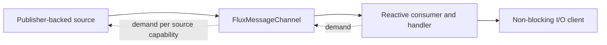

# When to Use Reactive Instead of a Poller

## 1. Objectives and Scope

In the **Reactive support** chapter of the **SPRING_INTEGRATION_CORE** module, this lesson helps choose how data enters a message flow and how endpoints consume it. The focus is the relationship among `Message`, `MessageChannel`, pollers, reactive consumers, and Java DSL.

Prefer reactive when the source or protocol already offers a suitable reactive API, the flow must serve many pending I/O operations concurrently, and the application can manage demand across key boundaries. Keep a poller when the business requires a polling schedule, the source only permits active pulling, or migration cost outweighs measurable gains.

A flow can also keep polling at intake while using reactive processing downstream. Base the decision on each flow segment's capabilities rather than applying one label to the whole application.

Examples use Java 17 and Spring Integration 6.5 APIs, with `handleReactive(...)` available since 6.1. You need `spring-integration-core`, Reactor Core, and a Spring application context with Spring Integration enabled; let your project's dependency management coordinate versions. Source and service interfaces in the examples are application contracts that must be backed by real beans. [Spring Integration Reactive Streams Documentation](https://docs.spring.io/spring-integration/reference/6.5/reactive-streams.html#reactive-message-handler)

## 2. Pollers and Reactive Control Two Different Things

### 2.1. Pollers Decide When to Actively Pull Data

In Spring Integration, distinguish two cases:

| Component | Target Being Polled | Example |
|---|---|---|
| `SourcePollingChannelAdapter` | A `MessageSource<?>` | Reading pending records, checking a remote directory |
| `PollingConsumer` | A `PollableChannel` | Pulling messages from a `QueueChannel` to invoke a service activator |

Thus, removing a consumer's poller does not mean polling has been eliminated at the external source. [Spring Integration: Pollers](https://docs.spring.io/spring-integration/reference/polling-consumer.html)

For instance, a scheduled SFTP endpoint still has to check the server. Even if the subsequent step sends results via a reactive HTTP client, discovering new files still relies on a polling schedule if the chosen adapter works that way.

### 2.2. Reactive Coordinates Data by Consumption Demand

Reactive Streams uses `Publisher`, `Subscriber`, and `Subscription`. The subscriber communicates demand via `request(n)`; a compliant publisher must never emit beyond remaining demand. The subscriber can also cancel the subscription.

This demand coordinates fast sources and slow destinations across asynchronous boundaries. It does not automatically add durable persistence, business acknowledgment, or extra capacity to the target service. [Reactive Streams Specification and Goals](https://www.reactive-streams.org/)

A poller asks "is it time for the next poll yet?", whereas a reactive pipeline asks "how many more items does the receiver allow?" An application may need both answers.

### 2.3. Event-Driven Alone Is Not Reactive

| Flow Wiring | When Handler Is Invoked | Is There a `request(n)` Protocol at This Boundary? |
|---|---|---|
| `DirectChannel` | When sender sends a message, in the normal call flow | No |
| `ExecutorChannel` | Through the configured executor | No |
| `QueueChannel` with standard consumer | When poller pulls a message from the queue | No |
| `FluxMessageChannel` with reactive consumer | Via subscription and demand mechanics | Yes |

`DirectChannel` already supports event-driven handling without a poller. `ExecutorChannel` adds an asynchronous execution boundary. Adding a thread pool does not simultaneously create a Reactive Streams protocol. [MessageChannel Implementations](https://docs.spring.io/spring-integration/reference/channel/implementations.html)

If the only goal is invoking a handler immediately when a message arrives, `DirectChannel` may already suffice. Identify requirements around I/O, load throttling, or composing reactive APIs before changing architecture.

## 3. When to Consider Reactive

### 3.1. The Source Already Exposes a Meaningful Reactive Stream

Suppose the system receives order status events from a client exposing `Flux<OrderEvent>`. The client supports cancellation and controls pending data cleanly for the application's needs. Feeding this publisher into `IntegrationFlow` preserves that consumption model while wrapping events into `Message` instances.

Replacing it with a task running every second just to check a self-built queue fed by that same stream adds a timer schedule and a new buffer to manage. In that scenario, wiring the publisher directly to the flow is usually worth trying.

However, examine what the source API actually means. A `Flux` wrapping a callback may still buffer in memory if the physical source cannot slow down. A reactive return type is merely the starting point of evaluation.

### 3.2. Many Concurrent Waiting I/O Tasks

For example, each event calls an external API and most processing time is spent waiting on responses. When the external client supports non-blocking I/O and the application caps in-flight tasks, reactive can use resources more efficiently than dedicating a platform thread to every wait.

A design estimate: if the target is 300 events/second and each call averages 80 ms, average pending operations are roughly:

```text
300 × 0.08 = 24 operations
```

This is a calculation from example assumptions, not a benchmark result or mandatory concurrency setting. Tail latency, connection pools, quotas, and timeout behavior still govern real limits.

### 3.3. Bursty Traffic with Bounded Downstream Capacity

Suppose intake hits 800 events/second while the target handles only 500 events/second for 20 seconds. Accepting every event into a queue grows the backlog by roughly:

```text
(800 - 500) × 20 = 6,000 events
```

This calls for an explicit admission policy: slow the source if possible, spill to durable storage, reject, or drop according to business rules. Reactive is useful when demand propagation can coordinate components; an unbounded buffer only delays when the problem surfaces.

For temperature telemetry, keeping only the latest reading may be valid. For debit commands, dropping an element due to a full buffer is usually unacceptable. Identical load profiles can lead to two different designs.

## 4. When Is Keeping a Poller Reasonable?

| Scenario | Suggested Direction | Reason to Consider |
|---|---|---|
| Scanning a partner directory every 5 minutes | Poller | A polling schedule is a direct requirement |
| External API only supports status querying | Poller or equivalent active query mechanism | Wrapping calls in `Mono` does not create an event API |
| Publisher source, non-blocking target client, high concurrent I/O | Reactive | Good foundation for demand and async composition |
| Short, low-load, synchronous flow | Keep the simple design already meeting goals | Gains must justify migration cost |
| Existing JDBC flow relying on per-poll transactions | Evaluate keeping the poller first | Moving execution boundaries can alter transaction scope |
| Legacy source must be polled, downstream calls reactive API | Combine polling and reactive | Each segment uses the fitting mechanism |
| Partner pushes webhooks | Suitable event-driven adapter | No poller needed just to receive requests; reactivity still depends on client, server, and downstream |
| Heavy CPU computation | Measure and optimize CPU work first | Reactive does not make calculations run faster |

Do not use "many messages" as the sole criterion. A traditional flow with well-tuned concurrency, batch size, and queues can still perform well. Conversely, a low-volume flow may still need reactive to integrate with an existing protocol.

## 5. Understanding Spring Integration's Reactive Components Accurately

### 5.1. `FluxMessageChannel`

`FluxMessageChannel` is both a `MessageChannel` and a `Publisher<Message<?>>`, while also accepting data from publishers via `subscribeTo(...)`. It bridges Spring Integration's message model and a reactive stream. [FluxMessageChannel 6.5 Javadoc](https://docs.spring.io/spring-integration/docs/6.5.0/api/org/springframework/integration/channel/FluxMessageChannel.html)

This channel is not a business persistence store. When recovery after an abrupt process shutdown is required, design which broker, database, or durable store holds the data.

### 5.2. `ReactiveStreamsConsumer`

`ReactiveStreamsConsumer` manages subscribing to the input channel and consuming messages reactively. It still connects a channel to a handler, similar to endpoint coordination in other flow styles. [ReactiveStreamsConsumer 6.5 Javadoc](https://docs.spring.io/spring-integration/docs/6.5.0/api/org/springframework/integration/endpoint/ReactiveStreamsConsumer.html)

Creating a reactive consumer does not alter the nature of work inside the handler. A handler calling synchronous JDBC still blocks waiting for JDBC even though the endpoint uses a subscription.

### 5.3. Endpoint `reactive()` Option

Java DSL provides the `reactive()` option on consumer endpoints to use `ReactiveStreamsConsumer`, even when the input channel has another type. You can pass a reactive stream customizer function to this option. [ConsumerEndpointSpec.reactive Javadoc](https://docs.spring.io/spring-integration/docs/6.5.0/api/org/springframework/integration/dsl/ConsumerEndpointSpec.html)

This is an adaptation at the endpoint boundary. It does not guarantee a sender on a `DirectChannel` or an external system knows how to respond to demand. Before using it, pinpoint exactly which segment throttles load and which still manages its own buffers.

## 6. Baseline Example: Polling an Actively Queried Source

Suppose a source stores order events awaiting dispatch. `nextPending()` fetches at most one event and returns `null` when none is available.

```java
import java.time.Duration;

import org.springframework.context.annotation.Bean;
import org.springframework.context.annotation.Configuration;
import org.springframework.integration.config.EnableIntegration;
import org.springframework.integration.dsl.IntegrationFlow;
import org.springframework.integration.dsl.Pollers;

@Configuration
@EnableIntegration
public class PollingOrderConfiguration {

    public record OrderEvent(String eventId, String orderId) {
    }

    public interface PendingOrderSource {
        OrderEvent nextPending();
    }

    public interface BlockingOrderNotifier {
        void deliver(OrderEvent event);
    }

    @Bean
    IntegrationFlow pollingOrders(
            PendingOrderSource source,
            BlockingOrderNotifier notifier) {

        return IntegrationFlow
                .fromSupplier(
                        source::nextPending,
                        endpoint -> endpoint.poller(
                                Pollers.fixedDelay(Duration.ofSeconds(2))
                                        .maxMessagesPerPoll(10)))
                .handle(OrderEvent.class, (event, headers) -> {
                    notifier.deliver(event);
                    return null;
                })
                .get();
    }
}
```

`Pollers.fixedDelay(Duration)` configures a poller with a fixed delay between polls. `maxMessagesPerPoll(10)` caps messages fetched in a single poll cycle; the source can end the cycle early by returning `null`. [Pollers Javadoc](https://docs.spring.io/spring-integration/docs/6.5.0/api/org/springframework/integration/dsl/Pollers.html), [Inbound Channel Adapter](https://docs.spring.io/spring-integration/reference/channel-adapter.html)

In this simple synchronous setup, downstream processing time contributes to each poll cycle's duration. Do not infer this configuration always produces exactly 5 events/second. The source may be empty, a poll may take longer, and the next run depends on scheduling.

The source interface does not define record ownership. When backed by a database, add claiming, transactions, or locking so multiple instances do not process the same record simultaneously. That is a separate business requirement not solved by `maxMessagesPerPoll` alone.

## 7. Replacing the Poller When the Source Truly Exposes a Publisher

In an alternative setup, the source exposes an event stream and the notifier returns `Mono<Void>`. This replaces the polling example; do not enable both simultaneously against the same dataset without a consumption-partitioning design.

```java
import java.time.Duration;

import org.springframework.context.annotation.Bean;
import org.springframework.context.annotation.Configuration;
import org.springframework.integration.config.EnableIntegration;
import org.springframework.integration.dsl.IntegrationFlow;
import org.springframework.messaging.Message;
import org.springframework.messaging.support.MessageBuilder;

import reactor.core.publisher.Flux;
import reactor.core.publisher.Mono;

@Configuration
@EnableIntegration
public class ReactiveOrderConfiguration {

    public record OrderEvent(String eventId, String orderId) {
    }

    public interface OrderEventSource {
        Flux<OrderEvent> events();
    }

    public interface OrderNotifier {
        Mono<Void> deliver(OrderEvent event);
    }

    public interface FailureStore {
        Mono<Void> record(OrderEvent event, Throwable error);
    }

    @Bean
    IntegrationFlow reactiveOrders(
            OrderEventSource source,
            OrderNotifier notifier,
            FailureStore failures) {

        Flux<Message<OrderEvent>> messages = Flux.defer(source::events)
                .map(event -> MessageBuilder.withPayload(event)
                        .setHeader("eventId", event.eventId())
                        .build());

        return IntegrationFlow.from(messages)
                .handleReactive(message -> {
                    OrderEvent event = (OrderEvent) message.getPayload();

                    return Mono.defer(() -> notifier.deliver(event))
                            .timeout(Duration.ofSeconds(3))
                            .onErrorResume(error ->
                                    failures.record(event, error));
                });
    }
}
```

`IntegrationFlow.from(Publisher)` creates a `FluxMessageChannel` boundary to connect the publisher to the flow. Business payloads are wrapped in `Message`, preserving `eventId` in a header. [IntegrationFlow.from Javadoc](https://docs.spring.io/spring-integration/docs/6.5.0/api/org/springframework/integration/dsl/IntegrationFlow.html)

`handleReactive(...)` is a terminal flow operator returning `IntegrationFlow` directly, so do not chain `.get()`. Spring Integration manages subscribing to the `Mono<Void>` returned by the handler. [Spring Integration: ReactiveMessageHandler](https://docs.spring.io/spring-integration/reference/6.5/reactive-streams.html#reactive-message-handler)

Contracts to enforce in real beans:

- `events()` must define clear behavior for resubscription, cancellation, and insufficient demand; the `Flux` type alone does not say whether data replays.
- `deliver()` must return a publisher representing the send operation, completing when the service's commitment is met.
- `FailureStore.record()` must complete only after recording the failure under the chosen recovery mechanism. Logging alone must not count as durably persisting a failed event.

The example focuses on replacing the polling source and wiring a reactive handler. It does not implement broker acknowledgments, connection recovery, or in-flight call limits. Decide those according to your real adapters and load.

## 8. Keeping a Poller at Intake and Going Reactive Downstream

When the source only provides `MessageSource<OrderEvent>`, you can still place a `FluxMessageChannel` at the output of the polling source. The configuration below reuses `OrderEvent` and `OrderNotifier` from the reactive example, with additional imports:

```java
import java.time.Duration;

import org.springframework.context.annotation.Bean;
import org.springframework.integration.channel.FluxMessageChannel;
import org.springframework.integration.core.MessageSource;
import org.springframework.integration.dsl.IntegrationFlow;
import org.springframework.integration.dsl.Pollers;

import reactor.core.publisher.Mono;

// Place inside a @Configuration class with @EnableIntegration.
@Bean
IntegrationFlow hybridOrders(
        MessageSource<OrderEvent> source,
        OrderNotifier notifier) {

    return IntegrationFlow
            .from(source, endpoint -> endpoint.poller(
                    Pollers.fixedDelay(Duration.ofSeconds(2))
                            .maxMessagesPerPoll(10)))
            .channel(new FluxMessageChannel())
            .handleReactive(message ->
                    Mono.defer(() -> notifier.deliver(
                            (OrderEvent) message.getPayload()))
                            .timeout(Duration.ofSeconds(3)));
}
```

With an output channel implementing `ReactiveStreamsSubscribableChannel`, `SourcePollingChannelAdapter` takes an execution branch that builds a publisher from the trigger and consumes on demand. The trigger and fetch limits still matter. [Spring Integration: Source Polling Channel Adapter in Reactive Flows](https://docs.spring.io/spring-integration/reference/6.5/reactive-streams.html#source-polling-channel-adapter)

Design implications:

- The external source is still actively queried; changing the channel does not turn it into a push event source.
- If the source's `receive()` blocks, that operation still blocks. Verify where it runs and how it is isolated.
- Errors in the hybrid example propagate to the endpoint's error-handling mechanism; production deployments must configure and verify proper error paths.
- If the source supports acknowledgments, do not equate sending a message into the channel with acknowledgment timing.

Another option is `ReactiveMessageSourceProducer`, which adapts a `MessageSource` into a `Flux` and allows configuring the wait delay when a poll returns empty via `setDelayWhenEmpty(...)`. It fits when you want demand-driven fetching instead of a fixed business polling schedule. [ReactiveMessageSourceProducer Javadoc](https://docs.spring.io/spring-integration/docs/6.5.0/api/org/springframework/integration/endpoint/ReactiveMessageSourceProducer.html)

Inspect all poller features currently in use before switching to this producer: cron schedules, advice, transactions, and empty-source handling may be part of the operational contract.

## 9. Identifying Demand Paths and Resource Limits



When reviewing a real diagram, mark every buffer, thread switch, callback bridge, or synchronous API call. In particular, an imperative sender calling `send()` on a reactive channel does not thereby become a demand-compliant publisher.

Reactor can reshape demand across operators; for instance, prefetch and multi-item operators make upstream request counts differ from what the final subscriber requests. Hence, "consumer requests one message" does not always mean "the physical source reads only one record." [Reactor: Backpressure and Ways to Reshape Requests](https://projectreactor.io/docs/core/release/reference/coreFeatures/simple-ways-to-create-a-flux-or-mono-and-subscribe-to-it.html#_on_backpressure_and_ways_to_reshape_requests)

Distinguish these limits during design:

| Limit | Question to Answer |
|---|---|
| Demand | How many more items may be emitted on this subscription? |
| Concurrency | How many I/O operations are executing simultaneously? |
| Prefetch | How many items does an operator proactively pre-request? |
| Buffer capacity | How much waiting data can be retained at most? |
| Rate limit | How many requests may be sent within a time window? |
| Connection pool | How many connections or connection waiters does the client allow? |

`limitRate(...)` shapes upstream requests in batches; do not interpret it as a requests/second quota for an external API. Likewise, `maxMessagesPerPoll` bounds one poll cycle, not total in-flight tasks if downstream branches off asynchronously.

When explicitly composing Reactor in a processing segment, you can bound concurrency of that exact segment:

```java
// events: Flux<OrderEvent>; notifier: OrderNotifier
Flux<OrderEvent> delivered = events.flatMap(
        event -> Mono.defer(() -> notifier.deliver(event))
                .timeout(Duration.ofSeconds(3))
                .thenReturn(event),
        16,  // at most 16 inner publishers subscribed concurrently
        1);  // prefetch per inner publisher
```

This pipeline replaces the dispatch step; do not tack it on after another step already dispatching the same event. The limit of `16` belongs to this operator; it does not guarantee only 16 items exist across the whole application. `flatMap` can also emit results out of input order. For sequential execution, consider `concatMap`; for preserving emission order with concurrent execution, evaluate `flatMapSequential` and its buffering cost. [Flux Javadoc](https://projectreactor.io/docs/core/release/api/reactor/core/publisher/Flux.html)

For orders, ordering usually matters per `orderId`, not necessarily across all orders globally. Document that rule before picking operators or partitioning strategies.

## 10. Isolating Blocking When the Whole Flow Cannot Be Converted Yet

Synchronous calls must be deferred until subscription and run on an appropriate scheduler. The following snippet merely illustrates wrapping a legacy operation:

```java
import reactor.core.publisher.Mono;
import reactor.core.scheduler.Schedulers;

// legacyNotifier.deliver(event) returns void and may block.
Mono<Void> delivery = Mono.fromRunnable(
        () -> legacyNotifier.deliver(event))
        .subscribeOn(Schedulers.boundedElastic())
        .then();
```

`boundedElastic` is suitable for isolating blocking work with resource bounds; `subscribeOn` only specifies the scheduler and does not subscribe itself. Wrapping preserves a reactive return API, yet the underlying operation still blocks a worker thread while running. [Reactor FAQ: Wrapping Blocking Calls](https://projectreactor.io/docs/core/release/reference/faq.html#faq.wrap-blocking)

Never use the following if you intend to defer the call:

```java
// Wrong for deferral: fetch() runs before Mono is created.
Mono<Result> result = Mono.just(legacyClient.fetch());
```

If legacy sources or notifiers dominate processing time, compare this hybrid approach against a polling flow with a controlled thread pool. Migration cost is justified only when gains in composability, resource usage, or overload behavior are clear.

Inside framework-managed reactive handlers, return the publisher to the framework. Nesting `subscribe()` inside a handler detaches work from the publisher tracked by the endpoint, making completion, cancellation, and error handling harder.

## 11. Designing Errors, Retries, and Acknowledgments Alongside Migration

### 11.1. Distinguishing Per-Event Errors from Source Errors

In Reactor, an error terminates the sequence emitting it. `onErrorResume` switches to a fallback publisher; it does not resume the failed sequence from the next item. Placing recovery inside each event's inner publisher has a different scope than placing it outside the entire stream. [Reactor: Handling Errors](https://projectreactor.io/docs/core/release/reference/coreFeatures/error-handling.html)

In the `reactiveOrders` example, failure to deliver one event routes to `FailureStore.record(event, error)`. If recording succeeds, that event's handling completes per policy. If the failure store also fails, the error must still be handled by an appropriate coordination layer. Errors from `source.events()`, meanwhile, require a reconnect or source-restart policy.

Never wrap the entire source in infinite retries and assume everything is safe. If the source replays data upon resubscription, already-sent events can reappear. Retries need explicit scope, attempt counts, backoff, and eligibility conditions; use `eventId` as a deduplication key when business rules require it.

### 11.2. Spring Integration Error Paths

Synchronous errors can unwind to the caller while the caller is still on the call stack. Across asynchronous boundaries, observe endpoint error-handling mechanics and configured error channels. Never assume a `try/catch` around the initial send catches errors occurring later in another task. [Spring Integration: Error Handling](https://docs.spring.io/spring-integration/reference/error-handling.html)

When refactoring a flow, pinpoint where each error surfaces: handler publisher, consumer error handler, error channel, or source adapter mechanism. Log `eventId`, error type, and recovery decision so an event can be traced across the flow.

### 11.3. Acknowledgments Must Follow Business Completion Checkpoints

For sources with acknowledgment mechanics, distinguish:

1. Message enters the application.
2. Message enters a channel or buffer.
3. Target service completes the operation per its guarantee.
4. Failure is durably persisted for reprocessing, if policy allows ending on that branch.

Moving to reactive can separate step 2 and step 3 widely in time. Read your adapter's acknowledgment contract carefully and verify it under failure scenarios.

Some pollable sources expose `AcknowledgmentCallback`, yet deferral, nack, and cross-thread behavior depend on the implementation; do not apply one rule universally across brokers. [Spring Integration: Deferred Acknowledgment Pollable Message Source](https://docs.spring.io/spring-integration/reference/polling-consumer.html#deferred-acknowledgment-pollable-message-source)

Similarly, traditional transactions bound to a poll thread do not automatically span an asynchronously detached step. If atomicity between data updates and event emission is needed, design transactions or an outbox fitting your actual resources.

## 12. Validating the Decision via Flow Behavior

Before replacing a running system's poller, gather baseline metrics: empty poll count, latency from data availability to intake, business completion throughput, waiting threads, memory, in-flight tasks, and source backlog.

For a source polled every `T` seconds, if events arrive uniformly at random between polls and each poll is brief, average scheduling wait latency can be estimated as `T/2`. That is an idealized model. Slow polls, fixed-delay schedules, and backlogs can push real latency far from that estimate.

Scenarios to verify against real flows and adapters:

| Scenario | What to Observe |
|---|---|
| Source has no data | No tight-loop polling burning CPU; wait schedule matches design |
| Consumer processes slowly | In-flight tasks and buffers stay within chosen limits |
| Sudden traffic spike | Source slows down, rejects, or spills durably per policy |
| Target API times out | Explicit business outcome for the event, not just a log line |
| Failure store unavailable | No false success ack; appropriate operational alert fires |
| Source disconnects | Reconnects or restarts per policy, replay controlled |
| Application stops | Subscriptions and resources close; in-flight items handled per commitment |
| Two events share `orderId` | Required ordering holds when concurrency is enabled |
| Message is redelivered | No unintended duplicate business side effects |

For Reactor pipelines, use `StepVerifier` and demand-controlled publishers to observe subscriptions, errors, and cancellations. For Spring Integration, also verify the flow inside an application context and real source/target behavior. A test proving `Flux.range(...)` honors demand does not prove an external adapter throttles load.

Before-and-after measurements must use identical payload sizes, identical target service conditions, and identical completion criteria. Channel send throughput cannot substitute for business completion throughput.

## 13. Finalizing the Decision for a Concrete Flow

Write a short decision record in this order:

1. **Identify the source:** does it push events, expose a publisher, or force scheduled polling?
2. **Identify the bottleneck:** wasted empty polls, slow detection latency, I/O wait, or CPU saturation?
3. **Define reactive scope:** which segments truly propagate demand; which use queues, callbacks, or blocking calls?
4. **State limits:** concurrency, buffer capacity, quotas, and full-capacity behavior.
5. **State commitments:** ordering, deduplication, acknowledgment checkpoints, and failure recovery.
6. **Provide evidence:** metrics or test scenarios showing the choice meets goals.

Example decision: "The order-status source already exposes a demand-aware publisher; most processing time is spent waiting on a non-blocking HTTP client. Move intake to the publisher, cap concurrent calls to target capacity, durably record errors by `eventId`, and verify redelivery. Keep the 5-minute polling schedule for the SFTP reconciliation source."

A sufficiently concrete decision explains why each flow boundary drops, keeps, or combines a poller, and states what the application does when the source outpaces the destination.