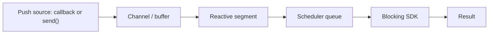

# Limits When Mixing Imperative and Reactive

## 1. The Problem to Solve

In Spring Integration Core, a flow can accept requests through a gateway returning `Mono`, traverse a `MessageChannel`, call a synchronous JDBC or HTTP library, and then continue with Reactor. Such a configuration is valid, yet segments within the flow can follow very different execution contracts.

For example, an inventory-lookup system receives 200 requests per second via WebFlux, while the inventory SDK provides only a synchronous method taking roughly 100 ms. Switching the return type to `Mono<StockResult>` expresses an asynchronous outcome; serving capacity still depends on how many SDK calls execute, connection counts, and queued work.

This lesson belongs to the **Reactive support** chapter of **SPRING_INTEGRATION_CORE**, focusing on identifying and designing those boundaries with `Message`, channels, endpoints, gateways, and Java DSL. After this lesson, you should be able to distinguish:

- Which segments defer execution until subscription vs. execute immediately.
- Which segments support Reactive Streams demand vs. accept messages solely via push.
- Which segments retain caller threads, transactions, or processing order.
- Who owns subscriptions, errors, timeouts, and still-running work after cancellation.

## 2. Properties That Are Frequently Conflated

| Property | Meaning to Verify | What Cannot Be Inferred |
|---|---|---|
| Imperative | Control flow is expressed with method calls and return values | Every call is slow or blocking |
| Reactive | Work is composed via publishers and signals for subscription, demand, data, error, and completion | Every library called inside is non-blocking |
| Asynchronous | Results can arrive after the initial call returns | Backpressure exists or no thread is held while waiting |
| Non-blocking I/O | Waiting for I/O does not tie up a worker thread per call in the traditional blocking way | There are no connection, buffer, or CPU limits |
| Backpressure | Subscriber throttles item requests from a protocol-compliant publisher | External push sources automatically slow down |
| Bounded buffering | Waiting capacity has a limit | Behavior when full matches business requirements |
| Transactional | Operations run within corresponding transaction boundaries and resources | Transactions cross every channel or scheduler |

A transformer that merely normalizes strings is imperative yet can run very fast on the current thread. Conversely, a lambda inside `map()` calling JDBC still holds the thread while waiting on the database.

Reactor does not spawn a dedicated thread for every `Mono` or `Flux` by default. `subscribeOn()` affects upstream subscription; `publishOn()` switches the execution context for downstream signals after its position. Reactor blocking calls like `block()` can be rejected on threads marked non-blocking; blocking JDBC is not necessarily detected in the same way. [Reactor: Threading and Schedulers](https://projectreactor.io/docs/core/release/reference/coreFeatures/schedulers.html)

## 3. Reading Channel and Endpoint Contracts Accurately

### 3.1. Channels Determine Message Handoff

| Component | Notable Execution Contract | Boundary to Inspect |
|---|---|---|
| `DirectChannel` | Invokes handler on the sender thread in normal usage | Slow handlers block the caller thread |
| `ExecutorChannel` | Hands off execution via an executor | Queues, rejections, and cross-thread transactions |
| `QueueChannel` | Stores messages for consumers to receive later | Capacity, send timeouts, pollers, persistence durability |
| `FluxMessageChannel` | Feeds messages into a publisher for Reactive Streams consumption | Push input vs. publisher input, buffering, subscriptions |
| `ReactiveStreamsConsumer` | Endpoint consuming via the reactive model | Whether logic inside the handler blocks |

`ExecutorChannel` offloads threads; it does not provide the `request(n)` protocol. With a bounded `QueueChannel`, `send()` may block when full depending on call form and timeout.

`FluxMessageChannel` is not a standard `PollableChannel` or `SubscribableChannel`. It also accepts publisher sources via `subscribeTo(...)`. Calling imperative `send(message)` on this channel remains a push operation at the entry point. [Spring Integration: Message Channel Implementations](https://docs.spring.io/spring-integration/reference/channel/implementations.html)

### 3.2. Distinguishing Endpoint-Level Reactive Support from Flow-Wide Reactivity

The endpoint `reactive()` option creates a `ReactiveStreamsConsumer`, even when the input channel is not a `FluxMessageChannel`. It can accept a customizer function over the source flux, such as adding `publishOn()`. This changes how the endpoint consumes messages; it does not magically convert blocking code inside into non-blocking code. [Spring Integration: The reactive() Endpoint](https://docs.spring.io/spring-integration/reference/dsl/java-reactive.html)

When reading a Java DSL flow, mark three kinds of boundaries:

1. **Message handoff:** does the channel buffer, switch threads, or bridge to a publisher?
2. **Work execution:** does the endpoint call a pure function, a blocking driver, or a reactive client?
3. **Result return:** is the reply a completed value, a publisher representing work, or a send-accepted signal?

For instance, placing two `FluxMessageChannel`s on either side of a JDBC call only wires flow segments together. JDBC itself still needs a thread and a connection for the duration of the operation.

## 4. Backpressure Has a Scope, While Load Can Bypass That Scope

Consider the flow:



In this design, at least three points need separate control:

- The rate at which the push source is admitted into the system.
- The number of tasks subscribed or queued.
- The number of SDK calls actually executing.

If a source publisher honors demand, downstream can request data matching its processing capacity. If the provider only pushes callbacks, the system must decide what to do when it cannot accept more: reject, persist durably for later processing, drop by business policy, or ask the source to pause if the API supports it.

Never assume `FluxMessageChannel` is a durable queue or an application-wide pending capacity config. To know what happens under overload, examine the driver, channels, operators, schedulers, and any brokers involved.

### 4.1. Estimating Capacity Before Picking Concurrency

Suppose the SDK holds a worker for 100 ms and the system permits four concurrent calls. Ideal capacity of this segment is roughly:

```text
4 / 0.1 seconds = 40 requests/second
```

If intake remains at 200 requests/second, the excess of roughly 160 requests/second must be shed, rejected, or persisted to a backlog. This is an ideal estimate; latency variance, connection pools, and overhead can push actual capacity lower.

Increasing buffers mainly prolongs the time until saturation. If messages wait too long, returned results may no longer be useful by the time they arrive.

### 4.2. Concurrency Does Not Equal a Global Rate Limit

```java
Flux<StockResult> results = queries.flatMap(
        gateway::lookup,
        4,
        1);
```

In this example:

- `4` caps active inner publishers within a single subscription of this chain.
- `1` is prefetch per inner publisher; it is not an application-wide queue cap.
- Multiple independent subscriptions together can open more than four calls.
- When a blocking call refuses to stop after cancellation, tracked inner publishers no longer reflect all external operations still running.

If a shared limit is needed for a target service, enforce the limit on the shared resource, combining admission control with bounded queues. Limiting within individual HTTP requests does not create a shared quota.

## 5. Placing Blocking Boundaries in the Right Spot

### 5.1. Call Executing Too Early

```java
// Wrong for deferral: available() runs before Mono is created.
Mono<Integer> available = Mono.just(legacyClient.available("SKU-1"));
```

Java must evaluate the argument to `Mono.just(...)` first. If this runs on an event loop, the event loop blocks while assembling the publisher.

### 5.2. Deferral Alone Is Insufficient to Isolate Blocking

```java
// Deferred, yet may still run on the subscribing thread.
Mono<Integer> available =
        Mono.fromCallable(() -> legacyClient.available("SKU-1"));
```

The source is lazy, yet it still needs an appropriate execution venue.

```java
Mono<Integer> available =
        Mono.fromCallable(() -> legacyClient.available("SKU-1"))
                .subscribeOn(legacyScheduler);
```

This is the recommended Reactor pattern for synchronous blocking sources: `fromCallable()` defers the call and `subscribeOn()` places the work onto a suitable scheduler. `subscribeOn()` itself does not subscribe. [Reactor: How Do I Wrap a Synchronous, Blocking Call?](https://projectreactor.io/docs/core/release/reference/faq.html)

### 5.3. Switching Threads After a Call Does Not Protect What Already Ran

```java
// available() sits before publishOn(), so it can still block upstream.
Flux<Integer> available = skus
        .map(legacyClient::available)
        .publishOn(legacyScheduler);
```

A clearer boundary expression is:

```java
Flux<Integer> available = skus.flatMap(
        sku -> Mono.fromCallable(() -> legacyClient.available(sku))
                .subscribeOn(legacyScheduler),
        4);
```

Scheduler and concurrency must be chosen according to real resources: connection pools, partner quotas, wait times, and latency budgets. Sprinkling schedulers onto every endpoint only increases handoffs and makes boundaries harder to trace.

## 6. Java DSL Example: Reactive Gateway Calling a Blocking Inventory Service

The example is a request–reply stock-lookup flow. The external service has only a synchronous API. The design returns status `FOUND`, `TIMEOUT`, or `UNAVAILABLE` so callers do not confuse infrastructure errors with zero stock.

The snippets use Java 17+, Spring Integration Core with Java DSL, Reactor Core, and Spring configuration. Place the types in the same package; each public type can go in its own Java file. The application supplies a `LegacyStockClient` bean backed by a real SDK or test double. This example does not include a standalone Spring Boot application.

### 6.1. Data Contract and Legacy API

```java
public record StockQuery(String sku) {
}

public record StockResult(
        String sku,
        String status,
        Integer available) {
}

@FunctionalInterface
public interface LegacyStockClient {

    int available(String sku);
}
```

`available = null` in an error outcome means quantity could not be determined. `FOUND` with `available = 0` is a successful lookup indicating out of stock.

### 6.2. Adapter Isolating the Blocking Call

```java
import java.time.Duration;
import java.util.concurrent.TimeoutException;
import java.util.logging.Level;
import java.util.logging.Logger;

import reactor.core.publisher.Mono;
import reactor.core.scheduler.Scheduler;

public final class StockBoundary {

    private static final Logger LOG =
            Logger.getLogger(StockBoundary.class.getName());

    private final LegacyStockClient legacy;
    private final Scheduler scheduler;
    private final Duration deadline;

    public StockBoundary(
            LegacyStockClient legacy,
            Scheduler scheduler,
            Duration deadline) {

        this.legacy = legacy;
        this.scheduler = scheduler;
        this.deadline = deadline;
    }

    public Mono<StockResult> lookup(StockQuery query) {
        return Mono.fromCallable(() -> legacy.available(query.sku()))
                .subscribeOn(scheduler)
                .map(quantity -> new StockResult(
                        query.sku(), "FOUND", quantity))
                .timeout(deadline)
                .doOnError(error -> LOG.log(
                        Level.WARNING,
                        "Stock lookup failed: " + query.sku(),
                        error))
                .onErrorResume(
                        TimeoutException.class,
                        error -> Mono.just(new StockResult(
                                query.sku(), "TIMEOUT", null)))
                .onErrorResume(
                        Exception.class,
                        error -> Mono.just(new StockResult(
                                query.sku(), "UNAVAILABLE", null)));
    }
}
```

Design decisions in the adapter:

- The SDK call appears exclusively inside `fromCallable()`.
- The scheduler is injected so resources have an explicit owner.
- `timeout` sits outside the scheduled source, so queue wait time also counts against the deadline.
- Errors are logged before mapping to a business outcome.
- Neither `subscribe()` nor `block()` is called inside the adapter.

The policy mapping every `Exception` to `UNAVAILABLE` is an illustrative choice for this read-only API. In production applications, classify auth, validation, and technical errors per the API contract. Do not copy this pattern verbatim for payment capture or order creation, because an observed exception does not prove side effects never occurred.

### 6.3. Declaring the Scheduler and Integration Flow

```java
import java.time.Duration;

import org.springframework.context.annotation.Bean;
import org.springframework.context.annotation.Configuration;
import org.springframework.integration.config.EnableIntegration;
import org.springframework.integration.annotation.IntegrationComponentScan;
import org.springframework.integration.dsl.IntegrationFlow;

import reactor.core.scheduler.Scheduler;
import reactor.core.scheduler.Schedulers;

@Configuration
@EnableIntegration
@IntegrationComponentScan(basePackageClasses = StockGateway.class)
public class StockFlowConfiguration {

    @Bean(destroyMethod = "dispose")
    public Scheduler legacyStockScheduler() {
        return Schedulers.newBoundedElastic(4, 32, "legacy-stock");
    }

    @Bean
    public StockBoundary stockBoundary(
            LegacyStockClient legacy,
            Scheduler legacyStockScheduler) {

        return new StockBoundary(
                legacy,
                legacyStockScheduler,
                Duration.ofSeconds(2));
    }

    @Bean
    public IntegrationFlow stockFlow(StockBoundary stockBoundary) {
        return IntegrationFlow.from("stockRequests")
                .handle(
                        StockQuery.class,
                        (query, headers) -> stockBoundary.lookup(query),
                        endpoint -> endpoint.async(true))
                .channel(channels -> channels.flux())
                .handle(
                        StockResult.class,
                        (result, headers) -> result)
                .get();
    }
}
```

Reading the flow in handoff order:

1. `stockRequests` is the request entry point; when auto-created by name in this DSL config, it is a `DirectChannel`.
2. The first handler returns `Mono<StockResult>` without calling the SDK immediately.
3. The output is a `FluxMessageChannel`, where reactive results are composed and emitted downstream as the publisher runs.
4. The final handler returns the value via the request's `replyChannel` because no dedicated output channel is declared. It is kept here to make the return to the request–reply contract explicit.

With a reactive output, the framework supports flattening reactive replies; since Spring Integration 6.1, async mode is enabled by default for `ReactiveStreamsSubscribableChannel` outputs. The config above still writes `async(true)` to state intent explicitly. If switching the output to an imperative channel, re-examine how publishers are handled and when subscription occurs. [Spring Integration: Asynchronous Service Activator](https://docs.spring.io/spring-integration/reference/service-activator.html)

In `newBoundedElastic(4, 32, ...)`, the thread cap is four; the limit of 32 queued tasks applies per backing thread, not as a single global queue of 32 items. Worker assignment and rejections must be accounted for when designing admission control; do not assume every request is always accepted until a simple total hits a threshold. The dedicated bean is disposed when the context closes. [Reactor: Schedulers API](https://projectreactor.io/docs/core/release/api/reactor/core/scheduler/Schedulers.html)

### 6.4. Gateway Returning Mono and Start Timing

```java
import org.springframework.integration.annotation.MessagingGateway;

import reactor.core.publisher.Mono;

@MessagingGateway(defaultRequestChannel = "stockRequests")
public interface StockGateway {

    Mono<StockResult> lookup(StockQuery query);
}
```

```java
Mono<StockResult> work =
        gateway.lookup(new StockQuery("SKU-1"));

// Return work to the reactive layer responsible for subscribing,
// such as returning directly from a WebFlux controller.
```

A gateway returning `Mono` defers flow execution until the publisher is subscribed. That does not promise downstream runs on a new thread or non-blockingly. If the first handler is replaced with a direct SDK call, the subscriber's thread can still be blocked. [Spring Integration: Reactor Mono Gateway](https://docs.spring.io/spring-integration/reference/gateway.html#reactor-mono)

This example bounds SDK workers and observable wait times. It is not a complete load-admission policy: requests can still queue before the scheduler and inside other buffers. For high-load production systems, add intake limits and test behavior at capacity.

## 7. A Publisher in Payload Differs from a Resolved Result

Distinguish:

```text
Message<StockResult>
Message<Mono<StockResult>>
Mono<Message<StockResult>>
Flux<Message<StockResult>>
```

- `Message<StockResult>`: a message already containing the reply value.
- `Message<Mono<StockResult>>`: a payload describing pending work or a future value.
- `Mono<Message<StockResult>>`: a publisher emitting one message.
- `Flux<Message<StockResult>>`: a stream of many independent messages.

A router trying to read `StockResult.status()` will fail to work as intended if the actual payload is still `Mono<StockResult>`. The declared Java service return type is only part of the contract; how endpoints and output channels resolve publishers matters just as much.

APIs like `IntegrationFlow.from(Publisher)`, `toReactivePublisher()`, `fluxTransform()`, and terminal `handleReactive()` serve different composition directions. Notably, `handleReactive()` fits terminal `Mono<Void>` processing and does not synthesize a data reply for an awaiting gateway. [Spring Integration: Reactive Streams Support](https://docs.spring.io/spring-integration/reference/reactive-streams.html)

In request–reply scenarios, also design the empty-emission case. For example, a lookup returning `Mono.empty()` must be converted into a "not found" result or an appropriate error if the caller must always receive a reply.

## 8. Transactions Do Not Automatically Follow Messages

### 8.1. Imperative Transactions Are Typically Thread-Bound

An active JDBC transaction on the caller thread does not automatically migrate to an `ExecutorChannel`, poller, or scheduler thread. A successful handoff can end the work scope awaited by the caller while downstream continues running. Exact commit timing also depends on method boundaries or transaction interceptors. [Spring Integration: Transaction Boundaries](https://docs.spring.io/spring-integration/reference/transactions.html)

A classic design bug is:

```java
@Transactional
public Mono<OrderResult> place(OrderCommand command) {
    return Mono.fromCallable(() -> jdbcOrders.insert(command))
            .subscribeOn(legacyScheduler);
}
```

With an imperative transaction manager, do not assume the transaction spans the later subscription and JDBC call. Placing an imperative annotation outside a publisher-returning method does not turn a thread-bound transaction into a reactive transaction.

### 8.2. Opening the Transaction Where the Work Actually Runs

A clearer boundary for JDBC is:

```java
public Mono<OrderResult> place(OrderCommand command) {
    return Mono.fromCallable(() ->
                    transactionTemplate.execute(status -> {
                        OrderResult result = jdbcOrders.insert(command);
                        jdbcAudit.append(result.orderId());
                        return result;
                    }))
            .subscribeOn(legacyScheduler);
}
```

This example assumes `jdbcOrders` and `jdbcAudit` share the same resource or participate in `transactionTemplate`'s transaction manager. The callback runs on the worker, so the transaction opens where JDBC calls actually happen. Exceptions requiring rollback must exit the callback per configured rollback rules.

With a reactive driver, use an appropriate `ReactiveTransactionManager` and `TransactionalOperator` to wrap the chain:

```java
return reactiveOrders.insert(command)
        .flatMap(result ->
                reactiveAudit.append(result.orderId())
                        .thenReturn(result))
        .as(transactionalOperator::transactional);
```

These two transaction APIs serve two different models; choose based on participating resources and execution venue. [Spring Framework: Programmatic Transaction Management](https://docs.spring.io/spring-framework/reference/data-access/transaction/programmatic.html)

If a flow both writes to a database and makes an HTTP call or sends to another system, switching schedulers or adding annotations does not create cross-system atomicity. For guaranteed delivery requirements, use a transactional outbox, idempotency, or compensating actions per business needs.

## 9. Handling Errors at Both Message and Publisher Boundaries

### 9.1. Try/Catch Around Publisher Creation Misses Later Failures

```java
try {
    Mono<StockResult> work = gateway.lookup(query);
    return work;
}
catch (RuntimeException error) {
    // Handles only errors thrown while creating/returning the publisher.
}
```

If the SDK is called after subscription, those errors must be handled inside the reactive chain or by the infrastructure consuming the chain.

In synchronous segments using `DirectChannel`, exceptions usually unwind along the call stack to the sender. Once handed off across a queue or executor, the sender cannot catch downstream exceptions on the same call stack. Spring Integration provides `ErrorMessage` with `errorChannel` resolved from configuration and message headers. Verify endpoint/adapter behavior rather than assuming every error automatically lands in the same place. [Spring Integration: Error Handling](https://docs.spring.io/spring-integration/reference/error-handling.html)

### 9.2. Scoping Error Recovery to the Unit of Work

Suppose many orders are processed independently:

```java
Flux<OrderOutcome> outcomes = orders.flatMap(
        order -> place(order)
                .map(OrderOutcome::success)
                .onErrorResume(error ->
                        Mono.just(OrderOutcome.failure(order.id(), error))),
        4);
```

Here, an inner publisher's error is converted into an outcome for that specific order. The outer chain can continue receiving other orders.

If `onErrorResume()` sits outside `flatMap()`, an error reaching it has already terminated the upstream sequence; the fallback replaces the failed sequence rather than resuming unprocessed items. `retry()`, meanwhile, re-subscribes to the source; with a cold source, that can re-execute work. [Reactor: Handling Errors](https://projectreactor.io/docs/core/release/reference/coreFeatures/error-handling.html)

`OrderOutcome` here is an illustrative application result type containing success and failure variants. With this pattern, metrics and callers must inspect the outcome to track error rates; a low terminal `onError` count no longer proves the system succeeded.

### 9.3. Finalizing the Error Contract per Flow

| Flow Type | Contract to Design |
|---|---|
| Request–reply | Caller receives error via publisher or receives a reply describing failure clearly |
| One-way | Somewhere to record errors and decide retry, discard, or store for reprocessing |
| Multi-element batch | Decide whether one item failing terminates the batch or becomes an item outcome |
| Flow with side effects | Distinguish observed errors from actual state in the target system |

Sending an `ErrorMessage` for monitoring does not fulfill a gateway reply. Conversely, turning an error into a reply inside an adapter can hide terminal errors from the framework. Both choices must align with how callers and operations define success.

## 10. Timeouts and Cancellation Do Not Prove Side Effects Stopped

In the inventory example, a two-second timeout can return `TIMEOUT` while the SDK keeps running if it lacks interruption or proper client timeout support. Because that is a read operation, the impact is mainly continued worker and connection consumption.

For write operations, trace this sequence:

```text
t0: Start calling payment system.
t1: Payment system charges the account.
t2: Application times out before reading the response.
t3: Caller retries.
```

At `t2`, the accurate status may be "indeterminate" rather than "not paid." Without an idempotency key or reconciliation, the retry at `t3` can cause a duplicate side effect.

A sound design coordinates:

- Client/driver timeouts: appropriate connect, read, query, or request timeouts.
- Business deadline: including queued wait time.
- Stable idempotency key across retries, tied to the business operation.
- Post-timeout verification, such as querying status by request ID.
- Bounded retry rules classifying which errors are eligible for retry.

When working with a cold publisher, two independent subscriptions can also trigger two separate calls even without a `retry` operator. Returning `Mono` from a gateway or adapter does not automatically guarantee exactly-once execution.

Never use `cache()` as a general fix for duplicate writes: caching inside one publisher instance does not replace a shared idempotency store, crash recovery across restarts, or coordination across multiple application instances.

## 11. Message Headers, Reactor Context, and ThreadLocal Have Three Distinct Scopes

| Mechanism | Typically Appropriate Scope | Risk at Boundaries |
|---|---|---|
| Message headers | Metadata traveling with one message: business keys, correlation, reply, error | Lost when building a new message without copying needed headers |
| Reactor Context | Data bound to a reactive subscription | Does not automatically become headers on every message |
| ThreadLocal/MDC | Data on the current thread | Thread switches can lose data or leak stale data across requests |

A hot channel shared across many requests does not give each request an independent subscription carrying all of the caller's context. If metadata must follow a message across multiple flow segments, pass it explicitly in headers and design propagation points carefully.

Example of creating a new message inside a transformer:

```java
Message<StockResult> reply = MessageBuilder
        .withPayload(result)
        .copyHeaders(request.getHeaders())
        .build();
```

When building replies manually, preserve flow-critical headers, especially `replyChannel`, `errorChannel`, and correlation IDs if used. Do not rely on the framework automatically restoring headers across every endpoint type.

Reactor supports context-propagation integration with Micrometer when properly configured. That mechanism requires specific dependencies, accessors, and propagation modes; never assume all application `ThreadLocal` values cross every scheduler or message boundary automatically. [Reactor: Context-Propagation Support](https://projectreactor.io/docs/core/release/reference/advanced-contextPropagation.html)

## 12. Enterprise Integration Patterns Still Have Their Own Limits

### 12.1. Transformer

Synchronous transformers suit small, deterministic, fast conversions. If "transformation" requires blocking I/O, extract it into a service endpoint with explicit resource boundaries so wait times, failures, and retries are visible.

When a transformer returns a publisher or creates a new `Message`, check both downstream payload types and metadata preservation. A flow can match declared types at compile time yet fail at runtime when values are consumed.

### 12.2. Router

Routers route based on available data. If routing depends on a reactive result, place the routing step after the result has been resolved into an inspectable payload.

Branches with different speeds also raise ordering and completion questions: a faster branch finishing first does not mean the whole business flow is done. When branches must be coordinated, specify correlation and completion criteria explicitly.

### 12.3. Filter

In request–reply, a filter dropping a message without emitting a reply can leave callers waiting indefinitely. Choose one explicit behavior: return a rejection outcome, throw an appropriate error, or route to a discard flow responsible for fulfilling the contract.

`Mono.empty()` must also be interpreted accurately where used. "Zero emitted elements" does not mean "valid empty reply" in every request–reply protocol.

### 12.4. Splitter and Aggregator

A splitter turns one message into multiple processing units, so concurrency and buffering budgets must be sized for post-split element counts. A request containing 10,000 line items has very different resource characteristics from a single-line request.

An aggregator holds state for incomplete groups. Design questions to answer include:

- How many open groups and messages per group are allowed at most?
- What happens when an item is filtered out, fails, or never arrives?
- What timeout, expiry, discard, and late-message policies apply?
- Does state live in memory or in a durable message store?
- Where is the reply to the original request produced if too few items arrive?

Reactive stream demand does not guarantee a group will complete. A finite batch and an unbounded stream require different release strategies.

## 13. Ordering, Subscriptions, and Lifecycle

### 13.1. Completion Order Differs from Arrival Order

If business rules allow independent processing, `flatMap()` with concurrency is a natural choice. If sequential per-element processing is required, consider `concatMap()`, accepting lower parallelism.

`flatMapSequential()` preserves emission order yet still subscribes to multiple tasks concurrently. Hence it does not guarantee side-effect order at external systems. For multiple events targeting the same account, design key-based ordering or serialize within an appropriate key partition.

### 13.2. Avoid Subscribing Manually Inside Request–Reply Logic

```java
public void process(OrderCommand command) {
    place(command).subscribe(); // Creates an execution branch detached from the caller's contract.
}
```

This style makes it hard for callers to know when work finishes, who owns errors, and whether cancellation still works. When the framework owns the subscription, return the publisher to the framework.

At a standalone application edge, manual subscription may be necessary, in which case that edge must own error callbacks, cancellation, and shutdown. Do not treat "never call subscribe" as an absolute rule for every situation.

### 13.3. Shutdown Plan for Hybrid Flows

A sensible sequence can be:

1. Stop accepting new work.
2. Stop message-generating sources or pollers.
3. Await already-accepted in-flight work up to a bounded deadline.
4. Record or persist indeterminate in-flight tasks according to contract.
5. Dispose schedulers and close clients once work using them has drained.

Do not assume every publisher is cold or replayable. Especially when exposing a `Publisher` from an integration flow, inspect lifecycle, subscription timing, and how the source behaves before a subscriber connects.

## 14. Testing Execution Boundaries

Tests aim to observe what the flow promises callers: when calls begin, which results emit, where tasks run, and what happens after failures or cancellation.

### 14.1. Verifying a Lazy Adapter and Expected Output

The following JUnit 5 example uses `StockBoundary` from above and the `reactor-test` test dependency:

```java
import static org.junit.jupiter.api.Assertions.assertEquals;

import java.time.Duration;
import java.util.concurrent.atomic.AtomicInteger;

import org.junit.jupiter.api.Test;

import reactor.core.publisher.Mono;
import reactor.core.scheduler.Scheduler;
import reactor.core.scheduler.Schedulers;
import reactor.test.StepVerifier;

class StockBoundaryTest {

    @Test
    void invokesLegacyClientOnlyAfterSubscription() {
        AtomicInteger calls = new AtomicInteger();
        Scheduler scheduler =
                Schedulers.newBoundedElastic(1, 4, "test-stock");

        try {
            LegacyStockClient legacy = sku -> {
                calls.incrementAndGet();
                return 7;
            };

            StockBoundary boundary = new StockBoundary(
                    legacy,
                    scheduler,
                    Duration.ofSeconds(2));

            Mono<StockResult> work =
                    boundary.lookup(new StockQuery("SKU-1"));

            assertEquals(0, calls.get());

            StepVerifier.create(work)
                    .expectNext(new StockResult("SKU-1", "FOUND", 7))
                    .expectComplete()
                    .verify(Duration.ofSeconds(3));

            assertEquals(1, calls.get());
        }
        finally {
            scheduler.dispose();
        }
    }
}
```

This test verifies adapter deferral and the returned value. It does not prove the flow wired the reply channel properly, enforced effective load limits, or that a real SDK supports cancellation.

`StepVerifier`, `TestPublisher`, and `PublisherProbe` help assert signals, control sources, and verify branch subscriptions. Virtual time helps test time operators; it does not speed up a real blocking SDK. [Reactor: Testing](https://projectreactor.io/docs/core/release/reference/testing.html)

### 14.2. Scenarios to Observe in Integration Tests

| Scenario | Evidence to Collect |
|---|---|
| Gateway called without subscribing | No request sent to the legacy client yet |
| Subscribe to a valid request | Receives `StockResult`, not an unintended `Mono` payload |
| Legacy client is slow | Does not hold event loop; deadline returns proper status |
| Load exceeds capacity | Limits hold; rejection or queued storage matches policy |
| One item fails mid-batch | Other items continue or stop per contract |
| Caller cancels during SDK call | Distinguish canceled publisher from still-running external work |
| Crossing schedulers or channels | Metadata and transactions stay within intended scope |
| Filter or branch produces no output | Caller does not wait indefinitely by accident |
| Retry after write timeout | No duplicate side effects or clear reconciliation exists |

Use latches or controlled signals inside fake clients to control start, finish, and concurrent call counts. Avoid relying on scattered `Thread.sleep()` calls assuming thread scheduling. When testing backpressure, observe both upstream request counts and how much work actually entered schedulers or drivers.

## 15. Choosing Composition by Problem Context

| Context | Appropriate Design Direction |
|---|---|
| Mostly blocking SDKs, moderate load, clear JDBC transactions | Imperative flow with bounded resources and explicit error behavior |
| Reactive source and reactive clients needing streaming | Preserve continuous publishers and demand; minimize blocking detours |
| Reactive application calling one blocking SDK | Lazy adapter, bounded scheduler, admission control, timeouts, and metrics |
| Long-running work continuing after caller departs | Durable handoff, job ID, and status tracking |
| Strict per-entity write ordering needed | Sequential or key-partitioned coordination; verify side-effect order |
| Guaranteed delivery across multiple systems | Business-level durability and idempotency |

A hybrid flow can be a pragmatic choice during incremental migration. Its value comes from clear boundaries and verifiable contracts, not from how many `Mono` or `Flux` types appear in the code.

## 16. Core Design Principles to Maintain

- A reactive return type represents work; verify when and where the work actually runs.
- Every transition from publisher to push, queue, thread, or driver is a point to re-evaluate demand and resources.
- Offloading blocking work to a scheduler protects upstream threads; load and wait times still must be bounded.
- Transactions, message headers, and Reactor Context have distinct scopes.
- Timeouts, cancellations, replies, and business commits are distinct events; specify which event proves success.
- Assign explicit owners for subscriptions, error handling, retries, and shutdown at every boundary.

When these points are stated explicitly, `Message`, channels, and endpoints still form an understandable flow even when one part of the system remains imperative and another part is reactive.