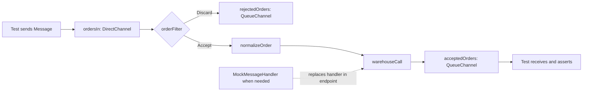

# Spring Integration Test

**Chapter:** Testing support  
**Scope:** Spring Integration Core (`SPRING_INTEGRATION_CORE`)

A message flow can start up successfully and still be wrong: a transformer drops tracking headers, a filter discards the wrong data, a router sends to the wrong branch, an aggregator groups the wrong orders, or worker errors only appear in logs. Testing a flow needs to prove the message contract from entry point to observation point, while also controlling components that run on a schedule or connect externally.

This lesson uses Message, MessageChannel, endpoints, and the Java DSL to build tests that clearly explain why a case passes or fails. The examples follow the Spring Integration 6.5.x API, Java 17 or later, and JUnit Jupiter 5. Specifically, `substituteTriggerFor(...)` requires Spring Integration 6.3 or later. When applying these to another version branch, check the corresponding dependencies and APIs.

## 1. Objectives and testing boundaries

After this lesson, you will be able to:

- Choose between unit tests, testing a flow segment, and testing adapters against a real system.
- Load Java DSL configurations using Spring TestContext and use `@SpringIntegrationTest`.
- Replace an endpoint's source or handler using `MockIntegrationContext`.
- Verify payloads, business headers, discard branches, and processing counts.
- Control polling with `OnlyOnceTrigger` instead of waiting for an arbitrary duration.
- Choose how to observe errors based on execution thread boundaries.
- Design tests for routers, gateways, and stateful aggregators.

### 1.1. Three complementary testing levels

| Testing level | Real components in the test | Example contract to prove |
| --- | --- | --- |
| Unit test | Business processing function or POJO | Normalize order codes according to the defined rules |
| Flow testing in ApplicationContext | Channels, endpoints, DSL configuration; external boundaries can be mocked | Valid messages pass through the filter, are transformed, and retain tracking headers |
| Adapter and external system testing | Real adapter with a test service, broker, or database | Header mapping, serialization, authentication, retry, and transactions matching the protocol |

A mock returning success does not prove that the HTTP request was constructed correctly or that the broker received the message. Conversely, using a real broker for every string normalization case makes the failure surface broader than what needs to be tested.

For each test, write a sentence beforehand such as: "When receiving an order code with whitespace, the flow returns the normalized code and preserves `requestId`". That sentence determines the input data, observation point, and assertions.

### 1.2. Distinguishing the tools

Spring Integration splits testing support into `spring-integration-test-support` for shared utilities and `spring-integration-test` for test context configuration and the ability to substitute integration components. These tools work alongside Spring Test, JUnit, Mockito, and assertion libraries. See [Testing support](https://docs.spring.io/spring-integration/reference/6.5/testing.html).

| Tool | Role in this lesson |
| --- | --- |
| `@SpringJUnitConfig` | Connects JUnit Jupiter with Spring TestContext and selects configuration classes |
| `@SpringIntegrationTest` | Registers Spring Integration testing support |
| `MockIntegrationContext` | Replaces the source, handler, or trigger in a real endpoint |
| `MockIntegration` | Creates sources and handlers for testing |
| `QueueChannel` | Stores results for the test to receive and verify |
| `ArgumentCaptor<Message<?>>` | Captures messages entering a substituted handler |
| `OnlyOnceTrigger` | Schedules once to control polling |
| `TestUtils` | Helps inspect internal configuration when needed |

`MockIntegrationContext` is not a mock ApplicationContext. It operates on endpoints inside the Spring-managed context. Therefore, tests can still verify channel wiring, processing order, and header propagation across the remaining parts of the flow.

## 2. Preparing dependencies and the test context

### 2.1. Dependencies

If the project already uses compatible Spring Boot dependency management, you can declare the following dependencies without specifying versions explicitly:

```xml
<dependencies>
    <dependency>
        <groupId>org.springframework.integration</groupId>
        <artifactId>spring-integration-core</artifactId>
    </dependency>

    <dependency>
        <groupId>org.springframework.integration</groupId>
        <artifactId>spring-integration-test</artifactId>
        <scope>test</scope>
    </dependency>

    <dependency>
        <groupId>org.springframework.boot</groupId>
        <artifactId>spring-boot-starter-test</artifactId>
        <scope>test</scope>
    </dependency>
</dependencies>
```

This is a dependency snippet to add to a project that already has version management, not a standalone `pom.xml`. `spring-boot-starter-test` provides the testing libraries used in the examples; the test classes below still load the context via `@SpringJUnitConfig`.

If not using Spring Boot, provide `spring-integration-core`, `spring-integration-test`, Spring Test, JUnit Jupiter, Mockito, and AssertJ through the project's dependency management. Keep Spring Integration artifacts on the same version and use a compatible Spring Framework release train. Do not mix arbitrary versions of core and the test library.

### 2.2. Two annotations solve two distinct tasks

```java
@SpringJUnitConfig(OrderFlowConfiguration.class)
@SpringIntegrationTest
class OrderFlowTest {
}
```

`@SpringJUnitConfig` selects the configuration and registers `SpringExtension` for JUnit Jupiter. `@SpringIntegrationTest` adds infrastructure such as the `MockIntegrationContext` bean; it does not replace Spring Test's context-loading role. How these annotations combine is described in [Spring TestContext support classes](https://docs.spring.io/spring-framework/reference/testing/testcontext-framework/support-classes.html) and [SpringIntegrationTest 6.5.5 source code](https://raw.githubusercontent.com/spring-projects/spring-integration/v6.5.5/spring-integration-test/src/main/java/org/springframework/integration/test/context/SpringIntegrationTest.java).

If you need to test auto-configuration and Boot application wiring together, you can use `@SpringBootTest` alongside `@SpringIntegrationTest`. For a flow with explicit configuration, loading the configuration class directly makes the test scope easier to define.

## 3. Complete example: testing an order intake flow

The sample flow has the following contract:

1. The message has a string order code payload.
2. Blank strings (whitespace-only) go to `rejectedOrders`.
3. Valid strings are trimmed and converted to uppercase.
4. The `warehouseCall` endpoint produces a reply.
5. Results are stored in `acceptedOrders`; the `requestId` header is preserved.



### 3.1. Flow configuration

Place the following configuration class in package `example.integration`. In a real project, tests should load the flow configuration used by the application; avoid copying a similar-looking flow just to make tests pass.

```java
package example.integration;

import java.util.Locale;

import org.springframework.context.annotation.Bean;
import org.springframework.context.annotation.Configuration;
import org.springframework.integration.channel.DirectChannel;
import org.springframework.integration.channel.QueueChannel;
import org.springframework.integration.config.EnableIntegration;
import org.springframework.integration.dsl.IntegrationFlow;

@Configuration
@EnableIntegration
public class OrderFlowConfiguration {

    @Bean
    public DirectChannel ordersIn() {
        return new DirectChannel();
    }

    @Bean
    public QueueChannel acceptedOrders() {
        return new QueueChannel(20);
    }

    @Bean
    public QueueChannel rejectedOrders() {
        return new QueueChannel(20);
    }

    @Bean
    public IntegrationFlow orderFlow() {
        return IntegrationFlow.from(ordersIn())
                .<String>filter(
                        value -> !value.isBlank(),
                        endpoint -> endpoint
                                .id("orderFilter")
                                .discardChannel(rejectedOrders()))
                .<String, String>transform(
                        value -> value.trim().toUpperCase(Locale.ROOT),
                        endpoint -> endpoint.id("normalizeOrder"))
                .handle(
                        String.class,
                        (payload, headers) -> "ACK:" + payload,
                        endpoint -> endpoint.id("warehouseCall"))
                .channel(acceptedOrders())
                .get();
    }
}
```

The handler creating `ACK:` is an inline processor to keep the example self-contained. In an application, this spot might be a service call or an outbound gateway. When replaced by a real adapter, add separate tests for the adapter's communication contract.

### 3.2. Test class

Place the test class in the same package. The tests below do not require a broker, database, or network service.

```java
package example.integration;

import org.junit.jupiter.api.AfterEach;
import org.junit.jupiter.api.BeforeEach;
import org.junit.jupiter.api.Test;
import org.mockito.ArgumentCaptor;

import org.springframework.beans.factory.annotation.Autowired;
import org.springframework.beans.factory.annotation.Qualifier;
import org.springframework.integration.channel.QueueChannel;
import org.springframework.integration.test.context.MockIntegrationContext;
import org.springframework.integration.test.context.SpringIntegrationTest;
import org.springframework.integration.test.mock.MockIntegration;
import org.springframework.integration.test.mock.MockMessageHandler;
import org.springframework.messaging.Message;
import org.springframework.messaging.MessageChannel;
import org.springframework.messaging.support.MessageBuilder;
import org.springframework.test.context.junit.jupiter.SpringJUnitConfig;

import static org.assertj.core.api.Assertions.assertThat;

@SpringJUnitConfig(OrderFlowConfiguration.class)
@SpringIntegrationTest
class OrderFlowTest {

    @Autowired
    @Qualifier("ordersIn")
    MessageChannel ordersIn;

    @Autowired
    @Qualifier("acceptedOrders")
    QueueChannel acceptedOrders;

    @Autowired
    @Qualifier("rejectedOrders")
    QueueChannel rejectedOrders;

    @Autowired
    MockIntegrationContext mockIntegrationContext;

    @BeforeEach
    void clearPreviousResults() {
        drain(acceptedOrders);
        drain(rejectedOrders);
    }

    @AfterEach
    void restoreEndpoints() {
        mockIntegrationContext.resetBeans();
        drain(acceptedOrders);
        drain(rejectedOrders);
    }

    @Test
    void shouldNormalizeOrderAndPreserveRequestId() {
        Message<String> request = MessageBuilder
                .withPayload("  po-42  ")
                .setHeader("requestId", "req-100")
                .build();

        assertThat(ordersIn.send(request, 1_000)).isTrue();

        Message<?> reply = acceptedOrders.receive(1_000);

        assertThat(reply).isNotNull();
        assertThat(reply.getPayload()).isEqualTo("ACK:PO-42");
        assertThat(reply.getHeaders().get("requestId"))
                .isEqualTo("req-100");
        assertThat(rejectedOrders.receive(0)).isNull();
        assertThat(acceptedOrders.receive(0)).isNull();
    }

    @Test
    void shouldSendBlankOrderToDiscardChannel() {
        Message<String> request = MessageBuilder
                .withPayload("   ")
                .setHeader("requestId", "req-101")
                .build();

        assertThat(ordersIn.send(request, 1_000)).isTrue();

        Message<?> rejected = rejectedOrders.receive(1_000);

        assertThat(rejected).isNotNull();
        assertThat(rejected.getPayload()).isEqualTo("   ");
        assertThat(rejected.getHeaders().get("requestId"))
                .isEqualTo("req-101");
        assertThat(acceptedOrders.receive(0)).isNull();
    }

    @Test
    void shouldReplaceWarehouseHandlerAndCaptureNormalizedMessage() {
        ArgumentCaptor<Message<?>> captor =
                MockIntegration.messageArgumentCaptor();

        MockMessageHandler warehouseStub =
                MockIntegration.mockMessageHandler(captor)
                        .handleNextAndReply(
                                message -> "RESERVED:" + message.getPayload());

        mockIntegrationContext.substituteMessageHandlerFor(
                "warehouseCall", warehouseStub);

        Message<String> request = MessageBuilder
                .withPayload("  po-77 ")
                .setHeader("requestId", "req-102")
                .build();

        assertThat(ordersIn.send(request, 1_000)).isTrue();

        Message<?> reply = acceptedOrders.receive(1_000);

        assertThat(reply).isNotNull();
        assertThat(reply.getPayload()).isEqualTo("RESERVED:PO-77");
        assertThat(reply.getHeaders().get("requestId"))
                .isEqualTo("req-102");

        assertThat(captor.getAllValues()).hasSize(1);
        assertThat(captor.getValue().getPayload()).isEqualTo("PO-77");
        assertThat(captor.getValue().getHeaders().get("requestId"))
                .isEqualTo("req-102");
    }

    private static void drain(QueueChannel channel) {
        while (channel.receive(0) != null) {
            // Remove data from previous test cases from the test queue.
        }
    }
}
```

### 3.3. What the test suite proved

The first test checks the output through the real flow and verifies the business header. The second test verifies the discard branch, avoiding a situation where you only know "there is no result" without knowing where the message went. The third test keeps the real filter, transformer, and channel wiring, while replacing the processing at the warehouse endpoint.

`ordersIn.send(...)` returning `true` is not enough to conclude business success: the message may have been accepted into the channel but then discarded by a filter, queued, or processed on another thread. Assertions must be placed on the outcome or side effects required by the contract.

In this example, processing before the output queue runs synchronously over `DirectChannel`. Therefore, after `send()` completes, checking `receive(0)` on the unselected branch is immediately meaningful. For asynchronous flows, concluding that "no message will appear" requires an additional completion condition or observation window.

## 4. Selecting the right endpoint when substituting components

A consuming endpoint typically wraps a `MessageHandler`. The input channel name, flow name, endpoint name, and business bean name do not necessarily match.

In the example:

| Name | Represents |
| --- | --- |
| `ordersIn` | Input channel |
| `orderFlow` | Flow definition bean |
| `warehouseCall` | Endpoint assigned an ID in the DSL |
| Handler inside `warehouseCall` | Component replaced by the stub |

The correct call is:

```java
mockIntegrationContext.substituteMessageHandlerFor(
        "warehouseCall", warehouseStub);
```

If you pass `"ordersIn"`, you are passing a channel name to an API expecting an endpoint. If you pass the name of a service bean, that is still not necessarily the endpoint containing the handler.

`substituteMessageSourceFor(...)` applies to `SourcePollingChannelAdapter` endpoints; it is not an API for replacing every kind of inbound adapter. An inbound adapter that receives events from network callbacks has a different model from a polled source. You can stop that inbound adapter and send messages into the appropriate channel to test the downstream flow. See [MockIntegrationContext](https://docs.spring.io/spring-integration/api/org/springframework/integration/test/context/MockIntegrationContext.html).

### 4.1. One-way handlers and reply-producing handlers

```java
MockMessageHandler auditStub = MockIntegration.mockMessageHandler()
        .handleNext(message -> {
            // Observe or record a message; do not emit a reply.
        });

MockMessageHandler replyStub = MockIntegration.mockMessageHandler()
        .handleNextAndReply(message -> "OK:" + message.getPayload());
```

Choose `handleNext(...)` for a one-way branch, and `handleNextAndReply(...)` when downstream flow steps or a gateway expect a result. Mocking a `MessageHandler` whose `void handleMessage(...)` method returns nothing with Mockito will not automatically produce a reply for you.

You can chain multiple behaviors to simulate consecutive requests. The last behavior continues to be used for subsequent messages; chaining stubs is not a call-count limit. If the requirement is "process only once", assert the number of captured messages or interactions. Refer to [MockMessageHandler](https://docs.spring.io/spring-integration/api/org/springframework/integration/test/mock/MockMessageHandler.html).

### 4.2. Placing mock boundaries based on what you need to prove

If you want to test the JSON mapping of an outbound HTTP gateway, replacing the entire handler with a stub skips the very part under test. In that case, keep the real gateway and use a test server that can inspect requests.

If you want to test a router placed before an outbound gateway, replacing the handler at the outer boundary is usually more appropriate. The scope of your conclusions must match the parts of the flow that actually executed.

## 5. Controlling startup with noAutoStartup

A polling adapter may read files, query a database, or receive data before a test method starts. Substituting the source in `@BeforeEach` does not undo activity that already occurred during context startup.

```java
@SpringJUnitConfig(InventoryPollingTest.Config.class)
@SpringIntegrationTest(noAutoStartup = {"inventorySource"})
class InventoryPollingTest {
}
```

`noAutoStartup` matches endpoints by bean name and simple patterns, such as `inventorySource`, `inventory*`, or `*Inbound`; these are not regular expressions. Choosing specific names makes the test clearly express which endpoint is kept stopped. The attribute's semantics are defined in [SpringIntegrationTest 6.5.5](https://raw.githubusercontent.com/spring-projects/spring-integration/v6.5.5/spring-integration-test/src/main/java/org/springframework/integration/test/context/SpringIntegrationTest.java).

Preventing endpoint auto-startup does not stop all activity during bean creation. A client that opens a connection in its constructor or initialization callback still needs a dedicated test configuration. Determine whether the activity belongs to the endpoint lifecycle or the client lifecycle.

## 6. Complete example: polling exactly once

Suppose production polls an inventory source on a long interval. The test needs to proactively receive one message without waiting for the real schedule.

Procedure:

1. Keep `inventorySource` stopped while loading the context.
2. Replace the source and trigger with the boolean parameter set to `false` so the endpoint is not started yet.
3. Start the endpoint after completing the substitutions.
4. Receive the result with a bounded timeout and wait for the polling cycle to finish.
5. Stop the endpoint before restoring components.

```java
package example.integration;

import java.time.Duration;
import java.util.Locale;

import org.junit.jupiter.api.AfterEach;
import org.junit.jupiter.api.Test;

import org.springframework.beans.factory.annotation.Autowired;
import org.springframework.beans.factory.annotation.Qualifier;
import org.springframework.context.annotation.Bean;
import org.springframework.context.annotation.Configuration;
import org.springframework.integration.channel.QueueChannel;
import org.springframework.integration.config.EnableIntegration;
import org.springframework.integration.core.MessageSource;
import org.springframework.integration.dsl.IntegrationFlow;
import org.springframework.integration.dsl.Pollers;
import org.springframework.integration.endpoint.SourcePollingChannelAdapter;
import org.springframework.integration.test.context.MockIntegrationContext;
import org.springframework.integration.test.context.SpringIntegrationTest;
import org.springframework.integration.test.mock.MockIntegration;
import org.springframework.integration.test.util.OnlyOnceTrigger;
import org.springframework.messaging.Message;
import org.springframework.messaging.support.GenericMessage;
import org.springframework.test.context.junit.jupiter.SpringJUnitConfig;

import static org.assertj.core.api.Assertions.assertThat;
import static org.mockito.Mockito.times;
import static org.mockito.Mockito.verify;

@SpringJUnitConfig(InventoryPollingTest.Config.class)
@SpringIntegrationTest(noAutoStartup = "inventorySource")
class InventoryPollingTest {

    @Autowired
    MockIntegrationContext mockIntegrationContext;

    @Autowired
    @Qualifier("inventorySource")
    SourcePollingChannelAdapter sourceEndpoint;

    @Autowired
    @Qualifier("inventoryResults")
    QueueChannel results;

    @AfterEach
    void cleanup() {
        sourceEndpoint.stop();
        mockIntegrationContext.resetBeans();
        while (results.receive(0) != null) {
            // Drain queue after stopping the producer.
        }
    }

    @Test
    void shouldPollMockSourceOnce() {
        MessageSource<String> source =
                MockIntegration.mockMessageSource("sku-9");

        OnlyOnceTrigger trigger = new OnlyOnceTrigger();

        mockIntegrationContext.substituteMessageSourceFor(
                "inventorySource", source, false);
        mockIntegrationContext.substituteTriggerFor(
                "inventorySource", trigger, false);

        sourceEndpoint.start();

        Message<?> result = results.receive(2_000);

        assertThat(result).isNotNull();
        assertThat(result.getPayload()).isEqualTo("SKU-9");

        trigger.await();
        sourceEndpoint.stop();

        verify(source, times(1)).receive();
        assertThat(results.receive(0)).isNull();
    }

    @Configuration
    @EnableIntegration
    static class Config {

        @Bean
        QueueChannel inventoryResults() {
            return new QueueChannel(10);
        }

        @Bean
        IntegrationFlow inventoryFlow() {
            MessageSource<String> realSource =
                    () -> new GenericMessage<>("production-stock");

            return IntegrationFlow
                    .from(
                            realSource,
                            endpoint -> endpoint
                                    .id("inventorySource")
                                    .poller(Pollers
                                            .fixedDelay(Duration.ofHours(12))
                                            .maxMessagesPerPoll(1)))
                    .<String, String>transform(
                            value -> value.toUpperCase(Locale.ROOT))
                    .channel(inventoryResults())
                    .get();
        }
    }
}
```

`realSource` in the configuration is just an inline source to keep the example self-contained. The same substitution mechanism applies when the endpoint polls a real source.

`OnlyOnceTrigger` determines the number of scheduled executions; `maxMessagesPerPoll(1)` limits the number of messages per poll. These two concepts are distinct: a single trigger execution can still cause the poller to read multiple messages if configured to do so. Create a new trigger instance per test; if reusing one, understand its state and `reset()`. See [OnlyOnceTrigger 6.5.5](https://raw.githubusercontent.com/spring-projects/spring-integration/v6.5.5/spring-integration-test-support/src/main/java/org/springframework/integration/test/util/OnlyOnceTrigger.java).

A source created by `MockIntegration.mockMessageSource("sku-9")` does not exhaust itself after the first read. If polled again, it can keep returning the same data. For scenarios that need the source to end, explicitly stub messages followed by `null` using Mockito; in this example, the trigger and poll limit control the number of reads. How mock sources are constructed is shown in [MockIntegration 6.5.5](https://raw.githubusercontent.com/spring-projects/spring-integration/v6.5.5/spring-integration-test/src/main/java/org/springframework/integration/test/mock/MockIntegration.java).

`trigger.await()` provides a synchronization point for the trigger cycle; assertions on the output message still need to be written separately. Receiving the first message alone does not prove the producer will not continue emitting messages.

## 7. Observing properly by channel type

| Channel type | Key consideration when testing | Suitable observation point |
| --- | --- | --- |
| `DirectChannel` | Handler is invoked on the sender's thread | Synchronous return value, exception, or a dedicated sink |
| `QueueChannel` | Messages are buffered; consumers pull point-to-point | `receive(timeout)` or the consumer's side effects |
| `ExecutorChannel` | Processing can run on an executor thread | Synchronized result, latch, or error channel |
| `PublishSubscribeChannel` | Broadcasts to subscribers; may have an executor configured | Observe the subscribers required by the contract |

`DirectChannel` does not provide `receive()` like a queue. To receive results in a test, wire to an output `QueueChannel` or use an appropriate gateway. `QueueChannel` is point-to-point: a test calling `receive()` on a queue that a business consumer is also reading from will compete for messages. Channel semantics are described in [Message Channel Implementations](https://docs.spring.io/spring-integration/reference/6.5/channel/implementations.html).

### 7.1. A timeout is a wait limit, not proof of completion

```java
Message<?> result = output.receive(2_000);
assertThat(result).isNotNull();
```

This waits up to two seconds; if a message arrives earlier, it returns immediately. It differs from `Thread.sleep(2_000)`, which merely delays the assertion.

When verifying emission counts or negative conditions on asynchronous flows, define a completion point: the producer has stopped, the trigger has finished, a callback has signaled completion, or an equivalent barrier. Calling `receive(0)` immediately after `send()` is not enough to conclude that a worker will not emit a message later.

The timeouts in this lesson are illustrative limits for small local flows. Choose limits suitable for your CI environment, and investigate wiring, lifecycle, polling, or missing replies before increasing timeouts.

## 8. Testing synchronous errors

If a handler runs on the same thread as the sender, exceptions can propagate back through `send()`. Setting an `errorChannel` header does not automatically turn every synchronous exception into an error message.

You can add the following test to `OrderFlowTest`, along with importing `org.springframework.messaging.MessagingException` and static importing `org.junit.jupiter.api.Assertions.assertThrows`:

```java
@Test
void shouldPropagateWarehouseFailureToSender() {
    MockMessageHandler failingHandler =
            MockIntegration.mockMessageHandler()
                    .handleNext(message -> {
                        throw new IllegalStateException("warehouse-down");
                    });

    mockIntegrationContext.substituteMessageHandlerFor(
            "warehouseCall", failingHandler);

    Message<String> request = MessageBuilder
            .withPayload("po-88")
            .setHeader("requestId", "req-103")
            .build();

    MessagingException failure = assertThrows(
            MessagingException.class,
            () -> ordersIn.send(request, 1_000));

    assertThat(failure).hasRootCauseInstanceOf(IllegalStateException.class);
    assertThat(failure).hasRootCauseMessage("warehouse-down");
    assertThat(failure.getFailedMessage()).isNotNull();
    assertThat(failure.getFailedMessage().getPayload()).isEqualTo("PO-88");
    assertThat(failure.getFailedMessage().getHeaders().get("requestId"))
            .isEqualTo("req-103");
    assertThat(acceptedOrders.receive(0)).isNull();
}
```

The failed payload is `PO-88` because the transformer ran before the handler failed. Inspecting the failed message helps pinpoint at which stage the error occurred; checking log output alone does not express this contract.

How exceptions propagate back to the sender versus how asynchronous errors are published is distinguished in [Error Handling](https://docs.spring.io/spring-integration/reference/6.5/error-handling.html).

## 9. Complete example: testing errors from a polling consumer

With an input `QueueChannel` and a polled consumer, `send()` only puts the request into the queue. The handler fails later on the poller thread, so the test needs to receive an `ErrorMessage`.

The following example dedicates the `testErrors` queue to poller errors:

```java
package example.integration;

import java.time.Duration;

import org.junit.jupiter.api.Test;

import org.springframework.beans.factory.annotation.Autowired;
import org.springframework.beans.factory.annotation.Qualifier;
import org.springframework.context.annotation.Bean;
import org.springframework.context.annotation.Configuration;
import org.springframework.integration.channel.QueueChannel;
import org.springframework.integration.config.EnableIntegration;
import org.springframework.integration.dsl.IntegrationFlow;
import org.springframework.integration.dsl.Pollers;
import org.springframework.messaging.Message;
import org.springframework.messaging.MessagingException;
import org.springframework.messaging.support.ErrorMessage;
import org.springframework.messaging.support.MessageBuilder;
import org.springframework.test.annotation.DirtiesContext;
import org.springframework.test.context.junit.jupiter.SpringJUnitConfig;

import static org.assertj.core.api.Assertions.assertThat;
import static org.junit.jupiter.api.Assertions.assertInstanceOf;

@SpringJUnitConfig(AsyncFailureTest.Config.class)
@DirtiesContext(classMode = DirtiesContext.ClassMode.AFTER_CLASS)
class AsyncFailureTest {

    @Autowired
    @Qualifier("asyncOrders")
    QueueChannel input;

    @Autowired
    @Qualifier("testErrors")
    QueueChannel errors;

    @Test
    void shouldPublishErrorForFailedPolledMessage() {
        Message<String> request = MessageBuilder
                .withPayload("PO-99")
                .setHeader("requestId", "req-async")
                .build();

        assertThat(input.send(request, 1_000)).isTrue();

        Message<?> received = errors.receive(2_000);
        ErrorMessage error = assertInstanceOf(ErrorMessage.class, received);
        MessagingException failure =
                assertInstanceOf(MessagingException.class, error.getPayload());

        assertThat(failure).hasRootCauseInstanceOf(IllegalStateException.class);
        assertThat(failure).hasRootCauseMessage("inventory-unavailable");
        assertThat(failure.getFailedMessage()).isNotNull();
        assertThat(failure.getFailedMessage().getPayload()).isEqualTo("PO-99");
        assertThat(failure.getFailedMessage().getHeaders().get("requestId"))
                .isEqualTo("req-async");
    }

    @Configuration
    @EnableIntegration
    static class Config {

        @Bean
        QueueChannel asyncOrders() {
            return new QueueChannel(10);
        }

        @Bean
        QueueChannel testErrors() {
            return new QueueChannel(10);
        }

        @Bean
        IntegrationFlow failingFlow() {
            return IntegrationFlow.from(asyncOrders())
                    .handle(
                            String.class,
                            (payload, headers) -> {
                                throw new IllegalStateException(
                                        "inventory-unavailable");
                            },
                            endpoint -> endpoint
                                    .id("failingInventory")
                                    .poller(Pollers
                                            .fixedDelay(Duration.ofMillis(20))
                                            .maxMessagesPerPoll(1)
                                            .errorChannel("testErrors")))
                    .get();
        }
    }
}
```

This class does not use `MockIntegrationContext`, so it does not need `@SpringIntegrationTest`. It illustrates that ordinary flow tests can use Spring Test directly; only add specialized tools when you need their capabilities.

`@DirtiesContext(AFTER_CLASS)` closes the dedicated context containing the polling consumer after the test class finishes. There is no need to make `@DirtiesContext` the default for every test method.

In the example, the error channel is configured directly on the poller, avoiding reliance on log inspection. In configurations using other standard error routing mechanisms, explicitly inspect the dedicated configured channel, the request's `errorChannel` header, and the default error channel. Assertions should check the exception along with the failed message, rather than assuming business headers always reside directly on the `ErrorMessage` wrapper.

If the application has retry or recovery advice, the test also needs to distinguish per-attempt errors from the outcome after retries are exhausted. An intermediate error is not necessarily the final business outcome.

## 10. Testing routers with both selected and unselected branches

Routers must be tested with messages actually entering the branches. Merely testing a function that returns a channel name does not prove that the DSL configuration mapped it correctly.

Suppose you add the following flow to a `@Configuration` class with `@EnableIntegration`. `DirectChannel`, `QueueChannel`, `Bean`, and `IntegrationFlow` use the same imports as the first example:

```java
@Bean
DirectChannel routeInput() {
    return new DirectChannel();
}

@Bean
QueueChannel domesticOrders() {
    return new QueueChannel(10);
}

@Bean
QueueChannel internationalOrders() {
    return new QueueChannel(10);
}

@Bean
QueueChannel unknownMarkets() {
    return new QueueChannel(10);
}

@Bean
IntegrationFlow marketRoutingFlow() {
    return IntegrationFlow.from(routeInput())
            .<String, String>route(
                    market -> market,
                    router -> router
                            .channelMapping("VN", "domesticOrders")
                            .channelMapping("GLOBAL", "internationalOrders")
                            .defaultOutputChannel("unknownMarkets")
                            .resolutionRequired(false))
            .get();
}
```

A test class loading this configuration can inject the channels by the same names and verify:

```java
@Test
void shouldRouteVietnameseMarketOnlyToDomesticBranch() {
    Message<String> request = MessageBuilder
            .withPayload("VN")
            .setHeader("requestId", "route-1")
            .build();

    assertThat(routeInput.send(request, 1_000)).isTrue();

    Message<?> domestic = domesticOrders.receive(1_000);
    assertThat(domestic).isNotNull();
    assertThat(domestic.getPayload()).isEqualTo("VN");
    assertThat(domestic.getHeaders().get("requestId")).isEqualTo("route-1");
    assertThat(internationalOrders.receive(0)).isNull();
    assertThat(unknownMarkets.receive(0)).isNull();
}
```

This is an extension snippet; declare the injected fields `routeInput`, `domesticOrders`, `internationalOrders`, and `unknownMarkets` in the test class. Drain the queues before and after each case as in the first example.

Add cases for `GLOBAL` and unknown values. If the contract requires an unknown value to raise an error instead of going to the default branch, configure the router and assertions according to that requirement. Do not use the same expectation for two different policies.

## 11. Testing aggregators: correlation, release, and state

An aggregator must hold messages in a group before producing a result. Therefore, tests must account for correlation across groups and leftover data after the test. The concepts of correlation, release, and message store are described in [Aggregator](https://docs.spring.io/spring-integration/reference/6.5/aggregator.html).

### 11.1. A simple configuration to practice with

Add the following beans to the test configuration. Add the import `org.springframework.integration.store.SimpleMessageStore`:

```java
@Bean
DirectChannel batchInput() {
    return new DirectChannel();
}

@Bean
QueueChannel completedBatches() {
    return new QueueChannel(10);
}

@Bean
SimpleMessageStore batchStore() {
    return new SimpleMessageStore();
}

@Bean
IntegrationFlow batchFlow() {
    return IntegrationFlow.from(batchInput())
            .aggregate(aggregator -> aggregator
                    .messageStore(batchStore())
                    .correlationStrategy(
                            message -> message.getHeaders().get("batchId"))
                    .releaseStrategy(group -> group.size() == 2)
                    .expireGroupsUponCompletion(true))
            .channel(completedBatches())
            .get();
}
```

This is the specific contract of the example: each batch has exactly two lines and uses the `batchId` header for grouping. For groups formed using default sequence headers, test the corresponding correlation and sequence headers; do not mechanically apply `size() == 2` to every aggregator.

### 11.2. Test case ensuring groups are not mixed

In a test class loading the configuration above, inject `batchInput`, `completedBatches`, and `batchStore`. Add imports `java.util.List`, `java.util.UUID`, and static import `assertInstanceOf` from JUnit Jupiter:

```java
@Test
void shouldKeepInterleavedBatchesSeparate() {
    String batchA = UUID.randomUUID().toString();
    String batchB = UUID.randomUUID().toString();

    try {
        assertThat(batchInput.send(batchLine(batchA, "A-1"), 1_000)).isTrue();
        assertThat(batchInput.send(batchLine(batchB, "B-1"), 1_000)).isTrue();

        assertThat(completedBatches.receive(0)).isNull();

        assertThat(batchInput.send(batchLine(batchA, "A-2"), 1_000)).isTrue();

        Message<?> resultA = completedBatches.receive(1_000);
        assertThat(resultA).isNotNull();

        List<?> linesA = assertInstanceOf(List.class, resultA.getPayload());
        assertThat(linesA.size()).isEqualTo(2);
        assertThat(linesA.containsAll(List.of("A-1", "A-2"))).isTrue();
        assertThat(completedBatches.receive(0)).isNull();

        assertThat(batchInput.send(batchLine(batchB, "B-2"), 1_000)).isTrue();

        Message<?> resultB = completedBatches.receive(1_000);
        assertThat(resultB).isNotNull();

        List<?> linesB = assertInstanceOf(List.class, resultB.getPayload());
        assertThat(linesB.size()).isEqualTo(2);
        assertThat(linesB.containsAll(List.of("B-1", "B-2"))).isTrue();
        assertThat(completedBatches.receive(0)).isNull();
    }
    finally {
        batchStore.removeMessageGroup(batchA);
        batchStore.removeMessageGroup(batchB);
        while (completedBatches.receive(0) != null) {
            // Clean up results even if a prior assertion fails.
        }
    }
}

private static Message<String> batchLine(String batchId, String payload) {
    return MessageBuilder.withPayload(payload)
            .setHeader("batchId", batchId)
            .build();
}
```

The test sends interleaved data to catch correlation bugs. Sending two consecutive messages for a single group might fail to detect a bug where all messages are accidentally grouped together.

`expireGroupsUponCompletion(true)` in the example removes group state upon completion. Policies for retaining completed groups, accepting late messages, and handling duplicates must be decided by business requirements; test separately if changing the policy.

### 11.3. Cases to add in a real application

| Scenario | What to verify |
| --- | --- |
| Incomplete group | No result emitted before the release condition is met |
| Multiple interleaved groups | Data is not mixed between correlation IDs |
| Enough messages | Correct result emitted the right number of times |
| Late or resent message | Duplicates and completed groups handled per policy |
| Expired group | Partial result, discard, or error behavior matches configuration |
| Test finishes while group is incomplete | Remove test groups from the message store |

Draining the output queue does not clear unfinished groups in the aggregator. Similarly, `resetBeans()` does not replace cleaning up the message store.

## 12. Testing gateways via the business interface

Testing by sending directly to a channel does not verify the full gateway contract, such as mapping parameters to headers and converting the reply payload to the return type. Include a test that calls the real gateway interface.

The example below is a standalone test class. `@Import` registers the `@MessagingGateway` interface in Spring Integration 6.x configurations; this is an alternative to scanning with `@IntegrationComponentScan`.

```java
package example.integration;

import java.util.Locale;

import org.junit.jupiter.api.Test;

import org.springframework.beans.factory.annotation.Autowired;
import org.springframework.context.annotation.Bean;
import org.springframework.context.annotation.Configuration;
import org.springframework.context.annotation.Import;
import org.springframework.integration.annotation.MessagingGateway;
import org.springframework.integration.config.EnableIntegration;
import org.springframework.integration.dsl.IntegrationFlow;
import org.springframework.messaging.handler.annotation.Header;
import org.springframework.test.context.junit.jupiter.SpringJUnitConfig;

import static org.assertj.core.api.Assertions.assertThat;

@SpringJUnitConfig(GatewayFlowTest.Config.class)
class GatewayFlowTest {

    @Autowired
    OrderGateway gateway;

    @Test
    void shouldMapRequestHeaderAndReturnReplyPayload() {
        String reply = gateway.submit(" po-55 ", "req-gateway");

        assertThat(reply).isEqualTo("req-gateway:PO-55");
    }

    @MessagingGateway(
            defaultRequestChannel = "gatewayOrders",
            defaultRequestTimeout = "1000",
            defaultReplyTimeout = "1000")
    public interface OrderGateway {

        String submit(String orderId, @Header("requestId") String requestId);
    }

    @Configuration
    @EnableIntegration
    @Import(OrderGateway.class)
    static class Config {

        @Bean
        IntegrationFlow gatewayFlow() {
            return IntegrationFlow.from("gatewayOrders")
                    .handle(
                            String.class,
                            (payload, headers) ->
                                    headers.get("requestId") + ":"
                                            + payload.trim()
                                                    .toUpperCase(Locale.ROOT))
                    .get();
        }
    }
}
```

The final handler returns a payload and does not bind a fixed output channel, allowing the reply to return via the request's reply channel. Do not arbitrarily wire the gateway to `acceptedOrders` from the first example while also calling `receive()` from the test: a point-to-point queue can cause consumers to compete for results or break the expected reply path.

Gateway timeouts limit waiting at the respective stage; they do not automatically interrupt a long-running handler on the calling thread. When testing timeouts, design an asynchronous boundary and a clear resource-completion mechanism. See [Messaging Gateways](https://docs.spring.io/spring-integration/reference/6.5/gateway.html).

## 13. Assertions for Messages and internal configuration

### 13.1. Checking meaningful payloads and headers

Usually it is best to check explicitly:

```java
assertThat(actual.getPayload()).isEqualTo("ACK:PO-42");
assertThat(actual.getHeaders().get("requestId")).isEqualTo("req-100");
```

Do not assume that the output message's `id` and `timestamp` must equal those of the input message. A step that creates a new message can regenerate infrastructure metadata. Only check them when the component's contract requires it.

Similarly, avoid comparing an entire `Message` against a newly constructed message just to check the payload. Selective comparison clarifies what matters to the business logic and reduces coupling to auto-generated metadata.

Matchers such as `PayloadMatcher`, `HeaderMatcher`, `MockitoMessageMatchers`, and `MessagePredicate` can help write assertions when the project already uses the corresponding libraries. There is no need to force every matcher style into the same test. The utility catalog is listed in [Testing support](https://docs.spring.io/spring-integration/reference/6.5/testing.html).

### 13.2. When to use TestUtils

Sometimes you need to inspect a property not exposed by the public API, such as the source inside a polling endpoint. The following API can be used in `InventoryPollingTest` after substituting the source, with import `org.springframework.integration.test.util.TestUtils`:

```java
MessageSource<?> installedSource = TestUtils.getPropertyValue(
        sourceEndpoint, "source", MessageSource.class);

assertThat(installedSource).isSameAs(source);
```

`TestUtils.getPropertyValue(...)` supports reading internal properties, including nested paths. Assertions of this kind depend on implementation structure and fit questions about wiring; prefer checking inputs and outputs when proving business behavior. Refer to [TestUtils 6.5.5](https://raw.githubusercontent.com/spring-projects/spring-integration/v6.5.5/spring-integration-test-support/src/main/java/org/springframework/integration/test/util/TestUtils.java).

## 14. Restoring state and keeping tests independent

Spring Test can reuse the `ApplicationContext` across tests. Substituting a handler or source in one test and forgetting to restore it will cause subsequent tests to run on a flow different from the expected configuration.

For flows with asynchronous producers, the typical cleanup sequence is:

1. Wait for the work under test to finish and stop producers scoped to the test.
2. Restore substituted components with `mockIntegrationContext.resetBeans()`.
3. Drain the test's result and error queues.
4. Clean up groups in the message store, database data, files, or test resources if created.

`resetBeans()` restores components substituted through `MockIntegrationContext`; manage lifecycle and data state separately. The overloads for substituting a source, handler, or trigger with a boolean parameter let you choose whether to start the endpoint after substitution. This is useful when multiple components must be substituted before a single start. Behavioral details are in [MockIntegrationContext 6.5.5](https://raw.githubusercontent.com/spring-projects/spring-integration/v6.5.5/spring-integration-test/src/main/java/org/springframework/integration/test/context/MockIntegrationContext.java).

Do not run tests in parallel if they substitute the same endpoint or receive from the same queue in a shared context. Different `requestId` values help distinguish data, but do not prevent tests from racing to modify the endpoint. When parallel execution is required, design isolated contexts and resources.

## 15. Diagnosing common test failures

| Symptom | Likely cause to check | Resolution |
| --- | --- | --- |
| Cannot inject `MockIntegrationContext` | Spring Integration Test support not enabled or missing dependency | Check `@SpringIntegrationTest` and test context |
| Endpoint not found for substitution | Passing a channel, flow, or service bean name | Assign an explicit endpoint ID in the DSL |
| Test connects to external service before mock substitution | Inbound endpoint auto-starts or client connects during bean creation | Control lifecycle and test client configuration |
| Source emits duplicate data | Stub keeps returning messages and poller keeps running | Control the trigger, messages per poll, or return `null` when exhausted |
| Gateway waits then produces no result | Handler produces no reply or reply goes to the wrong channel | Check the reply contract and `replyChannel` |
| Async error test fails to catch exception | Assertion placed on the thread sending to the queue | Receive the message from the corresponding error channel |
| Queue intermittently misses messages | Test and another consumer read the same queue | Use a dedicated observation point and avoid consumer competition |
| Passes in isolation, fails in full suite | Mock or stateful data not restored | Clean up endpoints, queues, and message stores |
| Still fails after increasing timeout | Incorrect wiring, stopped endpoint, filtered message, or missing reply | Inspect each point in the flow against the contract |

You can add logging or a wire tap to investigate, but test outcomes must still be expressed through assertions. A log line appearing does not by itself prove that the business branch completed correctly.

## 16. Applying to an enterprise integration flow

Suppose an application receives orders, normalizes data, filters invalid entries, routes by market, calls a warehouse, and aggregates replies from multiple line items. You can organize the test suite around these questions:

| Flow segment | Question to answer |
| --- | --- |
| Transformer | Is data transformed properly and are tracking headers preserved? |
| Filter | Where do discarded messages go, and is the warehouse system accidentally called? |
| Router | Does the selected branch receive the right message, and are other branches untouched? |
| External boundary handler | Does the request after prior steps match the outbound contract? |
| Gateway | Are method parameters, headers, and return types mapped properly? |
| Aggregator | Does it group properly, release on time, and clean up state per policy? |
| Error handling | Are the exception and failed message observable at the right execution boundary? |

Start with small tests with clear entry and exit points. Then add tests using real adapters to prove what mocks cannot observe, such as wire-level data format, protocol compatibility, and transactional behavior. Every conclusion drawn from the test suite should correspond to the parts of the system that actually executed.
