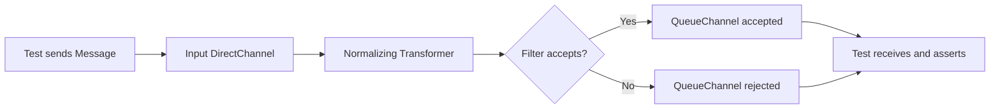
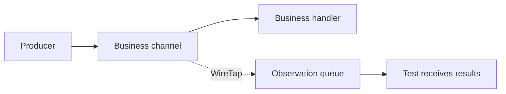

# MessageCollector

## 1. Objectives and scope

In the **Testing support** chapter of the **SPRING_INTEGRATION_CORE** module, this lesson shows how to collect `Message<?>` instances at a point in a flow to inspect payloads, headers, counts, and processing branches. This is an essential skill when testing transformers, routers, filters, aggregators, and endpoints wired with the Java DSL.

Identify the right API upfront: `org.springframework.cloud.stream.test.binder.MessageCollector` is an interface from the **legacy Spring Cloud Stream** testing kit, used together with `TestSupportBinder`. Do not look for or assume an equivalent class of that name exists in `org.springframework.integration.test`. You can verify the API signature in the [Spring Cloud Stream 2.2.1.RELEASE source code](https://github.com/spring-cloud/spring-cloud-stream/blob/v2.2.1.RELEASE/spring-cloud-stream-test-support/src/main/java/org/springframework/cloud/stream/test/binder/MessageCollector.java).

Within Spring Integration Core, the same need is solved with an output `QueueChannel` for testing, or a `WireTap` routing messages to an observation queue. The main hands-on section of this lesson uses these Core components; the legacy API section helps you read and maintain existing tests that already use `MessageCollector`.

After this lesson, you will be able to:

- Explain the relationship between the observed channel, collector, and result queue.
- Read `forChannel(...)` accurately and use `BlockingQueue` operations.
- Write Java DSL tests that collect both valid messages and messages discarded by a filter.
- Choose an observation point without introducing unintended competing consumers.
- Distinguish evidence that "a message was seen at the channel" from "the final business operation completed".

## 2. What problem does message collection solve?

Suppose a system receives order codes, normalizes whitespace and casing, and only accepts non-empty codes. If a test only checks that `input.send(message)` returns `true`, you have not verified the transformed value or where discarded messages were routed.

A collection point lets the test observe concrete outcomes:



Collected messages contain aspects that should be evaluated independently:

| Aspect | Example | What the test needs to clarify |
|---|---|---|
| Payload | `ORDER-42` | Did the transformer produce the right data and type? |
| Business header | `orderId=42` | Was metadata needed by downstream steps preserved? |
| Correlation header | `correlationId` | Does the result belong to the expected request or group? |
| Message count | One result per valid input | Are any results missing or duplicated? |
| Receiving channel | `accepted` or `rejected` | Did the filter/router pick the right branch? |

A collector supports observation in tests. It does not replace transformer logic, aggregator correlation, or the application's error-handling policy.

## 3. The MessageCollector API in legacy Spring Cloud Stream

### 3.1. Signature and meaning

The core API is:

```java
BlockingQueue<Message<?>> forChannel(MessageChannel channel);
```

`channel` is an output channel instance already registered by the test binder. The result is a queue holding messages collected from that channel. `Message<?>` allows payloads of any type; tests must verify the type or content before casting.

In `TestSupportBinder` of version 2.2.1.RELEASE, binding a producer creates a queue and registers a subscriber that pushes messages into that queue. `forChannel(...)` only looks up an already-registered queue; calling this method does not attach a collector to an arbitrary channel. A channel not registered by the binder leads to an error instead of creating a new queue. This is the behavior of the [TestSupportBinder implementation in that version](https://github.com/spring-cloud/spring-cloud-stream/blob/v2.2.1.RELEASE/spring-cloud-stream-test-support/src/main/java/org/springframework/cloud/stream/test/binder/TestSupportBinder.java).

```text
Application sends to output channel
                |
                v
Subscriber registered by TestSupportBinder
                |
                v
Corresponding BlockingQueue<Message<?>>
                |
                v
Test calls forChannel(output).poll(timeout, unit)
```

Therefore, calling `forChannel(inputChannel)` does not observe every input. This API is designed around bound output channels in that testing model.

### 3.2. Operations to understand

Once you have the queue, the methods below belong to `BlockingQueue` or its superinterfaces, not to `MessageCollector` itself:

| Operation | When queue is non-empty | When queue is empty | Removes element from queue? |
|---|---|---|---|
| `poll()` | Returns head element | Returns `null` immediately | Yes |
| `poll(1, TimeUnit.SECONDS)` | Returns head element | Waits up to timeout, then returns `null` | Yes |
| `take()` | Returns head element | Waits indefinitely | Yes |
| `peek()` | Views head element | Returns `null` immediately | No |
| `drainTo(list)` | Transfers existing elements to `list` | Nothing to transfer | Yes |
| `clear()` | Removes existing elements | No change | Yes |

These waiting semantics and return values are specified in the [Java BlockingQueue Javadoc](https://docs.oracle.com/en/java/javase/17/docs/api/java.base/java/util/concurrent/BlockingQueue.html).

Example of a timed read in a test with an initialized binder:

```java
BlockingQueue<Message<?>> results =
        messageCollector.forChannel(processor.output());

Message<?> received = results.poll(1, TimeUnit.SECONDS);
assertNotNull("No result received within timeout", received);
assertEquals("ORDER-42", received.getPayload());
```

The assertions above use JUnit 4 syntax. `poll(timeout, unit)` can throw `InterruptedException`; the test method can declare `throws InterruptedException`. Check for non-`null` before reading the payload so test failures report the true cause.

### 3.3. Illustrative test for a legacy project

The following example is for a project with Spring Boot/Spring Cloud versions compatible with **Spring Cloud Stream 2.2.x**, the `@EnableBinding` model, and JUnit 4. It is not a configuration for Spring Integration Core 6.x or a Cloud Stream project using functional bindings.

In a legacy project with dependencies managed by a compatible BOM, the relevant test dependency is:

```xml
<dependency>
    <groupId>org.springframework.cloud</groupId>
    <artifactId>spring-cloud-stream-test-support</artifactId>
    <scope>test</scope>
</dependency>
```

This dependency snippet assumes the application already includes Spring Cloud Stream and a compatible Spring Boot/JUnit 4 test stack. Use `test` scope because the test binder can replace the real binder via auto-configuration. This mechanism is described in the [Spring Cloud Stream Ditmars.SR1 testing documentation](https://docs.spring.io/spring-cloud-stream/docs/Ditmars.SR1/reference/html/_testing.html).

```java
import java.util.Locale;
import java.util.concurrent.BlockingQueue;
import java.util.concurrent.TimeUnit;

import org.junit.Test;
import org.junit.runner.RunWith;
import org.springframework.beans.factory.annotation.Autowired;
import org.springframework.boot.SpringBootConfiguration;
import org.springframework.boot.autoconfigure.EnableAutoConfiguration;
import org.springframework.boot.test.context.SpringBootTest;
import org.springframework.cloud.stream.annotation.EnableBinding;
import org.springframework.cloud.stream.messaging.Processor;
import org.springframework.cloud.stream.test.binder.MessageCollector;
import org.springframework.integration.annotation.Transformer;
import org.springframework.messaging.Message;
import org.springframework.messaging.support.MessageBuilder;
import org.springframework.test.context.junit4.SpringRunner;

import static org.junit.Assert.assertEquals;
import static org.junit.Assert.assertNotNull;
import static org.junit.Assert.assertNull;
import static org.junit.Assert.assertTrue;

@RunWith(SpringRunner.class)
@SpringBootTest(
        classes = LegacyCollectorTest.App.class,
        webEnvironment = SpringBootTest.WebEnvironment.NONE)
public class LegacyCollectorTest {

    @Autowired
    private Processor processor;

    @Autowired
    private MessageCollector messageCollector;

    @Test
    public void collectsNormalizedOrder() throws InterruptedException {
        BlockingQueue<Message<?>> results =
                messageCollector.forChannel(processor.output());

        // This test's fixture must have exclusive access to the output queue.
        results.clear();

        Message<String> request = MessageBuilder
                .withPayload("  order-42  ")
                .setHeader("orderId", "42")
                .setHeader("contentType", "text/plain")
                .build();

        assertTrue(processor.input().send(request));

        Message<?> result = results.poll(1, TimeUnit.SECONDS);
        assertNotNull("No output message collected", result);
        assertEquals("ORDER-42", result.getPayload());
        assertEquals("42", result.getHeaders().get("orderId"));
        assertNull(results.poll());
    }

    @SpringBootConfiguration
    @EnableAutoConfiguration
    @EnableBinding(Processor.class)
    public static class App {

        @Transformer(
                inputChannel = Processor.INPUT,
                outputChannel = Processor.OUTPUT)
        public String normalize(String value) {
            return value.trim().toUpperCase(Locale.ROOT);
        }
    }
}
```

In this fixture, the transformer and default channels execute synchronously, so checking that the queue has no remaining elements immediately after `send()` completes is meaningful for the inputs the test just sent. Once the application adds an executor or background producer, you must change how completion is determined.

The observed payload type also depends on the content-conversion configuration of that legacy release train. If a project receives `byte[]`, the test must decode using a defined charset or assert bytes per the actual contract; do not cast to `String` just because the business method takes `String`.

## 4. Applying this in Spring Integration Core with QueueChannel

### 4.1. Choosing a queue as the test output

A `QueueChannel` at the end of a flow retains results for the test to receive proactively. You do not need an extra consumer endpoint just to read the queue: the test itself calls `receive(...)`.

With default in-memory queue configuration, `receive(1000)` waits up to 1,000 milliseconds, `receive(0)` reads immediately, and `receive()` can wait indefinitely. Each successful receive removes a message from the queue. These semantics are described in [Message Channel Implementations](https://docs.spring.io/spring-integration/reference/channel/implementations.html).

The next example uses Java 17+, Spring Integration 6.x, and JUnit Jupiter. Dependency versions must be managed consistently by the project's BOM, such as a compatible Spring Boot 3.x release train; do not mix the legacy Cloud Stream artifact from the previous section into this fixture.

```xml
<dependency>
    <groupId>org.springframework.integration</groupId>
    <artifactId>spring-integration-core</artifactId>
</dependency>
<dependency>
    <groupId>org.junit.jupiter</groupId>
    <artifactId>junit-jupiter</artifactId>
    <scope>test</scope>
</dependency>
```

These are direct dependencies for the example when dependency management and the JUnit Jupiter runner are already configured by the project. `AnnotationConfigApplicationContext` is provided via Spring Context. `@SpringBootTest` is unnecessary because the test creates and closes its own minimal context.

Spring Integration provides `spring-integration-test-support` and `spring-integration-test` for utilities, mocks, and advanced test configuration. However, reading results from a `QueueChannel` only requires Core; adding those modules does not create Cloud Stream's `MessageCollector` bean. See [Spring Integration Testing support](https://docs.spring.io/spring-integration/reference/testing.html).

### 4.2. Full example: transformer, filter, and two collection queues

Each test method creates a fresh context, preventing results from one test from remaining in another test's queue.

```java
import java.util.Locale;

import org.junit.jupiter.api.AfterEach;
import org.junit.jupiter.api.BeforeEach;
import org.junit.jupiter.api.Test;
import org.springframework.context.annotation.AnnotationConfigApplicationContext;
import org.springframework.context.annotation.Bean;
import org.springframework.context.annotation.Configuration;
import org.springframework.integration.channel.DirectChannel;
import org.springframework.integration.channel.QueueChannel;
import org.springframework.integration.config.EnableIntegration;
import org.springframework.integration.dsl.IntegrationFlow;
import org.springframework.messaging.Message;
import org.springframework.messaging.support.MessageBuilder;

import static org.junit.jupiter.api.Assertions.assertEquals;
import static org.junit.jupiter.api.Assertions.assertNotNull;
import static org.junit.jupiter.api.Assertions.assertNull;
import static org.junit.jupiter.api.Assertions.assertTrue;

class MessageCollectionTest {

    private AnnotationConfigApplicationContext context;
    private DirectChannel input;
    private QueueChannel accepted;
    private QueueChannel rejected;

    @BeforeEach
    void setUp() {
        context = new AnnotationConfigApplicationContext(FlowConfig.class);
        input = context.getBean("input", DirectChannel.class);
        accepted = context.getBean("accepted", QueueChannel.class);
        rejected = context.getBean("rejected", QueueChannel.class);
    }

    @AfterEach
    void tearDown() {
        if (context != null) {
            context.close();
        }
    }

    @Test
    void collectsNormalizedPayloadAndBusinessHeader() {
        Message<String> request = MessageBuilder
                .withPayload("  order-42  ")
                .setHeader("orderId", "42")
                .build();

        assertTrue(input.send(request));

        Message<?> result = accepted.receive(1000);
        assertNotNull(result, "No result at accepted");
        assertEquals("ORDER-42", result.getPayload());
        assertEquals("42", result.getHeaders().get("orderId"));
        assertNull(accepted.receive(0), "Unexpected extra result at accepted");
        assertNull(rejected.receive(0), "Valid message was sent to rejected");
    }

    @Test
    void collectsBlankPayloadOnDiscardChannel() {
        Message<String> request = MessageBuilder
                .withPayload("   ")
                .setHeader("orderId", "blank-case")
                .build();

        assertTrue(input.send(request));

        Message<?> result = rejected.receive(1000);
        assertNotNull(result, "Discarded message was not collected");
        assertEquals("", result.getPayload());
        assertEquals("blank-case", result.getHeaders().get("orderId"));
        assertNull(accepted.receive(0));
        assertNull(rejected.receive(0));
    }

    @Test
    void collectsTwoResultsInOrderWithoutExtras() {
        assertTrue(input.send(MessageBuilder.withPayload(" first ").build()));
        assertTrue(input.send(MessageBuilder.withPayload(" second ").build()));

        Message<?> first = accepted.receive(1000);
        Message<?> second = accepted.receive(1000);
        assertNotNull(first);
        assertNotNull(second);
        assertEquals("FIRST", first.getPayload());
        assertEquals("SECOND", second.getPayload());
        assertNull(accepted.receive(0));
        assertNull(rejected.receive(0));
    }

    @Configuration
    @EnableIntegration
    static class FlowConfig {

        @Bean
        DirectChannel input() {
            return new DirectChannel();
        }

        @Bean
        QueueChannel accepted() {
            return new QueueChannel(20);
        }

        @Bean
        QueueChannel rejected() {
            return new QueueChannel(20);
        }

        @Bean
        IntegrationFlow orderFlow() {
            return IntegrationFlow.from(input())
                    .<String, String>transform(
                            value -> value.trim().toUpperCase(Locale.ROOT))
                    .<String>filter(
                            value -> !value.isEmpty(),
                            spec -> spec.discardChannel(rejected()))
                    .channel(accepted())
                    .get();
        }
    }
}
```

`IntegrationFlow.from(...)` creates the starting point, and the DSL steps are registered when the flow is a bean in the context. You can check how this is built in the [IntegrationFlow 6.5.0 Javadoc](https://docs.spring.io/spring-integration/docs/6.5.0/api/org/springframework/integration/dsl/IntegrationFlow.html).

### 4.3. Interpreting the example's results

The first test confirms both the normalized data and that the business header survives. Do not compare the entire input `Message` to the output `Message`, because a transformer can construct a new message with a different `id` and `timestamp`.

The second test receives an empty payload at `rejected`: this is the value **after** the normalization step. If you need to observe the raw data before the transformer, collect at a point before that step or explicitly preserve the original value by flow design.

The third test checks ordering in a fixture with two sequential sends, synchronous processing, and FIFO queues. Conclusions about ordering apply only to the configuration under test; once parallel processing is introduced, completion order may vary.

`input.send(...)` still returns `true` when the filter routes data to the discard channel. The return value does not imply that the payload passed all business conditions.

## 5. Collecting at a channel with active consumers using WireTap

### 5.1. Why not attach another subscriber to DirectChannel?

A `DirectChannel` has point-to-point semantics. If it already has a business consumer and the test registers an additional handler to collect messages, the two handlers can become competing consumers. The test would then alter the behavior under test.

Similarly, if a test calls `receive()` on a `QueueChannel` being consumed by a business poller, the message received by the test is removed from the poller's processing path. That approach works when the queue is dedicated to test output, but is unsuitable for eavesdropping on an active pipeline.

`WireTap` is an interceptor that copies/forwards messages to a secondary channel while continuing down the main path. This mechanism is described in the [WireTap Javadoc](https://docs.spring.io/spring-integration/docs/6.5.0/api/org/springframework/integration/channel/interceptor/WireTap.html).



### 5.2. Example of observing and cleaning up the interceptor

This is a standalone JUnit Jupiter method that can be added to the test class in the previous section. Add the import:

```java
import org.springframework.integration.channel.interceptor.WireTap;
```

```java
@Test
void wireTapKeepsBusinessDeliveryAndCapturesObservation() {
    DirectChannel businessChannel = new DirectChannel();
    QueueChannel businessResults = new QueueChannel(10);
    QueueChannel observed = new QueueChannel(10);

    businessChannel.subscribe(message -> {
        if (!businessResults.send(message, 0)) {
            throw new IllegalStateException("Test business queue is full");
        }
    });

    WireTap tap = new WireTap(observed);
    tap.setTimeout(0);
    businessChannel.addInterceptor(tap);

    try {
        Message<String> request = MessageBuilder
                .withPayload("ORDER-42")
                .setHeader("orderId", "42")
                .build();

        assertTrue(businessChannel.send(request));

        Message<?> delivered = businessResults.receive(1000);
        Message<?> captured = observed.receive(1000);
        assertNotNull(delivered);
        assertNotNull(captured);
        assertEquals("ORDER-42", delivered.getPayload());
        assertEquals("ORDER-42", captured.getPayload());
        assertEquals("42", captured.getHeaders().get("orderId"));
        assertNull(observed.receive(0));
    }
    finally {
        businessChannel.removeInterceptor(tap);
    }
}
```

The example passes the channel object directly to `WireTap`. If you use the constructor that takes a channel name, the interceptor must be Spring-managed to resolve the name via `BeanFactory`.

### 5.3. Placement and limitations of WireTap

`WireTap` runs at `preSend`. A message appearing in the observation queue indicates it reached that interceptor point; a downstream handler can still fail. If you need to confirm results after a transformation or business operation, place the observation point at the corresponding output.

Do not treat the observed message as a deep copy of the payload. With mutable payloads, mutating the object afterward can cause the test to read a state different from the moment it was sent. Use immutable payloads or capture an explicit snapshot if the test needs point-in-time state.

In the WireTap 6.5.0 implementation, if sending to the secondary channel returns `false`, the interceptor logs a warning and continues the main path. Thus, a full observation queue can drop collected data while the business flow keeps running. `setTimeout(0)` avoids blocking for free space, but tests must size capacity appropriately and assert all expected results. See [WireTap 6.5.0 source code](https://github.com/spring-projects/spring-integration/blob/v6.5.0/spring-integration-core/src/main/java/org/springframework/integration/channel/interceptor/WireTap.java).

A wire tap itself does not spawn threads. Processing timing on the observation branch also depends on the target channel; `QueueChannel` simply buffers messages for the test to receive later. Configuration and threading characteristics are explained in the [Wire Tap documentation](https://docs.spring.io/spring-integration/reference/7.0/channel/configuration.html).

## 6. Waiting properly for results in asynchronous flows

### 6.1. Wait for conditions instead of fixed sleeps

The snippet below easily produces flaky tests:

```java
Thread.sleep(200);
Message<?> result = results.poll();
```

If a worker takes longer than 200 milliseconds, the test fails even though the flow is correct. If the worker finishes early, the test still wastes the rest of the sleep interval.

With `MessageCollector`, use `results.poll(timeout, unit)`. With `QueueChannel`, use `receive(timeoutMillis)`. Both allow returning immediately when a message arrives and bounding the wait when the flow produces nothing.

### 6.2. A single time budget for multiple messages

When retrieving multiple asynchronous results from a `MessageCollector` queue, waiting one second per item makes the worst-case total time grow linearly with item count. You can use a shared deadline instead.

The helper below uses JUnit Jupiter; `results` is an existing `BlockingQueue<Message<?>>`. If placing this into the JUnit 4 test from the earlier section, swap the message argument order in the corresponding assertions.

```java
import java.time.Duration;
import java.util.ArrayList;
import java.util.List;
import java.util.concurrent.BlockingQueue;
import java.util.concurrent.TimeUnit;

static List<Message<?>> collectExactly(
        BlockingQueue<Message<?>> results,
        int expected,
        Duration budget) throws InterruptedException {

    if (expected < 0 || budget.isNegative() || budget.isZero()) {
        throw new IllegalArgumentException("Invalid count or timeout budget");
    }

    long deadline = System.nanoTime() + budget.toNanos();
    List<Message<?>> collected = new ArrayList<>(expected);

    while (collected.size() < expected) {
        long remaining = deadline - System.nanoTime();
        assertTrue(remaining > 0,
                "Timed out; received " + collected.size() + "/" + expected);

        Message<?> next = results.poll(remaining, TimeUnit.NANOSECONDS);
        assertNotNull(next,
                "Missing result; received " + collected.size() + "/" + expected);
        collected.add(next);
    }

    return collected;
}
```

The name `collectExactly` here means the helper collects the requested number of elements before the deadline; it does not by itself prove the producer will emit no further results. Check for extra messages after a completion signal, or within a clearly chosen observation window.

### 6.3. Concluding absence requires a time boundary

`poll()` or `receive(0)` returning `null` only tells you the queue was empty at the instant of the call. In an asynchronous flow, a producer might push more data right afterward.

To test that a filter produces no valid output, you can:

- Use a completion signal tied to that specific request, then assert on the relevant queues.
- Collect the message on the discard channel to prove the input reached the filter and was rejected.
- When the contract is time-based, verify no result arrives within a defined observation window and document that bound in the test.

If a filter silently drops messages by default, an empty output queue could also mean the flow never ran, an error happened before the filter, or the test sent to the wrong channel. Therefore, evidence on the discard branch is usually clearer than checking absence alone.

## 7. Headers, ordering, and result correlation

### 7.1. Asserting headers that serve the contract

Verify business-meaningful headers such as `orderId`, tenant, or request ID. Do not require the entire header map to match by default, as intermediate steps may add metadata or construct new messages.

For `byte[]`, verify array contents using array assertions or decode with a specific charset. For JSON, if the contract allows field reordering, assert structure and values rather than comparing formatted strings.

### 7.2. FIFO does not guarantee global input ordering

A collector's queue preserves the order in which messages arrive at it. If two tasks execute concurrently, the task receiving a later input may finish first. The queue can then receive `B` before `A` even though the test sent `A` first.

If the contract does not require ordering, verify the result multiset including occurrence counts, or index by a unique header. Simply converting to a `Set` can mask duplicate-message bugs; for instance, `[A, A, B]` and `[A, B]` yield the same set of values.

If the contract requires ordering, verify that the design actually preserves order across executors, splitters, and consumers. A collector records what happened; it does not restore order on its own.

### 7.3. Do not share a single queue across parallel tests

`BlockingQueue` supporting multi-threaded access does not mean tests sharing a queue are isolated. One test can steal another test's results; `clear()` can even wipe messages just emitted by another task.

Prefer an isolated fixture per test. When forced to use a shared context, manage background producers, completion timing, and queue reading rights. Attaching a `correlationId` helps identify data, but does not prevent another consumer from taking the message.

## 8. Applying to integration patterns and gateways

| Component under test | Appropriate collection point | What to verify |
|---|---|---|
| Transformer | Queue after transformer | Payload value, payload type, and headers preserved per contract |
| Router | Dedicated queue at each branch | Result reaches the right branch; no emissions outside contract |
| Filter | Valid output queue and discard channel | Inputs accepted or rejected properly; discard data reflects filter position |
| Splitter | Queue after splitter | Item count and metadata needed for downstream aggregation |
| Aggregator | Queue after aggregator | Group emits only when release condition is met; groups do not mix data |
| Service-calling endpoint | Queue at output or tap after endpoint | Call result is forwarded properly |
| Request-reply gateway | Gateway return value, combined with observation points as needed | Request and reply match the same invocation; reply timeout handled properly |

For routers with multi-branch broadcast semantics, receiving multiple results can satisfy the contract. Do not apply "only one queue has data" to every router.

For aggregators, interleave messages from at least two groups and verify result identifiers. If checking before a group is complete in an async flow, know that the corresponding inputs have been processed before concluding "no result yet".

For gateways, placing a collecting queue where the flow must return a reply can prevent the reply from reaching the gateway and cause the call to time out. When you need to observe while keeping the reply path intact, place a tap appropriately and preserve the flow's reply mechanism.

## 9. Collecting and verifying errors

### 9.1. Synchronous errors vs. errors via an error channel

When sending directly to a `DirectChannel` and the handler runs on the same thread, exceptions typically propagate back to the caller. For that fixture, the test should assert on the exception; do not expect an `ErrorMessage` to appear on `errorChannel` by default.

With processing via an executor or poller using Spring Integration's error publishing mechanism, errors can be wrapped in an `ErrorMessage` and sent to an error channel. If the request has an `errorChannel` header, the publisher uses that channel; otherwise, it uses the configured global error channel. Preserve the exact error-handling mechanism of the endpoint under test. These cases are distinguished in the [Error Handling documentation](https://docs.spring.io/spring-integration/reference/error-handling.html).

### 9.2. Asserting on a collected ErrorMessage

Suppose an asynchronous fixture has a `QueueChannel errors` configured as the error destination for requests, and a handler intentionally throws an exception. The test can verify collection as follows using JUnit Jupiter:

```java
import org.springframework.messaging.MessagingException;
import org.springframework.messaging.support.ErrorMessage;

import static org.junit.jupiter.api.Assertions.assertInstanceOf;

Message<?> captured = errors.receive(1000);
assertNotNull(captured, "No error message received");

ErrorMessage error = assertInstanceOf(ErrorMessage.class, captured);
MessagingException failure = assertInstanceOf(
        MessagingException.class, error.getPayload());

Message<?> failedMessage = failure.getFailedMessage();
assertNotNull(failedMessage);
assertEquals("42", failedMessage.getHeaders().get("orderId"));
```

This snippet checks the contract of a fixture whose errors are wrapped in `MessagingException`; it does not assert that every `ErrorMessage` contains this exception type. For errors published directly by application code, assert the actual payload type defined by the application.

After verifying the type and failed message, you can inspect the root cause or data needed for compensating actions. Avoid depending on the framework's exact full error message string if the application contract only specifies the error type and request ID.

## 10. Common mistakes when using collectors

| Symptom | Cause to investigate | How to handle |
|---|---|---|
| Cannot autowire `MessageCollector` in a Core project | Using an API from legacy Cloud Stream | Use an output queue or WireTap suitable for Core |
| `forChannel(...)` reports channel is not bound | Passing a channel not registered by TestSupportBinder | Check the exact output binding and channel instance in the legacy context |
| Test intermittently receives `null` | Using non-blocking read while producer has not finished | Use timed receive and determine proper completion conditions |
| Test hangs | Using `take()` or `receive()` without a timeout | Set a timeout on waiting operations |
| Wrong payload type | Wrong assumption about content conversion or observation point | Check actual type, content type, and data contract |
| Business handler misses messages | Test added a competing consumer or reads a queue consumed by a poller | Use a tap point or a queue dedicated to the test |
| Passes individually, fails in full suite | Shared queue/context, background messages, or unremoved interceptor | Isolate fixtures and remove observers after tests |
| Message observed but business logic still fails | Tap placed before the handler | Assert on output after the handler or on relevant completion state |
| Missing observed data under higher load | Tap queue full or observer drops data | Size capacity per fixture and verify received counts |
| Test misses duplicate messages | Only checking the first element or converting all to a `Set` | Verify total count and occurrence counts per contract |

## 11. Level of evidence provided by tests

A good message-collecting test states three things clearly: **where it observes, how long it waits, and which contract it asserts**.

In this lesson's Core example, the evidence is that the transformer and filter processed inputs properly, headers propagated properly, and the two test-dedicated queues received the expected results. The example does not traverse a broker, network, or database.

With Cloud Stream, the test binder helps observe the application inside the JVM, but does not replace testing against a real binder/broker when verifying wire serialization, partitions, acknowledgments, redelivery, or dead-letter queues.

In Cloud Stream projects using the current testing mechanism, the documentation describes `InputDestination`, `OutputDestination`, and the `spring-cloud-stream-test-binder` artifact. That is the approach for testing Cloud Stream bindings; there is no need to add it just to test a Core flow. Refer to [Spring Cloud Stream — Spring Integration Test Binder](https://docs.spring.io/spring-cloud-stream/reference/spring-cloud-stream/spring_integration_test_binder.html).

When selecting tools, start from the boundary you need to verify: a queue at the end of the flow for output data, a tap to observe a point with an active consumer, a return value for a gateway, or an error channel for asynchronously published errors. Placing boundaries properly keeps tests aligned with system behavior and produces easily diagnosable failures.
