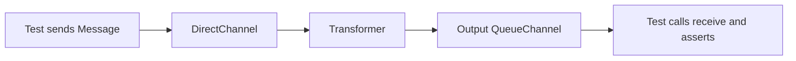
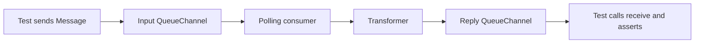
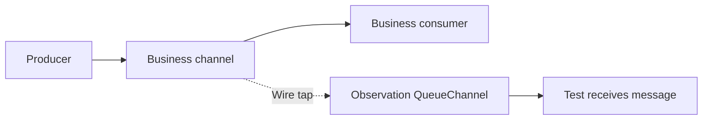

# QueueChannel in Tests

## 1. Objectives and use cases

In the **Testing support** chapter of the **SPRING_INTEGRATION_CORE** module, `QueueChannel` is a straightforward tool for capturing messages at the boundary of an integration flow. Rather than only verifying that a Java method was invoked, tests can send a `Message` into the flow, receive the output message, and inspect its payload, headers, and result count.

For example, a flow normalizing order codes receives `"  order-42  "` and returns `"ORDER-42"`. You need to verify both the transformed value and that the `requestId` header stays with the message. Placing a `QueueChannel` at the output lets the test observe that exact contract.

After this lesson, you will be able to:

- Use `send(message, timeout)` and `receive(timeout)` without making tests block indefinitely.
- Distinguish a result-collection queue from an input queue requiring a polling consumer.
- Write tests for transformers with the Java DSL, including flows running through a poller.
- Receive replies or `ErrorMessage` instances using per-request queues.
- Avoid competing with real consumers for messages, reusing leftover data, or over-concluding from a single timeout.

The examples use JUnit Jupiter, Spring Test, and the Java DSL with `IntegrationFlow.from(...)`. You can run them on Java 17 and a compatible Spring Integration 6.x release; if your project uses another line, choose the JDK required by that line. Manage dependency versions via your project's BOM and avoid manually mixing incompatible Spring versions.

## 2. What role does QueueChannel play in testing?

`QueueChannel` implements `PollableChannel`: the sender places messages in the queue, and the receiver actively calls `receive(...)`. Each successful receive removes one message; multiple consumers receiving concurrently share the messages rather than each receiving a copy. According to the official documentation, this is a point-to-point channel. [Spring Integration — Message Channel Implementations](https://docs.spring.io/spring-integration/reference/channel/implementations.html)

In tests, there are two common setups:





In the first diagram, the flow can run completely on the test's calling thread. The output queue simply buffers results for the test to read afterward. In the second diagram, the polling consumer pulls requests on a scheduler-managed thread. That difference determines how to wait for results and inspect errors; `QueueChannel` itself does not create worker threads.

A good test verifies what happens at the observed boundary. Receiving a message at the output proves the flow emitted that message; if downstream steps write to a database or call another service, verify those side effects separately.

## 3. Timeout and capacity: the foundation for terminating tests

### 3.1. Choosing the right call

Timeouts in the overloads below are in **milliseconds**:

| Call | When it cannot complete immediately | Usage in tests |
|---|---|---|
| `send(message, 0)` | Returns `false` if the queue is full | Check immediate send or capacity |
| `send(message, 100)` | Waits for free space up to timeout | Send request with bounded wait |
| `receive(0)` | Returns `null` if the queue is empty | Inspect current state |
| `receive(2_000)` | Waits for a message up to timeout | Wait for asynchronous flow output |
| `send(message)` | Can block when the queue is full | Avoid unless capacity is controlled |
| `receive()` | Can block when the queue is empty | Avoid in test assertions |

Overloads without a timeout can block indefinitely. `receive(0)` only inspects the instant of the call; it does not wait. [Spring Integration — QueueChannel API](https://docs.spring.io/spring-integration/docs/current/api/org/springframework/integration/channel/QueueChannel.html)

Always check the received result before reading the payload:

```java
Message<?> actual = results.receive(2_000);
assertNotNull(actual, "No result received within timeout");
assertEquals("ORDER-42", actual.getPayload());
```

`send()` returning `true` on a queue indicates that the message was accepted into the channel. It does not prove a consumer has run, business logic succeeded, or a reply is ready. Therefore, assertions on `send()` and assertions on output serve two distinct purposes.

A channel timeout is also not a deadline for the entire business operation. For instance, with `DirectChannel`, the handler runs on the thread calling `send()`; an argument of `100` does not interrupt a handler that takes five seconds. If you need an overall test bound, add JUnit timeouts and control the resources created by the test.

### 3.2. Setting capacity appropriate to what you are testing

Prefer declaring capacity explicitly:

```java
QueueChannel oneReply = new QueueChannel(1);
QueueChannel batchResults = new QueueChannel(20);
```

A test expecting a single reply can use capacity `1`; a splitter test producing ten items needs enough room for them before the test starts receiving. The default in-memory queue configuration has a very large capacity; setting an explicit limit surfaces throughput mismatches earlier. [Spring Integration — Configuring Message Channels](https://docs.spring.io/spring-integration/reference/channel/configuration.html)

A small capacity must be paired carefully with how results are sent. If a synchronous handler sends two outputs to a capacity-`1` queue using an unbounded send while the test only receives after input `send()` returns, both sides can wait on each other. When testing multiple outputs, size capacity for the scenario, configure send timeouts on the endpoint when needed, or coordinate concurrent consumption.

## 4. Standalone example: verifying the queue contract

The following example does not start a Spring context. The required dependencies are `spring-integration-core` and `junit-jupiter` in test scope. This example is for learning channel behavior, not a requirement for every project to re-test the library.

```java
import org.junit.jupiter.api.Test;
import org.springframework.integration.channel.QueueChannel;
import org.springframework.messaging.Message;
import org.springframework.messaging.support.MessageBuilder;

import static org.junit.jupiter.api.Assertions.*;

class QueueChannelContractTest {

    @Test
    void receivesMessagesInInsertionOrder() {
        QueueChannel channel = new QueueChannel(2);
        Message<String> first = MessageBuilder.withPayload("first").build();
        Message<String> second = MessageBuilder.withPayload("second").build();

        assertTrue(channel.send(first, 0));
        assertTrue(channel.send(second, 0));

        Message<?> actualFirst = channel.receive(0);
        Message<?> actualSecond = channel.receive(0);

        assertNotNull(actualFirst);
        assertNotNull(actualSecond);
        assertEquals("first", actualFirst.getPayload());
        assertEquals("second", actualSecond.getPayload());
        assertNull(channel.receive(0));
    }

    @Test
    void rejectsImmediateSendWhenFullThenAcceptsAfterReceive() {
        QueueChannel channel = new QueueChannel(1);
        Message<String> first = MessageBuilder.withPayload("first").build();
        Message<String> second = MessageBuilder.withPayload("second").build();

        assertTrue(channel.send(first, 0));
        assertFalse(channel.send(second, 0));

        Message<?> removed = channel.receive(0);
        assertNotNull(removed);
        assertEquals("first", removed.getPayload());

        assertTrue(channel.send(second, 0));
        Message<?> remaining = channel.receive(0);
        assertNotNull(remaining);
        assertEquals("second", remaining.getPayload());
    }

    @Test
    void returnsNullWhenNoMessageIsAvailable() {
        QueueChannel channel = new QueueChannel(1);

        assertNull(channel.receive(0));
    }
}
```

In these tests, all data is sent before receiving, with no scheduler or other consumer, so `receive(0)` is appropriate. For a flow with concurrent workers, the waiting approach in later sections differs.

FIFO here is the retrieval order of the default queue. It does not guarantee completion order across multiple concurrent workers; a request dequeued earlier can still finish processing after a subsequent request.

## 5. Testing a Java DSL flow with QueueChannel at the output

### 5.1. Setting up the test environment

The Spring context examples use the following dependencies:

| Dependency | Usage scope |
|---|---|
| `org.springframework.integration:spring-integration-core` | Channels, endpoints, and Java DSL |
| `org.springframework:spring-test` | Spring TestContext and `@SpringJUnitConfig` |
| `org.junit.jupiter:junit-jupiter` | JUnit Jupiter tests and assertions |

`spring-integration-test` provides `@SpringIntegrationTest`, `MockIntegrationContext`, and component-substitution features for testing. The examples below that only send and receive through channels do not require those utilities yet; `QueueChannel` is a core component. [Spring Integration — Testing support](https://docs.spring.io/spring-integration/reference/testing.html)

If using Spring Boot, you can let Boot's test starter provide JUnit and Spring Test. The example below intentionally uses a minimal context without scanning the whole application.

### 5.2. Testing a transformer and headers

This is a complete test class. The flow receives a string over a `DirectChannel`, normalizes the payload, and places the result into `testResults`.

```java
import java.util.Locale;

import org.junit.jupiter.api.AfterEach;
import org.junit.jupiter.api.BeforeEach;
import org.junit.jupiter.api.Test;
import org.junit.jupiter.api.Timeout;
import org.springframework.beans.factory.annotation.Autowired;
import org.springframework.beans.factory.annotation.Qualifier;
import org.springframework.context.annotation.Bean;
import org.springframework.context.annotation.Configuration;
import org.springframework.integration.channel.DirectChannel;
import org.springframework.integration.channel.QueueChannel;
import org.springframework.integration.config.EnableIntegration;
import org.springframework.integration.dsl.IntegrationFlow;
import org.springframework.messaging.Message;
import org.springframework.messaging.support.MessageBuilder;
import org.springframework.test.context.junit.jupiter.SpringJUnitConfig;

import static org.junit.jupiter.api.Assertions.*;

@SpringJUnitConfig(QueueChannelFlowTest.Config.class)
@Timeout(10)
class QueueChannelFlowTest {

    @Autowired
    @Qualifier("normalizeInput")
    DirectChannel input;

    @Autowired
    @Qualifier("testResults")
    QueueChannel results;

    @BeforeEach
    void verifiesNoLeftoverResult() {
        assertNull(results.receive(0), "Leftover result found before test");
    }

    @AfterEach
    void verifiesNoAdditionalResult() {
        assertNull(results.receive(0), "Flow produced an unexpected extra result");
    }

    @Test
    void normalizesPayloadAndPreservesBusinessHeader() {
        Message<String> request = MessageBuilder
                .withPayload("  order-42  ")
                .setHeader("requestId", "req-42")
                .build();

        assertTrue(input.send(request, 100));

        Message<?> actual = results.receive(1_000);
        assertNotNull(actual, "Missing normalized result");
        assertInstanceOf(String.class, actual.getPayload());
        assertEquals("ORDER-42", actual.getPayload());
        assertEquals("req-42", actual.getHeaders().get("requestId"));
    }

    @Configuration
    @EnableIntegration
    static class Config {

        @Bean
        DirectChannel normalizeInput() {
            return new DirectChannel();
        }

        @Bean
        QueueChannel testResults() {
            return new QueueChannel(10);
        }

        @Bean
        IntegrationFlow normalizationFlow(
                @Qualifier("normalizeInput") DirectChannel input,
                @Qualifier("testResults") QueueChannel results) {

            return IntegrationFlow.from(input)
                    .transform(String.class,
                            text -> text.strip().toUpperCase(Locale.ROOT))
                    .channel(results)
                    .get();
        }
    }
}
```

The Java DSL connects endpoints and channels within a flow; channels can be declared as beans and passed into the flow as shown above. [Spring Integration — Message Channels in Java DSL](https://docs.spring.io/spring-integration/reference/dsl/java-channels.html)

### 5.3. Interpreting the results accurately

Because the input is a `DirectChannel` with no asynchronous boundary before the transformer, processing completes before `input.send(...)` returns. `results.receive(1_000)` is still a bounded receive, though in this specific flow the result is already ready; `receive(0)` could also be used after the successful send.

The two assertions on the payload and `requestId` represent this example's business contract. Avoid comparing the entire `MessageHeaders` against the input request just to infer the transformer worked: technical headers like ID or timestamp are not part of the preserved contract here.

The check in `@AfterEach` is valid here because synchronous processing has finished. It helps detect unexpected extra outputs sitting in the queue. Do not carry that same conclusion straight into an asynchronous flow without knowing whether producers have finished emitting results.

## 6. Receiving replies with a per-request QueueChannel

### 6.1. When to use replyChannel?

The flow in section 5 has a fixed output `testResults`. Another option is letting the final endpoint use the request's `replyChannel` header. For reply-capable endpoints, an explicitly configured output channel takes precedence; when none is configured, the endpoint can use `replyChannel`. [Spring Integration — Service Activator](https://docs.spring.io/spring-integration/reference/service-activator.html)

The following configuration snippet illustrates a flow using dynamic replies:

```java
@Bean
IntegrationFlow replyFlow(
        @Qualifier("replyInput") DirectChannel replyInput) {

    return IntegrationFlow.from(replyInput)
            .transform(String.class,
                    text -> text.strip().toUpperCase(Locale.ROOT))
            .get();
}
```

This snippet assumes a `replyInput` bean already exists. Do not add `.channel(testResults)` at the end of the flow if the test intends to receive via a per-request reply queue.

On the sender side, create a reply destination for the request:

```java
QueueChannel replies = new QueueChannel(1);

Message<String> request = MessageBuilder.withPayload("  order-43  ")
        .setHeader("requestId", "req-43")
        .setReplyChannel(replies)
        .build();

assertTrue(replyInput.send(request, 100));
Message<?> actual = replies.receive(1_000);
assertNotNull(actual);
assertEquals("ORDER-43", actual.getPayload());
```

The local queue is placed directly in the header as a channel instance, so it does not need to be a bean. This works for in-JVM request-reply; do not treat a Java channel reference as an address that can automatically be serialized over Kafka, JMS, or HTTP.

Giving each request its own reply queue reduces contention for results across tests. However, it does not isolate other shared resources such as databases, aggregator message groups, or service state.

If going through a messaging gateway, the gateway normally manages sending the request and waiting for the reply for the caller. Gateway tests should verify the gateway method contract; setting `replyChannel` manually as above is suited for directly testing the flow's messaging boundary.

## 7. QueueChannel at the input: requiring a poller to process

A queue holding requests does not invoke a transformer by itself. An endpoint consuming a `PollableChannel` requires a polling mechanism. The Java DSL lets you configure a poller on the endpoint receiving from the queue; calling `receive(...)` directly from the test only removes the request from the queue without triggering the endpoint. [Spring Integration — Message Endpoints](https://docs.spring.io/spring-integration/reference/endpoint.html)

The following example uses one input queue and creates two local queues per request: `replies` for successful results and `errors` for errors published by the poller.

```java
import java.util.Locale;

import org.junit.jupiter.api.Test;
import org.junit.jupiter.api.Timeout;
import org.springframework.beans.factory.annotation.Autowired;
import org.springframework.beans.factory.annotation.Qualifier;
import org.springframework.context.annotation.Bean;
import org.springframework.context.annotation.Configuration;
import org.springframework.integration.channel.QueueChannel;
import org.springframework.integration.config.EnableIntegration;
import org.springframework.integration.dsl.IntegrationFlow;
import org.springframework.integration.dsl.Pollers;
import org.springframework.messaging.Message;
import org.springframework.messaging.MessagingException;
import org.springframework.messaging.support.ErrorMessage;
import org.springframework.messaging.support.MessageBuilder;
import org.springframework.test.context.junit.jupiter.SpringJUnitConfig;

import static org.junit.jupiter.api.Assertions.*;

@SpringJUnitConfig(PolledQueueChannelTest.Config.class)
@Timeout(10)
class PolledQueueChannelTest {

    @Autowired
    @Qualifier("asyncInput")
    QueueChannel input;

    @Test
    void receivesReplyFromPollingConsumer() {
        QueueChannel replies = new QueueChannel(1);
        QueueChannel errors = new QueueChannel(1);

        Message<String> request = MessageBuilder
                .withPayload("  order-44  ")
                .setHeader("requestId", "req-44")
                .setReplyChannel(replies)
                .setErrorChannel(errors)
                .build();

        assertTrue(input.send(request, 100), "Could not enqueue request");

        Message<?> actual = replies.receive(2_000);
        assertNotNull(actual, "Poller did not produce a reply within timeout");
        assertEquals("ORDER-44", actual.getPayload());
        assertEquals("req-44", actual.getHeaders().get("requestId"));
        assertNull(errors.receive(0), "Unexpected error was recorded");
    }

    @Test
    void receivesErrorMessageWhenTransformationFails() {
        QueueChannel replies = new QueueChannel(1);
        QueueChannel errors = new QueueChannel(1);

        Message<String> request = MessageBuilder
                .withPayload("   ")
                .setHeader("requestId", "req-invalid")
                .setReplyChannel(replies)
                .setErrorChannel(errors)
                .build();

        assertTrue(input.send(request, 100));

        Message<?> received = errors.receive(2_000);
        assertNotNull(received, "Missing error message from poller");
        ErrorMessage error = assertInstanceOf(ErrorMessage.class, received);

        MessagingException failure = assertInstanceOf(
                MessagingException.class, error.getPayload());
        Message<?> failedMessage = failure.getFailedMessage();
        assertNotNull(failedMessage);
        assertEquals("   ", failedMessage.getPayload());
        assertEquals("req-invalid", failedMessage.getHeaders().get("requestId"));

        Throwable root = failure;
        while (root.getCause() != null) {
            root = root.getCause();
        }
        assertInstanceOf(IllegalArgumentException.class, root);
        assertEquals("Order code must not be blank", root.getMessage());
        assertNull(replies.receive(0), "Unexpected success reply received");
    }

    @Configuration
    @EnableIntegration
    static class Config {

        @Bean
        QueueChannel asyncInput() {
            return new QueueChannel(10);
        }

        @Bean
        IntegrationFlow polledNormalizationFlow(
                @Qualifier("asyncInput") QueueChannel input) {

            return IntegrationFlow.from(input)
                    .transform(String.class, text -> {
                        if (text.isBlank()) {
                            throw new IllegalArgumentException(
                                    "Order code must not be blank");
                        }
                        return text.strip().toUpperCase(Locale.ROOT);
                    }, endpoint -> endpoint.poller(
                            Pollers.fixedDelay(10)
                                    .receiveTimeout(0)
                                    .maxMessagesPerPoll(1)))
                    .get();
        }
    }
}
```

### 7.1. Three distinct wait times

| Parameter | Used by | Purpose in the example |
|---|---|---|
| `fixedDelay(10)` | Poller scheduler | Sets the pause between polling cycles |
| `receiveTimeout(0)` | Poller when receiving from `asyncInput` | Avoids holding the poller thread on an empty queue |
| `replies.receive(2_000)` or `errors.receive(2_000)` | Test thread | Waits for the result to assert |

`fixedDelay` measures the interval from the end of the previous poll; it does not guarantee requests finish in exactly 10 ms. `maxMessagesPerPoll(1)` limits how many messages are taken per poll, not the flow's total request count. [Spring Integration — Pollers API](https://docs.spring.io/spring-integration/api/org/springframework/integration/dsl/Pollers.html), [Spring Integration — Message Endpoints](https://docs.spring.io/spring-integration/reference/endpoint.html)

The numbers in the example are illustrative settings for an in-memory transformation. Choose timeouts based on your CI environment and expected processing time, rather than treating 2,000 ms as a universal rule for every test. A large timeout will not fix an unstarted poller, miswired channel, or stopped endpoint.

### 7.2. Why not receive from input to verify the flow?

In the test class above, `input.receive(...)` is not called after sending the request. The polling consumer is the one that must pull the request to run the transformer. If the test receives from the same queue, it can steal data the flow is waiting for and create intermittent failures.

If the goal is solely to verify that a producer put a request into the queue, you can keep the test as the sole consumer and leave the business consumer stopped. When the goal is to verify the whole flow, observe at the output or at a separate tap point.

## 8. Distinguishing synchronous errors and asynchronous ErrorMessages

In a flow running on the calling thread through a `DirectChannel`, handler errors typically propagate back to the `send()` call as messaging exceptions. The corresponding test pattern wraps the send call in `assertThrows(...)`. Simply adding an `errorChannel` header does not automatically turn every exception on the calling thread into an `ErrorMessage`.

In the polling example in section 7, the error happens inside a task managed by Spring Integration. The task's error-handling mechanism can publish an `ErrorMessage` to the channel specified in the `errorChannel` header; when that address is absent, it defaults to the global error channel. This behavior relies on the scheduler/poller error handler; if you customize the scheduler or error handler, re-check the configuration. [Spring Integration — Error Handling](https://docs.spring.io/spring-integration/reference/error-handling.html)

Thus, the snippet below cannot verify the transformation error in the polling example:

```java
// Wrong when aiming to catch a worker processing error: send only enqueues the request.
assertThrows(MessagingException.class, () -> input.send(request, 100));
```

The proper test receives from `errors` and then inspects the error. The complete example in section 7 checks both the business cause and the `requestId` of the failed message. That distinguishes the failure of the request under test from an unrelated error.

Do not force every error at every endpoint to have the exact same wrapper class or non-`null` `failedMessage`. That assertion fits the intentional transformer error in the example; if testing scheduling errors, infrastructure failures, or custom error strategies, verify the expected error structure accordingly.

Assertions like `errors.receive(0)` and `replies.receive(0)` in an asynchronous flow only state that no message had arrived at the moment of the check. Neither illustrative flow has retries or delayed emission branches. If you add such mechanisms, wait for a completion signal or observe over a defined interval before concluding no unexpected messages exist.

## 9. Using QueueChannel to observe integration patterns

The purpose of the table below is choosing observation points, not replacing dedicated lessons on each endpoint.

| Component under test | Where to place observation queue | Useful assertions |
|---|---|---|
| Transformer | Output or `replyChannel` | New payload, data type, and business headers |
| Router | Each output branch to verify | Request goes to the right branch, retaining identifying keys |
| Filter | Accepted branch and discard channel | Valid messages continue, discarded messages appear in the expected place |
| Splitter | Splitter output | Exact item count and content of each item |
| Aggregator | Aggregator output | Emits only when group meets release condition, with expected group contents |
| Failing endpoint in poller | Request's `errorChannel` | Error matches root cause and correlates to the request |

### 9.1. Testing filters with an explicit output

Waiting a bit and seeing an empty queue is not enough to prove a filter rejected a request. The flow may not have received the request or may be failing at an earlier step. When the contract allows, use a discard channel to directly observe rejected messages. Filters support configuring such a channel. [Spring Integration — Filter](https://docs.spring.io/spring-integration/reference/filter.html)

Here is the body of a configuration bean; `input`, `accepted`, and `rejected` are channels already declared in the context:

```java
return IntegrationFlow.from(input)
        .filter(String.class, text -> !text.isBlank(),
                filter -> filter.discardChannel(rejected))
        .channel(accepted)
        .get();
```

For a blank request, the test receives from `rejected`, verifies the payload or `requestId`, and then checks `accepted` according to the flow's execution model. A message appearing on the discard channel is more direct evidence than timing out on the accepted branch.

### 9.2. Observing routers, splitters, and aggregators

For a router, place queues on the branches the test needs to check and verify the identifying key on the expected branch. Once a synchronous flow finishes running, you can immediately inspect the remaining branches. If the flow has multiple async tasks, know when all routing work has finished.

For a splitter emitting multiple messages, set sufficient output capacity and decide whether to compare by order or as a multiset of items. Do not infer completion order across multiple workers from the FIFO ordering of an intermediate queue.

For an aggregator, the output queue is only where results are collected. Tests still need to control the correlation key, release condition, and message group state. Use a dedicated group key per test, send enough items for the group, and inspect the aggregated payload. An empty queue alone does not tell you whether the group is incomplete, the flow did not run, or an error occurred; add observation points when testing non-release cases.

When collecting multiple async outputs, use a single shared deadline for the entire batch. Calling `receive(2_000)` repeatedly per item can multiply total wait time by item count, making a failing test drag on unnecessarily.

## 10. Observing flows with active consumers using wire tap

Do not attach the test as a second consumer on a business queue just to read data. Because point-to-point channels distribute messages, the test can alter the behavior it wants to verify.

One option is a wire tap to an observation queue. Spring Integration supports configuring a wire tap on a channel, including configurations for testing. [Spring Integration — Wire Tap](https://docs.spring.io/spring-integration/reference/channel/configuration.html)



The tap location must match what you want to prove. Tapping before a transformer only sees pre-transformation data; tapping before a database write does not prove the transaction committed.

The tap's queue also has capacity and can block the sender if misconfigured. Size its capacity and send timeout according to the test's message volume. A wire tap aids observation, yet observation configuration can still affect execution timing.

## 11. Isolating data across tests

Per-test local queues naturally separate results across requests. For bean-defined queues, Spring Test may reuse the context, so leftover data must be managed.

A practical workflow for shared queues is:

1. Ensure no producers from a previous test are still running.
2. Detect any leftover data before sending a new request.
3. Send the request with a unique identifying key and check the received result.
4. Receive all outputs required by the scenario; check for extra outputs only once result emission is known to be complete.

`QueueChannel.clear()` can clean remaining messages in a queue. However, clearing a queue does not cancel in-flight tasks or prevent delayed results from arriving later. Do not use queue clearing to mask a flow that routinely emits unexpected outputs.

For tests running in parallel, methods sharing a single result queue can receive each other's messages. You can serialize tests sharing a resource, allocate dedicated reply queues, or use a correlation-key-based collector. Giving each request its own header only helps identify messages; it does not stop a `receive()` call from grabbing another request's message.

If a test creates its own executor or manually registers consumers, stop/close those resources after the test. In the context-based examples, the poller is managed by Spring; there is no need to spin up an extra executor just to wait on a queue.

## 12. Common issues and reading symptoms

| Symptom or pattern | Cause to investigate | Adjustment |
|---|---|---|
| Test hangs in `receive()` | No message arrives and receive has no timeout | Use `receive(timeout)` and check for `null` |
| Test hangs immediately on send | Queue is full or synchronous handler has not finished | Check capacity, endpoint send settings, and running handler |
| `send()` succeeds but no reply appears | Request only entered queue, poller stopped, or flow miswired | Check endpoint lifecycle, poller, output, and error channel |
| Set `replyChannel` but private queue stays empty | Final endpoint has a fixed output channel | Pick the right reply model and receive from the actual channel |
| `assertThrows` misses worker error | Error happened after request was enqueued | Receive `ErrorMessage` on the error channel |
| Results vanish intermittently | Test and business consumer read from the same queue | Observe at output or use a separate tap |
| Test passes with payload from a prior run | Reused context has leftover queue data | Use private queues or check for leftover data |
| `getQueueSize()` is 0 yet worker still runs | Message was dequeued, processing not yet done | Wait for reply, completion signal, or business side effect |
| Calling `Thread.sleep(...)` then checking | Sleep duration is unrelated to actual result readiness | Wait for messages with `receive(timeout)` |
| Concluding no output after `receive(0)` | Only observed instantaneous state | Determine completion or use an appropriate observation window |

Avoid raising all timeouts to huge values right away when a test is flaky. First identify whether the test is waiting at the input, output, error channel, or an unconsumed point. Putting the stage name and request key in assertion messages ensures failing runs provide actionable information.

## 13. Practical exercise

Starting from `QueueChannelFlowTest`, complete these steps in order:

1. Add a business header `tenantId` and assert it at the output.
2. Send two requests with different `requestId` values, receive both results, and verify each ID/payload pair.
3. Switch the input to a `QueueChannel`, configure a poller on the first endpoint, and use a timed receive for results.
4. Make whitespace-only requests throw an error; receive the error from a queue set in `errorChannel` and verify the failed message.
5. Replace throwing the error with a filter that has a discard channel to compare two contracts: an intentionally rejected request and a failed processing request.

When finished, the test should state clearly which message was sent, where it is observing, and what evidence confirms the expected behavior. That is the core value of `QueueChannel` in Spring Integration testing: turning message-flow outcomes into data you can receive and verify under control.
