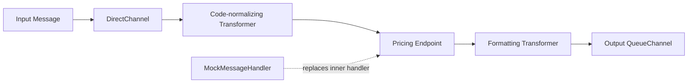

# MockIntegration

## 1. Objectives of the lesson

In the **Testing support** chapter of the **SPRING_INTEGRATION_CORE** module, `MockIntegration` helps create mock message sources and handlers to test a segment of an integration flow. You still observe `Message`, headers, channels, and endpoints, while directly controlling data or errors at the isolated boundary.

After this lesson, you will be able to:

- Create a `MessageSource` with payloads or predefined messages.
- Mock a one-way or request–reply handler using `MockMessageHandler`.
- Collect messages using `ArgumentCaptor<Message<?>>`.
- Substitute handlers in a Java DSL flow using `MockIntegrationContext`.
- Write assertions for payloads, headers, invocation counts, and synchronous errors.
- Recognize the limits of a test when a component has been replaced with a mock.

The running example is a flow that normalizes a product code, calls a pricing step, and formats the result. We mock the pricing step while keeping the remaining message-processing steps to evaluate how they collaborate.

## 2. Where does MockIntegration fit in a test?

`MockIntegration` lives in package `org.springframework.integration.test.mock`, inside the `spring-integration-test` artifact. It is a factory class with static methods—not an annotation that enables testing, and it does not load an `ApplicationContext` itself. The APIs used in this lesson are referenced against Spring Integration 6.5.x. [MockIntegration Javadoc](https://www.springframework.org/spring-integration/docs/6.5.0/api/org/springframework/integration/test/mock/MockIntegration.html).

Three similar-sounding names have distinct responsibilities:

| Component | Responsibility | How it is used in this lesson |
| --- | --- | --- |
| `MockIntegration` | Creates mock source and handler objects | Call `mockMessageSource(...)`, `mockMessageHandler(...)` |
| `MockMessageHandler` | Declares per-message handling behavior | Use `handleNext(...)` or `handleNextAndReply(...)` |
| `MockIntegrationContext` | Replaces the component used by an endpoint and restores it after the test | Use `substituteMessageHandlerFor(...)`, `resetBeans()` |

`@SpringIntegrationTest` registers `MockIntegrationContext` in the Spring Test context. Loading the test configuration is performed by `@SpringJUnitConfig` in the examples below. [Testing support](https://docs.spring.io/spring-integration/reference/6.5/testing.html).

### 2.1. Setting the test boundary

Suppose the application has this flow:



A test for the input `"  sku-01  "` may need to prove three things:

1. The pricing handler receives `"SKU-01"` together with the original trace header.
2. The mocked reply flows onward through the formatting transformer.
3. The final result contains the expected code and the price supplied by the test.

If you merely call the mock lambda directly and compare results, the test never traverses this flow. If you replace both transformers with mocks as well, the test no longer observes the normalization and formatting you intended to verify.

Boundaries should follow the question the test is asking. When testing a router, keep the real router and record which branches receive messages. When testing an aggregator, keep the real aggregation mechanism and substitute external sources or services. When testing a gateway, send requests through the configured gateway to observe the full request–reply contract.

## 3. Preparing dependencies and the example environment

The Java snippets use JUnit Jupiter and Spring Integration 6.5.x APIs on Java 17 or later. This is an API reference baseline, not a requirement to upgrade or downgrade an existing project. Use mutually compatible Spring Integration artifacts from your project's BOM or dependency management.

In a Spring Boot project with managed versions, the relevant dependencies look like:

```groovy
dependencies {
    implementation 'org.springframework.boot:spring-boot-starter-integration'
    testImplementation 'org.springframework.boot:spring-boot-starter-test'
    testImplementation 'org.springframework.integration:spring-integration-test'
}

tasks.named('test') {
    useJUnitPlatform()
}
```

This is an illustrative snippet to include in a practice project's build; it is not a complete build script. If not using Boot, declare and manage compatible versions for Spring Test, JUnit Jupiter, Mockito, `spring-integration-core`, and `spring-integration-test`.

`spring-integration-test-support` provides foundational test utilities. The mock components and test-context configuration used here belong to `spring-integration-test`; do not add only the `test-support` artifact and expect to find all APIs in this lesson. [Testing module breakdown](https://docs.spring.io/spring-integration/reference/6.5/testing.html).

## 4. Creating a MessageSource with mockMessageSource

`MessageSource<T>` provides the `receive()` method. Unlike `QueueChannel`, it does not have the `receive(timeout)` contract of a pollable channel. `MockIntegration.mockMessageSource(...)` creates a Mockito mock of this source.

### 4.1. Providing a sequence of payloads

The following test class can stand alone in the test source set:

```java
import org.junit.jupiter.api.Test;

import org.springframework.integration.core.MessageSource;

import static org.junit.jupiter.api.Assertions.assertEquals;
import static org.mockito.Mockito.times;
import static org.mockito.Mockito.verify;
import static org.springframework.integration.test.mock.MockIntegration.mockMessageSource;

class ProductSourceTest {

    @Test
    void returnsConfiguredPayloadsInOrder() {
        MessageSource<String> source =
                mockMessageSource("sku-01", "sku-02");

        assertEquals("sku-01", source.receive().getPayload());
        assertEquals("sku-02", source.receive().getPayload());
        assertEquals("sku-02", source.receive().getPayload());

        verify(source, times(3)).receive();
    }
}
```

In the reference version, the factory configures the sequence of return values with Mockito. Once the sequence is exhausted, subsequent calls continue returning the last value. Thus, two payloads do not form a finite source with strictly two elements. [MockIntegration 6.5.0 implementation](https://raw.githubusercontent.com/spring-projects/spring-integration/v6.5.0/spring-integration-test/src/main/java/org/springframework/integration/test/mock/MockIntegration.java).

This is especially important when wiring a mock source to a poller: if emission is not bounded, the last item can be emitted repeatedly and skew expected message counts.

### 4.2. Providing Messages when header control is needed

The following snippet is used inside a test method with full additional imports listed:

```java
import org.springframework.integration.core.MessageSource;
import org.springframework.messaging.Message;
import org.springframework.messaging.support.MessageBuilder;

import static org.junit.jupiter.api.Assertions.assertEquals;
import static org.junit.jupiter.api.Assertions.assertSame;
import static org.springframework.integration.test.mock.MockIntegration.mockMessageSource;

// Inside a @Test method:
Message<String> expected = MessageBuilder.withPayload("sku-01")
        .setHeader("traceId", "trace-source-01")
        .setHeader("tenantId", "shop-a")
        .build();

MessageSource<?> source = mockMessageSource(expected);
Message<?> actual = source.receive();

assertSame(expected, actual);
assertEquals("trace-source-01", actual.getHeaders().get("traceId"));
assertEquals("shop-a", actual.getHeaders().get("tenantId"));
```

The overload taking `Message<?>` configures the source to return that exact message, so you do not need to cast to `MessageSource<String>`. The overload taking payloads wraps each payload in a `GenericMessage`. [Factory overloads](https://www.springframework.org/spring-integration/docs/6.5.0/api/org/springframework/integration/test/mock/MockIntegration.html).

The identity assertion here only verifies that the source emitted the message. After a transformer in a flow, check the required content and headers rather than assuming the output message is still the exact same instance.

### 4.3. When a finite source is needed

You can adjust the Mockito mock just created so `receive()` returns `null` after two messages:

```java
import org.springframework.integration.core.MessageSource;
import org.springframework.messaging.support.GenericMessage;

import static org.mockito.Mockito.when;
import static org.springframework.integration.test.mock.MockIntegration.mockMessageSource;

// Inside a test method or test setup:
MessageSource<String> source = mockMessageSource("unused");

when(source.receive()).thenReturn(
        new GenericMessage<>("sku-01"),
        new GenericMessage<>("sku-02"),
        null);
```

The final value becomes `null`, representing no data available on the current poll. It does not automatically stop the endpoint or scheduler. Tests using a poller still need to manage lifecycle and wait bounds explicitly.

If the test case only requires processing one message, sending the message directly into the input channel usually keeps the test more focused. Only bring a poller into the test when the polling schedule, data source, or ingestion mechanics are part of what you need to verify.

## 5. Mocking handlers: one-way and request–reply

### 5.1. handleNext for one-way behavior

`handleNext(Consumer<Message<?>>)` describes an action on a message without producing a reply. For example, recording an email-sending request or publishing an event:

```java
import java.util.concurrent.atomic.AtomicInteger;

import org.springframework.integration.test.mock.MockMessageHandler;

import static org.springframework.integration.test.mock.MockIntegration.mockMessageHandler;

// Behavior invoked by the endpoint after substituting the handler:
AtomicInteger notificationCount = new AtomicInteger();

MockMessageHandler notificationStub = mockMessageHandler()
        .handleNext(message -> notificationCount.incrementAndGet());
```

Once the flow finishes processing, the test asserts `notificationCount.get()` along with the collected message data. With asynchronous processing, a completion signal is required before reading results; using an atomic variable alone does not prove all tasks have finished.

### 5.2. handleNextAndReply for reply-producing behavior

`handleNextAndReply(Function<Message<?>, ?>)` receives the full message. The lambda can read the payload and headers and then return a result:

```java
MockMessageHandler priceStub = mockMessageHandler()
        .handleNextAndReply(message ->
                "PRICE:" + message.getPayload() + ":120000");
```

`MockMessageHandler` extends `AbstractMessageProducingHandler`, so replies also flow through the handler's message-producing mechanism. If used standalone outside a context, configure a reply destination and appropriate initialization requirements; simply creating the handler and calling `handleMessage()` does not automatically create somewhere to receive results. [MockMessageHandler Javadoc](https://docs.spring.io/spring-integration/docs/6.5.0/api/org/springframework/integration/test/mock/MockMessageHandler.html).

Choose `handleNext` when the simulated endpoint only receives one-way messages. Choose `handleNextAndReply` when downstream flow steps depend on the returned value. If you use one-way behavior for the pricing step, the flow can stop there and a test waiting for the final output will time out.

### 5.3. Behavior chains are consumed per invocation

Example with two behaviors:

```java
MockMessageHandler priceStub = mockMessageHandler()
        .handleNextAndReply(message -> "PRICE:FIRST:120000")
        .handleNextAndReply(message -> "PRICE:LATER:125000");
```

| Message arriving at handler | Behavior used | Reply payload |
| --- | --- | --- |
| First | First behavior | `PRICE:FIRST:120000` |
| Second | Second behavior | `PRICE:LATER:125000` |
| Third and subsequent | Continues using the last behavior | `PRICE:LATER:125000` |

This is an invocation-order chain, not a rule table matching on payload. To reply based on product code, read the payload inside a single lambda and decide the result from that data. [Behavior consumption in MockMessageHandler](https://raw.githubusercontent.com/spring-projects/spring-integration/v6.5.0/spring-integration-test/src/main/java/org/springframework/integration/test/mock/MockMessageHandler.java).

In tests with multiple processing threads, do not equate the order of sends from the test with arrival order at the handler unless the architecture guarantees that order. Responding based on a business key makes tests easier to understand when ordering is not the target of verification.

## 6. Testing a Java DSL flow with a substituted handler

### 6.1. Contract to prove

The hands-on flow consists of:

```text
"  sku-01  " + traceId
    -> normalize to "SKU-01"
    -> mocked pricing handler returns "PRICE:SKU-01:120000"
    -> format to "RESULT:PRICE:SKU-01:120000"
    -> output QueueChannel
```

The `PriceClient` class in the example models an external pricing service. Its method intentionally throws an exception so a test that forgets to substitute the handler fails clearly. In a real project, this would be the corresponding service-calling bean or adapter.

### 6.2. Complete configuration and test

```java
import java.util.Locale;

import org.junit.jupiter.api.AfterEach;
import org.junit.jupiter.api.Test;
import org.mockito.ArgumentCaptor;

import org.springframework.beans.factory.annotation.Autowired;
import org.springframework.beans.factory.annotation.Qualifier;
import org.springframework.context.annotation.Bean;
import org.springframework.context.annotation.Configuration;
import org.springframework.integration.channel.DirectChannel;
import org.springframework.integration.channel.QueueChannel;
import org.springframework.integration.config.EnableIntegration;
import org.springframework.integration.dsl.IntegrationFlow;
import org.springframework.integration.test.context.MockIntegrationContext;
import org.springframework.integration.test.context.SpringIntegrationTest;
import org.springframework.integration.test.mock.MockMessageHandler;
import org.springframework.messaging.Message;
import org.springframework.messaging.MessageChannel;
import org.springframework.messaging.MessageHandlingException;
import org.springframework.messaging.support.MessageBuilder;
import org.springframework.test.context.junit.jupiter.SpringJUnitConfig;

import static org.junit.jupiter.api.Assertions.assertEquals;
import static org.junit.jupiter.api.Assertions.assertNotNull;
import static org.junit.jupiter.api.Assertions.assertNull;
import static org.junit.jupiter.api.Assertions.assertSame;
import static org.junit.jupiter.api.Assertions.assertThrows;
import static org.junit.jupiter.api.Assertions.assertTrue;
import static org.springframework.integration.test.mock.MockIntegration.messageArgumentCaptor;
import static org.springframework.integration.test.mock.MockIntegration.mockMessageHandler;

@SpringJUnitConfig(PriceFlowTest.Config.class)
@SpringIntegrationTest(noAutoStartup = "priceEndpoint")
class PriceFlowTest {

    @Autowired
    MockIntegrationContext mockContext;

    @Autowired
    @Qualifier("priceInput")
    MessageChannel input;

    @Autowired
    @Qualifier("priceResults")
    QueueChannel results;

    @AfterEach
    void cleanUp() {
        mockContext.resetBeans();
        while (results.receive(0) != null) {
            // Drain remaining messages from the current test.
        }
    }

    @Test
    void preservesTraceAndRunsTransformersAroundTheStub() {
        ArgumentCaptor<Message<?>> captured = messageArgumentCaptor();
        MockMessageHandler priceStub = mockMessageHandler(captured)
                .handleNextAndReply(message ->
                        "PRICE:" + message.getPayload() + ":120000");

        mockContext.substituteMessageHandlerFor("priceEndpoint", priceStub);

        Message<String> request = MessageBuilder.withPayload("  sku-01  ")
                .setHeader("traceId", "trace-price-01")
                .build();

        assertTrue(input.send(request));

        Message<?> reply = results.receive(1000);
        assertNotNull(reply);
        assertEquals("RESULT:PRICE:SKU-01:120000", reply.getPayload());
        assertEquals("trace-price-01", reply.getHeaders().get("traceId"));

        assertEquals(1, captured.getAllValues().size());
        Message<?> sentToPriceClient = captured.getValue();
        assertEquals("SKU-01", sentToPriceClient.getPayload());
        assertEquals("trace-price-01",
                sentToPriceClient.getHeaders().get("traceId"));
        assertNull(results.receive(0));
    }

    @Test
    void propagatesFailureOnTheDirectChannelPath() {
        IllegalStateException failure =
                new IllegalStateException("pricing-unavailable");

        MockMessageHandler failingStub = mockMessageHandler()
                .handleNextAndReply(message -> {
                    throw failure;
                });

        mockContext.substituteMessageHandlerFor("priceEndpoint", failingStub);

        Message<String> request = MessageBuilder.withPayload("sku-02")
                .setHeader("traceId", "trace-price-02")
                .build();

        MessageHandlingException thrown = assertThrows(
                MessageHandlingException.class,
                () -> input.send(request));

        assertSame(failure, thrown.getCause());
        assertNotNull(thrown.getFailedMessage());
        assertEquals("SKU-02", thrown.getFailedMessage().getPayload());
        assertNull(results.receive(0));
    }

    @Configuration
    @EnableIntegration
    static class Config {

        @Bean
        DirectChannel priceInput() {
            return new DirectChannel();
        }

        @Bean
        QueueChannel priceResults() {
            return new QueueChannel();
        }

        @Bean
        PriceClient priceClient() {
            return new PriceClient();
        }

        @Bean
        IntegrationFlow priceFlow(PriceClient priceClient) {
            return IntegrationFlow.from("priceInput")
                    .transform(String.class,
                            value -> value.trim().toUpperCase(Locale.ROOT))
                    .handle(priceClient, "quote",
                            endpoint -> endpoint.id("priceEndpoint"))
                    .transform(String.class, value -> "RESULT:" + value)
                    .channel("priceResults")
                    .get();
        }
    }

    public static class PriceClient {

        public String quote(String productCode) {
            throw new IllegalStateException(
                    "Pricing handler must be substituted in test: " + productCode);
        }
    }
}
```

### 6.3. Why must you use the exact endpoint ID?

In the DSL, `endpoint.id("priceEndpoint")` names the endpoint wrapping the handler that invokes `PriceClient.quote`. `substituteMessageHandlerFor(...)` takes the ID of the consumer endpoint, not the `priceClient` bean name or the name of the entire `priceFlow`. [Handler substitution contract](https://docs.spring.io/spring-integration/docs/6.5.0/api/org/springframework/integration/test/context/MockIntegrationContext.html).

In the test above:

- `priceInput` identifies the channel feeding messages into the flow.
- `priceEndpoint` identifies where to substitute the handler.
- `priceResults` identifies the channel for observing results.

Giving an explicit name to the substitution point helps readers locate the test boundary as the flow grows with more steps.

### 6.4. Role of noAutoStartup and the reply path

`noAutoStartup = "priceEndpoint"` keeps the target endpoint unstarted when the context starts up. The two-argument `substituteMessageHandlerFor(...)` call in the example replaces the handler and then starts the endpoint. Therefore, perform the substitution before sending messages.

When both the old and new handlers are `MessageProducer` instances, the substitution mechanism copies the old handler's output channel configuration onto the replacement handler. As a result, the mock's reply reaches the formatting transformer declared in the flow. This mechanism does not transfer all configuration such as advice chains onto the mock; the example above has no advice. [Handler substitution 6.5.0 implementation](https://raw.githubusercontent.com/spring-projects/spring-integration/v6.5.0/spring-integration-test/src/main/java/org/springframework/integration/test/context/MockIntegrationContext.java).

If you use `MockMessageHandler` standalone outside a flow, you must configure the test's reply destination yourself. When substituting a one-way handler, preserve its one-way contract rather than attaching reply behavior and expecting a downstream branch to appear automatically.

### 6.5. What are the assertions proving?

| Assertion | Meaning in this flow |
| --- | --- |
| Payload captured by captor is `SKU-01` | The transformer before the handler normalized the data |
| Captor has exactly one message | The mocked handler received one request in this synchronous run |
| `traceId` header is present at the pricing call | Tracing metadata reached the call boundary |
| Result starts with `RESULT:` | The transformer after the handler executed |
| Result contains `120000` | The flow used the test-controlled reply |
| Queue has no more messages after reading the result | No extra results remain once the synchronous flow completed |

Business headers are usually a better target for assertions than comparing the entire `MessageHeaders`. Technical headers like `id` can change when the framework constructs new messages.

In this test, `DirectChannel` executes handlers on the sending thread. The final `QueueChannel` merely holds results for the test to pull; it does not spawn downstream processing because there is no consumer after it in this configuration. `receive(1000)` bounds the wait time; `receive(0)` checks queue state immediately. [DirectChannel and QueueChannel semantics](https://docs.spring.io/spring-integration/reference/6.5/channel/implementations.html).

## 7. Collecting messages with ArgumentCaptor

`messageArgumentCaptor()` creates an `ArgumentCaptor<Message<?>>` suitable for passing to `mockMessageHandler(captor)`. With multiple requests, `getValue()` only returns the most recently captured message; use `getAllValues()` to inspect the entire sequence. [Captor creation API](https://www.springframework.org/spring-integration/docs/6.5.0/api/org/springframework/integration/test/mock/MockIntegration.html).

You can add the following test to `PriceFlowTest` above; it reuses the already-declared fields and configuration:

```java
@Test
void capturesBothNormalizedRequests() {
    ArgumentCaptor<Message<?>> captured = messageArgumentCaptor();
    MockMessageHandler stub = mockMessageHandler(captured)
            .handleNextAndReply(message -> "PRICE:FIRST:120000")
            .handleNextAndReply(message -> "PRICE:SECOND:125000");

    mockContext.substituteMessageHandlerFor("priceEndpoint", stub);

    assertTrue(input.send(MessageBuilder.withPayload(" sku-01 ").build()));
    assertTrue(input.send(MessageBuilder.withPayload(" sku-02 ").build()));

    Message<?> first = results.receive(1000);
    Message<?> second = results.receive(1000);
    assertNotNull(first);
    assertNotNull(second);
    assertEquals("RESULT:PRICE:FIRST:120000", first.getPayload());
    assertEquals("RESULT:PRICE:SECOND:125000", second.getPayload());

    assertEquals(2, captured.getAllValues().size());
    assertEquals("SKU-01", captured.getAllValues().get(0).getPayload());
    assertEquals("SKU-02", captured.getAllValues().get(1).getPayload());
    assertNull(results.receive(0));
}
```

Two sends on the same synchronous thread establish a clear order for this test. If you later move the pricing step onto an executor, re-evaluate the ordering contract and completion conditions before keeping positional assertions.

Capturing messages is valuable when assertions specify mandatory data at the boundary. For example, in a multi-tenant system, verify that `tenantId` reaches the right handler rather than only checking a generic result string.
