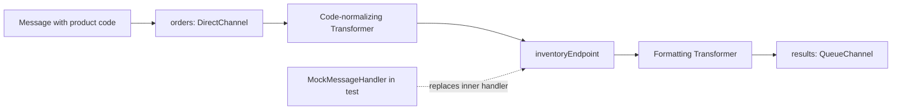

# MockMessageHandler

## 1. Objectives and use cases

In the **Testing support** chapter of **SPRING_INTEGRATION_CORE**, `MockMessageHandler` helps test message flows when you need to control the behavior of a processing step. You still send a `Message` through a `MessageChannel` and observe the flow's outcome, while replacing an external system call with a scripted handler.

After this lesson, you will be able to:

- Choose `handleNext` for one-way processing and `handleNextAndReply` for reply-producing processing.
- Configure behavior chains and verify the number of messages that actually pass through the handler.
- Capture payloads, headers, and invocation counts with `ArgumentCaptor`.
- Substitute the handler at an endpoint in the Java DSL using `MockIntegrationContext`.
- Assert replies, no-reply cases, and errors in synchronous flows.
- Restore configuration after each test and identify the exact scope verified by the test.

The running example is an inventory check flow: normalize a product code, call an inventory lookup step, and format the result. We need to prove that the steps before and after the call still behave correctly with test-controlled reply data.



In this design, the endpoint binds message consumption to the handler. Replacing the handler does not mean replacing the entire flow or invoking the business lambda directly from the test.

## 2. Nature and related components

`MockMessageHandler` resides in package `org.springframework.integration.test.mock` and extends `AbstractMessageProducingHandler`. It carries the message-receiving and reply-emitting logic of a Spring Integration handler. Create instances via `MockIntegration.mockMessageHandler()`, rather than calling the constructor directly. Two factory overloads let you create a handler with or without a captor. [MockIntegration Javadoc](https://docs.spring.io/spring-integration/api/org/springframework/integration/test/mock/MockIntegration.html)

Each component has a distinct role:

| Component | Role in this lesson |
| --- | --- |
| `Message<?>` | Carries input payload and headers such as `traceId` |
| `MessageChannel` | Feeds messages into the real flow |
| `MockMessageHandler` | Executes test-declared behavior at one processing step |
| `MockIntegration` | Factory creating handlers and captors |
| `MockIntegrationContext` | Replaces and restores handlers inside configured endpoints |
| `ArgumentCaptor<Message<?>>` | Records messages actually received by the handler |
| `QueueChannel` | Holds results for the test to receive and verify |

In the 6.5.0 version referenced in this lesson, the factory wraps `MockMessageHandler` in a Mockito spy. Therefore, describing it as a handler with real behavior remains accurate, while the returned object also supports Mockito interaction verification. Do not infer from the word "mock" that all methods default to no-ops. [MockIntegration 6.5.0 source code](https://github.com/spring-projects/spring-integration/blob/v6.5.0/spring-integration-test/src/main/java/org/springframework/integration/test/mock/MockIntegration.java)

## 3. Preparing dependencies and environment

The examples use Java 17+, JUnit Jupiter, and Spring Integration 6.x APIs; version-specific implementation details are referenced against 6.5.0 source code. This is a choice for the examples, not a statement about the version used in any specific project.

If your Maven project already has a compatible Spring Boot parent or BOM managing versions, you can add the following dependencies:

```xml
<dependencies>
    <dependency>
        <groupId>org.springframework.integration</groupId>
        <artifactId>spring-integration-core</artifactId>
    </dependency>

    <dependency>
        <groupId>org.springframework.integration</groupId>
        <artifactId>spring-integration-test</artifactId>
        <scope>test</scope>
    </dependency>

    <dependency>
        <groupId>org.springframework.boot</groupId>
        <artifactId>spring-boot-starter-test</artifactId>
        <scope>test</scope>
    </dependency>
</dependencies>
```

This is a dependency snippet, not a complete `pom.xml`. Outside Spring Boot, manage compatible versions of Spring Integration, Spring Framework, JUnit Jupiter, and Mockito yourself, and configure your build tool to run JUnit Jupiter.

`MockMessageHandler`, `MockIntegrationContext`, and `@SpringIntegrationTest` belong to the integration-testing tools of `spring-integration-test`. Adding only `spring-integration-test-support` is not enough for the handler-substitution examples below. [Testing support — testing modules](https://docs.spring.io/spring-integration/reference/testing.html)

## 4. Declaring processing behavior

### 4.1. `handleNext`: receive a message without producing a reply

`handleNext(Consumer<Message<?>>)` is used when the simulated step only consumes messages, such as writing a business audit log or sending a one-way notification.

The following standalone JUnit test checks one message arriving at the handler:

```java
import org.junit.jupiter.api.Test;
import org.mockito.ArgumentCaptor;
import org.springframework.integration.test.mock.MockIntegration;
import org.springframework.integration.test.mock.MockMessageHandler;
import org.springframework.messaging.Message;
import org.springframework.messaging.support.MessageBuilder;

import static org.junit.jupiter.api.Assertions.*;

class OneWayMockMessageHandlerTest {

    @Test
    void capturesAnInventoryAuditEvent() {
        ArgumentCaptor<Message<?>> captor =
                MockIntegration.messageArgumentCaptor();

        MockMessageHandler handler = MockIntegration.mockMessageHandler(captor)
                .handleNext(message -> {
                    assertEquals("SKU-42", message.getPayload());
                    assertEquals("audit-42", message.getHeaders().get("traceId"));
                });

        Message<String> request = MessageBuilder.withPayload("SKU-42")
                .setHeader("traceId", "audit-42")
                .build();

        handler.handleMessage(request);

        assertEquals(1, captor.getAllValues().size());
        assertSame(request, captor.getValue());
    }
}
```

This test illustrates using the handler and captor; it does not yet test channel or endpoint configuration. To test those components, send messages through a Spring-managed flow as in section 5.

### 4.2. `handleNextAndReply`: compute a reply value

`handleNextAndReply(Function<Message<?>, ?>)` lets you read the full request and return a payload or a reply `Message`. If the function returns `null`, the handler emits no reply for that invocation. The handler must have at least one behavior declared before receiving messages. [MockMessageHandler Javadoc](https://docs.spring.io/spring-integration/docs/current/api/org/springframework/integration/test/mock/MockMessageHandler.html)

Example declaring a stub for the inventory lookup step:

```java
MockMessageHandler handler = MockIntegration.mockMessageHandler()
        .handleNextAndReply(message -> {
            String sku = (String) message.getPayload();
            return "AVAILABLE:" + sku;
        });
```

This declaration does not connect the handler to the flow by itself. You must register it in the test configuration or substitute the handler on the target endpoint. Additionally, a reply path must exist, such as the flow's output channel.

### 4.3. Behavior chain tied to invocation order

When chaining multiple calls, each message consumes one behavior in declaration order. Once the chain is exhausted, the last behavior continues to be applied to subsequent messages. Keep this in mind when writing multi-request tests. [Chaining mechanism in MockMessageHandler](https://github.com/spring-projects/spring-integration/blob/main/spring-integration-test/src/main/java/org/springframework/integration/test/mock/MockMessageHandler.java)

```java
MockMessageHandler handler = MockIntegration.mockMessageHandler()
        .handleNextAndReply(message -> "BUSY")
        .handleNextAndReply(message -> "AVAILABLE");
```

| Message arrival | Handler reply |
| --- | --- |
| 1 | `BUSY` |
| 2 | `AVAILABLE` |
| 3 | `AVAILABLE` |
| 4 and later | `AVAILABLE` |

This is not content-based behavior selection. If the first request contains `SKU-99`, it still gets the first behavior. To return results per product, branch inside a single lambda:

```java
MockMessageHandler handler = MockIntegration.mockMessageHandler()
        .handleNextAndReply(message -> {
            String sku = (String) message.getPayload();
            return switch (sku) {
                case "SKU-42" -> "AVAILABLE";
                case "SKU-99" -> "OUT_OF_STOCK";
                default -> "UNKNOWN_SKU";
            };
        });
```

Choosing between the two depends on test intent: a behavior chain fits progression across calls, while branching on payload fits an input-value table.

## 5. Complete example: substituting a handler in a Java DSL flow

The sample flow has three processing steps:

1. Trim leading/trailing whitespace and convert the product code to uppercase.
2. Process at an endpoint with the explicit ID `inventoryEndpoint`.
3. Prepend `RESULT:` and send the output to `results`.

The original handler simply returns a `REAL:` string to keep the example self-contained without network calls. In a real application, that spot could be a service activator calling an inventory lookup client.

```java
import java.util.Locale;

import org.junit.jupiter.api.AfterEach;
import org.junit.jupiter.api.Test;
import org.mockito.ArgumentCaptor;
import org.springframework.beans.factory.annotation.Autowired;
import org.springframework.beans.factory.annotation.Qualifier;
import org.springframework.context.annotation.Bean;
import org.springframework.context.annotation.Configuration;
import org.springframework.integration.channel.DirectChannel;
import org.springframework.integration.channel.QueueChannel;
import org.springframework.integration.config.EnableIntegration;
import org.springframework.integration.dsl.IntegrationFlow;
import org.springframework.integration.test.context.MockIntegrationContext;
import org.springframework.integration.test.context.SpringIntegrationTest;
import org.springframework.integration.test.mock.MockIntegration;
import org.springframework.integration.test.mock.MockMessageHandler;
import org.springframework.messaging.Message;
import org.springframework.messaging.MessageChannel;
import org.springframework.messaging.support.MessageBuilder;
import org.springframework.test.context.junit.jupiter.SpringJUnitConfig;

import static org.junit.jupiter.api.Assertions.*;

@SpringJUnitConfig(MockMessageHandlerFlowTest.Config.class)
@SpringIntegrationTest
class MockMessageHandlerFlowTest {

    @Autowired
    private MockIntegrationContext mockIntegrationContext;

    @Autowired
    @Qualifier("orders")
    private MessageChannel orders;

    @Autowired
    @Qualifier("results")
    private QueueChannel results;

    @AfterEach
    void restoreFlow() {
        mockIntegrationContext.resetBeans("inventoryEndpoint");
        results.purge(null);
    }

    @Test
    void preservesTransformationsAndTraceHeaderAroundTheStub() {
        ArgumentCaptor<Message<?>> captor =
                MockIntegration.messageArgumentCaptor();

        MockMessageHandler inventoryStub =
                MockIntegration.mockMessageHandler(captor)
                        .handleNextAndReply(message ->
                                "AVAILABLE:" + message.getPayload());

        mockIntegrationContext.substituteMessageHandlerFor(
                "inventoryEndpoint", inventoryStub);

        Message<String> request = MessageBuilder.withPayload("  sku-42  ")
                .setHeader("traceId", "trace-42")
                .build();

        assertTrue(orders.send(request));

        Message<?> response = results.receive(1_000);
        assertNotNull(response);
        assertEquals("RESULT:AVAILABLE:SKU-42", response.getPayload());
        assertEquals("trace-42", response.getHeaders().get("traceId"));

        assertEquals(1, captor.getAllValues().size());
        Message<?> receivedByInventory = captor.getValue();
        assertEquals("SKU-42", receivedByInventory.getPayload());
        assertEquals("trace-42", receivedByInventory.getHeaders().get("traceId"));

        assertNull(results.receive(0));
    }

    @Configuration
    @EnableIntegration
    static class Config {

        @Bean
        DirectChannel orders() {
            return new DirectChannel();
        }

        @Bean
        QueueChannel results() {
            return new QueueChannel();
        }

        @Bean
        IntegrationFlow inventoryFlow(
                @Qualifier("orders") MessageChannel orders,
                @Qualifier("results") QueueChannel results) {

            return IntegrationFlow.from(orders)
                    .<String, String>transform(value ->
                            value.strip().toUpperCase(Locale.ROOT))
                    .handle(String.class,
                            (payload, headers) -> "REAL:" + payload,
                            endpoint -> endpoint.id("inventoryEndpoint"))
                    .<String, String>transform(value -> "RESULT:" + value)
                    .channel(results)
                    .get();
        }
    }
}
```

### 5.1. Meaning of the annotations and IDs

`@SpringJUnitConfig` loads the configuration and integrates Spring Test with JUnit Jupiter. `@SpringIntegrationTest` adds the Spring Integration testing environment, including the autowirable `MockIntegrationContext` bean. `substituteMessageHandlerFor` accepts the bean name of the **consumer endpoint** wrapping the handler; here, that is the ID assigned via `endpoint.id("inventoryEndpoint")`. [Testing support — Test Context and endpoint names](https://docs.spring.io/spring-integration/reference/6.5/testing.html)

Do not pass `inventoryFlow`, `orders`, or a business service bean name to this substitution API. Those may be valid bean names, yet they do not identify the consumer endpoint whose handler you want to replace.

### 5.2. Why does the reply still reach the downstream transformer?

In this substitution, when the original handler is a `MessageProducer`, `MockIntegrationContext` transfers the original handler's output channel to the replacement handler. Consequently, the `AVAILABLE:SKU-42` reply continues through the `RESULT:` step. This is a behavior of the substitution API; constructing a standalone handler does not automatically provide that wiring. [substituteMessageHandlerFor 6.5.0 source code](https://github.com/spring-projects/spring-integration/blob/v6.5.0/spring-integration-test/src/main/java/org/springframework/integration/test/context/MockIntegrationContext.java#L192)

### 5.3. What the tests proved

Each assertion has a dedicated purpose:

| Assertion | What is verified |
| --- | --- |
| Captor has exactly one item | Exactly one message reached the stub during this send |
| Payload at the stub is `SKU-42` | Upstream transformer still ran |
| `traceId` at the stub is `trace-42` | Business header reached the test boundary |
| Output is `RESULT:AVAILABLE:SKU-42` | Reply from the stub passed through the downstream transformer |
| `traceId` in output is preserved | Header is retained in the example configuration |
| No more items in `results` | No second result after the synchronous flow completed |

The test has not proved connectivity to an inventory system, HTTP protocol details, authentication, or data conversion of a replaced adapter. Those parts require a test with a different boundary.

## 6. Capturing messages and designing meaningful assertions

A `send()` call returning `true` does not fully describe the business outcome. For instance, the input channel may accept a message, yet a subsequent filter discards it so the stub receives nothing. Therefore, assert both the message at the boundary and the final output.

The captor offers two views:

```java
Message<?> mostRecent = captor.getValue();
java.util.List<Message<?>> allRequests = captor.getAllValues();
```

`getValue()` returns the most recent message; it does not replace asserting the total processing count. With multiple requests, assert `getAllValues().size()` and the meaningful fields of each element.

Useful fields commonly include business keys in the payload, `traceId`, tenant, or routing headers. Only verify `correlationId`, `sequenceNumber`, and `sequenceSize` when the contract of that flow segment genuinely requires them, such as messages passing through a splitter and then an aggregator.

Do not require the entire output `Message` to equal the entire input `Message`. Flows with transformers can create new messages and new IDs; assertions should reflect the business contract rather than inadvertently locking down how the framework constructs messages.

If you want to verify that a router branch did not invoke a handler, verify the captor is empty once you are certain that branch finished processing. In an asynchronous flow, reading the captor right after `send()` may be too early. A result on the alternative branch or a completion signal makes the conclusion reliable.

## 7. Testing multiple calls, no-reply cases, and replies with headers

The methods in this section can be added to `MockMessageHandlerFlowTest` from section 5, reusing the same configuration and cleanup method.

### 7.1. Observing the last behavior being repeated

```java
@Test
void repeatsTheLastConfiguredReply() {
    ArgumentCaptor<Message<?>> captor =
            MockIntegration.messageArgumentCaptor();

    MockMessageHandler stub = MockIntegration.mockMessageHandler(captor)
            .handleNextAndReply(message -> "BUSY")
            .handleNextAndReply(message -> "AVAILABLE");

    mockIntegrationContext.substituteMessageHandlerFor("inventoryEndpoint", stub);

    String[] expected = {
            "RESULT:BUSY",
            "RESULT:AVAILABLE",
            "RESULT:AVAILABLE"
    };

    for (String expectedPayload : expected) {
        assertTrue(orders.send(MessageBuilder.withPayload("sku-42").build()));
        Message<?> reply = results.receive(1_000);
        assertNotNull(reply);
        assertEquals(expectedPayload, reply.getPayload());
    }

    assertEquals(3, captor.getAllValues().size());
    assertNull(results.receive(0));
}
```

If a scenario allows strictly two calls, a repeated final reply could cause a test to overlook an extra invocation. You can append a guarding behavior at the end:

```java
MockMessageHandler exactlyTwoRequests = MockIntegration.mockMessageHandler()
        .handleNextAndReply(message -> "BUSY")
        .handleNextAndReply(message -> "AVAILABLE")
        .handleNext(message -> {
            throw new AssertionError("Must not receive a third request");
        });
```

You still need an assertion that exactly two requests occurred, because the guarding behavior only catches excess calls, not missing ones. Also ensure worker errors are observable by the test if the flow runs asynchronously.

### 7.2. Producing no reply

```java
@Test
void stopsProducingOutputWhenTheStubDoesNotReply() {
    ArgumentCaptor<Message<?>> captor =
            MockIntegration.messageArgumentCaptor();

    MockMessageHandler stub = MockIntegration.mockMessageHandler(captor)
            .handleNext(message ->
                    assertEquals("SKU-42", message.getPayload()));

    mockIntegrationContext.substituteMessageHandlerFor("inventoryEndpoint", stub);

    assertTrue(orders.send(MessageBuilder.withPayload("sku-42").build()));

    assertEquals(1, captor.getAllValues().size());
    assertNull(results.receive(0));
}
```

The conclusion "no output" is valid here because steps prior to `results` run synchronously. Having no reply also leaves the `RESULT:` step with no message to process.

If the caller is a gateway expecting request–reply, producing no reply can lead to waiting until timeout. Gateway tests should set bounded timeouts and verify the gateway contract. Picking `handleNext` merely because the lambda is shorter can accidentally turn a reply test into a timeout test.

### 7.3. Creating a reply `Message` with custom headers

To simulate headers returned by an external system, replace the stub in section 5 with:

```java
MockMessageHandler stub = MockIntegration.mockMessageHandler()
        .handleNextAndReply(request ->
                MessageBuilder.withPayload("AVAILABLE:" + request.getPayload())
                        .setHeader("inventoryNode", "warehouse-a")
                        .build());
```

After sending the request and receiving the output, assert additionally:

```java
assertEquals("warehouse-a", response.getHeaders().get("inventoryNode"));
```

When returning a payload, the handler's message-building path packages the reply. When returning a `Message`, the test can explicitly set reply headers. Either way, still assert headers the application relies on; propagation settings or downstream transformations can affect the result.

## 8. Simulating errors and deciding where to observe them

### 8.1. Errors in synchronous flows

In the main example, processing prior to `results` runs on the sender's thread. An exception at the stub is observed from the `orders.send(...)` call; setting an `errorChannel` header does not automatically turn a direct send over `DirectChannel` into asynchronous error publishing. [Error Handling — synchronous and asynchronous flows](https://docs.spring.io/spring-integration/reference/error-handling.html)

The following method can be added to the test class in section 5. The exception's fully qualified name is kept inline to avoid extra imports:

```java
@Test
void exposesInventoryFailureToTheSynchronousSender() {
    ArgumentCaptor<Message<?>> captor =
            MockIntegration.messageArgumentCaptor();

    MockMessageHandler failingStub = MockIntegration.mockMessageHandler(captor)
            .handleNext(message -> {
                throw new IllegalStateException("inventory unavailable");
            });

    mockIntegrationContext.substituteMessageHandlerFor(
            "inventoryEndpoint", failingStub);

    org.springframework.messaging.MessageHandlingException failure =
            assertThrows(
                    org.springframework.messaging.MessageHandlingException.class,
                    () -> orders.send(
                            MessageBuilder.withPayload("sku-42").build()));

    Throwable rootCause = failure;
    while (rootCause.getCause() != null) {
        rootCause = rootCause.getCause();
    }

    assertInstanceOf(IllegalStateException.class, rootCause);
    assertEquals("inventory unavailable", rootCause.getMessage());
    assertEquals(1, captor.getAllValues().size());
    assertNull(results.receive(0));
}
```

The test verifies both the error and that the request reached the stub. Unwrapping to the root cause avoids brittle coupling to the number of wrapping exception layers in a longer flow.

### 8.2. When an asynchronous boundary exists

If you switch the configuration to an `ExecutorChannel` or use a polled consumer receiving from a `QueueChannel`, execution time no longer coincides with send time. You must then identify the executor's or poller's actual error-reporting mechanism and receive errors from the configured channel, typically as an `ErrorMessage`.

Such a test should wait for a result or error signal with a bounded timeout, then inspect the error payload and related message. Wrapping the queue-enqueue call in `assertThrows` alone cannot prove the handler did not fail.

A chain like "first call throws, next call succeeds" only describes successive invocations of the handler. It does not trigger retry by itself. When testing retry advice, ensure the stub is placed where the retry mechanism actually re-invokes it and verify the corresponding invocation count. Do not assume every advice on the original handler is preserved just because you replaced the handler in the endpoint.

## 9. Output channels, substitution limits, and lifecycle

### 9.1. Use a handler matching the endpoint type

In Spring Integration 6.5.0, when the original handler is strictly a one-way `MessageHandler` and not a `MessageProducer`, the substitution API rejects a `MockMessageHandler` configured with a reply via `handleNextAndReply`. For a one-way sink, use `handleNext` and assert on the received data. This restriction is verified directly in the framework's own test suite. [MockMessageHandlerTests — substituting one-way handler](https://github.com/spring-projects/spring-integration/blob/v6.5.0/spring-integration-test/src/test/java/org/springframework/integration/test/mock/MockMessageHandlerTests.java#L173)

Therefore, when encountering a substitution error, check the original handler's contract before changing the stub. A reply-producing service call and a one-way outbound adapter serve different roles even though both appear as processing steps in the DSL.

### 9.2. Substitute the handler before sending data

The order should be: create the stub, substitute at the endpoint, send the request, receive the result, assert, and then restore. Sending a request before substituting may route that call through the real handler.

For applications with auto-starting sources, `@SpringIntegrationTest(noAutoStartup = "someInboundEndpoint")` can prevent the specified endpoint from starting automatically in tests. Pick the right source endpoint and control when processing begins; stopping one endpoint does not mean every connection-opening activity across the whole application is disabled.

### 9.3. Clean up state after each test

`resetBeans("inventoryEndpoint")` reverts the replaced component on that endpoint back to its original configuration. Call `resetBeans()` with no arguments to restore all components substituted in this context. This is a configuration-restoration operation, not an API to rewind a stub's lambda chain. [MockIntegrationContext Javadoc — resetBeans](https://docs.spring.io/spring-integration/api/org/springframework/integration/test/context/MockIntegrationContext.html)

Tests should create fresh stubs and captors per scenario. Reusing a stub may mean early behaviors were already consumed; reusing a captor may retain messages from a previous test. Result queues must also be drained to avoid reading stale data.

Do not run tests in parallel if they substitute handlers on a shared application context. One test could replace or restore configuration while another test is sending messages. For async flows, wait for in-flight work to finish before restoring the handler.

## 10. Timeouts and message ordering

`QueueChannel` supports receiving messages with a timeout; `receive(0)` returns immediately, whereas parameterless `receive()` can block indefinitely. Use `receive(1_000)` in examples so a configuration error does not hang the test forever. Choose CI-appropriate timeouts based on your system's characteristics. [Message Channel Implementations — QueueChannel](https://docs.spring.io/spring-integration/reference/channel/implementations.html)

`receive(0) == null` only tells you the queue is empty at the instant of observation. In this lesson's synchronous flow, the send call already completed upstream steps, so that assertion is valid. In asynchronous flows, you need a completion signal or an appropriate wait condition before asserting no output exists.

Behavior chains also interact with concurrency: if multiple threads deliver messages to the handler, arrival order need not match the order of inputs prepared by the test. Do not use "first call returns A, second returns B" to stand in for "product X returns A, product Y returns B" in a parallel flow. When the contract depends on data, compute the reply from the payload or a business key header.

## 11. Choosing test boundaries and troubleshooting common errors

| Goal | Appropriate approach |
| --- | --- |
| Test a transformer, router, or filter around an external call | Substitute the external-call handler with `MockMessageHandler` |
| Verify data sent to a one-way sink | Use `handleNext`, a captor, and invocation-count assertions |
| Test downstream processing after a reply | Use `handleNextAndReply` and receive at the flow output |
| Test pure Java algorithm in a service | Call the service directly in a unit test |
| Test HTTP requests, mapping, or adapter authentication | Keep the real adapter in the test and mock at the HTTP boundary |
| Test grouping with an aggregator | Keep the real aggregator, supply data and group headers per contract |

When mocking a segment of a flow, the steps being verified must lie outside what was substituted. For example, if the goal is to verify which warehouse a router selects, the router itself must keep running; stubs should sit at the endpoints of each branch you want to observe.

| Symptom | Cause to check | Resolution |
| --- | --- | --- |
| Bean not found or wrong bean type when substituting | Passed flow ID, channel ID, or service bean instead of endpoint ID | Assign an explicit ID with `endpoint.id(...)` and pass that ID |
| Error when the first message reaches the stub | Missing `handleNext` or `handleNextAndReply` | Declare at least one behavior before sending |
| No result in the queue | Stub did not reply, returned `null`, request filtered before stub, or endpoint stopped | Inspect the captor first, then check reply contract and lifecycle |
| Third call still succeeds despite only two declared replies | Last behavior repeats | Assert total invocation count or append a guarding behavior |
| Error substituting a one-way sink with a reply stub | Original handler contract does not support reply substitution | Use `handleNext` for one-way sinks |
| Test fails only when running the full suite | Handler, captor, or queue kept state from prior test | Restore endpoints, create fresh stubs, and drain outputs |
| Flaky pass/fail on CI | Observed too early, parallel execution, or ordering dependency | Wait on explicit conditions and isolate modified contexts |
| Tests pass locally yet real calls fail | The integration component with the bug was mocked out | Add a test keeping that adapter or client inside the test boundary |

## 12. Consolidation exercises

Practice directly on the example in section 5:

1. Change the input to `"  sku-99  "`, make the stub return `OUT_OF_STOCK` based on payload, and verify the final output.
2. Add a filter discarding blank codes before the inventory endpoint. Send whitespace-only input and prove the captor receives no requests.
3. Add a router classifying products by a business header. Place stubs on the branches under test and observe both selected and unselected branches.
4. Use a chain of two replies plus a guarding behavior to catch a third request; add a request-count assertion to catch sending only one request.
5. Have the stub return a `Message` with header `inventoryNode`, then verify that header in the final output.
6. Keep the same error scenario but switch one segment to asynchronous execution. Identify the error-receiving mechanism and completion wait before updating assertions.

The key to applying `MockMessageHandler` effectively is stating clearly which step is controlled by the stub, which parts of the flow remain real, and what evidence proves the message followed the right path. From there, tests can verify integration wiring with `Message`, channels, and endpoints while keeping inputs, replies, and failures reproducible.
