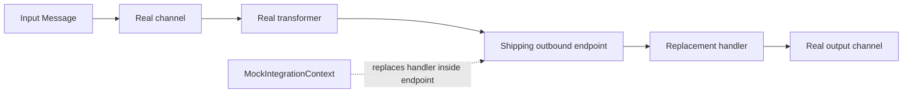

# MockIntegrationContext

## 1. Role in testing Spring Integration flows

In the **Testing support** chapter of the `SPRING_INTEGRATION_CORE` module, `MockIntegrationContext` helps test a message flow inside a Spring `ApplicationContext` by replacing selected endpoint components with test-controlled objects. The rest of the flow still processes `Message` instances, passes them through `MessageChannel`s, and executes configured transformations.

Suppose an order intake flow normalizes data, filters valid orders, chooses a carrier, and submits a booking request. To verify whether the message reaching the booking step has the expected payload and headers, you can replace the handler calling the shipping service with a test handler. The test feeds data into the start of the flow and observes results at the end of the segment under test.

This is integration testing at the level of wiring and behavior for the preserved segment of the flow. It complements unit tests of individual transformers, routers, or filters, while helping construct repeatable success and failure scenarios.

`MockIntegrationContext` is registered via `@SpringIntegrationTest`. `MockIntegration` is the set of factories creating test objects, while `MockMessageHandler` is a handler that can receive messages and produce scripted replies. These three names refer to distinct roles. [Testing support documentation](https://docs.spring.io/spring-integration/reference/testing.html).



In this lesson, examples use the Java DSL, JUnit Jupiter, and Spring TestContext. Code follows the Spring Integration 6.5.x API; trigger substitution requires Spring Integration 6.3 or later. When applying this, use libraries from the same version train managed by your project.

## 2. Understanding the exact target being replaced

### 2.1. Endpoint, handler, and channel

A consumer endpoint typically binds a `MessageHandler` to an input channel and manages message-consumption lifecycle. When using:

```java
mockIntegrationContext.substituteMessageHandlerFor(
        "shippingGateway", replacementHandler);
```

`shippingGateway` must be **the bean name of the consumer endpoint**. It is not the channel name, gateway interface name, called service name, or inner handler bean name. For polling sources, `substituteMessageSourceFor()` takes the `SourcePollingChannelAdapter` bean name. [Endpoint conventions in Testing support](https://docs.spring.io/spring-integration/reference/testing.html).

A convenient way to assign a stable endpoint name in the Java DSL:

```java
.handle(shippingClient, "book",
        endpoint -> endpoint.id("shippingGateway"))
```

Here, the word `Gateway` in the endpoint name merely describes an external system call step. The API expects the `IntegrationConsumer` wrapping the handler, not an arbitrary `@MessagingGateway` proxy.

### 2.2. Core operations

| API | Target component | Purpose |
| --- | --- | --- |
| `substituteMessageHandlerFor(id, handler)` | Consumer endpoint wrapping a `MessageHandler` | Replaces processing at a step in the flow |
| `substituteMessageSourceFor(id, source)` | `SourcePollingChannelAdapter` | Replaces the object supplying data to a poller |
| `substituteTriggerFor(id, trigger)` | `AbstractPollingEndpoint` | Replaces the polling schedule trigger; available since 6.3 |
| `resetBeans()` | Endpoints replaced through this context | Restores saved original components |
| `resetBeans("endpointA", "endpointB")` | Specified endpoints | Selective restoration |

The `substitute...` methods have overloads taking an extra `boolean autoStartup`. This value controls whether the endpoint is started during the substitution operation. [MockIntegrationContext Javadoc](https://docs.spring.io/spring-integration/api/org/springframework/integration/test/context/MockIntegrationContext.html).

When replacing both source and trigger, we usually pass `false` for both, finish setup, and call `start()` once. This prevents the poller from firing while the test has only replaced part of the configuration.

## 3. Preparing the test environment

### 3.1. Dependencies

The project needs `spring-integration-core` for the flow and `spring-integration-test` in test scope for `MockIntegrationContext`. The Maven example below assumes your project BOM or dependency management already manages compatible versions:

```xml
<dependencies>
    <dependency>
        <groupId>org.springframework.integration</groupId>
        <artifactId>spring-integration-core</artifactId>
    </dependency>

    <dependency>
        <groupId>org.springframework.integration</groupId>
        <artifactId>spring-integration-test</artifactId>
        <scope>test</scope>
    </dependency>

    <dependency>
        <groupId>org.springframework</groupId>
        <artifactId>spring-test</artifactId>
        <scope>test</scope>
    </dependency>

    <dependency>
        <groupId>org.junit.jupiter</groupId>
        <artifactId>junit-jupiter</artifactId>
        <scope>test</scope>
    </dependency>
</dependencies>
```

This is a dependency snippet to add to an existing build, not a standalone `pom.xml`. With Spring Boot, you can use the application's existing test dependencies and add `spring-integration-test`; avoid overlapping version declarations for Spring Framework and Spring Integration.

The `spring-integration-test-support` module provides foundational utilities. To use the `ApplicationContext` intervention mechanism in this lesson, you need `spring-integration-test`. [Testing module breakdown](https://docs.spring.io/spring-integration/reference/testing.html).

### 3.2. Annotations and endpoint startup

```java
@SpringJUnitConfig(FlowConfig.class)
@SpringIntegrationTest(noAutoStartup = "shippingGateway")
class ShippingFlowTest {

    @Autowired
    MockIntegrationContext mockIntegrationContext;
}
```

`@SpringJUnitConfig` sets up JUnit Jupiter with Spring TestContext and loads the configuration. `@SpringIntegrationTest` adds Spring Integration test support. Therefore, do not treat the second annotation as loading the entire application configuration by itself.

`noAutoStartup` accepts endpoint name patterns such as an exact name, `orders*`, or `*Inbound`. Matching endpoints are prevented from auto-starting during context initialization. They still exist so the test can substitute their inner components and start them afterward. [SpringIntegrationTest Javadoc](https://docs.spring.io/spring-integration/api/org/springframework/integration/test/context/SpringIntegrationTest.html).

List the exact endpoints you need to control. Using `noAutoStartup = "*"` may also prevent necessary transformers or consumers from starting to route messages. Furthermore, deferring endpoint lifecycle does not skip creating dependent beans; if a client's constructor or initialization method already opens a connection, provide a separate test configuration for that client.

## 4. Full example: replacing a handler while keeping the normalization flow

### 4.1. Contract to verify

The example receives `" ord-007 "`, strips whitespace, and calls the shipping booking step. The test needs to prove:

- The replacement handler receives payload `"ord-007"` after the transformer.
- The business header `orderId` still reaches the processing step.
- The replacement handler's reply reaches `shippingReplies`.

`ShippingClient` in the configuration below is just a local illustrative object returning a `LIVE:` prefix. In an application, this spot would typically be a client calling the shipping carrier's API.

### 4.2. Configuration and two test cases

Place the entire block below into a single Java test file. You do not need Spring Boot enabled to run this example in a project with compatible dependencies.

```java
import java.util.concurrent.atomic.AtomicReference;

import org.junit.jupiter.api.AfterEach;
import org.junit.jupiter.api.Test;

import org.springframework.beans.factory.annotation.Autowired;
import org.springframework.beans.factory.annotation.Qualifier;
import org.springframework.context.annotation.Bean;
import org.springframework.context.annotation.Configuration;
import org.springframework.integration.channel.DirectChannel;
import org.springframework.integration.channel.QueueChannel;
import org.springframework.integration.config.EnableIntegration;
import org.springframework.integration.dsl.IntegrationFlow;
import org.springframework.integration.test.context.MockIntegrationContext;
import org.springframework.integration.test.context.SpringIntegrationTest;
import org.springframework.messaging.Message;
import org.springframework.messaging.MessagingException;
import org.springframework.messaging.support.MessageBuilder;
import org.springframework.test.context.junit.jupiter.SpringJUnitConfig;

import static org.junit.jupiter.api.Assertions.*;
import static org.springframework.integration.test.mock.MockIntegration
        .mockMessageHandler;

@SpringJUnitConfig(ShippingFlowTest.Config.class)
@SpringIntegrationTest(noAutoStartup = "shippingGateway")
class ShippingFlowTest {

    @Autowired
    MockIntegrationContext mocks;

    @Autowired
    @Qualifier("shippingInput")
    DirectChannel input;

    @Autowired
    @Qualifier("shippingReplies")
    QueueChannel replies;

    @AfterEach
    void cleanup() {
        mocks.resetBeans();
        replies.clear();
    }

    @Test
    void normalizesPayloadAndPreservesBusinessHeader() {
        AtomicReference<Message<?>> observed = new AtomicReference<>();

        var replacement = mockMessageHandler()
                .handleNextAndReply(message -> {
                    observed.set(message);
                    return "ACCEPTED:" + message.getPayload();
                });

        mocks.substituteMessageHandlerFor(
                "shippingGateway", replacement);

        Message<String> request = MessageBuilder
                .withPayload(" ord-007 ")
                .setHeader("orderId", "ORD-007")
                .build();

        assertTrue(input.send(request));

        Message<?> reply = replies.receive(1_000);
        assertNotNull(reply);
        assertEquals("ACCEPTED:ord-007", reply.getPayload());
        assertNotNull(observed.get());
        assertEquals("ord-007", observed.get().getPayload());
        assertEquals("ORD-007",
                observed.get().getHeaders().get("orderId"));
        assertEquals("ORD-007", reply.getHeaders().get("orderId"));
        assertNull(replies.receive(0));
    }

    @Test
    void propagatesFailureOnTheSynchronousPath() {
        var replacement = mockMessageHandler()
                .handleNext(message -> {
                    throw new IllegalStateException("carrier unavailable");
                });

        mocks.substituteMessageHandlerFor(
                "shippingGateway", replacement);

        MessagingException failure = assertThrows(
                MessagingException.class,
                () -> input.send(MessageBuilder
                        .withPayload(" ord-009 ")
                        .build()));

        assertInstanceOf(IllegalStateException.class, failure.getCause());
        assertEquals("carrier unavailable", failure.getCause().getMessage());
        assertNull(replies.receive(0));
    }

    @Configuration
    @EnableIntegration
    static class Config {

        @Bean
        DirectChannel shippingInput() {
            return new DirectChannel();
        }

        @Bean
        QueueChannel shippingReplies() {
            return new QueueChannel();
        }

        @Bean
        ShippingClient shippingClient() {
            return new ShippingClient();
        }

        @Bean
        IntegrationFlow shippingFlow(ShippingClient shippingClient) {
            return IntegrationFlow.from(shippingInput())
                    .<String, String>transform(String::trim)
                    .handle(shippingClient, "book",
                            endpoint -> endpoint.id("shippingGateway"))
                    .channel(shippingReplies())
                    .get();
        }
    }

    public static class ShippingClient {

        public String book(String order) {
            return "LIVE:" + order;
        }
    }
}
```

### 4.3. Interpreting the test results

In the success case, the message still passes through the real transformer. If the `trim()` step were removed, the payload assertion on `observed` would fail. If the configuration lost its output path, the assertion on `reply` would fail. If you merely invoked the mock's function directly and checked the returned string, neither wiring mistake would be caught.

`AtomicReference` captures the message at the boundary under observation. Do not check for same instance identity with the request, because the transformer builds a message with a new payload; the important contract here is the payload and business headers. `MessageHeaders.ID` and timestamps should also not be treated as immutable business identifiers across every transformation step.

`assertNull(replies.receive(0))` only confirms the queue is empty at the instant of inspection. In this synchronous example, the main execution path completes before `send()` returns. In an asynchronous system, that instantaneous assertion is not enough to conclude no late messages will arrive.

The failure case uses `MockMessageHandler`, a handler built on Spring Integration's message-handling infrastructure. It throws an error right at the shipping booking step, letting us observe error propagation along the synchronous path. This test does not call `ShippingClient.book()`, so it does not verify how the real client handles protocol errors.

## 5. One-way handlers and reply-producing handlers

### 5.1. Choosing based on the processing step's contract

An ordinary `MessageHandler` has the method `void handleMessage(Message<?> message)`. The lambda below can record a message at a terminal endpoint:

```java
AtomicReference<Message<?>> received = new AtomicReference<>();

MessageHandler sink = message -> received.set(message);

mockIntegrationContext.substituteMessageHandlerFor(
        "auditSink", sink);
```

This snippet requires importing `AtomicReference` and `org.springframework.messaging.MessageHandler`; `auditSink` is assumed to be a consume-only endpoint. The lambda does not emit a reply. If you use it to replace a request/reply step and wait for a downstream output, the test can time out even though the handler received the message.

When the replaced step must produce a reply, use `mockMessageHandler().handleNextAndReply(...)`. `handleNext(...)` only runs the message-receiving action. Actions in a chain are used in sequence, and the last action continues applying to subsequent messages. Do not assume the mock stops receiving once the declared actions are exhausted. [MockMessageHandler Javadoc](https://docs.spring.io/spring-integration/api/org/springframework/integration/test/mock/MockMessageHandler.html).

### 5.2. A multi-invocation scenario

```java
var replacement = mockMessageHandler()
        .handleNextAndReply(message -> "REJECTED")
        .handleNextAndReply(message -> "ACCEPTED");
```

If three messages arrive at the mock in sequence, they receive `REJECTED`, `ACCEPTED`, `ACCEPTED`. This is a way to script reply data; the chain itself does not enable retries. To test real retries, repeated calls must be driven by the component holding the retry policy within the test scope.

Do not use a reply-producing mock to replace a pure sink and assume the old endpoint will gain a request/reply contract. Keep the replacement behavior compatible with the target handler type. The handler-substitution mechanism wires output channels for message-producing handlers, yet it does not turn a terminal endpoint into a new reply-producing service. [MockIntegrationContext 6.5.1 source code](https://github.com/spring-projects/spring-integration/blob/v6.5.1/spring-integration-test/src/main/java/org/springframework/integration/test/context/MockIntegrationContext.java).

## 6. Full example: replacing a polling source and controlling the trigger

### 6.1. Why replace before starting?

A production source may fetch orders from a database or a remote directory. If the endpoint already started before the test attached the test source, it might read real data or emit unexpected messages.

The example below defers `ordersInbound`, replaces both the source and trigger while the endpoint is stopped, and then starts it explicitly. The illustrative production configuration uses a 30-second interval; the test trigger schedules one task immediately. The test source returns one message and then returns `null` if polled again.

`OnlyOnceTrigger` limits how many times the task is scheduled. `maxMessagesPerPoll(1)` limits the number of messages per poll cycle. These two mechanisms govern different units; one polling cycle does not automatically equal one message. [OnlyOnceTrigger Javadoc](https://docs.spring.io/spring-integration/api/org/springframework/integration/test/util/OnlyOnceTrigger.html).

### 6.2. Configuration and test

This is a standalone test class separate from the shipping example:

```java
import java.util.Locale;
import java.util.concurrent.atomic.AtomicBoolean;

import org.junit.jupiter.api.AfterEach;
import org.junit.jupiter.api.Test;

import org.springframework.beans.factory.annotation.Autowired;
import org.springframework.beans.factory.annotation.Qualifier;
import org.springframework.context.annotation.Bean;
import org.springframework.context.annotation.Configuration;
import org.springframework.integration.channel.QueueChannel;
import org.springframework.integration.config.EnableIntegration;
import org.springframework.integration.core.MessageSource;
import org.springframework.integration.dsl.IntegrationFlow;
import org.springframework.integration.dsl.Pollers;
import org.springframework.integration.endpoint.SourcePollingChannelAdapter;
import org.springframework.integration.test.context.MockIntegrationContext;
import org.springframework.integration.test.context.SpringIntegrationTest;
import org.springframework.integration.test.util.OnlyOnceTrigger;
import org.springframework.messaging.Message;
import org.springframework.messaging.support.GenericMessage;
import org.springframework.messaging.support.MessageBuilder;
import org.springframework.test.context.junit.jupiter.SpringJUnitConfig;

import static org.junit.jupiter.api.Assertions.*;

@SpringJUnitConfig(PollingFlowTest.Config.class)
@SpringIntegrationTest(noAutoStartup = "ordersInbound")
class PollingFlowTest {

    @Autowired
    MockIntegrationContext mocks;

    @Autowired
    @Qualifier("ordersInbound")
    SourcePollingChannelAdapter inbound;

    @Autowired
    @Qualifier("polledResults")
    QueueChannel results;

    @AfterEach
    void cleanup() {
        inbound.stop();
        mocks.resetBeans();
        results.clear();
    }

    @Test
    void processesOneControlledOrder() {
        AtomicBoolean firstRead = new AtomicBoolean(true);

        MessageSource<String> source = () -> {
            if (!firstRead.getAndSet(false)) {
                return null;
            }
            return MessageBuilder.withPayload(" ord-008 ")
                    .setHeader("batchId", "batch-A")
                    .build();
        };

        mocks.substituteMessageSourceFor(
                "ordersInbound", source, false);
        mocks.substituteTriggerFor(
                "ordersInbound", new OnlyOnceTrigger(), false);

        assertFalse(inbound.isRunning());
        inbound.start();

        Message<?> result = results.receive(2_000);
        assertNotNull(result);
        assertEquals("ORD-008", result.getPayload());
        assertEquals("batch-A", result.getHeaders().get("batchId"));
    }

    @Configuration
    @EnableIntegration
    static class Config {

        @Bean
        QueueChannel polledResults() {
            return new QueueChannel();
        }

        @Bean
        MessageSource<String> liveOrdersSource() {
            return () -> new GenericMessage<>("LIVE");
        }

        @Bean
        IntegrationFlow ordersInboundFlow(
                MessageSource<String> liveOrdersSource) {
            return IntegrationFlow.from(liveOrdersSource,
                            endpoint -> endpoint.id("ordersInbound")
                                    .poller(Pollers.fixedDelay(30_000)
                                            .maxMessagesPerPoll(1)))
                    .<String, String>transform(value ->
                            value.trim().toUpperCase(Locale.ROOT))
                    .channel(polledResults())
                    .get();
        }
    }
}
```

`liveOrdersSource` is the data-source bean name, whereas `ordersInbound` is the endpoint wrapping the source. The source-substitution call must use the latter name. If you pass the first name, the API looks for a bean of the corresponding endpoint type and receives the wrong type.

Here `receive(2_000)` waits up to two seconds for the result, allowing the scheduler to finish sooner when ready. Do not call `Thread.sleep(2_000)` and then inspect, as that always wastes the full sleep duration and still does not prove the work completed.

Each test case creates a fresh `OnlyOnceTrigger` and a fresh `AtomicBoolean`. If you intentionally reuse a trigger across cases, call `reset()` before the next run. Using a one-time trigger in tests does not prove the production system guarantees exactly-once business processing.

### 6.3. Scope of source substitution

`substituteMessageSourceFor()` is meant for polling models using `SourcePollingChannelAdapter`. It does not apply directly to every inbound adapter or inbound gateway. A listener receiving messages pushed by a broker does not become a polling source just because its name includes `Inbound`.

When an adapter is of another type, you can test the downstream segment by sending messages into the boundary channel, configuring a dedicated test component, or using an appropriate protocol environment. The choice depends on the contract to prove: internal flow behavior, or actually ingesting data from an external system.

## 7. Testing errors according to the execution model

### 7.1. Synchronous flows

In the shipping example, `DirectChannel` and synchronous steps execute on the sender's thread. Therefore, errors from the handler can be observed via `assertThrows()` around `send()`.

An `errorChannel` header on a message does not automatically turn every synchronous exception into a message sent to an error queue. Gateways, advice, or configured recovery mechanisms can alter error routing; tests must match how the application actually invokes the flow. [Spring Integration Error Handling](https://docs.spring.io/spring-integration/reference/error-handling.html).

With a replacement handler implemented as a plain lambda, exceptions may emerge differently than from a framework-wrapped handler. When asserting exception types, distinguish the mock being used from the production object under test; do not force all cases into the same wrapper type.

### 7.2. Asynchronous or polled flows

When processing happens on another thread, errors do not return to the request-sending thread like a synchronous Java call. With appropriate error-handling infrastructure, errors are wrapped in an `ErrorMessage` and sent to an error channel. For polling tasks, observe the scheduler/poller error path rather than expecting `inbound.start()` to throw business exceptions. [ErrorMessage publishing mechanism](https://docs.spring.io/spring-integration/reference/error-handling.html).

An asynchronous error test should clarify:

1. Which error channel is used in the test configuration.
2. Which business exception must appear, with or without a wrapper.
3. Whether `failedMessage` or required tracing metadata is preserved.
4. Whether the failed message was mistakenly routed to the success path.
5. Whether any background tasks are still running when cleanup starts.

If business rules require routing errors to a dead-letter channel or producing a fallback reply, keep the router or recovery flow responsible for that behavior. Only replace the failing step with a test handler. However, if advice or proxies containing retry, transactions, or recovery are attached to the old handler, replacing the entire handler can bypass the exact logic under test. In that case, substitute the handler's dependency instead of the handler itself, or write a separate test preserving that mechanism.

## 8. Restoring state and preventing cross-test interference

### 8.1. Cleaning up after every case

Spring TestContext may reuse an `ApplicationContext` across multiple cases. If one test leaves a test handler behind, the next case may keep hitting that handler even with completely different input data.

```java
@AfterEach
void cleanup() {
    mockIntegrationContext.resetBeans();
}
```

`resetBeans()` restores components substituted through that `MockIntegrationContext`. You can pass endpoint IDs to restore only a subset. This is not `Mockito.reset()` and does not wipe all application state. [Bean restoration API](https://docs.spring.io/spring-integration/api/org/springframework/integration/test/context/MockIntegrationContext.html).

States that require separate attention include `QueueChannel` contents, message groups in aggregators/message stores, database data, mock-source counters, and still-running async tasks. For instance, `resetBeans()` does not remove a completed aggregator group from an application-managed message store.

### 8.2. Endpoint lifecycle must be managed separately

A sensible sequence for a polling endpoint is:

```text
Endpoint stopped
    -> attach required source/handler/trigger
    -> start endpoint
    -> send or receive test data
    -> wait for result or error within bounds
    -> stop producer and wait for active work if needed
    -> resetBeans()
    -> clean queues and test-owned state
```

Do not treat `resetBeans()` as returning every endpoint to a running state. Restoration interacts with endpoint lifecycle and auto-startup flags. For an endpoint whose auto-startup was suppressed in the test, the next test case should proactively substitute components and start it again as shown in the example. [resetBean implementation in Spring Integration 6.5.1](https://github.com/spring-projects/spring-integration/blob/v6.5.1/spring-integration-test/src/main/java/org/springframework/integration/test/context/MockIntegrationContext.java).

Passing `false` to a substitution overload should also not be used as a command to stop an arbitrary running endpoint. Ensure the endpoint is stopped before applying multiple changes and start it again once finished.

### 8.3. Parallel execution and shared resources

Two tests modifying the same endpoint in a shared `ApplicationContext` can overwrite each other's scripts or reset components while the other case is still processing messages. Avoid running cases in parallel if they touch the same endpoint; when parallelism is required, separate contexts or test resources explicitly.

`@DirtiesContext` can force rebuilding the context when state cannot be cleanly restored, though at higher cost. When substitutions are handled by `resetBeans()` and test resources are cleaned up, rebuilding the entire context is usually unnecessary.

## 9. Choosing mock boundaries for integration patterns

| What to prove | Components to keep real | Point to substitute | Meaningful assertions |
| --- | --- | --- | --- |
| Order normalization | Transformers and wiring channels | Outbound handler | Normalized payload and business headers |
| Carrier selection | Router and branch channels | Handlers at each target system | Only the right branch receives the message |
| Invalid order filtering | Filter and discard channel | Downstream handler or final sink | Rejected orders reach the exact discard channel |
| Line-item grouping | Splitter, aggregator, correlation config, and store | Data source or post-group handler | Group contents, release condition, result count |
| Integration error reporting | Error/recovery path under test | Failing external interaction step | Exception type, original message, and error destination |

Substitute only at boundaries that serve the specific goal. If the goal is verifying an aggregator's release condition, keep the real aggregator and send messages with matching correlation/sequence headers. Replacing the aggregator with a mock returning a fixed list prevents the test from verifying grouping rules.

Similarly, to test router mappings, keep the router and observe the branches. Merely verifying a mock was called is insufficient if unintended branches also receive messages.

For gateways, call through the real gateway interface when testing request mapping, replies, or gateway error propagation. Substituting a downstream handler still lets you control replies, while calling via the gateway preserves the boundary used by the application.

## 10. Common errors and narrowing down causes

| Symptom | Cause to investigate | Resolution |
| --- | --- | --- |
| Bean not found or wrong bean type | Passed service, source, or channel name instead of endpoint | Use the endpoint ID set in the DSL |
| Sent to `DirectChannel` but no subscriber | Endpoint not started or blocked by `noAutoStartup` pattern | Check the ID and start the consumer properly |
| Mock received message yet no reply | Used `void` handler or `handleNext()` on a request/reply step | Use a compatible reply-producing behavior |
| Real source still gets read | Endpoint started before source substitution | Suppress auto-startup in test configuration |
| Polling emits repeated data | Source always returns a message and poller is unbounded | Use a finite source, limit polls, and use a suitable trigger |
| Test passes alone, fails with full class | Handler, queue, or store retained stale state | Reset components and clean test state properly |
| Waiting for reply times out after changing trigger | Reused trigger not reset or endpoint not started | Create a fresh trigger and check lifecycle |
| Failed to catch error with `assertThrows()` | Error occurred on scheduler/executor | Observe the error flow and wait with a timeout |
| Retry test passes yet real client fails | Mock replaced the handler/advice containing retry | Keep the retry path under test and replace external dependencies |

When facing a timeout, inspect from input to output: was the message accepted, is the endpoint running, did the mock receive the right payload, did the mock produce a reply, and which channel received the reply? Increasing timeouts before locating the break usually just slows down the test suite.

## 11. Limits of conclusions from the test

A test using `MockIntegrationContext` can prove the behavior of the flow segment actually retained under the chosen inputs and replies. A passing test does not prove HTTP authentication, JDBC mapping, broker message acknowledgment, or SFTP connectivity of the replaced component.

A test suite can combine three levels: unit tests for transformation algorithms, flow tests with controlled boundary substitutions, and adapter/contract tests against appropriate target systems. Each level should state clearly which contract it verifies to avoid writing multiple tests that all merely confirm a mock returns a constant.

The examples in this lesson focus on internal flows and endpoint lifecycles. When applying them to a project, run tests in your real build with the exact BOM, gateway configuration, scheduler, advice, and resources used by the application.
