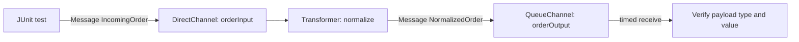

# Testing Message Payloads

In Spring Integration, a flow can send and receive messages successfully yet still produce wrong data: fields get dropped, quantities change, data types are wrong, or result lists miss elements. Payload testing verifies that **the data at a flow boundary satisfies the contract required by the next component**.

This lesson belongs to the **Testing support** chapter of the `SPRING_INTEGRATION_CORE` module. The focus is on asserting `Message` payloads, combining unit tests of transformation logic with tests of a real Java DSL flow. This approach also applies at the outputs of gateways, filters, routers, and aggregators when building enterprise integration patterns.

After this lesson, you will be able to:

- Identify which payload type, value, structure, and cardinality to verify.
- Write direct assertions and use `PayloadMatcher` for the right purpose.
- Send messages through a flow with a transformer and observe results using `QueueChannel`.
- Distinguish invalid business data, conversion errors, and cases with no output message.
- Keep tests stable when payloads contain collections, byte arrays, decimals, or mutable data.

## 1. Distinguishing payload from message

`Message<T>` contains a payload and headers. When testing business data, the target of observation is usually `message.getPayload()`. Headers serve other needs such as routing, correlation, and tracing. See [the Spring Integration Message model](https://docs.spring.io/spring-integration/reference/6.5/message.html).

```java
import org.springframework.messaging.Message;
import org.springframework.messaging.support.MessageBuilder;

Message<String> message = MessageBuilder
        .withPayload("  coffee  ")
        .setHeader("sourceSystem", "web")
        .build();

String payload = message.getPayload();
```

Here, the payload contract might require the normalized string to equal `"coffee"`. The `sourceSystem` value only needs assertion if preserving or changing that header is part of the flow's requirements.

Avoid comparing two separately constructed messages in full just to verify business data. Headers generated on message creation, such as ID and timestamp, can cause the comparison to fail even when the payload is correct.

### A non-null payload can still lack internal data

`GenericMessage` and `MessageBuilder.withPayload(...)` require a non-`null` payload. Thus, `new GenericMessage<>(null)` does not simulate a valid message missing a business field; it fails immediately upon message construction. See [the GenericMessage constructor contract](https://docs.spring.io/spring-framework/docs/6.2.x/javadoc-api/org/springframework/messaging/support/GenericMessage.html).

Cases to distinguish:

| Case | Example | Where to test |
| --- | --- | --- |
| Null payload | Constructing a message from `null` | Message creation boundary or direct Java call |
| Empty string payload | `""`, `"   "` | Validator, transformer, or filter per contract |
| DTO missing fields | `new IncomingOrder(null, "SKU-1", 1)` | Business data validation logic |
| Wrong payload type | Sending `Integer` into a flow expecting a DTO | Conversion boundary or endpoint input handling |
| Empty collection | `List.of()` | Empty dataset handling rules |
| No output | `output.receive(timeout)` returns `null` | Emission behavior, flow wiring, and wait timeout |

`receive(...) == null` means **no message was received under the chosen wait condition**, not that a message with a null payload was received.

## 2. Writing the payload contract before writing assertions

Suppose the system receives orders from an internal channel. Before forwarding to the next processing step, the flow must trim whitespace from the order ID, normalize the SKU to uppercase, and preserve a valid quantity.

Contract for the example in this lesson:

| Element | Rule |
| --- | --- |
| Input type | `IncomingOrder` |
| `orderId` | Non-null, non-blank; trim leading and trailing whitespace |
| `sku` | Non-null, non-blank; trim leading/trailing whitespace and convert to uppercase using `Locale.ROOT` |
| `quantity` | Integer greater than 0; preserved after transformation |
| Output type | `NormalizedOrder` |
| Output message count | One message per valid input |
| Invalid input | Throws an error; no `NormalizedOrder` produced |
| Input data | Not mutated during normalization |

In a real project, add length limits, quantity bounds, or SKU character-set rules if the business requires them. Do not invent extra constraints in tests when the contract does not define them.

An assertion like `assertNotNull(result)` only checks presence. An assertion like `assertEquals("SKU-1", actual.sku())` only checks one field. Tests must verify the data dimensions that could break downstream behavior: payload type, full contents, preserved fields, and result count.

## 3. Choosing the right testing layer

| Layer | How to test | What is verified |
| --- | --- | --- |
| Business logic | Call the normalization function directly | Transformation rules, boundary data, and business error messages |
| Endpoint or flow segment | Send `Message` via input channel, read output channel | Wiring, endpoint actually invoked, and actual emitted payload |
| Gateway or adapter | Call across the application boundary | Request/reply mapping, data conversion, and interaction with external systems |

The first two layers complement each other. Unit tests pinpoint rule bugs quickly; flow tests catch misconfigured channels, missing transformers, or miswired outputs.

When testing normalization, run the real normalization logic. If you mock the transformer itself to return the expected data, assertions only verify values hard-coded into the mock. For a larger flow, you can replace network or database components while keeping the payload transformation segment under test intact.

## 4. Preparing the environment for the examples

The examples use Java 17, Spring Integration 6.5.x APIs, Spring Framework 6.2.x, JUnit Jupiter 5, and AssertJ 3.x. This is the API baseline for the lesson; use compatible versions managed by your project when applying them. Snippets belong to package `example.payload` and assume the test runner supports JUnit Platform.

Dependencies needed for the main examples:

| Dependency | Scope | Role |
| --- | --- | --- |
| `org.springframework.integration:spring-integration-core` | Compile | Message channels, Java DSL, and transformer endpoints |
| `org.springframework:spring-test` | Test | Spring TestContext and `@SpringJUnitConfig` |
| `org.junit.jupiter:junit-jupiter` | Test | Test execution and parameterized tests |
| `org.assertj:assertj-core` | Test | Type and data assertions |

The `PayloadMatcher` section additionally needs `org.springframework.integration:spring-integration-test-support` and `org.hamcrest:hamcrest` in test scope. The `spring-integration-test` module provides mock support and specialized test-context configuration; the small flow example below does not need those capabilities. These two testing modules serve distinct roles according to [the Testing support documentation](https://docs.spring.io/spring-integration/reference/6.5/testing.html).

If the project uses Spring Boot, you can rely on Boot-managed test dependencies when they provide these libraries. Keep Spring Integration artifacts on the same release line; do not mix an arbitrary `test-support` version with `core`.

## 5. Creating the data model and normalization logic

Example `OrderPayloads.java`:

```java
package example.payload;

import java.util.Locale;

public final class OrderPayloads {

    private OrderPayloads() {
    }

    public record IncomingOrder(String orderId, String sku, int quantity) {
    }

    public record NormalizedOrder(String orderId, String sku, int quantity) {
    }

    public static NormalizedOrder normalize(IncomingOrder order) {
        if (order == null) {
            throw new IllegalArgumentException("order is required");
        }
        if (order.orderId() == null || order.orderId().isBlank()) {
            throw new IllegalArgumentException("orderId is required");
        }
        if (order.sku() == null || order.sku().isBlank()) {
            throw new IllegalArgumentException("sku is required");
        }
        if (order.quantity() <= 0) {
            throw new IllegalArgumentException("quantity must be positive");
        }

        return new NormalizedOrder(
                order.orderId().strip(),
                order.sku().strip().toUpperCase(Locale.ROOT),
                order.quantity());
    }
}
```

Both records have `String` and `int` components, fitting value-based equality in this example. The function returns a new object without mutating its input. `Locale.ROOT` makes the normalization rule independent of the test machine's default locale.

The `order == null` check in the function serves direct Java callers. It does not turn a null payload into valid data accepted inside a message.

## 6. Testing rules with unit tests

Example `OrderPayloadsTest.java` without starting a Spring context:

```java
package example.payload;

import example.payload.OrderPayloads.IncomingOrder;
import example.payload.OrderPayloads.NormalizedOrder;
import org.junit.jupiter.api.Test;
import org.junit.jupiter.params.ParameterizedTest;
import org.junit.jupiter.params.provider.NullAndEmptySource;
import org.junit.jupiter.params.provider.ValueSource;

import static example.payload.OrderPayloads.normalize;
import static org.assertj.core.api.Assertions.assertThat;
import static org.assertj.core.api.Assertions.assertThatIllegalArgumentException;

class OrderPayloadsTest {

    @Test
    void normalizesTextAndPreservesQuantity() {
        IncomingOrder input = new IncomingOrder(" ORD-42 ", " café-01 ", 3);

        NormalizedOrder actual = normalize(input);

        assertThat(actual).isEqualTo(
                new NormalizedOrder("ORD-42", "CAFÉ-01", 3));
        assertThat(input).isEqualTo(
                new IncomingOrder(" ORD-42 ", " café-01 ", 3));
    }

    @ParameterizedTest
    @ValueSource(ints = {0, -1, Integer.MIN_VALUE})
    void rejectsNonPositiveQuantity(int quantity) {
        IncomingOrder input = new IncomingOrder("ORD-42", "SKU-1", quantity);

        assertThatIllegalArgumentException()
                .isThrownBy(() -> normalize(input))
                .withMessage("quantity must be positive");
    }

    @ParameterizedTest
    @NullAndEmptySource
    @ValueSource(strings = {" ", "\t"})
    void rejectsMissingSku(String sku) {
        IncomingOrder input = new IncomingOrder("ORD-42", sku, 1);

        assertThatIllegalArgumentException()
                .isThrownBy(() -> normalize(input))
                .withMessage("sku is required");
    }
}
```

Expected payloads are written directly from the business contract. Do not call `normalize(input)` again to compute the expected value; otherwise a bug in the function itself can show up in both actual and expected.

The example covers the main groups of cases. To cover the full contract stated above, add cases for null/blank `orderId`, the minimum valid quantity `1`, large positive quantities, and an already-normalized string. The null case for the entire `IncomingOrder` belongs to unit tests calling the function directly.

## 7. Testing payloads through a real Java DSL flow

Path to test:



`DirectChannel` invokes handlers on the sending thread by default. The `QueueChannel` at the end retains results for the test to read; placing a queue at the output alone does not make the upstream transformer asynchronous. Channel and timeout characteristics are described in [Message Channel Implementations](https://docs.spring.io/spring-integration/reference/6.5/channel/implementations.html).

Example `OrderPayloadFlowTest.java`:

```java
package example.payload;

import example.payload.OrderPayloads.IncomingOrder;
import example.payload.OrderPayloads.NormalizedOrder;
import org.junit.jupiter.api.AfterEach;
import org.junit.jupiter.api.Test;
import org.junit.jupiter.api.parallel.Execution;
import org.junit.jupiter.api.parallel.ExecutionMode;
import org.springframework.beans.factory.annotation.Autowired;
import org.springframework.beans.factory.annotation.Qualifier;
import org.springframework.context.annotation.Bean;
import org.springframework.context.annotation.Configuration;
import org.springframework.integration.channel.DirectChannel;
import org.springframework.integration.channel.QueueChannel;
import org.springframework.integration.config.EnableIntegration;
import org.springframework.integration.dsl.IntegrationFlow;
import org.springframework.messaging.Message;
import org.springframework.messaging.MessagingException;
import org.springframework.messaging.support.MessageBuilder;
import org.springframework.test.context.junit.jupiter.SpringJUnitConfig;

import static org.assertj.core.api.Assertions.assertThat;
import static org.junit.jupiter.api.Assertions.assertThrows;

@SpringJUnitConfig(OrderPayloadFlowTest.FlowConfig.class)
@Execution(ExecutionMode.SAME_THREAD)
class OrderPayloadFlowTest {

    @Autowired
    @Qualifier("orderInput")
    private DirectChannel input;

    @Autowired
    @Qualifier("orderOutput")
    private QueueChannel output;

    @AfterEach
    void leavesNoExtraOutputMessage() {
        assertThat(output.receive(0))
                .as("no extra messages emitted in this synchronous flow")
                .isNull();
    }

    @Test
    void normalizesPayloadThroughFlow() {
        IncomingOrder incoming = new IncomingOrder(" ORD-42 ", " café-01 ", 3);
        Message<IncomingOrder> request = MessageBuilder
                .withPayload(incoming)
                .setHeader("sourceSystem", "web")
                .build();

        assertThat(input.send(request, 1_000)).isTrue();

        Message<?> result = output.receive(1_000);
        assertThat(result).as("transformer output message").isNotNull();
        assertThat(result.getPayload()).isInstanceOf(NormalizedOrder.class);

        NormalizedOrder actual = (NormalizedOrder) result.getPayload();
        assertThat(actual).isEqualTo(
                new NormalizedOrder("ORD-42", "CAFÉ-01", 3));
        assertThat(incoming).isEqualTo(
                new IncomingOrder(" ORD-42 ", " café-01 ", 3));
    }

    @Test
    void rejectsInvalidPayloadWithoutProducingOutput() {
        IncomingOrder incoming = new IncomingOrder("ORD-42", "SKU-1", 0);
        Message<IncomingOrder> request = MessageBuilder
                .withPayload(incoming)
                .build();

        MessagingException failure = assertThrows(
                MessagingException.class,
                () -> input.send(request, 1_000));

        assertThat(failure)
                .hasRootCauseInstanceOf(IllegalArgumentException.class)
                .hasRootCauseMessage("quantity must be positive");
        assertThat(failure.getFailedMessage()).isNotNull();
        assertThat(failure.getFailedMessage().getPayload()).isEqualTo(incoming);
    }

    @Configuration
    @EnableIntegration
    static class FlowConfig {

        @Bean
        DirectChannel orderInput() {
            return new DirectChannel();
        }

        @Bean
        QueueChannel orderOutput() {
            return new QueueChannel();
        }

        @Bean
        IntegrationFlow normalizeOrderFlow(
                @Qualifier("orderInput") DirectChannel input,
                @Qualifier("orderOutput") QueueChannel output) {
            return IntegrationFlow.from(input)
                    .transform(IncomingOrder.class, OrderPayloads::normalize)
                    .channel(output)
                    .get();
        }
    }
}
```

`@SpringJUnitConfig` combines JUnit Jupiter with Spring TestContext to load the test configuration. See [SpringJUnitConfig Javadoc](https://docs.spring.io/spring-framework/docs/6.2.x/javadoc-api/org/springframework/test/context/junit/jupiter/SpringJUnitConfig.html). `@EnableIntegration` registers Spring Integration infrastructure in this plain Spring context.

The `.transform(IncomingOrder.class, OrderPayloads::normalize)` operator creates a payload-transforming endpoint. The type parameter indicates the input type expected by the transformation; the framework may attempt to convert data to that type when needed, so do not treat it as an absolute rejection gate for every other input type. See [transform API with expectedType](https://docs.spring.io/spring-integration/docs/6.5.0/api/org/springframework/integration/dsl/BaseIntegrationFlowDefinition.html).

The example observes at the exact output boundary, uses the real transformer, and receives one message at a time. No other consumer reads `orderOutput`. `@Execution(SAME_THREAD)` runs methods in this test class sequentially; when applying to a larger suite, also avoid sharing the same queue across classes running in parallel.

### Meaning of each verification step

1. `send(...)` confirms the send was accepted; `true` alone does not prove the payload is correct.
2. `receive(...)` fetches the output message. Checking non-null before accessing the payload makes failure messages clearer.
3. `isInstanceOf(...)` checks the runtime type before casting.
4. `isEqualTo(...)` verifies the full value of the output record.
5. Asserting on the input confirms source data remains unmodified per contract.
6. `@AfterEach` checks no leftover messages remain after each case in this synchronous flow, including error-input cases.

The timeout on `send(message, timeout)` is not a maximum duration for all business processing in `DirectChannel`. Synchronous handlers still execute on the calling thread. Also avoid calling `Thread.sleep(...)` before reading the queue; `receive(timeout)` already provides a bounded wait for results.

## 8. Using PayloadMatcher to express message-level assertions

`PayloadMatcher` resides in package `org.springframework.integration.test.matcher`. Its two usage forms compare the payload against an expected value, or delegate payload checks to a Hamcrest matcher. See [PayloadMatcher Javadoc](https://docs.spring.io/spring-integration/api/org/springframework/integration/test/matcher/PayloadMatcher.html).

In `normalizesPayloadThroughFlow()`, after receiving `result`, you can use the following assertions instead of the AssertJ payload assertions:

```java
// Add static imports at the top of the file:
import static org.hamcrest.MatcherAssert.assertThat;
import static org.hamcrest.Matchers.instanceOf;
import static org.springframework.integration.test.matcher.PayloadMatcher.hasPayload;

// Place inside the test method after checking result is non-null:
assertThat(result, hasPayload(instanceOf(NormalizedOrder.class)));
assertThat(result, hasPayload(
        new NormalizedOrder("ORD-42", "CAFÉ-01", 3)));
```

If you keep both AssertJ and Hamcrest in the same file, qualify the call by class name to avoid colliding `assertThat` imports:

```java
org.hamcrest.MatcherAssert.assertThat(
        result,
        hasPayload(new NormalizedOrder("ORD-42", "CAFÉ-01", 3)));
```

`hasPayload(expected)` uses payload equality; it will not automatically treat two POJOs with identical fields as equal unless that class defines `equals()`. For nested DTOs or checking only a subset of fields, direct AssertJ assertions are often easier to express.

Do not use matchers merely because the project includes `spring-integration-test-support`. Pick the syntax that keeps the data contract readable and failure messages clear. Do not use a matcher comparing the entire message when you only need to verify the payload.

## 9. Choosing comparisons by data nature

### Records and POJOs

The records in the example contain simple value fields, so `isEqualTo(expected)` expresses the entire contract. For POJOs without `equals()`, compare fields individually or recursively:

```java
// actualPayload and expectedPayload are two business DTOs of the same structure.
assertThat(actualPayload)
        .usingRecursiveComparison()
        .isEqualTo(expectedPayload);
```

Only ignore a field when the contract permits it. If output includes creation timestamps or generated IDs, inject a `Clock` or ID generator into the logic to produce deterministic data. Do not ignore whole groups of fields just to make a test green.

### Lists and sets

```java
// actualOrders has type List<NormalizedOrder>.
assertThat(actualOrders).containsExactly(firstExpected, secondExpected);

// Use this comparison when the contract permits arbitrary ordering.
assertThat(actualOrders)
        .containsExactlyInAnyOrder(firstExpected, secondExpected);
```

`containsExactly` checks both order and element count; `containsExactlyInAnyOrder` still checks matching cardinality while relaxing order. Plain `contains(...)` can miss extra emitted data. Do not convert a `List` to a `Set` before comparing if duplicate elements matter to the test.

### Byte arrays and charsets

For binary payloads, compare array contents rather than calling `byte[].equals(...)`, which compares object identity as standard for Java arrays:

```java
import java.nio.charset.StandardCharsets;

// result has already been received and checked non-null.
assertThat(result.getPayload()).isInstanceOf(byte[].class);
byte[] actualBytes = (byte[]) result.getPayload();
byte[] expectedBytes = "Valid order".getBytes(StandardCharsets.UTF_8);

assertThat(actualBytes).containsExactly(expectedBytes);
```

If the contract is text content, decode using the specified charset and compare strings. If the contract is wire-level bytes, assert bytes directly. Do not rely on the machine's default charset.

### BigDecimal and monetary data

`BigDecimal.equals()` considers scale: `10.0` and `10.00` are not equal under `equals()`. When the contract only requires numeric equality, use the corresponding comparison:

```java
import java.math.BigDecimal;

assertThat(actualAmount).isEqualByComparingTo(new BigDecimal("10.00"));
```

If the contract mandates exactly two decimal places, also assert `actualAmount.scale()` equals `2` along with rounding rules. Switching to numeric comparison must not hide currency formatting bugs. Equality and ordering semantics are distinguished in [BigDecimal Javadoc](https://docs.oracle.com/en/java/javase/17/docs/api/java.base/java/math/BigDecimal.html).

### JSON

If property order and whitespace are not part of the contract, parse JSON into a data tree or DTO and assert structure, types, and values. Keep array element order checks when order is meaningful. Comparing raw JSON strings verbatim fits when the exact text representation itself is required.

When testing JSON conversion, construct the expected DTO or tree from business requirements. Do not generate expected output using the same serializer/deserializer under test, as both sides would repeat the same mapping bug.

## 10. Testing error payloads and no-output cases

### Synchronous flows

In the Java DSL example, failures are observed at the `input.send(...)` call. Business exceptions may be wrapped in a messaging exception. Therefore, tests check `MessagingException`, root cause, and the failed message payload instead of relying on the full framework-generated error string.

`MessagingException.getFailedMessage()` returns the associated message if the exception captured it; the API allows `null`, so check before accessing. See [MessagingException Javadoc](https://docs.spring.io/spring-framework/docs/6.2.x/javadoc-api/org/springframework/messaging/MessagingException.html).

Setting an `errorChannel` header on a request sent directly through a `DirectChannel` does not automatically convert every synchronous exception into an error message. Error observation depends on execution boundaries and the caller's error-handling configuration.

### Asynchronous flows

When a handler runs on another thread, assertions around `send(...)` generally cannot catch business errors thrown later. Observe the error channel configured for the asynchronous component. With Spring Integration's standard error publishing, this is an `ErrorMessage` whose payload is the exception; the original business payload is typically found via the messaging exception's failed message.

Verify the error type, cause, and associated source data. Do not cast the `ErrorMessage` payload to a business DTO. See [Error Handling](https://docs.spring.io/spring-integration/reference/6.5/error-handling.html) to identify the error-publishing mechanism for the channel, poller, or gateway used.

### Absence of output alone is not proof of proper rejection

`output.receive(1_000) == null` may happen because a filter rejected the message per rules, or because the endpoint never started, the wrong channel was wired, a processing error occurred, or the system has not produced a result within the timeout.

For rules intentionally emitting no output, verify an additional meaningful signal: a message arriving at a discard channel, an error observed at the expected boundary, or a valid case proving the flow is active. When a discard channel exists, asserting on the payload there confirms the exact rejected data took the right branch.

A transformer must produce a valid result; returning `null` is not the way to drop valid messages in a Spring Integration transformer. To filter data conditionally, use a filter with explicit discard or exception behavior. See [Transformer return value rules](https://docs.spring.io/spring-integration/reference/6.5/transformer.html).

## 11. Applying at other endpoints

| Component | Payload contract to verify | Points to watch |
| --- | --- | --- |
| Transformer | Target type, transformed values, and preserved fields | Verify one valid input produces the right output count |
| Filter | Accepted or discarded payloads | Do not conclude solely from a single missing message |
| Router | Payload arriving on the selected branch | Check unselected branches too when single-branch selection is required |
| Splitter | Child payloads, total count, and item contents | Distinguish multiple messages from one message holding a collection |
| Aggregator | Complete aggregated payload per group | Set matching correlation and release conditions before waiting for output |
| Gateway | Return type and reply value received by caller | Method return type alone does not prove full reply contents are right |

For example, an aggregator returning `List<NormalizedOrder>` does not mean the test receives one message per order. The test reads one aggregated message and inspects the list inside. With a splitter, it may receive multiple separate messages; determine the exact output shape from the contract.

For stateful components like an aggregator, each test case needs isolated correlation data or state cleanup. If messages from two cases get grouped together, payload assertions can fail intermittently even when each individual input is valid.

## 12. Keeping tests stable and easy to diagnose

The `Message` wrapper does not make the payload object deeply immutable. A payload that is an `ArrayList` or a POJO with setters can still be mutated after message creation. This property is noted in [the Message model and payload mutability](https://docs.spring.io/spring-integration/reference/6.5/message.html).

When constructing test data:

- Use a fresh fixture per case, especially with mutable collections and DTOs.
- Do not share mutable instances between actual and expected.
- If taking a pre-processing snapshot, copy to the depth required by the contract; `List.copyOf(...)` does not deep-copy elements.
- Use deterministic clocks, IDs, and locales when they affect payloads.
- Choose timeouts based on real execution behavior, and bound total wait time when receiving multiple messages.

In this example's synchronous flow segment, checking an empty queue right after processing catches extra messages because processing has already finished. In an asynchronous flow, `receive(0)` only indicates the queue is empty at that instant; it does not prove no late messages will arrive. When asserting no extra emissions matters, use a bounded observation window or a reliable completion signal.

Common issues and fixes:

| Symptom | Possible issue | Improvement |
| --- | --- | --- |
| Only checking `send()` returns `true` | Output data never verified | Receive the message and compare payloads |
| Two DTOs with identical fields fail equality | DTO lacks value-based equality | Compare fields or use recursive comparison appropriately |
| Test stays green even when transformation logic changes | Expected computed with the same logic or mock returns canned output | Write expected independently from contract; run real logic |
| Occasionally receives the wrong message | Shared queue or shared input data | Isolate queues, fixtures, and state across cases |
| Correct output seen yet bugs slip through | Extra messages or missing elements undetected | Verify cardinality per contract |
| Test fails depending on OS | Default charset or locale affects data | Specify UTF-8 and an explicit locale |
| Increasing sleep still fails | No synchronization with actual output | Wait on channel or completion signal with timeout |
| No output yet reason unclear | Error boundary or discard branch unobserved | Inspect the relevant handling branch and confirm the flow is active |

## 13. Practice exercises

Extend the example while keeping the payload contract clear:

1. Add cases for `null`, empty, and whitespace-only `orderId`. Confirm the error matches the rule and no business output is produced.
2. Send two valid requests with different order IDs. Receive both messages, compare each payload, and confirm no missing or extra results.
3. Introduce an intentional bug in normalization, such as incrementing `quantity` by one. Confirm the output payload test catches the discrepancy, then restore the logic.
4. Add a filter before the transformer to route orders with `quantity <= 0` to a discard channel. Update the error contract and inspect the payload on the discard channel.
5. Change one boundary to asynchronous processing with an error channel configured. Update the test to wait for output or an `ErrorMessage` on the right channel.

The exercise is complete when each case shows clearly where data entered, what shape and values the payload must have, and which signal confirms processing has finished. A good payload test provides enough detail to distinguish a data bug from a configuration error or a wait-timing bug.
