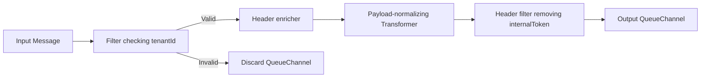

# Testing Message Headers

## 1. Objectives and real-world scenario

In the **Testing support** chapter of the **SPRING_INTEGRATION_CORE** module, testing message headers verifies that a message flow preserves the right business context as it passes through channels, endpoints, transformers, routers, filters, and gateways.

Suppose a system receives an order with payload `" order-42 "` and the following headers:

| Header | Input value | Meaning in the example |
|---|---|---|
| `tenantId` | `"tenant-01"` | Owning tenant of the request |
| `requestId` | `"req-0042"` | Business trace ID |
| `region` | `"eu"` | Processing region already specified by the sender |
| `stage` | `"received"` | Status before normalization |
| `internalToken` | `"demo-token"` | Internal data that must be removed before external output |

The flow normalizes the payload to `"ORDER-42"`. However, checking only the payload is insufficient: losing `tenantId` may stop downstream steps from identifying the tenant; overwriting `region` may make a router pick the wrong branch; keeping `internalToken` may violate the output contract.

After this lesson, you will be able to:

- Identify headers to preserve, add, overwrite, remove, and assert their corresponding data types.
- Write assertions for a `Message<?>` using JUnit, AssertJ, and Spring Integration matchers.
- Test header rules on a Java DSL flow with both an accepted branch and a discard branch.
- Choose appropriate verification strategies for auto-generated headers, request–reply, errors, and message groups.
- Design negative test cases when a header is missing, blank, or has the wrong type.

The names `tenantId`, `requestId`, `region`, `stage`, and `internalToken` in this lesson are application-defined contracts, not standard header names handled automatically by Spring.

## 2. Distinguishing header groups

`Message<T>` consists of a payload and `MessageHeaders`. Header values are Java objects, so `"3"`, `3`, and `3L` represent three different types. Having the same key name does not guarantee the receiver can use that value. You can inspect the structure and header-reading methods in the [MessageHeaders API](https://docs.spring.io/spring-framework/docs/current/javadoc-api/org/springframework/messaging/MessageHeaders.html).

### 2.1. Application-defined headers

For business headers, clearly specify the name, type, and rule:

| Example header | Contract type | What to verify |
|---|---|---|
| `tenantId` | Non-blank `String` | Not lost; missing or wrong type must enter the discard branch |
| `requestId` | `String` | Post-processing value matches the request value |
| `region` | `String` | Keeps existing value; only adds `"apac"` when missing |
| `stage` | `String` | Explicitly updated to `"normalized"` |
| `retryCount` | `Integer` | Integer value, not a string substitute |
| `internalToken` | `String` | Absent from output messages on the accepted branch |

Avoid calling `toString()` in assertions just to make different types look alike. If a downstream step expects `Integer`, the test should prove the value actually has type `Integer`.

### 2.2. Framework headers

Some commonly encountered headers:

| Constant | Type or value form | Appropriate check |
|---|---|---|
| `MessageHeaders.ID` | `UUID` in typical setups | Non-null, right type; check relationship to other messages only when contract requires |
| `MessageHeaders.TIMESTAMP` | `Long` in typical setups | Non-null or within a reasonable time range |
| `MessageHeaders.REPLY_CHANNEL` | Channel instance or resolvable name | Reply actually arrives at the right destination |
| `MessageHeaders.ERROR_CHANNEL` | Channel instance or resolvable name | Errors arrive at the right destination in the configured error-handling mechanism |
| `IntegrationMessageHeaderAccessor.CORRELATION_ID` | `Object` | Messages in the same group share the same correlation ID |
| `IntegrationMessageHeaderAccessor.SEQUENCE_NUMBER` | `Integer` | Item sequence index within the group |
| `IntegrationMessageHeaderAccessor.SEQUENCE_SIZE` | `Integer` | Group size per the grouping component's rule |

Integration-specific constants live in [IntegrationMessageHeaderAccessor](https://docs.spring.io/spring-integration/api/org/springframework/integration/IntegrationMessageHeaderAccessor.html). Using constants instead of handwritten strings avoids typos, especially between an application-defined `requestId` and the framework's `correlationId`.

Do not assume every message has a default timestamp or ID: applications can customize message creation. Tests checking the presence of these two headers must match the actual configuration under test.

## 3. Defining the contract before writing assertions

For each processing step, express requirements in terms of **input → output**:

| Rule category | Question to answer | Typical assertion |
|---|---|---|
| Preserve | Which headers must pass through unchanged? | `out.tenantId == in.tenantId` |
| Add default | What is filled in when a header is missing? | Missing `region` → `"apac"` |
| Do not overwrite | Is a valid sender value preserved? | `"eu"` → `"eu"` |
| Explicit overwrite | Which header is managed by the current step? | `stage` → `"normalized"` |
| Remove | Which header must not appear at the output boundary? | Key `internalToken` absent |
| Input validation | Where do missing or wrongly typed headers go? | Message appears on discard branch and not on accepted branch |
| Flow control | Does the header trigger the expected behavior? | Router picks right branch; reply arrives at right channel |

For example, a request with `tenantId = 42` must not be considered valid merely because the key exists. Under this lesson's contract, `tenantId` must be a non-blank string.

Test diagram:



There are two kinds of filters in the diagram: a message filter decides whether the entire message proceeds; a header filter only strips specified headers. Confusing the two leads to assertions targeting the wrong thing.

## 4. Preparing testing libraries

The examples use Java 17 or later, JUnit Jupiter, and AssertJ. They use core APIs present in the Spring Integration 6.x line; when using another line, pick a JDK and Spring versions compatible with your project.

In a Spring Boot application that already has a parent or BOM managing versions, you can declare:

```xml
<dependencies>
    <dependency>
        <groupId>org.springframework.integration</groupId>
        <artifactId>spring-integration-core</artifactId>
    </dependency>

    <dependency>
        <groupId>org.springframework.boot</groupId>
        <artifactId>spring-boot-starter-test</artifactId>
        <scope>test</scope>
    </dependency>

    <dependency>
        <groupId>org.springframework.integration</groupId>
        <artifactId>spring-integration-test-support</artifactId>
        <scope>test</scope>
    </dependency>
</dependencies>
```

This is a dependency snippet to insert into a project with version management, not a standalone `pom.xml`. For non-Boot projects, declare JUnit Jupiter, AssertJ, Spring Test, and required matcher libraries separately, keeping Spring versions consistent.

`spring-integration-test-support` provides standalone utilities and matchers. When you need to substitute endpoints or adjust the Spring test context with `MockIntegrationContext` and `@SpringIntegrationTest`, also add `spring-integration-test`. The Java DSL example below only needs Spring Test to load the context, not endpoint substitution. See [Testing support](https://docs.spring.io/spring-integration/reference/testing.html).

In the Java snippets, `MessageBuilder` is imported from `org.springframework.messaging.support`. Do not mix two builder classes with the same name in the same example.

## 5. Unit test: verifying headers in a message-processing function

When a transformer builds a new message manually, unit tests can prove that application code copies the right context and strips the right data.

The example below is a complete test class. The `normalize` method sits inside the class to highlight what is under test; in an application, move it into the corresponding transformer or service.

```java
import java.util.Locale;

import org.junit.jupiter.api.Test;
import org.springframework.messaging.Message;
import org.springframework.messaging.support.MessageBuilder;

import static org.assertj.core.api.Assertions.assertThat;

class NormalizeMessageHeadersTest {

    static Message<String> normalize(Message<String> input) {
        return MessageBuilder
                .withPayload(input.getPayload().trim()
                        .toUpperCase(Locale.ROOT))
                .copyHeaders(input.getHeaders())
                .setHeader("stage", "normalized")
                .removeHeader("internalToken")
                .build();
    }

    @Test
    void preservesContextChangesStageAndRemovesInternalToken() {
        Message<String> input = MessageBuilder
                .withPayload(" order-42 ")
                .setHeader("tenantId", "tenant-01")
                .setHeader("requestId", "req-0042")
                .setHeader("stage", "received")
                .setHeader("retryCount", 3)
                .setHeader("internalToken", "demo-token")
                .build();

        Message<String> output = normalize(input);

        assertThat(output.getPayload()).isEqualTo("ORDER-42");

        assertThat(output.getHeaders().get("tenantId", String.class))
                .isEqualTo("tenant-01");
        assertThat(output.getHeaders().get("requestId", String.class))
                .isEqualTo("req-0042");
        assertThat(output.getHeaders().get("retryCount"))
                .isInstanceOf(Integer.class)
                .isEqualTo(3);
        assertThat(output.getHeaders().get("stage", String.class))
                .isEqualTo("normalized");
        assertThat(output.getHeaders())
                .doesNotContainKey("internalToken");

        // The input message still reflects its original state.
        assertThat(input.getPayload()).isEqualTo(" order-42 ");
        assertThat(input.getHeaders().get("stage"))
                .isEqualTo("received");
        assertThat(input.getHeaders())
                .containsEntry("internalToken", "demo-token");
    }
}
```

This test verifies the application's `normalize` code. If `copyHeaders` were removed, the assertions on `tenantId` and `requestId` would fail. If `removeHeader` were forgotten, the assertion on the absence of `internalToken` would catch the bug.

### 5.1. Understanding header copying and modification

`MessageBuilder.fromMessage(input)` is convenient when keeping the payload; `withPayload(newPayload).copyHeaders(input.getHeaders())` fits when changing the payload. `copyHeadersIfAbsent` keeps values already set on the builder. `setHeader(name, null)` removes that header, so it cannot be used to create a "key exists with null value" fixture. See [MessageBuilder API](https://docs.spring.io/spring-framework/docs/current/javadoc-api/org/springframework/messaging/support/MessageBuilder.html).

Ordinary `MessageHeaders` cannot be mutated directly via `put` or `remove`. However, that does not mean objects stored inside headers are deep-copied. If a header holds a mutable `List`, two messages can reference the same list. For business headers in these examples, using `String` and `Integer` keeps tests free of shared mutable state.

### 5.2. Choosing the right level to test a transformer

There is a difference between two cases:

- A transformation function returning a **payload**: the framework normally propagates headers from the input message.
- A transformer returning a **full Message**: transformer code is responsible for building the returned message's headers.

Therefore, testing a `String -> String` function alone does not test header propagation performed by the endpoint. Add tests through the real flow or handler. This rule is described in [Header propagation](https://docs.spring.io/spring-integration/reference/message.html#message-header-propagation).

## 6. Testing a Java DSL flow in a Spring context

The following example implements the contract from section 3:

1. Accept only non-blank `String` values for `tenantId`.
2. Keep existing `region`, filling `"apac"` when missing.
3. Always set `stage = "normalized"`.
4. Normalize the payload while keeping `tenantId` and `requestId`.
5. Strip `internalToken` before sending to the output.

`header(name, value, false)` means do not overwrite and `header(name, value, true)` allows overwriting. Stating the choice explicitly makes the contract readable; refer to [HeaderEnricherSpec](https://docs.spring.io/spring-integration/api/org/springframework/integration/dsl/HeaderEnricherSpec.html).

```java
import java.util.Locale;
import java.util.stream.Stream;

import org.junit.jupiter.api.Test;
import org.junit.jupiter.params.ParameterizedTest;
import org.junit.jupiter.params.provider.MethodSource;

import org.springframework.beans.factory.annotation.Autowired;
import org.springframework.beans.factory.annotation.Qualifier;
import org.springframework.context.annotation.Bean;
import org.springframework.context.annotation.Configuration;
import org.springframework.integration.channel.DirectChannel;
import org.springframework.integration.channel.QueueChannel;
import org.springframework.integration.config.EnableIntegration;
import org.springframework.integration.dsl.IntegrationFlow;
import org.springframework.messaging.Message;
import org.springframework.messaging.support.MessageBuilder;
import org.springframework.test.context.junit.jupiter.SpringJUnitConfig;

import static org.assertj.core.api.Assertions.assertThat;

@SpringJUnitConfig(HeaderFlowTest.Config.class)
class HeaderFlowTest {

    @Autowired
    @Qualifier("headerInput")
    DirectChannel input;

    @Autowired
    @Qualifier("accepted")
    QueueChannel accepted;

    @Autowired
    @Qualifier("rejected")
    QueueChannel rejected;

    static boolean hasValidTenant(Message<?> message) {
        Object tenant = message.getHeaders().get("tenantId");
        return tenant instanceof String text && !text.isBlank();
    }

    @Test
    void keepsContextPreservesRegionAndOverwritesStage() {
        Message<String> request = MessageBuilder
                .withPayload(" order-42 ")
                .setHeader("tenantId", "tenant-01")
                .setHeader("requestId", "req-0042")
                .setHeader("region", "eu")
                .setHeader("stage", "received")
                .setHeader("internalToken", "demo-token")
                .build();

        assertThat(input.send(request)).isTrue();

        Message<?> result = accepted.receive(1_000);
        assertThat(result).isNotNull();
        assertThat(result.getPayload()).isEqualTo("ORDER-42");
        assertThat(result.getHeaders())
                .containsEntry("tenantId", "tenant-01")
                .containsEntry("requestId", "req-0042")
                .containsEntry("region", "eu")
                .containsEntry("stage", "normalized")
                .doesNotContainKey("internalToken");

        assertThat(result.getHeaders().get("region", String.class))
                .isEqualTo("eu");
        assertThat(rejected.receive(0)).isNull();

        assertThat(request.getHeaders())
                .containsEntry("stage", "received")
                .containsEntry("internalToken", "demo-token");
    }

    @Test
    void addsDefaultRegionWhenHeaderIsMissing() {
        Message<String> request = MessageBuilder
                .withPayload("order-43")
                .setHeader("tenantId", "tenant-01")
                .setHeader("requestId", "req-0043")
                .build();

        assertThat(input.send(request)).isTrue();

        Message<?> result = accepted.receive(1_000);
        assertThat(result).isNotNull();
        assertThat(result.getHeaders())
                .containsEntry("region", "apac")
                .containsEntry("stage", "normalized")
                .containsEntry("requestId", "req-0043");
        assertThat(request.getHeaders()).doesNotContainKey("region");
        assertThat(rejected.receive(0)).isNull();
    }

    static Stream<Object> invalidTenants() {
        return Stream.of(null, "", "   ", 42);
    }

    @ParameterizedTest
    @MethodSource("invalidTenants")
    void rejectsMissingBlankOrWronglyTypedTenant(Object tenant) {
        Message<String> request = MessageBuilder
                .withPayload("order-invalid")
                .setHeader("tenantId", tenant)
                .setHeader("requestId", "req-invalid")
                .build();

        assertThat(input.send(request)).isTrue();

        Message<?> discarded = rejected.receive(1_000);
        assertThat(discarded).isNotNull();
        assertThat(discarded.getHeaders())
                .containsEntry("requestId", "req-invalid");
        assertThat(discarded.getHeaders().get("tenantId"))
                .isEqualTo(tenant);
        assertThat(accepted.receive(0)).isNull();
    }

    @Configuration
    @EnableIntegration
    static class Config {

        @Bean
        DirectChannel headerInput() {
            return new DirectChannel();
        }

        @Bean
        QueueChannel accepted() {
            return new QueueChannel();
        }

        @Bean
        QueueChannel rejected() {
            return new QueueChannel();
        }

        @Bean
        IntegrationFlow headerFlow() {
            return IntegrationFlow.from(headerInput())
                    .filter(Message.class, HeaderFlowTest::hasValidTenant,
                            endpoint ->
                                    endpoint.discardChannel(rejected()))
                    .enrichHeaders(headers -> headers
                            .header("region", "apac", false)
                            .header("stage", "normalized", true))
                    .<String, String>transform(payload ->
                            payload.trim().toUpperCase(Locale.ROOT))
                    .headerFilter("internalToken")
                    .channel(accepted())
                    .get();
        }
    }
}
```

In the selector, reading `Object` first and using `instanceof` treats wrongly typed headers as invalid inputs. If you read `get("tenantId", String.class)` directly, an `Integer` value can throw an exception before the selector decides to discard it.

`Message.class` in the `filter` overload lets the selector receive the full message to inspect headers. `headerFilter` removes the specified headers. The corresponding overloads are in the [Java DSL API](https://docs.spring.io/spring-integration/api/org/springframework/integration/dsl/BaseIntegrationFlowDefinition.html).

### 6.1. Interpreting the test results

Different test cases catch different bugs:

| Wrong change in the flow | Test case catching it |
|---|---|
| `region` always overwritten | Case with `region = "eu"` |
| Default `region` not added | Case missing `region` |
| `stage` not updated when already present | Case with `stage = "received"` |
| Transformer drops business headers | Case preserving `tenantId` and `requestId` |
| Token-removal step omitted | Assertion that `internalToken` is absent |
| Selector only checks non-null | Blank string and `Integer` cases |
| Invalid message still passes through | Assertion that `accepted` output is empty |

`input.send(...) == true` only indicates the channel send succeeded; it does not prove the message was accepted by business rules. In the discard case, send still returns `true` and the message appears in `rejected`.

The discard branch sits before the header-removal step, so the "remove `internalToken`" contract in the example applies only to the `accepted` output. If the system also exports the discard branch externally, define and test a separate contract at that boundary.

### 6.2. Reading channels and avoiding time-dependent tests

The flow above receives via `DirectChannel` and processes synchronously up to placing the result into `QueueChannel`. Thus, after `send` returns, `receive(0)` can verify that the other branch holds no message from this run.

For flows with executors or pollers, `receive(0)` right after sending does not prove no message will arrive later. Wait for a completion milestone, use a bounded timeout, and define an observation window per contract. Avoid fixed `Thread.sleep` calls merely guessing when work finishes.

The tests above assume sequential execution per typical JUnit defaults. If parallel execution is enabled, isolate channels/contexts or distinguish requests so one test does not consume another test's results. Each test run should consume the messages it produced.

## 7. Using Spring Integration's HeaderMatcher

When you want to express assertions directly on a `Message`, you can use `HeaderMatcher` from `spring-integration-test-support`. The example below is a standalone test class:

```java
import java.util.Map;

import org.junit.jupiter.api.Test;
import org.springframework.messaging.Message;
import org.springframework.messaging.support.MessageBuilder;

import static org.hamcrest.MatcherAssert.assertThat;
import static org.hamcrest.Matchers.instanceOf;
import static org.hamcrest.Matchers.not;
import static org.springframework.integration.test.matcher.HeaderMatcher
        .hasAllHeaders;
import static org.springframework.integration.test.matcher.HeaderMatcher
        .hasHeader;
import static org.springframework.integration.test.matcher.HeaderMatcher
        .hasHeaderKey;

class MessageHeaderMatcherTest {

    @Test
    void checksRequiredHeadersAndTheirTypes() {
        Message<String> actual = MessageBuilder
                .withPayload("ORDER-42")
                .setHeader("tenantId", "tenant-01")
                .setHeader("stage", "normalized")
                .setHeader("retryCount", 3)
                .build();

        assertThat(actual, hasHeader("tenantId", "tenant-01"));
        assertThat(actual,
                hasHeader("retryCount", instanceOf(Integer.class)));
        assertThat(actual, not(hasHeaderKey("internalToken")));
        assertThat(actual, hasAllHeaders(Map.of(
                "tenantId", "tenant-01",
                "stage", "normalized")));
    }
}
```

`hasAllHeaders` checks the expected headers present in the provided map; it does not require the message to contain strictly those headers and no others. To forbid a header, add a separate negative assertion. See exact signatures in the [HeaderMatcher API](https://docs.spring.io/spring-integration/api/org/springframework/integration/test/matcher/HeaderMatcher.html).

Descriptions in some articles may mention older names like `hasEntry`. When writing code, use the actual methods of the declared library, such as `hasHeader` and `hasHeaderKey`.

Do not static-import two `assertThat` methods simultaneously if it causes ambiguity. You can qualify `org.hamcrest.MatcherAssert.assertThat` in Hamcrest sections and keep AssertJ for the rest.

This test illustrates matcher usage. In application tests, apply those assertions to messages produced by a transformer or flow, rather than only asserting on a fixture you just built.

## 8. Handling ID, timestamp, and message comparisons

### 8.1. Avoid comparing the whole header map when only the business contract is needed

Two independently created messages can differ in ID and timestamp even when business data is identical. A test like the following easily over-constrains:

```java
// Easily misses the target if expected is created independently:
assertThat(actual.getHeaders()).isEqualTo(expected.getHeaders());
```

Instead, assert the set of headers the step is responsible for:

```java
assertThat(actual.getHeaders())
        .containsEntry("tenantId", "tenant-01")
        .containsEntry("requestId", "req-0042")
        .containsEntry("stage", "normalized")
        .doesNotContainKey("internalToken");
```

When the contract requires an exact key set, such as an allowlist at a protocol boundary, test that key set separately and document how technical headers are handled.

### 8.2. Do not force ID and timestamp to fixed constants

For default messages, you can assert that `getId()` is non-null and `getTimestamp()` is a plausible time value. Do not manually pin technical headers to constants just to make full-message comparison easier.

When an endpoint builds a new message, the ID may change; when merely forwarding a message, the ID may stay the same. Two timestamps can also be equal due to millisecond resolution. Only assert "ID changed" or "timestamp increased" if that exact behavior is a requirement of the component under test.

If you need tracing across multiple transformations, an application-defined `requestId` expresses the business relationship more clearly than requiring every message to keep the same `MessageHeaders.ID`.

For expiration testing, control the application logic's time source with a `Clock` if possible. Do not test expiration by sleeping several seconds in each test.

## 9. Testing correlation and sequence headers

In a splitter → transformer → aggregator flow, a correct payload with missing group headers can still prevent result aggregation from completing.

With the default splitter and a `List` payload of known size, child messages carry correlation and sequence headers. The following example inspects right at the splitter output, before the aggregator:

```java
import java.util.List;

import org.junit.jupiter.api.Test;
import org.springframework.integration.IntegrationMessageHeaderAccessor;
import org.springframework.integration.channel.QueueChannel;
import org.springframework.integration.splitter.DefaultMessageSplitter;
import org.springframework.messaging.Message;
import org.springframework.messaging.support.MessageBuilder;

import static org.assertj.core.api.Assertions.assertThat;

class SplitterHeadersTest {

    @Test
    void givesChildrenTheSameGroupAndConsecutiveSequenceNumbers() {
        QueueChannel parts = new QueueChannel();

        DefaultMessageSplitter splitter = new DefaultMessageSplitter();
        splitter.setOutputChannel(parts);
        splitter.afterPropertiesSet();

        Message<List<String>> batch = MessageBuilder
                .withPayload(List.of("sku-a", "sku-b"))
                .setHeader("tenantId", "tenant-01")
                .build();

        splitter.handleMessage(batch);

        for (int index = 0; index < batch.getPayload().size(); index++) {
            Message<?> part = parts.receive(1_000);
            assertThat(part).isNotNull();
            assertThat(part.getPayload())
                    .isEqualTo(batch.getPayload().get(index));
            assertThat(part.getHeaders())
                    .containsEntry("tenantId", "tenant-01");
            assertThat(part.getHeaders().get(
                    IntegrationMessageHeaderAccessor.CORRELATION_ID))
                    .isEqualTo(batch.getHeaders().getId());
            assertThat(part.getHeaders().get(
                    IntegrationMessageHeaderAccessor.SEQUENCE_NUMBER,
                    Integer.class))
                    .isEqualTo(index + 1);
            assertThat(part.getHeaders().get(
                    IntegrationMessageHeaderAccessor.SEQUENCE_SIZE,
                    Integer.class))
                    .isEqualTo(2);
        }

        assertThat(parts.receive(0)).isNull();
    }
}
```

The example intentionally uses a two-element `List`. For an iterator of unknown size, sequence size can be `0`; do not hardcode an expectation of `2` for every source type. Refer to [Splitter](https://docs.spring.io/spring-integration/reference/splitter.html).

To test context preservation across multiple endpoints, place another observation point after the transformer and re-verify the required group headers. In asynchronous flows, do not assume receive order equals send order; match by sequence number or assert the set of sequence numbers.

When reaching the aggregator, test that two groups with different correlation keys do not mix and only emit when the release condition is met. Do not require the aggregator output to retain all sequence headers from child messages: that behavior depends on the aggregator's grouping and sequence configuration. See [Aggregator](https://docs.spring.io/spring-integration/reference/aggregator.html).

## 10. Testing replyChannel and gateways via behavior

The `replyChannel` header can be a channel object, so comparing strings from `toString()` usually does not express the requirement. To test replies, send a request with a reply channel and receive the result from that channel.

Here is a standalone configuration snippet for a test context:

```java
@Bean
DirectChannel replyInput() {
    return new DirectChannel();
}

@Bean
IntegrationFlow replyFlow() {
    return IntegrationFlow.from(replyInput())
            .<String, String>transform(value ->
                    value.toUpperCase(Locale.ROOT))
            .get();
}
```

The flow does not set an explicit output channel, letting the reply resolve via header. In the test, inject `replyInput` and run:

```java
QueueChannel replies = new QueueChannel();

Message<String> request = MessageBuilder
        .withPayload("order-42")
        .setHeader("requestId", "req-0042")
        .setReplyChannel(replies)
        .build();

assertThat(replyInput.send(request)).isTrue();

Message<?> reply = replies.receive(1_000);
assertThat(reply).isNotNull();
assertThat(reply.getPayload()).isEqualTo("ORDER-42");
assertThat(reply.getHeaders())
        .containsEntry("requestId", "req-0042");
```

With a messaging gateway, test from the gateway method to cover both parameter-to-header mapping and reply reception. The gateway may create a temporary reply channel; do not force it to have a specific bean name or implementation class. See [Messaging Gateways](https://docs.spring.io/spring-integration/reference/gateway.html).

For example, if a gateway method accepts `@Header("tenantId") String tenantId`, the test should invoke the method with `"tenant-01"` and verify that the message at the flow's entry point carries that header. Manually building a `MessageBuilder` and sending straight to the channel bypasses gateway mapping configuration bugs.

## 11. Testing errorChannel in the right error-handling mechanism

The presence of an `errorChannel` header does not guarantee that every exception turns into an error message.

- With a synchronous `DirectChannel` and direct `send`, processing exceptions typically propagate back to the caller.
- With asynchronous processing where the framework configures an appropriate error handler, errors can be wrapped in an `ErrorMessage` and sent to the error channel from the header, or to the default error channel.
- With a gateway, error behavior also depends on the gateway's configuration.

These rules are presented in [Error Handling](https://docs.spring.io/spring-integration/reference/error-handling.html). Choose a fixture matching the real error-handling path.

In an async test, attach a `QueueChannel` as the request's error channel, send a failing message, and receive with a bounded timeout. After receiving, inspect both the error and the failed message's context. The snippet below is the assertion part, assuming `errors` is already configured as the flow's error destination:

```java
Message<?> received = errors.receive(2_000);
assertThat(received)
        .isInstanceOf(org.springframework.messaging.support.ErrorMessage.class);

Throwable failure = ((org.springframework.messaging.support.ErrorMessage)
        received).getPayload();

assertThat(failure)
        .isInstanceOf(org.springframework.messaging.MessagingException.class);

Message<?> failedMessage =
        ((org.springframework.messaging.MessagingException) failure)
                .getFailedMessage();

assertThat(failedMessage).isNotNull();
assertThat(failedMessage.getHeaders())
        .containsEntry("tenantId", "tenant-01")
        .containsEntry("requestId", "req-failure");
```

The assertion above applies when the error path under test produces a `MessagingException` with `failedMessage`. If the application uses another `ErrorMessageStrategy` or error handler, adjust expectations to match the actual structure.

Do not assume the request's business headers are copied onto the outer headers of `ErrorMessage`. Typically you retrieve context from the failed message or original message depending on the active error strategy. Also verify no unintended success output exists for the failed request.

## 12. Choosing observation points and handling negative cases

### 12.1. Routers, filters, and protocol boundaries

For a header-based router, verify both the data and the routing decision:

| Contract input | Expected observation |
|---|---|
| `region = "eu"` | Received on EU branch, not on default branch |
| `region = "apac"` | Received on APAC branch |
| Missing `region` | Default added or sent to fallback per design |
| `region` wrong type or disallowed value | Discarded or throws error per contract |

A correct header value at an intermediate point does not prove the router read the right header name. Add assertions at the destination channels.

Similarly, tests receiving only internal messages do not cover header mappers for HTTP, JMS, or AMQP adapters. When the contract involves data crossing a protocol boundary, observe the protocol side too. This lesson focuses on core and does not assume every Java header is exported across adapters with the same name and type.

### 12.2. Minimum test-case matrix

| Case | Fixture | Outcome to prove |
|---|---|---|
| Normal input | Valid business headers | Correct payload, required headers present |
| Defaulted header missing | `region` omitted | Default value present at output |
| Existing value | `region = "eu"` | Not overwritten unintentionally |
| Endpoint-managed header present | `stage = "received"` | Updated to new state |
| Sensitive header present | `internalToken` set | Absent at specified output |
| Required header missing | `tenantId` omitted | Enters discard branch |
| Required header blank | `tenantId = "   "` | Enters discard branch |
| Required header wrong type | `tenantId = 42` | Enters discard branch, not coerced to string |
| Multiple requests | Distinct `requestId` values | Context not mixed across results |
| Message groups | Two distinct batches | Correlation not mixed between batches |
| Processing failure | Message with dedicated trace ID | Context of the exact failed request is recoverable |

Not every endpoint needs all cases. Select based on the endpoint's responsibilities and the boundaries that can alter headers.

## 13. Common testing mistakes and fixes

| Symptom | Common cause | Fix |
|---|---|---|
| Payload passes yet downstream picks wrong branch | Routing header never asserted | Check the header and destination channel |
| Flaky tests due to header map differences | Comparing auto-generated IDs or timestamps | Compare only contract-relevant headers |
| Numeric header looks right yet receiver fails | Fixture used a string instead of a numeric type | Assert type and value explicitly |
| Cannot build "null header" fixture | Builder removes header when value is `null` | Use separate missing-header and empty-string cases |
| Test assumes message was accepted | Only checked `send` returned `true` | Receive message on accepted or discard branch |
| Error channel receives nothing | Synchronous flow returned error directly to caller | Check error mechanism of the channel or gateway |
| Passes alone, fails in suite | Leftover data in queue or parallel tests sharing channel | Manage data lifecycle and isolate context |
| Header lost after custom transformer | Transformer built a full message without copying context | Fix message construction and test at endpoint output |
| Overly broad header removal hangs request–reply | Accidentally stripped header needed for reply | Define kept/removed header lists per boundary |

A header test suite is valuable when it proves business context travels to the right places and drives the right behavior. Tie each assertion to a specific message or endpoint rule; when a rule changes, it will be clear which tests need updating.
