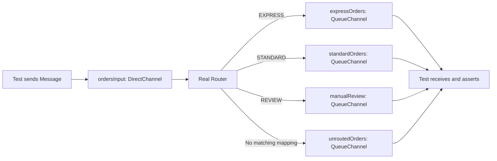

# Testing Routing

## 1. Objectives of routing tests

In the `SPRING_INTEGRATION_CORE` module, a router is an endpoint that decides which `MessageChannel` a `Message` should go to. That decision can be based on payload, headers, data type, or the outcome of a business rule. When a flow is built with the Java DSL, even a short `.route(...)` call can contain multiple behaviors that need testing.

Suppose a system receives orders and classifies them into express delivery, standard delivery, and manual review. A mapping bug could send orders needing review straight to shipping. That bug still occurs even if the classification function returns the right result.

A routing test suite needs to answer the following questions:

- Does the message arrive at the right channel or subflow according to the rule?
- Do unselected branches genuinely receive no messages?
- Are the payload and headers required by downstream steps preserved properly?
- Does a message with no matching branch go to a fallback, get intentionally discarded, or throw an error?
- Does the test observe results only after the work under test has finished?

This lesson builds tests that answer these questions—from pure-Java classification rules to flows with a real router in a Spring context, and then extending to mock endpoints and asynchronous processing.

## 2. Choosing the right test scope

### 2.1. Three complementary test layers

| Scope | Real components running | What to prove | Bugs commonly found |
| --- | --- | --- | --- |
| Rule unit test | Route-key computation function | Input data produces the right business decision | Boundary errors, wrong priority order |
| Routing flow test | Input channel, router, mappings, output channels | Decision translates into the right path | Wrong channel mapping, missing fallback, reading wrong header |
| Flow test with external systems | Router plus part or all of downstream | Real integration contract is met | Wrong serialization, wrong request, communication or adapter config bugs |

If you mock the router itself to return a predetermined branch, the test no longer proves the real router is configured properly. For routing tests, keep the real router and mappings; place the observation boundary right after the router or replace handlers with external side effects using test doubles.

Spring Integration provides `spring-integration-test` to support substituting components in the application context; simple flow tests can still use Spring Test and real channels. See [Testing support](https://docs.spring.io/spring-integration/reference/testing.html).

### 2.2. Choosing observation points before writing assertions

For a router selecting a single branch, you can terminate each branch in a `QueueChannel`:



In this fixture, the router executes on the sender's thread because the input is a `DirectChannel`. Each output queue merely buffers messages for the test to read; there is no competing poller or consumer. Thus, once `send()` returns successfully, synchronous routing work is done. Placing a queue at the output does not automatically create a worker processing messages. This follows from how [DirectChannel and QueueChannel](https://docs.spring.io/spring-integration/reference/channel/implementations.html) work.

If an output channel in the real application already has a consumer, calling `receive()` on that same queue can steal messages from the consumer. In that case, observe via a substituted handler or a dedicated collection point in the test.

## 3. Writing the routing contract as a data matrix

The example uses payload `Order(id, totalVnd)` and header `shippingMode`. Monetary amounts use `long` in VND to avoid floating-point rounding issues in boundary conditions.

Business rules chosen for this lesson:

1. Header equals string `EXPRESS`: route to the express branch, regardless of order value.
2. Header equals string `STANDARD`: orders of 5,000,000 VND or more require manual review; below the threshold go to standard.
3. Missing header, wrong header type, or any value other than the two strings above: route to the unrouted branch.

In the example, comparison is case-sensitive; headers are not trimmed or normalized automatically. If the application requires normalization, reflect that step and its corresponding expectation in the tests.

| `shippingMode` header | `totalVnd` | Route key | Expected channel | Meaning |
| --- | ---: | --- | --- | --- |
| `EXPRESS` | 100,000 | `EXPRESS` | `expressOrders` | Basic express branch |
| `EXPRESS` | 5,000,000 | `EXPRESS` | `expressOrders` | Express priority overrides high-value condition |
| `STANDARD` | 4,999,999 | `STANDARD` | `standardOrders` | Just below threshold |
| `STANDARD` | 5,000,000 | `REVIEW` | `manualReview` | Exactly at threshold |
| `STANDARD` | 5,000,001 | `REVIEW` | `manualReview` | Just above threshold |
| `ECONOMY` | 100,000 | `UNKNOWN` | `unroutedOrders` | Unsupported value |
| Missing header | 100,000 | `UNKNOWN` | `unroutedOrders` | Missing decision data |
| Empty string | 100,000 | `UNKNOWN` | `unroutedOrders` | Header present yet invalid |
| Integer `99` | 100,000 | `UNKNOWN` | `unroutedOrders` | Wrong header type |
| `express` | 100,000 | `UNKNOWN` | `unroutedOrders` | Wrong casing |

Rule tests need expected values derived by the test author from requirements. Do not call the classification function itself to compute the expected channel: that repeats implementation bugs in the assertion.

Conditions such as negative amounts, missing payload fields, or wrong payload types require a separate contract. This example assumes the payload is already a valid `Order`; invalid headers are handled directly in the routing decision.

## 4. Complete fixture: testing a router with the Java DSL

### 4.1. Baseline and dependencies

The illustrative code targets Java 17+, Spring Integration 6.x, Spring Test, and JUnit Jupiter 5. A Spring Boot 3.x project already managing dependencies via a compatible parent or BOM can use the following dependencies. This is a snippet to add to `pom.xml`, not a standalone POM.

```xml
<dependencies>
    <dependency>
        <groupId>org.springframework.boot</groupId>
        <artifactId>spring-boot-starter-integration</artifactId>
    </dependency>

    <dependency>
        <groupId>org.springframework.boot</groupId>
        <artifactId>spring-boot-starter-test</artifactId>
        <scope>test</scope>
    </dependency>

    <dependency>
        <groupId>org.springframework.integration</groupId>
        <artifactId>spring-integration-test</artifactId>
        <scope>test</scope>
    </dependency>
</dependencies>
```

Keep `spring-integration-core` and `spring-integration-test` on the same version managed by your project's BOM. The first example uses `@SpringJUnitConfig` to load a minimal context without booting the entire application via `@SpringBootTest`. The `MockIntegrationContext` section later directly uses utilities from `spring-integration-test`.

### 4.2. Single test class containing policy, flow configuration, and assertions

Place the class below in the test source set of a project with the baseline above. Records and configuration are nested inside the class so the example is self-contained; in a real application, policy and flow typically live in production code.

```java
import java.util.LinkedHashMap;
import java.util.Map;
import java.util.stream.Stream;

import org.junit.jupiter.api.AfterEach;
import org.junit.jupiter.api.BeforeEach;
import org.junit.jupiter.api.Test;
import org.junit.jupiter.api.parallel.Execution;
import org.junit.jupiter.api.parallel.ExecutionMode;
import org.junit.jupiter.params.ParameterizedTest;
import org.junit.jupiter.params.provider.MethodSource;

import org.springframework.beans.factory.annotation.Autowired;
import org.springframework.beans.factory.annotation.Qualifier;
import org.springframework.context.ApplicationContext;
import org.springframework.context.annotation.Bean;
import org.springframework.context.annotation.Configuration;
import org.springframework.integration.channel.DirectChannel;
import org.springframework.integration.channel.QueueChannel;
import org.springframework.integration.config.EnableIntegration;
import org.springframework.integration.dsl.IntegrationFlow;
import org.springframework.integration.router.HeaderValueRouter;
import org.springframework.messaging.Message;
import org.springframework.messaging.MessageChannel;
import org.springframework.messaging.MessagingException;
import org.springframework.messaging.support.MessageBuilder;
import org.springframework.test.context.junit.jupiter.SpringJUnitConfig;

import static org.junit.jupiter.api.Assertions.*;

@SpringJUnitConfig(RoutingFlowTest.Config.class)
@Execution(ExecutionMode.SAME_THREAD)
class RoutingFlowTest {

    record Order(String id, long totalVnd) {}

    record RoutingCase(
            String id, long totalVnd, Object mode, String expectedChannel) {}

    static class RoutePolicy {

        static String key(Order order, Object shippingMode) {
            if ("EXPRESS".equals(shippingMode)) {
                return "EXPRESS";
            }
            if ("STANDARD".equals(shippingMode)) {
                return order.totalVnd() >= 5_000_000L
                        ? "REVIEW" : "STANDARD";
            }
            return "UNKNOWN";
        }
    }

    @Configuration(proxyBeanMethods = false)
    @EnableIntegration
    static class Config {

        @Bean
        DirectChannel ordersInput() {
            return new DirectChannel();
        }

        @Bean
        QueueChannel expressOrders() {
            return new QueueChannel(20);
        }

        @Bean
        QueueChannel standardOrders() {
            return new QueueChannel(20);
        }

        @Bean
        QueueChannel manualReview() {
            return new QueueChannel(20);
        }

        @Bean
        QueueChannel unroutedOrders() {
            return new QueueChannel(20);
        }

        @Bean
        IntegrationFlow orderRoutingFlow(
                @Qualifier("ordersInput") MessageChannel input) {

            return IntegrationFlow.from(input)
                    .route(Message.class,
                            message -> RoutePolicy.key(
                                    (Order) message.getPayload(),
                                    message.getHeaders().get("shippingMode")),
                            router -> router
                                    .id("orderRouter")
                                    .channelMapping("EXPRESS", "expressOrders")
                                    .channelMapping("STANDARD", "standardOrders")
                                    .channelMapping("REVIEW", "manualReview")
                                    .defaultOutputChannel("unroutedOrders")
                                    .channelKeyFallback(false)
                                    .resolutionRequired(false))
                    .get();
        }
    }

    @Autowired
    @Qualifier("ordersInput")
    MessageChannel input;

    @Autowired
    ApplicationContext context;

    final Map<String, QueueChannel> outputs = new LinkedHashMap<>();

    @BeforeEach
    void checkCleanQueues() {
        outputs.clear();
        for (String name : new String[] {
                "expressOrders", "standardOrders",
                "manualReview", "unroutedOrders"}) {
            QueueChannel queue = context.getBean(name, QueueChannel.class);
            outputs.put(name, queue);
            assertNull(queue.receive(0), "Queue still had data before test: " + name);
        }
    }

    @AfterEach
    void drainQueuesAfterTest() {
        for (QueueChannel queue : outputs.values()) {
            while (queue.receive(0) != null) {
                // Drain data even if a prior assertion failed.
            }
        }
    }

    static Stream<RoutingCase> routingCases() {
        return Stream.of(
                new RoutingCase("express-low", 100_000L,
                        "EXPRESS", "expressOrders"),
                new RoutingCase("express-at-limit", 5_000_000L,
                        "EXPRESS", "expressOrders"),
                new RoutingCase("below-limit", 4_999_999L,
                        "STANDARD", "standardOrders"),
                new RoutingCase("at-limit", 5_000_000L,
                        "STANDARD", "manualReview"),
                new RoutingCase("above-limit", 5_000_001L,
                        "STANDARD", "manualReview"),
                new RoutingCase("unknown-mode", 100_000L,
                        "ECONOMY", "unroutedOrders"),
                new RoutingCase("missing-mode", 100_000L,
                        null, "unroutedOrders"),
                new RoutingCase("empty-mode", 100_000L,
                        "", "unroutedOrders"),
                new RoutingCase("wrong-type", 100_000L,
                        99, "unroutedOrders"),
                new RoutingCase("lower-case", 100_000L,
                        "express", "unroutedOrders"));
    }

    @ParameterizedTest(name = "{index}: {0}")
    @MethodSource("routingCases")
    void routesToExactlyOneExpectedChannel(RoutingCase testCase) {
        Order order = new Order(testCase.id(), testCase.totalVnd());
        MessageBuilder<Order> builder = MessageBuilder.withPayload(order)
                .setHeader("traceId", "trace-" + testCase.id())
                .setHeader("businessCorrelationId", testCase.id());

        if (testCase.mode() != null) {
            builder.setHeader("shippingMode", testCase.mode());
        }
        Message<Order> sent = builder.build();

        assertTrue(input.send(sent, 1_000), "Failed to send message");

        QueueChannel selected = outputs.get(testCase.expectedChannel());
        assertNotNull(selected, "Expected channel name is missing from fixture");

        Message<?> received = selected.receive(1_000);
        assertNotNull(received,
                "Did not receive at " + testCase.expectedChannel());
        assertEquals(order, received.getPayload());
        assertEquals("trace-" + testCase.id(),
                received.getHeaders().get("traceId"));
        assertEquals(testCase.id(),
                received.getHeaders().get("businessCorrelationId"));
        assertEquals(testCase.mode(),
                received.getHeaders().get("shippingMode"));

        for (Map.Entry<String, QueueChannel> output : outputs.entrySet()) {
            assertNull(output.getValue().receive(0),
                    "Unexpected message present at " + output.getKey());
        }
    }

    @Test
    void policyTreatsTheExactLimitAsReview() {
        assertEquals("STANDARD", RoutePolicy.key(
                new Order("below", 4_999_999L), "STANDARD"));
        assertEquals("REVIEW", RoutePolicy.key(
                new Order("equal", 5_000_000L), "STANDARD"));
        assertEquals("REVIEW", RoutePolicy.key(
                new Order("above", 5_000_001L), "STANDARD"));
        assertEquals("EXPRESS", RoutePolicy.key(
                new Order("priority", 5_000_000L), "EXPRESS"));
    }

    @Test
    void strictRouterReportsAnExplicitMappingToAMissingChannel()
            throws Exception {

        HeaderValueRouter router = new HeaderValueRouter("route");
        router.setBeanFactory(context);
        router.setChannelMapping("BROKEN", "missingOrdersChannel");
        router.setChannelKeyFallback(false);
        router.setResolutionRequired(true);
        router.afterPropertiesSet();

        Message<Order> sent = MessageBuilder
                .withPayload(new Order("broken", 100_000L))
                .setHeader("route", "BROKEN")
                .build();

        MessagingException failure = assertThrows(
                MessagingException.class, () -> router.handleMessage(sent));

        assertNotNull(failure.getFailedMessage());
        assertEquals(sent.getPayload(), failure.getFailedMessage().getPayload());
    }
}
```

The Java DSL supports routers receiving the full `Message` via the overload taking `Message.class`, along with mappings from route keys to channels. This enables decisions based simultaneously on payload and headers. See [Message Routers in Java DSL](https://docs.spring.io/spring-integration/reference/dsl/java-routers.html).

### 4.3. Interpreting what the example tested

Each row in `routingCases()` is sent through the real input channel. The real router invokes the policy, resolves the mapping, and sends to the output queue. The test then checks three groups of conditions:

1. The expected queue holds the exact payload and preserved headers.
2. The expected queue does not hold a second extra message.
3. All remaining queues are empty.

The final loop also checks the selected queue because the first message was already pulled from it earlier. Thus, the test catches both routing to the wrong branch and emitting duplicate messages to the right branch.

`policyTreatsTheExactLimitAsReview()` illustrates testing business decisions without sending messages through the flow. In a real codebase, you can move it to a separate unit test class so it does not need to load a Spring context. Mapping tests still require a context to verify channel beans and DSL wiring.

`strictRouterReportsAnExplicitMappingToAMissingChannel()` constructs a separate router with an intentionally broken mapping. It tests channel-resolution errors on a strict router without altering the order flow that uses a fallback.

## 5. Testing fallback and channel-resolution errors

### 5.1. Distinguishing route keys from channel names

In the flow above, `REVIEW` is the business route key, while `manualReview` is the channel name. The two values can be completely different. Therefore, test both the business decision and the mapping.

The following three scenarios are also distinct:

| Scenario | Example | Behavior to verify |
| --- | --- | --- |
| Key missing from mapping table | Policy returns `UNKNOWN` | Goes to fallback or reports no destination per contract |
| Mapping exists yet target channel does not | `REVIEW -> missingOrdersChannel` | Configuration error, or fallback if config allows |
| Channel exists yet send fails | Queue is full, or synchronous handler throws | Delivery behavior and error handling |

A test with an unknown header only covers the first scenario. It does not prove the other two scenarios are handled properly.

### 5.2. Explicit fallback configuration

The fixture explicitly declares:

```java
.defaultOutputChannel("unroutedOrders")
.channelKeyFallback(false)
.resolutionRequired(false)
```

`channelKeyFallback(false)` prevents the router from treating an unmapped key as a channel name. `resolutionRequired(false)` allows ignoring an unresolvable destination; `defaultOutputChannel` provides the target when no destination is resolved. Note that `resolutionRequired(false)` by itself is not an instruction to automatically drop messages.

Since Spring Integration 6.0, setting a default output channel also sets `channelKeyFallback` to `false`. The example still states the setting explicitly so readers see the contract. If you re-enable key fallback, test its interaction with `resolutionRequired`; see [Common Router Parameters](https://docs.spring.io/spring-integration/reference/router/common-parameters.html).

If the requirement is to drop unclassified messages, you can choose `nullChannel` as the default output. In that case, observe the discard at an appropriate boundary, such as with a recording handler in a substituted fixture or a metric on the real flow. Simply seeing no messages on business branches is insufficient to know whether the message was intentionally dropped or never reached the router.

### 5.3. Testing errors without relying on message strings

The strict example uses `MessagingException` as the general contract. Errors can be wrapped across multiple endpoints; full exception message strings often contain details that vary with configuration and version.

If the requirement needs to distinguish a channel-resolution error from a downstream error, assert a specific exception type or walk the cause chain for the expected type. Also check `failedMessage` or business-identifying data to tie the error to the right message. Avoid merely asserting `exception != null` or comparing full stack trace strings.

## 6. Keeping the real router and replacing downstream handlers

### 6.1. When to use `MockIntegrationContext`?

Output queues are a simple option for small flows. In an existing production configuration, branches after a router may call shipping services, write data, or publish messages to a broker. To test the router in that configuration, keep the real input and mappings intact, and replace downstream handlers with mocks.

`@SpringIntegrationTest` registers `MockIntegrationContext`; `substituteMessageHandlerFor(...)` takes **the consumer endpoint ID**, not the input channel name. `resetBeans()` restores replaced components. These APIs are described in [MockIntegrationContext Javadoc](https://docs.spring.io/spring-integration/api/org/springframework/integration/test/context/MockIntegrationContext.html).

Suppose another application configuration, `ShippingConfiguration`, uses synchronous channels after the router and assigns explicit endpoint IDs:

| Route key | Channel | Processing endpoint |
| --- | --- | --- |
| `EXPRESS` | `expressDispatch` | `carrierEndpoint` |
| `STANDARD` | `standardDispatch` | `standardEndpoint` |
| `REVIEW` | `reviewDispatch` | `reviewEndpoint` |

For example, one branch can declare its endpoint as follows:

```java
@Bean
IntegrationFlow carrierFlow(CarrierClient carrierClient) {
    return IntegrationFlow.from("expressDispatch")
            .handle(Order.class, (order, headers) -> {
                carrierClient.send(order);
                return null;
            }, endpoint -> endpoint.id("carrierEndpoint"))
            .get();
}
```

This snippet illustrates a production configuration with application types `Order` and `CarrierClient`. `return null` represents a one-way handler. This is a different downstream setup from the queue fixture in section 4; do not attach this consumer to queues that the test reads directly.

### 6.2. Substituting endpoints and verifying which branch was invoked

The test skeleton below assumes `ShippingConfiguration` defines the endpoints in the table, input `ordersInput`, and an inbound adapter named `orderInboundAdapter`. Use your application's actual names and payload types when applying.

```java
import org.junit.jupiter.api.AfterEach;
import org.junit.jupiter.api.BeforeEach;
import org.junit.jupiter.api.Test;
import org.springframework.beans.factory.annotation.Autowired;
import org.springframework.beans.factory.annotation.Qualifier;
import org.springframework.integration.test.context.MockIntegrationContext;
import org.springframework.integration.test.context.SpringIntegrationTest;
import org.springframework.messaging.MessageChannel;
import org.springframework.messaging.MessageHandler;
import org.springframework.messaging.support.MessageBuilder;
import org.springframework.test.context.junit.jupiter.SpringJUnitConfig;

import static org.junit.jupiter.api.Assertions.assertTrue;
import static org.mockito.ArgumentMatchers.argThat;
import static org.mockito.Mockito.*;

@SpringJUnitConfig(ShippingConfiguration.class)
@SpringIntegrationTest(noAutoStartup = "orderInboundAdapter")
class ShippingRoutingTest {

    @Autowired
    MockIntegrationContext mocks;

    @Autowired
    @Qualifier("ordersInput")
    MessageChannel input;

    MessageHandler express;
    MessageHandler standard;
    MessageHandler review;

    @BeforeEach
    void substituteDownstreamHandlers() {
        express = mock(MessageHandler.class);
        standard = mock(MessageHandler.class);
        review = mock(MessageHandler.class);

        mocks.substituteMessageHandlerFor("carrierEndpoint", express);
        mocks.substituteMessageHandlerFor("standardEndpoint", standard);
        mocks.substituteMessageHandlerFor("reviewEndpoint", review);
    }

    @AfterEach
    void restoreEndpoints() {
        mocks.resetBeans();
    }

    @Test
    void expressOrderInvokesOnlyCarrierEndpoint() {
        Order order = new Order("order-42", 5_000_000L);
        assertTrue(input.send(MessageBuilder.withPayload(order)
                .setHeader("shippingMode", "EXPRESS")
                .setHeader("traceId", "trace-42")
                .build(), 1_000));

        verify(express, times(1)).handleMessage(argThat(message ->
                order.equals(message.getPayload())
                        && "trace-42".equals(
                                message.getHeaders().get("traceId"))));
        verifyNoInteractions(standard, review);
        verifyNoMoreInteractions(express);
    }
}
```

`noAutoStartup` prevents the specified inbound adapter from generating traffic automatically in the test. It does not disable every bean or connection in the context; test configuration must still fit the boundary you want to verify. This mechanism and endpoint naming are explained in [Spring Integration and the Test Context](https://docs.spring.io/spring-integration/reference/6.5/testing.html).

Because the example assumes the entire path to the three handlers is synchronous, `verify` calls can run right after `send()`. When the application places an executor or poller in between, update the waiting strategy as in the next section.

If downstream follows a request–reply contract, the mock must produce an appropriate reply so the gateway receives a result. A Mockito `MessageHandler` mock merely recording calls suits the one-way branch here; using it for a gateway awaiting a reply can make the test wait until timeout.

## 7. Testing asynchronous routing and error flows

### 7.1. `send()` succeeding does not mean downstream finished

In flows with an `ExecutorChannel`, poller, or asynchronous adapter, `send()` may only confirm the work was accepted. Immediately asserting that wrong branches are empty can run before the router even executes.

The test design needs an appropriate completion signal:

- Use `receive(timeout)` on a result queue to wait for an expected result.
- Use a latch or expected result count to know the relevant branches reached the observation point.
- When proving no extra results exist, wait for the test case's work to finish before checking, or use a bounded observation window defined in the contract.
- Manage the executor inside the Spring context or shut it down after tests; prevent tasks from an earlier test from leaking into the next.

A positive assertion with a wait mechanism only proves a result arrived at that point. With fan-out running multiple tasks, it does not automatically prove all other tasks finished. Similarly, `verify(..., timeout(...))` waits for an expected invocation, yet does not guarantee no extra late invocation occurs.

Do not use `Thread.sleep(1000)` as a completion signal. CI machine speed, executor load, and poller schedules all vary.

### 7.2. Synchronous and asynchronous errors are observed differently

On a synchronous path from a `DirectChannel`, errors typically propagate back to the `send()` caller. Adding an `errorChannel` header does not automatically turn every synchronous exception into an `ErrorMessage`.

On an asynchronous component using Spring Integration's error-reporting mechanism, errors can be sent as an `ErrorMessage`; the request's `errorChannel` header specifies the destination, or the global error channel is used. Test against the exact configuration of the running executor, poller, or adapter. See [Error Handling](https://docs.spring.io/spring-integration/reference/error-handling.html).

The snippet below shows a test body when `asyncInput` is a Spring-managed `ExecutorChannel`, a strict router runs after it, key `BROKEN` maps to a nonexistent channel, and the default error-reporting mechanism is active:

```java
QueueChannel errors = new QueueChannel(1);
Order order = new Order("async-broken", 100_000L);

Message<Order> sent = MessageBuilder.withPayload(order)
        .setHeader("route", "BROKEN")
        .setHeader("traceId", "trace-async-broken")
        .setHeader("errorChannel", errors)
        .build();

assertTrue(asyncInput.send(sent, 1_000));

Message<?> reported = errors.receive(2_000);
assertNotNull(reported, "No error received within timeout");

org.springframework.messaging.support.ErrorMessage error =
        assertInstanceOf(
                org.springframework.messaging.support.ErrorMessage.class,
                reported);

MessagingException failure = assertInstanceOf(
        MessagingException.class, error.getPayload());
assertNotNull(failure.getFailedMessage());
assertEquals(order, failure.getFailedMessage().getPayload());
assertEquals("trace-async-broken",
        failure.getFailedMessage().getHeaders().get("traceId"));
```

The timeouts in the example are test wait bounds and can be tuned to the environment. `receive(timeout)` does not bound execution time of the entire flow; `send(timeout)` is also not a completion deadline for all downstream components. In an async error test, avoid using `assertThrows(() -> asyncInput.send(...))` as the sole check for exceptions thrown inside a worker.

## 8. Extending to multiple recipients and subflows

### 8.1. A router can send to multiple branches

The contract "strictly one channel receives the message" applies only to the flow in section 4. With a recipient list, multiple selectors can match simultaneously and a single message must reach multiple destinations. The Java DSL provides `routeToRecipients(...)` for this routing pattern; see [Message Routers](https://docs.spring.io/spring-integration/reference/dsl/java-routers.html).

For example, suppose every order goes to audit, while orders of 5,000,000 VND or more are also sent to risk control:

| Order value | Messages at audit | Messages at risk | Additional expectation |
| --- | ---: | ---: | --- |
| 4,999,999 | 1 | 0 | No extra sends |
| 5,000,000 | 1 | 1 | Both branches receive the same order |
| 5,000,001 | 1 | 1 | Still fans out to the exact target set |

Tests should assert **the expected recipient set** and the message count at each destination. Do not reuse the single-target flow's assertion that all other branches must be empty.

If `applySequence(true)` is enabled for downstream aggregation, verify `correlationId`, `sequenceNumber`, and `sequenceSize` per the group contract. Do not assume the `Message` across branches is the exact same object instance, because sequence headers can cause the framework to construct new messages. The `applySequence` option is described in [Common Router Parameters](https://docs.spring.io/spring-integration/reference/router/common-parameters.html).

If branches execute in parallel, do not infer completion order between audit and risk from the recipient declaration order. Furthermore, a router sending to multiple channels does not create an atomic transaction across destinations; testing rollback or consistency requires dedicated transaction configuration and assertions.

### 8.2. `subFlowMapping` requires appropriate output observation

With `subFlowMapping(...)`, a branch can continue through transformers, service activators, or gateways before returning a result. Observation points must match what you want to check:

- To check branch selection: record right at the branch entry or replace the branch's initial handler with a suitable mock.
- To check the outcome of the whole branch: assert payload and headers after transformers, and check required side effects.
- To check a request–reply flow: send through a gateway or matching send–receive setup, then assert the reply within the timeout.

Do not assume messages automatically continue past `.route(...)` through subsequent steps. How subflows, default output, and replies are wired determines the onward path. `subFlowMapping` and `defaultOutputToParentFlow` are choices that should be explicit in the fixture; see [RouterSpec Javadoc](https://docs.spring.io/spring-integration/api/org/springframework/integration/dsl/RouterSpec.html).

## 9. Verifying payloads and headers per contract

For a router that does not transform data, verify the payload and headers that matter downstream:

| Property | How to verify | Rationale |
| --- | --- | --- |
| Payload | Compare the object or required fields | Catches misrouted messages |
| Routing header | Compare value after routing | Catches dropped or mutated decision data |
| Trace ID | Compare the sent identifier | Helps track messages across branches |
| Business correlation key | Compare order or request key | Prevents mixing results across cases |
| Sequence headers | Check when flow uses sequences/aggregation | Proves grouping conditions remain intact |

The example uses a custom `businessCorrelationId` header to separate business identity from the `correlationId` used by EIPs. In flows with splitters or aggregators, clarify which component sets each header and which is allowed to modify it.

Avoid comparing the entire `MessageHeaders` map out of habit. Infrastructure headers such as message ID and timestamp can differ when new messages are created. Similarly, `assertSame(sent, received)` is a stricter identity contract than "same data"; use it only when object identity itself must be preserved.

When sending multiple messages in one test, give each message a unique business ID or trace ID. Tests should match results by that ID if receive order is not part of the contract. A queue with the right element count can still hold the wrong message or duplicate another order's message.

## 10. Common test design mistakes

| Misleading pattern | Why bugs can slip through | Fix |
| --- | --- | --- |
| Asserting only `input.send(...)` returns `true` | Does not prove right target or right outcome | Receive message at observation point and assert data |
| Checking only the expected branch | Misses extra sends to wrong branches | Assert counts across all relevant outputs |
| Mocking the router itself | Skips real mappings and configuration | Keep real router, substitute downstream to isolate |
| Computing expected using the policy under test | Assertion repeats the implementation's bug | Build expected matrix from business requirements |
| Using only values far from thresholds | Fails to distinguish `>` from `>=` | Include the triple: just below, at, and just above threshold |
| Checking empty queue right after async send | Worker may not have run yet | Wait for completion signal or defined observation window |
| Letting real consumer read the observation queue | Test competes with consumer for messages | Use a dedicated boundary or mock endpoint |
| Using a reply-waiting gateway for a one-way branch | Test times out even when router picked right | Use one-way send or return a contract-compliant reply |
| Not restoring substituted handlers | Next test runs against previous test's mock | Call `resetBeans()` in cleanup |
| Using shared queues/context in parallel runs | Results across cases mix together | Isolate fixtures or control execution mode |

In section 4's example, `@Execution(SAME_THREAD)` keeps methods in the class running sequentially. Other classes sharing a context and queues must also be structured appropriately if parallel execution is enabled. Draining queues does not substitute for waiting on task completion when a flow is genuinely asynchronous.

## 11. Workflow for applying to a real flow

1. Trace the path from the send point to every possible branch; mark channels that switch threads.
2. Document the rules in a table of inputs, target sets, counts, and fallback/error policies. Include boundary and missing data in the table.
3. Extract a pure-Java decision function if business rules are complex enough to warrant dedicated unit tests.
4. Load the configuration containing the real router and mappings. Choose unconsumed output queues or substitute downstream handlers by endpoint ID.
5. Send messages with valid payloads and representative headers; use distinct IDs to correlate results.
6. Assert the selected branch, unselected branches, counts, and critical data fields.
7. Write separate cases for channel-resolution errors, send failures, and handler errors if they fall under the flow's responsibility.
8. For async flows, configure bounded waits and completion signals; restore endpoints and shut down resources after tests.

For an existing production flow, import the actual production configuration into the test rather than copying the flow into a test configuration. If the test builds a duplicate flow, it can stay green while the application's mapping was broken. Self-contained fixtures in this lesson teach the mechanics; in practice, stay coupled to the real configuration under protection.

## 12. Practice exercises

### Exercise 1: Changing priority order

Update the requirement so every order of 5,000,000 VND or more, including `EXPRESS`, must go through `manualReview`. Update the matrix first, run the tests to see `express-at-limit` fail, and then fix the policy. Results must verify both the new priority branch and that the old branches no longer receive the message.

### Exercise 2: Catching a swapped mapping

Intentionally change the `STANDARD` mapping to `expressOrders`. Verify that the flow test catches the bug even while the `RoutePolicy` unit test still passes. Then restore the mapping and explain the difference between the two test scopes.

### Exercise 3: Turning fallback into an error

Create a separate test configuration without a fallback, disallowing key fallback, and requiring routing resolution. Send a message with `shippingMode = ECONOMY`; assert the appropriate exception when no channel is resolved. Do not use this case as a substitute for an explicit mapping pointing to a nonexistent channel, since the two causes differ.

### Exercise 4: Adding an asynchronous boundary

Insert an `ExecutorChannel` before the router. Adjust the test to wait for results and only check for extra messages after the case's work completes. Create an intentional mapping error and observe it on a dedicated error channel, verifying the failed message's ID.

### Exercise 5: Switching to a recipient list

Route every order to audit and additionally route high-value orders to the risk branch. Write a table of expected recipient sets, assert counts at each branch, and do not enforce completion ordering if the two branches run in parallel.

## 13. References

- [Spring Integration — Testing support](https://docs.spring.io/spring-integration/reference/testing.html): testing support utilities and working with the test context.
- [Spring Integration 6.5 — Testing support](https://docs.spring.io/spring-integration/reference/6.5/testing.html): documentation for the version line used as the example baseline.
- [Spring Integration — Message Routers in Java DSL](https://docs.spring.io/spring-integration/reference/dsl/java-routers.html): `route`, channel mapping, and recipient lists.
- [Spring Integration — Common Router Parameters](https://docs.spring.io/spring-integration/reference/router/common-parameters.html): default output, channel resolution, sequence, and send errors.
- [Spring Integration — Message Channel Implementations](https://docs.spring.io/spring-integration/reference/channel/implementations.html): semantics of direct channels and queue channels.
- [Spring Integration — Error Handling](https://docs.spring.io/spring-integration/reference/error-handling.html): observing errors via exceptions and error messages.
- [MockIntegrationContext Javadoc](https://docs.spring.io/spring-integration/api/org/springframework/integration/test/context/MockIntegrationContext.html): replacing handlers and restoring endpoints in tests.
- [RouterSpec Javadoc](https://docs.spring.io/spring-integration/api/org/springframework/integration/dsl/RouterSpec.html): mappings, subflows, and router DSL options.
