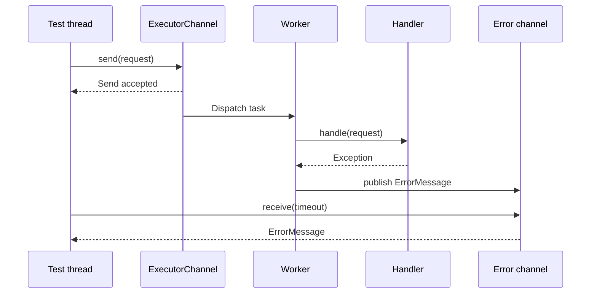

# Testing Error Channels

## 1. Objectives and scope

In the **SPRING_INTEGRATION_CORE** module, message flow testing must cover both successful outcomes and behavior when an endpoint fails. This lesson belongs to the **Testing support** chapter and focuses on proving that errors are detected, wrapped, routed to the right channel, and correlated with the failing message.

After this lesson, you will be able to:

- Choose accurately between asserting an exception returned to the caller and receiving an `ErrorMessage`.
- Test the global error channel, header-specified channels, and poller error channels.
- Verify the error cause, `failedMessage`, and correlation details.
- Write asynchronous tests with timeouts and checkpoints confirming how far processing progressed.
- Distinguish testing error-producing infrastructure, testing error handlers, and testing gateway contracts.
- Recognize how retries, recovery, and shared channels affect test outcomes.

The main examples use **Java 17+, Spring Integration 6.5.x, Spring Test, and JUnit Jupiter 5**. This is an API baseline for the examples, not a requirement to upgrade your project. Use compatible versions managed by your application's BOM or Spring Boot.

## 2. First determine which thread the error occurs on

A header named `errorChannel` does not automatically turn every exception into an error message. A component must catch the exception and publish it—such as the error-handling mechanism of an executor, poller, or appropriately configured gateway.

| Message path | Where processing happens in typical setups | How to observe errors in tests |
|---|---|---|
| Direct call to `DirectChannel.send(...)` | Caller's thread | `assertThrows` around the send call |
| `ExecutorChannel` using a thread pool | Worker thread | Receive `ErrorMessage` from target channel |
| `QueueChannel` consumed by an endpoint poller | Polling task thread | Receive the polling task's `ErrorMessage` |
| Messaging gateway without configured error channel | Depends on flow and gateway contract | Assert the exception returned to caller |
| Messaging gateway with configured error channel | Gateway forwards error to error flow | Verify error flow and return value if any |

Rows in the table assume no earlier advice catches and handles the exception first. Send-time failures, such as an executor rejecting a task, must also be distinguished from business failures occurring after a worker receives the message. Synchronous and asynchronous mechanisms are described in [Spring Integration Error Handling](https://docs.spring.io/spring-integration/reference/6.5/error-handling.html).

### 2.1. Direct call on DirectChannel

```text
test thread
    -> DirectChannel
    -> handler throws exception
    <- exception propagates back to send()
```

Along this path, the test should wrap `send()` in `assertThrows`. Simply adding an `errorChannel` header and waiting on a queue will not verify error handling, because no publisher catches exceptions on that direct call path.

### 2.2. ExecutorChannel and pollers



In a fully initialized Spring Integration configuration, `ExecutorChannel` integrates an error-handling mechanism for dispatched tasks. Accordingly, the example uses beans in a Spring context and a real thread pool; do not replace the executor with something running synchronously on the test thread. See [ExecutorChannel source on 6.5.x branch](https://github.com/spring-projects/spring-integration/blob/6.5.x/spring-integration-core/src/main/java/org/springframework/integration/channel/ExecutorChannel.java).

What needs testing is where the error lands after the task runs. `true` returned from `send()` only confirms the send was accepted by channel semantics; it does not confirm business completion.

## 3. What does an ErrorMessage carry?

`ErrorMessage` is a `Message<Throwable>`. When a handler fails, the payload is typically a `MessagingException` wrapping the business exception.

```text
ErrorMessage
├── payload: MessagingException
│   ├── cause: business exception
│   └── failedMessage: message at the point of failure
└── originalMessage: original message if provided by publisher/strategy
```

`originalMessage` is optional. It is not synonymous with `failedMessage`; after a transformer, the message at the failure site can differ from the initial message. Tests should check data per the active publisher's contract rather than assuming both attributes always exist. See [ErrorMessage Javadoc](https://docs.spring.io/spring-framework/docs/6.2.x/javadoc-api/org/springframework/messaging/support/ErrorMessage.html).

A meaningful test typically verifies:

| Attribute | Reason to check |
|---|---|
| Received message is `ErrorMessage` | Avoid confusing it with business messages on the same queue |
| Exception type or business root cause | Proves the expected error occurred |
| `failedMessage.payload` | Identifies which data caused the failure |
| Order ID, `traceId`, correlation headers | Correlates the error with the sent request |
| Target channel | Detects wrong routing or misconfiguration |
| Business output | Catches cases that emit both an error and an unintended success output |

`MessagingException.getFailedMessage()` can return `null` in general. In the handler example below, it is part of the tested contract so the test requires it to be present. Do not apply this assertion mechanically to startup errors, scheduler errors, or source errors happening before any message exists. Refer to [MessagingException Javadoc](https://docs.spring.io/spring-framework/docs/6.2.x/javadoc-api/org/springframework/messaging/MessagingException.html).

Avoid comparing full `Throwable.toString()`, stack traces, or endpoint description strings. Those details easily change across configuration updates. In the example, only the fixed business message declared by the application itself is compared verbatim.

## 4. Choosing target channels and preparing the test

With the standard `MessagePublishingErrorHandler`, the `MessageHeaders.ERROR_CHANNEL` header on the failed message takes precedence over the error handler's default channel. The header value may be a `MessageChannel` instance or a bean name resolved in the context. When no header is present, the error handler's default configuration determines the destination; with the usual global mechanism, that is the `errorChannel` bean.

A header pointing to a nonexistent bean name is a configuration bug to test separately. Do not treat resolution failure as a guarantee of falling back to the global error channel. This rule can be checked in [MessagePublishingErrorHandler source code](https://github.com/spring-projects/spring-integration/blob/6.5.x/spring-integration-core/src/main/java/org/springframework/integration/channel/MessagePublishingErrorHandler.java).

In the example, three queues serve three distinct observations:

- `errorChannel`: global target when an async request specifies no header.
- `localErrors`: dedicated target for requests carrying the header.
- `pollerErrors`: default target configured for the poller.

`receipts` collects successful business results.

This is a standalone test context without importing application configuration. Declaring a `QueueChannel` named `errorChannel` lets the test read errors directly. This setup does not test production subscribers, logging, or error channel topology.

## 5. Complete example: testing an error-producing flow

### 5.1. Required dependencies

The example needs the following artifacts on the classpath with project-managed compatible versions:

| Artifact | Purpose |
|---|---|
| `org.springframework.integration:spring-integration-core` | Channels, endpoints, and Java DSL |
| `org.springframework:spring-test` | Spring TestContext and `@SpringJUnitConfig` |
| `org.junit.jupiter:junit-jupiter` | JUnit Jupiter API and test engine |

The example does not yet use Spring Integration's mock APIs, so `spring-integration-test` is not required. Section 9 explains when that module is needed.

### 5.2. Business model

An order with `quantity <= 0` must fail with `IllegalArgumentException`. A valid order produces a `Receipt`.

The same logic is wired to three inputs:

```text
syncInput   (DirectChannel)   -> accept(order) -> receipts
asyncInput  (ExecutorChannel) -> accept(order) -> receipts
polledInput (QueueChannel)    -> poller -> accept(order) -> receipts
```

The test intentionally configures one worker for `asyncInput`, one handler per path, and no retries. Those conditions clarify execution order and expected error counts.

### 5.3. Test code

Place the following class in the test source set of a project with the dependencies above. The class needs no component scanning or Spring Boot application.

```java
import org.junit.jupiter.api.Test;
import org.junit.jupiter.api.parallel.Execution;
import org.junit.jupiter.api.parallel.ExecutionMode;
import org.springframework.beans.factory.annotation.Autowired;
import org.springframework.beans.factory.annotation.Qualifier;
import org.springframework.context.annotation.Bean;
import org.springframework.context.annotation.Configuration;
import org.springframework.integration.channel.DirectChannel;
import org.springframework.integration.channel.ExecutorChannel;
import org.springframework.integration.channel.QueueChannel;
import org.springframework.integration.config.EnableIntegration;
import org.springframework.integration.dsl.IntegrationFlow;
import org.springframework.integration.dsl.Pollers;
import org.springframework.messaging.Message;
import org.springframework.messaging.MessageHeaders;
import org.springframework.messaging.MessagingException;
import org.springframework.messaging.support.ErrorMessage;
import org.springframework.messaging.support.MessageBuilder;
import org.springframework.scheduling.concurrent.ThreadPoolTaskExecutor;
import org.springframework.test.annotation.DirtiesContext;
import org.springframework.test.context.junit.jupiter.SpringJUnitConfig;

import static org.junit.jupiter.api.Assertions.*;

@SpringJUnitConfig(ErrorChannelTest.Config.class)
@DirtiesContext(classMode = DirtiesContext.ClassMode.AFTER_EACH_TEST_METHOD)
@Execution(ExecutionMode.SAME_THREAD)
class ErrorChannelTest {

    private static final long WAIT_MS = 2_000;

    record Order(String orderId, int quantity) {}
    record Receipt(String orderId, int amount) {}

    @Autowired
    @Qualifier("syncInput")
    DirectChannel syncInput;

    @Autowired
    @Qualifier("asyncInput")
    ExecutorChannel asyncInput;

    @Autowired
    @Qualifier("polledInput")
    QueueChannel polledInput;

    @Autowired
    @Qualifier("errorChannel")
    QueueChannel globalErrors;

    @Autowired
    @Qualifier("localErrors")
    QueueChannel localErrors;

    @Autowired
    @Qualifier("pollerErrors")
    QueueChannel pollerErrors;

    @Autowired
    @Qualifier("receipts")
    QueueChannel receipts;

    @Test
    void directFailureIsThrownToCallerDespiteErrorHeader() {
        Message<Order> request = MessageBuilder
                .fromMessage(request("O-SYNC", 0))
                .setHeader(MessageHeaders.ERROR_CHANNEL, localErrors)
                .build();

        MessagingException failure = assertThrows(
                MessagingException.class,
                () -> syncInput.send(request, WAIT_MS));

        assertFailure(failure, request);
        assertNull(receipts.receive(0));
        assertErrorQueuesEmpty();
    }

    @Test
    void asyncFailureWithoutHeaderUsesGlobalErrorChannel() {
        Message<Order> request = request("O-GLOBAL", 0);

        assertTrue(asyncInput.send(request, WAIT_MS));
        assertError(globalErrors, request);

        awaitAsyncMarker();
        assertErrorQueuesEmpty();
    }

    @Test
    void channelObjectHeaderOverridesGlobalErrorChannel() {
        Message<Order> request = MessageBuilder
                .fromMessage(request("O-LOCAL-OBJECT", 0))
                .setHeader(MessageHeaders.ERROR_CHANNEL, localErrors)
                .build();

        assertTrue(asyncInput.send(request, WAIT_MS));
        assertError(localErrors, request);

        awaitAsyncMarker();
        assertErrorQueuesEmpty();
    }

    @Test
    void channelBeanNameHeaderIsResolved() {
        Message<Order> request = MessageBuilder
                .fromMessage(request("O-LOCAL-NAME", 0))
                .setHeader(MessageHeaders.ERROR_CHANNEL, "localErrors")
                .build();

        assertTrue(asyncInput.send(request, WAIT_MS));
        assertError(localErrors, request);

        awaitAsyncMarker();
        assertErrorQueuesEmpty();
    }

    @Test
    void successfulAsyncOrderProducesReceiptWithoutError() {
        Message<Order> request = request("O-OK", 2);

        assertTrue(asyncInput.send(request, WAIT_MS));

        Message<?> reply = receipts.receive(WAIT_MS);
        assertNotNull(reply, "No Receipt received");
        assertEquals(new Receipt("O-OK", 200), reply.getPayload());

        awaitAsyncMarker();
        assertErrorQueuesEmpty();
    }

    @Test
    void pollingFailureUsesConfiguredDefaultErrorChannel() {
        Message<Order> request = request("O-POLLER", 0);

        assertTrue(polledInput.send(request, WAIT_MS));
        assertError(pollerErrors, request);

        assertNull(receipts.receive(0));
        assertErrorQueuesEmpty();
    }

    @Test
    void requestHeaderOverridesPollerDefaultErrorChannel() {
        Message<Order> request = MessageBuilder
                .fromMessage(request("O-POLLER-LOCAL", 0))
                .setHeader(MessageHeaders.ERROR_CHANNEL, "localErrors")
                .build();

        assertTrue(polledInput.send(request, WAIT_MS));
        assertError(localErrors, request);

        assertNull(receipts.receive(0));
        assertErrorQueuesEmpty();
    }

    private static Message<Order> request(String orderId, int quantity) {
        return MessageBuilder.withPayload(new Order(orderId, quantity))
                .setHeader("traceId", "trace-" + orderId)
                .build();
    }

    private static void assertError(
            QueueChannel channel, Message<Order> request) {

        Message<?> received = channel.receive(WAIT_MS);
        assertNotNull(received, "No error message received");

        ErrorMessage error = assertInstanceOf(ErrorMessage.class, received);
        MessagingException failure = assertInstanceOf(
                MessagingException.class, error.getPayload());

        assertFailure(failure, request);
    }

    private static void assertFailure(
            MessagingException failure, Message<Order> request) {

        Throwable cause = failure.getMostSpecificCause();
        assertInstanceOf(IllegalArgumentException.class, cause);
        assertEquals("quantity must be positive", cause.getMessage());

        Message<?> failed = failure.getFailedMessage();
        assertNotNull(failed, "Handler failure must retain failedMessage");
        assertEquals(request.getPayload(), failed.getPayload());
        assertEquals(
                request.getHeaders().get("traceId"),
                failed.getHeaders().get("traceId"));

        // This flow does not transform the message before the handler.
        assertEquals(
                request.getHeaders().getId(),
                failed.getHeaders().getId());
    }

    private void awaitAsyncMarker() {
        // The single executor has only one worker, so the marker is processed
        // after the previously submitted task.
        assertTrue(asyncInput.send(request("MARKER", 1), WAIT_MS));

        Message<?> markerReply = receipts.receive(WAIT_MS);
        assertNotNull(markerReply, "Worker has not processed the marker yet");
        assertEquals(new Receipt("MARKER", 100), markerReply.getPayload());

        // If the failing task unexpectedly produced a Receipt, the receive above
        // or this assertion will detect the extra result.
        assertNull(receipts.receive(0));
    }

    private void assertErrorQueuesEmpty() {
        assertNull(globalErrors.receive(0), "Remaining error in global channel");
        assertNull(localErrors.receive(0), "Remaining error in local channel");
        assertNull(pollerErrors.receive(0), "Remaining error in poller channel");
    }

    private static Receipt accept(Order order) {
        if (order.quantity() <= 0) {
            throw new IllegalArgumentException("quantity must be positive");
        }
        return new Receipt(order.orderId(), order.quantity() * 100);
    }

    @Configuration
    @EnableIntegration
    static class Config {

        @Bean
        DirectChannel syncInput() {
            return new DirectChannel();
        }

        @Bean
        ThreadPoolTaskExecutor testExecutor() {
            ThreadPoolTaskExecutor executor = new ThreadPoolTaskExecutor();
            executor.setCorePoolSize(1);
            executor.setMaxPoolSize(1);
            executor.setQueueCapacity(20);
            executor.setThreadNamePrefix("error-channel-test-");
            executor.setWaitForTasksToCompleteOnShutdown(true);
            executor.setAwaitTerminationSeconds(2);
            return executor;
        }

        @Bean
        ExecutorChannel asyncInput(
                @Qualifier("testExecutor")
                ThreadPoolTaskExecutor executor) {
            return new ExecutorChannel(executor);
        }

        @Bean
        QueueChannel polledInput() {
            return new QueueChannel(20);
        }

        @Bean
        QueueChannel errorChannel() {
            return new QueueChannel(20);
        }

        @Bean
        QueueChannel localErrors() {
            return new QueueChannel(20);
        }

        @Bean
        QueueChannel pollerErrors() {
            return new QueueChannel(20);
        }

        @Bean
        QueueChannel receipts() {
            return new QueueChannel(20);
        }

        @Bean
        IntegrationFlow syncFlow() {
            return IntegrationFlow.from("syncInput")
                    .handle(Order.class, (order, headers) -> accept(order))
                    .channel("receipts")
                    .get();
        }

        @Bean
        IntegrationFlow asyncFlow() {
            return IntegrationFlow.from("asyncInput")
                    .handle(Order.class, (order, headers) -> accept(order))
                    .channel("receipts")
                    .get();
        }

        @Bean
        IntegrationFlow polledFlow() {
            return IntegrationFlow.from("polledInput")
                    .handle(
                            Order.class,
                            (order, headers) -> accept(order),
                            endpoint -> endpoint
                                    .id("polledOrderHandler")
                                    .poller(Pollers.fixedDelay(20)
                                            .receiveTimeout(0)
                                            .maxMessagesPerPoll(1)
                                            .errorChannel("pollerErrors")))
                    .channel("receipts")
                    .get();
        }
    }
}
```

### 5.4. Interpreting the outcome of each test

| Test | What is proved |
|---|---|
| `directFailureIsThrownToCallerDespiteErrorHeader` | Direct call on synchronous channel returns exception to caller; header does not auto-publish errors |
| `asyncFailureWithoutHeaderUsesGlobalErrorChannel` | Worker error goes to global channel |
| `channelObjectHeaderOverridesGlobalErrorChannel` | Header containing channel object routes error specifically for the request |
| `channelBeanNameHeaderIsResolved` | Bean name in header is resolved properly |
| `successfulAsyncOrderProducesReceiptWithoutError` | Success path produces result and produces no error within the flow scope |
| `pollingFailureUsesConfiguredDefaultErrorChannel` | Error when poller invokes handler goes to configured default channel |
| `requestHeaderOverridesPollerDefaultErrorChannel` | Header still takes precedence over the poller's default error handler channel |

In the Java DSL above, `.errorChannel("pollerErrors")` configures the default channel of a `MessagePublishingErrorHandler` for the poller. It is not a directive to ignore the request's `errorChannel` header. You can inspect this setup in [PollerSpec source code](https://github.com/spring-projects/spring-integration/blob/6.5.x/spring-integration-core/src/main/java/org/springframework/integration/dsl/PollerSpec.java).

`QueueChannel` merely buffers messages for the poller to pull. Putting a request into `polledInput` does not directly call `accept()`. Only receiving the `ErrorMessage` observes that the polling task reached the handler and failed.

## 6. Why doesn't the example use Thread.sleep()?

### 6.1. Waiting for events with a time bound

```java
Message<?> error = errors.receive(2_000);
assertNotNull(error);
```

The receive call returns immediately once a message arrives, or returns `null` when the timeout expires. This avoids always waiting a fixed interval before checking.

`receive(0)` only polls at the instant of the call. It fits when you already have grounds for processing progress, not as a way to wait for an async task to start. `receive()` without a timeout can hang the test indefinitely when the flow breaks.

In the example, `WAIT_MS` is a limit per send/receive operation, not the maximum duration of the entire test. When tuning for CI environments, account for context startup time, polling intervals, and the number of waits.

### 6.2. Using a marker to bound the tasks under observation

After receiving the request's error, the async tests send a valid order with ID `MARKER`. With strictly one worker and a FIFO task queue in this configuration, the marker's `Receipt` indicates the preceding task has passed through processing on the worker.

This gives clearer context to probing the error queues. If a flow has multiple workers, subsequent async steps, scheduled retries, or callbacks outside the executor, an input-side marker no longer proves all branches finished. In that case, use a latch, completion event, future, or observation point at the appropriate final step.

A marker does not prove the system will never emit another error. Negative assertions always require scope: which tasks completed, whether any branches remain active, and whether retries/redeliveries can still occur.

### 6.3. Isolating state across tests

The example rebuilds the context after every test via `@DirtiesContext`, while also running methods in the class on the same thread. This gives each test clean queues, executor, and endpoints at the cost of longer runtime.

Spring Test can reuse contexts across tests with the same configuration. If keeping the context for speed, wait for prior tasks to finish, drain queues, and reset mocks/subscriptions according to their lifecycles. Clearing queues at the start alone does not prevent an old task from publishing an error afterward. See [Spring Test Context Caching](https://docs.spring.io/spring-framework/reference/6.2/testing/testcontext-framework/ctx-management/caching.html).

## 7. Testing an error handler is a separate test layer

The tests in section 5 trace from a real request to the framework-published error. They verify the error-handling boundary and channel selection.

If the goal is a router, transformer, or error recorder behind the error channel, you can construct an `ErrorMessage` directly to test that consumer independently:

```java
import org.junit.jupiter.api.Test;
import org.springframework.integration.channel.DirectChannel;
import org.springframework.integration.channel.QueueChannel;
import org.springframework.messaging.Message;
import org.springframework.messaging.MessageHandlingException;
import org.springframework.messaging.MessagingException;
import org.springframework.messaging.support.ErrorMessage;
import org.springframework.messaging.support.MessageBuilder;

import static org.junit.jupiter.api.Assertions.*;

class ErrorConsumerTest {

    @Test
    void mapsFailureToBusinessRejection() {
        DirectChannel errors = new DirectChannel();
        QueueChannel rejections = new QueueChannel(10);

        errors.subscribe(message -> {
            ErrorMessage error = (ErrorMessage) message;
            MessagingException failure =
                    (MessagingException) error.getPayload();
            Message<?> failed = failure.getFailedMessage();

            if (failed == null) {
                throw new IllegalStateException("Missing failedMessage");
            }

            rejections.send(MessageBuilder
                    .withPayload("REJECTED:" + failed.getPayload())
                    .setHeader("traceId", failed.getHeaders().get("traceId"))
                    .build());
        });

        Message<String> failedRequest = MessageBuilder
                .withPayload("O-100")
                .setHeader("traceId", "T-100")
                .build();

        MessagingException failure = new MessageHandlingException(
                failedRequest,
                new IllegalArgumentException("quantity must be positive"));

        assertTrue(errors.send(new ErrorMessage(failure)));

        Message<?> rejection = rejections.receive(0);
        assertNotNull(rejection);
        assertEquals("REJECTED:O-100", rejection.getPayload());
        assertEquals("T-100", rejection.getHeaders().get("traceId"));
    }
}
```

This is an illustrative consumer with a narrow input contract: the error payload must be a `MessagingException` with a `failedMessage`. A consumer shared across multiple sources must also handle other `Throwable` types and missing-message cases.

The test above proves mapping an error into a rejection. It does not prove the framework caught an exception from a business endpoint. In a real application, invoke the same consumer or import the same error flow used in production to avoid testing a test-only copy of the logic.

If the error handler contains a router, synthesize errors of each kind and verify the selected channel and correlation data. If it contains a filter, distinguish intentionally discarded messages from messages lost because a channel has no consumer.

## 8. Gateways: also verify the contract returned to the caller

A gateway can catch flow errors and forward them to an error flow per configuration. Hence, a gateway calling a `DirectChannel` can still send errors to the gateway's configured error channel; this does not contradict the direct `syncInput.send()` test.

The configuration snippet below illustrates a gateway returning a fallback string when the backend fails. You can add these declarations to a dedicated `@Configuration @EnableIntegration` class for gateway testing:

```java
public interface TextGateway {
    String process(String request);
}

@Bean
org.springframework.integration.gateway.GatewayProxyFactoryBean textGateway() {
    var factory =
            new org.springframework.integration.gateway.GatewayProxyFactoryBean(
                    TextGateway.class);
    factory.setDefaultRequestChannelName("gatewayInput");
    factory.setErrorChannelName("gatewayErrors");
    factory.setDefaultRequestTimeout(1_000L);
    factory.setDefaultReplyTimeout(1_000L);
    return factory;
}

@Bean
org.springframework.integration.dsl.IntegrationFlow backendFlow() {
    return org.springframework.integration.dsl.IntegrationFlow
            .from("gatewayInput")
            .<String, String>transform(request -> {
                throw new IllegalStateException("backend unavailable");
            })
            .get();
}

@Bean
org.springframework.integration.dsl.IntegrationFlow gatewayErrorFlow() {
    return org.springframework.integration.dsl.IntegrationFlow
            .from("gatewayErrors")
            .transform(Throwable.class, failure -> "FALLBACK")
            .get();
}
```

Named input channels in both flows are created by the DSL when no matching bean exists yet. The error transformer returns a reply to the gateway via message reply mechanics. The gateway proxy can be injected as `TextGateway`, then asserted:

```java
assertEquals("FALLBACK", textGateway.process("hello"));
```

A thorough gateway test should cover the exception returned to the caller when no error flow exists, and the fallback or exception per policy when an error flow exists. The exception type returned by a gateway may differ from the wrapper received when calling a channel directly, due to gateway exception-unwrapping rules.

For a method with a return value, an error flow that only logs or pushes errors to a queue does not produce a reply for the caller. Test behavior when no reply arrives within the configured timeout. Do not assume every error produces a fallback. See [Messaging Gateways — Error Handling](https://docs.spring.io/spring-integration/reference/6.5/gateway.html#error-handling).

## 9. Using Spring Integration Test when endpoints need substitution

In larger flows, errors often originate from an HTTP client, repository, or outbound adapter. To test error channels reliably, inject controlled failures at that exact boundary—such as stubbing a service client to throw the expected exception.

When you need to replace a handler inside a real context, use `spring-integration-test`, `@SpringIntegrationTest`, and `MockIntegrationContext`:

```java
// Members placed in a test already annotated with @SpringJUnitConfig
// and @SpringIntegrationTest.
@Autowired
org.springframework.integration.test.context.MockIntegrationContext
        mockIntegrationContext;

@org.junit.jupiter.api.AfterEach
void restoreEndpoints() {
    mockIntegrationContext.resetBeans();
}

@Test
void downstreamFailureCanBeInjected() {
    mockIntegrationContext.substituteMessageHandlerFor(
            "billingEndpoint",
            message -> {
                throw new org.springframework.messaging.MessageHandlingException(
                        message,
                        new IllegalStateException("billing unavailable"));
            });

    // Send the request through the flow's real entry point.
    // Receive the error on the real error channel and verify cause/failedMessage.
}
```

This snippet demonstrates endpoint substitution; add your application's specific flow configuration and assertions. `billingEndpoint` must be **the consumer endpoint bean name**, not a channel name or an arbitrary service bean name. Endpoints can be named explicitly via `.handle(..., e -> e.id("billingEndpoint"))`.

Keep the asynchronous channel or poller under test intact. Replacing that entire section with a mock skips the very error-publishing mechanism under test. `resetBeans()` restores replaced components; waiting for tasks and draining queues remain the test's separate responsibilities. These APIs are described in [Testing support — Spring Integration and the Test Context](https://docs.spring.io/spring-integration/reference/6.5/testing.html#spring-integration-and-the-test-context).

## 10. How do retry and recovery change things?

An error channel is not a retry policy. When adding retry advice, state clearly after which attempt the test observes an error and whether recovery handles the exception.

| Configured policy | Additional assertions needed |
|---|---|
| No retry, handler fails | Error reaches right channel, no `Receipt` for failed request |
| Stateless retry then succeeds | Exact dependency call count; successful result produced |
| Stateless retry exhausted, exception rethrown | Exact call count; final error reaches outer error handler |
| Recovery publishes error and stops propagation | Check recovery channel; do not assume an extra global error |
| Recovery returns fallback | Verify fallback and error outputs per contract |
| Stateful retry or redelivering source | Verify state across multiple redeliveries per source config |

For instance, `maxAttempts = 3` typically means up to three total invocations in the corresponding Spring Retry policy, including the initial attempt. Tests should use explicit configuration values and count invocations; do not infer attempt counts solely from the number of `ErrorMessage`s received.

With stateless retry wrapping a handler, exceptions can be retried inside the advice before escaping to an outer error publisher. Thus, do not assume each attempt emits an `ErrorMessage`. Recovery behavior depends on the callback. Refer to [Provided Advice Classes — Retry Advice](https://docs.spring.io/spring-integration/reference/6.5/handler-advice/classes.html#retry-advice).

Receiving an in-memory `ErrorMessage` also does not prove a transaction rolled back, a broker NACKed, or a message entered a dead-letter queue. Those contracts require tests with the corresponding transaction manager or adapter/broker.

## 11. Observing real topology without altering behavior

### 11.1. QueueChannel and PublishSubscribeChannel are observed differently

`QueueChannel.receive()` removes messages from the queue. If a production consumer and a test both read from the same queue, they compete for messages.

`DirectChannel` delivers a message to one subscriber per its dispatcher strategy. Adding a subscriber to "eavesdrop" does not guarantee both the business subscriber and the test receive the message.

With `PublishSubscribeChannel`, you can add an event-recording subscriber or wire-tap to an observation queue. When using a test-only subscriber, manage its lifecycle and unsubscribe when the test ends. Channel configuration differences are described in [Configuring Message Channels](https://docs.spring.io/spring-integration/reference/6.5/channel/configuration.html).

Example of collecting errors on an injected synchronous pub-sub channel:

```java
var observed = new java.util.concurrent.LinkedBlockingQueue<
        org.springframework.messaging.Message<?>>();

org.springframework.messaging.MessageHandler probe =
        message -> observed.add(message);

pubSubErrors.subscribe(probe);
try {
    // Send the request causing the flow to fail here.
    var error = observed.poll(2, java.util.concurrent.TimeUnit.SECONDS);
    assertNotNull(error);
} finally {
    pubSubErrors.unsubscribe(probe);
}
```

This is a probe-attachment snippet; supply `pubSubErrors`, the request, and real test assertions. Another subscriber throwing an exception can affect dispatch depending on configuration, so adding a probe alone does not guarantee isolated observation.

### 11.2. An error channel without consumers

A test replacing a real error channel with a queue only proves errors are pushed to the queue. It does not catch failures in downstream production consumers.

If the contract requires errors to be processed through logging or notification steps, add observation at the end of the error flow. Do not rely solely on logs or the mere existence of an `errorChannel` bean.

## 12. Common testing mistakes

| Symptom | Possible cause | Fix |
|---|---|---|
| Waiting on error queue yet test gets exception immediately | Directly invoking a synchronous flow | Assert with `assertThrows`, or invoke across an error-handling boundary |
| `assertThrows` misses worker error | Handler runs after `send()` has returned | Wait for `ErrorMessage` |
| Test passes even with no message | Only asserting `send() == true` | Receive the message and assert error contents |
| Passes sometimes, fails on CI | Short sleep or polling queue too early | Wait for events with timeout and clear completion point |
| Trace ID missing | Reading header on `ErrorMessage` instead | Inspect headers on `failedMessage` or per custom strategy contract |
| Results mix across tests | Shared context, queues, or in-flight tasks | Isolate context or manage completion/cleanup thoroughly |
| Wrong expected error count | Active retry, recovery, or redelivery | Check policy and dependency invocation counts |
| Test hangs | Unbounded receive or gateway missing reply | Set timeouts and verify reply contract |
| Error still missing from dedicated queue | Wrong bean name, altered header, or error occurred before message existed | Check header at failure site and publish boundary |
| Error handler test passes yet real flow drops errors | Test only manually sent `ErrorMessage` | Add a test from request through the failing endpoint |
| Observation test steals business messages | Test competes with consumer on queue/direct channel | Use appropriate observation topology or isolated context |

## 13. Extended practice

Work through these steps on the main example:

1. Add a transformer before the handler to modify the payload, then verify `failedMessage` reflects data at the failure point. Keep a stable business ID or trace ID instead of assuming message IDs stay constant.
2. Replace the inline logic with a stubbable service client. Make the client throw an error and verify the message still traverses real channels, endpoints, and error publisher.
3. Build an error flow classifying data errors and transient errors. Verify each target channel with dedicated error payloads.
4. Configure stateless retry with a specific attempt count. Verify call counts, final outcome, and the error channel once attempts are exhausted.
5. Write a separate test for failures inside the error consumer itself. Determine how to observe when error recording fails.
6. For a reply-returning gateway, test both fallback behavior and the case where the error flow produces no reply before timeout.

Each test should tie to an observable contract: which request causes the failure, which error is emitted, which destination receives it, which business outputs are allowed to exist, and when processing within that scope can be declared complete.
