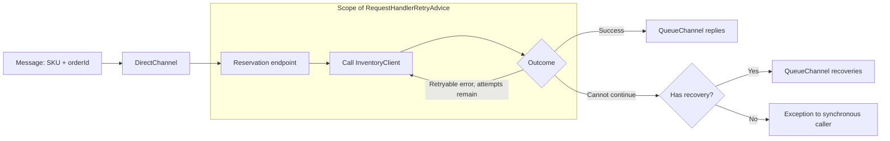

# Testing Retry Advice

## 1. Objectives and scope

In Spring Integration Core, an endpoint may call an inventory service, payment service, or partner API and encounter transient failures. Retry advice lets you re-invoke the processing wrapped by the advice. A solid test must prove **when retries happen**, **how many times it runs**, **which exit path it takes**, and **which message continues**.

After this lesson, you will be able to:

- Attach `RequestHandlerRetryAdvice` to an endpoint in the Java DSL and test it via `MessageChannel`.
- Distinguish total execution count from retry attempts after the initial call.
- Test retryable errors, non-retryable errors, and nested exception causes.
- Verify replies, recovery messages, exceptions propagated to callers, and business headers.
- Test backoff without actually sleeping threads.
- Recognize the limits of synchronous tests, stateful retry, and side effects across retries.

**Version baseline for the main examples:** Java 17 or later, Spring Integration **6.5.x**, Spring Retry **2.x**, JUnit Jupiter, and Mockito. This is an illustrative API baseline, not a mandate to change your project's version. Starting in Spring Integration 7.0, retry moves to Spring Framework's API; section 11 explains the mapping. Do not mix imports from both generations in the same example. See [retry changes from 6.5 to 7.0](https://docs.spring.io/spring-integration/reference/changes-6.5-7.0.html).

## 2. Identifying the exact target being retried

Consider a flow handling inventory reservation requests:



With a typical reply-producing handler, the advice wraps `handleRequestMessage()`. Sending the reply to the next step occurs after that method. Therefore, do not assume retrying endpoint A also re-runs a transformer before A or handles errors thrown in a downstream endpoint B. Where the advice sits is part of the contract to test. This mechanism is shown in [AbstractReplyProducingMessageHandler](https://github.com/spring-projects/spring-integration/blob/v6.5.0/spring-integration-core/src/main/java/org/springframework/integration/handler/AbstractReplyProducingMessageHandler.java).

### 2.1. Execution counts in Spring Retry 2.x

With `SimpleRetryPolicy(3, ...)`:

```text
Execution 1: initial attempt
Execution 2: first retry
Execution 3: second retry

Maximum: 3 handler calls, not 4.
```

`maxAttempts` includes the initial call. If a call succeeds early or throws a non-retryable exception, the actual invocation count is lower than the limit. These are the semantics of [SimpleRetryPolicy in Spring Retry](https://github.com/spring-projects/spring-retry/blob/v2.0.12/src/main/java/org/springframework/retry/policy/SimpleRetryPolicy.java).

Do not rely on defaults as implicit test assumptions. Declare limits explicitly so the test continues expressing its intent across version upgrades.

### 2.2. Stateless and stateful

**Stateless retry:** a single entry into the advice can invoke the handler multiple times before returning a result or failing. This is the mode used in the main example.

**Stateful retry:** state is tracked by key; exceptions may be thrown back toward the source so the source redelivers the message. A single `send()` does not imply exhausting the retry budget. In the 6.5 line, this mode uses `RetryStateGenerator`. See [Spring Integration 6.5 Retry Advice](https://docs.spring.io/spring-integration/reference/6.5/handler-advice/classes.html).

## 3. Building a behavior matrix before writing tests

Suppose the reservation service contract is:

- Only `TemporaryInventoryException` and its subclasses are retried.
- At most three executions per stateless processing attempt.
- When recovery is configured, the final error goes to the `recoveries` channel.
- A successful request emits strictly one reply, preserving `orderId`.
- The endpoint does not have to emit a reply when recovery finishes by returning `null`.

| Scenario | Service outcome sequence | Call count | Reply | Recovery or exception |
|---|---|---:|---:|---|
| Immediate success | Success | 1 | 1 | None |
| Transient errors then success | Error, error, success | 3 | 1 | None |
| Budget exhausted, with recovery | Consecutive transient errors | 3 | 0 | One recovery message |
| Business error, with recovery | Non-retryable error | 1 | 0 | One recovery message per lesson config |
| Budget exhausted, no recovery | Consecutive transient errors | 3 | 0 | Exception to caller |
| Business error, no recovery | Non-retryable error | 1 | 0 | Exception to caller |
| Two independent requests | Each fails twice then succeeds | 3 per request | 2 | None |

**Do not retry** and **do not recover** are two distinct decisions. In this lesson's policy, a business error is not retried, yet still enters recovery when the endpoint has a callback. If the application requires that error to propagate straight out, configure a recovery policy appropriate for your version and write a dedicated test.

## 4. Setting the test at the right boundary

To verify advice wiring, send a `Message` into the real flow. Mock the `InventoryClient` object called by the handler. If you call `client.reserve()` directly, the test only exercises the mock; it does not prove the endpoint has the advice attached.

The example uses:

- `DirectChannel` at the input so all handler calls finish on the sending thread.
- `QueueChannel` at outputs so the test explicitly pulls replies and errors.
- Two endpoints with identical business logic but different termination: with recovery and without recovery.
- Context managed by `@SpringJUnitConfig`; `@EnableIntegration` initializes Integration infrastructure.

Dependencies needed in the test environment:

| Artifact | Role |
|---|---|
| `org.springframework.integration:spring-integration-core` | Channels, endpoints, advice, and Java DSL |
| `org.springframework.retry:spring-retry` | `RetryTemplate`, retry policies, and backoff in the 6.5 line |
| `org.springframework:spring-test` | `SpringJUnitConfig` |
| `org.junit.jupiter:junit-jupiter` | Tests and assertions |
| `org.mockito:mockito-core` | Mocking external services |
| `org.springframework.integration:spring-integration-test` | Only needed if using Integration test utilities in section 9 |

Manage versions with your application's compatible BOM. The class below uses JUnit Jupiter and does not need `MockitoExtension` because the mock is created directly in the test configuration. Your build must enable JUnit Platform.

Spring Integration splits test utilities into `spring-integration-test-support` and `spring-integration-test`; for this simple flow, JUnit, Mockito, and Spring Test suffice. See [Testing support](https://docs.spring.io/spring-integration/reference/6.5/testing.html).

## 5. Complete example: testing an endpoint with Java DSL

The entire snippet below is one test class. Tests share the context, so reset mocks and drain queues before each test. Run methods in this class sequentially; do not enable parallel execution on shared fixtures.

```java
import java.util.Map;

import org.junit.jupiter.api.BeforeEach;
import org.junit.jupiter.api.Test;
import org.junit.jupiter.api.parallel.Execution;
import org.junit.jupiter.api.parallel.ExecutionMode;

import org.springframework.beans.factory.annotation.Autowired;
import org.springframework.beans.factory.annotation.Qualifier;
import org.springframework.context.annotation.Bean;
import org.springframework.context.annotation.Configuration;
import org.springframework.integration.channel.DirectChannel;
import org.springframework.integration.channel.QueueChannel;
import org.springframework.integration.config.EnableIntegration;
import org.springframework.integration.dsl.IntegrationFlow;
import org.springframework.integration.handler.advice.ErrorMessageSendingRecoverer;
import org.springframework.integration.handler.advice.RequestHandlerRetryAdvice;
import org.springframework.messaging.Message;
import org.springframework.messaging.MessageChannel;
import org.springframework.messaging.MessagingException;
import org.springframework.messaging.support.ErrorMessage;
import org.springframework.messaging.support.MessageBuilder;
import org.springframework.retry.backoff.NoBackOffPolicy;
import org.springframework.retry.policy.SimpleRetryPolicy;
import org.springframework.retry.support.RetryTemplate;
import org.springframework.test.context.junit.jupiter.SpringJUnitConfig;

import static org.junit.jupiter.api.Assertions.*;
import static org.mockito.Mockito.*;

@SpringJUnitConfig(RetryAdviceFlowTest.Config.class)
@Execution(ExecutionMode.SAME_THREAD)
class RetryAdviceFlowTest {

    @Autowired
    InventoryClient client;

    @Autowired
    @Qualifier("recoveringInput")
    MessageChannel recoveringInput;

    @Autowired
    @Qualifier("propagatingInput")
    MessageChannel propagatingInput;

    @Autowired
    @Qualifier("replies")
    QueueChannel replies;

    @Autowired
    @Qualifier("recoveries")
    QueueChannel recoveries;

    @BeforeEach
    void cleanFixture() {
        reset(client);
        drain(replies);
        drain(recoveries);
    }

    @Test
    void succeedsOnFirstAttempt() {
        when(client.reserve("SKU-1", "ORD-1"))
                .thenReturn("RESERVED");

        assertTrue(recoveringInput.send(request("SKU-1", "ORD-1")));

        assertReply("ORD-1");
        assertNull(recoveries.receive(0));
        verify(client, times(1)).reserve("SKU-1", "ORD-1");
        verifyNoMoreInteractions(client);
    }

    @Test
    void retriesTwiceThenProducesOneReply() {
        when(client.reserve("SKU-1", "ORD-2"))
                .thenThrow(new TemporaryInventoryException("timeout-1"))
                .thenThrow(new TemporaryInventoryException("timeout-2"))
                .thenReturn("RESERVED");

        assertTrue(recoveringInput.send(request("SKU-1", "ORD-2")));

        assertReply("ORD-2");
        assertNull(recoveries.receive(0));
        verify(client, times(3)).reserve("SKU-1", "ORD-2");
        verifyNoMoreInteractions(client);
    }

    @Test
    void publishesOneErrorAfterRetryExhaustion() {
        var first = new TemporaryInventoryException("timeout-1");
        var second = new TemporaryInventoryException("timeout-2");
        var last = new TemporaryInventoryException("timeout-3");
        when(client.reserve("SKU-1", "ORD-3"))
                .thenThrow(first, second, last);
        Message<String> sent = request("SKU-1", "ORD-3");

        assertTrue(recoveringInput.send(sent));

        assertRecovery(sent, last);
        assertNull(replies.receive(0));
        verify(client, times(3)).reserve("SKU-1", "ORD-3");
        verifyNoMoreInteractions(client);
    }

    @Test
    void doesNotRetryPermanentFailureButStillRecoversIt() {
        var invalid = new PermanentInventoryException("unknown SKU");
        when(client.reserve("INVALID", "ORD-4")).thenThrow(invalid);
        Message<String> sent = request("INVALID", "ORD-4");

        assertTrue(recoveringInput.send(sent));

        assertRecovery(sent, invalid);
        assertNull(replies.receive(0));
        verify(client, times(1)).reserve("INVALID", "ORD-4");
        verifyNoMoreInteractions(client);
    }

    @Test
    void propagatesFinalFailureWhenRecoveryIsAbsent() {
        var last = new TemporaryInventoryException("still unavailable");
        when(client.reserve("SKU-1", "ORD-5")).thenThrow(last);

        MessagingException failure = assertThrows(
                MessagingException.class,
                () -> propagatingInput.send(request("SKU-1", "ORD-5")));

        assertSame(last, rootCause(failure));
        assertNull(replies.receive(0));
        assertNull(recoveries.receive(0));
        verify(client, times(3)).reserve("SKU-1", "ORD-5");
        verifyNoMoreInteractions(client);
    }

    @Test
    void propagatesPermanentFailureAfterOneAttempt() {
        var invalid = new PermanentInventoryException("bad request");
        when(client.reserve("INVALID", "ORD-6")).thenThrow(invalid);

        MessagingException failure = assertThrows(
                MessagingException.class,
                () -> propagatingInput.send(request("INVALID", "ORD-6")));

        assertSame(invalid, rootCause(failure));
        assertNull(replies.receive(0));
        assertNull(recoveries.receive(0));
        verify(client, times(1)).reserve("INVALID", "ORD-6");
        verifyNoMoreInteractions(client);
    }

    @Test
    void givesIndependentRequestsIndependentRetryBudgets() {
        when(client.reserve("SKU-A", "ORD-A"))
                .thenThrow(new TemporaryInventoryException("A-1"))
                .thenThrow(new TemporaryInventoryException("A-2"))
                .thenReturn("RESERVED");
        when(client.reserve("SKU-B", "ORD-B"))
                .thenThrow(new TemporaryInventoryException("B-1"))
                .thenThrow(new TemporaryInventoryException("B-2"))
                .thenReturn("RESERVED");

        assertTrue(recoveringInput.send(request("SKU-A", "ORD-A")));
        assertReply("ORD-A");
        assertTrue(recoveringInput.send(request("SKU-B", "ORD-B")));
        assertReply("ORD-B");

        assertNull(recoveries.receive(0));
        verify(client, times(3)).reserve("SKU-A", "ORD-A");
        verify(client, times(3)).reserve("SKU-B", "ORD-B");
        verifyNoMoreInteractions(client);
    }

    private void assertReply(String orderId) {
        Message<?> reply = replies.receive(0);
        assertNotNull(reply);
        assertEquals("RESERVED", reply.getPayload());
        assertEquals(orderId, reply.getHeaders().get("orderId"));
        assertNull(replies.receive(0), "Only one reply is expected");
    }

    private void assertRecovery(Message<?> sent, Throwable expectedCause) {
        ErrorMessage error =
                assertInstanceOf(ErrorMessage.class, recoveries.receive(0));
        MessagingException failure =
                assertInstanceOf(MessagingException.class, error.getPayload());

        assertSame(expectedCause, rootCause(failure));
        Message<?> failedMessage = failure.getFailedMessage();
        assertNotNull(failedMessage);
        assertEquals(sent.getPayload(), failedMessage.getPayload());
        assertEquals(sent.getHeaders().getId(),
                failedMessage.getHeaders().getId());
        assertEquals(sent.getHeaders().get("orderId"),
                failedMessage.getHeaders().get("orderId"));
        assertNull(recoveries.receive(0), "Only one recovery is expected");
    }

    static Message<String> request(String sku, String orderId) {
        return MessageBuilder.withPayload(sku)
                .setHeader("orderId", orderId)
                .build();
    }

    static Throwable rootCause(Throwable failure) {
        Throwable current = failure;
        while (current.getCause() != null && current.getCause() != current) {
            current = current.getCause();
        }
        return current;
    }

    static void drain(QueueChannel channel) {
        while (channel.receive(0) != null) {
            // Remove leftovers from the previous synchronous test.
        }
    }

    static RetryTemplate newTemplate(int maxAttempts) {
        Map<Class<? extends Throwable>, Boolean> retryable =
                Map.of(TemporaryInventoryException.class, true);
        RetryTemplate template = new RetryTemplate();
        template.setRetryPolicy(new SimpleRetryPolicy(
                maxAttempts, retryable, true, false));
        template.setBackOffPolicy(new NoBackOffPolicy());
        return template;
    }

    interface InventoryClient {
        String reserve(String sku, String orderId);
    }

    static class TemporaryInventoryException extends RuntimeException {
        TemporaryInventoryException(String message) {
            super(message);
        }
    }

    static class PermanentInventoryException extends RuntimeException {
        PermanentInventoryException(String message) {
            super(message);
        }
    }

    @Configuration
    @EnableIntegration
    static class Config {

        @Bean
        InventoryClient client() {
            return mock(InventoryClient.class);
        }

        @Bean
        DirectChannel recoveringInput() {
            return new DirectChannel();
        }

        @Bean
        DirectChannel propagatingInput() {
            return new DirectChannel();
        }

        @Bean
        QueueChannel replies() {
            return new QueueChannel();
        }

        @Bean
        QueueChannel recoveries() {
            return new QueueChannel();
        }

        @Bean
        RequestHandlerRetryAdvice recoveringAdvice() {
            RequestHandlerRetryAdvice advice = new RequestHandlerRetryAdvice();
            advice.setRetryTemplate(newTemplate(3));
            advice.setRecoveryCallback(
                    new ErrorMessageSendingRecoverer(recoveries()));
            return advice;
        }

        @Bean
        RequestHandlerRetryAdvice propagatingAdvice() {
            RequestHandlerRetryAdvice advice = new RequestHandlerRetryAdvice();
            advice.setRetryTemplate(newTemplate(3));
            return advice;
        }

        @Bean
        IntegrationFlow recoveringFlow() {
            return IntegrationFlow.from(recoveringInput())
                    .handle(String.class,
                            (sku, headers) -> client().reserve(
                                    sku, headers.get("orderId", String.class)),
                            endpoint -> endpoint.id("reserveWithRecovery")
                                    .advice(recoveringAdvice()))
                    .channel(replies())
                    .get();
        }

        @Bean
        IntegrationFlow propagatingFlow() {
            return IntegrationFlow.from(propagatingInput())
                    .handle(String.class,
                            (sku, headers) -> client().reserve(
                                    sku, headers.get("orderId", String.class)),
                            endpoint -> endpoint.id("reserveWithoutRecovery")
                                    .advice(propagatingAdvice()))
                    .channel(replies())
                    .get();
        }
    }
}
```

Calls between `@Bean` methods in `Config` rely on `@Configuration`'s default proxy mechanism. If switching to `proxyBeanMethods = false`, inject beans via method parameters instead to avoid accidentally creating separate mocks, channels, or advice instances.

### 5.1. Key assertions

`verify(..., times(3))` confirms the number of service invocations. Reply assertions confirm only the final result proceeds and business headers remain intact. Recovery assertions confirm the right failed message, the right final cause, and only one error emission.

`send()` returning `true` on the recovery branch only indicates that sending and configured handling completed. It does not mean inventory reservation succeeded. Business success must be determined from replies or resulting state.

When stubbing with `thenThrow(first, second, last)`, calls beyond the sequence keep throwing the last exception. Thus, `verify(times(3))` is the check that catches excessive retries; checking that recovery occurred alone is insufficient.

### 5.2. Why enable traverseCauses?

The third parameter of `SimpleRetryPolicy` is `traverseCauses = true`; the fourth parameter is the default `false` for unlisted exception types. This lets the policy locate a transient exception inside the cause chain of an outer wrapper exception.

To test this behavior explicitly, add the following method to the test class above. The test constructs the wrapper directly, avoiding reliance on whether a specific handler wraps exceptions:

```java
@Test
void retriesWhenTransientFailureIsNestedInsideMessagingException() {
    var wrapped = new MessagingException(
            request("SKU-1", "ORD-W"),
            "adapter failed",
            new TemporaryInventoryException("connection reset"));
    when(client.reserve("SKU-1", "ORD-W"))
            .thenThrow(wrapped)
            .thenReturn("RESERVED");

    assertTrue(recoveringInput.send(request("SKU-1", "ORD-W")));

    assertReply("ORD-W");
    assertNull(recoveries.receive(0));
    verify(client, times(2)).reserve("SKU-1", "ORD-W");
    verifyNoMoreInteractions(client);
}
```

`RequestHandlerRetryAdvice` in the 6.5 line also notes enabling cause-chain traversal when business exceptions are wrapped. See [advice API and implementation](https://github.com/spring-projects/spring-integration/blob/v6.5.0/spring-integration-core/src/main/java/org/springframework/integration/handler/advice/RequestHandlerRetryAdvice.java).

## 6. Testing backoff without waiting in real time

The behavior tests above use `NoBackOffPolicy` to run fast. That does not prove the application's backoff configuration is right. Isolate a test for the policy and replace `Sleeper` with an object recording requested wait intervals.

The class below is independent of the Integration context. It tests `RetryTemplate`'s policy and execution counts, and does not replace the endpoint wiring tests in section 5.

```java
import java.util.ArrayList;
import java.util.List;
import java.util.concurrent.atomic.AtomicInteger;

import org.junit.jupiter.api.Test;
import org.springframework.retry.backoff.ExponentialBackOffPolicy;
import org.springframework.retry.policy.SimpleRetryPolicy;
import org.springframework.retry.support.RetryTemplate;

import static org.junit.jupiter.api.Assertions.*;

class RetryBackoffTest {

    @Test
    void requestsExponentialDelaysWithAnUpperBound() {
        List<Long> requestedSleeps = new ArrayList<>();
        ExponentialBackOffPolicy backoff = new ExponentialBackOffPolicy();
        backoff.setInitialInterval(10L);
        backoff.setMultiplier(2.0);
        backoff.setMaxInterval(25L);
        backoff.setSleeper(period -> {
            requestedSleeps.add(period);
        });

        RetryTemplate template = new RetryTemplate();
        template.setRetryPolicy(new SimpleRetryPolicy(5));
        template.setBackOffPolicy(backoff);
        AtomicInteger attempts = new AtomicInteger();
        IllegalStateException last =
                new IllegalStateException("service unavailable");

        IllegalStateException thrown = assertThrows(
                IllegalStateException.class,
                () -> template.execute(context -> {
                    attempts.incrementAndGet();
                    throw last;
                }));

        assertSame(last, thrown);
        assertEquals(5, attempts.get());
        assertEquals(List.of(10L, 20L, 25L, 25L), requestedSleeps);
    }
}
```

Five failed executions produce four backoff intervals before subsequent attempts. The expected sequence verifies both the multiplier and the cap. It does not measure `System.currentTimeMillis()`, call `Thread.sleep()`, or require CI to finish within tight timing windows.

`ExponentialBackOffPolicy` supports `setSleeper()` and caps sleep durations with `maxInterval`. See [ExponentialBackOffPolicy Javadoc](https://docs.spring.io/spring-retry/docs/2.0.12/apidocs/org/springframework/retry/backoff/ExponentialBackOffPolicy.html).

In a real project, share the same backoff-configuration factory between production and tests, substituting only `Sleeper` in tests. If a test builds a different policy from production, it proves the fixture's math without protecting the deployed configuration.

## 7. Testing recovery per the message contract

### 7.1. Routing errors to a dedicated channel

`ErrorMessageSendingRecoverer` emits an `ErrorMessage` and returns `null`. When sending the error succeeds and the handler permits no reply, the normal path finishes without emitting a reply. If the endpoint requires a reply, returning `null` can lead to `ReplyRequiredException`; if sending the recovery message itself fails, the caller can still receive an exception. See [recoverer implementation](https://github.com/spring-projects/spring-integration/blob/v6.5.0/spring-integration-core/src/main/java/org/springframework/integration/handler/advice/ErrorMessageSendingRecoverer.java).

Verify:

1. Error payload holds the exact final cause.
2. `failedMessage` carries the failing request's payload and business key.
3. Error channel receives strictly one message.
4. Success channel receives no reply.

Do not assume the `orderId` header appears on the outer headers of `ErrorMessage`. In the example, read it from `MessagingException.getFailedMessage()`. Likewise, `ErrorMessage.getOriginalMessage()` depends on context and `ErrorMessageStrategy`; do not equate it with `failedMessage`. See [DefaultErrorMessageStrategy](https://github.com/spring-projects/spring-integration/blob/v6.5.0/spring-integration-core/src/main/java/org/springframework/integration/support/DefaultErrorMessageStrategy.java).

### 7.2. Returning a fallback for request-reply flows

A gateway expecting a reply may need a fallback result instead of a recovery branch that only emits an error. With the 6.5 API, an illustrative configuration is:

```java
RequestHandlerRetryAdvice advice = new RequestHandlerRetryAdvice();
advice.setRetryTemplate(RetryAdviceFlowTest.newTemplate(3));
advice.setRecoveryCallback(context -> "PENDING_MANUAL_REVIEW");
```

This is an alternative to the fixture's `ErrorMessageSendingRecoverer` and must be attached to the real endpoint. Tests for this option should assert strictly one fallback reply, three calls when transient errors exhaust attempts, and no recovery error message if the callback emits no error.

Do not return a fallback identical to a business-success value. `PENDING_MANUAL_REVIEW` helps the caller distinguish reserved inventory from cases needing extra handling. If you need to both emit an error and return a fallback, write a callback performing both actions and verify both outputs.

## 8. Testing retry scope and side effects

### 8.1. Which steps are re-executed?

Extend the fixture with a counter in a transformer before the reservation endpoint and a counter in an endpoint after it. When the service fails twice then succeeds, expectations for the lesson's typical structure are:

| Observation point | Expected count |
|---|---:|
| Transformer before advised endpoint | 1 |
| `InventoryClient.reserve()` inside handler | 3 |
| Endpoint after successful reservation | 1 |
| Recovery | 0 |

Another test has the downstream endpoint throw an exception after reservation succeeds. The reservation call count is expected to remain one under this advice's scope. That test catches accidentally wrapping a broader processing region than intended.

These counts are the contract for the illustrative topology; nested gateways, advice wrapping the entire `handleMessage()`, or source-level redelivery can change execution scope. When topology changes, update observation points to match the real boundaries.

### 8.2. Retry does not guarantee once-only side effects

Suppose the external service recorded the reservation yet the response was lost. The handler sees a timeout and retries. A test checking only `times(3)` does not prove inventory was not decremented three times.

An additional business test should use a fake storing requests by `orderId`:

1. On the first call, the fake persists the result under `orderId` and then throws an exception simulating a lost response.
2. On the next call, the fake receives the same key and returns the stored result.
3. The test asserts multiple invocations occurred yet only one reservation record exists.
4. A request with a different key creates a distinct record.

The business key must remain stable across retries and redeliveries. `MessageHeaders.ID` works for matching the same message in a synchronous fixture, yet can change if an adapter constructs a new message upon broker redelivery. Do not use a test preserving message ID to conclude the system is idempotent.

## 9. Using Spring Integration test utilities in the right place

`@SpringIntegrationTest` and `MockIntegrationContext` are helpful when disabling inbound adapters, replacing message sources, or substituting parts of endpoints in a large context. `substituteMessageHandlerFor()` takes **the consuming endpoint bean name**, not an arbitrary business service name. After bean-substitution tests, call `resetBeans()` to restore them. See [MockIntegrationContext in Testing support](https://docs.spring.io/spring-integration/reference/6.5/testing.html).

Specifically when testing retry advice, check whether replacing the handler preserves the advice boundary you need to prove. Replacing the whole handler with a mock at the wrong layer can bypass the advised path.

An easy-to-observe setup in this lesson is:

- Keep real channels, endpoints, DSL, and advice.
- Mock the dependency called by the handler.
- Send messages through the flow's channels.
- Verify results on output channels and dependency call counts.

Calling `RetryTemplate.execute()` directly fits policy/backoff tests. It does not prove the Java DSL attached the advice to the right endpoint. Conversely, testing the entire application with a real broker for every exception-classification case often makes fixtures hard to control; reserve broker tests for redelivery, transaction, and connectivity contracts.

## 10. When flows are asynchronous or use stateful retry

### 10.1. DirectChannel vs. ExecutorChannel and polling endpoints

In the synchronous fixture, once `send()` finishes, the handler and recovery have already run so `receive(0)` works. Switching to an `ExecutorChannel` or placing a `QueueChannel` before a polling consumer lets the send finish before processing runs.

In that case:

- Use `receive(timeout)`, a latch, or a bounded wait condition to observe outputs.
- Do not use `assertThrows(() -> input.send(...))` to catch errors occurring on another worker thread.
- Configure an appropriate error path for the executor or poller and inspect `ErrorMessage`s there.
- Drain queues or reset mocks only after ensuring tasks from the previous test have finished.
- Separate gateway timeout tests from handler retry-count tests.

This is the thread-boundary distinction described in [Error Handling](https://docs.spring.io/spring-integration/reference/error-handling.html). Advice-invoked recovery callbacks and executor/poller error publishing are two separate paths; test configuration must make clear which path is expected.

If a handler returns a `CompletableFuture` or publisher and an error happens after the handler returned, do not assume synchronous advice will observe and retry that error. Test against the endpoint's specific async/reactive contract and corresponding retry mechanism.

### 10.2. Stateful retry requires simulating redelivery

In Spring Integration 6.5, an illustrative state-key configuration is:

```java
import org.springframework.retry.support.DefaultRetryState;

// advice is a RequestHandlerRetryAdvice bean with an appropriate RetryTemplate.
advice.setRetryStateGenerator(message ->
        new DefaultRetryState(message.getHeaders().get("orderId")));
```

The example assumes `orderId` is always present and uniquely identifies one unit of work; production code should validate that invariant before keying on it.

A stateful test suite must exercise a sequence of **multiple message deliveries**, rather than expecting one `send()` to exhaust all attempts:

| Scenario | What to prove |
|---|---|
| Message redelivered with same key | Resumes retry state of the prior work |
| New message with different key | Gets an independent budget |
| Newly constructed message with same business key | Still recognized as a redelivery |
| Success or recovery completes | Old state is cleaned up per configuration |
| Budget exhausted | Does not call service past limit; terminates per contract |
| Real broker and transaction | Rolls back, requeues, or dead-letters as designed |

Depending on the policy and rollback mechanics, the delivery that triggers final recovery may differ from the last handler call. Count **redeliveries** and **service invocations** separately. An in-memory channel test does not prove a real broker redelivers.

When both local retry and source-side retry/redelivery are active, total invocations multiply across layers. For instance, three local executions per delivery and four deliveries can produce up to twelve invocations if every round exhausts its budget and every layer permits continuation. Test total limits against the actual system configuration.

## 11. Mapping to Spring Integration 7.x

Starting in the 7.0 line, Spring Integration replaces Spring Retry with retry in Spring Framework Core. `RequestHandlerRetryAdvice` remains the endpoint-attached component, yet its configuration API changed. See [6.5 → 7.0 migration guide](https://docs.spring.io/spring-integration/reference/changes-6.5-7.0.html).

| Aspect | Main example: Integration 6.5 | Integration 7.x |
|---|---|---|
| Retry policy | `org.springframework.retry.RetryPolicy` | `org.springframework.core.retry.RetryPolicy` |
| Advice setup | `setRetryTemplate(...)` | `setRetryPolicy(...)` |
| Limit | `maxAttempts = 3` including first try | `maxRetries = 2` after first try, max 3 total |
| Recovery callback | `org.springframework.retry` API | `org.springframework.integration.core` API |
| Stateful key | `RetryStateGenerator` | `setStateKeyFunction(...)` |
| Backoff | `BackOffPolicy`, replaceable `Sleeper` | `org.springframework.util.backoff.BackOff` and matching policy config |

Example stateless configuration for 7.x, with three maximum executions and zero delay:

```java
import java.time.Duration;

import org.springframework.core.retry.RetryPolicy;
import org.springframework.integration.handler.advice.RequestHandlerRetryAdvice;

// TemporaryInventoryException is the example's business exception.
RetryPolicy policy = RetryPolicy.builder()
        .maxRetries(2)
        .delay(Duration.ZERO)
        .includes(TemporaryInventoryException.class)
        .build();

RequestHandlerRetryAdvice advice = new RequestHandlerRetryAdvice();
advice.setRetryPolicy(policy);
```

This snippet illustrates the policy/advice portion without recovery or flow wiring. When migrating a full fixture, update callbacks, outer-exception assertions, and stateful tests to the new API. Do not copy Spring Retry's `Sleeper` test verbatim into 7.x.

`maxRetries` in the new API excludes the first attempt; configuring `2` matches the three-execution limit used throughout this lesson. The builder also configures exception types and delays. See [RetryPolicy.Builder](https://docs.spring.io/spring-framework/docs/7.0.x/javadoc-api/org/springframework/core/retry/RetryPolicy.Builder.html).

## 12. Common mistakes when writing retry tests

| Symptom | Cause to check | Adjustment |
|---|---|---|
| Called only once despite stubbing two errors then success | Called service directly, attached advice wrongly, or misclassified exception | Send through the real flow; check exception type and cause |
| Recovery appears yet retry count is unknown | Only asserted error message | Add `verify(times(n))` and check the final cause |
| Business error gets retried | Policy too broad or default treats unknown errors as retryable | Whitelist transient exceptions; test unlisted errors |
| Retries exhausted yet test reports success | Only checked `send() == true` | Assert business output and recovery separately |
| Flaky test | Fixed sleep, unfinished async task, or parallel runs on shared fixture | Wait on bounded condition; isolate state |
| Test takes tens of seconds | Real backoff running in behavior tests | Use no-backoff for flow tests; test backoff with recording sleeper |
| Error message lacks expected header | Read outer headers of `ErrorMessage` instead of `failedMessage` | Inspect failed message per strategy contract |
| Gateway times out after recovery | Callback only emits error and returns `null` | Decide whether fallback reply is needed; test timeout separately |
| Call count spikes unexpectedly | Retries at client, advice, and broker layers | Count per layer and verify total budget |
| Test passes yet duplicate data is created | Only counted calls without verifying idempotency | Use a fake or integration test asserting one side effect per key |

## 13. Practice exercises

1. Make only the first attempt fail with a transient error and succeed on the second. Verify strictly two invocations, one reply, and no recovery.
2. Raise the 6.5 policy limit from three to four executions. Update limit-dependent tests; immediate-success and non-retryable-error tests must still invoke once.
3. Replace error-sending recovery with fallback `PENDING_MANUAL_REVIEW`. Verify the caller receives the fallback and never receives `RESERVED`.
4. Add a transformer before the handler and an endpoint after the handler. Use counters to prove the retry scope when the service fails twice.
5. Use a fake idempotent on `orderId` that simulates persisting data before timing out. Verify multiple calls create only one record.
6. Switch one fixture to asynchronous processing. Replace assertions on `send()` with timed observations on the reply or error channel.

Completion criteria: the test states the retry policy clearly, distinguishes both exit paths, verifies execution counts, and preserves the link between errors and the original request. Backoff has its own observation test; side effects and broker redelivery are tested at the exact boundaries used by the application.
