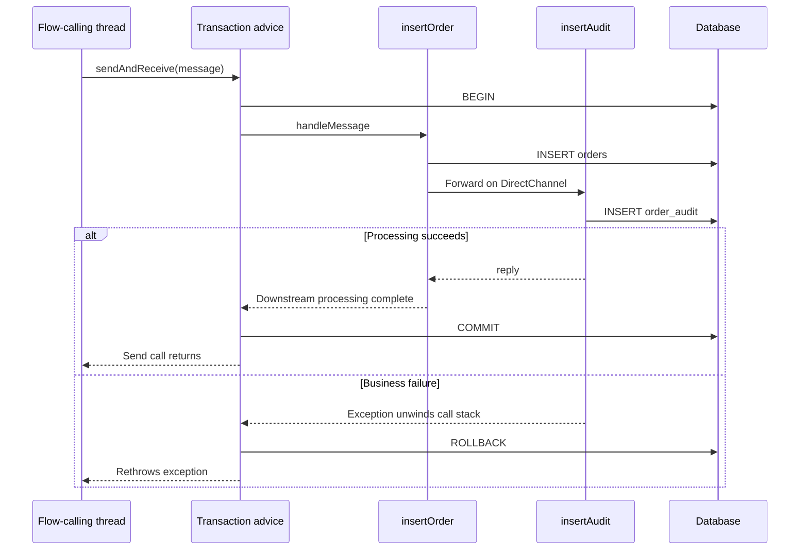

# Testing Transaction Flows

## Objectives and scope

In the **Testing support** chapter of the **SPRING_INTEGRATION_CORE** module, testing a transaction flow means verifying the relationship between `Message` traversal, endpoint execution scope, and data state after processing finishes. A test receiving the right reply does not prove data committed; a test catching an exception does not prove every change rolled back.

This lesson uses `MessageChannel`, service activators, `MessagingTemplate`, and the Java DSL to test an order-writing flow. It then extends test design to gateways, pollers, asynchronous channels, error handling, and stateful integration patterns.

After this lesson, you will be able to:

- Identify where a transaction begins, which resources participate, and where the synchronous scope ends.
- Write tests distinguishing real commits, real rollbacks, and rollbacks created by the test itself.
- Place transaction advice at the right spot for the scope you want to protect.
- Independently verify database state, errors, messages, and redelivery behavior.
- Recognize conclusions that exceed the evidence a test actually provides.

The main examples target Java 17+, Spring Integration 6.5.x, Spring Framework 6.2.x, and JUnit Jupiter. This is an illustrative API baseline, not a requirement to upgrade your project. The lesson focuses on thread-bound imperative JDBC transactions; reactive flows need corresponding transaction management and testing tools.

## 1. Determining what needs to be proved

Suppose a flow receives an order creation request:

```text
ordersInput
    -> insertOrder
    -> insertAudit
    -> reply "ACCEPTED:<orderId>"
```

Both SQL operations must succeed together or be aborted together. `insertAudit` can intentionally throw an exception after executing its SQL statement, letting the test determine whether both writes share the same transaction.

The contract to test has three parts:

| Aspect | On success | On failure after the second SQL operation |
| --- | --- | --- |
| Synchronous processing outcome | Receives reply with matching order ID | Caller receives exception |
| Orders table | One committed row | No row for the failed request |
| Audit table | One committed row | No row for the failed request |
| Pre-existing data | Unchanged | Unchanged |

Counting repository calls only proves code invoked the repository. To conclude anything about commit or rollback, inspect the real resource after the transaction boundary closes.

## 2. Mapping transaction boundaries before writing tests

### 2.1. Same thread is a prerequisite for imperative transaction propagation

`DirectChannel` invokes handlers directly on the message-sending thread. If the caller already has a transaction, receiving JDBC code can join that transaction. `ExecutorChannel` with an asynchronous executor does not propagate the sending thread's transaction to the worker thread; a queue consumed by a poller likewise creates a processing stage detached from the initial send call. See [Message Channel Implementations](https://docs.spring.io/spring-integration/reference/6.5/channel/implementations.html).



The diagram shows the logical scope. In request/reply, the reply may be placed onto the reply channel before commit; in this lesson's synchronous example, `sendAndReceive()` returns only after the send call exits the transaction advice.

### 2.2. Same thread is not enough to put every operation in the same transaction

You must know precisely which call the advice wraps. A plain `TransactionInterceptor` in a request-handler advice chain guards the handler's internal request logic without automatically spanning reply delivery down the rest of the flow. `TransactionHandleMessageAdvice` wraps `handleMessage()`, so it can guard downstream steps that still execute synchronously. You can build this advice via `new TransactionInterceptorBuilder(true)`. See [Transaction Support for message handlers](https://docs.spring.io/spring-integration/reference/6.5/handler-advice/tx-handle-message.html).

A service annotated with `@Transactional` also creates scope only around the proxied service call. Once the service returns and the endpoint forwards the result to the next step, the service's transaction may already have committed. Therefore, tests should inject failures in a downstream endpoint to verify the true scope.

### 2.3. Resources must participate in the right transaction manager

In the example, `DataSourceTransactionManager` and `JdbcTemplate` share the same `DataSource`. `JdbcTemplate` obtains connections through Spring's transaction synchronization mechanism. Opening connections manually with `DataSource.getConnection()` in business code can open an independent connection unless transaction-aware mechanisms are used. See [DataSourceTransactionManager](https://docs.spring.io/spring-framework/docs/6.2.x/javadoc-api/org/springframework/jdbc/datasource/DataSourceTransactionManager.html).

An HTTP request, sent email, or change on an external system does not automatically become a rollbackable JDBC resource. Database tests and external-side-effect tests require separate expectations.

## 3. Preparing a minimal example

The example uses a real in-memory H2 database rather than mocking a transaction manager or repository. Only place illustrative classes in the test source set of a separate practice project; file names in this lesson are suggestions, not files bundled with the documentation.

In a project whose versions are managed by a Spring Boot BOM compatible with the API baseline above, add these dependencies:

```xml
<dependencies>
    <dependency>
        <groupId>org.springframework.boot</groupId>
        <artifactId>spring-boot-starter-integration</artifactId>
    </dependency>
    <dependency>
        <groupId>org.springframework.boot</groupId>
        <artifactId>spring-boot-starter-jdbc</artifactId>
    </dependency>
    <dependency>
        <groupId>com.h2database</groupId>
        <artifactId>h2</artifactId>
        <scope>test</scope>
    </dependency>
    <dependency>
        <groupId>org.springframework.boot</groupId>
        <artifactId>spring-boot-starter-test</artifactId>
        <scope>test</scope>
    </dependency>
</dependencies>
```

This is a dependency snippet to merge into an existing build, not a complete `pom.xml`. If not using Spring Boot, manage compatible versions for `spring-integration-core`, `spring-jdbc`, `spring-tx`, `spring-test`, JUnit Jupiter, and H2.

`spring-integration-test` is only needed when using `@SpringIntegrationTest`, `MockIntegrationContext`, or specialized testing utilities. The synchronous example below uses Spring TestContext and real components, so it does not require Spring Integration's mock framework. See [Testing support](https://docs.spring.io/spring-integration/reference/6.5/testing.html).

## 4. Configuring a flow whose transaction spans downstream

Illustrative configuration class `TxFlowConfig.java`:

```java
package example.integration;

import javax.sql.DataSource;

import org.springframework.context.annotation.Bean;
import org.springframework.context.annotation.Configuration;
import org.springframework.integration.channel.DirectChannel;
import org.springframework.integration.config.EnableIntegration;
import org.springframework.integration.dsl.IntegrationFlow;
import org.springframework.integration.transaction.TransactionInterceptorBuilder;
import org.springframework.jdbc.core.JdbcTemplate;
import org.springframework.jdbc.datasource.DataSourceTransactionManager;
import org.springframework.jdbc.datasource.embedded.EmbeddedDatabase;
import org.springframework.jdbc.datasource.embedded.EmbeddedDatabaseBuilder;
import org.springframework.jdbc.datasource.embedded.EmbeddedDatabaseType;
import org.springframework.messaging.MessageChannel;
import org.springframework.transaction.PlatformTransactionManager;
import org.springframework.transaction.annotation.Propagation;
import org.springframework.transaction.interceptor.TransactionInterceptor;
import org.springframework.transaction.support.TransactionSynchronizationManager;

@Configuration(proxyBeanMethods = false)
@EnableIntegration
public class TxFlowConfig {

    public record Order(String id, boolean failAfterAudit) {
    }

    @Bean(destroyMethod = "shutdown")
    EmbeddedDatabase dataSource() {
        return new EmbeddedDatabaseBuilder()
                .generateUniqueName(true)
                .setType(EmbeddedDatabaseType.H2)
                .build();
    }

    @Bean
    JdbcTemplate jdbcTemplate(DataSource dataSource) {
        JdbcTemplate jdbc = new JdbcTemplate(dataSource);
        jdbc.execute("""
                create table orders (
                    order_id varchar(64) primary key
                )
                """);
        jdbc.execute("""
                create table order_audit (
                    order_id varchar(64) primary key,
                    event_name varchar(32) not null
                )
                """);
        return jdbc;
    }

    @Bean
    PlatformTransactionManager transactionManager(DataSource dataSource) {
        return new DataSourceTransactionManager(dataSource);
    }

    @Bean
    TransactionInterceptor flowTxAdvice(
            PlatformTransactionManager transactionManager) {
        return new TransactionInterceptorBuilder(true)
                .transactionManager(transactionManager)
                .propagation(Propagation.REQUIRED)
                .build();
    }

    @Bean
    MessageChannel ordersInput() {
        return new DirectChannel();
    }

    @Bean
    OrderWriter orderWriter(JdbcTemplate jdbcTemplate) {
        return new OrderWriter(jdbcTemplate);
    }

    @Bean
    IntegrationFlow orderFlow(OrderWriter writer,
                              TransactionInterceptor flowTxAdvice) {
        return IntegrationFlow.from("ordersInput")
                .handle(writer, "insertOrder",
                        endpoint -> endpoint
                                .id("insertOrderEndpoint")
                                .advice(flowTxAdvice))
                .handle(writer, "insertAudit",
                        endpoint -> endpoint.id("insertAuditEndpoint"))
                .get();
    }

    public static class OrderWriter {

        private final JdbcTemplate jdbc;

        public OrderWriter(JdbcTemplate jdbc) {
            this.jdbc = jdbc;
        }

        public Order insertOrder(Order order) {
            requireTransaction();
            jdbc.update("insert into orders(order_id) values (?)",
                    order.id());
            return order;
        }

        public String insertAudit(Order order) {
            requireTransaction();
            jdbc.update("""
                    insert into order_audit(order_id, event_name)
                    values (?, ?)
                    """, order.id(), "CREATED");

            if (order.failAfterAudit()) {
                throw new IllegalStateException("Rejected after audit");
            }
            return "ACCEPTED:" + order.id();
        }

        private static void requireTransaction() {
            if (!TransactionSynchronizationManager
                    .isActualTransactionActive()) {
                throw new IllegalStateException("Missing transaction");
            }
        }
    }
}
```

Key characteristics of this configuration:

- `true` in `TransactionInterceptorBuilder(true)` selects advice wrapping `handleMessage()`. The return type is still `TransactionInterceptor`, yet the constructed instance is `TransactionHandleMessageAdvice`.
- The advice sits on the first endpoint that mutates data. The two endpoints connect via the DSL's default synchronous channel.
- `OrderWriter` does not open transactions itself. Thus, test success depends on the flow's transaction advice.
- `requireTransaction()` is a checkpoint in this learning example. It proves an active transaction exists at each step, while external SQL assertions prove storage outcomes.
- `@EnableTransactionManagement` is unnecessary for advice attached directly via the DSL. That annotation is needed when configuring transactions with `@Transactional` on beans.

The builder API lets you specify an explicit transaction manager and configure propagation; see [TransactionInterceptorBuilder](https://docs.spring.io/spring-integration/docs/6.5.0/api/org/springframework/integration/transaction/TransactionInterceptorBuilder.html). Annotation-driven transaction activation is described in [Using `@Transactional`](https://docs.spring.io/spring-framework/reference/data-access/transaction/declarative/annotations.html).

The schema is initialized directly inside a bean so the example is self-contained without SQL scripts. In real applications, use your project's migration tool. Unique database names isolate separate application contexts, though tests sharing a context must still manage their own data.

## 5. Testing commit and rollback via database state

Illustrative test class `TransactionFlowTest.java`, in the same package as the configuration:

```java
package example.integration;

import org.junit.jupiter.api.BeforeEach;
import org.junit.jupiter.api.Test;
import org.springframework.beans.factory.annotation.Autowired;
import org.springframework.beans.factory.annotation.Qualifier;
import org.springframework.integration.core.MessagingTemplate;
import org.springframework.jdbc.core.JdbcTemplate;
import org.springframework.messaging.Message;
import org.springframework.messaging.MessageChannel;
import org.springframework.messaging.MessagingException;
import org.springframework.messaging.support.GenericMessage;
import org.springframework.test.context.junit.jupiter.SpringJUnitConfig;
import org.springframework.transaction.support.TransactionSynchronizationManager;

import static org.junit.jupiter.api.Assertions.*;

@SpringJUnitConfig(TxFlowConfig.class)
class TransactionFlowTest {

    @Autowired
    @Qualifier("ordersInput")
    MessageChannel input;

    @Autowired
    JdbcTemplate jdbc;

    private MessagingTemplate template;

    @BeforeEach
    void prepare() {
        // The test must not open a transaction wrapping the flow.
        assertNoTransactionOnTestThread();

        jdbc.update("delete from order_audit");
        jdbc.update("delete from orders");

        template = new MessagingTemplate();
        template.setSendTimeout(1_000);
        template.setReceiveTimeout(1_000);
    }

    @Test
    void commitsBothWritesWhenFlowSucceeds() {
        Message<?> reply = template.sendAndReceive(input,
                new GenericMessage<>(
                        new TxFlowConfig.Order("ORD-100", false)));

        assertNotNull(reply);
        assertEquals("ACCEPTED:ORD-100", reply.getPayload());
        assertNoTransactionOnTestThread();

        assertEquals(1, orderCount("ORD-100"));
        assertEquals(1, auditCount("ORD-100"));
        assertEquals("CREATED", jdbc.queryForObject("""
                select event_name from order_audit where order_id = ?
                """, String.class, "ORD-100"));
    }

    @Test
    void rollsBackBothWritesWhenDownstreamFailsAfterSql() {
        MessagingException failure = assertThrows(MessagingException.class,
                () -> template.sendAndReceive(input,
                        new GenericMessage<>(
                                new TxFlowConfig.Order("ORD-200", true))));

        Throwable cause = rootCause(failure);
        assertInstanceOf(IllegalStateException.class, cause);
        assertEquals("Rejected after audit", cause.getMessage());
        assertNoTransactionOnTestThread();

        assertEquals(0, orderCount("ORD-200"));
        assertEquals(0, auditCount("ORD-200"));
    }

    @Test
    void rollsBackNewOrderButKeepsExistingAuditOnConstraintFailure() {
        jdbc.update("""
                insert into order_audit(order_id, event_name)
                values (?, ?)
                """, "ORD-300", "SEEDED");

        assertThrows(MessagingException.class,
                () -> template.sendAndReceive(input,
                        new GenericMessage<>(
                                new TxFlowConfig.Order("ORD-300", false))));

        assertNoTransactionOnTestThread();
        assertEquals(0, orderCount("ORD-300"));
        assertEquals(1, auditCount("ORD-300"));
        assertEquals("SEEDED", jdbc.queryForObject("""
                select event_name from order_audit where order_id = ?
                """, String.class, "ORD-300"));
    }

    private int orderCount(String id) {
        return jdbc.queryForObject(
                "select count(*) from orders where order_id = ?",
                Integer.class, id);
    }

    private int auditCount(String id) {
        return jdbc.queryForObject(
                "select count(*) from order_audit where order_id = ?",
                Integer.class, id);
    }

    private static void assertNoTransactionOnTestThread() {
        assertFalse(TransactionSynchronizationManager
                .isActualTransactionActive());
    }

    private static Throwable rootCause(Throwable error) {
        Throwable result = error;
        while (result.getCause() != null) {
            result = result.getCause();
        }
        return result;
    }
}
```

The test class has no `@Transactional`. When the synchronous call returns or throws, the transaction created by the flow has already finished. Subsequent `JdbcTemplate` queries no longer use the ended transaction; with this H2 setup, they obtain fresh connections for independent reads.

The three tests provide distinct evidence:

1. The success test verifies the reply and that both rows persist after commit.
2. The business-failure test places an error after both SQL statements, checks the exact root cause, and confirms both rows were discarded.
3. The database-constraint test proves the first insert rolled back while data seeded before the transaction remained intact.

`MessagingException` can wrap handler exceptions. Checking the cause in the second test avoids a green test caused by an unrelated configuration error. For SQL error tests needing deeper diagnosis, look for `DataIntegrityViolationException` in the cause chain rather than depending on H2-specific exception names.

Deleting rows in `@BeforeEach` fits a sequential test class that exclusively owns this context's database. If parallel execution is enabled or the context is shared with another class, use separate databases/schemas or test-key-scoped cleanup to prevent tests from deleting each other's data.

## 6. Why can `@Transactional` on a test mask bugs?

Spring TestContext rolls back test transactions by default when a test finishes. This is a convenient cleanup utility, yet easily misleads when the goal is testing application-created transactions. Distinguish **the test's transaction** from **the flow's transaction**. See [Transaction Management in Spring TestContext](https://docs.spring.io/spring-framework/reference/testing/testcontext-framework/tx.html).

Consider a test structured like:

```java
@Test
@Transactional
void insufficientEvidenceOfCommit() {
    template.sendAndReceive(input,
            new GenericMessage<>(new TxFlowConfig.Order("ORD-400", false)));
    assertEquals(1, orderCount("ORD-400"));
}
```

With `REQUIRED` propagation, the flow can join the outer transaction. Assertions see uncommitted writes from that same transaction. Even if the flow's advice were accidentally removed, the test could still pass thanks to the test-managed transaction.

When verifying commit/rollback boundaries, prefer running tests without an outer transaction as in the main example. If test infrastructure requires a transaction, end it explicitly with `TestTransaction.end()` before invoking the flow and inspecting data. Design that alongside the test class's data cleanup rules.

When inside a test-managed transaction and needing to explicitly commit setup data:

```java
// Only use when Spring TestContext has already opened a transaction for the test.
TestTransaction.flagForCommit();
TestTransaction.end();

assertFalse(TestTransaction.isActive());
// From here, invoke the flow to test the transaction created by the application.
```

This snippet requires importing `org.springframework.test.context.transaction.TestTransaction` and must run before the operation under test. Do not treat it as proof that the flow opens a transaction itself.

## 7. Testing flows started by a poller

### 7.1. Placing the transaction around the poll operation

If a flow starts with a poller, the transaction usually needs to span both receiving the message and synchronous downstream processing. This differs fundamentally from placing advice around a single service after already pulling the message from the source. Spring Integration provides transaction support for pollers; see [Transaction Support](https://docs.spring.io/spring-integration/reference/6.5/transactions.html).

The configuration snippet below is a **replacement variant** for `orderFlow` in the main example—do not register both flows simultaneously for the same exercise. It reuses `OrderWriter`, the database, and the transaction manager:

```java
@Bean
QueueChannel queuedOrders() {
    return new QueueChannel(10);
}

@Bean
QueueChannel pollReplies() {
    return new QueueChannel(10);
}

@Bean
QueueChannel pollErrors() {
    return new QueueChannel(10);
}

@Bean
OnlyOnceTrigger orderPollTrigger() {
    return new OnlyOnceTrigger();
}

@Bean
IntegrationFlow polledOrderFlow(OrderWriter writer,
        PlatformTransactionManager transactionManager,
        OnlyOnceTrigger orderPollTrigger) {
    return IntegrationFlow.from("queuedOrders")
            .handle(writer, "insertOrder", endpoint -> endpoint
                    .id("polledOrderEndpoint")
                    .autoStartup(false)
                    .poller(Pollers.trigger(orderPollTrigger)
                            .maxMessagesPerPoll(1)
                            .receiveTimeout(0)
                            .transactional(transactionManager)
                            .errorChannel("pollErrors")))
            .handle(writer, "insertAudit")
            .channel("pollReplies")
            .get();
}
```

This variant needs `spring-integration-test` in test scope, plus imports for `QueueChannel`, `Pollers`, and `org.springframework.integration.test.util.OnlyOnceTrigger`. `OnlyOnceTrigger` is purely for test control. The poller's `.transactional(...)` API configures a transaction for the polling task; see [PollerSpec](https://docs.spring.io/spring-integration/docs/6.5.0/api/org/springframework/integration/dsl/PollerSpec.html).

Do not also attach `flowTxAdvice` to the handler in this variant: what needs proving is the transaction created by the poller. With one message and one poll, outcomes are also easier to tie to a specific request. Do not infer that every configuration pulling multiple messages in one poll cycle equals a single batch transaction; inspect the polling task scope and advice of the real configuration.

### 7.2. Repeatable poller test sequence

A test for the poller variant should follow these steps:

1. Keep `polledOrderEndpoint` stopped while cleaning the database, reply queue, and error queue.
2. Put strictly one message with a dedicated order ID into `queuedOrders` before starting the endpoint.
3. Reset `OnlyOnceTrigger`, then start the endpoint bean via `Lifecycle.start()`.
4. Receive the reply or `ErrorMessage` with a bounded `receive(timeout)`.
5. Wait for a transaction-completion signal or observe committed/rolled-back state using a conditional wait mechanism.
6. Stop the endpoint in `finally` and ensure active tasks finish before cleaning data for the next test.

`OnlyOnceTrigger` curbs unintended polls. If replacing message sources or triggers via `MockIntegrationContext`, restore substituted beans at the end of the test. These tools aid flow control; they do not replace database assertions.

A reply placed on an in-memory `QueueChannel` may be received by the test before the poller finishes committing. Similarly, a latch placed right before `return` in a handler only proves the handler reached that line. When verifying commits, wait for a post-transaction signal or query the database from an independent transaction.

## 8. Data rollback differs from message redelivery

The default `QueueChannel` stores messages in memory. Wrapping a poller in a JDBC transaction does not turn dequeuing from that queue into a rollbackable JDBC operation. Hence, two outcomes can occur together: database writes roll back, yet the message was already removed from the queue. Queue semantics and transaction semantics must be tested separately.

When message recovery needs testing, use a source with transaction or acknowledgment mechanisms matching your application. One option in the Spring Integration ecosystem is a queue backed by `JdbcChannelMessageStore`, configured with the appropriate database schema and query provider. See [JDBC Message Store](https://docs.spring.io/spring-integration/reference/6.5/jdbc/message-store.html).

With a JDBC queue and business logic sharing the same transactional resource, design tests around this contract:

```text
Setup:
    Commit message to the store using a separate setup transaction.

Failing run:
    Poll the message and write data inside the transaction under test.
    Make downstream throw an error, wait for transaction rollback to complete.

Observe:
    No business rows from the failing run.
    Message can still be re-received according to the store's mechanism.

Successful run:
    Reprocess and wait for commit.
    Strictly one business outcome exists, and the message is consumed.
```

Limit or stop automatic consumers before checking whether the message remains in the queue; otherwise a consumer can immediately re-pull it right before your assertion. In this test, "message can be re-received" is a store contract to verify, not a universal assumption for every adapter.

For brokers, add tests against the broker and real acknowledgment/transaction mechanics. Message redelivery and data recovery are two independent outcomes until resource configuration proves they coordinate properly.

## 9. Testing when the flow switches threads

Suppose an asynchronous `ExecutorChannel` is inserted between two operations:

```text
Thread A: BEGIN -> insertOrder -> send to ExecutorChannel -> COMMIT
Thread B:                                  insertAudit -> failure
```

This is a conceptual model; exact execution order across the two threads depends on the executor. What is certain is that you cannot rely on the transaction bound to thread A to protect work on thread B.

For this variant, the test suite must record separately:

- Whether `insertOrder` commits under the transaction scope on thread A.
- Whether thread B has its own transaction when writing the audit record.
- Where thread B's error is observed and which request ID it corresponds to.
- Which business invariants must still hold when the two stages fail independently.

Do not simply swap `DirectChannel` for `ExecutorChannel` in the main example while keeping the expectation that both tables roll back. `requireTransaction()` in the second endpoint helps detect that no transaction is active there. Even if the second endpoint opens its own transaction, a failure there still will not undo the row already committed in the first stage.

If business requirements demand coordinating two stages, design an outbox, compensation flow, or appropriate distributed transaction mechanism. Tests must then verify the invariants of that chosen design—such as an outbox record committing alongside the order and retries causing no duplicate effects. An H2 test for a synchronous flow does not prove such a distributed contract.

## 10. Testing error flows together with transactions

Synchronous errors when sending via `MessageChannel` or `MessagingTemplate` are thrown back to the caller. Setting an `errorChannel` header alone does not turn every `DirectChannel` error into an error message. With asynchronous tasks and scheduled pollers configured with a Spring Integration error handler, errors can be published as `ErrorMessage`s. See [Error Handling](https://docs.spring.io/spring-integration/reference/6.5/error-handling.html).

Therefore, choose observation by entry point:

| Entry point or processing mechanism | Error observation in tests | Additional checks |
| --- | --- | --- |
| Synchronous send to `DirectChannel` | `assertThrows` and cause chain | Data state after call ends |
| Messaging gateway with dedicated error flow | Exception or recovery result per gateway config | Whether recovery hides the error from the transaction scope |
| Scheduled poller | Receive `ErrorMessage` on configured error channel | Transaction state and message in source |
| Async executor | Error channel or completion signal of executor mechanism | Worker's own transaction and previously committed data |

Error-flow tests should verify the business key inside `failedMessage` or error context, rather than only checking "there is an error in the queue". If a recovery component catches an exception inside the transaction scope and returns a normal result, the transaction may no longer see an exception to trigger rollback. If the transaction was already marked rollback-only, the outcome may instead be a rollback or `UnexpectedRollbackException` on commit.

Thus, check **recovery outcome**, **database state**, and **the boundary where errors are caught** together. The existence of an `ErrorMessage` is not independent proof that a rollback occurred.

## 11. Propagation and rollback rules that need separate tests

### 11.1. Propagation changes the atomicity contract

| Propagation | Question to answer with tests |
| --- | --- |
| `REQUIRED` | When an outer transaction exists, does the endpoint join that same transaction? |
| `REQUIRES_NEW` | Does the independent write survive after the outer transaction rolls back? |
| `NESTED` | Does rolling back to a savepoint allow the rest of the outer transaction to continue? |

`REQUIRES_NEW` creates an independent physical transaction. `NESTED` usually relies on savepoints and depends on transaction manager/JDBC driver support. Marking `REQUIRED` rollback-only in an inner scope can cause `UnexpectedRollbackException` when the outer scope tries to commit. See [Transaction Propagation](https://docs.spring.io/spring-framework/reference/data-access/transaction/declarative/tx-propagation.html).

Do not apply "all tables are empty on failure" to a design that intentionally writes history using `REQUIRES_NEW`. Define clearly which rows belong to which transaction, then verify each separately after its respective transaction finishes.

### 11.2. Exceptions at the boundary determine rollback

By default, `RuntimeException` and `Error` trigger rollback; checked exceptions require matching rules if rollback is desired. However, in messaging flows, a business exception may be wrapped in a runtime `MessagingException` before reaching the transaction advice. Evaluate the exception that **the transaction boundary actually sees**, not just the exception signature declared on the business method. See [Rolling Back a Declarative Transaction](https://docs.spring.io/spring-framework/reference/data-access/transaction/declarative/rolling-back.html).

The main example uses `IllegalStateException` for an unambiguous rollback expectation. If the system uses checked exceptions, `rollbackFor`, or `noRollbackFor`, write tests tailored to the exact advice placement and error-propagation path. Do not assume a rule placed on a service bean automatically applies to a separate flow transaction advice.

### 11.3. Retry must align with the defined transaction scope

The two structures below serve different purposes:

```text
Retry outside transaction:
    attempt 1 -> transaction 1 -> rollback
    attempt 2 -> transaction 2 -> commit

Transaction outside retry:
    transaction 1 -> attempt 1 -> attempt 2 -> end transaction 1
```

If each attempt needs a fresh transaction, configure the wrapping order and propagation properly, then prove it with tests. `RequestHandlerRetryAdvice` is a retry tool for a handler, not an automatic guarantee that the entire downstream flow re-runs. See [Provided Advice Classes](https://docs.spring.io/spring-integration/reference/6.5/handler-advice/classes.html).

A useful retry test uses call-controlled failures—for example, failing on the first attempt after a write and succeeding on the next. Assertions should verify attempt counts, final data, and that no changes leaked from the failed attempt. Counting invocations alone does not prove a new transaction was created.

## 12. Observing completion time via synchronization

For work on a worker thread, you can register a `TransactionSynchronization` to signal after commit/rollback. For example, the helper below is called **inside a handler with an active transaction**, using a `CompletableFuture` dedicated to the test request:

```java
static void observeCompletion(
        java.util.concurrent.CompletableFuture<Integer> completion) {
    if (!TransactionSynchronizationManager.isSynchronizationActive()) {
        throw new IllegalStateException("No active synchronization");
    }

    TransactionSynchronizationManager.registerSynchronization(
            new org.springframework.transaction.support.TransactionSynchronization() {
                @Override
                public void afterCompletion(int status) {
                    completion.complete(status);
                }
            });
}
```

The test waits with a bound, then inspects data:

```java
int status = completion.get(3, java.util.concurrent.TimeUnit.SECONDS);
assertEquals(
        org.springframework.transaction.support.TransactionSynchronization
                .STATUS_COMMITTED,
        status);
// Continue reading the database from the test thread with no outer transaction.
```

This is an observation building block, not a complete test: `completion` must be passed or looked up by request key rather than sharing one future across all messages. On the failure branch, expect `STATUS_ROLLED_BACK`. `afterCompletion` reports the transaction outcome, yet does not replace business data checks.

`afterCommit()` runs after commit, so an exception inside that callback cannot undo the committed transaction. If the callback needs to write data with its own commit, open an appropriate transaction scope. See [TransactionSynchronization](https://docs.spring.io/spring-framework/docs/6.2.x/javadoc-api/org/springframework/transaction/support/TransactionSynchronization.html).

Note that completion callbacks may run before all transaction resource cleanup completes. This signal is suitable for knowing commit/rollback status; if you need to shut down the context or tear down infrastructure, still coordinate worker lifecycles.

## 13. How transformers, routers, filters, and aggregators affect tests

Not every endpoint performs a write operation, yet they alter the path toward writes:

| Component | Transaction scenario to check |
| --- | --- |
| Transformer | Does conversion failure happen before or after the first write; is data rolled back within the right scope? |
| Router | Which channel and transaction manager does each branch use; does the selected branch uphold the same business invariants? |
| Filter | Is normal message discard considered a successful outcome or must it throw to roll back prior changes? |
| Aggregator | Where is group state stored; do completion, timeout, and result writing execute in the same transaction? |

For example, if an order is written and a filter subsequently discards the message through normal discard routing, having no reply does not automatically mean the transaction rolls back. Tests must verify the business contract: either accepting commit with discarded status, or configuring rejection via exception to roll back prior writes.

For aggregators, simply sending enough messages and checking output is insufficient. Separate group state, output data, and timeout tasks; inject failures at each stage that must be protected. A transaction on the final message does not automatically cover all previously committed message arrivals either.

## 14. Avoiding false-green and time-dependent tests

| Insufficient check | Why conclusions can be wrong | How to add evidence |
| --- | --- | --- |
| Only `verify(repository).save(...)` | Does not tell if changes committed | Query the real resource after the transaction ends |
| Only checking reply | Reply can be sent before commit in async flows | Wait for transaction completion and read data independently |
| Only `assertThrows` | Failure might occur before SQL or due to misconfiguration | Check root cause and data at each step |
| Test with `@Transactional` reading back | May read uncommitted data from test transaction | Remove outer transaction from boundary tests |
| `Thread.sleep(500)` | Does not prove task or transaction finished | Wait on events or state with a deadline |
| Empty queue after failure | Message might be lost even though data rolled back | Verify the source's redelivery contract |
| Cleaning data while worker runs | Worker may write rows after cleanup | Coordinate stopping and waiting for task completion |
| Replacing advised endpoint with mock | Can accidentally remove the exact boundary under test | Keep real transaction configuration in the test |

Do not use `assertTimeoutPreemptively()` to wrap code relying on a transaction bound to the test thread: running on another thread alters the context under test. `MessagingTemplate` timeouts also do not forcefully abort a running synchronous handler; distinguish channel/reply wait times from transaction timeouts and overall test timeouts.

With JPA, add `flush` where SQL errors must be detected and avoid using a stale persistence context to infer post-commit state. With H2, the main test verifies atomicity of two JDBC statements in the illustrative configuration; specific behaviors such as isolation, locks, deadlocks, or redelivery require additional tests against your application's actual database/broker.

## 15. Minimum evidence checklist for reading test results

Before concluding a transaction flow works properly, cross-check these questions against concrete assertions:

1. **Who opened the transaction?** The test, gateway/service, handler advice, or poller?
2. **How far does it protect?** Internal method, entire `handleMessage()`, or polling task?
3. **Which resources participate?** Do they use the right transaction manager and connection?
4. **Where is the failure placed?** Was at least one rollback-worthy change made before the error occurred?
5. **When is observation performed?** Has the transaction ended or was only a reply received?
6. **Which outcomes were proved?** Commit, rollback, recovery, message redelivery, or duplicate-processing protection?

In the main example, three tests prove atomicity of two writes in a synchronous flow, on the same `DataSource`, with transaction advice placed on the first endpoint. When changing channels, propagation, message sources, or error-handling mechanisms, update the test contract to match the new boundaries.
