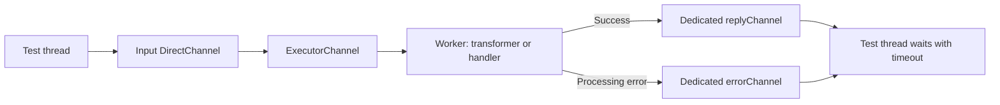

# Testing Asynchronous Flows

In the **Testing support** chapter of the **SPRING_INTEGRATION_CORE** module, testing an asynchronous flow verifies that a message is processed properly when the sender and business endpoints may execute on different threads. This lesson uses `Message`, `MessageChannel`, endpoints, and the Java DSL to connect input conditions to observable outcomes.

Key point to remember from the start: **sending a message successfully and completing business processing are two distinct events**. A reliable test must wait for the right completion event, enforce a time bound, and identify which test run a message belongs to.

After this lesson, you will be able to:

- Identify asynchronous boundaries in an integration flow.
- Write tests for success and failure branches using dedicated observation channels.
- Choose between `QueueChannel.receive(timeout)`, Awaitility, and Java synchronization primitives.
- Verify multiple messages without depending on completion order.
- Design tests for routers, filters, aggregators, and gateways with asynchronous processing.
- Recognize causes of flaky tests, especially on CI or under parallel execution.

## 1. Determining what is actually asynchronous

### 1.1. Tracing the message path

Do not infer a flow is asynchronous merely because a method is named `send`, uses a gateway, or has multiple endpoints. Identify which component hands work off to another thread.

| Component | Implication for test design |
| --- | --- |
| `DirectChannel` | Subscriber is invoked on the sending thread. Until an async boundary is crossed downstream, handler execution happens inside `send`. |
| `ExecutorChannel` | Hands work off to an executor. Processing outcomes must be observed independently of the send result. |
| `QueueChannel` | Buffers messages for another party to pull. A queue creates no consumer on its own; either the test calls `receive` or a polling endpoint consumes it. |

Channel execution semantics are described in [Message Channel Implementations](https://docs.spring.io/spring-integration/reference/7.0/channel/implementations.html). With `ExecutorChannel`, the actual executor determines how work runs; for example, a synchronous executor still runs on the calling thread. See also [ExecutorChannel API](https://docs.spring.io/spring-integration/api/org/springframework/integration/channel/ExecutorChannel.html).

Example path of a request:



Once work is handed to the executor, the test thread and worker can progress independently. A worker can also execute very quickly and finish before `send` returns; tests must not depend on a relative ordering not guaranteed by the contract.

### 1.2. Writing the test contract before choosing tools

For a flow normalizing product names, the contract might be:

1. The input accepts a string and a test-run identifier.
2. Valid strings are trimmed and converted to uppercase.
3. The result retains the input identifier.
4. Whitespace-only strings trigger a business error.
5. Errors can be traced back to the failing message.
6. Every wait finishes within a bounded time.

If business logic requires writing to a database, define the completion event even more clearly: handler started, SQL write executed, transaction committed, or row visible from another transaction. Pick the observation point matching the flow's guarantee.

A reply message emitted before a transaction commits is not sufficient proof that data was persisted.

## 2. Choosing how to wait based on the outcome type

| What to observe | Suitable tool | What to avoid |
| --- | --- | --- |
| Output or error message | `QueueChannel.receive(timeout)` | Calling `receive()` without a timeout in tests |
| State in repository or test double | Awaitility re-reading state | Re-running the send operation inside the wait condition |
| Worker reached a checkpoint | `CountDownLatch` with timeout | Using sleep duration as a signal that a worker arrived |
| Result of a `Future`-returning API | `get(timeout, unit)` | Waiting forever or only checking `isDone()` |
| No output allowed during an interval | Bounded observation window plus signal that input was processed | Concluding from a single instantaneous read |

### 2.1. Why does `Thread.sleep` make tests unstable?

The pattern below couples test correctness to machine speed:

```java
input.send(request);
Thread.sleep(100);
assertEquals("DONE", observedStatus);
```

If the worker is not scheduled within 100 ms, the test fails even though the logic is right. If the system finishes in 2 ms, the test still wastes the full 100 ms. Sleeping also does not substitute for cross-thread memory visibility; a plain field does not automatically become a safe state-sharing channel.

Wait on a meaningful condition and bound the wait time. For instance, `receive(2_000)` returns immediately when a message arrives, or returns `null` when the timeout expires. On `QueueChannel`, a timeout of `0` is an immediate poll; parameterless `receive()` can wait indefinitely. See [send and receive semantics](https://docs.spring.io/spring-integration/reference/7.0/channel/implementations.html).

### 2.2. Separating timeout types

Three bounds serve three purposes:

- **Send timeout:** bounds delivering a message to a channel when the channel supports waiting; it is not a business-completion deadline.
- **Result timeout:** bounds how long the test waits for a result or condition.
- **Overall test timeout:** stops a test from hanging due to misconfiguration or a missed wait.

A 2-second timeout in the examples below is an illustrative test budget. When adopting in a project, choose a budget based on expected flow latency and CI resources. Returning a result within that budget is not a performance benchmark or proof of tail latency percentiles.

Do not assume every `MessageChannel` honors timeout parameters identically. In particular, a timeout passed to `send` cannot turn a long-running synchronous handler into an operation aborted on time.

## 3. Complete example: testing a transformer running via an executor

### 3.1. Scope and dependencies

The example uses JUnit Jupiter, Spring Test, and the Spring Integration Java DSL. Place the following class in the test source set of a project with the matching dependencies:

```text
org.springframework.integration:spring-integration-core
org.springframework:spring-test                 (test)
org.junit.jupiter:junit-jupiter                 (test)
```

Use compatible versions managed by your project's BOM or dependency management. The Java DSL is included in `spring-integration-core`; this example requires no separate DSL artifact.

The test class needs no Spring Boot, broker, or database. It keeps a real executor to test the asynchronous boundary itself. The configuration is a minimal teaching flow; in real applications, import the production flow configuration to avoid maintaining a copy that drifts from production.

### 3.2. Configuration and two foundational tests

```java
package example.integration.testing;

import java.util.Locale;
import java.util.UUID;

import org.junit.jupiter.api.Test;

import org.springframework.beans.factory.annotation.Autowired;
import org.springframework.beans.factory.annotation.Qualifier;
import org.springframework.context.annotation.Bean;
import org.springframework.context.annotation.Configuration;
import org.springframework.integration.channel.DirectChannel;
import org.springframework.integration.channel.QueueChannel;
import org.springframework.integration.config.EnableIntegration;
import org.springframework.integration.dsl.IntegrationFlow;
import org.springframework.messaging.Message;
import org.springframework.messaging.MessageChannel;
import org.springframework.messaging.MessagingException;
import org.springframework.messaging.support.ErrorMessage;
import org.springframework.messaging.support.MessageBuilder;
import org.springframework.scheduling.concurrent.ThreadPoolTaskExecutor;
import org.springframework.test.context.junit.jupiter.SpringJUnitConfig;

import static org.junit.jupiter.api.Assertions.*;

@SpringJUnitConfig(AsyncFlowTest.FlowConfig.class)
class AsyncFlowTest {

    private static final long RESULT_TIMEOUT_MS = 2_000;

    @Autowired
    @Qualifier("asyncInput")
    private MessageChannel input;

    @Test
    void shouldReplyWithNormalizedPayloadOnWorkerThread() {
        QueueChannel replies = new QueueChannel(10);
        QueueChannel errors = new QueueChannel(10);
        String testCaseId = UUID.randomUUID().toString();
        String callerThread = Thread.currentThread().getName();

        Message<String> request = request(
                "  spring integration  ", testCaseId, replies, errors);

        assertTrue(input.send(request, 500), "Failed to deliver input message");

        Message<?> reply = replies.receive(RESULT_TIMEOUT_MS);

        assertNotNull(reply, "No reply received for " + testCaseId);
        assertEquals("SPRING INTEGRATION", reply.getPayload());
        assertEquals(testCaseId, reply.getHeaders().get("testCaseId"));

        String handledBy = reply.getHeaders().get("handledBy", String.class);
        assertNotNull(handledBy);
        assertTrue(handledBy.startsWith("si-test-"));
        assertNotEquals(callerThread, handledBy);

        // Only checks state at the moment the reply was received.
        assertNull(errors.receive(0), "An error was emitted on the success branch");
    }

    @Test
    void shouldPublishFailureForBlankPayload() {
        QueueChannel replies = new QueueChannel(10);
        QueueChannel errors = new QueueChannel(10);
        String testCaseId = UUID.randomUUID().toString();

        Message<String> request = request("   ", testCaseId, replies, errors);

        assertTrue(input.send(request, 500), "Failed to deliver input message");

        Message<?> observed = errors.receive(RESULT_TIMEOUT_MS);
        assertNotNull(observed, "No error received for " + testCaseId);

        ErrorMessage errorMessage = assertInstanceOf(ErrorMessage.class, observed);
        MessagingException failure = assertInstanceOf(
                MessagingException.class, errorMessage.getPayload());

        Message<?> failedMessage = failure.getFailedMessage();
        assertNotNull(failedMessage);
        assertEquals(testCaseId, failedMessage.getHeaders().get("testCaseId"));
        assertEquals("   ", failedMessage.getPayload());

        Throwable root = rootCause(failure);
        assertInstanceOf(IllegalArgumentException.class, root);
        assertEquals("payload must not be blank", root.getMessage());

        // Does not assert across all future points in time.
        assertNull(replies.receive(0));
    }

    private static Message<String> request(
            String payload,
            String testCaseId,
            MessageChannel replies,
            MessageChannel errors) {

        return MessageBuilder.withPayload(payload)
                .setHeader("testCaseId", testCaseId)
                .setReplyChannel(replies)
                .setErrorChannel(errors)
                .build();
    }

    private static Throwable rootCause(Throwable failure) {
        Throwable current = failure;
        while (current.getCause() != null
                && current.getCause() != current) {
            current = current.getCause();
        }
        return current;
    }

    @Configuration
    @EnableIntegration
    static class FlowConfig {

        @Bean
        MessageChannel asyncInput() {
            return new DirectChannel();
        }

        @Bean
        ThreadPoolTaskExecutor flowExecutor() {
            ThreadPoolTaskExecutor executor = new ThreadPoolTaskExecutor();
            executor.setCorePoolSize(2);
            executor.setMaxPoolSize(2);
            executor.setQueueCapacity(20);
            executor.setThreadNamePrefix("si-test-");
            executor.setWaitForTasksToCompleteOnShutdown(true);
            executor.setAwaitTerminationSeconds(5);
            return executor;
        }

        @Bean
        IntegrationFlow normalizeFlow(
                @Qualifier("flowExecutor") ThreadPoolTaskExecutor executor) {

            return IntegrationFlow.from("asyncInput")
                    .channel(channels -> channels.executor(executor))
                    .enrichHeaders(headers -> headers.headerFunction(
                            "handledBy",
                            message -> Thread.currentThread().getName()))
                    .transform(String.class, text -> {
                        String normalized = text.trim();
                        if (normalized.isEmpty()) {
                            throw new IllegalArgumentException(
                                    "payload must not be blank");
                        }
                        return normalized.toUpperCase(Locale.ROOT);
                    })
                    .get();
        }
    }
}
```

### 3.3. Why does the example use dedicated channels per test?

Each test creates two local `QueueChannel` instances and attaches them to the `replyChannel` and `errorChannel` headers. Other tests hold no reference to these queues, so they cannot accidentally consume the wrong reply. `MessageBuilder` provides `setReplyChannel` and `setErrorChannel` directly; see [MessageBuilder API](https://docs.spring.io/spring-framework/docs/current/javadoc-api/org/springframework/messaging/support/MessageBuilder.html).

The flow configures no fixed output channel at the end. Transformer output returns via the request's `replyChannel`. If the real flow already has an explicit output channel, observe that channel or use an appropriate observation branch; adding the header does not override a configured output channel.

The `testCaseId` header is a correlation header for matching in this example; it does not replace an aggregator's correlation/sequence headers.

### 3.4. Why set the worker-name header after `ExecutorChannel`?

If you capture the thread name before the executor boundary, the header only records the sending thread. In the configuration above, the header is computed in an endpoint after the executor and before the transformer. Checking the thread name therefore confirms this flow segment ran on a worker from the illustrative configuration.

`headerFunction` evaluates a callback when processing the message; see [HeaderEnricherSpec API](https://docs.spring.io/spring-integration/api/org/springframework/integration/dsl/HeaderEnricherSpec.html). Do not turn thread names into business data or make production tests depend on a specific thread prefix.

`ThreadPoolTaskExecutor` is a Spring-managed bean, so Spring initializes and shuts down the executor with the context lifecycle. Do not call `initialize()` extra times inside the `@Bean` method, and do not call `shutdown()` inside individual tests when tests share a context.

The queues in this example are in-memory observation points. They do not simulate data durability, broker acknowledgments, or recovery after a process stops.

## 4. Testing errors beyond the asynchronous boundary

### 4.1. Why `assertThrows` around `send` usually misses the target

The pattern below does not properly observe business errors occurring in a worker:

```java
// Do not use to test handler errors occurring after handoff to the executor.
assertThrows(IllegalArgumentException.class, () -> input.send(request));
```

With the default error-handling mechanism of compatible asynchronous components, Spring Integration publishes an `ErrorMessage`. The request's `errorChannel` header is used first; when absent, the global `errorChannel` is used. That is why the example passes a dedicated error channel upfront. See [Error Handling](https://docs.spring.io/spring-integration/reference/7.0/error-handling.html).

Tests on the error branch should verify separately:

- The error message was received within the timeout.
- The error message payload has the expected type.
- The business root cause matches.
- `failedMessage` holds the payload and identifier of the input under test.

Do not assume the input identifier sits directly in the outer headers of `ErrorMessage`. The example navigates via `MessagingException.getFailedMessage()`.

### 4.2. Distinguishing processing errors from handoff errors

An error happening before work is handed off—such as an executor rejecting a task—can still surface directly on the sending thread. Tests for overload scenarios should observe dispatch failures per the specific executor and channel configuration.

Similarly, do not mechanically apply worker rules to a handler running entirely on a `DirectChannel`. Error propagation depends on where the failure happens.

If the application uses retries, a recovery callback, or a custom error handler, identify the final outcome promised by that configuration: fallback return, error emission, dead-lettering, or silent termination. Tests must assert that promised final outcome.

## 5. Testing multiple messages when completion order varies

A thread pool with multiple workers does not guarantee an earlier-sent message finishes first. Therefore, positional assertions like `reply1 == request1`, `reply2 == request2` can fail under valid scheduling.

With the normalization flow above, match by identifier instead. The snippet below can be added as a test method in `AsyncFlowTest`. Add imports:

```java
import java.util.HashMap;
import java.util.Map;
import java.util.concurrent.TimeUnit;
```

```java
@Test
void shouldReturnAllResultsRegardlessOfCompletionOrder() {
    QueueChannel replies = new QueueChannel(20);
    QueueChannel errors = new QueueChannel(20);

    String runId = UUID.randomUUID().toString();
    Map<String, String> expected = Map.of(
            runId + "-1", "ALPHA",
            runId + "-2", "BETA",
            runId + "-3", "GAMMA");

    for (Map.Entry<String, String> entry : expected.entrySet()) {
        String payload = " " + entry.getValue().toLowerCase(Locale.ROOT) + " ";
        assertTrue(input.send(
                request(payload, entry.getKey(), replies, errors), 500));
    }

    // One deadline for the whole receive phase, not 2 seconds per message.
    long deadline = System.nanoTime() + TimeUnit.SECONDS.toNanos(2);
    Map<String, String> actual = new HashMap<>();

    while (actual.size() < expected.size()) {
        long remainingNanos = deadline - System.nanoTime();
        assertTrue(remainingNanos > 0, "Missing results: " + actual);

        long remainingMillis = Math.max(
                1, TimeUnit.NANOSECONDS.toMillis(remainingNanos));
        Message<?> reply = replies.receive(remainingMillis);
        assertNotNull(reply, "Wait timed out, received: " + actual);

        String id = reply.getHeaders().get("testCaseId", String.class);
        assertNotNull(id);
        assertTrue(expected.containsKey(id), "Received ID outside input set: " + id);
        assertFalse(actual.containsKey(id), "Received duplicate ID: " + id);
        actual.put(id, assertInstanceOf(String.class, reply.getPayload()));
    }

    assertEquals(expected, actual);
    assertNull(errors.receive(0));
    assertNull(replies.receive(0));
}
```

`HashMap` in the example is updated solely by the test thread after pulling messages from the queue, so it is not shared between workers and the test.

The deadline uses `System.nanoTime()` to track elapsed time. If every receive waited a full 2 seconds, a test expecting 100 messages could spend nearly 200 seconds before failing.

This test verifies the result set, detects unexpected IDs, and catches duplicate messages arriving during the collection loop. The final `receive(0)` only catches extra messages already present. It does not prove the system cannot emit a late duplicate afterward.

If the business contract requires guaranteeing no duplicates over an interval, add a predefined observation window or assert the corresponding idempotency state.

## 6. Waiting for side effects with Awaitility

Not every flow returns a message. A terminal endpoint may update state and finish.

Consider a test double storing status in a `ConcurrentHashMap<String, String>`. The worker executes `statuses.put(testCaseId, "DONE")` after the operation under test, while the test only reads status. The wait can be written:

```java
import java.time.Duration;
import java.util.concurrent.ConcurrentHashMap;

import static org.awaitility.Awaitility.await;
import static org.junit.jupiter.api.Assertions.assertEquals;

// statuses is the same instance injected into the flow's handler.
ConcurrentHashMap<String, String> statuses = new ConcurrentHashMap<>();

// After configuring the handler to use statuses and sending a request carrying testCaseId:
await()
        .alias("Completion status for " + testCaseId)
        .pollDelay(Duration.ZERO)
        .pollInterval(Duration.ofMillis(25))
        .atMost(Duration.ofSeconds(2))
        .untilAsserted(() ->
                assertEquals("DONE", statuses.get(testCaseId)));
```

This snippet illustrates the waiting technique, not a full test class replacing the section 3 example. It requires `org.awaitility:awaitility` in test scope. `untilAsserted` retries the assertion until it passes or times out; see [Awaitility Usage](https://github.com/awaitility/awaitility/wiki/Usage).

The wait condition should only read data. If you put `input.send(request)` inside the retried lambda, every poll cycle submits another request. If you put `receive(0)` and check multiple conditions in the same lambda, a failed poll attempt can consume and lose the message from the queue.

Practical choices:

- Use `receive(timeout)` when the primary outcome is a message.
- Use Awaitility when observing re-readable state.
- Use thread-safe data structures or clear synchronization in test doubles.
- Keep a separate error observation path when success may never appear due to worker failure.

Errors handled by Spring Integration and routed to an error channel do not necessarily become uncaught exceptions visible to the waiting tool. Therefore, timeouts on success conditions should be diagnosed alongside information from the error branch.

With a real repository, each read must be able to observe committed data. A persistence context caching stale entities or a read transaction holding a fixed snapshot can make the test repeatedly read old state.

## 7. Proving asynchronous handoff without relying on machine speed

Checking the thread name in section 3 confirmed where execution ran. To prove the caller can continue while the handler has not finished, use a test-controlled handler.

A common design uses two `CountDownLatch` instances:

1. `entered` initialized to 1; the handler calls `countDown()` on entry.
2. `release` initialized to 1; the handler awaits this latch with a timeout before finishing.
3. The test calls `send`, awaits `entered`, and verifies no result has appeared yet.
4. The test releases `release` and awaits the final result.

Coordination pattern on the test thread:

```java
try {
    assertTrue(input.send(request, 500));

    assertTrue(entered.await(1, TimeUnit.SECONDS),
            "Handler has not reached the checkpoint");

    // Valid because the handler is deliberately held before reply creation.
    assertNull(replies.receive(0));

    release.countDown();
    assertNotNull(replies.receive(2_000));
}
finally {
    // Always release the worker even if an assertion above fails.
    release.countDown();
}
```

This snippet assumes the test injected a controllable handler sharing both latches with the test and pausing before creating the reply. The handler itself must await `release` with `await(timeout, unit)`, signal an error on expiry, and restore the interrupt flag when catching `InterruptedException`.

`CountDownLatch` establishes a happens-before synchronization between `countDown()` and the corresponding `await()` completion. Latches are not reusable; create fresh ones per test run. See [CountDownLatch, Java API](https://docs.oracle.com/en/java/javase/21/docs/api/java.base/java/util/concurrent/CountDownLatch.html).

When testing against accidental synchronous execution, also give the `send` call an overall test timeout or invoke it from a task with `Future.get(timeout, unit)`. The `500` argument in `send(request, 500)` does not interrupt a handler blocked on the calling thread. Handler timeouts help release resources, yet do not replace an overall scenario bound.

## 8. Testing "no message" and filters

### 8.1. Instantaneous reads speak only about the present

The snippet below can pass even if the handler has not run yet:

```java
input.send(request);
assertNull(replies.receive(0));
```

It only states the queue was empty at the instant of the read.

Even `assertNull(replies.receive(300))` only confirms no message arrived during a 300 ms wait. It does not prove a message won't appear at the 2-second mark.

To test that a filter rejected an input, observe a positive signal that the input was evaluated—such as the message arriving at a discard channel.

### 8.2. Using the discard channel as an observation point

An illustrative DSL snippet:

```java
.filter(String.class,
        text -> !text.isBlank(),
        endpoint -> endpoint.discardChannel("rejected"))
```

Tests for invalid inputs can:

1. Attach a unique identifier to the request.
2. Wait for the matching message on the `rejected` channel.
3. Verify the payload or rejection reason per contract.
4. Observe the success channel over a defined window if checking for no late output.

If a flow intentionally drops messages without replying, a request-reply gateway needs an appropriate timeout. Do not leave a test waiting indefinitely for a reply from a business branch that intentionally produces none.

Distinguish "was discarded" from "was never processed". A clear discard or completion signal lets tests tell those two cases apart.

## 9. Extending to routers, aggregators, and gateways

### 9.1. Router: verifying the right branch and right message

For an order-classifying router, attach dedicated observation channels to the branches under test. Send an input with an identifier, receive the outcome on the expected branch, and check the payload and headers.

When checking unselected branches, still specify the observation window. If another flow shares the same output channel, separate by correlation or use dedicated queues to avoid grabbing the wrong message.

A minimal test suite should include inputs reaching each valid branch and an input matching no branch per router configuration.

### 9.2. Aggregator: verifying the group contract

An aggregator holds group state, so tests must check both correlation and release conditions. The default mechanism uses correlation headers to group and sequence info to determine completeness; see [Aggregator](https://docs.spring.io/spring-integration/reference/aggregator.html).

For a three-part group, a meaningful scenario is:

- Send parts in order 3, 1, 2.
- Assert output once the release condition is met.
- Verify members inside the result per the application contract.
- Interleave two groups to prove data does not mix.
- Test an incomplete group and observe configured timeout/discard behavior.

Each test needs its own correlation key. If the flow uses a shared message store, draining the output queue does not clear remaining group state.

Do not assume the output payload preserves the order of `send` calls. If ordering is a business requirement, configure an order-preserving mechanism and test that exact mechanism.

### 9.3. Gateway: separating caller API from flow execution model

A gateway returning a regular type can block waiting for a reply while downstream processing runs on a worker. "Asynchronous flow" does not mean "gateway method always returns immediately".

When testing a gateway, clarify:

- Whether the API is one-way, request-reply, or returns a `Future`.
- Request-delivery bounds and reply-wait bounds.
- Behavior on timeout: return value or configured exception.
- Whether worker errors propagate to the caller or to an error flow.

A gateway's `replyTimeout` applies during the reply-wait phase; it is not a mechanism for arbitrarily aborting a synchronous handler running before the caller reaches that phase. See [Messaging Gateways — timeouts](https://docs.spring.io/spring-integration/reference/gateway.html).

If the API returns a `Future`, call `get(timeout, unit)` and verify both results and failure causes. Timing out on the caller side also does not automatically prove the background task was canceled.

## 10. Keeping asynchronous boundaries when isolating external systems

You can replace HTTP services, repositories, or external clients with test doubles so tests run fast with deterministic data. However, if the goal is testing an asynchronous flow, keep the channels, executors, and endpoint wiring under verification intact.

Replacing `ExecutorChannel` with `DirectChannel` can help a separate unit test of transformation logic, yet that test no longer verifies thread handoff, async error propagation, or shared-state risks.

When substituting an endpoint inside a real context, `spring-integration-test` provides `@SpringIntegrationTest` and `MockIntegrationContext`. `noAutoStartup` can stop inbound endpoints from starting automatically; substitution APIs take the corresponding endpoint names. Afterward, `resetBeans()` restores replaced beans. See [Testing support — Spring Integration and the Test Context](https://docs.spring.io/spring-integration/reference/testing.html).

Illustrative configuration skeleton for an application with an inbound endpoint named `ordersInbound`:

```java
@SpringJUnitConfig(ProductionFlowConfig.class)
@SpringIntegrationTest(noAutoStartup = "ordersInbound")
class OrderFlowTest {
    // Inject the input channel to actively send test data.
    // If substituting endpoints with MockIntegrationContext,
    // restore with resetBeans() after the test.
}
```

This is an outline for production configuration, not a direct addition to `AsyncFlowTest`; `ProductionFlowConfig` and `ordersInbound` must exist in the application.

For polling endpoints, tests should control the polling schedule and start/stop timing explicitly. Do not let a long production interval dictate test duration. Only suppress the data-producing source when the test still needs downstream consumers active.

## 11. Isolating state and lifecycles

### 11.1. A shared context does not mean data refreshes automatically

Spring Test may reuse an application context across compatible tests. The following components can therefore retain state:

| Component | Possible leftover data | Appropriate isolation |
| --- | --- | --- |
| Shared output channel | Unconsumed messages | Dedicated queues or non-competing correlation matching |
| Aggregator/message store | Unreleased groups or retained completed groups | Distinct correlation keys, scenario-managed store |
| Test double/repository | Records and call counts | Test-ID-scoped data and reset after workers finish |
| Executor | Submitted tasks still running | Wait for related tasks to complete before cleaning state |
| Substituted endpoint | Previous test's handler/source | Restore after test |

Draining a queue in `@BeforeEach` only clears messages present at that moment. A worker from an earlier test may still emit results into the queue afterward.

If tests run in parallel sharing a single queue, one test can steal another test's message before checking correlation. "Read and discard non-matching IDs" does not solve this contention. Dedicated queues or a centralized ID-dispatching observer is usually cleaner.

Use `@DirtiesContext` only when context mutations or hard-to-isolate state genuinely require it; recreating the context for every test slows down the suite without fixing broken waiting contracts.

### 11.2. Transactions and shared data do not automatically travel with messages

An executor boundary does not propagate a transaction bound to the sending thread onto the worker. Thus, test data created inside an uncommitted `@Transactional` test transaction may be invisible to the handler's transaction.

Commit setup data beforehand or align transaction lifecycles with the scenario. Data written by a worker in its own transaction also needs explicit cleanup; do not assume the test thread's rollback will erase it.

Do not mutate a mutable payload right after `send` while a worker may still be reading that same object. Prefer immutable payloads or explicit copies when testing asynchronous behavior.

## 12. Diagnosing failed tests

| Symptom | First thing to check |
| --- | --- |
| Timed out with no reply | Wrong output/reply channel, filter/router branch, error went to error channel |
| `send` succeeded yet no side effects | Worker not running, task stuck, or test observes wrong completion milestone |
| Passes locally, fails on CI | Fixed sleep, under-budgeted timeout, state contention, or executor capacity |
| Occasionally receives another test's payload | Shared queue or un-isolated correlation |
| Wrong result order | Test enforces ordering the flow does not guarantee |
| `assertThrows` misses handler error | Error occurred beyond an executor boundary |
| Test hangs | Unbounded wait, held handler, full queue, or missing resource release |
| Repository repeatedly returns stale data | Uncommitted transaction, read snapshot, or stale persistence context |
| Aggregator group never releases | Wrong correlation/sequence or release strategy unsatisfied |

On timeout, helpful diagnostics include test ID, expected payload, received results, observed endpoints, and corresponding errors. When reading an error queue for diagnostics, remember `receive` removes messages from the queue; capture the error message before building the failure report.

Do not immediately raise timeouts to mask every bug. First determine how far the message got and which event the test is awaiting. Only adjust budgets when the delay is genuinely valid for the scenario.

## 13. Practice exercises

1. Add a router classifying strings by prefix, keep the real executor, and write tests for both branches with distinct identifiers. State clearly how the unselected branch is observed.
2. Add a filter rejecting blank strings to the flow, wire a discard channel, and assert the rejection signal using a bounded wait.
3. Build an aggregator grouping three messages per order, interleave two orders, and verify groups do not mix. Add a missing-part scenario per your chosen timeout policy.
4. Replace the terminal endpoint with a test double recording thread-safe state, use read-only Awaitility checks, and keep a dedicated error channel for diagnostics.
5. Use a latch-controlled handler to hold the worker at a checkpoint, confirm the sender can proceed, and release the worker in `finally`.

For each exercise, specify inputs, what event counts as completion, message-matching logic, wait bounds, and state cleanup. That design discipline keeps test outcomes meaningful even when thread scheduling varies.
