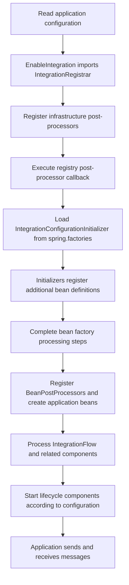

# IntegrationConfigurationBeanFactoryPostProcessor

## 1. Objectives and Lesson Scope

In the **SPRING_INTEGRATION_CORE** module, message flows are described using `Message`, `MessageChannel`, endpoints, gateways, and Java DSL. For these components to work together properly, Spring must prepare the infrastructure during `ApplicationContext` initialization. This lesson belongs to the **Configuration and Lifecycle** chapter and focuses on the `IntegrationConfigurationBeanFactoryPostProcessor` class and the infrastructure extension mechanism it orchestrates.

After this lesson, learners will be able to:

- Identify at which stage of context initialization this class runs.
- Distinguish between `BeanDefinition` registration, bean instance processing, and endpoint startup.
- Explain the relationship between `@EnableIntegration`, `IntegrationConfigurationInitializer`, and `META-INF/spring.factories`.
- Observe a Java DSL flow after the context finishes initializing.
- Write a minimal initializer for a shared integration library and diagnose initializer discovery errors.

Prerequisites: `@Configuration`, `@Bean`, dependency injection, the bean definition concept, and a simple Java DSL flow.

**Version baseline:** detailed implementation analysis is referenced against Spring Integration **6.5.0** source code; examples use Java 17 or later and the API of this line. This is a fixed baseline for reading the source code, not a claim about the latest version. When practicing in another project, use a compatible Spring dependency set managed by a BOM or Spring Boot, and verify internal details against the actual version.

## 2. Role of the Class in the Configuration Architecture

The fully qualified name of the class is:

```text
org.springframework.integration.config.IntegrationConfigurationBeanFactoryPostProcessor
```

The class implements `BeanDefinitionRegistryPostProcessor`, an interface extending `BeanFactoryPostProcessor`. It loads implementations of `IntegrationConfigurationInitializer` to add Integration infrastructure configuration. This API has existed since Spring Integration 4.0. [Class Javadoc](https://docs.spring.io/spring-integration/docs/6.0.x/api/org/springframework/integration/config/IntegrationConfigurationBeanFactoryPostProcessor.html).

A bean definition can be understood as a blueprint describing how to create a bean: implementation class, constructor arguments, references to other beans, and related attributes. A bean instance is the object created from that blueprint.

An initializer can register the definition of another post-processor. Spring will detect and use that post-processor in the next appropriate phase. Therefore, the system can add Java DSL or converter processing capabilities before creating regular application beans. The `BeanDefinitionRegistryPostProcessor` contract allows registering additional bean definitions before regular `BeanFactoryPostProcessor` beans are detected. [Javadoc on the registry phase](https://docs.spring.io/spring-framework/docs/6.2.x/javadoc-api/org/springframework/beans/factory/support/BeanDefinitionRegistryPostProcessor.html).

### 2.1. Components to Distinguish

| Component | Target or Execution Timing | Primary Responsibility |
| --- | --- | --- |
| `BeanDefinitionRegistryPostProcessor` | Registry during bootstrap | Add or adjust bean definitions, and optionally register additional post-processors |
| `BeanFactoryPostProcessor` | Metadata in the bean factory | Adjust configuration before regular application beans are created |
| `BeanPostProcessor` | Bean instance being created | Intervene before/after initialization callbacks, and optionally wrap beans with a proxy |
| `IntegrationConfigurationInitializer` | Bean factory passed in by the coordinator | Set up the Integration infrastructure for a feature or module |
| `SmartLifecycle` | Created component that needs to run | Coordinate `start()`, `stop()`, and phase ordering |

`BeanPostProcessor` operates on instances; `BeanFactoryPostProcessor` operates on metadata. Confusing these two layers easily leads to calling `getBean()` too early or placing message-processing logic in the configuration phase. [Container extension points documentation](https://docs.spring.io/spring-framework/reference/core/beans/factory-extension.html).

`SmartLifecycle` controls the start/stop process of runtime components. Changing an endpoint's `phase` does not change the initializer loading order in the registry phase. [SmartLifecycle Javadoc](https://docs.spring.io/spring-framework/docs/6.2.x/javadoc-api/org/springframework/context/SmartLifecycle.html).

## 3. How Is the Class Registered?

### 3.1. Java Configuration with @EnableIntegration

In a plain Spring application, the starting point is typically:

```java
@Configuration
@EnableIntegration
public class MessagingConfiguration {
}
```

`@EnableIntegration` imports `IntegrationRegistrar`. The registrar registers the definition of `IntegrationConfigurationBeanFactoryPostProcessor` with the infrastructure role, while also checking whether the corresponding infrastructure bean name already exists. This is why a normal application does not need to declare another bean of this class manually. [EnableIntegration source code](https://github.com/spring-projects/spring-integration/blob/v6.5.0/spring-integration-core/src/main/java/org/springframework/integration/config/EnableIntegration.java), [IntegrationRegistrar source code](https://github.com/spring-projects/spring-integration/blob/v6.5.0/spring-integration-core/src/main/java/org/springframework/integration/config/IntegrationRegistrar.java).

The registrar also participates in the initialization path from the Integration XML namespace. There is no need to use both the standard activation mechanism and manually declare the post-processor class to "make sure it runs." Declaring an extra one under a different name may cause the infrastructure initialization logic to execute multiple times.

With Spring Boot, Integration auto-configuration can activate the infrastructure via `@EnableIntegration` when the appropriate conditions are met. The examples in this lesson use plain Spring to clearly show the activation point. When diagnosing a Boot application, check both auto-configuration conditions and excluded configurations. [Spring Boot documentation for Integration](https://docs.spring.io/spring-boot/reference/messaging/spring-integration.html).

### 3.2. Conceptual Initialization Sequence



The diagram illustrates the main phases and does not guarantee an absolute order among all post-processors. During this phase, Spring has already had to create some infrastructure objects to execute callbacks; stating that "no objects exist at all" is inaccurate. What matters is not forcing early creation of application beans while the system is still processing metadata.

## 4. The Two Callbacks and the Initializer Loading Mechanism

### 4.1. The Callback That Performs the Main Work

At baseline 6.5.0, `postProcessBeanDefinitionRegistry(...)` executes the following sequence:

1. Treat the received registry as a `ConfigurableListableBeanFactory`.
2. Obtain the bean factory's class loader.
3. Use `SpringFactoriesLoader` to load implementations of `IntegrationConfigurationInitializer`.
4. Call `initialize(beanFactory)` on each implementation.

In that same version, `postProcessBeanFactory(...)` has an empty method body. Placing a breakpoint only inside this callback will miss the important initialization work. [Source code of the two callbacks](https://github.com/spring-projects/spring-integration/blob/v6.5.0/spring-integration-core/src/main/java/org/springframework/integration/config/IntegrationConfigurationBeanFactoryPostProcessor.java).

The cast in the first step also shows that you cannot arbitrarily pass an object that only implements `BeanDefinitionRegistry` and expect the class to work. `DefaultListableBeanFactory`, used in common contexts, fulfills both the registry and bean factory roles. When writing low-level tests, choose an appropriate infrastructure rather than mocking only a single interface.

### 4.2. spring.factories as the Implementation Catalog

The resource searched on the classpath has the path:

```text
META-INF/spring.factories
```

Its format is Java properties. The key is the fully qualified name of the interface; the value is a comma-separated list of implementation class names. Example for a custom library:

```properties
org.springframework.integration.config.IntegrationConfigurationInitializer=com.example.integration.TrainingIntegrationInitializer
```

`SpringFactoriesLoader` can read this resource from multiple JARs. For the same factory type, duplicate implementation names are deduplicated and the list is sorted using `AnnotationAwareOrderComparator`. Therefore, do not design dependencies that rely on the order in which JARs appear on the classpath. [SpringFactoriesLoader Javadoc](https://docs.spring.io/spring-framework/docs/6.2.x/javadoc-api/org/springframework/core/io/support/SpringFactoriesLoader.html).

This mechanism differs from `java.util.ServiceLoader` and `META-INF/services/...` resources. Spring Boot's `AutoConfiguration.imports` resource also serves a different mechanism. In the baseline being analyzed, keep the exact `IntegrationConfigurationInitializer` key in `spring.factories`.

### 4.3. Initializers Do Not Automatically Become Application Beans

The initializer contract receives a `ConfigurableListableBeanFactory` and allows performing infrastructure preparation. [IntegrationConfigurationInitializer source code](https://github.com/spring-projects/spring-integration/blob/v6.5.0/spring-integration-core/src/main/java/org/springframework/integration/config/IntegrationConfigurationInitializer.java).

In the loading path under consideration, the loader instantiates the initializer object itself. Therefore, do not assume that `@Autowired`, `@Value`, or `@PostConstruct` on that object will be processed by Spring as on a regular bean. An accessible no-argument constructor is the appropriate choice for the initializer demonstrated in this lesson.

Declaring a `@Bean` that returns `IntegrationConfigurationInitializer` does not cause that bean to be automatically discovered by this coordinator: the discovery source here is the factories catalog. Similarly, adding `@Component` to the class does not replace the factories entry.

If dependencies whose lifecycle is managed by the container are needed, the initializer should register bean definitions with constructor references or property references. Instantiating and wiring the dependencies will take place during the bean creation phase.

### 4.4. Two Different Types of Ordering

The ordering of initializers sorted by the loader differs from the ordering of `BeanFactoryPostProcessor` beans in the container. For initializers, `Ordered` or `@Order` can be used according to the loader's contract. For auto-detected bean factory post-processors, Spring uses `PriorityOrdered`/`Ordered`; `@Order` is not used to sort this kind of post-processor. [Javadoc on post-processor ordering](https://docs.spring.io/spring-framework/docs/6.2.x/javadoc-api/org/springframework/beans/factory/config/BeanFactoryPostProcessor.html).

If two initializers have a dependency relationship, clearly specify the input conditions and registration rules. An unordered initializer should not depend on a bean definition just created by another unordered initializer.

## 5. What Infrastructure Is Added?

In `spring-integration-core` 6.5.0, the factories resource lists the following four initializers. This list belongs to this specific version baseline; other modules may add their own implementations. [Core factories catalog](https://github.com/spring-projects/spring-integration/blob/v6.5.0/spring-integration-core/src/main/resources/META-INF/spring.factories).

| Initializer | Related Infrastructure |
| --- | --- |
| `GlobalChannelInterceptorInitializer` | Metadata and wrappers for globally marked interceptors |
| `IntegrationConverterInitializer` | Registration of Integration converters and conversion service |
| `IdempotentReceiverAutoProxyCreatorInitializer` | Support for applying idempotent receiver advice when configured |
| `DslIntegrationConfigurationInitializer` | Infrastructure for processing and registering Java DSL flows |

### 5.1. Global Channel Interceptor

`GlobalChannelInterceptorInitializer` recognizes `@GlobalChannelInterceptor` metadata on bean definitions and `@Bean` methods, then registers definitions of wrappers containing the interceptor reference, patterns, and order. It does not inspect individual messages at bootstrap time. [Interceptor initializer source code](https://github.com/spring-projects/spring-integration/blob/v6.5.0/spring-integration-core/src/main/java/org/springframework/integration/config/GlobalChannelInterceptorInitializer.java).

`GlobalChannelInterceptorProcessor` attaches matching interceptors to channels during subsequent bean/singleton processing phases. When a message passes through a channel, the interceptor's logic participates in processing that message. These are three distinct moments: preparing metadata, attaching interceptors to channels, and then executing interceptors. [Interceptor processor source code](https://github.com/spring-projects/spring-integration/blob/v6.5.0/spring-integration-core/src/main/java/org/springframework/integration/config/GlobalChannelInterceptorProcessor.java).

### 5.2. Integration Converter

`IntegrationConverterInitializer` searches for `@IntegrationConverter` metadata, creates definitions supporting converter registration, and adds `ConverterRegistrar` along with the Integration conversion service when corresponding definitions do not yet exist. It creates references to converters rather than invoking converters to test data conversion during bootstrap. [Converter initializer source code](https://github.com/spring-projects/spring-integration/blob/v6.5.0/spring-integration-core/src/main/java/org/springframework/integration/config/IntegrationConverterInitializer.java).

When payload conversion is needed, the application still declares the appropriate converter or transformer. The coordinator being studied provides the infrastructure initialization path; the data transformation logic resides in the components configured for the flow.

### 5.3. Idempotent Receiver

`IdempotentReceiverAutoProxyCreatorInitializer` reads the mapping information between interceptors and endpoints. When a suitable mapping exists, it registers the definition of the auto-proxy creator for the idempotent receiver. [Idempotent receiver initializer source code](https://github.com/spring-projects/spring-integration/blob/v6.5.0/spring-integration-core/src/main/java/org/springframework/integration/config/IdempotentReceiverAutoProxyCreatorInitializer.java).

The presence of the initializer does not automatically provide deduplication keys, metadata stores, or business rules for every endpoint. The flow designer must still configure an appropriate duplicate-handling strategy.

### 5.4. Java DSL

`DslIntegrationConfigurationInitializer` adds definitions related to `IntegrationFlowBeanPostProcessor`, the flow management context, and supporting components that clean up reply producer references when the corresponding infrastructure does not yet exist. [Java DSL initializer source code](https://github.com/spring-projects/spring-integration/blob/v6.5.0/spring-integration-core/src/main/java/org/springframework/integration/dsl/context/DslIntegrationConfigurationInitializer.java).

Afterwards, `IntegrationFlowBeanPostProcessor` processes `IntegrationFlow` beans to register concrete components. Because the DSL builder primarily collects configuration, creating a flow via a Java call and holding it in a local variable is not equivalent to placing the flow into the context. [Java DSL documentation](https://docs.spring.io/spring-integration/reference/dsl.html).

### 5.5. Distinguishing from Default Configuration

`DefaultConfiguringBeanFactoryPostProcessor` is a different component, also registered by the registrar. It handles many default beans such as `errorChannel`, `nullChannel`, the scheduler, and other supporting components, with its own registration conditions. [Default configurator source code](https://github.com/spring-projects/spring-integration/blob/v6.5.0/spring-integration-core/src/main/java/org/springframework/integration/config/DefaultConfiguringBeanFactoryPostProcessor.java).

Do not attribute every infrastructure bean to `IntegrationConfigurationBeanFactoryPostProcessor`. When encountering an error about a missing scheduler or a default `errorChannel` issue, trace the exact registering component before concluding the root cause.

## 6. Example: Observing Bootstrap with a Java DSL Flow

The following example only requires the `org.springframework.integration:spring-integration-core` dependency along with compatible Spring dependencies. Place the code in `BootstrapObservation.java` with the matching package. The example uses a standalone context without needing Spring Boot.

```java
package com.example.integration;

import java.util.Locale;

import org.springframework.context.annotation.AnnotationConfigApplicationContext;
import org.springframework.context.annotation.Bean;
import org.springframework.context.annotation.Configuration;
import org.springframework.integration.channel.DirectChannel;
import org.springframework.integration.channel.QueueChannel;
import org.springframework.integration.config.EnableIntegration;
import org.springframework.integration.config.IntegrationConfigurationBeanFactoryPostProcessor;
import org.springframework.integration.dsl.IntegrationFlow;
import org.springframework.messaging.Message;
import org.springframework.messaging.MessageChannel;
import org.springframework.messaging.support.MessageBuilder;

public class BootstrapObservation {

    @Configuration(proxyBeanMethods = false)
    @EnableIntegration
    static class OrdersConfiguration {

        @Bean
        DirectChannel orderInput() {
            return new DirectChannel();
        }

        @Bean
        QueueChannel orderOutput() {
            return new QueueChannel();
        }

        @Bean
        IntegrationFlow normalizeOrderFlow() {
            return IntegrationFlow.from("orderInput")
                    .transform(String.class,
                            value -> value.trim().toUpperCase(Locale.ROOT))
                    .channel("orderOutput")
                    .get();
        }
    }

    public static void main(String[] args) {
        try (var context = new AnnotationConfigApplicationContext(
                OrdersConfiguration.class)) {

            String[] processors = context.getBeanNamesForType(
                    IntegrationConfigurationBeanFactoryPostProcessor.class);
            System.out.println("Infrastructure processor count: "
                    + processors.length);

            MessageChannel input = context.getBean(
                    "orderInput", MessageChannel.class);
            QueueChannel output = context.getBean(
                    "orderOutput", QueueChannel.class);

            boolean accepted = input.send(
                    MessageBuilder.withPayload("  dh-001  ").build());
            if (!accepted) {
                throw new IllegalStateException("Message was not accepted");
            }

            Message<?> result = output.receive(1_000);
            if (result == null) {
                throw new IllegalStateException("No result received");
            }
            System.out.println(result.getPayload());
        }
    }
}
```

Expected output printed by the program:

```text
Infrastructure processor count: 1
DH-001
```

There are two flows to observe:

- **Bootstrap flow:** `@EnableIntegration` activates the registrar, the coordinator loads initializers, DSL infrastructure is prepared, and the flow is processed in the context.
- **Data flow:** the message enters `orderInput`, the transformer normalizes the payload, and the resulting message is placed into `orderOutput`.

`IntegrationConfigurationBeanFactoryPostProcessor` participates in the bootstrap flow. Each order passing through the transformer does not cause this coordinator to run again.

The message send point sits after the `AnnotationConfigApplicationContext` constructor finishes refreshing. Do not move the `send()` call into an initializer or `@PostConstruct` of an arbitrary bean, because the required components of the flow may not be ready yet.

The example has a `DirectChannel` input; calling `send()` executes the processing branch synchronously on the calling thread. `QueueChannel` at the end holds the result for the `receive(...)` call, so no poller is needed for this manual read. A finite receive timeout lets the program detect cases where no result arrives.

Seeing one processor and receiving the expected payload is observable evidence for the example; it does not prove that every initializer from every module has been discovered.

## 7. Writing an Initializer for a Shared Library

Normal business applications should use `@Configuration` and `@Bean`. The initializer SPI is more useful when a library needs to contribute Integration infrastructure to applications that consume it.

Suppose the library provides a policy that attaches a `trainingSource` header. The example below intentionally keeps the policy simple to focus on the registration lifecycle. The full structure is presented in the lesson; this is not a request to modify additional files in the knowledge module.

### 7.1. The Policy Bean

Place the following class in `src/main/java/com/example/integration/TrainingMessagePolicy.java` of your practice project:

```java
package com.example.integration;

public record TrainingMessagePolicy(String source) {
}
```

### 7.2. Initializer That Registers Only the Definition

Place the following class in `TrainingIntegrationInitializer.java` in the same package:

```java
package com.example.integration;

import org.springframework.beans.factory.BeanDefinitionStoreException;
import org.springframework.beans.factory.config.BeanDefinition;
import org.springframework.beans.factory.config.ConfigurableListableBeanFactory;
import org.springframework.beans.factory.support.BeanDefinitionRegistry;
import org.springframework.beans.factory.support.RootBeanDefinition;
import org.springframework.integration.config.IntegrationConfigurationInitializer;

public final class TrainingIntegrationInitializer
        implements IntegrationConfigurationInitializer {

    public static final String POLICY_BEAN_NAME = "trainingMessagePolicy";

    public TrainingIntegrationInitializer() {
    }

    @Override
    public void initialize(ConfigurableListableBeanFactory beanFactory) {
        if (!(beanFactory instanceof BeanDefinitionRegistry registry)) {
            throw new BeanDefinitionStoreException(
                    "Training integration requires BeanDefinitionRegistry");
        }

        // Allow using a policy already provided by the application or parent context.
        if (beanFactory.containsBean(POLICY_BEAN_NAME)) {
            return;
        }

        RootBeanDefinition definition =
                new RootBeanDefinition(TrainingMessagePolicy.class);
        definition.setRole(BeanDefinition.ROLE_INFRASTRUCTURE);
        definition.getConstructorArgumentValues()
                .addIndexedArgumentValue(0, "spring-integration-training");

        registry.registerBeanDefinition(POLICY_BEAN_NAME, definition);
    }
}
```

In the callback, creating a `RootBeanDefinition` only creates metadata. The container will create `TrainingMessagePolicy` when needed in the next phase. There is no `getBean()` call to force early initialization of the policy or flow.

The convention in the example is that the name `trainingMessagePolicy` is consistently used by both the library and the application. If the application provides a replacement bean, that bean must have the right type. `containsBean(...)` also sees beans in the parent context; in this example, that intentionally allows sharing a policy from the parent.

The check helps avoid re-registering the same name when the initializer is invoked again on the same bean factory. This is a property of the illustrative initializer; do not generalize that every framework initializer is safe when manually invoked multiple times.

### 7.3. Declaring the Factories Resource

Place the resource at `src/main/resources/META-INF/spring.factories` of the library or practice project:

```properties
org.springframework.integration.config.IntegrationConfigurationInitializer=com.example.integration.TrainingIntegrationInitializer
```

The package name must match the Java class exactly. Both the class and the resource must be present on the runtime classpath. No `@Component` or `@Bean` declaration is needed for this initializer.

If the same file already has the key above, append the class name to the value list of that same key. Do not write two property lines with the same key in the same file and expect both values to be retained.

### 7.4. Using the Policy in Flow Configuration

In `OrdersConfiguration` from section 6, replace the `normalizeOrderFlow()` method with the following method; add the corresponding `Qualifier` import:

```java
@Bean
IntegrationFlow normalizeOrderFlow(
        @org.springframework.beans.factory.annotation.Qualifier(
                TrainingIntegrationInitializer.POLICY_BEAN_NAME)
        TrainingMessagePolicy policy) {

    return IntegrationFlow.from("orderInput")
            .enrichHeaders(headers ->
                    headers.header("trainingSource", policy.source()))
            .transform(String.class,
                    value -> value.trim().toUpperCase(Locale.ROOT))
            .channel("orderOutput")
            .get();
}
```

The initializer registers the policy's definition during bootstrap. When Spring creates the flow bean, dependency injection provides the policy to the `@Bean` method. Afterwards, the header enricher uses the policy value to add the header to the message.

In the result receiving section, you can additionally observe:

```java
System.out.println(result.getHeaders().get("trainingSource"));
```

The expected value is `spring-integration-training`. Without the factories resource and without an application-provided policy bean, creating the flow will miss the `TrainingMessagePolicy` dependency. This scenario helps distinguish bootstrap errors from payload-processing errors.

For a standalone application that only needs this policy, a regular `@Bean` method is usually sufficient. The SPI example illustrates how a library contributes infrastructure without forcing every application to call the initializer directly.

## 8. Verifying the Mechanism Without Mixing It with Business Logic

Verification can be designed across three layers, each answering a different question:

| Verification Layer | How to Observe | What the Result Demonstrates |
| --- | --- | --- |
| Resource discovery | List `META-INF/spring.factories` URLs and inspect the class catalog | The resource is on the classpath and declares the right implementation |
| Metadata registration | Use a dedicated bean factory and invoke the initializer directly | The definition is registered with the right type and arguments |
| Context integration | Refresh the context, send a message, check payload/headers | Infrastructure and flow configuration work together in the application |

### 8.1. Testing the Initializer on a Dedicated Bean Factory

The following snippet is a JUnit Jupiter test method. The classes from section 7 must exist in the practice project:

```java
package com.example.integration;

import org.junit.jupiter.api.Test;
import org.springframework.beans.factory.support.DefaultListableBeanFactory;

import static org.junit.jupiter.api.Assertions.assertEquals;
import static org.junit.jupiter.api.Assertions.assertFalse;
import static org.junit.jupiter.api.Assertions.assertTrue;

class TrainingIntegrationInitializerTest {

    @Test
    void registersPolicyWithoutCreatingItDuringInitialization() {
        var beanFactory = new DefaultListableBeanFactory();
        var initializer = new TrainingIntegrationInitializer();
        String name = TrainingIntegrationInitializer.POLICY_BEAN_NAME;

        initializer.initialize(beanFactory);

        assertTrue(beanFactory.containsBeanDefinition(name));
        assertFalse(beanFactory.containsSingleton(name));

        int definitionCount = beanFactory.getBeanDefinitionCount();
        initializer.initialize(beanFactory);
        assertEquals(definitionCount, beanFactory.getBeanDefinitionCount());
        assertFalse(beanFactory.containsSingleton(name));

        TrainingMessagePolicy policy = beanFactory.getBean(
                name, TrainingMessagePolicy.class);
        assertEquals("spring-integration-training", policy.source());
    }
}
```

This test confirms that registration does not yet create an instance and verifies the custom initializer's duplicate-registration guard. It does not go through `SpringFactoriesLoader`, so it cannot detect wrong resource paths. The context example in section 6, combined with the changes in section 7, provides that observational angle.

When testing a reusable library, add a case where the application provides a replacement policy: verify that the application's configuration is preserved and the message carries the header from the replacement policy. This is the behavioral verification library consumers care about, not just checking bean counts.

The code snippets are learning examples to place in a suitable practice project; the expected outcome is not a report of running builds or tests in the documentation module.

### 8.2. Inspecting Resources Without Initializing a Factory

The following snippet is for a standalone diagnostic tool or code run after the context is ready:

```java
ClassLoader loader = context.getBeanFactory().getBeanClassLoader();
if (loader == null) {
    throw new IllegalStateException("No application bean class loader");
}

var resources = loader.getResources("META-INF/spring.factories");
while (resources.hasMoreElements()) {
    System.out.println(resources.nextElement());
}
```

The list of URLs helps identify which JAR provides the resource. Do not re-invoke the entire post-processor on a running context as a way to "test-print" initializers, because that action can re-register infrastructure.

## 9. Common Errors and How to Trace Root Causes

### 9.1. Breakpoint Does Not Stop Where Expected

If the breakpoint is placed in `postProcessBeanFactory(...)`, move it to `postProcessBeanDefinitionRegistry(...)` per the 6.5.0 implementation. If it still does not stop, check whether the configuration is actually loaded and whether Integration is enabled in the right context.

Useful observation points when debugging the initial startup:

1. `IntegrationRegistrar.registerBeanDefinitions(...)`.
2. The registry callback of `IntegrationConfigurationBeanFactoryPostProcessor`.
3. The list of initializers after the factories loading step.
4. `initialize(...)` of the initializer being traced.
5. The definitions and beans created from the registration result.

### 9.2. Custom Initializer Is Not Called

Check sequentially:

- Is the resource named and located correctly at `META-INF/spring.factories`?
- Is the key the exact fully qualified name of `IntegrationConfigurationInitializer`?
- Do the values have the exact package, class name, and separators?
- Is the implementation class on the runtime classpath, implementing the right interface, and instantiable?
- Is Integration enabled before the application bean creation phase?

Errors loading or instantiating a factory can cause context refresh to fail. In that case, read the deepest root cause chain, such as a class not found or a failing constructor, instead of looking only at the top-level message line.

### 9.3. Works in IDE but Packaged JAR Fails

With flat JARs merged using shading tools, multiple dependencies may contain `META-INF/spring.factories`. If the tool keeps only one resource, initializers from other JARs disappear from the discovery catalog. Configure merging in properties format to keep and merge the implementation lists for the same key.

Spring Boot executable JARs keep dependencies as nested JARs by default, so resource preservation differs from flat merging. Do not apply reasoning from one packaging format to all JAR formats. [Official documentation on packaged/shaded JARs](https://docs.spring.io/spring-integration/reference/overview.html#programming-considerations).

After changing packaging configuration, check both the resources in the final artifact and the context behavior of that exact artifact. Running on the IDE classpath does not replace verifying the runtime classpath after packaging.

### 9.4. Calling getBean Too Early in an Initializer

An initializer calling `getBean("orderInput")` and sending a message to "test connectivity" can force channels, handlers, or business dependencies to be created before enough post-processors have run. The consequence may be missing proxies or an incompletely wired flow.

The fix is to keep the initializer focused on registering metadata, and move message sending to when the application is ready. Spring Integration recommends not sending messages from initialization callbacks such as `@PostConstruct`; instead, you can use a context refreshed event or `SmartLifecycle` with an appropriate phase for intentional startup needs. [Recommendations on when to send messages](https://docs.spring.io/spring-integration/reference/overview.html#programming-considerations).

### 9.5. Confusing Bootstrap Errors with Message Processing Errors

Initializer errors typically surface during context refresh. When refresh fails, do not expect the global `errorChannel` to receive a message describing every configuration error.

Once the application is running, errors in transformers, routers, filters, or aggregators belong to the message processing flow and must be analyzed according to the channel, executor, gateway, and corresponding error-handling configuration. Separating these two moments helps choose the right logs, stack traces, and tests to inspect.

### 9.6. Parent Context and Child Context

When an application has multiple contexts, identify which context owns the flows, bean definitions, and post-processors before debugging. A `BeanPostProcessor` in a parent context does not automatically post-process every bean created by a child context; its bean-processing scope is tied to the container that registers it. [Documentation on post-processor scope](https://docs.spring.io/spring-framework/reference/core/beans/factory-extension.html).

Seeing a bean in the parent context is not enough to prove that the flow-processing infrastructure in the child context has been properly prepared. A library should also clearly specify whether a default bean is inherited from the parent or must be created locally; the policy initializer in section 7 intentionally chooses inheritance if a bean with the corresponding name already exists.

## 10. Choosing the Right Extension Point

| Specific Need | Appropriate Starting Point |
| --- | --- |
| Declare channels, transformers, routers, filters, aggregators for an application | `@Configuration`, `@Bean`, messaging annotations, or Java DSL |
| Provide converters for Integration | Converter beans and `@IntegrationConverter` |
| Apply interceptors to a group of channels by pattern | `ChannelInterceptor` and `@GlobalChannelInterceptor` |
| Add Integration infrastructure when a library appears on the classpath | Consider `IntegrationConfigurationInitializer` and factories |
| Modify bean metadata in the application | An appropriate `BeanFactoryPostProcessor` or registry post-processor |
| Wrap or adjust an instance being created | `BeanPostProcessor` |
| Coordinate starting/stopping endpoints | Lifecycle API, `SmartLifecycle`, `autoStartup`, and appropriate phase |

There is no need to extend `IntegrationConfigurationBeanFactoryPostProcessor` to write transformers or business logic. Those needs already have configuration points closer to the message flow.

When designing an initializer for a library, determine the contributed bean names, registration conditions, application override rules, and how to verify on the packaged classpath. Initializers should be small, avoid business I/O during bootstrap, and prefer registering definitions so the container manages the lifecycle of created components.

## 11. Takeaways When Reading Source Code and Operating

`IntegrationConfigurationBeanFactoryPostProcessor` connects Spring's bootstrap process with Integration infrastructure initializers on the classpath. When reading the implementation, start from the registry callback, follow the factories loading path, and then trace each initializer to the definitions it registers.

When inspecting a Java DSL flow, continue tracing bean creation and `IntegrationFlowBeanPostProcessor`. When inspecting a message, follow the flow's channels and endpoints. These three observational angles help pinpoint whether an error lies in configuration discovery, infrastructure setup, or message flow execution.
