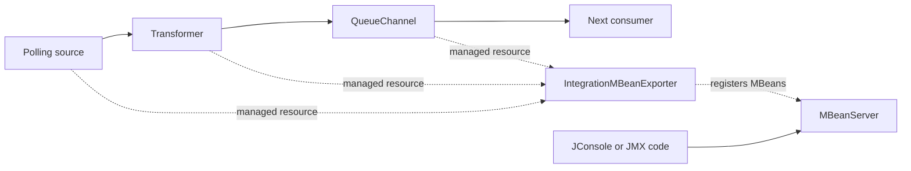

# IntegrationMBeanExporter

## 1. Objectives and Lesson Scope

In the **Configuration and Lifecycle** chapter of the `SPRING_INTEGRATION_CORE` module, this lesson explains how to expose message flow components to the JMX management interface using `IntegrationMBeanExporter`.

After this lesson, you will be able to:

- Distinguish between `Message`, channel, handler, endpoint, and MBean in a Spring Integration application.
- Configure the exporter using annotations or Java beans, choose an `MBeanServer`, and restrict which components are exported.
- Find the right MBean to view queue status or perform lifecycle operations.
- Distinguish between stopping a single component, orderly shutdown, and closing the `ApplicationContext`.
- Write tests verifying that MBeans are registered, accessible, and unregistered when the context closes.

Examples use the Spring Integration **6.5** API, Java 17 or later, and plain Spring configuration. This is the API baseline for the lesson, not a claim about your current project's version. When applying this, keep Spring libraries aligned via the application's BOM. Actual attribute and operation names should be confirmed using `MBeanInfo` in the running version.

## 2. From Business Flow to Management Interface

Suppose a flow receives an order code, normalizes the string, and places the message into a queue waiting for the next processing step. The operations team needs to know how many items remain in the queue and whether the message source has started running.

These questions differ from whether an order's payload is valid. They belong to the management layer of the application:

| Component | Role in the Problem |
| --- | --- |
| `Message<?>` | Carries the order payload and related headers |
| `MessageChannel` | Transfers or stores messages between steps |
| `MessageHandler` | Executes a transformer, filter, router, service activator, or other integration logic |
| Endpoint | Binds processing to a message-receiving mechanism, registers a subscriber, or runs a poller |
| MBean | Represents a resource with management attributes and operations |
| `MBeanServer` | Registry where MBeans are registered and looked up within the JVM |
| `IntegrationMBeanExporter` | Registers the management interface of eligible Spring Integration components |

The exporter does not create an MBean per `Message`. It works with application components. A queue holding thousands of messages is still observed through the MBean of the corresponding channel.



Dashed relationships represent management registration, not the path of messages. Sending an order does not require the message to pass through the exporter.

`IntegrationMBeanExporter` extends Spring's `MBeanExporter` and adds discovery, naming, and registration for integration components. Place the exporter in the context containing the components to be managed. See [IntegrationMBeanExporter API](https://docs.spring.io/spring-integration/docs/6.5.0/api/org/springframework/integration/monitor/IntegrationMBeanExporter.html).

## 3. Mechanisms Easily Confused with the Exporter

| Mechanism | Purpose | Usage Example |
| --- | --- | --- |
| `@EnableIntegrationMBeanExport` | Creates the exporter for integration components | Observe an order flow's channel via JMX |
| `@EnableMBeanExport` or `AnnotationMBeanExporter` | Exports beans using Spring JMX metadata | Export a bean annotated with `@ManagedResource` |
| `@EnableIntegrationManagement` | Configures Spring Integration management capabilities | Select components participating in observation |
| Micrometer | Collects meters for monitoring | Track processing time and send rate |
| Control Bus | Executes management commands via a message flow | Send start/stop commands from an internal management channel |
| JMX adapter/gateway | Reads attributes or invokes JMX operations from a flow | Poll an attribute of an external system |

The presence of the exporter does not automatically create a dashboard or a metrics history store. In modern Spring Integration, metrics and observation require configuring the corresponding infrastructure. This lesson uses `QueueSize` to observe backlog because it can be verified directly by queue behavior; do not assume every MBean has the counters, rates, or timers shown in older-version examples. See [Metrics and Management](https://docs.spring.io/spring-integration/reference/6.5/metrics.html).

## 4. Preparing Dependencies and Configuration Options

To use the JMX classes in the examples, add the following module to a Maven application whose Spring Integration version is managed by a BOM:

```xml
<dependency>
    <groupId>org.springframework.integration</groupId>
    <artifactId>spring-integration-jmx</artifactId>
</dependency>
```

If there is no BOM or dependency management, declare a version compatible with your existing Spring dependencies. The testing section at the end of the lesson additionally uses JUnit Jupiter in test scope.

With the annotation, the main options are:

```java
@EnableIntegrationMBeanExport(
    server = "mbeanServer",
    defaultDomain = "com.example.orders",
    managedComponents = {"!ordersInternal*", "orders*"},
    registration = RegistrationPolicy.FAIL_ON_EXISTING
)
```

| Attribute | Meaning When Applied |
| --- | --- |
| `server` | Target `MBeanServer` bean name; must match the configured bean exactly |
| `defaultDomain` | ObjectName domain, helping group resources by application |
| `managedComponents` | List of patterns selecting component names to register |
| `registration` | Policy if an ObjectName already exists |

The annotation creates a bean named **`integrationMbeanExporter`**, noting the lowercase `b` in `Mbean`. The default pattern is `*`; the default policy is `FAIL_ON_EXISTING`. Patterns are evaluated left to right, and the first match wins; `!` indicates exclusion. See [EnableIntegrationMBeanExport API](https://docs.spring.io/spring-integration/docs/6.5.0/api/org/springframework/integration/jmx/config/EnableIntegrationMBeanExport.html).

With the configuration above:

| Name Evaluated Against Patterns | Expected Result | Explanation |
| --- | --- | --- |
| `ordersReady` | Exported | Matches `orders*` |
| `ordersSource` | Exported | Matches `orders*` |
| `ordersInternalScratch` | Excluded | Matches `!ordersInternal*` first |
| `billingReady` | Not selected | Does not match an allow pattern |

If reversed to `{"orders*", "!ordersInternal*"}`, the internal name is already allowed by the first pattern. Placing specific rules before broad rules is readable and easy to test.

Patterns only control management registration. Excluding a channel from JMX does not make the channel disappear, stop the flow, or filter business messages.

## 5. Java DSL Example: Order Source and Result Queue

The following example generates order codes on its own so practice does not depend on a broker, database, or external service. The source does not start automatically after context initialization; learners will start it via JMX.

```java
package example.integration;

import java.lang.management.ManagementFactory;
import java.util.Locale;
import java.util.concurrent.atomic.AtomicLong;

import javax.management.MBeanServer;

import org.springframework.context.annotation.Bean;
import org.springframework.context.annotation.Configuration;
import org.springframework.integration.channel.QueueChannel;
import org.springframework.integration.config.EnableIntegration;
import org.springframework.integration.dsl.IntegrationFlow;
import org.springframework.integration.dsl.Pollers;
import org.springframework.integration.jmx.config.EnableIntegrationMBeanExport;
import org.springframework.jmx.support.RegistrationPolicy;

@Configuration(proxyBeanMethods = false)
@EnableIntegration
@EnableIntegrationMBeanExport(
    server = "mbeanServer",
    defaultDomain = "com.example.orders",
    managedComponents = {"!ordersInternal*", "orders*"},
    registration = RegistrationPolicy.FAIL_ON_EXISTING
)
public class OrdersJmxConfiguration {

    @Bean
    public MBeanServer mbeanServer() {
        return ManagementFactory.getPlatformMBeanServer();
    }

    @Bean
    public QueueChannel ordersReady() {
        return new QueueChannel(100);
    }

    @Bean
    public QueueChannel ordersInternalScratch() {
        return new QueueChannel(10);
    }

    @Bean
    public IntegrationFlow ordersFlow() {
        AtomicLong sequence = new AtomicLong();

        return IntegrationFlow
            .fromSupplier(
                () -> " po-" + sequence.incrementAndGet() + " ",
                endpoint -> endpoint
                    .id("ordersSource")
                    .autoStartup(false)
                    .poller(Pollers.fixedDelay(1000)
                        .maxMessagesPerPoll(1)))
            .transform(
                String.class,
                value -> value.trim().toUpperCase(Locale.ROOT),
                endpoint -> endpoint.id("ordersNormalize"))
            .channel("ordersReady")
            .get();
    }
}
```

The flow has three points worth observing:

1. `ordersSource` is a polling endpoint. `autoStartup(false)` allows verifying that the MBean exists while the source is not running yet.
2. `ordersNormalize` explicitly names the transformer endpoint, helping connect the management interface with business configuration.
3. `ordersReady` is a queue bounded at 100 items. Because the example does not attach a consumer at the end, the backlog will grow while the source is active.

`ordersInternalScratch` is declared separately to illustrate exclusion from JMX and does not participate in the order path.

After the source runs, the expected payloads in `ordersReady` are `PO-1`, `PO-2`, ... During practice, receive messages from the queue or stop the source after a few polls. If you let the source run indefinitely without a consumer, the queue will fill up; a capacity limit does not automatically create a backlog-handling mechanism.

`QueueChannel` provides `getQueueSize()` and `getRemainingCapacity()` to observe capacity. Reading the size does not remove messages; `receive()` modifies the queue. See [QueueChannel API](https://docs.spring.io/spring-integration/docs/6.5.0/api/org/springframework/integration/channel/QueueChannel.html).

In a real application, the supplier is replaced with an inbound adapter or appropriate source. Transformers, routers, filters, and aggregators remain business steps; the exporter helps observe eligible components of that flow.

## 6. ObjectName: Finding the Right Resource Before Operating

Each MBean has an `ObjectName`. With the example's default configuration, the resulting channel has the name:

```text
com.example.orders:type=MessageChannel,name=ordersReady
```

The structure consists of the domain before `:` and key/value pairs after it. `name` is the management name of the component, not the ID of a message. The key `bean=endpoint` in some ObjectNames describes the origin of the naming; it does not mean that MBean is always the endpoint object itself.

In the API line illustrated, the naming patterns to distinguish are:

| Resource Type | Common Name Pattern |
| --- | --- |
| Channel | `domain:type=MessageChannel,name=...` |
| Handler | `domain:type=MessageHandler,name=...,bean=...` |
| Source | `domain:type=MessageSource,name=...,bean=...` |
| Separately registered endpoint | `domain:type=ManagedEndpoint,name=...,bean=...` |

For the polling source in the example, the endpoint controlling the poller is registered under the name `ordersSource.adapter`. Details on handler/source naming and the adapter suffix can be checked in [IntegrationMBeanExporter 6.5.0 source code](https://github.com/spring-projects/spring-integration/blob/v6.5.0/spring-integration-jmx/src/main/java/org/springframework/integration/monitor/IntegrationMBeanExporter.java).

Do not infer that every handler has the same lifecycle operations. Before invoking a command, query and read the metadata of the target MBean itself:

```java
import java.util.Arrays;
import java.util.Set;
import javax.management.MBeanInfo;
import javax.management.MBeanServer;
import javax.management.ObjectName;

public final class JmxInspection {

    private JmxInspection() {
    }

    public static void inspect(MBeanServer server) throws Exception {
        Set<ObjectName> names = server.queryNames(
            new ObjectName("com.example.orders:*"), null);

        for (ObjectName name : names) {
            MBeanInfo info = server.getMBeanInfo(name);
            System.out.println(name.getCanonicalName());

            Arrays.stream(info.getAttributes()).forEach(attribute ->
                System.out.println("  attribute: " + attribute.getName()
                    + ", readable=" + attribute.isReadable()
                    + ", writable=" + attribute.isWritable()));

            Arrays.stream(info.getOperations()).forEach(operation ->
                System.out.println("  operation: " + operation.getName()
                    + ", arguments=" + operation.getSignature().length));
        }
    }
}
```

`queryNames`, `getMBeanInfo`, `getAttribute`, and `invoke` are distinct operations: finding resources, inspecting the contract, reading state, and invoking an action. See [Java MBeanServer API](https://docs.oracle.com/en/java/javase/17/docs/api/java.management/javax/management/MBeanServer.html).

If adding keys like `application` or `instance`, query patterns should include `,*` to allow additional keys. Avoid building an ObjectName with strings containing arbitrary values; when values contain special characters, apply JMX quoting.

## 7. Observing the Queue and Controlling the Source via JMX

### 7.1. Reading Backlog

Assuming `server` is the example's `mbeanServer` bean:

```java
ObjectName ready = new ObjectName(
    "com.example.orders:type=MessageChannel,name=ordersReady");

int size = ((Number) server.getAttribute(ready, "QueueSize")).intValue();
System.out.println("Pending orders: " + size);
```

JMX uses the attribute name `QueueSize`, not the method name `getQueueSize`. This value is a snapshot at the moment of reading. When producers and consumers run concurrently, two consecutive reads may differ.

In a real flow, a growing backlog is only a signal to investigate. The cause could be a stopped consumer, slow consumer processing, a failing destination system, or an intake rate exceeding processing capacity. From a queue size number alone, you cannot conclude that the system is losing data.

### 7.2. Finding the Polling Endpoint MBean

```java
Set<ObjectName> matches = server.queryNames(
    new ObjectName(
        "com.example.orders:type=ManagedEndpoint,"
            + "name=ordersSource.adapter,*"),
    null);

if (matches.size() != 1) {
    throw new IllegalStateException(
        "Expected exactly one polling endpoint, found: " + matches);
}

ObjectName pollingEndpoint = matches.iterator().next();
boolean running = (Boolean) server.getAttribute(
    pollingEndpoint, "Running");
```

Checking the match count helps avoid operating on the wrong instance if the application later has multiple contexts or multiple ObjectNames of the same type.

### 7.3. Start and Stop

After metadata confirms the endpoint has the corresponding operations:

```java
server.invoke(pollingEndpoint, "start", new Object[0], new String[0]);

boolean afterStart = (Boolean) server.getAttribute(
    pollingEndpoint, "Running");

server.invoke(pollingEndpoint, "stop", new Object[0], new String[0]);

boolean afterStop = (Boolean) server.getAttribute(
    pollingEndpoint, "Running");
```

`Running` is a management attribute; `start` and `stop` are operations. Lifecycle methods are exposed to JMX through the component's management contract. See [ManageableLifecycle API](https://docs.spring.io/spring-integration/docs/6.5.0/api/org/springframework/integration/support/management/ManageableLifecycle.html).

In the example, acting on `ordersSource.adapter` controls the polling endpoint. Stopping the source prevents subsequent polls; messages that already reached `ordersReady` remain there. In-flight messages and task interruption capability must be evaluated based on the specific endpoint type.

If operating on a handler's MBean instead of the polling endpoint, the contract and scope of impact may differ. Do not use the fact that one MBean has a `stop` operation to conclude that the entire consumer or entire flow has stopped.

### 7.4. Practicing with JConsole

In an application that keeps the JVM running, you can use JConsole to connect locally to the process and then:

1. Open the **MBeans** tab and find the `com.example.orders` domain.
2. Verify that `ordersReady` has the `QueueSize` attribute.
3. Locate the polling endpoint `ordersSource.adapter` and read `Running` initially as `false`.
4. Invoke `start`, observe the backlog increase, and then invoke `stop`.
5. Receive messages from `ordersReady` on the application side to observe the size decrease.

MBean registration and opening a remote JMX connector are two separate configurations. The example only uses the platform MBeanServer and does not configure a remote port. When deploying remote management, treat operation invocation permission as permission to alter system behavior and configure connectivity according to your environment's operational policy.

## 8. Endpoint Lifecycle and MBean Lifecycle

Two questions must be answered separately: "is the component running?" and "is the component's MBean registered?".

| Scenario | Processing Component | MBean Registration |
| --- | --- | --- |
| Context initialized, source `autoStartup(false)` | Source not running yet | May already be registered |
| Invoke `start` on the source | Source begins operating | MBean continues to exist |
| Invoke `stop` on the source | Source stops per lifecycle contract | MBean continues to exist |
| Context destroyed | Beans cleaned up per context lifecycle | Exporter unregisters MBeans it registered |

`IntegrationMBeanExporter` no longer implements `SmartLifecycle` to use `start()`/`stop()` for registering and unregistering MBeans. Registration is tied to context initialization, and unregistration is tied to context destruction. See [JMX Support — exporter lifecycle changes](https://docs.spring.io/spring-integration/reference/6.5/jmx.html).

Therefore, stopping an endpoint without making its ObjectName disappear can be completely normal behavior. Conversely, seeing an ObjectName exist is not enough to assert that the poller is running or that connectivity to the target system works.

Endpoints have `autoStartup`, `phase`, and their own lifecycle methods. When you need to manage startup/shutdown order, inspect the specific endpoint and Spring's lifecycle mechanism rather than inferring order from the MBean list. See [AbstractEndpoint API](https://docs.spring.io/spring-integration/docs/6.5.0/api/org/springframework/integration/endpoint/AbstractEndpoint.html).

## 9. Exporting the Exporter Itself

There are two layers of resources:

- MBeans of channels, handlers, sources, and endpoints.
- The MBean of `IntegrationMBeanExporter` itself, used for aggregate information and broader management operations.

Simply adding `@EnableIntegrationMBeanExport` does not mean the exporter itself is exposed to JMX. The exporter does not register itself. If you need to manage it, configure a standard JMX exporter with an explicit bean list.

This is an additional configuration for `OrdersJmxConfiguration`, not a replacement for the existing annotation:

```java
package example.integration;

import java.util.Map;
import javax.management.MBeanServer;

import org.springframework.context.annotation.Bean;
import org.springframework.context.annotation.Configuration;
import org.springframework.jmx.export.annotation.AnnotationMBeanExporter;
import org.springframework.jmx.support.RegistrationPolicy;

@Configuration(proxyBeanMethods = false)
public class ExporterManagementConfiguration {

    @Bean
    public static AnnotationMBeanExporter exporterManagement(
            MBeanServer mbeanServer) {

        AnnotationMBeanExporter exporter = new AnnotationMBeanExporter();
        exporter.setServer(mbeanServer);
        exporter.setAutodetect(false);
        exporter.setRegistrationPolicy(RegistrationPolicy.FAIL_ON_EXISTING);
        exporter.setBeans(Map.of(
            "com.example.orders.management:type=IntegrationExporter,name=orders",
            "integrationMbeanExporter"));
        return exporter;
    }
}
```

In the map, the key is the ObjectName to register; the value is the bean name of the exporter created by the annotation. This approach restricts the second exporter to a specific resource. `AnnotationMBeanExporter` uses Spring's `@ManagedResource`, `@ManagedAttribute`, and `@ManagedOperation` metadata. See [AnnotationMBeanExporter API](https://docs.spring.io/spring-framework/docs/6.2.x/javadoc-api/org/springframework/jmx/export/annotation/AnnotationMBeanExporter.html).

When initializing the context with plain Java, register both configuration classes to use this addition:

```java
try (var context = new AnnotationConfigApplicationContext(
        OrdersJmxConfiguration.class,
        ExporterManagementConfiguration.class)) {
    // Read metadata or perform management operations within this context.
}
```

The snippet above requires importing `org.springframework.context.annotation.AnnotationConfigApplicationContext`. If the application already has a JMX exporter provided by another configuration, check resource ownership before adding a second exporter to avoid duplicate registration.

## 10. Orderly Shutdown with stopActiveComponents

The exporter provides the method:

```java
void stopActiveComponents(long howLong)
```

`howLong` is the wait time budget in **milliseconds** to give in-flight messages a chance to finish. The sequence includes preparation steps via `OrderlyShutdownCapable`, stopping new incoming sources and related active channels, waiting for the remaining time, and then performing shutdown completion steps. Mid-flow pollers are given a chance to process remaining messages. See [Orderly Shutdown](https://docs.spring.io/spring-integration/reference/6.5/shutdown.html).

There are two approaches:

```java
import org.springframework.integration.monitor.IntegrationMBeanExporter;

IntegrationMBeanExporter exporter = context.getBean(
    "integrationMbeanExporter", IntegrationMBeanExporter.class);

exporter.stopActiveComponents(5000L);
```

Or, after exporting the exporter itself as in the previous section:

```java
ObjectName exporterName = new ObjectName(
    "com.example.orders.management:type=IntegrationExporter,name=orders");

server.invoke(
    exporterName,
    "stopActiveComponents",
    new Object[] {5000L},
    new String[] {"long"});
```

The Java signature is primitive `long`; the JMX signature array must correspondingly be `"long"`, even though the argument in `Object[]` is boxed as `Long`.

This is an application shutdown preparation operation, not a pause/resume command for a single endpoint. Nor does it call `System.exit()` or replace closing the context in a subsequent step.

For a real-world flow, the operational procedure must answer:

1. Which sources must stop accepting new work and who coordinates those sources?
2. Is the wait time sufficient for typical tasks and valid retries?
3. Does unfinished work reside in a broker, a persistent store, or only in JVM memory?
4. When the context closes, how can that unfinished work be reprocessed?

`managedComponents` is a JMX registration filter, not a way to scope shutdown. Do not assume that only resources visible in JConsole can be affected by the exporter's global management operations.

With an aggregator, an "empty queue" does not tell the whole story of system state: messages may still be waiting in a message group. With a gateway, a request may still be waiting for a reply. With asynchronous processing, tasks may still be running in an executor. To assess work completion, combine these states with persistence characteristics and business acknowledgments.

## 11. When to Declare IntegrationMBeanExporter as a Java Bean

The annotation is suitable for simple configuration. When you need to add static properties to ObjectNames, you can **replace the annotation** with the following Java bean in the configuration from section 5:

```java
import java.util.Map;
import javax.management.MBeanServer;

import org.springframework.context.annotation.Bean;
import org.springframework.integration.monitor.IntegrationMBeanExporter;
import org.springframework.jmx.support.RegistrationPolicy;

@Bean
public static IntegrationMBeanExporter integrationMbeanExporter(
        MBeanServer mbeanServer) {

    IntegrationMBeanExporter exporter = new IntegrationMBeanExporter();
    exporter.setServer(mbeanServer);
    exporter.setDefaultDomain("com.example.orders");
    exporter.setComponentNamePatterns(
        new String[] {"!ordersInternal*", "orders*"});
    exporter.setObjectNameStaticProperties(Map.of(
        "application", "orders",
        "instance", "local1"));
    exporter.setRegistrationPolicy(RegistrationPolicy.FAIL_ON_EXISTING);
    return exporter;
}
```

This is a method placed inside the configuration class; do not keep `@EnableIntegrationMBeanExport` at the same time for the same responsibility. After the change, the ObjectName gains extra keys, for example:

```text
com.example.orders:type=MessageChannel,name=ordersReady,application=orders,instance=local1
```

Key display order may vary. Queries that work for both configuration approaches should be:

```text
com.example.orders:type=MessageChannel,name=ordersReady,*
```

Setting an instance name helps distinguish resources sharing the same JVM/MBeanServer. Separate JVM processes have separate MBeanServers and do not collide on ObjectNames merely because they use the same name string.

When encountering duplicate registration, inspect the number of exporters, number of contexts, domains, and actual keys before changing the policy. `IGNORE_EXISTING` can cause operators to keep looking at an old MBean; `REPLACE_EXISTING` can overwrite a resource owned by another context. Keeping errors explicit in the example helps catch misconfiguration early.

## 12. Testing the Management Contract

JMX testing is useful because a flow can still process messages properly while MBean names or export filters are misconfigured. The section below illustrates integration tests for the annotation configuration in section 5, without static properties and without the configuration that exports the exporter itself.

```java
package example.integration;

import java.util.Set;
import javax.management.MBeanServer;
import javax.management.ObjectName;

import org.junit.jupiter.api.Test;
import org.springframework.context.annotation.AnnotationConfigApplicationContext;
import org.springframework.integration.channel.QueueChannel;
import org.springframework.messaging.Message;
import org.springframework.messaging.support.MessageBuilder;

import static org.junit.jupiter.api.Assertions.*;

class OrdersJmxConfigurationTest {

    @Test
    void exposesQueueStateAndUnregistersOnClose() throws Exception {
        MBeanServer server;
        ObjectName ready = new ObjectName(
            "com.example.orders:type=MessageChannel,name=ordersReady");
        ObjectName internal = new ObjectName(
            "com.example.orders:type=MessageChannel,"
                + "name=ordersInternalScratch");

        try (var context = new AnnotationConfigApplicationContext(
                OrdersJmxConfiguration.class)) {
            server = context.getBean("mbeanServer", MBeanServer.class);
            QueueChannel channel = context.getBean(
                "ordersReady", QueueChannel.class);

            assertTrue(server.isRegistered(ready));
            assertFalse(server.isRegistered(internal));
            assertEquals(0, queueSize(server, ready));

            assertTrue(channel.send(
                MessageBuilder.withPayload("PO-TEST").build(), 0));
            assertEquals(1, queueSize(server, ready));

            Message<?> received = channel.receive(0);
            assertNotNull(received);
            assertEquals("PO-TEST", received.getPayload());
            assertEquals(0, queueSize(server, ready));
        }

        assertFalse(server.isRegistered(ready));
    }

    @Test
    void startsAndStopsPollingEndpointThroughJmx() throws Exception {
        try (var context = new AnnotationConfigApplicationContext(
                OrdersJmxConfiguration.class)) {
            MBeanServer server = context.getBean(
                "mbeanServer", MBeanServer.class);

            Set<ObjectName> matches = server.queryNames(
                new ObjectName(
                    "com.example.orders:type=ManagedEndpoint,"
                        + "name=ordersSource.adapter,*"),
                null);

            assertEquals(1, matches.size());
            ObjectName endpoint = matches.iterator().next();
            assertEquals(Boolean.FALSE,
                server.getAttribute(endpoint, "Running"));

            server.invoke(endpoint, "start",
                new Object[0], new String[0]);
            try {
                assertEquals(Boolean.TRUE,
                    server.getAttribute(endpoint, "Running"));

                QueueChannel ready = context.getBean(
                    "ordersReady", QueueChannel.class);
                Message<?> message = ready.receive(3000);
                assertNotNull(message);
                assertTrue(((String) message.getPayload()).startsWith("PO-"));
            }
            finally {
                server.invoke(endpoint, "stop",
                    new Object[0], new String[0]);
            }

            assertEquals(Boolean.FALSE,
                server.getAttribute(endpoint, "Running"));
            assertTrue(server.isRegistered(endpoint));
        }
    }

    private static int queueSize(MBeanServer server, ObjectName name)
            throws Exception {
        return ((Number) server.getAttribute(name, "QueueSize")).intValue();
    }
}
```

The first test keeps the source stopped so queue size checks yield deterministic results. The second test verifies both lifecycle operations and a message passing through the transformer; `receive(3000)` waits for the result with a bounded timeout instead of sleeping for a fixed duration.

Because the example uses the platform MBeanServer, run these tests sequentially and avoid having another context register the same domain/names simultaneously. A test suite that runs in parallel should use a dedicated MBeanServer or distinct resource names per test. Close the context using `try-with-resources` to clean up MBeans even when an assertion fails.

The test snippets are practice code in the lesson; bringing them into a project and running them with a specific dependency/BOM is a separate verification step. Do not treat the examples above as evidence of tests already run for the current project.

## 13. Diagnosing Common Errors

| Symptom | What to Check | Resolution |
| --- | --- | --- |
| Expected domain not visible | Whether the exporter was created, is in the right context, and points to the right server | Verify the bean and server before checking the JMX client |
| Channel visible but other components missing | Patterns, auto-generated bean names, and management capability of the components | List ObjectNames and compare actual names |
| Internal components still appear | Order of patterns | Place exclusions before broad patterns |
| MBean exists but source emits no data | `Running`, `autoStartup`, poller configuration, and business errors | Read endpoint state then inspect the message path |
| `AttributeNotFoundException` | Attribute name and readability | Use `getMBeanInfo` instead of guessing names from old examples |
| Operation invocation fails | Correct MBean, operation, and parameter signature | Match metadata; check `long` vs `java.lang.Long` |
| `InstanceAlreadyExistsException` | Duplicate exporter/context names in the same server | Separate domains or add distinguishing keys after identifying the owner |
| `stopActiveComponents` not found | Whether you are viewing a channel MBean or the exporter MBean | Export the exporter itself separately if you need to invoke it via JMX |
| Called `stop` but MBean still exists | Confusing lifecycle with management registration | Check `Running`; MBean unregistration is tied to context destruction |

JMX management errors should also be distinguished from message processing errors. A JMX operation called with the wrong signature does not automatically become an `ErrorMessage` in the flow. Conversely, errors in a transformer or downstream component must be handled according to synchronous/asynchronous boundaries and the application's error flow; seeing an MBean does not prove the error-handling path is correct.

## 14. Extended Practice Exercises

1. Initialize the configuration from section 5 and list all ObjectNames under `com.example.orders`. Note the MBeans corresponding to the channel, source, and polling endpoint.
2. Keep the source stopped and manually send two messages into `ordersReady`. Read `QueueSize`, receive one message, and read it again. Explain why this manual send path does not go through the transformer.
3. Start the source via JMX, receive one result, and verify that the payload is normalized. Stop the source and verify the MBean remains registered.
4. Reverse the pattern order in a practice configuration. Predict and then verify the presence of `ordersInternalScratch`.
5. Add the configuration to export the exporter itself, read its metadata, and locate the `stopActiveComponents` operation. Only invoke it on a context dedicated to shutdown practice.
6. Replace the annotation with a Java bean having `application` and `instance`. Adjust the query/tests to locate the exact resources when extra keys are present.

The completion criterion is being able to explain the effect of each operation on **processing state**, **queue contents**, and **MBean registration**. These three aspects are related but not identical.
