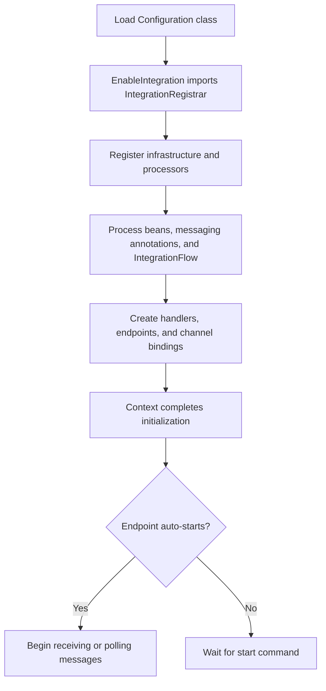

# EnableIntegration

## 1. Objectives and Scope

In the **Configuration and Lifecycle** chapter of the **SPRING_INTEGRATION_CORE** module, `@EnableIntegration` is the starting point for understanding how declarations of `MessageChannel`, endpoints, and Java DSL become a message-processing system in Spring.

After this lesson, you will be able to:

- Enable Spring Integration infrastructure in a plain Java application.
- Distinguish between enabling infrastructure, registering beans, and discovering gateway interfaces.
- Connect a channel with a transformer or service activator using annotations and Java DSL.
- Explain why an endpoint exists yet does not process messages.
- Write tests that verify both configuration and message-passing behavior.

Examples use **Java 17 or later and the Spring Integration 6.5.x API**; the Spring Boot section references the **3.5.x** branch. This is the lesson's API baseline, not a claim about the latest version. When applying this to a project, use a compatible version set managed by your project's BOM.

You should know `@Configuration`, `@Bean`, `@Import`, dependency injection, `ApplicationContext`, and the basic difference between `DirectChannel` and `QueueChannel`.

## 2. What Does @EnableIntegration Enable?

### 2.1. An Infrastructure Configuration Annotation

`@EnableIntegration` belongs to the package:

```java
import org.springframework.integration.config.EnableIntegration;
```

Place this annotation on a configuration class loaded into the context:

```java
import org.springframework.context.annotation.Configuration;
import org.springframework.integration.config.EnableIntegration;

@Configuration(proxyBeanMethods = false)
@EnableIntegration
public class IntegrationInfrastructureConfig {
}
```

The annotation has existed since Spring Integration 4.0. It imports `IntegrationRegistrar` to register infrastructure and configuration processors. This annotation has no business configuration attributes such as channel name, polling interval, or retry. Those options belong to the corresponding bean or endpoint. See [EnableIntegration Javadoc](https://docs.spring.io/spring-integration/docs/6.5.x/api/org/springframework/integration/config/EnableIntegration.html).

A class merely sitting on the classpath is not enough to take effect. You must load it via component scanning, `@Import`, or direct registration into `AnnotationConfigApplicationContext`.

### 2.2. Infrastructure Groups Prepared

| Group | Example or Role |
| --- | --- |
| Shared beans | `errorChannel` with default logging handler; scheduler for polling tasks |
| `BeanFactoryPostProcessor` | Prepares general configuration of the integration environment |
| `BeanPostProcessor` | Processes or wraps beans to participate in messaging infrastructure |
| Messaging annotation processors | Interprets endpoint declarations such as `@Transformer`, `@ServiceActivator` |

Some beans have default names and values while also allowing the application to supply replacement configurations according to each component's mechanism. Therefore, view this as a step that sets up the runtime environment, not a guarantee that every bean is newly created regardless of existing configuration. The documentation [Configuration and EnableIntegration](https://docs.spring.io/spring-integration/reference/6.5/overview.html#configuration-enabling) describes these infrastructure groups.

After enabling the infrastructure, you still need to define the flow, register business processing objects, and connect inputs and outputs. For example, this annotation does not automatically infer that the `normalizeOrderCode()` method must receive messages from `rawOrders`.

## 3. From Declaration to Active Endpoint

The initialization process can be read according to the following model:



`IntegrationRegistrar` implements `ImportBeanDefinitionRegistrar`. When Spring encounters `@EnableIntegration`, the registrar participates in registering bean definitions. Spring Integration's XML configuration path also uses this registrar to prepare the corresponding infrastructure. See [IntegrationRegistrar Javadoc](https://docs.spring.io/spring-integration/docs/6.5.x/api/org/springframework/integration/config/IntegrationRegistrar.html).

The diagram above is a model for reading configuration, not a guarantee of the detailed invocation order of every post-processor.

To diagnose a flow, separate four verification questions:

1. **Is the configuration loaded?** If not, annotations on that class have no effect.
2. **Is the processing object a bean?** An object created with `new` and held outside the context is not processed as a bean.
3. **Has an endpoint been created and connected to which channel?** Having a business bean does not prove that a consumer endpoint exists.
4. **Is the endpoint running?** Bean existence and an endpoint actively receiving messages are two different states.

This checklist also applies when learning transformers, routers, filters, and aggregators: each component must go through the configuration mechanism to become part of a flow.

## 4. Plain Java Example: Enabling Infrastructure and Running a Transformer

### 4.1. Preparing Dependencies

The example requires `org.springframework.integration:spring-integration-core`. The Maven snippet below assumes the project already has a suitable BOM or dependency management:

```xml
<dependency>
    <groupId>org.springframework.integration</groupId>
    <artifactId>spring-integration-core</artifactId>
</dependency>
```

If the project does not yet manage versions, add a compatible 6.5.x version to the build configuration. Adding only `spring-messaging` will not provide all the endpoints and Spring Integration infrastructure that the example requires.

### 4.2. A Complete Program

Place the following code in `EnableIntegrationDemo.java`, in package `vn.example.integration.enable`:

```java
package vn.example.integration.enable;

import java.util.Locale;

import org.springframework.context.annotation.AnnotationConfigApplicationContext;
import org.springframework.context.annotation.Bean;
import org.springframework.context.annotation.Configuration;
import org.springframework.context.annotation.Import;
import org.springframework.integration.annotation.Transformer;
import org.springframework.integration.channel.DirectChannel;
import org.springframework.integration.channel.QueueChannel;
import org.springframework.integration.config.EnableIntegration;
import org.springframework.messaging.Message;
import org.springframework.messaging.MessageChannel;
import org.springframework.messaging.support.GenericMessage;

public class EnableIntegrationDemo {

    @Configuration(proxyBeanMethods = false)
    @EnableIntegration
    @Import(OrderCodeNormalizer.class)
    public static class FlowConfig {

        @Bean
        public DirectChannel rawOrders() {
            return new DirectChannel();
        }

        @Bean
        public QueueChannel normalizedOrders() {
            return new QueueChannel(10);
        }
    }

    public static class OrderCodeNormalizer {

        @Transformer(
                inputChannel = "rawOrders",
                outputChannel = "normalizedOrders")
        public String normalize(String value) {
            String result = value.trim().toUpperCase(Locale.ROOT);
            if (result.isBlank()) {
                throw new IllegalArgumentException(
                        "Order code must not be blank");
            }
            return result;
        }
    }

    public static void main(String[] args) {
        try (var context =
                     new AnnotationConfigApplicationContext(FlowConfig.class)) {

            MessageChannel input =
                    context.getBean("rawOrders", MessageChannel.class);
            QueueChannel output =
                    context.getBean("normalizedOrders", QueueChannel.class);

            boolean accepted = input.send(
                    new GenericMessage<>("  order-2026-001  "), 1000);
            if (!accepted) {
                throw new IllegalStateException("Failed to send message");
            }

            Message<?> reply = output.receive(1000);
            if (reply == null) {
                throw new IllegalStateException("No result received");
            }

            System.out.println(reply.getPayload());
        }
    }
}
```

Expected output:

```text
ORDER-2026-001
```

Flow of the example:

```text
GenericMessage<String>
    -> rawOrders (DirectChannel)
    -> transformer normalize(...)
    -> normalizedOrders (QueueChannel)
    -> main calls receive(...)
```

Each declaration has a specific responsibility:

- `@EnableIntegration` prepares the integration configuration processing mechanism.
- `@Import(OrderCodeNormalizer.class)` registers the handler class as a bean, so the example does not need package scanning.
- Two `@Bean` methods register channels with names matching the references in `@Transformer`.
- `@Transformer` specifies input, output, and the payload transformation method.
- `try-with-resources` closes the context after execution finishes.

`DirectChannel` invokes the consumer on the sender's thread. `QueueChannel` stores messages for a receiver to pull; the default queue resides in memory. In the example, the output queue is received from directly by `main`, so no polling endpoint is needed for that queue. See [Message Channel Implementations](https://docs.spring.io/spring-integration/reference/6.5/channel/implementations.html).

### 4.3. Calling a Method Directly vs. Sending a Message

The following statement only tests Java logic:

```java
String result = new EnableIntegrationDemo.OrderCodeNormalizer()
        .normalize("  order-2026-001  ");
```

It does not prove that `rawOrders` has a consumer, that channel names are right, or that the annotation processor has been activated. To test integration configuration, send a message through the channel as in the program above.

This is why a unit test of the method can pass while the actual application still reports that the channel has no subscriber.

## 5. Distinguishing Enabling Infrastructure from Component Scanning

### 5.1. Three Responsibilities Frequently Confused

| Declaration | Primary Responsibility |
| --- | --- |
| `@EnableIntegration` | Registers Spring Integration infrastructure |
| `@ComponentScan` | Finds regular component classes to register as beans |
| `@IntegrationComponentScan` | Finds `@MessagingGateway` interfaces to register gateway proxies |
| `@Import` | Registers explicitly specified types directly |
| `@Bean` | Registers objects created by configuration methods |

`@MessageEndpoint` is a stereotype based on `@Component`. In contrast, a gateway is an interface, so regular component scanning does not create an implementation for it. The `@IntegrationComponentScan` mechanism solves discovering and registering gateway interfaces. See [Annotation Support](https://docs.spring.io/spring-integration/reference/6.5/configuration/annotations.html).

Example configuration when using scanning:

```java
package vn.example.integration.enable;

import org.springframework.context.annotation.ComponentScan;
import org.springframework.context.annotation.Configuration;
import org.springframework.integration.annotation.IntegrationComponentScan;
import org.springframework.integration.config.EnableIntegration;

@Configuration(proxyBeanMethods = false)
@EnableIntegration
@ComponentScan(basePackages = "vn.example.integration.handlers")
@IntegrationComponentScan(basePackageClasses = OrderCodeGateway.class)
public class ScannedIntegrationConfig {
}
```

This is an **alternative configuration template**. The package `vn.example.integration.handlers` is chosen by the application to hold handler classes with stereotypes. The next section uses a separate configuration and does not need to load `ScannedIntegrationConfig`.

Choosing `basePackageClasses` lets you reference a package via a Java type. Whether using a package name or a marker class, the scan scope must still contain the exact components to be registered.

### 5.2. When Gateway Scanning Is Not Needed

Since Spring Integration 6.0, an interface annotated with `@MessagingGateway` can be registered via `@Import`. This approach suits cases where you want to explicitly list each gateway in a small configuration. It is an alternative to scanning or manually declaring a factory bean, and does not replace the role of enabling infrastructure. See [Messaging Gateways](https://docs.spring.io/spring-integration/reference/6.5/gateway.html).

Do not assume by default that "having the gateway annotation means Spring will find it automatically." Look at how the application registers that interface.

## 6. Java DSL Example Combined with Gateway

This example is independent of `EnableIntegrationDemo`. It accepts a Java call, creates a message, normalizes the order code, and returns the payload to the caller.

### 6.1. Gateway Interface

File `OrderCodeGateway.java`:

```java
package vn.example.integration.enable;

import org.springframework.integration.annotation.MessagingGateway;

@MessagingGateway(
        defaultRequestChannel = "gatewayOrders",
        defaultReplyTimeout = "1000")
public interface OrderCodeGateway {

    String normalize(String code);
}
```

### 6.2. DSL Configuration

File `DslGatewayConfig.java`:

```java
package vn.example.integration.enable;

import java.util.Locale;

import org.springframework.beans.factory.annotation.Qualifier;
import org.springframework.context.annotation.Bean;
import org.springframework.context.annotation.Configuration;
import org.springframework.context.annotation.Import;
import org.springframework.integration.channel.DirectChannel;
import org.springframework.integration.config.EnableIntegration;
import org.springframework.integration.dsl.IntegrationFlow;
import org.springframework.messaging.MessageChannel;

@Configuration(proxyBeanMethods = false)
@EnableIntegration
@Import(OrderCodeGateway.class)
public class DslGatewayConfig {

    @Bean
    public DirectChannel gatewayOrders() {
        return new DirectChannel();
    }

    @Bean
    public IntegrationFlow normalizeOrderFlow(
            @Qualifier("gatewayOrders") MessageChannel input) {

        return IntegrationFlow.from(input)
                .<String, String>transform(
                        value -> value.trim().toUpperCase(Locale.ROOT))
                .get();
    }
}
```

### 6.3. Calling the Gateway

File `GatewayDemo.java`:

```java
package vn.example.integration.enable;

import org.springframework.context.annotation.AnnotationConfigApplicationContext;

public class GatewayDemo {

    public static void main(String[] args) {
        try (var context =
                     new AnnotationConfigApplicationContext(DslGatewayConfig.class)) {

            OrderCodeGateway gateway =
                    context.getBean(OrderCodeGateway.class);

            System.out.println(gateway.normalize("  order-2026-002  "));
        }
    }
}
```

Expected output is `ORDER-2026-002`.

In the DSL, `IntegrationFlow` is a declaration so the framework registers the actual components into the context. `transform(...)` creates a transformation step; channels and endpoints connecting steps are handled by the DSL infrastructure. Therefore, calling the builder inside an object outside the context is not equivalent to registering an `IntegrationFlow` bean. See [DSL Basics](https://docs.spring.io/spring-integration/reference/6.5/dsl/java-basics.html).

The gateway provides a temporary reply channel via the `replyChannel` header. When the flow above ends at the transformer without specifying a separate output channel, the result can return to the gateway using that reply address. This is why the example does not declare an output `QueueChannel` like the plain Java section. See [Setting the Default Reply Channel](https://docs.spring.io/spring-integration/reference/6.5/gateway.html#gateway-default-reply-channel).

You can replace `@Import(OrderCodeGateway.class)` with `@IntegrationComponentScan(basePackageClasses = OrderCodeGateway.class)` and import the corresponding annotation. For this small example, choosing one gateway registration method is sufficient.

Do not simultaneously load multiple alternative configurations with the same bean names into one context. Choose either annotation endpoints or DSL for the same processing connection; creating an extra consumer on the same channel can alter how messages are distributed.

## 7. EnableIntegration, Poller, and Lifecycle

### 7.1. Scheduler and Poller Have Different Responsibilities

`TaskScheduler` provides scheduling capability. A poller defines polling work such as the trigger, number of messages per poll, and receive timeout. A consumer reading from a `QueueChannel` needs a dedicated poller configuration or a suitable default poller; having only a scheduler does not describe the consumer's reading schedule.

Conversely, a consumer connected to a `DirectChannel` receives messages via subscription and needs no polling. Long-running tasks on a scheduler thread can slow down other polling endpoints sharing that scheduler. See [Configuring the Task Scheduler](https://docs.spring.io/spring-integration/reference/6.5/configuration/namespace-taskscheduler.html).

### 7.2. Endpoint Exists but Does Not Auto-Start

The following `PollingOrderConfig.java` file illustrates a consumer intentionally kept in a stopped state:

```java
package vn.example.integration.enable;

import java.util.Locale;

import org.springframework.context.annotation.Bean;
import org.springframework.context.annotation.Configuration;
import org.springframework.context.annotation.Import;
import org.springframework.integration.annotation.EndpointId;
import org.springframework.integration.annotation.Poller;
import org.springframework.integration.annotation.ServiceActivator;
import org.springframework.integration.channel.QueueChannel;
import org.springframework.integration.config.EnableIntegration;

@Configuration(proxyBeanMethods = false)
@EnableIntegration
@Import(PollingOrderConfig.PollingHandler.class)
public class PollingOrderConfig {

    @Bean
    public QueueChannel pendingOrders() {
        return new QueueChannel(10);
    }

    @Bean
    public QueueChannel pollingResults() {
        return new QueueChannel(10);
    }

    public static class PollingHandler {

        @EndpointId("orderPollingEndpoint")
        @ServiceActivator(
                inputChannel = "pendingOrders",
                outputChannel = "pollingResults",
                autoStartup = "false",
                poller = @Poller(
                        fixedDelay = "100",
                        maxMessagesPerPoll = "1"))
        public String handle(String code) {
            return code.trim().toUpperCase(Locale.ROOT);
        }
    }
}
```

Intent of the example:

- `pendingOrders` holds codes waiting for processing.
- `@Poller` sets a 100 ms interval between polls and at most one message per poll.
- `autoStartup = "false"` keeps the consumer stopped when the context refreshes.
- `@EndpointId` assigns an explicit name to the endpoint so the program can retrieve and control it.

`@EndpointId` names the consumer endpoint; the business handler and the consumer wrapping it are separate components. When using annotations on a POJO method as in the example, the handler gets a name derived from the endpoint ID according to framework conventions. See [EndpointId Javadoc](https://docs.spring.io/spring-integration/api/org/springframework/integration/annotation/EndpointId.html).

Messages sent into `pendingOrders` while the endpoint is stopped can sit in the queue if space remains. A successful send status at this point does not prove the business logic ran. The testing section below verifies that difference.

### 7.3. Controlling Startup and Lifecycle Order

Commonly used options:

| Option | Meaning |
| --- | --- |
| `autoStartup` | Whether the endpoint starts automatically on context refresh |
| `phase` | Participates in lifecycle ordering |
| `start()` | Requests the component to begin operating |
| `stop()` | Requests the component to stop operating |
| `isRunning()` | Checks operational state |

According to `SmartLifecycle`, lower phases start first and higher phases start later; stopping proceeds in reverse order. Explicit dependency relationships can take precedence over phase order. Phase only orders lifecycle; it does not prove an external service is ready or that backlogged messages have finished processing. See [SmartLifecycle Javadoc](https://docs.spring.io/spring-framework/docs/6.2.x/javadoc-api/org/springframework/context/SmartLifecycle.html).

`@EnableIntegration` is not a runtime business toggle switch. To stop a specific endpoint, control the endpoint's lifecycle rather than trying to alter annotations while the program is running.

## 8. Error Channel Does Not Replace Every Exception

The default infrastructure includes `errorChannel`, yet how errors propagate still depends on the execution path:

| Processing Path | Typical Way Errors Are Observed |
| --- | --- |
| Handler running synchronously via `DirectChannel` | Exception returns to the caller of `send()` |
| Handler running in a framework-managed polling task | Error handler may publish an `ErrorMessage` |
| Application-created background thread | Requires application error-catching and publishing mechanism |

With the default error handler of eligible integration tasks, the `errorChannel` header on the request is checked first; if absent, the error is sent to the global channel named `errorChannel`. The default channel is a `PublishSubscribeChannel` with a logging subscriber. See [Error Handling](https://docs.spring.io/spring-integration/reference/6.5/error-handling.html).

Applying this to `EnableIntegrationDemo`: sending a whitespace-only string causes the transformer to throw `IllegalArgumentException`; because the input is a `DirectChannel`, the sender receives the message-handling exception. Simply adding a subscriber to `errorChannel` does not automatically turn that call into an asynchronous error-reporting path.

When replacing the scheduler or offloading work to an executor yourself, review the error handler for that execution path. To retry, route errors elsewhere, or store failed messages, you must configure the corresponding policy.

## 9. Using in Spring Boot

Spring Boot 3.5.x provides the `spring-boot-starter-integration` starter. When the corresponding auto-configuration is active and Spring Integration is on the classpath, Boot initializes the infrastructure via `@EnableIntegration` and also supports configuring a default poller via `spring.integration.poller.*`. See [Spring Integration in Spring Boot](https://docs.spring.io/spring-boot/3.5/reference/messaging/spring-integration.html).

Dependency example when the project already uses Boot's dependency management:

```xml
<dependency>
    <groupId>org.springframework.boot</groupId>
    <artifactId>spring-boot-starter-integration</artifactId>
</dependency>
```

In a typical Boot application, you can declare `IntegrationFlow` beans without adding `@EnableIntegration` to the application class yourself. When extracting a configuration to load with `AnnotationConfigApplicationContext` or writing tests without Boot, ensure that context has its own infrastructure activation path.

The source code of [Boot 3.5.0 IntegrationAutoConfiguration](https://raw.githubusercontent.com/spring-projects/spring-boot/v3.5.0/spring-boot-project/spring-boot-autoconfigure/src/main/java/org/springframework/boot/autoconfigure/integration/IntegrationAutoConfiguration.java) shows that Boot also has conditional configuration for integration component scanning. Therefore, when a gateway does not appear, inspect the scanned packages and actual auto-configuration rather than concluding solely from the presence or absence of an annotation on the application class.

Selection table:

| Environment | Approach |
| --- | --- |
| Plain Java Spring | Load configuration with `@EnableIntegration` |
| Boot with integration auto-configuration active | Use Boot-provided infrastructure; declare business flows |
| Test loading a single configuration class in isolation | Ensure the test configuration itself enables integration |
| XML integration configuration combined with Java | Check how the namespace registers infrastructure and how annotation processing is enabled |
| Auto-configuration excluded | Provide explicit configuration for the context in use |

An example that runs under Boot but fails when loaded in a plain context may be relying on configuration provided by Boot. Comparing both context initialization paths helps identify what is missing.

## 10. Testing Configuration Through Actual Behavior

The tests below use JUnit Jupiter and the classes already presented. They are illustrative code for learners, not a report that the project's build has been run.

### 10.1. Testing the Transformer and Synchronous Exception

File `EnableIntegrationConfigTest.java`:

```java
package vn.example.integration.enable;

import org.junit.jupiter.api.Test;

import org.springframework.context.annotation.AnnotationConfigApplicationContext;
import org.springframework.integration.channel.QueueChannel;
import org.springframework.messaging.Message;
import org.springframework.messaging.MessageChannel;
import org.springframework.messaging.MessageHandlingException;
import org.springframework.messaging.support.GenericMessage;

import static org.junit.jupiter.api.Assertions.*;

class EnableIntegrationConfigTest {

    @Test
    void transformsMessageThroughConfiguredChannel() {
        try (var context = new AnnotationConfigApplicationContext(
                EnableIntegrationDemo.FlowConfig.class)) {

            assertTrue(context.containsBean("errorChannel"));

            MessageChannel input =
                    context.getBean("rawOrders", MessageChannel.class);
            QueueChannel output =
                    context.getBean("normalizedOrders", QueueChannel.class);

            assertTrue(input.send(
                    new GenericMessage<>("  order-2026-003  "), 1000));

            Message<?> result = output.receive(1000);
            assertNotNull(result);
            assertEquals("ORDER-2026-003", result.getPayload());
        }
    }

    @Test
    void propagatesSynchronousHandlerFailureToSender() {
        try (var context = new AnnotationConfigApplicationContext(
                EnableIntegrationDemo.FlowConfig.class)) {

            MessageChannel input =
                    context.getBean("rawOrders", MessageChannel.class);

            assertThrows(MessageHandlingException.class,
                    () -> input.send(new GenericMessage<>("   "), 1000));
        }
    }
}
```

The two levels of checks complement each other:

- Bean checks help detect when a context lacks basic infrastructure.
- Sending messages and asserting results verifies that handlers are wired properly.

Only checking that `errorChannel` exists will miss wrong channel names, missing handler beans, or stopped endpoints.

### 10.2. Testing That an Endpoint Polls Only After Starting

File `PollingLifecycleTest.java`:

```java
package vn.example.integration.enable;

import org.junit.jupiter.api.Test;

import org.springframework.context.annotation.AnnotationConfigApplicationContext;
import org.springframework.integration.channel.QueueChannel;
import org.springframework.integration.endpoint.AbstractEndpoint;
import org.springframework.messaging.Message;
import org.springframework.messaging.support.GenericMessage;

import static org.junit.jupiter.api.Assertions.*;

class PollingLifecycleTest {

    @Test
    void processesQueuedMessageOnlyAfterEndpointStarts() {
        try (var context =
                     new AnnotationConfigApplicationContext(PollingOrderConfig.class)) {

            QueueChannel input =
                    context.getBean("pendingOrders", QueueChannel.class);
            QueueChannel output =
                    context.getBean("pollingResults", QueueChannel.class);
            AbstractEndpoint endpoint =
                    context.getBean("orderPollingEndpoint", AbstractEndpoint.class);

            assertFalse(endpoint.isRunning());
            assertTrue(input.send(
                    new GenericMessage<>("  order-2026-004  "), 1000));
            assertNull(output.receive(0));

            try {
                endpoint.start();
                assertTrue(endpoint.isRunning());

                Message<?> result = output.receive(2000);
                assertNotNull(result);
                assertEquals("ORDER-2026-004", result.getPayload());
            }
            finally {
                endpoint.stop();
            }

            assertFalse(endpoint.isRunning());
        }
    }
}
```

The test uses `receive(timeout)` for a bounded wait. It checks both the state before starting and the result after starting, while also cleaning up the context and endpoint. The 2-second limit is the timeout in the example; when applying it, pick a bound appropriate for your CI environment.

For the gateway in the DSL section, also verify calling `context.getBean(OrderCodeGateway.class).normalize(...)` to check both proxy registration and the reply path.

## 11. Diagnosing Common Configuration Errors

The table below lists diagnostic directions derived from the mechanism and examples in this lesson; a single symptom may have multiple causes.

| Symptom | What to Check | Appropriate Action |
| --- | --- | --- |
| No `errorChannel` in plain context | Class enabling integration was not loaded | Register or import the configuration class |
| Processing bean exists but channel has no subscriber | Annotation not processed, wrong channel, or endpoint stopped | Check infrastructure, bindings, and `isRunning()` |
| Cannot inject gateway interface | Interface not registered or outside scan scope | Use properly scoped scan or `@Import` |
| Changed input to `QueueChannel` and flow fails to initialize | Consumer lacks an appropriate poller | Declare a poller on the endpoint or a default poller |
| Sent to queue successfully but no result appears | Endpoint not started, poll schedule not reached, or business error | Check lifecycle, polling, and error path |
| Added `errorChannel` yet exception still returns to caller | Running synchronously via `DirectChannel` | Handle exceptions synchronously or design an explicit error path |
| Gateway receives no reply | Flow returns no result, branches one-way, or loses reply address | Trace the request-reply path and related headers |
| Bean conflict after combining configurations | Multiple alternative configurations loaded with same names | Choose one configuration or use distinct names and scopes |
| Works under Boot but plain test fails | Test lacks the auto-configuration the application relies on | Add the required integration configuration for the test |

When troubleshooting, keep input data as small as possible and verify sequentially: context, business bean, channel, endpoint, running state, then reply path or error path. Adding many annotations at once makes it hard to tell which change fixed the issue.

## 12. Guided Practice

Use the three independent configurations in the lesson to observe the following behaviors:

1. **Synchronous transformer:** send `"  order-2026-010  "` through `rawOrders` and verify the output payload is normalized.
2. **Java logic and wiring:** call `normalize()` directly, then compare with the message-sending test. Note which parts of configuration a direct call cannot test.
3. **Gateway and DSL:** call `OrderCodeGateway.normalize()` and verify the result returns without declaring a separate output queue.
4. **Lifecycle:** send a message into `pendingOrders` before starting the endpoint; verify no result yet, then start it and receive the result.
5. **Synchronous error:** send a blank string to the transformer in the first example and observe the exception on the sender side.
6. **Missing configuration experiment:** in a learning copy using a plain context, remove the integration activation path and re-run the behavioral check. Compare the existence of the business bean with an actually functioning endpoint; restore the configuration after observing.

The completion criterion is being able to explain **which component registers beans, which component connects the flow, and which component controls when processing runs**. From that foundation, you can add filters, routers, and aggregators while still identifying the configuration responsibility of each piece.
