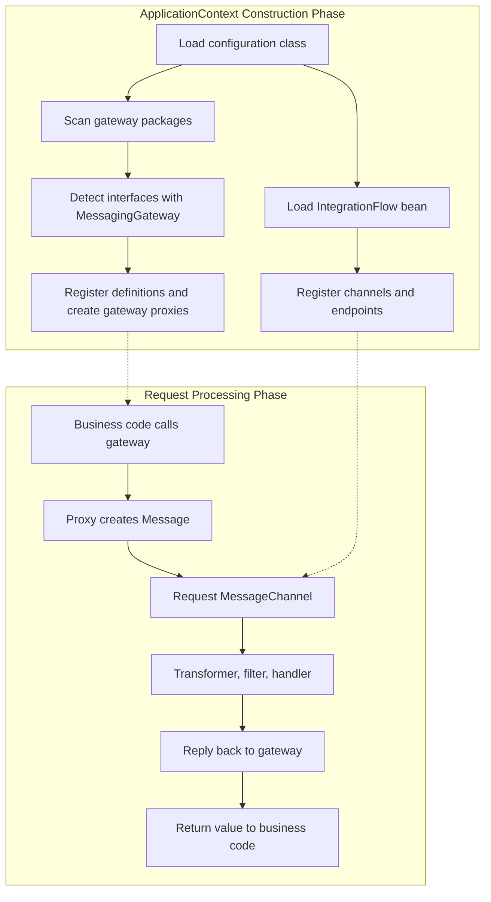

# IntegrationComponentScan

## 1. Objectives and Scope

In the **Configuration and Lifecycle** chapter of the **SPRING_INTEGRATION_CORE** module, this lesson explains how to bring a gateway interface into the Spring container using `@IntegrationComponentScan`. After this lesson, you will be able to:

- Distinguish gateway interface scanning from regular bean scanning and enabling Spring Integration infrastructure.
- Specify packages to scan, select gateways using filters, and control bean names.
- Connect a gateway with `MessageChannel`, transformers, filters, and endpoints in Java DSL.
- Verify proxy registration and diagnose causes when a gateway is not injected or does not reply.

Examples use Java 17 and the Spring Integration 6.5.x API. Implementation details specify versions where needed. For Spring Boot projects, use the dependency version set managed by your project's BOM.

## 2. Why Do Gateway Interfaces Need a Separate Scanning Mechanism?

Suppose business logic wants to send a product code into a processing flow via a Java method call:

```java
String result = orderGateway.submit("  book-42  ", "tenant-a");
```

`orderGateway` has an interface type. You do not write an `implements` class; Spring Integration provides a proxy to convert this call into a message.

Regular `@ComponentScan` does not register gateway interfaces the way it registers a `@Service` class. `@IntegrationComponentScan` adds a discovery mechanism for interfaces annotated with `@MessagingGateway` so the infrastructure can create gateway proxies. [Annotation Support](https://docs.spring.io/spring-integration/reference/6.5/configuration/annotations.html)

Three responsibilities to distinguish:

| Configuration | Primary Responsibility | Applied in Example |
|---|---|---|
| `@ComponentScan` | Discovers regular bean classes | Can be used to find service or configuration classes |
| `@EnableIntegration` | Registers Spring Integration infrastructure | Enables processing of endpoint and flow configurations |
| `@IntegrationComponentScan` | Discovers gateway interfaces | Finds `OrderGateway` |
| `@Bean IntegrationFlow` | Declares message flow structure | Creates transformer, filter, and handler |
| `@MessagingGateway` | Describes the gateway contract | Specifies bean name, request channel, and timeout |

In a plain Spring application, enabling infrastructure and registering gateways are two separate steps. When using Boot, auto-configuration can perform them on behalf of the application. [Configuration and @EnableIntegration](https://docs.spring.io/spring-integration/reference/6.5/overview.html#configuration-enable-integration)

A package-scanning annotation does not describe the entire message flow. In the examples below, `@Bean` and Java DSL are responsible for creating the flow; the scanner is responsible for discovering interface-based entry points.

## 3. From Interface Discovery to Message Processing

Two phases should be observed separately:



This is a diagram of responsibilities, not a mandatory internal callback order among all beans.

A gateway proxy is provided via the `GatewayProxyFactoryBean` mechanism. As a result, business code calls an interface while sending and receiving `Message` instances happens inside the gateway infrastructure. [Messaging Gateways](https://docs.spring.io/spring-integration/reference/6.5/gateway.html)

Scanning takes place when the container processes configuration. It does not automatically re-run on every gateway call. Adding a new interface to source code and expecting a running application to discover it dynamically is not how this annotation works.

In Spring Integration 6.5.2, the registrar selects the configured packages; if no packages are specified, it uses the package of the annotated class. Therefore, specify the scope explicitly when configuration and gateways reside in different package branches. [IntegrationComponentScanRegistrar 6.5.2 source code](https://raw.githubusercontent.com/spring-projects/spring-integration/v6.5.2/spring-integration-core/src/main/java/org/springframework/integration/config/IntegrationComponentScanRegistrar.java)

Registering the proxy only proves that the container has an entry point. Processing capability also depends on the request channel, active endpoints, and the flow's reply path.

## 4. Choosing the Scan Scope

### 4.1. Scanning by Package Name

The following two styles are alternatives to each other:

```java
@IntegrationComponentScan("com.acme.orders.gateway")
```

```java
@IntegrationComponentScan(
    basePackages = {
        "com.acme.orders.gateway",
        "com.acme.billing.gateway"
    }
)
```

`value` is an alias for `basePackages`; pick one style instead of declaring both attributes simultaneously.

Package scope includes subpackages. For instance, selecting `com.acme.orders.gateway` covers gateways placed in `com.acme.orders.gateway.internal`.

### 4.2. Scanning by Java Type

You can use a gateway or a marker type as an anchor:

```java
@IntegrationComponentScan(basePackageClasses = OrderGateway.class)
```

This attribute selects **the package containing the referenced type**, rather than restricting the result solely to `OrderGateway`. To select only a single gateway, use filters as shown in section 6.

A marker type is useful when configuration should not depend on a specific gateway:

```java
package com.acme.orders.gateway;

public interface OrderGatewayPackage {
}
```

```java
@IntegrationComponentScan(
    basePackageClasses = OrderGatewayPackage.class
)
```

The marker above is not annotated with `@MessagingGateway`, so under default filters it acts only as a package anchor and does not become a gateway.

### 4.3. Common Attributes

| Attribute | Meaning |
|---|---|
| `value` / `basePackages` | Select packages by string |
| `basePackageClasses` | Select packages containing the specified Java types |
| `useDefaultFilters` | Default `true`, enables `@MessagingGateway` recognition |
| `includeFilters` | Add conditions to include candidates |
| `excludeFilters` | Exclude candidates matching conditions |
| `nameGenerator` | Select bean name generation strategy; available since 6.0 |

Attributes and defaults are described in [IntegrationComponentScan 6.5.2 Javadoc](https://docs.spring.io/spring-integration/docs/6.5.2/api/org/springframework/integration/annotation/IntegrationComponentScan.html).

When organizing code, you can place each business domain's gateways in its own package. This helps configuration clearly show which entry points the application exposes.

## 5. Complete Example: Receiving a Product Code

The example uses plain Spring so the registration mechanism is explicit. It requires the `org.springframework.integration:spring-integration-core` dependency from the 6.5.x line. The test section requires JUnit Jupiter and JUnit 5 runner configuration in your build tool.

Create the illustrative classes following this structure in a practice project:

```text
com.acme.orders
├── Demo.java
├── config
│   ├── OrdersConfiguration.java
│   └── OrderFlowConfiguration.java
└── gateway
    └── OrderGateway.java
```

### 5.1. Declaring the Gateway Interface

`OrderGateway.java`:

```java
package com.acme.orders.gateway;

import org.springframework.integration.annotation.MessagingGateway;
import org.springframework.messaging.handler.annotation.Header;

@MessagingGateway(
    name = "orderGateway",
    defaultRequestChannel = "orders.input",
    defaultReplyTimeout = "2000"
)
public interface OrderGateway {

    String submit(String sku, @Header("tenantId") String tenantId);
}
```

In this contract, `sku` is used as the payload, and `tenantId` becomes a header. The `String` return type indicates that the call expects a reply result.

The name `orderGateway` is the bean name; `orders.input` is the channel name. They serve two different purposes. [MessagingGateway Javadoc](https://docs.spring.io/spring-integration/docs/current/api/org/springframework/integration/annotation/MessagingGateway.html)

### 5.2. Declaring the Channel and Java DSL Flow

`OrderFlowConfiguration.java`:

```java
package com.acme.orders.config;

import java.util.Locale;

import org.springframework.context.annotation.Bean;
import org.springframework.context.annotation.Configuration;
import org.springframework.integration.channel.DirectChannel;
import org.springframework.integration.dsl.IntegrationFlow;
import org.springframework.messaging.MessageChannel;

@Configuration(proxyBeanMethods = false)
public class OrderFlowConfiguration {

    @Bean(name = "orders.input")
    public MessageChannel ordersInput() {
        return new DirectChannel();
    }

    @Bean
    public IntegrationFlow orderFlow(MessageChannel ordersInput) {
        return IntegrationFlow.from(ordersInput)
                .transform(String.class,
                        sku -> sku.strip().toUpperCase(Locale.ROOT))
                .filter(String.class,
                        sku -> !sku.isBlank(),
                        spec -> spec.throwExceptionOnRejection(true))
                .<String>handle((sku, headers) ->
                        "ACCEPTED/" + headers.get("tenantId") + "/" + sku)
                .get();
    }
}
```

Three business steps are declared directly in the flow:

1. The transformer strips leading and trailing whitespace and normalizes to uppercase.
2. The filter rejects blank codes after normalization.
3. The handler produces the result containing the tenant and normalized code.

`IntegrationFlow` must be registered as a bean so the DSL infrastructure processes the components declared in the builder. [Java DSL](https://docs.spring.io/spring-integration/reference/6.5/dsl.html)

The filter uses `throwExceptionOnRejection(true)` so rejected cases produce a clear error. If a message is simply dropped from the flow, a request-reply call may not receive an expected outcome. This is a flow design decision, independent of interface scanning filters. [Filter](https://docs.spring.io/spring-integration/reference/6.5/filter.html)

### 5.3. Enabling Infrastructure and Scanning the Gateway

`OrdersConfiguration.java`:

```java
package com.acme.orders.config;

import com.acme.orders.gateway.OrderGateway;

import org.springframework.context.annotation.Configuration;
import org.springframework.context.annotation.Import;
import org.springframework.integration.annotation.IntegrationComponentScan;
import org.springframework.integration.config.EnableIntegration;

@Configuration(proxyBeanMethods = false)
@EnableIntegration
@IntegrationComponentScan(basePackageClasses = OrderGateway.class)
@Import(OrderFlowConfiguration.class)
public class OrdersConfiguration {
}
```

The configuration explicitly imports the flow so the example does not need to scan the entire package tree. Only the gateway package is passed into the `@IntegrationComponentScan` mechanism.

If you remove the gateway scan annotation in this plain Spring configuration, there is no step registering `OrderGateway`; the flow bean is still imported. If you only delete `@Import`, the gateway can be discovered, but the example's flow configuration will not be loaded.

### 5.4. Calling the Gateway

`Demo.java`:

```java
package com.acme.orders;

import com.acme.orders.config.OrdersConfiguration;
import com.acme.orders.gateway.OrderGateway;

import org.springframework.context.annotation.AnnotationConfigApplicationContext;

public class Demo {

    public static void main(String[] args) {
        try (var context =
                new AnnotationConfigApplicationContext(OrdersConfiguration.class)) {

            OrderGateway gateway = context.getBean(OrderGateway.class);
            String result = gateway.submit("  book-42  ", "tenant-a");

            System.out.println(result);
        }
    }
}
```

Expected business result:

```text
ACCEPTED/tenant-a/BOOK-42
```

In this example, `DirectChannel` invokes handlers on the sender's thread. Using messages does not automatically create an asynchronous boundary. [DirectChannel](https://docs.spring.io/spring-integration/reference/6.5/channel/implementations.html#channel-implementations-directchannel)

The flow returns the final result to the reply address provided by the gateway. There is no need to declare a separate reply channel bean for this simple example. [Gateway reply channel](https://docs.spring.io/spring-integration/reference/6.5/gateway.html#gateway-default-reply-channel)

`defaultReplyTimeout = "2000"` specifies how long the gateway waits to receive a reply, in milliseconds. It does not cancel a long-running synchronous handler: a handler on a `DirectChannel` still runs within the send call. When you need to bound total task duration, you must design an execution boundary and timeout on the relevant resources. [Gateway timeout](https://docs.spring.io/spring-integration/reference/gateway.html)

## 6. Gateway Scan Filters and Message Filters

The name "filter" appears at two different points:

| Filter | Input Evaluated | Timing | Result |
|---|---|---|---|
| `includeFilters`, `excludeFilters` | Metadata of Java types | Context construction | Decides which candidates are registered |
| `.filter(...)` in DSL | Message payload or headers | Request processing | Decides whether the message continues |

The scanner does not inspect the `sku` of individual calls. Likewise, the filter in the flow does not decide which interfaces get scanned.

### 6.1. Accepting Only a Selected Gateway

This is an **alternative configuration** for `OrdersConfiguration` in the example:

```java
package com.acme.orders.config;

import com.acme.orders.gateway.OrderGateway;

import org.springframework.context.annotation.ComponentScan;
import org.springframework.context.annotation.Configuration;
import org.springframework.context.annotation.FilterType;
import org.springframework.context.annotation.Import;
import org.springframework.integration.annotation.IntegrationComponentScan;
import org.springframework.integration.config.EnableIntegration;

@Configuration(proxyBeanMethods = false)
@EnableIntegration
@IntegrationComponentScan(
    basePackageClasses = OrderGateway.class,
    useDefaultFilters = false,
    includeFilters = @ComponentScan.Filter(
        type = FilterType.ASSIGNABLE_TYPE,
        classes = OrderGateway.class
    )
)
@Import(OrderFlowConfiguration.class)
public class SelectedOrdersConfiguration {
}
```

In this example, default filters are turned off and the interface is selected by type. In the illustrative package there is only one matching gateway.

If you keep `useDefaultFilters = true`, adding an include filter does not turn the condition into "has `@MessagingGateway` **and** matches include." Include filters expand the candidate set; exclude filters remove matching candidates. When you want to narrow the default set using include filters, consider disabling default filters. [Javadoc on includeFilters](https://docs.spring.io/spring-integration/api/org/springframework/integration/annotation/IntegrationComponentScan.html)

If default filters are turned off without adding any include filter, the scanner has no criteria to accept gateways under that configuration.

### 6.2. Excluding a Package Subtree

Another alternative annotation snippet:

```java
@IntegrationComponentScan(
    basePackageClasses = OrderGateway.class,
    excludeFilters = @ComponentScan.Filter(
        type = FilterType.REGEX,
        pattern = "com\\.acme\\.orders\\.gateway\\.internal\\..*"
    )
)
```

The regex pattern excludes types whose fully qualified names lie under `com.acme.orders.gateway.internal`. Import `ComponentScan` and `FilterType` as in the previous example.

Alternative configuration snippets serve different goals. During practice, load only the configuration you are testing so results are not affected by another gateway registration path.

## 7. Bean Names, Multiple Modules, and Lifecycle

### 7.1. Bean Names and Selection by Type

The example specifies the name explicitly with `@MessagingGateway(name = "orderGateway")`. If an application has gateways with the same short name in multiple packages, design clear bean names or use a suitable naming strategy.

Distinguish between:

- **Duplicate bean name:** multiple definitions share the same name.
- **Multiple beans of the same type:** injection by type cannot determine a unique match.

`@Qualifier` or `@Primary` helps choose among beans that already have different names; they do not resolve same-name registration conflicts. `nameGenerator` controls how names are assigned when the scanner needs to generate them. Since Spring Integration 6.0, gateways support `@Primary` and naming mechanisms more consistent with Spring annotation configuration. [Gateway annotation configuration](https://docs.spring.io/spring-integration/reference/gateway.html#messaging-gateway-annotation)

### 7.2. Centralizing the Scan Scope of Multiple Modules

You can gather markers from multiple modules into one configuration:

```java
@IntegrationComponentScan(
    basePackageClasses = {
        OrdersGatewayPackage.class,
        BillingGatewayPackage.class
    }
)
```

The two markers in this snippet are types declared by each module in its corresponding gateway package.

With the 6.5.2 registrar implementation, when a registrar is already registered, a subsequent scan configuration logs a warning and is ignored. Therefore, do not expect multiple `@IntegrationComponentScan` annotations scattered across configurations to automatically accumulate packages; combine the scope in one place. This is a detail to re-verify when changing versions. [Registrar 6.5.2](https://raw.githubusercontent.com/spring-projects/spring-integration/v6.5.2/spring-integration-core/src/main/java/org/springframework/integration/config/IntegrationComponentScanRegistrar.java)

### 7.3. Successful Scanning vs. Ready to Process

A useful way to observe is to separate three questions:

1. Does the container have a bean implementing the `OrderGateway` contract?
2. Are the channels and endpoints of `orderFlow` loaded and active?
3. Does a valid request receive a reply matching the contract?

Stopping an endpoint does not mean deleting the gateway definition. Conversely, finding the gateway in the context does not prove all downstream endpoints are ready.

In an application, use gateways after the context has finished initializing and the required consumers are ready. The practice lesson places the call after `AnnotationConfigApplicationContext` finishes construction, avoiding mixing bean construction with sending business requests.

## 8. When the Application Uses Spring Boot

In Spring Boot 3.5.3, Integration auto-configuration enables the infrastructure and configures gateway scanning when no application-provided `IntegrationComponentScanRegistrar` is present. Do not infer that a Boot application running gateways must have a scan annotation written directly in application code. [IntegrationAutoConfiguration 3.5.3](https://raw.githubusercontent.com/spring-projects/spring-boot/v3.5.3/spring-boot-project/spring-boot-autoconfigure/src/main/java/org/springframework/boot/autoconfigure/integration/IntegrationAutoConfiguration.java)

Boot's registrar derives its scope from `AutoConfigurationPackages`, typically tied to the package containing the main application class and its subpackages. Gateways in a branch outside that scope must be registered intentionally. This conclusion follows from how the registrar obtains its package list. [IntegrationAutoConfigurationScanRegistrar 3.5.3](https://raw.githubusercontent.com/spring-projects/spring-boot/v3.5.3/spring-boot-project/spring-boot-autoconfigure/src/main/java/org/springframework/boot/autoconfigure/integration/IntegrationAutoConfigurationScanRegistrar.java)

Example when an application wants to control gateway packages:

```java
package com.acme;

import com.acme.orders.gateway.OrderGateway;

import org.springframework.boot.SpringApplication;
import org.springframework.boot.autoconfigure.SpringBootApplication;
import org.springframework.integration.annotation.IntegrationComponentScan;

@SpringBootApplication
@IntegrationComponentScan(basePackageClasses = OrderGateway.class)
public class Application {

    public static void main(String[] args) {
        SpringApplication.run(Application.class, args);
    }
}
```

This example assumes the Integration starter is present and `OrderFlowConfiguration` lies under the `com.acme` package tree, so standard application configuration loads the flow.

When adding an explicit scan annotation, list all gateway packages the application needs. In the Boot configuration described, the default scanning mechanism yields when an application registrar is present; do not assume explicit packages will automatically be merged with the default scope.

A test that only loads a few configurations using plain Spring does not automatically receive Boot's full auto-configuration. Therefore, the tests in the next section declare the exact configuration needed.

## 9. Testing Scanning and the Gateway Contract

The three tests below verify different risks: missing scan mechanism, successful registration and invocation, and rejecting invalid data. No broker or network access is needed for this flow.

`OrderGatewayScanTest.java` in test sources:

```java
package com.acme.orders;

import com.acme.orders.config.OrderFlowConfiguration;
import com.acme.orders.config.OrdersConfiguration;
import com.acme.orders.gateway.OrderGateway;

import org.junit.jupiter.api.Test;
import org.springframework.context.annotation.AnnotationConfigApplicationContext;
import org.springframework.context.annotation.ComponentScan;
import org.springframework.context.annotation.Configuration;
import org.springframework.context.annotation.Import;
import org.springframework.integration.MessageRejectedException;
import org.springframework.integration.config.EnableIntegration;
import org.springframework.integration.gateway.GatewayProxyFactoryBean;

import static org.junit.jupiter.api.Assertions.assertEquals;
import static org.junit.jupiter.api.Assertions.assertInstanceOf;
import static org.junit.jupiter.api.Assertions.assertThrows;
import static org.junit.jupiter.api.Assertions.assertTrue;

class OrderGatewayScanTest {

    @Configuration(proxyBeanMethods = false)
    @EnableIntegration
    @ComponentScan(basePackageClasses = OrderGateway.class)
    @Import(OrderFlowConfiguration.class)
    static class OrdinaryScanOnly {
    }

    @Test
    void ordinaryComponentScanDoesNotRegisterGatewayInterface() {
        try (var context =
                new AnnotationConfigApplicationContext(OrdinaryScanOnly.class)) {

            assertTrue(context.containsBean("orders.input"));
            assertTrue(context.getBeansOfType(OrderGateway.class).isEmpty());
        }
    }

    @Test
    void integrationScanRegistersGatewayAndRequestGetsReply() {
        try (var context =
                new AnnotationConfigApplicationContext(OrdersConfiguration.class)) {

            assertEquals(1, context.getBeansOfType(OrderGateway.class).size());

            OrderGateway gateway =
                    context.getBean("orderGateway", OrderGateway.class);

            assertInstanceOf(GatewayProxyFactoryBean.class,
                    context.getBean("&orderGateway"));

            assertEquals("ACCEPTED/tenant-a/BOOK-42",
                    gateway.submit("  book-42  ", "tenant-a"));
        }
    }

    @Test
    void blankSkuIsRejectedByTheFlow() {
        try (var context =
                new AnnotationConfigApplicationContext(OrdersConfiguration.class)) {

            OrderGateway gateway = context.getBean(OrderGateway.class);

            assertThrows(MessageRejectedException.class,
                    () -> gateway.submit("   ", "tenant-a"));
        }
    }
}
```

In Spring, `getBean("orderGateway")` retrieves the object provided by the `FactoryBean`; the `&` prefix retrieves the factory itself. That assertion observes how the gateway is supplied, while the result assertion observes the behavior required by business logic. [FactoryBean and & prefix](https://docs.spring.io/spring-framework/reference/core/beans/factory-extension.html#beans-factory-extension-factorybean)

The first negative test intentionally uses a context without Boot. This accurately tests the boundary of `@ComponentScan`; auto-configuration does not silently register the gateway on the test's behalf.

When modifying package scopes or filters, maintain both the check on the selected bean and a call through the gateway. Checking only that the context starts will miss scenarios where the gateway exists but points to an incomplete flow.

## 10. Diagnosing Errors by Observation Point

| Symptom | What to Check | Resolution |
|---|---|---|
| Cannot inject `OrderGateway` | Whether the scan configuration is loaded; whether the gateway is inside the selected packages | Import the configuration or fix the package anchor |
| Flow exists but no gateway | Only `@ComponentScan` used; or default filters turned off | Add the appropriate gateway registration mechanism |
| Gateway exists but request channel not found | Channel name on annotation vs. flow bean | Compare `orders.input` and loaded configuration |
| Sending to `DirectChannel` reports no subscriber | Endpoint not loaded, not started, or stopped | Check flow and consumer state |
| Gateway receives no reply | Filter dropped message, handler returned no value, or wrong reply path | Check each step of the request-reply contract |
| Added include filter yet still see extra gateways | Default filters are still enabled | Review `useDefaultFilters` and candidate set |
| One module scans, another does not | Multiple scan configurations or missing package in centralized list | Combine scope and check version-specific registrar warnings |
| Bean name conflict or ambiguous injection by type | Distinguish duplicate names vs. multiple beans of the same type | Adjust names or select beans explicitly |
| Boot app works, small test fails | Test does not load auto-configuration or required configuration | Declare the test context's configuration |

This table outlines an investigation sequence for the example, and does not imply that all errors appear immediately at startup. Some components resolve channel references or perform sending when the gateway is invoked.

You can start with two observations in the context:

```java
System.out.println(context.getBeansOfType(OrderGateway.class).keySet());
System.out.println(context.containsBean("orders.input"));
```

If the gateway is missing, continue investigating the scan scope. If both gateway and channel are present, move on to inspecting endpoints and the result of a representative request.

## 11. Extended Practice

Perform these steps sequentially in the practice project:

1. **Move the gateway to another package.** Compare string-based configuration with `basePackageClasses`. Observe the impact when the IDE updates Java type references.
2. **Add a second gateway in the same package.** Give both distinct bean names. Verify that selecting the package via `OrderGateway.class` discovers both.
3. **Apply selective configuration.** Use `useDefaultFilters = false` and `ASSIGNABLE_TYPE` to select only the desired gateway. Verify that the other gateway is not registered.
4. **Separate configuration errors from data errors.** Try removing the scan configuration, then restore it and send a blank code. Explain why the two cases fail at different stages.
5. **Extend the flow with a router or aggregator.** Keep the gateway as the entry contract while designing adequate reply paths for branches and group completion conditions. Interface scanning does not replace those decisions.

When evaluating your solution, clearly point out which configuration registers the gateway, which configuration creates the flow, which payload/headers are sent, and what conditions produce a reply. That is the foundation for using `@IntegrationComponentScan` in its proper role within a Spring Integration application.
