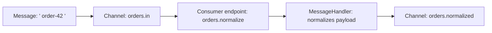

# Endpoint Bean Names

In the **Configuration and Lifecycle** chapter of the **SPRING_INTEGRATION_CORE** module, bean names are the link between message flow configuration and the actual objects managed by Spring. A single processing step can create multiple beans: channel, consumer endpoint, message handler, or message source. Knowing the right name helps you locate the right object, control its lifecycle, and replace components in tests.

This lesson focuses on message-processing endpoints in Spring Integration Core, using service activator, transformer, and Java DSL examples. These rules also help when reading router, filter, and aggregator configurations, though they do not replace the specific business configuration of each integration pattern.

## 1. Objectives and Prerequisites

After this lesson, you will be able to:

- Distinguish a consumer endpoint's bean name from the bean names of its handler and channel.
- Read names generated from XML, annotations on POJOs, and annotations on `@Bean` methods.
- Use `@EndpointId` or Java DSL to obtain stable endpoint names.
- Look up an endpoint to call `start()`, `stop()`, and check its state.
- Diagnose bean name confusion, duplicate names, and replacing the wrong object in tests.

You should know `Message<T>`, `MessageChannel`, `DirectChannel`, `QueueChannel`, `@Configuration`, and `@Bean`. The Java DSL examples use the `IntegrationFlow.from(...)` API, suitable for Spring Integration 6.x/7.x; use compatible versions of Spring Integration and Spring Framework managed by your application's BOM or dependency configuration.

## 2. One Processing Step Does Not Necessarily Correspond to One Bean

Suppose the system receives an order code, normalizes it, and passes the result to the next channel:



The components have distinct responsibilities:

| Component | Responsibility | Example |
| --- | --- | --- |
| `MessageChannel` | Delivers or buffers messages | `orders.in` |
| Consumer endpoint | Connects the input channel to the handler; manages subscribing or polling | `orders.normalize` |
| `MessageHandler` | Performs message processing | Handler for the normalization step |
| Business POJO, if any | Provides the method invoked by the handler | `orderNormalizer` |

In the standard consuming endpoint model, the endpoint holds a reference to the handler and invokes the handler when a message arrives. Therefore, an operation to stop message consumption must target the endpoint. Obtaining the business-processing bean does not mean you have obtained the object controlling the connection to the channel. See [the endpoint model in the overview documentation](https://docs.spring.io/spring-integration/reference/overview.html#endpoint-bean-names).

The consumer type depends on the input channel:

- `DirectChannel` is a `SubscribableChannel`; standard consumer configuration creates an `EventDrivenConsumer`.
- `QueueChannel` is a `PollableChannel`; the corresponding consumer is a `PollingConsumer` and requires an appropriate poller configuration.

`ConsumerEndpointFactoryBean` is the supporting component that creates the appropriate consumer. Assigning a different name does not change the channel type or turn a polling consumer into a subscription-based consumer. See [ConsumerEndpointFactoryBean API](https://docs.spring.io/spring-integration/api/org/springframework/integration/config/ConsumerEndpointFactoryBean.html).

### Names Commonly Confused

| Value | Meaning |
| --- | --- |
| `ordersFlow` | Bean name containing an `IntegrationFlow` definition |
| `orders.in` | Channel name where messages are sent |
| `orders.normalize` | Endpoint name executing a step in the flow |
| `orders.normalize.handler` | Name or alias to access the handler, depending on configuration |
| `id` header of `Message` | Identifier of a specific message |

Renaming an endpoint does not change `id`, `correlationId`, or `sequenceNumber` headers. Bean names identify components in the container; headers serve message identification and coordination.

## 3. Naming Rules in XML

For a service activator declared in XML, `id` names the consumer endpoint. The handler created for the endpoint is named by appending `.handler` by convention.

Suppose the `orderNormalizer` bean already exists and has a `normalize(String)` method:

```xml
<int:channel id="orders.in"/>

<int:channel id="orders.normalized">
    <int:queue/>
</int:channel>

<int:service-activator
        id="orders.normalize"
        input-channel="orders.in"
        output-channel="orders.normalized"
        ref="orderNormalizer"
        method="normalize"/>
```

The snippet above is the body of an XML configuration, with the `int` namespace already declared.

| Lookup Name | Object |
| --- | --- |
| `orders.in` | Input channel |
| `orders.normalize` | Consumer endpoint |
| `orders.normalize.handler` | Handler invoking the business method |
| `orderNormalizer` | Business bean referenced by `ref` |
| `orders.normalized` | Channel holding results |

`ref="orderNormalizer"` does not change the endpoint name to `orderNormalizer`. Likewise, `input-channel` references the channel rather than naming the consumer. This XML convention is described in [Endpoint Bean Names](https://docs.spring.io/spring-integration/reference/overview.html#endpoint-bean-names).

The example above uses a direct input channel, so the consumer needs no poller. If the input is changed to a queue, you must add a poller for the consumer; keeping the same `id` does not automatically complete that configuration change.

## 4. Annotations on POJOs: Default Names Depend on Code Structure

Consider a POJO registered via component scanning or `@Import`:

```java
import java.util.Locale;

import org.springframework.integration.annotation.ServiceActivator;
import org.springframework.stereotype.Component;

@Component("orderEndpoints")
public class OrderEndpoints {

    @ServiceActivator(
            inputChannel = "orders.in",
            outputChannel = "orders.normalized")
    public String normalizeOrder(String payload) {
        return payload.trim().toUpperCase(Locale.ROOT);
    }
}
```

Assuming Spring Integration infrastructure is enabled and both channels exist, the framework generates names following the pattern:

```text
[componentBeanName].[methodName].[annotationNameWithLowercaseFirstLetter]
```

In the example:

```text
POJO:              orderEndpoints
Consumer endpoint: orderEndpoints.normalizeOrder.serviceActivator
Handler:           orderEndpoints.normalizeOrder.serviceActivator.handler
```

`serviceActivator` comes from the `ServiceActivator` annotation. If `@Transformer` is used, the trailing part is `transformer`. This is the name generated for the messaging component, distinct from the original POJO name. See [Annotation Support](https://docs.spring.io/spring-integration/reference/configuration/annotations.html).

Default names are convenient for small configurations, but expose code structure into operational references. For instance, renaming `normalizeOrder` to `canonicalizeOrder` can break name strings in tests or management tools even when payload normalization remains unchanged.

### Pinning Names with `@EndpointId`

```java
import java.util.Locale;

import org.springframework.integration.annotation.EndpointId;
import org.springframework.integration.annotation.ServiceActivator;
import org.springframework.stereotype.Component;

@Component("orderEndpoints")
public class OrderEndpoints {

    @EndpointId("orders.normalize")
    @ServiceActivator(
            inputChannel = "orders.in",
            outputChannel = "orders.normalized",
            autoStartup = "false")
    public String normalizeOrder(String payload) {
        return payload.trim().toUpperCase(Locale.ROOT);
    }
}
```

Then the consumer is named `orders.normalize`; the handler created for the POJO method is named `orders.normalize.handler`. Renaming the Java method does not change the declared endpoint ID.

`@EndpointId` has existed since Spring Integration 5.0.4. This annotation is used alongside an EIP annotation on a method; do not use it on a method carrying multiple EIP annotations to pin multiple endpoints at once. See [EndpointId API](https://docs.spring.io/spring-integration/api/org/springframework/integration/annotation/EndpointId.html).

`autoStartup = "false"` only configures the startup state. The endpoint still exists in the container and can be retrieved for explicit startup.

## 5. Annotations on `@Bean`: Handler and Endpoint Names Are Set Separately

The following case differs from the POJO in the previous section: the `@Bean` method itself returns a `MessageHandler`.

```java
import org.springframework.context.annotation.Bean;
import org.springframework.context.annotation.Configuration;
import org.springframework.integration.annotation.EndpointId;
import org.springframework.integration.annotation.ServiceActivator;
import org.springframework.messaging.MessageHandler;

@Configuration
public class OrderAuditConfiguration {

    @Bean("orders.audit.handler")
    @EndpointId("orders.audit")
    @ServiceActivator(inputChannel = "orders.normalized")
    public MessageHandler auditHandler() {
        return message ->
                System.out.println("Processed: " + message.getPayload());
    }
}
```

Here:

- `@Bean("orders.audit.handler")` names the handler returned by the method.
- `@EndpointId("orders.audit")` names the consumer connected to the channel.
- The method name `auditHandler` is no longer the bean name because `@Bean` specifies an explicit name.

If `@EndpointId` is omitted, the default consumer name takes the form:

```text
orderAuditConfiguration.auditHandler.serviceActivator
```

If the explicit name on `@Bean` is omitted, the handler takes the method name `auditHandler`. Merely adding `@EndpointId("orders.audit")` does not automatically rename a handler already declared by `@Bean`. Therefore, using `orders.audit` and `orders.audit.handler` together is a readable convention, not an automatic renaming rule applied to every bean. See [EndpointId rules when used with Bean](https://docs.spring.io/spring-integration/api/org/springframework/integration/annotation/EndpointId.html).

### Why Does a `.wrapper` Bean Sometimes Appear?

A user-supplied `MessageHandler`, such as the lambda above, may be wrapped by the framework with `ReplyProducingMessageHandlerWrapper` if it is not an `AbstractReplyProducingMessageHandler`. In a configuration with `@EndpointId`, the wrapper's name by convention is the handler name plus `.wrapper`, for instance:

```text
orders.audit
orders.audit.handler
orders.audit.handler.wrapper
```

The object returned by the `@Bean` method and the object invoked by the endpoint through the wrapper may differ. The appearance of a wrapper does not mean an extra independent consumer exists. These details are described in [Endpoint Bean Names](https://docs.spring.io/spring-integration/reference/overview.html#endpoint-bean-names).

The audit snippet only illustrates naming rules. If attaching it to the complete flow in the next section, configure an appropriate channel and poller; do not combine alternative configurations as-is into the same context.

## 6. Java DSL: Flow Name Differs from Endpoint Name

In Java DSL, the `@Bean` method name is usually the flow name. To name a step, configure the endpoint of that step itself.

```java
@Bean
public IntegrationFlow ordersFlow(
        @Qualifier("orders.in") MessageChannel input,
        @Qualifier("orders.normalized") MessageChannel output) {

    return IntegrationFlow.from(input)
            .<String, String>transform(
                    payload -> payload.trim().toUpperCase(Locale.ROOT),
                    endpoint -> endpoint
                            .id("orders.normalize")
                            .autoStartup(false))
            .channel(output)
            .get();
}
```

There are three names declared in three different places:

| Configuration | Identified Component |
| --- | --- |
| `@Bean` on `ordersFlow(...)` | Flow named `ordersFlow` |
| `@Qualifier("orders.in")` | Input channel reference |
| `endpoint.id("orders.normalize")` | Consumer endpoint of the transform step |

`EndpointSpec.id(...)` configures the identifier used to register the component into the application context. In a consumer endpoint spec, this name applies to the created endpoint. See [EndpointSpec API](https://docs.spring.io/spring-integration/api/org/springframework/integration/dsl/EndpointSpec.html).

### Primary Name and Alias of the Handler

For the handler created and registered by the DSL inside the transform step above, the framework also registers an alias `orders.normalize.handler` to access the handler. The handler's primary name may be an auto-generated name tied to the flow. The alias and primary name point to the same bean; they are not two copies of the handler.

If the DSL references a handler already registered as a bean, do not assume the framework always creates an alias in the same way. When you need the actual handler, you can retrieve it through the consumer as shown in the practice section.

Details of alias registration are in [IntegrationFlowBeanPostProcessor source code](https://raw.githubusercontent.com/spring-projects/spring-integration/main/spring-integration-core/src/main/java/org/springframework/integration/dsl/context/IntegrationFlowBeanPostProcessor.java). This is also why naming tables should distinguish "lookup name or alias" from "primary bean name."

### Do Not Depend on Auto-Generated Names

The DSL can generate names containing the flow name, component type, and a suffix like `#0`. These names are helpful for reading logs, but should not become hardcoded strings in endpoint control code.

For example, if you add a processing step before the transformer, the name-generation order can change. A more resilient approach is to assign IDs to endpoints that need to be managed or tested by name, instead of guessing suffixes from DSL position.

## 7. Practice: Look Up the Right Endpoint and Control Lifecycle

The following example is a standalone Java configuration application without needing Spring Boot. It requires the `org.springframework.integration:spring-integration-core` dependency and a JDK compatible with the framework version you use.

Use only this configuration in the example's context. Configurations in earlier sections were alternative declaration styles for comparing names.

```java
import java.util.Locale;

import org.springframework.beans.factory.annotation.Qualifier;
import org.springframework.context.annotation.AnnotationConfigApplicationContext;
import org.springframework.context.annotation.Bean;
import org.springframework.context.annotation.Configuration;
import org.springframework.integration.channel.DirectChannel;
import org.springframework.integration.channel.QueueChannel;
import org.springframework.integration.config.EnableIntegration;
import org.springframework.integration.dsl.IntegrationFlow;
import org.springframework.integration.endpoint.AbstractEndpoint;
import org.springframework.integration.endpoint.EventDrivenConsumer;
import org.springframework.messaging.Message;
import org.springframework.messaging.MessageChannel;
import org.springframework.messaging.MessageHandler;
import org.springframework.messaging.PollableChannel;
import org.springframework.messaging.support.GenericMessage;

public class EndpointBeanNameDemo {

    @Configuration(proxyBeanMethods = false)
    @EnableIntegration
    public static class Config {

        @Bean("orders.in")
        public MessageChannel ordersInput() {
            return new DirectChannel();
        }

        @Bean("orders.normalized")
        public PollableChannel normalizedOrders() {
            return new QueueChannel();
        }

        @Bean
        public IntegrationFlow ordersFlow(
                @Qualifier("orders.in") MessageChannel input,
                @Qualifier("orders.normalized") MessageChannel output) {

            return IntegrationFlow.from(input)
                    .<String, String>transform(
                            value -> value.trim().toUpperCase(Locale.ROOT),
                            endpoint -> endpoint
                                    .id("orders.normalize")
                                    .autoStartup(false))
                    .channel(output)
                    .get();
        }
    }

    public static void main(String[] args) {
        try (var context =
                     new AnnotationConfigApplicationContext(Config.class)) {

            MessageChannel input =
                    context.getBean("orders.in", MessageChannel.class);

            PollableChannel output =
                    context.getBean("orders.normalized", PollableChannel.class);

            AbstractEndpoint endpoint =
                    context.getBean("orders.normalize", AbstractEndpoint.class);

            MessageHandler handler =
                    context.getBean(
                            "orders.normalize.handler", MessageHandler.class);

            EventDrivenConsumer consumer =
                    context.getBean(
                            "orders.normalize", EventDrivenConsumer.class);

            if (consumer.getHandler() != handler) {
                throw new IllegalStateException("Alias does not point to the right handler");
            }

            System.out.println("Before start: " + endpoint.isRunning());

            endpoint.start();

            boolean sent =
                    input.send(new GenericMessage<>("  order-42  "));

            Message<?> reply = output.receive(1000);

            if (!sent || reply == null
                    || !"ORDER-42".equals(reply.getPayload())) {
                throw new IllegalStateException("Did not receive expected result");
            }

            System.out.println("Result: " + reply.getPayload());

            endpoint.stop();

            System.out.println("After stop: " + endpoint.isRunning());
            System.out.println(
                    "Handler still exists: "
                            + context.containsBean("orders.normalize.handler"));
        }
    }
}
```

Expected business output, omitting framework startup logs:

```text
Before start: false
Result: ORDER-42
After stop: false
Handler still exists: true
```

Several details should be read carefully:

1. `@EnableIntegration` registers the infrastructure needed for this Java configuration application.
2. `ordersFlow` describes the entire flow; `orders.normalize` is the dedicated endpoint of the transform step.
3. The input channel is a `DirectChannel`, so `EventDrivenConsumer` is the matching type. The output queue is actively polled by the program via `receive()`, with no additional polling consumer.
4. `start()` connects message consumption; `stop()` stops that activity. Stopping the endpoint does not remove the handler bean from the context.
5. Comparing `consumer.getHandler() == handler` confirms that the alias points to the exact object used by the consumer in this specific configuration.

`EventDrivenConsumer` exposes `getHandler()` and `getInputChannel()`, which is useful when verifying relationships between components. See [EventDrivenConsumer API](https://docs.spring.io/spring-integration/api/org/springframework/integration/endpoint/EventDrivenConsumer.html).

### How Does Stopping an Endpoint Affect Sending?

In a configuration with only one consumer on a `DirectChannel`, sending a message after the consumer has stopped encounters a no-subscriber condition and typically receives a dispatch error. This channel does not buffer messages to wait for the endpoint to restart.

With a `QueueChannel`, producers can continue putting messages into the queue while the polling consumer is stopped, depending on capacity and send timeout. Messages remaining in the queue can be processed when the consumer becomes active again. Data durability also depends on how channel storage is configured.

Furthermore, stopping an endpoint does not mean all asynchronous processing has finished, does not guarantee undoing business side effects, and does not replace controlled shutdown design. The right name helps select the right control object; processing semantics still depend on the channel, executor, and handler.

## 8. FactoryBean: Distinguishing `name` and `&name`

In endpoint configurations based on `ConsumerEndpointFactoryBean`, Spring distinguishes the product created by the factory from the factory itself:

```java
AbstractEndpoint endpoint =
        context.getBean("orders.normalize", AbstractEndpoint.class);

ConsumerEndpointFactoryBean factory =
        context.getBean(
                "&orders.normalize", ConsumerEndpointFactoryBean.class);
```

This snippet requires importing:

```java
import org.springframework.integration.config.ConsumerEndpointFactoryBean;
```

- `orders.normalize` returns the consumer endpoint.
- `&orders.normalize` returns the factory that assists in creating and managing the endpoint.
- `orders.normalize.handler` returns the handler if that name or alias has been registered.

The `&` prefix is Spring's `FactoryBean` lookup convention, not a character you add to an ID when declaring it. See [BeanFactory API and FACTORY_BEAN_PREFIX](https://docs.spring.io/spring-framework/docs/current/javadoc-api/org/springframework/beans/factory/BeanFactory.html).

For routine operational tasks, retrieving the endpoint as `AbstractEndpoint` or `SmartLifecycle` is sufficient. Use the factory only when you genuinely need to inspect the configuration layer; do not assume every component named "endpoint" is registered through this kind of factory.

Nor should you call `setBeanName(...)` after the application is running to "rename a bean." The name property on an object and the registration key in the bean registry are two different things. Change the ID in configuration and update the corresponding references.

## 9. Inbound Polling Adapter: The `.source` Suffix

Not every endpoint consumes from an `inputChannel`. An inbound polling adapter actively invokes a `MessageSource` to create messages and push them to an output channel.

The following example method is placed inside a `@Configuration` class with `@EnableIntegration` and an existing `orders.raw` channel:

```java
@Bean("orders.poll.source")
@EndpointId("orders.poll")
@InboundChannelAdapter(
        channel = "orders.raw",
        poller = @Poller(fixedDelay = "1000"))
public MessageSource<String> orderSource() {
    return () -> null;
}
```

Additional imports:

```java
import org.springframework.integration.annotation.InboundChannelAdapter;
import org.springframework.integration.annotation.Poller;
import org.springframework.integration.core.MessageSource;
```

The lambda intentionally returns `null`: on that poll, there is no data to emit a message.

The names here are:

| Name | Role |
| --- | --- |
| `orders.poll` | `SourcePollingChannelAdapter`, managing scheduled invocations of the source |
| `orders.poll.source` | `MessageSource` declared via `@Bean` |
| `orders.raw` | Channel receiving messages from the adapter |

To stop periodic data retrieval, target `orders.poll`. Similar to the handler in the previous section, the `.source` name on `@Bean` is explicitly specified to follow convention. Do not infer that every inbound adapter, including event-driven listener adapters, shares this polling structure. See [naming rules for message sources](https://docs.spring.io/spring-integration/api/org/springframework/integration/annotation/EndpointId.html).

## 10. Endpoint Names in Testing and Diagnostics

### Replacing a Handler via the Consumer Endpoint

Spring Integration Test provides `MockIntegrationContext` to replace the component behind an endpoint. Assume the test class uses `@SpringIntegrationTest`, autowires `mockIntegrationContext`, and uses the demo configuration:

```java
MessageHandler replacement = message -> {
    // Collect messages or verify the expected effect.
};

mockIntegrationContext.substituteMessageHandlerFor(
        "orders.normalize", replacement);
```

The first argument is the **consumer endpoint ID**, even though the operation replaces the handler. Passing `orders.normalize.handler` here targets the wrong kind of object.

In the cleanup method, restore the replaced configuration:

```java
mockIntegrationContext.resetBeans();
```

The lambda example above only consumes messages and produces no reply. If the test needs to continue verifying the transformer's output, use a mock handler capable of returning a reply instead of expecting a result from a one-way lambda.

`@SpringIntegrationTest(noAutoStartup = {"orders.normalize"})` also targets endpoints by name or pattern. These APIs require the `spring-integration-test` dependency in test scope. See [Testing support](https://docs.spring.io/spring-integration/reference/testing.html).

### Listing Endpoints After Context Initialization

When unsure of the actual names, you can inspect the created endpoints:

```java
context.getBeansOfType(AbstractEndpoint.class)
        .forEach((name, endpoint) ->
                System.out.println(
                        name + " -> "
                                + endpoint.getClass().getSimpleName()
                                + ", running=" + endpoint.isRunning()));

for (String alias : context.getAliases("orders.normalize.handler")) {
    System.out.println("Handler alias: " + alias);
}
```

This snippet is meant for after the application context has finished initializing. Do not send messages inside a constructor or `@PostConstruct` just to test bean names, because flows and lifecycle may not be ready. If an endpoint is created late by annotation processing, early injection should also be considered; `@Lazy` references can be used where appropriate for the configuration. See [notes on initializing annotation-based components](https://docs.spring.io/spring-integration/reference/configuration/annotations.html).

When combining logs, message history, or the integration graph, identify whether each entry represents a channel, handler, or endpoint. Do not expect the display name across all observability mechanisms to always be the consumer ID, or treat auto-generated bean names as stable metric tag values.

## 11. Naming So Multiple Flows Can Coexist

A maintainable application convention is:

```text
<business-domain>.<processing-step>
```

Examples:

```text
orders.normalize
orders.validate
orders.route
orders.aggregate
orders.persist
orders.errors.log
```

Channels can use names expressing delivery roles such as `orders.in`, `orders.validated`, `orders.rejected`. Handlers and sources, when declared separately, should use `.handler` and `.source` suffixes respectively.

This is an application design convention, not a mandatory Spring Integration syntax requirement. Dots help group names; they do not create isolated namespaces inside the container.

### Two Static Flows Do Not Automatically Isolate Explicit IDs

If both `onlineOrdersFlow` and `storeOrdersFlow` declare the endpoint ID `orders.normalize`, they compete for the same name in the context. Different flow names do not guarantee that explicitly chosen endpoint IDs will be prefixed.

Choose distinct names instead, such as:

```text
onlineOrders.normalize
storeOrders.normalize
```

Do not enable bean overriding just to silence duplicate-name messages. If two endpoints coexist by design, they need two distinct identifiers and references must clearly indicate the intended endpoint.

### Multiple Copies of a Dynamic Flow

When registering the same structure multiple times using `IntegrationFlowContext`, the registration API supports adding the flow ID as a prefix:

```java
IntegrationFlowContext.IntegrationFlowRegistration registration =
        flowContext.registration(buildFlow())
                .id("tenantA")
                .useFlowIdAsPrefix()
                .register();
```

This snippet uses `org.springframework.integration.dsl.context.IntegrationFlowContext`. Suppose `buildFlow()` returns a flow with endpoint ID `normalize`. The corresponding endpoint is identified as `tenantA.normalize` when registered with the prefix. A copy registered under `tenantB` can use the same local ID `normalize` while still getting a different final name.

`useFlowIdAsPrefix()` requires a flow ID to be specified. When the dynamic flow is no longer needed, use the registration's lifecycle, such as `registration.destroy()`, to remove the flow along with its dependent components. Do not confuse `destroy()` with merely stopping an endpoint. See [Dynamic and Runtime Integration Flows](https://docs.spring.io/spring-integration/reference/dsl/java-runtime-flows.html).

## 12. Common Errors and Resolutions

| Symptom | Cause to Check | Resolution |
| --- | --- | --- |
| `NoSuchBeanDefinitionException` when looking up endpoint | Used flow name, old method name, or guessed auto-generated name | Check declared ID and list `AbstractEndpoint` beans after initialization |
| `BeanNotOfRequiredTypeException` | Looked up handler with endpoint type or confused factory with product | Identify role and select the matching name and type |
| Multiple beans of same type on autowire | Multiple matching endpoints/handlers exist | Use `@Qualifier` with the exact name; watch when beans are registered |
| Test replacing handler fails | Passed `.handler` name to an API expecting consumer ID | Use the endpoint name for `substituteMessageHandlerFor(...)` |
| Renaming a method breaks tests | Tests reference annotation-generated names | Pin with `@EndpointId` and update tests |
| Application reports duplicate bean | Two flows use the same explicit ID | Use distinct names or prefix when registering dynamic flows |
| Endpoint stopped yet handler can still be looked up | Stopping lifecycle does not delete beans | Check `isRunning()` and consumption behavior instead of just `containsBean()` |
| Sent to channel but expected step does not run | Endpoint not started, stopped, missing poller, or wired to wrong channel | Check endpoint state and relationship with the channel |
| Logs show an extra `.wrapper` | Framework wrapped an application-provided handler | Verify wrapper and original handler; do not assume two consumers exist |

When changing an ID, simultaneously review injection configurations, lookup strings, management commands, `noAutoStartup` patterns, test mocks, and operational documentation. Renaming may leave business processing unchanged yet break references to the component.

## 13. Key Takeaways

A consumer endpoint and its handler take on two different responsibilities. Channel names are used for routing messages; endpoint names are used to identify and control the consumption step; handler names are used to access the processing object.

With annotations on POJOs, `@EndpointId` keeps the endpoint name independent of the method name. With `@Bean`, the handler or source name is still determined by `@Bean`. With Java DSL, set the ID on the endpoint spec and remember that the flow name is a separate identifier.

Explicit names are valuable when they serve as stable reference points for lifecycle, testing, and operations. When in doubt, inspect the actual registry and endpoint-handler relationships in the context rather than guessing from class names or a step's position in the flow.
