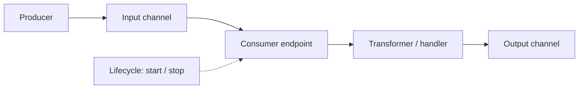

# Endpoint Auto Startup

In the **Configuration and Lifecycle** chapter of the **SPRING_INTEGRATION_CORE** module, this lesson explains how to decide whether an endpoint starts automatically with the application. This knowledge helps control when a flow begins receiving messages, rather than only controlling when beans are created.

The running example is an order code normalization flow: receiving a `Message<String>`, trimming whitespace, converting the code to uppercase, and forwarding the resulting message to an output channel. The processing endpoint is kept in a non-running state until a start command is issued.

## 1. Objectives and Practice Prerequisites

After this lesson, you will be able to:

- Distinguish the `autoStartup` configuration from the `isRunning()` state.
- Configure endpoints using Java DSL and annotations.
- Retrieve the right endpoint bean to invoke `start()` or `stop()`.
- Predict the behavior of `DirectChannel` and `QueueChannel` when a consumer is not running yet.
- Combine `autoStartup` with `phase` and write tests for the initial state.

Examples use Java 17+, Spring Integration 6.5.x, and compatible Spring Framework 6.2.x. The testing section uses JUnit Jupiter. The project needs `org.springframework.integration:spring-integration-core` and `org.junit.jupiter:junit-jupiter` in test scope; versions should be managed via an appropriate BOM for the project.

The code snippets in this lesson are standalone examples to place in a practice project. The Java DSL configuration in section 5 and the test class in section 9 share the `example.autostart` package.

## 2. Which Component Is Actually Started?

An integration flow has different roles:

| Component | Role in the Example |
| --- | --- |
| `Message<String>` | Carries the order code and headers |
| `MessageChannel` | Receives, forwards, or temporarily buffers messages |
| Handler/transformer | Performs payload normalization |
| Consumer endpoint | Connects the input channel to the handler and controls message reception |
| `IntegrationFlow` | Describes the components and connections in Java DSL |

With a subscribable channel, the endpoint is typically an `EventDrivenConsumer`. With a pollable channel, the endpoint is a `PollingConsumer` and requires a poller configuration. These two endpoints enable the handler to receive messages through two different mechanisms. See [Message Endpoints](https://docs.spring.io/spring-integration/reference/6.5/endpoint.html).



Therefore, when writing `.autoStartup(false)` on a transformer's endpoint, the controlled object is the endpoint connecting the transformer to the input channel. The transformer bean and the channels can still exist.

Endpoints based on `AbstractEndpoint` default to `autoStartup=true`. A value of `false` requires an explicit start for the endpoint to operate. See [AbstractEndpoint API](https://docs.spring.io/spring-integration/docs/6.5.0/api/org/springframework/integration/endpoint/AbstractEndpoint.html).

## 3. Distinguishing Startup Policy from Running State

`autoStartup` answers the question: **should the endpoint start automatically during ApplicationContext refresh?**

`isRunning()` answers the question: **is the endpoint currently in a running state?**

These two values are not synonymous:

| Scenario | `isAutoStartup()` | Expected `isRunning()` |
| --- | --- | --- |
| Context just refreshed, endpoint set to auto-start and started successfully | `true` | `true` |
| Context just refreshed, endpoint does not auto-start | `false` | `false` |
| `start()` called successfully on a non-auto-starting endpoint | `false` | `true` |
| `stop()` called on an auto-starting endpoint | `true` | `false` |

This table assumes no other component issues lifecycle commands. For instance, application code may still call `start()` immediately after context refresh.

Calling `start()` does not require changing `autoStartup` to `true`. Similarly, changing the auto-startup configuration value is not an immediate toggle equivalent to `start()` or `stop()`.

### 3.1. Not Auto-Starting Does Not Mean Beans Are Not Created

In the `SmartLifecycle` mechanism, the container can still instantiate beans to manage their lifecycle. Hence, `autoStartup=false` does not replace `@Lazy`, `@Profile`, or bean registration conditions. Constructors, dependency injection, and resource initialization steps of those beans must still be considered separately.

The `SmartLifecycle` contract defines auto-startup at context refresh time, whereas `start()` is an explicit startup request. See [SmartLifecycle API](https://docs.spring.io/spring-framework/docs/6.2.x/javadoc-api/org/springframework/context/SmartLifecycle.html).

### 3.2. When Should an Endpoint Be Kept Stopped?

Some design scenarios:

- Business reference tables must finish loading before processing orders.
- You want to verify wiring and message mapping before turning on consumers.
- A processing route must be enabled based on an operational decision.
- You want to hold a message-producing source stopped until downstream steps are ready.

Every scenario must clearly specify **who starts the endpoint** and **what conditions permit starting**. If you only set `false` and never issue a start command, the endpoint remains in a non-running state.

## 4. Behavior Depends on the Input Channel

Disabling a consumer does not by itself determine a message's fate. You must check whether the channel stores messages and whether any other consumer remains active.

| Input Channel | When the Consumer Under Consideration Is Not Running | What Needs to Be Designed |
| --- | --- | --- |
| `DirectChannel` | The endpoint has not subscribed the handler; if no other subscriber exists, sending fails | Delay the producer or prepare send-error handling |
| `QueueChannel` | Messages can enter the queue even when the consumer is not running, as long as space remains | Bound capacity and send timeout |
| `PublishSubscribeChannel` | Unsubscribed consumers will not receive broadcasts sent during that time | Consider subscriber requirements and potential message loss for that branch |

`DirectChannel` delivers directly to the handler on the sender's thread. `QueueChannel` stores messages and lets receivers pull them later. `PublishSubscribeChannel` defaults to `minSubscribers=0`, so a send may be treated as successful even with no subscribers. These differences are described in [Message Channel Implementations](https://docs.spring.io/spring-integration/reference/6.5/channel/implementations.html).

With a standard `QueueChannel`, the buffer resides in memory. Holding messages in the queue while a consumer is stopped does not mean those messages survive after the process exits.

A small example with a `DirectChannel` that has no subscribers at all:

```java
DirectChannel input = new DirectChannel();

// No subscriber: the send command cannot deliver the message to a handler.
input.send(new GenericMessage<>("order-17"));
```

This snippet requires importing `org.springframework.integration.channel.DirectChannel` and `org.springframework.messaging.support.GenericMessage`. In this case, the send call throws a delivery/dispatch exception because there are no subscribers; do not write logic assuming it only ever returns `false`.

If multiple consumers share one channel, stopping one endpoint affects only that endpoint. Other consumers can still receive messages.

## 5. Java DSL Example: Consumer Runs Only on Command

Practice flow:

```text
orderInput (QueueChannel, capacity 100)
    -> normalizeOrders (PollingConsumer, autoStartup=false)
    -> normalizedOrders (QueueChannel, capacity 100)
```

Complete configuration:

```java
package example.autostart;

import java.time.Duration;
import java.util.Locale;

import org.springframework.beans.factory.annotation.Qualifier;
import org.springframework.context.annotation.Bean;
import org.springframework.context.annotation.Configuration;
import org.springframework.integration.channel.QueueChannel;
import org.springframework.integration.config.EnableIntegration;
import org.springframework.integration.dsl.IntegrationFlow;
import org.springframework.integration.dsl.Pollers;

@Configuration
@EnableIntegration
public class AutoStartupConfig {

    @Bean
    public QueueChannel orderInput() {
        return new QueueChannel(100);
    }

    @Bean
    public QueueChannel normalizedOrders() {
        return new QueueChannel(100);
    }

    @Bean
    public IntegrationFlow orderNormalizationFlow(
            @Qualifier("orderInput") QueueChannel input,
            @Qualifier("normalizedOrders") QueueChannel output) {

        return IntegrationFlow.from(input)
                .transformWith(endpoint -> endpoint
                        .transformer((String payload) ->
                                payload.trim().toUpperCase(Locale.ROOT))
                        .id("normalizeOrders")
                        .autoStartup(false)
                        .phase(100)
                        .poller(Pollers.fixedDelay(Duration.ofMillis(50))
                                .maxMessagesPerPoll(10)
                                .receiveTimeout(0)))
                .channel(output)
                .get();
    }
}
```

In the example:

- `orderNormalizationFlow` is the bean name describing the flow.
- `normalizeOrders` is the endpoint bean name used for lifecycle operations.
- `autoStartup(false)` keeps the consumer from running after context refresh.
- `phase(100)` sets lifecycle ordering when the container coordinates multiple components.
- The poller uses a 50 ms fixed delay and receives at most 10 messages per poll.
- `receiveTimeout(0)` makes queue polling return immediately when no message is available.

Java DSL allows setting IDs and lifecycle attributes on endpoints. The example uses `transformWith` per the 6.5 API. See [DSL and Endpoint Configuration](https://docs.spring.io/spring-integration/reference/6.5/dsl/java-endpoints.html) and [BaseIntegrationFlowDefinition API](https://docs.spring.io/spring-integration/docs/6.5.0/api/org/springframework/integration/dsl/BaseIntegrationFlowDefinition.html).

`maxMessagesPerPoll` and `receiveTimeout` are poller options; they do not determine whether the endpoint auto-starts. See [PollerSpec API](https://docs.spring.io/spring-integration/docs/6.5.0/api/org/springframework/integration/dsl/PollerSpec.html).

After refresh, a message can be sent to `orderInput`. It sits waiting in the queue. Once the endpoint is started, the poller begins fetching messages to normalize and forward results to `normalizedOrders`.

Here, no thread automatically pulls results from the output queue. In a real application, a downstream consumer or appropriate receiving mechanism is needed.

## 6. Starting and Stopping the Right Endpoint Bean

After the context is created and refreshed, retrieve the endpoint by its configured ID:

```java
AbstractEndpoint endpoint =
        context.getBean("normalizeOrders", AbstractEndpoint.class);

boolean configuredToAutoStart = endpoint.isAutoStartup(); // false
boolean initiallyRunning = endpoint.isRunning();          // false

endpoint.start();
boolean runningAfterStart = endpoint.isRunning();         // true

endpoint.stop();
boolean runningAfterStop = endpoint.isRunning();          // false
```

The snippet requires importing `org.springframework.integration.endpoint.AbstractEndpoint`; the `context` variable is an ApplicationContext containing `AutoStartupConfig`.

Retrieve the `normalizeOrders` bean because it is the endpoint. A bean containing normalization business logic does not necessarily expose lifecycle APIs. Flow name, endpoint name, handler name, and channel name are identifiers with distinct roles.

### 6.1. Effects of Stop

For an event-driven consumer, stop unregisters the handler from the channel. For a polling consumer, stop halts the endpoint's polling activity.

Do not infer that all business work executing on another thread has completed solely from a `stop()` call. When executors, external system adapters, or long-running tasks are involved, examine how those components stop and handle in-flight work.

An operational sequence that can be applied to a pipeline is:

1. Prevent producers from accepting or generating new work.
2. Stop or detach producers using the adapter's API.
3. Monitor in-flight work and backlog according to business requirements.
4. Stop remaining consumers once desired conditions are met.

This is an application design choice; `autoStartup` alone does not provide a message-draining procedure.

### 6.2. Be Careful with context.start()

`context.start()` issues a lifecycle request at the context scope. With `DefaultLifecycleProcessor`, an explicit start operation starts lifecycle beans that are not yet running, including beans that did not auto-start on refresh.

Therefore, `autoStartup=false` is not a permanent prohibition on starting. If you want to enable a specific endpoint, call `start()` on that exact endpoint so the scope of impact is clear. See [DefaultLifecycleProcessor API](https://docs.spring.io/spring-framework/docs/6.2.x/javadoc-api/org/springframework/context/support/DefaultLifecycleProcessor.html).

## 7. Configuration with Annotations and Environment Properties

When using annotations, place lifecycle attributes on the annotation creating the endpoint. The example below is an alternative configuration for the transformer in Java DSL:

```java
package example.autostart;

import java.util.Locale;

import org.springframework.integration.annotation.EndpointId;
import org.springframework.integration.annotation.MessageEndpoint;
import org.springframework.integration.annotation.Transformer;

@MessageEndpoint
public class AnnotatedOrderNormalizer {

    @Transformer(
            inputChannel = "annotationInput",
            outputChannel = "annotationOutput",
            autoStartup = "${orders.normalize.auto-startup:false}",
            phase = "100")
    @EndpointId("annotatedNormalizeOrders")
    public String normalize(String payload) {
        return payload.trim().toUpperCase(Locale.ROOT);
    }
}
```

To use this example, the application must enable `@EnableIntegration`, register the class via component scan or `@Bean`, and provide the `annotationInput` and `annotationOutput` channels. For instance, choosing `DirectChannel` as input and `QueueChannel` as output requires no poller.

The `autoStartup` annotation attribute accepts a string, so property placeholders can be used. `@EndpointId` names the endpoint so you can retrieve the `annotatedNormalizeOrders` bean when needing to start/stop it. See [Annotation Support](https://docs.spring.io/spring-integration/reference/6.5/configuration/annotations.html).

A corresponding environment configuration:

```properties
orders.normalize.auto-startup=false
```

With Spring Boot, the property can be placed in `application.properties`. With a plain ApplicationContext, an appropriate property source must be loaded. If the property is not declared, the placeholder in the example uses the default value `false`.

Editing an external properties file while the application is running does not automatically issue lifecycle commands. A configuration reload mechanism and separate endpoint control are needed if runtime changes are required.

When changing the annotation's input to a `QueueChannel`, add a poller such as `poller = @Poller(fixedDelay = "50", receiveTimeout = "0")`, importing `org.springframework.integration.annotation.Poller`.

## 8. Combining autoStartup with Phase and Readiness

`autoStartup` determines participation in automatic startup. `phase` determines lifecycle ordering among container-coordinated components.

In the standard ordering of `SmartLifecycle`:

- Starts in ascending phase order.
- Stops in descending phase order.
- Do not rely on order between beans sharing the same phase.
- Explicit `depends-on` relationships may take precedence over phase.

See the ordering contract in [SmartLifecycle API](https://docs.spring.io/spring-framework/docs/6.2.x/javadoc-api/org/springframework/context/SmartLifecycle.html).

Suppose an application has two endpoints and wants to prepare the consumer before the source starts emitting messages:

| Endpoint | Application-Chosen Phase | Policy |
| --- | --- | --- |
| Order normalization consumer | `100` | Starts before the source |
| Order-producing inbound adapter | `200` | Starts after consumer; stops before consumer |

The numbers represent relative order only, not wait times. Phase 200 does not mean waiting 200 ms.

If the consumer sets `autoStartup=false` while the source still auto-starts, a lower phase on the consumer does not make it turn on automatically. When the source starts sending, the consumer may still be inactive. With a `DirectChannel`, this design can cause send failures right at startup.

If you manually invoke `endpoint.start()` on multiple endpoints yourself, the invocation order is decided by application code. Do not expect phase to automatically reorder those manual calls.

### Readiness Is a Separate Business Condition

A successful start only shows that the component executed its startup step per the lifecycle contract. It does not prove reference data is complete, partner services are ready for business, or the entire processing route is clear.

A clear coordination flow:

```text
Context refresh completes
    -> load and verify reference data
    -> confirm downstream consumers are ready
    -> start consumers that need enabling
    -> start message-producing sources
    -> announce route readiness to accept work
```

If preparation fails, the application needs a clear decision: keep the route stopped to retry, or fail startup. Avoid declaring a processing route ready merely because the Java process is alive.

## 9. Testing Initial State and Post-Start Processing

The test below uses `AutoStartupConfig` from section 5. Neither Spring Boot, a broker, nor `@SpringIntegrationTest` is needed because it tests an in-memory flow only.

```java
package example.autostart;

import org.junit.jupiter.api.Test;

import org.springframework.context.annotation.AnnotationConfigApplicationContext;
import org.springframework.integration.channel.QueueChannel;
import org.springframework.integration.endpoint.AbstractEndpoint;
import org.springframework.messaging.Message;
import org.springframework.messaging.support.GenericMessage;

import static org.junit.jupiter.api.Assertions.assertEquals;
import static org.junit.jupiter.api.Assertions.assertFalse;
import static org.junit.jupiter.api.Assertions.assertNotNull;
import static org.junit.jupiter.api.Assertions.assertNull;
import static org.junit.jupiter.api.Assertions.assertTrue;

class AutoStartupTest {

    @Test
    void keepsMessageQueuedUntilEndpointStarts() {
        try (AnnotationConfigApplicationContext context =
                     new AnnotationConfigApplicationContext(AutoStartupConfig.class)) {

            QueueChannel input =
                    context.getBean("orderInput", QueueChannel.class);
            QueueChannel output =
                    context.getBean("normalizedOrders", QueueChannel.class);
            AbstractEndpoint endpoint =
                    context.getBean("normalizeOrders", AbstractEndpoint.class);

            assertFalse(endpoint.isAutoStartup());
            assertFalse(endpoint.isRunning());

            assertTrue(input.send(new GenericMessage<>("  order-17  "), 0));
            assertEquals(1, input.getQueueSize());
            assertNull(output.receive(0));

            endpoint.start();

            assertTrue(endpoint.isRunning());
            assertFalse(endpoint.isAutoStartup());

            Message<?> result = output.receive(2_000);
            assertNotNull(result);
            assertEquals("ORDER-17", result.getPayload());
            assertEquals(0, input.getQueueSize());

            endpoint.stop();
            assertFalse(endpoint.isRunning());
        }
    }
}
```

Meaning of the assertion groups:

1. The endpoint exists but does not run automatically after refresh.
2. The message is accepted into the input queue without passing through the transformer.
3. The start command allows the consumer to process the waiting message.
4. Starting does not mutate the `autoStartup` policy.
5. The stop command returns the endpoint to the non-running state.

`output.receive(2_000)` waits for the result with a 2-second limit instead of using `Thread.sleep()` and guessing when the poller has run. This value is the test's wait bound, not a latency guarantee for the application.

Before starting, `receive(0)` only checks instantaneously that no result exists yet. Key evidence of the unprocessed state also includes `isRunning()==false` and the message remaining in the input queue.

For further practice, create an alternative configuration using `DirectChannel` and separately test sending while the consumer is stopped vs. after it starts. Do not apply `QueueChannel`'s "message will wait" expectation to that channel.

## 10. Choosing Where to Place autoStartup in a Pipeline

A flow may consist of multiple endpoints:

```text
Inbound adapter
    -> transformer
    -> router
    -> filter
    -> aggregator
    -> service activator
```

Setting `autoStartup(false)` on a transformer controls only that transformer's endpoint. Routers, filters, aggregators, or other adapters still have their own lifecycles.

This leads to two common design patterns:

| Purpose | Appropriate Control Point |
| --- | --- |
| Prevent the system from pulling external data yet | Inbound adapter or intake entry point |
| Keep a business step inactive while still accepting backlog | Consumer after a channel with suitable storage |

If you stop mid-pipeline when everything uses `DirectChannel`, the upstream endpoint may encounter errors when sending into a segment with no subscribers. If buffering with a queue, you must define capacity and a policy for growing backlogs.

For flows created dynamically with `IntegrationFlowContext`, the `.registration(flow).autoStartup(false)` option belongs to the **flow registration step**. This is a different scope from `.autoStartup(false)` placed on an endpoint inside the DSL. When auto-startup is disabled at registration, the caller is responsible for starting the flow or its components. See [Dynamic and Runtime Integration Flows](https://docs.spring.io/spring-integration/reference/6.5/dsl/java-runtime-flows.html).

## 11. Relationship with Gateways and Error Handling

A gateway provides a convenient API for senders to invoke a flow, but calling a gateway does not implicitly start downstream endpoints.

If a request is sent to a queue while the consumer is stopped, the request may be accepted into the queue while the caller still times out waiting for a reply. If a request enters a `DirectChannel` with no subscriber, an error may occur right at the send step.

This is a consequence of how gateways, channels, and endpoints are wired together. When designing request-reply, consider both when the route begins accepting requests and the call's timeouts.

Similarly, `errorChannel` is not a mechanism to automatically start a disabled endpoint. Distinguish synchronous send errors on the caller's thread from errors occurring in a poller or asynchronous executor to choose where to catch and handle errors.

Stopping a consumer also does not automatically create retry policies, persistent storage, or rollback of already processed work. Those requirements belong to the flow's delivery, transaction, and error-handling design.

## 12. Diagnosing Common Scenarios

| Symptom | Check First | Resolution |
| --- | --- | --- |
| Application starts but processing step receives no messages | `isRunning()`, `isAutoStartup()`, endpoint ID | Verify a start command exists and targets the right endpoint |
| `DirectChannel` reports no subscribers | Whether consumer is running, right input channel | Start the consumer before allowing producers to send |
| Queue grows continuously | Whether consumer is running, processing rate, and capacity | Start consumer when ready; control intake rate |
| Endpoint has `autoStartup=false` yet still runs | Code calling start on endpoint/flow/context; actual property value | Find the lifecycle call or configuration activating it |
| Started consumer yet still no output | Poller, payload, handler, output path, and processing errors | Separate running state from successful processing |
| Updated property yet endpoint keeps old state | Property reload mechanism and lifecycle commands | Call explicit start/stop per application workflow |
| Stopped an endpoint yet system still receives data | Input adapters and other consumers | Control the right intake point or the entire group needing to stop |

A simple observation snippet after the context is ready:

```java
context.getBeansOfType(AbstractEndpoint.class)
        .forEach((name, endpoint) -> System.out.printf(
                "%s autoStartup=%s running=%s phase=%d%n",
                name,
                endpoint.isAutoStartup(),
                endpoint.isRunning(),
                endpoint.getPhase()));
```

Using stable endpoint names like `normalizeOrders` helps link configuration, logs, tests, and operational actions. When deploying to a real system, also observe queue depth, processing outcomes, and business dependency health; a running flag alone does not describe the full health of a route.
