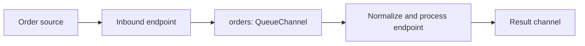

# SmartLifecycle

In the **Configuration and Lifecycle** chapter of the **SPRING_INTEGRATION_CORE** module, `SmartLifecycle` helps coordinate when components of a message flow start and stop operating. When designing flows with `Message`, `MessageChannel`, endpoints, gateways, and Java DSL, wiring the processing steps only resolves the flow structure; the application also needs an appropriate operational sequence.

For example, an adapter reading orders from a partner should not emit messages before the order-processing endpoint is ready. During maintenance, the application needs to stop accepting new orders, allow in-flight work to finish per the chosen policy, and only then close required resources. `SmartLifecycle` provides the contract to participate in this coordination process.

After this lesson, you will be able to:

- Explain the roles of `start()`, `stop()`, `isRunning()`, `isAutoStartup()`, `getPhase()`, and `stop(Runnable)`.
- Choose phases based on operational dependencies.
- Configure and control endpoint lifecycle using Java DSL or annotations.
- Distinguish between stopping an endpoint, waiting for in-flight work, and draining a queue.
- Design tests for startup state and message-processing capability after lifecycle transitions.

## 1. Why Do Message Flows Need Lifecycle Coordination?

Consider an order-intake flow:



There are three different operational questions:

| Question | Example |
| --- | --- |
| Has the component been created and configured? | The endpoint bean has been registered in the context |
| Is the component active yet? | The poller has started executing message-fetch cycles |
| Has the business work completed? | The order has been recorded and the transaction committed |

A bean may exist without running yet. An endpoint may be running while an external connection is unstable. A queue may be empty even while a worker is still processing a message it already pulled.

Therefore, merely seeing that the context initialized successfully or observing a `running` flag is not enough to infer the entire state of the flow. In the design below, lifecycle determines when an endpoint participates in the flow; business outcomes are observed separately through messages and processing state.

## 2. The SmartLifecycle Contract

`org.springframework.context.SmartLifecycle` extends `Lifecycle` and `Phased`. It adds auto-startup on context refresh, phase-based coordination, and completion signaling via a stop callback. [SmartLifecycle Javadoc](https://docs.spring.io/spring-framework/docs/6.2.x/javadoc-api/org/springframework/context/SmartLifecycle.html)

### 2.1. Methods to Understand

| Method | Meaning in Component Design |
| --- | --- |
| `start()` | Begin operating: subscribe to receive messages, start polling, or open an SDK receiver |
| `stop()` | Request the component to stop operating via a non-callback API |
| `isRunning()` | Reflect the operational state managed by the component |
| `isAutoStartup()` | Indicate whether the component participates in auto-startup during context refresh |
| `getPhase()` | Provide relative order when the lifecycle processor coordinates start/stop |
| `stop(Runnable callback)` | Stop the component and invoke the callback once its contracted stop completes |

Example usage from management code:

```java
SmartLifecycle endpoint =
        context.getBean("orderIngress", SmartLifecycle.class);

if (!endpoint.isRunning()) {
    endpoint.start();
}
```

Checking `isRunning()` in the example clarifies intent; the implementation must still handle repeated start/stop calls and appropriate state synchronization.

### 2.2. Auto-Start State and Running State Are Independent

`isAutoStartup()` is a startup policy; `isRunning()` is the state at the moment of observation.

| autoStartup | running | Possible Scenario |
| --- | --- | --- |
| `true` | `true` | Endpoint auto-started and is still active |
| `true` | `false` | Endpoint was stopped by a management operation |
| `false` | `false` | Endpoint awaits a start command after context refresh |
| `false` | `true` | Endpoint was started by an explicit command |

`autoStartup=false` does not delete the bean and does not prohibit calling `start()`. Calling `context.start()` must also be distinguished from the context refresh auto-start pass: it is an explicit start request for the lifecycle beans managed by the processor. [DefaultLifecycleProcessor](https://docs.spring.io/spring-framework/docs/6.2.x/javadoc-api/org/springframework/context/support/DefaultLifecycleProcessor.html)

In this lesson's examples, `autoStartup=false` is used to hold the input source in a non-running state until management code explicitly opens it.

## 3. Bean Initialization, Lifecycle Stop, and Bean Destruction

You can use the following conceptual chain to read configuration:

```text
Create beans and inject dependencies
    -> execute initialization callbacks
    -> context coordinates auto-start of eligible SmartLifecycle beans
    -> application operates
    -> stop requested or context closed
    -> stop lifecycle components
    -> destroy beans when context closes
```

This is a model for the normal path; when context initialization fails, do not assume all start steps have run. Resources allocated during bean creation still need appropriate release mechanisms. Spring distinguishes bean initialization/destruction callbacks from the `Lifecycle` contract; a component can be stopped and restarted while the bean still exists. [Bean lifecycle callbacks](https://docs.spring.io/spring-framework/reference/core/beans/factory-nature.html)

When designing a custom adapter:

- Constructors and initialization steps validate configuration and prepare required data.
- `start()` puts the adapter into a state of receiving or emitting messages.
- `stop()` halts activity according to an explicit contract.
- Bean destruction releases final resources owned by the bean.

For instance, if `stop()` permanently shuts down an executor that a subsequent `start()` tries to reuse, the component will fail on restart. Decide whether the executor is retained for reuse, recreated on each start, or shut down only during bean destruction.

`@Lazy` is also not a reliable tool to delay a `SmartLifecycle` component's activity: the lifecycle processor may need to instantiate the bean to manage it. To delay an endpoint from running, configure the endpoint's auto-start policy. [SmartLifecycle and lazy initialization](https://docs.spring.io/spring-framework/docs/6.2.x/javadoc-api/org/springframework/context/SmartLifecycle.html)

## 4. How Does Phase Determine Ordering?

### 4.1. Foundational Rules

When the lifecycle processor coordinates components:

- Start in ascending phase order.
- Stop in descending phase order.
- Components with the same phase have no guaranteed internal order.
- Explicit `depends-on` relationships take precedence over phase order. [SmartLifecycle phase rules](https://docs.spring.io/spring-framework/docs/6.2.x/javadoc-api/org/springframework/context/SmartLifecycle.html)

Applying this to an order-intake design:

| Component in Design | Illustrative Phase | Reason for Choice |
| --- | --- | --- |
| Error-recording endpoint | `-100` | Must be active before endpoints that may emit errors |
| Order-processing endpoint | `100` | Ready before opening the order source |
| Partner order-fetching endpoint | `200` | Opens after the processing side has started |

When participating together in auto-start:

```text
Start: error recording (-100) -> order processing (100) -> order source (200)
Stop:  order source (200) -> order processing (100) -> error recording (-100)
```

The numbers above are choices for the example. Projects should leave gaps between phases so new components can be added without renumbering the entire configuration.

### 4.2. Do Not Infer Phase from Flow Position

A Java DSL flow is usually read left to right along the message path. That does not mean endpoints appearing earlier in the DSL must start first.

When an upstream source actively emits messages, the downstream side usually needs to be ready before the source. In the example above, the processing endpoint sits after the source in the message diagram but is assigned a lower phase.

Similarly, do not use `@Order` as a substitute for `getPhase()`. Bean ordering, handler ordering, and lifecycle ordering are different configuration concerns.

### 4.3. Phase Does Not Create a Readiness Barrier

Suppose a receiver's `start()` merely launches a background connection task and returns. The processor may move on to the next component even though the connection is not complete yet.

Therefore, when designing `start()`, specify clearly:

1. When the method returns, what minimum condition has been satisfied?
2. If background preparation remains, where is readiness state tracked?
3. Is the input source allowed to open before that condition is reached?

Phase does not check brokers, does not check database schemas, does not confirm business outcomes, and does not dictate message ordering.

### 4.4. Reading Default Values Accurately

In Spring Framework 6.2, the default implementation of `SmartLifecycle.getPhase()` returns `Integer.MAX_VALUE`; a bean implementing only `Lifecycle` is treated by the processor as phase `0`. Specific implementations may choose their own values. [DEFAULT_PHASE](https://docs.spring.io/spring-framework/docs/6.2.x/javadoc-api/org/springframework/context/SmartLifecycle.html)

Spring Integration endpoints also have their own phase configuration, which may depend on endpoint type and version. This lesson declares phases explicitly for endpoints needing coordination; when applying to a project, inspect the API of the version in use instead of assuming every endpoint has phase `0`.

## 5. Where Does SmartLifecycle Live in Spring Integration?

### 5.1. Distinguishing Channel, Handler, and Endpoint

| Component | Primary Responsibility | When Designing Lifecycle Operations |
| --- | --- | --- |
| `Message` | Carries payload and headers | No start/stop operation on individual messages |
| `MessageChannel` | Transfers or stores messages per channel type | Do not assume every channel has a controllable lifecycle |
| `MessageHandler` | Performs message processing | A business-processing POJO does not automatically become an endpoint |
| Endpoint | Connects a source or channel to message receiving/processing activity | Usually the object to retrieve for start/stop |
| Gateway | Provides an interface to call into or out of a flow | Must consider lifecycle of the implementation and related endpoints |

`AbstractEndpoint` is the base class for message endpoints and implements a manageable lifecycle contract. `EventDrivenConsumer` connects a handler to a `SubscribableChannel`; for pollable channels, the framework uses an appropriate polling consumer model. [AbstractEndpoint](https://docs.spring.io/spring-integration/docs/current/api/org/springframework/integration/endpoint/AbstractEndpoint.html), [EventDrivenConsumer](https://docs.spring.io/spring-integration/api/org/springframework/integration/endpoint/EventDrivenConsumer.html)

In practice, assign names to endpoints needing management. The name of a flow bean or business service bean is not enough to identify which object controls message reception.

### 5.2. Consequences When a Consumer Stops

With a default in-memory `QueueChannel`, a message can still be sent into the queue even while the consumer is not taking it out. With a `DirectChannel`, a send call goes directly to a subscriber on the sender's thread; if the sole consumer has unregistered, sending has no handler and may raise a dispatch error. [Message Channel Implementations](https://docs.spring.io/spring-integration/reference/channel/implementations.html)

Therefore, before stopping a consumer, check whether producers continue sending:

| Connection Point | Scenario to Account For |
| --- | --- |
| `DirectChannel` with one consumer | Stopping the consumer while producers keep sending can cause send calls to fail |
| Capacity-bounded `QueueChannel` | Backlog may grow until sends wait or time out |
| `ExecutorChannel` | Tasks may already have been submitted to the executor |
| Broker-backed channel or adapter | Behavior also depends on listeners, acknowledgments, transactions, and broker policies |

Stopping an endpoint does not automatically close all related channels or finish all work it has already handed off.

## 6. Java DSL Example: Controlling an Order-Intake Source

The example uses Java 17+, Spring Integration with the `IntegrationFlow.from...` API, and Spring Context. The project needs the `spring-integration-core` dependency; the testing dependency in the later section is JUnit Jupiter. Let your project's dependency management select compatible Spring versions.

Two endpoints are explicitly named:

- `orderIngress`: pulls data from a simulated partner queue, phase `200`, not auto-started.
- `orderWorker`: takes messages from the `orders` channel to normalize, phase `100`, auto-started.

```java
package example.lifecycle;

import java.time.Duration;
import java.util.List;
import java.util.Locale;
import java.util.Queue;
import java.util.concurrent.ConcurrentLinkedQueue;

import org.springframework.beans.factory.annotation.Qualifier;
import org.springframework.context.annotation.Bean;
import org.springframework.context.annotation.Configuration;
import org.springframework.integration.channel.QueueChannel;
import org.springframework.integration.config.EnableIntegration;
import org.springframework.integration.dsl.IntegrationFlow;
import org.springframework.integration.dsl.Pollers;

@Configuration
@EnableIntegration
public class OrderLifecycleConfiguration {

    @Bean
    public Queue<String> partnerInbox() {
        return new ConcurrentLinkedQueue<>(
                List.of(" order-1001 ", " order-1002 "));
    }

    @Bean
    public QueueChannel orders() {
        return new QueueChannel(100);
    }

    @Bean
    public QueueChannel processedOrders() {
        return new QueueChannel(100);
    }

    @Bean
    public IntegrationFlow orderIngressFlow(
            @Qualifier("partnerInbox") Queue<String> partnerInbox) {

        return IntegrationFlow
                .fromSupplier(
                        partnerInbox::poll,
                        endpoint -> endpoint
                                .id("orderIngress")
                                .autoStartup(false)
                                .phase(200)
                                .sendTimeout(1_000)
                                .poller(Pollers
                                        .fixedDelay(Duration.ofMillis(100))
                                        .maxMessagesPerPoll(1)))
                .channel("orders")
                .get();
    }

    @Bean
    public IntegrationFlow orderProcessingFlow() {
        return IntegrationFlow
                .from("orders")
                .handle(
                        String.class,
                        (payload, headers) ->
                                payload.strip().toUpperCase(Locale.ROOT),
                        endpoint -> endpoint
                                .id("orderWorker")
                                .autoStartup(true)
                                .phase(100)
                                .sendTimeout(1_000)
                                .poller(Pollers
                                        .fixedDelay(Duration.ofMillis(50))
                                        .receiveTimeout(0)
                                        .maxMessagesPerPoll(1)))
                .channel("processedOrders")
                .get();
    }
}
```

Java DSL allows configuring lifecycle on the endpoint spec. `fromSupplier` provides a message source invoked via a polling adapter; consumer endpoint specs support `autoStartup`, `phase`, and `poller`. [IntegrationFlow](https://docs.spring.io/spring-integration/api/org/springframework/integration/dsl/IntegrationFlow.html), [ConsumerEndpointSpec](https://docs.spring.io/spring-integration/api/org/springframework/integration/dsl/ConsumerEndpointSpec.html)

### 6.1. Operational Flow

After context refresh:

1. `orderWorker` begins polling the `orders` channel.
2. `orderIngress` remains stopped because of `autoStartup(false)`.
3. After starting `orderIngress`, each poll fetches at most one string from `partnerInbox`.
4. The worker normalizes the string and sends the result to `processedOrders`.

When `partnerInbox.poll()` returns `null`, that poll produces no message. In this configuration, the source running dry does not mean the endpoint stopped itself: it can still keep polling to pick up subsequent data.

`receiveTimeout(0)` on the worker makes a receive attempt return immediately when `orders` is empty. The interval between polls is still governed by `fixedDelay`. `sendTimeout` bounds send waits on potentially blocking channels; values in the example are illustrative and should be tuned for real load. [PollerSpec](https://docs.spring.io/spring-integration/api/org/springframework/integration/dsl/PollerSpec.html)

### 6.2. Meaning of Phase in This Configuration

Because the source does not auto-start, the current refresh does not demonstrate an auto-start chain involving both endpoints. When an operator calls `orderIngress.start()` directly, the processor does not automatically search for and start all lower-phase components to serve that call.

The worker is already ready due to its own auto-start policy. If you change the source to `autoStartup(true)`, both endpoints participate in the auto-start sweep; phase `100` for the worker and `200` for the source express the desired order.

Likewise, stopping `orderIngress` alone does not mean stopping `orderWorker`. This is helpful when you need to halt new intake while keeping downstream processing running.

### 6.3. Why Use QueueChannel in the Example?

Two queues allow observing input and output via `send`/`receive` with timeouts. This is a choice for the practice lesson, not an order-persistence design for process crashes.

These queues store messages in memory by default. If the context closes or the process exits while unprocessed data remains, `SmartLifecycle` does not turn that data into persistent messages on its own. [QueueChannel and persistence](https://docs.spring.io/spring-integration/reference/channel/implementations.html)

## 7. Controlling the Right Endpoint at Runtime

After the context has refreshed, endpoints can be retrieved by explicit name:

```java
SmartLifecycle ingress =
        context.getBean("orderIngress", SmartLifecycle.class);

SmartLifecycle worker =
        context.getBean("orderWorker", SmartLifecycle.class);

worker.start();
ingress.start();
```

Here:

- `orderIngressFlow` is the bean name declaring the flow.
- `orderIngress` is the data-intake endpoint ID.
- `orderWorker` is the processing endpoint ID.

If you need to stop receiving orders, control `orderIngress`. If you need to stop pulling orders from the `orders` channel, control `orderWorker`.

For systems with management interfaces, these operations can be wrapped in a small management service, or use Control Bus/JMX depending on the management capabilities configured in the project. Spring Integration supports retrieving endpoint beans to invoke lifecycle and managing via Control Bus. [Annotation Support and endpoint lifecycle](https://docs.spring.io/spring-integration/reference/configuration/annotations.html)

Designing a management operation should log the target endpoint, before/after state, and success or error outcome. Avoid scattering start/stop commands across multiple business flows, as that makes it hard to determine which component owns operational decisions.

## 8. Equivalent Configuration with Annotations

If the application uses messaging annotations, lifecycle can be configured directly on the handler method:

```java
package example.lifecycle;

import java.util.Locale;

import org.springframework.integration.annotation.EndpointId;
import org.springframework.integration.annotation.Poller;
import org.springframework.integration.annotation.ServiceActivator;
import org.springframework.stereotype.Component;

@Component
public class AnnotatedOrderHandler {

    @EndpointId("annotatedOrderWorker")
    @ServiceActivator(
            inputChannel = "orders",
            outputChannel = "processedOrders",
            autoStartup = "${orders.worker.auto-startup:true}",
            phase = "100",
            poller = @Poller(
                    fixedDelay = "50",
                    maxMessagesPerPoll = "1"))
    public String normalize(String payload) {
        return payload.strip().toUpperCase(Locale.ROOT);
    }
}
```

This example assumes both channels are already declared and the application enables annotation processing via appropriate Spring Integration configuration. It is an alternative to the worker portion of the Java DSL example.

If you enable both the DSL worker and the annotated worker reading `orders` simultaneously, the two consumers will share messages under point-to-point queue semantics. In that case, stopping one worker does not mean all processing has stopped.

`@EndpointId` names the endpoint generated for the method. The bean holding the business method and the endpoint are objects with distinct roles; in this example, the control object is named `annotatedOrderWorker`. [EndpointId](https://docs.spring.io/spring-integration/api/org/springframework/integration/annotation/EndpointId.html)

Do not infer the endpoint name from the method name when the project configures an explicit ID. Also watch when framework-generated endpoints are injected: if accessed before the endpoint is registered, you may need to defer lookup or use appropriate lazy injection. [Bean registration from messaging annotations](https://docs.spring.io/spring-integration/reference/configuration/annotations.html)

## 9. stop(Runnable): Signaling Stop Completion at the Right Moment

### 9.1. The Callback Is the Lifecycle Completion Signal

During coordinated shutdown, the lifecycle processor uses `stop(Runnable)` for `SmartLifecycle` beans. The callback must be invoked once the component has finished stopping per its contract. The default implementation calls `stop()` and then runs the callback, so a component with an asynchronous stop process needs an appropriate implementation. [stop(Runnable) contract](https://docs.spring.io/spring-framework/docs/6.2.x/javadoc-api/org/springframework/context/SmartLifecycle.html)

Three moments should be separated when designing an asynchronous receiver:

```text
Receive stop request
    -> close intake of new work
    -> wait for in-flight work to finish per policy
    -> establish stopped state
    -> invoke callback
```

If you invoke the callback immediately after sending a stop request to an SDK, the lifecycle processor may proceed to stop resources the SDK is still using.

Conversely, if you fail to invoke the callback after stopping succeeds, the processor must wait out the phase's full timeout. This can prolong shutdown even though actual resources have already stopped.

### 9.2. A Conceptual Snippet for an Asynchronous Component

The following snippet illustrates the idea for a custom adapter, not a built-in Spring Integration API:

```java
@Override
public void stop(Runnable callback) {
    receiver.stopAccepting();

    receiver.whenDrained(() -> {
        running = false;
        callback.run();
    });
}
```

In this snippet, `receiver` is a hypothetical collaborator with the contract: `stopAccepting()` stops accepting new work, and `whenDrained(...)` runs the action once in-flight work reaches zero.

A real implementation must also handle:

- Component already stopped when the call arrives: still complete the corresponding callback.
- Multiple stop calls: do not drop the callback of any valid request.
- Completion callback may run concurrently with management threads.
- SDK stop operation fails: log the error and apply handling policy rather than faking completion.
- Component may be restarted after stop if the operational contract permits.

Do not hold a lock and wait for a worker to finish if that worker needs the same lock to update state or invoke the callback.

### 9.3. When Should You Implement SmartLifecycle Yourself?

Most standard endpoints already have their lifecycle managed by Spring Integration. You only need to configure them.

A custom implementation fits when integrating an SDK with a background receiver for which the framework does not yet provide an adapter. In that case, the lifecycle wrapper manages opening/closing the SDK and forwarding messages into the flow; transformers, routers, filters, or business services retain responsibility for message processing.

Clarify resource ownership: the wrapper may close executors or clients it created itself; shared clients need management policies at the appropriate level. Stopping a single source should not inadvertently close resources serving other flows.

## 10. Stopping in Order Does Not Mean Draining All Messages

### 10.1. Three Distinct Completion Levels

| Level | Condition to Observe | Example |
| --- | --- | --- |
| Stop accepting new work | The source's intake gate is closed | Inbound adapter fetches no more orders from partner |
| Finish in-flight work | Accepted tasks reach a terminal state per policy | Payment call completed or recorded for retry |
| Drain backlog | Waiting data has been processed or moved to appropriate storage | Queue has no remaining messages and no messages held by workers |

An endpoint's callback confirms only that endpoint's stop contract. It does not by itself confirm outcomes in a database, downstream executor, broker, or external service.

### 10.2. Why Doesn't Phase Create a Drain Window Automatically?

Consider source phase `200`, worker phase `100`:

```text
Stop source 200
    -> processor receives stop completion from source
    -> processor proceeds to stop worker 100
```

The processor does not inspect how many items remain in `orders` before stopping the worker. The interval between the two steps can be very brief.

If the maintenance requirement is to finish all pending orders, the application needs an explicit procedure:

1. Stop all relevant paths accepting new orders.
2. Confirm sources are closed and ongoing emissions have finished per contract.
3. Keep consumers, schedulers, executors, error-reporting endpoints, and required business resources active.
4. Wait for completion conditions using backlog metrics combined with in-flight work counts.
5. Once conditions are met, stop remaining processors; if the timeout expires, execute the defined retention, retry, or handoff policy.

`queueSize == 0` alone is not enough: a worker may have just pulled a message from the queue without finishing processing yet. With retries and aggregators, also check scheduled retry tasks, group states, and messages held in message stores.

### 10.3. Spring Integration's Orderly Shutdown Mechanism

Spring Integration provides an orderly shutdown procedure via `IntegrationMBeanExporter.stopActiveComponents(...)`. This mechanism coordinates shutdown-capable components, closes appropriate intake sources, and grants time for messages currently in flight to complete. The documentation also mentions keeping pollers running to help process messages remaining in `QueueChannel`s. [Orderly Shutdown](https://docs.spring.io/spring-integration/reference/shutdown.html)

This is a mechanism to configure and invoke via the application's management infrastructure. Do not treat setting phases or calling `context.close()` as automatically executing that entire procedure.

The learning example uses an in-memory queue and two finite messages. When applying to real orders, decide how to preserve data if the wait timeout expires before processing finishes.

## 11. Timeouts During Shutdown

There are multiple timeout types with different scopes:

| Timeout Type | What Is It Bounding? |
| --- | --- |
| Message send timeout | Wait time for a send operation, e.g., when a queue is full |
| Message receive timeout | Wait time for a message in a receive operation |
| SDK or listener stop timeout | Time that component waits for work or connections to finish |
| Lifecycle phase timeout | Time the processor waits for stop callbacks in a phase |
| Process termination grace period | Total time the deployment environment gives the application to shut down |

You can configure the processor to share a wait time per shutdown phase. The snippet below is configuration for a Spring Context application managing its own processor; if your project has pre-configured platform infrastructure, integrate into that mechanism:

```java
@Bean(name = "lifecycleProcessor")
public DefaultLifecycleProcessor lifecycleProcessor() {
    DefaultLifecycleProcessor processor =
            new DefaultLifecycleProcessor();

    processor.setTimeoutPerShutdownPhase(15_000);
    return processor;
}
```

The two types to import are `org.springframework.context.annotation.Bean` and `org.springframework.context.support.DefaultLifecycleProcessor`.

The value `15_000` is milliseconds per phase, not a single budget for the entire application. The processor also has per-phase options in supported versions; check the corresponding API when configuring. [DefaultLifecycleProcessor timeout configuration](https://docs.spring.io/spring-framework/docs/6.2.x/javadoc-api/org/springframework/context/support/DefaultLifecycleProcessor.html)

When designing shutdown, do not assume the processor's timeout can interrupt a `stop(Runnable)` implementation that blocks indefinitely before returning. Components should bound their own waits or use the asynchronous contract properly so the processor can coordinate.

The deployment environment's grace period must cover the sum of real steps, including stopping intake, draining, shutdown phases, and resource destruction. Increasing timeouts only helps work capable of finishing; it does not fix missing callbacks or deadlocks.

## 12. Testing Lifecycle Through Message Behavior

Checking `isRunning()` confirms control state. Checking output messages confirms the flow still performs the expected work.

The following test uses `OrderLifecycleConfiguration` from above:

```java
package example.lifecycle;

import java.util.concurrent.CountDownLatch;
import java.util.concurrent.TimeUnit;

import org.junit.jupiter.api.Test;

import org.springframework.context.SmartLifecycle;
import org.springframework.context.annotation.AnnotationConfigApplicationContext;
import org.springframework.integration.channel.QueueChannel;
import org.springframework.messaging.Message;
import org.springframework.messaging.support.GenericMessage;

import static org.junit.jupiter.api.Assertions.assertEquals;
import static org.junit.jupiter.api.Assertions.assertFalse;
import static org.junit.jupiter.api.Assertions.assertNotNull;
import static org.junit.jupiter.api.Assertions.assertNull;
import static org.junit.jupiter.api.Assertions.assertTrue;

class OrderLifecycleTest {

    @Test
    void startsIngressOnDemandAndKeepsWorkerIndependent()
            throws InterruptedException {

        try (var context = new AnnotationConfigApplicationContext(
                OrderLifecycleConfiguration.class)) {

            SmartLifecycle ingress =
                    context.getBean("orderIngress", SmartLifecycle.class);

            SmartLifecycle worker =
                    context.getBean("orderWorker", SmartLifecycle.class);

            QueueChannel orders =
                    context.getBean("orders", QueueChannel.class);

            QueueChannel processed =
                    context.getBean("processedOrders", QueueChannel.class);

            assertFalse(ingress.isRunning());
            assertTrue(worker.isRunning());
            assertNull(processed.receive(0));

            ingress.start();

            assertTrue(ingress.isRunning());
            assertEquals("ORDER-1001", receivePayload(processed));
            assertEquals("ORDER-1002", receivePayload(processed));

            CountDownLatch stopped = new CountDownLatch(1);
            ingress.stop(stopped::countDown);

            assertTrue(stopped.await(2, TimeUnit.SECONDS));
            assertFalse(ingress.isRunning());
            assertTrue(worker.isRunning());

            boolean accepted = orders.send(
                    new GenericMessage<>(" order-manual "), 1_000);

            assertTrue(accepted);
            assertEquals("ORDER-MANUAL", receivePayload(processed));
        }
    }

    private static String receivePayload(QueueChannel channel) {
        Message<?> message = channel.receive(2_000);
        assertNotNull(message, "Did not receive result within timeout");
        return (String) message.getPayload();
    }
}
```

The test confirms the source does not auto-start, can be started explicitly, emits data accurately, and can be stopped independently while the worker continues processing.

Receive operations use timeouts to wait for the observed condition. The callback is synchronized with a `CountDownLatch`, avoiding fixed sleeps to guess when stopping has completed.

This test does not yet verify the auto-start order of the two endpoints because the source uses `autoStartup(false)`. Nor does it prove draining capability under long processing or backlogged data. To test those, dedicated scenarios are needed:

| Additional Scenario | Evidence to Collect |
| --- | --- |
| Two components auto-starting with different phases | List of start/stop events recorded from lifecycle probes |
| Component stopping asynchronously | Next phase has not stopped before current phase callback completes |
| Maintenance with backlog | No active sources, backlog and in-flight work meet defined conditions |
| Stop then restart | New messages continue processing without using a closed executor |
| One source stopped while another source stays active | Management action affects only the target endpoint |
| Error during shutdown | Error is observed and data policy is applied properly |

Spring Integration provides additional testing tools, including preventing specific endpoints from auto-starting via `@SpringIntegrationTest(noAutoStartup = ...)`. This tool can be used when isolating a flow from real sources in integration tests. [Testing support](https://docs.spring.io/spring-integration/reference/testing.html)

## 13. Common Errors and Diagnostics

| Symptom | Possibilities to Check | Resolution |
| --- | --- | --- |
| Bean exists but receives no messages | Endpoint not started or channel differs from the one producers use | Verify endpoint ID, `isRunning()`, and actual channel |
| Stopped business service yet flow keeps running | Controlling the wrong object instead of the endpoint | Retrieve the endpoint bean by its assigned ID |
| Source emits before processors are ready | Phase unsuitable or `start()` returns before actual readiness | Adjust phase and readiness contract |
| Shutdown delays by roughly a fixed duration | A component's callback was never invoked | Trace timestamps of stop request, stop completion, and callback call |
| Queue still has data after shutdown | Only coordinated stop order without a drain procedure | Stop sources first, keep workers running for the policy wait window |
| Stopped one worker yet messages still process | Another consumer exists on the same queue | List all endpoints receiving from the channel |
| Restart reports executor shut down | Resource was permanently closed on previous stop | Redesign resource lifecycle or recreate on start |
| Tasks still run after endpoint stops | Work was handed off to another executor or SDK | Track in-flight task count and stop contract at that boundary |
| Errors occur after downstream has stopped | Error handling or logging path terminated too early | Keep error-recording endpoints and resources alive long enough |

When investigating, record at least endpoint name, phase, pre/post operation state, stop duration, and in-flight work count if the component exposes that metric. For business messages, also use correlation IDs or order codes to link operational events with processing outcomes.

Do not assume every error occurring inside `start()` or `stop()` is sent to `errorChannel`. Those are lifecycle management calls; how errors propagate or get logged depends on the implementation and caller. Message error-handling paths and lifecycle coordination errors must be observed in their proper context.

## 14. Extended Practice

Use the Java DSL example as a starting point:

1. Keep the source at `autoStartup(false)`, initialize the context, and verify the worker runs while the source does not.
2. Start the source, receive two results, and verify payloads are normalized.
3. Stop only the source, send a manual message to `orders`, and verify the worker still processes it.
4. Create a new context with both endpoints auto-starting; add lifecycle probes or logging to observe ordering rather than inferring order solely from a single business log print.
5. Replace the worker with a handler that can hold intentionally via a latch. When the queue hits zero while the latch is still closed, observe that work is not finished yet.
6. Design a maintenance condition based on both backlog and in-flight work; specify behavior when the timeout expires.
7. Try stopping and restarting the source after adding data to `partnerInbox`; confirm there is no need to recreate the entire context.

The goal to achieve is being able to explain, for each endpoint, when it is created, when it begins participating in the flow, when it stops accepting work, and what evidence confirms required work has finished. Once those milestones are clear, phase, auto-start, and callbacks become concrete, configurable, and testable tools.
