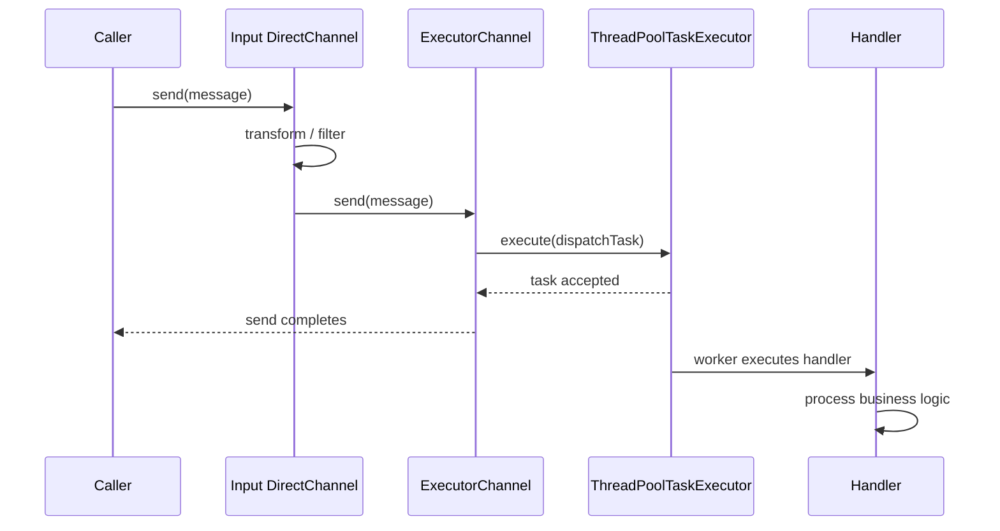

# TaskExecutor

In the **SPRING_INTEGRATION_CORE** module, `TaskExecutor` is the component that lets you choose how work is executed within a message flow. It connects a design built from `Message`, `MessageChannel`, and endpoints to concrete operational concerns: which thread processes work, how many tasks run concurrently, where excess tasks are queued, where errors go, and how the application shuts down.

This lesson belongs to the **Configuration and Lifecycle** chapter. The focus is configuring an executor for Spring Integration Core using Java DSL, understanding the impact of asynchronous boundaries, and operating flows with bounded resources.

Examples use Java 17+, Spring Integration 6.5, and Spring Framework 6.2 as the API baseline. Select compatible dependencies via your project's dependency management; do not mix arbitrary version lines. Virtual threads are discussed separately because they require Java 21+ and corresponding APIs.

## 1. Learning Objectives

After this lesson, you will be able to:

- Distinguish `TaskExecutor`, `TaskScheduler`, channels, and endpoints.
- Identify thread-handoff points in flows using `DirectChannel`, `ExecutorChannel`, or pollers.
- Configure `ThreadPoolTaskExecutor` with a bounded pool and queue.
- Explain why increasing `maxPoolSize` may not yet increase the number of workers.
- Separate task-rejection errors from business errors inside workers.
- Design transactions, context propagation, and shutdown suited to asynchronous flows.

Recommended prerequisites: `Message` structure, headers, subscribable/pollable channels, service activators, and basic `IntegrationFlow` syntax.

## 2. What Does TaskExecutor Actually Do?

### 2.1. The Execution Contract

`org.springframework.core.task.TaskExecutor` extends `java.util.concurrent.Executor`. The core operation is:

```java
void execute(Runnable task);
```

A component creates a `Runnable` and hands it to the executor. The executor decides whether to run it immediately on the current thread, hand it to another thread, enqueue it, or reject it per configuration. Thus, the name `TaskExecutor` by itself does not guarantee asynchronicity. See [the TaskExecutor contract](https://docs.spring.io/spring-framework/docs/6.2.x/javadoc-api/org/springframework/core/task/TaskExecutor.html).

In Spring Integration, a task may represent dispatching a message to a handler or executing one polling cycle. The unit of task depends on the component using the executor; not every task corresponds to exactly one message.

### 2.2. Distinguishing Responsibilities

| Component | Question It Resolves | Example |
|---|---|---|
| `Message<?>` | What data and metadata are being passed? | An order and a correlation ID |
| `MessageChannel` | How is a message delivered to consumers? | Direct handoff, dispatch via executor, stored in queue |
| Endpoint | How is a handler connected to the flow? | Event-driven consumer or polling consumer |
| `TaskExecutor` | By what mechanism is work executed? | Bounded thread pool |
| `TaskScheduler` | When is a task triggered? | Poll every 200 ms |
| Gateway | By what contract does business code call into messaging? | `submitOrder(...)` or request-reply |

An executor bean only affects components explicitly wired to it. Declaring a bean named `taskExecutor` does not automatically turn every channel, router, or transformer asynchronous.

`@Async` belongs to a different Spring mechanism. You do not need to add `@EnableAsync` for an `ExecutorChannel` configured with an executor to work.

## 3. Reading a Flow by Thread Before Configuring Pools

### 3.1. DirectChannel: Continues on the Sending Thread

```text
request-thread
  -> DirectChannel
  -> transformer
  -> filter
  -> service activator
  -> return to caller
```

Steps in a typical synchronous segment run on the sending thread. If the service activator takes two seconds, the caller also waits for that processing segment. Having multiple endpoints in Java DSL does not mean each endpoint gets its own thread.

### 3.2. ExecutorChannel: Delegating Dispatch to an Executor



The diagram illustrates one possible progression. A worker can also start or even finish before the caller observes `send()` returning.

With an asynchronous executor, task acceptance does not prove the handler has completed. `ExecutorChannel` remains a point-to-point channel: one message is dispatched to one subscriber per dispatcher configuration, not broadcast to all subscribers. Transaction context bound to the sending thread does not automatically follow asynchronous dispatch. See [ExecutorChannel configuration](https://docs.spring.io/spring-integration/reference/6.5/channel/configuration.html).

### 3.3. QueueChannel: Holds Messages for Consumers to Pull Later

```text
producer -> QueueChannel -> polling consumer -> handler
                              ^
                              |
                      scheduler / executor
```

`QueueChannel` holds messages. Consumers must call `receive()` directly or be managed by a polling endpoint. The channel does not create workers on its own.

Distinguish two buffers:

- The `QueueChannel` queue holds `Message<?>`.
- The thread pool's internal queue holds `Runnable`.

If a poller has an executor, queued tasks may not have received any message yet. Counting task queue depth is not enough to know total business backlog.

### 3.4. PublishSubscribeChannel with an Executor

`PublishSubscribeChannel` broadcasts messages to subscribers. When an executor is attached, branches may run concurrently; do not infer completion order from subscriber registration order.

Success status on an asynchronous send cannot prove every subscriber finished processing. If a minimum number of consumers is required, configure `minSubscribers` per your flow contract and still track outcomes separately. See [message channel implementations](https://docs.spring.io/spring-integration/reference/6.5/channel/implementations.html).

## 4. Choosing the Right Implementation

| Implementation | Key Characteristics | When to Consider |
|---|---|---|
| `SyncTaskExecutor` | Runs task on the calling thread | Small synchronous examples or pure logic checks |
| `ThreadPoolTaskExecutor` | Reuses workers; configurable pool, queue, rejection | Flows needing bounded resources and load visibility |
| `SimpleAsyncTaskExecutor` | Typically spawns a thread per task, not pooled for reuse | Need thread-per-task model with concurrency limit understood |
| `ConcurrentTaskExecutor` | Adapter for an existing JDK executor | System already has a separately managed executor |
| `VirtualThreadTaskExecutor` | Uses virtual threads on supported environments | Mostly I/O-bound work with separate downstream resource limits |

Do not equate `SimpleAsyncTaskExecutor` with a thread pool. Virtual thread options and lifecycle management depend on version; check the exact API in use. Implementations are described in [Task Execution and Scheduling](https://docs.spring.io/spring-framework/reference/integration/scheduling.html).

In the practice section below, `ThreadPoolTaskExecutor` is chosen to make workers, queues, and overload behavior explicit.

## 5. ThreadPoolTaskExecutor: Understanding Pool and Queue Together

### 5.1. Parameters to Decide

| Parameter | Practical Meaning |
|---|---|
| `corePoolSize` | Baseline worker count when creating workers on demand |
| `maxPoolSize` | Maximum worker limit when the queue cannot accept more |
| `queueCapacity` | Limit of tasks waiting in the executor's queue |
| `keepAliveSeconds` | Duration excess workers may stay idle before being reclaimed |
| `allowCoreThreadTimeOut` | Allows even core workers to expire when idle |
| `threadNamePrefix` | Worker identifier in logs and thread dumps |
| `rejectedExecutionHandler` | Policy when the executor cannot accept a task |
| `taskDecorator` | Wraps tasks to install/restore context |

Core workers are not necessarily pre-created at bean initialization. With standard configuration, they are created as tasks arrive.

`ThreadPoolTaskExecutor` defaults include core = 1, max and queue capacity = `Integer.MAX_VALUE`. This is not a configuration tuned for application traffic. `queueCapacity > 0` creates a `LinkedBlockingQueue`; non-positive values create a `SynchronousQueue`, meaning a direct handoff rather than holding backlog. See [ThreadPoolTaskExecutor API](https://docs.spring.io/spring-framework/docs/6.2.x/javadoc-api/org/springframework/scheduling/concurrent/ThreadPoolTaskExecutor.html).

### 5.2. Task Acceptance Order

The standard `ThreadPoolExecutor` model is:

1. If worker count is below core, create a worker for the task.
2. If core is reached, try placing the task into the queue.
3. If the queue cannot accept it and max is not reached, create an additional worker.
4. If it still cannot be accepted, apply the rejection policy.

Therefore, with core = 4, max = 8, queue capacity = 8, the pool does not automatically grow to 8 as soon as the fifth task arrives. Tasks wait in the queue before the pool expands beyond core. See [JDK pool and queue rules](https://docs.oracle.com/en/java/javase/17/docs/api/java.base/java/util/concurrent/ThreadPoolExecutor.html).

### 5.3. An Example Keeping All Workers Completely Busy

Suppose every task blocks, none finish yet, and tasks are submitted sequentially:

| Task Group | Expected Progression with core = 4, max = 8, queue = 8 |
|---|---|
| 1–4 | Creates 4 core workers |
| 5–12 | Enqueued into the queue |
| 13–16 | Queue full, creates 4 more workers |
| 17 | Already 8 workers and 8 waiting tasks; rejection policy applies |

This table is a reasoning model under the stated conditions. When workers finish or pull tasks from the queue during submission, observed numbers will differ.

One notable consequence: a later-arriving task can run on a newly spawned worker while an earlier task still waits in the queue. Thus, a FIFO queue does not guarantee FIFO completion across the entire executor.

### 5.4. Why Can a Very Large Queue Hide Problems?

Suppose an application sets core = 2, max = 64, and a huge queue. Once two workers are busy, new work keeps getting queued. The application may accumulate thousands of waiting tasks while worker count stays near 2.

In that situation, examine wait times and processing capacity rather than just increasing max. A larger queue allows holding more unfinished work in memory; it does not make individual tasks run faster.

## 6. Self-Contained Java DSL Example: Order Processing

The example builds a plain Spring context requiring no Spring Boot and no external systems. Place the class below in a Java source set with compatible `org.springframework.integration:spring-integration-core` dependencies.

Execution flow:

1. Receive `OrderTask` via `orderInput`.
2. Normalize the order ID with a transformer.
3. Validate data with a filter on the sending thread.
4. Set a header specifying the error channel.
5. Pass through `ExecutorChannel` for worker processing.
6. Send results to an observation queue; worker errors go to an error queue.

```java
import java.util.Locale;
import java.util.concurrent.ThreadPoolExecutor;

import org.springframework.context.annotation.AnnotationConfigApplicationContext;
import org.springframework.context.annotation.Bean;
import org.springframework.context.annotation.Configuration;
import org.springframework.integration.channel.DirectChannel;
import org.springframework.integration.channel.ExecutorChannel;
import org.springframework.integration.channel.QueueChannel;
import org.springframework.integration.config.EnableIntegration;
import org.springframework.integration.dsl.IntegrationFlow;
import org.springframework.messaging.Message;
import org.springframework.messaging.MessageHeaders;
import org.springframework.messaging.MessagingException;
import org.springframework.messaging.support.ErrorMessage;
import org.springframework.messaging.support.MessageBuilder;
import org.springframework.scheduling.concurrent.ThreadPoolTaskExecutor;

public class TaskExecutorLesson {

    public record OrderTask(String orderId, int quantity) {
    }

    public record OrderResult(String orderId, String workerThread) {
    }

    @Configuration(proxyBeanMethods = false)
    @EnableIntegration
    public static class IntegrationConfig {

        @Bean
        ThreadPoolTaskExecutor orderExecutor() {
            ThreadPoolTaskExecutor executor = new ThreadPoolTaskExecutor();
            executor.setCorePoolSize(4);
            executor.setMaxPoolSize(8);
            executor.setQueueCapacity(8);
            executor.setKeepAliveSeconds(30);
            executor.setThreadNamePrefix("si-order-");
            executor.setRejectedExecutionHandler(
                    new ThreadPoolExecutor.AbortPolicy());
            executor.setWaitForTasksToCompleteOnShutdown(true);
            executor.setAwaitTerminationSeconds(30);
            return executor;
        }

        @Bean
        DirectChannel orderInput() {
            return new DirectChannel();
        }

        @Bean
        ExecutorChannel orderWorkers(
                ThreadPoolTaskExecutor orderExecutor) {
            return new ExecutorChannel(orderExecutor);
        }

        @Bean
        QueueChannel orderResults() {
            return new QueueChannel(100);
        }

        @Bean
        QueueChannel orderErrors() {
            return new QueueChannel(100);
        }

        @Bean
        IntegrationFlow orderFlow(ExecutorChannel orderWorkers) {
            return IntegrationFlow.from("orderInput")
                    .transform(OrderTask.class, order ->
                            new OrderTask(
                                    order.orderId().trim()
                                            .toUpperCase(Locale.ROOT),
                                    order.quantity()))
                    .filter(OrderTask.class,
                            order -> !order.orderId().isBlank()
                                    && order.quantity() > 0,
                            filter -> filter
                                    .throwExceptionOnRejection(true))
                    .enrichHeaders(headers -> headers.header(
                            MessageHeaders.ERROR_CHANNEL,
                            "orderErrors"))
                    .channel(orderWorkers)
                    .handle(OrderTask.class, (order, headers) -> {
                        String thread =
                                Thread.currentThread().getName();

                        System.out.printf("PROCESS order=%s thread=%s%n",
                                order.orderId(), thread);

                        if ("FAIL".equals(order.orderId())) {
                            throw new IllegalStateException(
                                    "Illustrative business error");
                        }

                        return new OrderResult(
                                order.orderId(), thread);
                    })
                    .channel("orderResults")
                    .get();
        }
    }

    public static void main(String[] args) {
        try (AnnotationConfigApplicationContext context =
                     new AnnotationConfigApplicationContext(
                             IntegrationConfig.class)) {

            DirectChannel input =
                    context.getBean("orderInput", DirectChannel.class);
            QueueChannel results =
                    context.getBean("orderResults", QueueChannel.class);
            QueueChannel errors =
                    context.getBean("orderErrors", QueueChannel.class);

            for (String orderId : new String[]{" a-01 ", "b-02", "fail"}) {
                boolean accepted = input.send(
                        MessageBuilder.withPayload(
                                        new OrderTask(orderId, 2))
                                .setHeader("businessCorrelationId", orderId)
                                .build());

                System.out.printf("SEND order=%s accepted=%s thread=%s%n",
                        orderId, accepted,
                        Thread.currentThread().getName());
            }

            for (int i = 0; i < 2; i++) {
                Message<?> reply = results.receive(5_000);
                if (reply == null) {
                    throw new IllegalStateException(
                            "Did not receive enough results within timeout");
                }
                System.out.println("RESULT " + reply.getPayload());
            }

            Message<?> failure = errors.receive(5_000);
            if (!(failure instanceof ErrorMessage error)) {
                throw new IllegalStateException(
                        "Did not receive expected ErrorMessage");
            }

            Throwable exception = error.getPayload();
            Message<?> failedMessage =
                    exception instanceof MessagingException messaging
                            ? messaging.getFailedMessage()
                            : null;

            System.out.println("ERROR " + exception);
            if (failedMessage != null) {
                System.out.println("FAILED_PAYLOAD "
                        + failedMessage.getPayload());
                System.out.println("CORRELATION "
                        + failedMessage.getHeaders()
                                .get("businessCorrelationId"));
            }
        }
    }
}
```

### 6.1. How to Read the Output

You should observe:

- Order IDs in results are normalized to `A-01` and `B-02`.
- Handlers run on threads prefixed with `si-order-`.
- The two successful results can appear in either order.
- The `FAIL` order produces an `ErrorMessage`.
- The `SEND` log for `FAIL` can still show accepted = true; that is not confirmation of business success.

Do not hardcode worker thread suffixes or log ordering. The example uses queues so the program reads results and errors deterministically with `receive(timeout)` rather than using `Thread.sleep()` to guess when the flow finishes.

`businessCorrelationId` is an illustrative business header. It differs from the default `correlationId` header used by patterns such as splitter/aggregator.

### 6.2. Why Configure Beans This Way?

`ThreadPoolTaskExecutor` is a container-managed bean. Spring invokes initialization callbacks after setting properties and destruction callbacks when closing the context; there is no need to call `initialize()` inside the `@Bean` method. See [ExecutorConfigurationSupport](https://docs.spring.io/spring-framework/docs/6.2.x/javadoc-api/org/springframework/scheduling/concurrent/ExecutorConfigurationSupport.html).

The 4/8/8 parameters only serve lesson observation. They are not settings derived from a real service's load.

`orderResults` and `orderErrors` are in-memory queues for the example. If reusing this design for a continuous flow, you need consumers processing results/errors and a policy when queues fill up. Letting an observation queue fill up with no reader can block workers trying to send.

## 7. Poller Using TaskExecutor

### 7.1. Scheduler Triggers, Executor Performs the Poll

A service activator receiving from a `QueueChannel` needs a poller. If no separate executor is specified, polling work and synchronous downstream steps may run on the scheduler thread. With multiple endpoints, a slow handler can occupy the scheduler and delay other pollers.

When configuring an executor on a poller, the scheduler delegates the work to that executor. This separates scheduling triggers from potentially long-running work. See [Spring Integration task scheduler configuration](https://docs.spring.io/spring-integration/reference/6.5/configuration/namespace-taskscheduler.html).

### 7.2. Java DSL Configuration

The snippet below is an **alternative** to `orderFlow` in the previous example; do not register both simultaneously if you still want each order to go through only one processing flow. Keep the `orderExecutor` bean and define these two beans in the configuration:

```java
import java.time.Duration;

import org.springframework.context.annotation.Bean;
import org.springframework.integration.channel.QueueChannel;
import org.springframework.integration.dsl.IntegrationFlow;
import org.springframework.integration.dsl.Pollers;
import org.springframework.scheduling.concurrent.ThreadPoolTaskExecutor;

@Bean
QueueChannel queuedOrders() {
    return new QueueChannel(50);
}

@Bean
IntegrationFlow queuedOrderFlow(
        QueueChannel queuedOrders,
        ThreadPoolTaskExecutor orderExecutor) {

    return IntegrationFlow.from(queuedOrders)
            .handle(TaskExecutorLesson.OrderTask.class,
                    (order, headers) -> {
                        System.out.printf("POLLED order=%s thread=%s%n",
                                order.orderId(),
                                Thread.currentThread().getName());
                        return null;
                    },
                    endpoint -> endpoint.poller(
                            Pollers.fixedDelay(
                                            Duration.ofMillis(200))
                                    .receiveTimeout(0)
                                    .maxMessagesPerPoll(5)
                                    .taskExecutor(orderExecutor)
                                    .errorChannel("orderErrors")))
            .get();
}
```

Producers send messages to the `queuedOrders` bean. The handler returns `null` because this example only consumes messages and produces no reply.

`taskExecutor(...)`, `receiveTimeout(...)`, and `errorChannel(...)` are options on [PollerSpec](https://docs.spring.io/spring-integration/api/org/springframework/integration/dsl/PollerSpec.html).

Configuration meaning:

- `fixedDelay(200 ms)` provides the poll trigger cadence.
- `receiveTimeout(0)` makes receive return immediately when the channel has no messages.
- `maxMessagesPerPoll(5)` limits messages per poll cycle; it does not create five workers.
- `taskExecutor(orderExecutor)` hands the poll cycle to the pool.
- `errorChannel("orderErrors")` specifies the example's destination for polling errors.

With an asynchronous executor, do not infer that the 200 ms interval starts counting only after every handler from the previous poll has completed. Observe both poll execution time and task creation rate.

### 7.3. Task Backlog Can Grow Even When Messages Are Scarce

If the scheduler creates poll tasks rapidly while each task waits long on receive, workers can all block on an empty queue. Subsequent poll tasks then pile up in the executor queue.

Reasoning example: four workers each wait up to one second on receive, while the scheduler creates a task every 50 ms. When the source is frequently empty, task creation rate can exceed task completion rate even with almost no business messages. Poller and pool configuration must be planned together; [Asynchronous Polling](https://docs.spring.io/spring-integration/reference/6.5/endpoint.html#async-polling) also describes this kind of backlog.

A bounded task queue caps memory, but does not by itself solve the entire polling cadence. Coordinate poll period, receive timeout, messages per poll, and rejection behavior.

## 8. Overload and Rejection Policy

### 8.1. Distinguishing Two Error Moments

```text
Send message
  |
  +-> Executor rejects task
  |     -> error at send / dispatch time
  |
  +-> Executor accepts task
        -> worker starts
        -> handler may succeed or fail
```

With `AbortPolicy`, overload can produce a synchronous error at the submission step. When passing through messaging, the error may be wrapped in a `MessagingException`; do not catch only one exception type at the API layer while ignoring the cause chain.

Business errors occurring after the worker starts require an asynchronous handling path. The two situations require separate observation methods.

### 8.2. Common Policies

| Policy | Main Behavior | Design Decision Required |
|---|---|---|
| `AbortPolicy` | Throws error on rejection | Will the caller retry, back off, or return an admission error? |
| `CallerRunsPolicy` | While pool is active, submitting thread runs rejected task | Can HTTP/poller threads tolerate that processing duration? |
| `DiscardPolicy` | Drops rejected task without throwing per policy | Is dropping work allowed and metered? |
| `DiscardOldestPolicy` | Drops oldest queued task and retries accepting new task | Does the business contract permit dropping older work? |

Standard policies belong to [ThreadPoolExecutor](https://docs.oracle.com/en/java/javase/17/docs/api/java.base/java/util/concurrent/ThreadPoolExecutor.html). Do not pick discard merely to silence overload error messages.

`CallerRunsPolicy` shifts the execution thread during saturation and can slow down callers. Once the executor is shut down, this policy discards tasks rather than running them on callers. Hence, it is not a guarantee against work loss in every state. See [CallerRunsPolicy API](https://docs.oracle.com/en/java/javase/17/docs/api/java.base/java/util/concurrent/ThreadPoolExecutor.CallerRunsPolicy.html).

### 8.3. Bounded Queues and Backpressure Feedback

A bounded queue limits pending work. An application only has complete load regulation when producers receive an appropriate signal and react to it.

HTTP design example:

1. Attempt to accept the order.
2. If rejected due to overload, return a response per the API contract.
3. If accepted, return a job ID for tracking.
4. Publish business success/failure via separate status or events.

Do not view `ExecutorChannel.send(message, timeout)` as a general timeout waiting for pool space. Admission is decided by the executor and its rejection policy. If producers need to wait for space with a timeout, a bounded `QueueChannel` has better-suited send-wait semantics; you still need consumers and send-timeout handling.

## 9. Asynchronous Errors, ErrorMessage, and Recovery Paths

With Spring-managed channels and standard error handling, errors from integration tasks can be published as an `ErrorMessage`. The message's `errorChannel` header takes precedence; if absent, standard handling looks up the global channel named `errorChannel`. Do not assume an arbitrary `Runnable` submitted directly to an executor automatically gets all that behavior. See [Error Handling](https://docs.spring.io/spring-integration/reference/6.5/error-handling.html).

In the example:

```text
OrderTask
  -> header errorChannel = "orderErrors"
  -> orderWorkers
  -> handler throws error
  -> ErrorMessage to orderErrors
```

`ErrorMessage` carries a `Throwable` as its payload. For errors wrapped in `MessagingException`, `getFailedMessage()` can supply the failed message. Error-reading code must tolerate cases where no failed message exists and avoid forcing all errors into one exception class.

A real recovery path can use a correlation ID to update job state, classify errors, and route cases needing intervention to a dedicated handling channel.

Answer clearly:

- Which errors are retried and at most how many times?
- Are side effects that happened before the error safe to repeat?
- If retries are exhausted, where is the failure state persisted?
- If the error flow itself fails or overloads, who observes it?

Retries inside workers hold workers longer, especially when backoff blocks the thread. Do not retry indefinitely inside a pool that is already saturated.

For request-reply, do not equate caller timeout with canceling work. A gateway may time out while the worker continues processing. Likewise, a synchronous gateway across a long `DirectChannel` segment does not turn `replyTimeout` into a timeout interrupting the handler method. See [Messaging Gateways](https://docs.spring.io/spring-integration/reference/6.5/gateway.html#gateway-timeouts).

## 10. Transactions and Data Across Thread Handoffs

### 10.1. Thread-Bound Transactions

Suppose the logical flow is:

```text
Thread A: open transaction -> save record -> send ExecutorChannel -> commit
Thread B:                                      process -> error
```

With imperative transactions based on `PlatformTransactionManager`, thread-bound transaction context does not automatically cross to the new thread. An error on B does not automatically roll back the transaction already committed on A. See [thread-bound semantics of @Transactional](https://docs.spring.io/spring-framework/docs/6.2.x/javadoc-api/org/springframework/transaction/annotation/Transactional.html).

A service running on a worker can open its own transaction via a transaction-proxied bean. This creates a new transaction boundary suited to worker-side work; it does not merge two threads into one transaction.

A practical consequence: the worker may start before the producer's transaction commits. If the worker needs to read a record just written by the producer, coordinate publish and commit timing. Publishing after commit solves the read-timing issue, yet still requires durable storage if work must survive process restarts.

### 10.2. Choosing Boundaries per Business Requirements

- If the same call stack and same local transaction are required across processing steps, consider a synchronous `DirectChannel` segment.
- If parallelism or decoupled response time is needed, define a separate transaction and result state for the worker.
- If accepted work must survive restarts, use appropriate durable storage such as a broker or outbox, combined with idempotent handling.

An executor and its task queue primarily manage in-process execution. They do not provide durability or exactly-once guarantees for side effects on their own.

### 10.3. Immutable Messages Do Not Make Arbitrary Payloads Immutable

Across thread boundaries, avoid mutating a mutable payload after sending. A `Message` whose headers and payload reference follow an immutable model does not mean objects inside the payload are deeply immutable.

In the example, `OrderTask` is a record containing `String` and `int`, suitable for sharing. If a record contains a mutable `List`, copy it or enforce clear ownership conventions.

## 11. Logging Context, Tracing, and TaskDecorator

A correlation ID in a message header travels across steps as long as the flow preserves headers. Meanwhile, MDC or a `ThreadLocal` value on the sending thread does not automatically appear on the worker.

`TaskDecorator` lets you wrap tasks to install and restore context. It may receive a callback already wrapped by the framework; do not use a decorator as a catch-all for business errors, especially for `Future`-based tasks. See [TaskDecorator API](https://docs.spring.io/spring-framework/docs/6.2.x/javadoc-api/org/springframework/core/task/TaskDecorator.html).

The example below uses SLF4J MDC; the application needs SLF4J with an MDC-capable logging provider:

```java
import java.util.Map;

import org.slf4j.MDC;
import org.springframework.core.task.TaskDecorator;

public final class MdcTaskDecorator implements TaskDecorator {

    @Override
    public Runnable decorate(Runnable runnable) {
        Map<String, String> captured = MDC.getCopyOfContextMap();

        return () -> {
            Map<String, String> previous = MDC.getCopyOfContextMap();
            try {
                install(captured);
                runnable.run();
            }
            finally {
                install(previous);
            }
        };
    }

    private static void install(Map<String, String> context) {
        if (context == null) {
            MDC.clear();
        }
        else {
            MDC.setContextMap(context);
        }
    }
}
```

Attach the decorator before returning the executor bean:

```java
executor.setTaskDecorator(new MdcTaskDecorator());
```

Restoring the previous context in `finally` prevents log data from leaking into subsequent tasks on the same worker, and also works properly when a task runs on the caller due to a rejection policy.

The decorator captures context when the task is created/submitted to the executor. With a poller, that is usually the polling task's context, not the HTTP context from when the message was enqueued earlier. Therefore, long-lived identifying message data should reside in headers and be mapped into logging context at the appropriate processing point.

Do not copy entire transaction contexts the way you copy MDC. Tracing and security contexts also require propagation mechanisms designed for each system.

## 12. Concurrency, Ordering, and Integration Patterns

### 12.1. Handlers Must Tolerate Concurrent Invocations

A singleton handler bean may be invoked concurrently by multiple workers. Do not hold per-message state in a shared field:

```java
// Unsafe if the same instance is called by multiple workers.
private String currentOrderId;
```

Prefer local variables and immutable data. For unavoidable shared state, use synchronization or data structures suited to the business operation; a concurrent collection alone does not make a multi-step sequence atomic.

### 12.2. Placing Executors at Meaningful Points

Consider the design:

```text
input
  -> normalize transformer
  -> data filter
  -> router by business type
      -> ExecutorChannel payment pool      -> call payment service
      -> ExecutorChannel notification pool -> send notification
```

This is an architectural choice: lightweight operations up front, while potentially slow segments get dedicated resources. If the notification service slows down, it less directly consumes payment workers.

This separation must still account for total threads, connections, and downstream load. Creating a separate pool for every endpoint can inflate resource usage without creating corresponding throughput.

### 12.3. Ordering by Business Key

If events for the same account must be processed sequentially, do not rely solely on a multi-worker pool with a FIFO queue.

One option is partitioning by key, routing the same key to the same sequential processing branch. When designing this, keep key mapping stable, preserve intake order per branch, and handle partition count changes. Multiple concurrent producers also require a clear definition of "order."

If you only need to gather all results of a group, an aggregator solves a different problem from preserving side-effect execution order.

### 12.4. Aggregators Do Not Scale Concurrency Infinitely with Workers

An aggregator maintains per-group state and locks by correlation ID. Updates to the same group are serialized; in environments sharing a message store across multiple instances, an appropriate shared lock registry is needed. See [Aggregator — Lock Registry](https://docs.spring.io/spring-integration/reference/6.5/aggregator.html#aggregator-lock-registry).

Thus, adding workers can help different groups progress concurrently, but does not make updates to a single group run in parallel. Watch lock contention, release timing, and late-arriving messages.

### 12.5. Avoid Workers Waiting on Subtasks in the Same Pool

A scenario that can cause starvation:

```text
Pool has 4 workers
  -> all 4 workers are processing parent tasks
  -> each parent task submits a child task to the same pool
  -> each parent task calls get() waiting for the child task
  -> child tasks have no free worker to run
```

Adding a larger queue does not solve all workers waiting. Consider chaining via messages/replies, eliminating unnecessary blocking waits, or allocating separate resources for subtasks when clearly justified.

## 13. Capacity Estimation and Choosing Limits

The figures below are a rough lesson estimation model, not a substitute for load testing.

Suppose:

- Target throughput is 120 messages/second.
- Each task holds a worker for 0.2 seconds on average.
- No significant contention exists and downstream keeps up.

Average busy worker demand is approximately:

```text
120 messages/s × 0.2 s/message = 24 workers
```

If 32 workers are actually utilized, ideal model capacity is:

```text
32 / 0.2 = 160 messages/s
```

The figure 160 ignores traffic spikes, CPU limits, locks, and connections. Also, if core is small and the queue still accepts tasks, setting max = 32 does not prove 32 workers are active.

### 13.1. Sizing by the Tightest Bottleneck

| Constraint Type | How It Affects Configuration |
|---|---|
| CPU | More workers may only increase contention and context switching |
| HTTP connections | Workers may queue waiting for connections instead of doing useful work |
| Database connections | Too many tasks block waiting on the JDBC pool |
| Partner rate limits | Increasing concurrency may increase errors or throttling |
| Memory | Queued tasks may retain large payloads and objects |
| Latency budget | Long queues increase wait time before processing begins |

Size the queue according to acceptable bursts and wait times. If arrival rate consistently exceeds processing rate, any bounded queue eventually fills; reduce intake or increase capacity at the actual bottleneck.

### 13.2. Metrics to Observe Together

- Current worker count and active worker count.
- Queued task count and rejection count.
- Time from admission to start of processing.
- Processing duration and end-to-end completion duration.
- Backlog at `QueueChannel`, broker, or upstream source.
- Downstream errors, connections in use, and business outcomes.

You can read `getPoolSize()`, `getActiveCount()`, and `getThreadPoolExecutor().getQueue().size()` after the executor initializes. Point-in-time values can change immediately after reading; use them to observe trends, not as atomic admission conditions.

A pool that is 100% busy does not prove CPU is 100% busy. Workers may be waiting on I/O, locks, or connections.

## 14. Lifecycle: Initialization, Stopping Intake, and Shutdown

### 14.1. Beans With Clear Ownership

A Spring-managed executor should be configured in one place, injected into channels/pollers, and closed with the context. If creating an executor manually outside the container, the creating code is responsible for its corresponding initialization and shutdown.

Do not let a handler create a new pool per message. That loses shared resource bounds and complicates lifecycle management.

### 14.2. What Do the Two Options in the Example Mean?

`setWaitForTasksToCompleteOnShutdown(true)` requests giving running tasks and queued tasks a chance to complete when the executor shuts down, rather than actively interrupting them via fast shutdown. `setAwaitTerminationSeconds(30)` bounds how long shutdown blocks waiting for the executor to terminate. Flags related to context close and lifecycle stop interact depending on version; do not treat one flag alone as the entire process. See [ExecutorConfigurationSupport shutdown options](https://docs.spring.io/spring-framework/docs/6.2.x/javadoc-api/org/springframework/scheduling/concurrent/ExecutorConfigurationSupport.html#setWaitForTasksToCompleteOnShutdown(boolean)).

Waiting 30 seconds expiring does not mean all remaining tasks are forcibly terminated right at second 30. `shutdownNow()` also only attempts to stop running tasks via interruption; tasks must respond appropriately. See [ExecutorService shutdown and awaitTermination](https://docs.oracle.com/en/java/javase/17/docs/api/java.base/java/util/concurrent/ExecutorService.html).

### 14.3. Organizing Shutdown Sequence Along the Flow

A sensible design sequence is:

1. Stop intake sources or take the application out of new request traffic.
2. Allow accepted work to continue through required endpoints.
3. If using `QueueChannel`, keep required consumers active to drain queues within the time budget.
4. Shut down executors once no branch needs to submit more tasks.
5. Close resources that workers depend on and exit the process.

This is the desired sequence to implement via lifecycle configuration or an appropriate coordinator; a single `setAwaitTerminationSeconds(...)` does not orchestrate the entire system by itself.

In particular, shutting down an executor cannot drain messages remaining in a `QueueChannel` if its poller has already been stopped. Spring Integration has an orderly shutdown mechanism to stop intake sources and allow in-flight work through the flow to continue; check which endpoints are supported. See [Orderly Shutdown](https://docs.spring.io/spring-integration/reference/6.5/shutdown.html).

### 14.4. Calculating Drain Budget

Suppose 80 tasks are waiting, all 8 workers are effective, and each task takes 0.2 seconds. Ignoring other factors, the queue portion needs roughly:

```text
80 / 8 × 0.2 = 2 seconds
```

Then add currently running work, retry time, downstream load, and other queues in the flow. With multiple executor tiers, total backlog is spread across multiple places.

Graceful shutdown only applies when the process has an opportunity to run its shutdown sequence. Work residing only in RAM does not survive sudden process termination on its own.

## 15. Virtual Threads: Changing Thread Models Still Requires Bounding Work

Virtual threads can suit heavily I/O-bound work on Java 21+. However, lower thread overhead does not give a database more connections or make a partner accept more requests.

When considering an implementation using virtual threads, still design:

- Concurrent request limits per target system.
- Timeouts on actual I/O operations.
- Reaction when work cannot be admitted.
- Context propagation and result observability.
- Shutdown and persistence as required.

Do not mechanically apply core/max/queue parameters from a platform-thread pool to every virtual-thread executor. Choose the implementation first, then read its exact API and lifecycle contract.

## 16. Practice Exercises with Clear Observable Outcomes

The activities below are for learners to run in their own environment. They do not assume the example snippets were executed inside the current repository.

### 16.1. Observing the Synchronous Boundary

Using the order example, add thread logging to the transformer and compare with the `PROCESS` log.

Result to be able to explain: the transformer before `orderWorkers` runs on the sending thread; the handler after it runs on a worker when the executor accepts asynchronously.

Switch `orderWorkers` to a `DirectChannel` in a separate variant. Observe that the caller must go through the handler before completing the send and that business errors have a different propagation path.

### 16.2. Creating Controlled Overload

Create a pool variant with core = max = 1, queue = 1, and `AbortPolicy`. Use two `CountDownLatch`es:

1. The first task's handler signals that it has started, then waits on a latch allowing it to proceed.
2. After confirming the first task is running, send the second task so it sits in the queue.
3. Send the third task and observe the admission error.
4. Release the latch in `finally` so the worker is always freed.

All waits in the practice exercise should have finite timeouts. Do not use arbitrary sleep durations as a guarantee that the pool is saturated.

Switch only the policy to `CallerRunsPolicy` in another run. Allow the task running on the caller to finish independently of the worker's latch, then observe which thread processes the third task.

### 16.3. Separating Errors Before and After the Executor

- Send `OrderTask(" ", 2)`: the filter rejects before the executor boundary.
- Send `OrderTask("FAIL", 2)`: the worker throws an error after the executor boundary.
- Trigger saturation per the exercise above: the executor rejects task admission.

Record the thread, error path, and admission status of each case. Do not lump all three together as "send message failed."

### 16.4. Observing Polling Backlog

Use the poller variant and keep the channel empty. Compare two configurations with short vs. long receive timeouts while monitoring the executor's task queue.

Explain how the number of waiting tasks can grow even with no messages. Then tune poll cadence and queue limit, observing both rejections and worker utilization.

### 16.5. Observing Shutdown

Hold some tasks running or queued, stop the sending source, and close the context:

- Record which tasks finish.
- Compare the task queue with the message queue.
- Observe tasks exceeding the wait budget.
- Compare shutdown duration against actual processing time.

The goal is to see the limits of each layer, not to infer durability guarantees from a single successful run.

## 17. Quick Diagnostics for Common Symptoms

| Symptom | Hypothesis to Check | Resolution |
|---|---|---|
| Large max yet very few workers | Queue still accepts tasks, so pool has not grown past core | Inspect both core and queue; measure wait times |
| Almost no messages yet task queue grows | Fast polling, long receive timeout, or slow polls | Align poller and executor together |
| `send()` succeeds yet result is missing | Worker still waiting/running, async error, or wrong reply path | Trace correlation ID across results and error flow |
| Workers busy yet low CPU | Waiting on HTTP, database, lock, or downstream queue | Inspect thread dumps and target resource limits |
| HTTP thread runs business logic under high load | `CallerRunsPolicy` is active | Re-evaluate admission policy |
| Logs carry previous message's context | Worker context was not restored | Use `finally` and propagate context intentionally |
| Context takes long to close | Large backlog or non-terminating tasks | Measure drain, set I/O timeouts, and cap retries |
| Restart loses work | Tasks/messages resided only in RAM | Design persistence matching admission commitments |
| Adding workers does not increase aggregator throughput | Group-level or downstream bottleneck | Measure contention and active group count |
| Parent tasks wait forever | Child tasks need the same exhausted pool | Remove blocking wait dependency or isolate resources appropriately |

## 18. Self-Check Questions

1. Why is having a `TaskExecutor` not enough to conclude a flow is asynchronous?
2. With core = 4, max = 8, queue = 8, why might the fifth task not create a fifth worker yet?
3. What different objects do the two queues in a `QueueChannel + poller + executor` design hold?
4. What must the caller observe besides the return value from `send()`?
5. Why does a worker error not automatically roll back an already-committed producer transaction?
6. When does `CallerRunsPolicy` change the execution thread, and when does it drop a task?
7. Why must copying MDC restore the previous context in `finally`?
8. Why can stopping a poller before draining the message queue leave work behind?
9. Does a multi-worker pool guarantee side-effect ordering per account?
10. What must change if the admission commitment requires work to survive restarts?

When designing a new flow, draw thread-handoff points first, define admission limits and result/error paths, and only then choose pool sizes. Executor configuration becomes meaningful when tied to the business contract and lifecycle of the entire flow.
