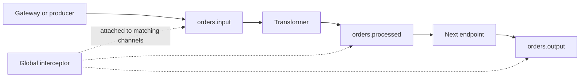

# Global Channel Interceptor

## 1. Objectives and Use Case

In the **SPRING_INTEGRATION_CORE** module, `Message`, `MessageChannel`, endpoints, and gateways work together to form message flows. When designing with Java DSL, transformers, routers, filters, and aggregators describe each processing step. However, many channels also need the same cross-cutting technical behavior: adding a tracking ID, validating a common header, or recording a send attempt.

If every channel declares the same interceptor separately, configurations easily drift as the flow grows. **Global channel interceptors** allow registering a single interceptor bean and automatically attaching it to channels whose names match.

After this lesson, you will be able to:

- Distinguish an interceptor attached directly to a channel from an interceptor applied via global configuration.
- Declare `@GlobalChannelInterceptor`, choose `patterns`, and specify `order`.
- Understand send, receive, and completion callbacks and chain short-circuiting cases.
- Combine interceptors with Java DSL while keeping endpoint responsibilities clear.
- Test application scope, header preservation, and channels registered at runtime.

This lesson belongs to the **Configuration and Lifecycle** chapter. The focus is how interceptors are attached to channels and invoked during messaging operations; retry policies, transactions, or business processing should be configured on the appropriate components in the flow.

## 2. Global Is a Configuration Scope, Not a Channel Type

A `ChannelInterceptor` implements the behavior. Global configuration decides **which channels receive that behavior**. Once attached to a channel, the interceptor still runs through the channel's callback mechanism.

Order processing flow example:



Three channels can share **a single bean instance** of the interceptor. Each send through a channel in scope can invoke the corresponding callbacks again. Therefore, one business request passing through three channels does not mean the interceptor runs only once.

| Configuration Style | How Target Scope Is Selected | When Appropriate |
| --- | --- | --- |
| Local interceptor | Call `addInterceptor(...)` or declare the interceptor directly on a channel | One channel needs a specific rule |
| Global interceptor | Match channel names by pattern | Many channels need the same technical rule |
| Endpoint in flow | Place transformer, filter, router, or service activator at a specific position | A processing step should appear explicitly in the flow |
| Advice on handler | Attach advice to an endpoint's handle operation | Need to wrap a handler call, such as per-step retry |

At the infrastructure level, the global processor finds channel beans implementing `InterceptableChannel` and adds matching interceptors. An object merely implementing `MessageChannel` might not support that mechanism. Nor does the word "global" mean automatically spanning every application, every JVM, or objects constructed with `new`. See [GlobalChannelInterceptorProcessor](https://raw.githubusercontent.com/spring-projects/spring-integration/v7.1.1/spring-integration-core/src/main/java/org/springframework/integration/config/GlobalChannelInterceptorProcessor.java).

**Design choice example:** adding `requestId` for `orders.*` channels is a shared technical rule. Routing high-value orders to a manual review queue should be expressed with a router so readers of the flow can see the business branch.

## 3. Registration via Annotations

The interface to implement resides in Spring Messaging:

```java
import org.springframework.messaging.support.ChannelInterceptor;
```

The global annotation resides in Spring Integration:

```java
import org.springframework.integration.config.GlobalChannelInterceptor;
```

There are two common declaration styles:

```java
@Bean
@GlobalChannelInterceptor(
        patterns = {"!orders.internal.*", "orders.*"},
        order = -100)
public ChannelInterceptor requestIdInterceptor() {
    return new RequestIdInterceptor();
}
```

Or placing the annotation on the bean class:

```java
@Component
@GlobalChannelInterceptor(
        patterns = {"!orders.internal.*", "orders.*"},
        order = -100)
public class RequestIdInterceptor implements ChannelInterceptor {
    // Override only the callbacks you need.
}
```

Choose one registration approach for the same interceptor. If you both scan `@Component` and declare another bean via `@Bean`, you may accidentally end up with two instances performing the same behavior.

`@GlobalChannelInterceptor` does not turn an unmanaged class into a Spring bean on its own. Configuration must actually be loaded; classes using `@Component` must lie within component scan scope. The API supports the annotation on classes and `@Bean` methods; defaults are `patterns = {"*"}` and `order = 0`. See [GlobalChannelInterceptor API](https://docs.spring.io/spring-integration/docs/7.1.x/api/org/springframework/integration/config/GlobalChannelInterceptor.html).

In the complete example below, `@EnableIntegration` explicitly enables Spring Integration infrastructure for a plain Java application context. In a Spring Boot application, inspect the infrastructure already provided by the application's auto-configuration before adding equivalent configuration.

## 4. Patterns: Channel Names and the First-Match Rule

### 4.1. What Do Patterns Match Against?

Patterns select **channel bean names**, not payloads, handler method names, or sender names. Therefore, give clear names to channels you want covered by a shared policy.

```java
@Bean(name = "orders.input")
public DirectChannel ordersInput() {
    return new DirectChannel();
}
```

This bean is matched by `orders.input` or `orders.*`. Do not infer that the pattern `ordersInput` will necessarily match the bean merely because that is the Java method name; here the bean name has been explicitly declared as `orders.input`.

Patterns support `*` for any sequence of characters. This is simple string matching, not regular expressions or filesystem paths. The dot in `orders.*` is a literal dot; there is no need to write `orders\..*` as in regex. See [Spring Framework's PatternMatchUtils](https://docs.spring.io/spring-framework/docs/current/javadoc-api/org/springframework/util/PatternMatchUtils.html).

### 4.2. Exclusion Patterns Must Be Ordered Properly

Spring Integration supports the `!` prefix for negation. **The first matching pattern determines the outcome**, whether it is an inclusion or exclusion pattern.

Correct configuration for "include orders, except internal branch":

```java
patterns = {"!orders.internal.*", "orders.*"}
```

| Channel Bean Name | First Matching Pattern | Interceptor Attached? |
| --- | --- | --- |
| `orders.input` | `orders.*` | Yes |
| `orders.processed` | `orders.*` | Yes |
| `orders.output` | `orders.*` | Yes |
| `orders.internal.audit` | `!orders.internal.*` | No |
| `payments.input` | No matching pattern | No |

The configuration below does not produce the intended scope:

```java
patterns = {"orders.*", "!orders.internal.*"}
```

The name `orders.internal.audit` already matched `orders.*` first, so the negation pattern after it has no effect on that name.

If you want broad application while excluding only certain channels, you can use:

```java
patterns = {"!errorChannel", "!observability.*", "*"}
```

Conversely, writing only `{"!orders.internal.*"}` does not mean accepting every remaining channel: names matching no pattern are not selected. A readable convention is placing exceptions first, followed by the broad pattern. This rule is described directly in [PatternMatchUtils.smartMatch](https://docs.spring.io/spring-integration/docs/7.1.x/api/org/springframework/integration/support/utils/PatternMatchUtils.html).

In Java, write each pattern as an element of a `String[]` array. When creating dynamic flows with bean-name prefixing options, verify the actual post-registration channel names so patterns continue to match.

## 5. Order: Position Relative to Local Interceptors

`order` controls the global interceptor's position when the framework inserts it into a channel's interceptor list.

| Value | Position When Global Configuration Applies |
| --- | --- |
| Negative, e.g., `-100` | Before interceptors already configured directly on the channel |
| Positive, e.g., `100` | After interceptors already configured directly on the channel |
| `0` | Default value; in the referenced implementation, placed in the trailing group |
| Multiple matching global interceptors | Within each group, sorted in ascending `order` |

Example with two global interceptors before the local group and one global interceptor after the local group:

```text
requestIdGlobal(-200)
    -> commonHeaderGlobal(-100)
    -> localWireTap
    -> sendAuditGlobal(100)
```

If the wire tap needs to see `requestId`, add the header before the wire tap using a negative `order`. If added afterwards, the copy received by the wire tap may not contain that header yet.

Before/after local interceptor semantics are presented in [Global Channel Interceptor Configuration](https://docs.spring.io/spring-integration/reference/channel/configuration.html#channel-global-interceptor). Placing `0` into the `order >= 0` group can be verified in [the processor source code](https://raw.githubusercontent.com/spring-projects/spring-integration/v7.1.1/spring-integration-core/src/main/java/org/springframework/integration/config/GlobalChannelInterceptorProcessor.java).

Do not use equal values to express a mandatory dependency. If behavior A must run before B, assign distinct values and test that order. Nor does this `order` determine endpoint startup order, order among concurrent messages, or subscriber execution order.

After the list is initialized, adding or replacing interceptors via runtime APIs can alter the effective list. Therefore, when diagnosing, inspect the channel's final configuration rather than reading annotations alone.

## 6. Lifecycle Callbacks of ChannelInterceptor

### 6.1. Send Group

| Callback | Role | Important Notes |
| --- | --- | --- |
| `preSend(message, channel)` | Inspect, enrich, or replace message before actual send | Return `null` to block the send |
| `postSend(message, channel, sent)` | Observe result after the actual send returns normally | Not guaranteed to run when an exception occurs |
| `afterSendCompletion(message, channel, sent, ex)` | Finalize and clean up resources for a send attempt | Invoked only for interceptors that completed `preSend` returning a non-`null` message |

When using standard channels in the example without errors, the simple order is:

```text
preSend(A)
preSend(B)
channel send operation
postSend(A)
postSend(B)
afterSendCompletion(B)
afterSendCompletion(A)
```

If `preSend(B)` returns `null`, the actual send operation is skipped. With direct `send(...)` on these channels, the result is `false`; `postSend` does not run. Interceptor A completed preparation successfully so its completion runs, whereas B's own completion callback is not invoked.

If an interceptor allocates a resource and then throws an exception or returns `null` inside `preSend`, it must release that allocated resource itself before exiting. It cannot rely on its own `afterSendCompletion`.

Callback guarantees are specified in [ChannelInterceptor API](https://docs.spring.io/spring-framework/docs/current/javadoc-api/org/springframework/messaging/support/ChannelInterceptor.html); chain ordering can be verified in [AbstractMessageChannel](https://raw.githubusercontent.com/spring-projects/spring-integration/v7.1.1/spring-integration-core/src/main/java/org/springframework/integration/channel/AbstractMessageChannel.java).

### 6.2. Receive Group

| Callback | Role |
| --- | --- |
| `preReceive(channel)` | Runs before fetching a message; return `false` to prevent the receive |
| `postReceive(message, channel)` | Runs after a message is retrieved; can replace the message or return `null` |
| `afterReceiveCompletion(message, channel, ex)` | Finalizes receive for interceptors that passed `preReceive` successfully |

Receive callbacks apply to `PollableChannel`s such as `QueueChannel`. `DirectChannel` delivers directly to subscribers and provides no `receive()` operation, so there are no `preReceive` or `postReceive` callbacks for that usage.

Since Spring Integration 5.1, `postReceive` is not invoked if no message was retrieved. A `receive(0)` on an empty queue can still pass through `preReceive` and `afterReceiveCompletion`; the message argument in the completion callback may be `null`. See [Channel Interceptors](https://docs.spring.io/spring-integration/reference/channel/interceptors.html).

**Be careful returning `null` from `postReceive`:** the message has already been removed from the queue. Returning `null` does not put it back into the queue automatically. If you need an observable or persisted rejection branch, express it with a filter and an appropriate discard flow.

### 6.3. Do Not Pair Send and Receive as a Fixed Timeline

With queues, sender and receiver may run on different threads. Receiving can happen while the sender is still inside the send operation, or long after sending finished.

Therefore:

- Use message headers to carry data across thread boundaries.
- Do not assume `postSend` always occurs before `preReceive`.
- Do not use an instance `startTime` variable to correlate send and receive timestamps across multiple messages.
- Do not measure end-to-end process latency solely by the duration of one channel callback.

## 7. Complete Example: requestId via Java DSL

### 7.1. Example Scope

The flow receives a string, trims leading/trailing whitespace, and converts it to uppercase:

```text
orders.input
    -> trim
    -> orders.processed
    -> uppercase
    -> orders.output (QueueChannel)
```

Technical requirements:

1. Sends to `orders.*` pass through the interceptor.
2. `orders.internal.*` is excluded.
3. If `requestId` is missing, the interceptor adds a value.
4. If `requestId` is already present, the interceptor preserves it.
5. Payload transformation stays in the transformers; the interceptor handles only the header and illustrative counter.

The example uses `spring-integration-core` in an application with Spring Context; tests use JUnit Jupiter. Manage Spring versions using your project's compatible dependency set, such as an active BOM, rather than picking individual library versions independently. No external message broker is needed for this flow.

### 7.2. Configuration

```java
import java.util.Locale;
import java.util.UUID;
import java.util.concurrent.atomic.LongAdder;

import org.springframework.context.annotation.Bean;
import org.springframework.context.annotation.Configuration;
import org.springframework.integration.channel.DirectChannel;
import org.springframework.integration.channel.QueueChannel;
import org.springframework.integration.config.EnableIntegration;
import org.springframework.integration.config.GlobalChannelInterceptor;
import org.springframework.integration.dsl.IntegrationFlow;
import org.springframework.messaging.Message;
import org.springframework.messaging.MessageChannel;
import org.springframework.messaging.support.ChannelInterceptor;
import org.springframework.messaging.support.MessageBuilder;

@Configuration
@EnableIntegration
public class GlobalInterceptorConfig {

    public static final String REQUEST_ID = "requestId";

    @Bean(name = "orders.input")
    public DirectChannel ordersInput() {
        return new DirectChannel();
    }

    @Bean(name = "orders.processed")
    public DirectChannel ordersProcessed() {
        return new DirectChannel();
    }

    @Bean(name = "orders.output")
    public QueueChannel ordersOutput() {
        return new QueueChannel(10);
    }

    @Bean(name = "orders.internal.audit")
    public QueueChannel ordersInternalAudit() {
        return new QueueChannel(10);
    }

    @Bean
    @GlobalChannelInterceptor(
            patterns = {"!orders.internal.*", "orders.*"},
            order = -100)
    public RequestIdInterceptor requestIdInterceptor() {
        return new RequestIdInterceptor();
    }

    @Bean
    public IntegrationFlow orderFlow() {
        return IntegrationFlow.from("orders.input")
                .<String, String>transform(String::trim)
                .channel("orders.processed")
                .<String, String>transform(
                        value -> value.toUpperCase(Locale.ROOT))
                .channel("orders.output")
                .get();
    }

    public static final class RequestIdInterceptor
            implements ChannelInterceptor {

        private final LongAdder sendAttempts = new LongAdder();

        @Override
        public Message<?> preSend(
                Message<?> message, MessageChannel channel) {

            this.sendAttempts.increment();

            if (message.getHeaders().containsKey(REQUEST_ID)) {
                return message;
            }

            return MessageBuilder.fromMessage(message)
                    .setHeader(REQUEST_ID, UUID.randomUUID().toString())
                    .build();
        }

        public long sendAttempts() {
            return this.sendAttempts.sum();
        }
    }
}
```

The example intentionally uses stable channel names so patterns are readable and testable. The `sendAttempts` counter counts `preSend` invocations on selected channels; it does not assert completed order count.

When the header is missing, `MessageBuilder.fromMessage(...)` builds a message carrying the needed change instead of mutating the input message's headers directly. Keeping existing headers preserves other metadata used by the flow.

`requestId` in the example is an application header for tracing. Do not arbitrarily overwrite `correlationId`, `sequenceNumber`, or `sequenceSize` of a flow containing splitters/aggregators just for logging convenience: those values may participate in grouping and release rules.

In real deployments, clearly define which sources are allowed to supply `requestId` and how values are validated. This example illustrates adding and preserving a header, not using that header as proof of authentication or authorization.

### 7.3. Why Does the Counter Increment Three Times?

With input `"  order-42  "` and space available in the output queue:

| Send | Channel | Behavior |
| --- | --- | --- |
| 1 | `orders.input` | Generates `requestId` if missing |
| 2 | `orders.processed` | Preserves existing `requestId` |
| 3 | `orders.output` | Continues preserving `requestId` |

The outcome is payload `ORDER-42`, a single `requestId` throughout, and three `preSend` calls. Calling `receive(...)` on the output queue does not increment this counter because it only increments inside the send callback.

If the goal is generating an ID exactly once at the intake boundary, a header enricher at the start of the flow can also be a clear choice. Global interceptors are useful when applying the same policy across multiple boundaries or multiple flows.

## 8. Testing Real Configuration Instead of Calling Callbacks Directly

Calling `interceptor.preSend(...)` directly only tests the method's logic. That approach does not prove annotations are processed, patterns match properly, or the interceptor was attached to channels.

The tests below construct a real application context using the configuration above without needing `@SpringBootTest`. Each test has its own context so counters are not shared across tests.

```java
import org.junit.jupiter.api.Test;
import org.springframework.context.annotation.AnnotationConfigApplicationContext;
import org.springframework.integration.channel.QueueChannel;
import org.springframework.integration.dsl.IntegrationFlow;
import org.springframework.integration.dsl.context.IntegrationFlowContext;
import org.springframework.messaging.Message;
import org.springframework.messaging.MessageChannel;
import org.springframework.messaging.support.MessageBuilder;

import static org.junit.jupiter.api.Assertions.*;

class GlobalInterceptorConfigTest {

    @Test
    void addsRequestIdAcrossMatchingChannels() {
        try (var context = new AnnotationConfigApplicationContext(
                GlobalInterceptorConfig.class)) {

            var input = context.getBean(
                    "orders.input", MessageChannel.class);
            var output = context.getBean(
                    "orders.output", QueueChannel.class);
            var interceptor = context.getBean(
                    GlobalInterceptorConfig.RequestIdInterceptor.class);

            assertTrue(input.send(
                    MessageBuilder.withPayload("  order-42  ").build(),
                    1000));

            Message<?> result = output.receive(1000);

            assertNotNull(result);
            assertEquals("ORDER-42", result.getPayload());
            assertNotNull(result.getHeaders().get(
                    GlobalInterceptorConfig.REQUEST_ID));
            assertEquals(3L, interceptor.sendAttempts());
        }
    }

    @Test
    void preservesExistingRequestId() {
        try (var context = new AnnotationConfigApplicationContext(
                GlobalInterceptorConfig.class)) {

            var input = context.getBean(
                    "orders.input", MessageChannel.class);
            var output = context.getBean(
                    "orders.output", QueueChannel.class);

            assertTrue(input.send(
                    MessageBuilder.withPayload("order-43")
                            .setHeader(
                                    GlobalInterceptorConfig.REQUEST_ID,
                                    "req-43")
                            .build(),
                    1000));

            Message<?> result = output.receive(1000);

            assertNotNull(result);
            assertEquals("req-43", result.getHeaders().get(
                    GlobalInterceptorConfig.REQUEST_ID));
        }
    }

    @Test
    void excludesInternalChannel() {
        try (var context = new AnnotationConfigApplicationContext(
                GlobalInterceptorConfig.class)) {

            var internal = context.getBean(
                    "orders.internal.audit", QueueChannel.class);
            var interceptor = context.getBean(
                    GlobalInterceptorConfig.RequestIdInterceptor.class);

            assertTrue(internal.send(
                    MessageBuilder.withPayload("audit-event").build(),
                    1000));

            Message<?> result = internal.receive(1000);

            assertNotNull(result);
            assertNull(result.getHeaders().get(
                    GlobalInterceptorConfig.REQUEST_ID));
            assertEquals(0L, interceptor.sendAttempts());
        }
    }

    @Test
    void interceptsChannelRegisteredAtRuntime() {
        try (var context = new AnnotationConfigApplicationContext(
                GlobalInterceptorConfig.class)) {

            var flowContext = context.getBean(
                    IntegrationFlowContext.class);
            var output = context.getBean(
                    "orders.output", QueueChannel.class);
            var interceptor = context.getBean(
                    GlobalInterceptorConfig.RequestIdInterceptor.class);

            IntegrationFlow flow =
                    IntegrationFlow.from("orders.runtime.input")
                            .<String, String>transform(
                                    value -> value + "-runtime")
                            .channel("orders.output")
                            .get();

            var registration = flowContext.registration(flow)
                    .id("runtimeOrders")
                    .register();

            try {
                var input = context.getBean(
                        "orders.runtime.input", MessageChannel.class);

                assertTrue(input.send(
                        MessageBuilder.withPayload("order-44").build(),
                        1000));

                Message<?> result = output.receive(1000);

                assertNotNull(result);
                assertEquals("order-44-runtime", result.getPayload());
                assertNotNull(result.getHeaders().get(
                        GlobalInterceptorConfig.REQUEST_ID));
                assertEquals(2L, interceptor.sendAttempts());
            }
            finally {
                registration.destroy();
            }
        }
    }
}
```

The exclusion test case is especially valuable: if you swap the order of the two patterns in the annotation, `orders.internal.audit` will be selected and the corresponding assertions will catch the mismatch.

The runtime test uses an input name distinct from the main flow while output is the existing bean. Thus, two intercepted sends are expected—the runtime input and the output—rather than three as in the main flow.

When extending practice, add the following behavioral tests:

| Scenario | What to Observe |
| --- | --- |
| Two global interceptors and one local interceptor | Event list proving execution order |
| `preSend` returns `null` | No message at destination, direct `send` returns `false` |
| `preSend` throws exception | Caller receives error along actual send path; no fake success result |
| Receiving from an empty queue | No `postReceive`; matching completion callback still cleans up resources |
| Multiple concurrent senders | Headers of each message do not mix with other messages |
| Re-sending the same request | Policy for preserving or generating tracking IDs behaves as designed |

Timeouts in tests prevent indefinite hangs. They do not impose an overall deadline on a synchronous processing chain; if a handler hangs, the timeout passed to `send` does not interrupt that handler automatically.

## 9. Registration, Startup, and Dynamic Flows

Two lifecycles must be distinguished:

1. **Bean/configuration lifecycle:** Spring creates interceptors, channels, and infrastructure; matching global interceptors are added to channels.
2. **Operation lifecycle:** each `send` or `receive` invokes the corresponding callbacks.

You do not need to call `start()` on an interceptor merely because it is marked global. Starting or stopping consumption is an endpoint's own lifecycle responsibility. A channel that has interceptors does not automatically gain a consumer because of this annotation.

Since Spring Integration 5.1, global channel interceptors also support dynamically registered channels via framework-managed initialization paths, including `IntegrationFlowContext`. Refer to [Channel Interceptors](https://docs.spring.io/spring-integration/reference/channel/interceptors.html).

In the runtime case above, `IntegrationFlowContext` manages registering the flow and dependent components. `registration.destroy()` removes the dynamic flow when no longer needed. Management is presented in [Dynamic and Runtime Integration Flows](https://docs.spring.io/spring-integration/reference/dsl/java-runtime-flows.html).

Conversely:

```java
QueueChannel unmanaged = new QueueChannel(10);
```

This local variable has not gone through bean management or flow registration. Merely giving a variable a name resembling a pattern does not cause global interceptors to appear on the object. If you need a runtime channel in an application, pass it through an appropriate registration/initialization mechanism and test the result.

Do not assume that adding a new interceptor bean after the context has started will automatically update all existing channels. Changing interception policies at runtime requires an explicit design and interceptor-list management operations.

## 10. Errors and the Limits of sent=true

### 10.1. sent Reflects the Send Operation at the Channel

| Channel | What Can Be Inferred When Send Succeeds? | What Cannot Be Concluded? |
| --- | --- | --- |
| `DirectChannel` | Synchronous dispatch operation returned normally | Any spawned asynchronous tasks or external transactions completed |
| `QueueChannel` | Message was placed in the queue per channel mechanics | Consumer pulled and finished processing it |
| `ExecutorChannel` | Task handoff to the executor was accepted/returned | Handler running on the executor succeeded |

On `ExecutorChannel`, the thread executing the handler also depends on the executor and rejection policy; do not build assumptions that handlers always run on a different thread. See [Message Channel Implementations](https://docs.spring.io/spring-integration/reference/channel/implementations.html).

With the order example, incrementing an `order_completed` metric inside `postSend` of `orders.output` would be misleading: the output queue may merely be holding the message. A more accurate metric here is "accepted sends," while "order completed" should be recorded at the business acknowledgment step.

### 10.2. Callbacks Do Not Replace Error Handling Mechanisms

`afterSendCompletion` observes errors tied to the send attempt it wraps; it does not retry, does not roll back, and does not convert an exception into an `ErrorMessage`.

When sending directly to a synchronous flow, errors can propagate back to the caller along the call stack. In asynchronous processing managed by Spring Integration, appropriate error handling may emit an `ErrorMessage` to the channel in the `errorChannel` header or the default error channel. The presence of a global interceptor does not create that error path by itself. See [Error Handling](https://docs.spring.io/spring-integration/reference/error-handling.html).

An error arising later in a consumer cannot turn back time to alter a send callback already completed on a queue.

### 10.3. Blocking Messages Can Affect Gateways

If `preSend` returns `null`, the message never reaches the endpoint and no business reply is produced by the endpoint. When a flow is invoked via a request/reply gateway, clarify how the gateway handles send failures and reply waiting.

At an intermediate position or reply branch, dropping a message can also cause the caller to wait until its configured timeout. A "drop invalid orders" rule is usually easier to operate using a filter with a discard channel or an explicit business error.

## 11. Thread Safety, Tracing, and Side Effects

### 11.1. One Bean Can Serve Multiple Channels and Multiple Threads

A singleton interceptor should not hold current-message state in fields like:

```java
private String currentRequestId;
private long currentStartTime;
```

Concurrent calls can overwrite each other. In the example, `LongAdder` suits a counter updated from multiple threads; request IDs belong inside each message.

If implementing timing measurements with `ThreadLocal`, account for nested sends on the same thread and cleaning up state on exceptions. Even a single thread-local variable can be overwritten when a synchronous flow subsequently invokes another channel using that same interceptor.

### 11.2. Headers Cross Threads; MDC Does Not Automatically Follow

A regular `ChannelInterceptor` does not automatically propagate MDC or arbitrary `ThreadLocal`s across an executor. When messages cross to another thread, the processing side must establish context from headers or use an appropriate context propagation mechanism.

If callbacks around subscriber invocation on an executor-backed channel are needed, look at `ExecutorChannelInterceptor` with `beforeHandle` and `afterMessageHandled`. This is a complementary contract, not a renamed version of `QueueChannel`'s `preReceive`. See [ExecutorChannelInterceptor API](https://docs.spring.io/spring-framework/docs/current/javadoc-api/org/springframework/messaging/support/ExecutorChannelInterceptor.html).

When setting MDC, save the previous value and restore it at the corresponding boundary, especially if nested calls occur or threads are reused.

### 11.3. Avoid Creating Observation Loops

Suppose an interceptor applies to `"*"` and itself sends an audit message to `observability.events`. That audit send gets intercepted too; the interceptor sends another audit, creating a recursive loop.

One design approach:

```java
@GlobalChannelInterceptor(
        patterns = {"!observability.*", "!errorChannel", "orders.*"},
        order = 100)
```

With these patterns, observability channels are out of scope. If you also need to monitor the error path, design recording so it does not keep sending messages back into the exact set of observed channels.

Do not make HTTP calls, query databases, or serialize entire payloads inside every `preSend` just to log. Those operations sit directly on the send path and can add latency or turn an observability failure into a primary processing failure.

When implementing logging or metrics:

- Select only needed headers instead of logging entire messages.
- Name metrics after actual events: sends, send failures, or business completions.
- Put `requestId` in logs/traces; avoid turning every value into a metrics label because cardinality grows with request volume.
- Define a clear policy when the audit system fails: mandatory audit may block processing; best-effort observability needs an appropriate error path so it does not cause unintended outages.

## 12. Diagnostics and Practice Exercises

### 12.1. Common Symptoms

| Symptom | Possibilities to Check | Concrete Check |
| --- | --- | --- |
| Callback does not run | Interceptor bean/configuration not loaded | Create context with the right configuration and retrieve the interceptor bean |
| A channel is skipped | Actual name does not match patterns | Compare channel bean name against each pattern in order |
| Internal channel still gets intercepted | Broad pattern precedes negation | Place `!orders.internal.*` before `orders.*` |
| Logic runs twice on the same channel | Duplicate bean registration or both local and global | Inspect `getInterceptors()` of an interceptable channel |
| `preReceive` does not run | Using `DirectChannel` or no receive called | Check channel type and actual `receive(...)` operations |
| `postReceive` does not run on empty queue | No message to receive | Observe `afterReceiveCompletion` instead of assuming `postReceive` |
| Counter exceeds request count | One request crosses multiple channels or is resent | Count sends and business events separately |
| Dynamic flow is not intercepted | Object bypassed managed initialization or name got prefixed | Check registration path and post-registration bean name |
| Send succeeds yet processing later fails | Queue/executor boundary present | Inspect endpoint, error flow, and business response |
| Logs grow endlessly | Interceptor re-emits messages into channels in its own scope | Check audit channel and exclusion patterns |

### 12.2. Extended Practice

Building on the example, add a `LocalProbeInterceptor` to `orders.input`. The probe records whether the `requestId` header is already present at `preSend` time.

Perform sequentially:

1. Keep the global interceptor at `order = -100`; verify the probe sees the header.
2. Change the global interceptor to `order = 100`; observe the probe on input receiving the message before the global interceptor adds the header.
3. Send a message that already has `requestId`; verify neither configuration alters the ID.
4. Add a `payments.input` channel; verify the `orders.*` policy does not apply.
5. Reverse the order of inclusion and exclusion patterns; use the internal test case to detect the difference.
6. Add a business filter in the flow and observe the difference between a message rejected by the filter vs. a message blocked by an interceptor before the channel.

The goal is to clearly see the boundaries between **configuration attaching interceptors**, **callbacks on channel operations**, and **endpoints executing business logic**. Once these three boundaries are clear, you can apply cross-cutting policies while keeping message flows readable, testable, and diagnosable.
