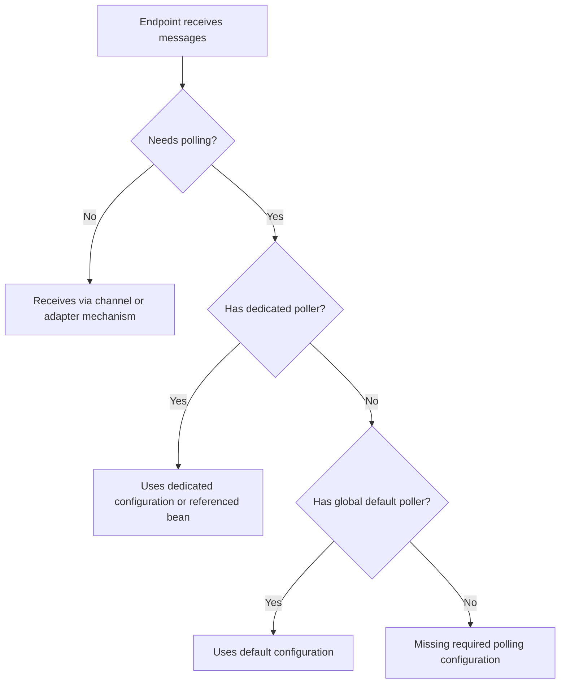

# Global Poller

In the **SPRING_INTEGRATION_CORE** module, a global poller is a default polling configuration allowing multiple endpoints to share a message-retrieval policy without repeating schedule configuration. This topic belongs to the **Configuration and Lifecycle** chapter: poller selection determines when an endpoint pulls work, how many messages it receives per poll, and how the flow uses execution resources.

After this lesson, you will be able to declare a default poller, identify which endpoints use it, set a dedicated configuration for one endpoint, and verify behavior when an endpoint stops or restarts. Examples use APIs available in Spring Integration 6.x with Spring Framework 6 and Java 17 or later; specific library versions should be managed by your project's compatible BOM.

## 1. The Problem a Global Poller Solves

Suppose an application receives orders through a gateway and places `Message<String>` into a `QueueChannel`. A transformer normalizes the order code, and then another endpoint appends status. Because the channel has a queue, a component is needed to actively pull messages out and pass them to handlers.

If every endpoint declares a 200 ms interval, a limit of 5 messages per poll, and a receive timeout of 0 on its own, configuration is duplicated. When changing the shared policy, developers must track down each endpoint and easily miss some.

A global poller provides a default for this case. In Java configuration, it is a `PollerMetadata` bean registered under the name `PollerMetadata.DEFAULT_POLLER`. Endpoints needing polling that do not declare their own poller will use that configuration. The scope considered here is endpoints within the same `ApplicationContext`. [Global default poller rules](https://docs.spring.io/spring-integration/reference/endpoint.html#global-default-poller).

The word "global" refers to the scope of default configuration selection. Each polling endpoint remains an independent active component; the 5-message limit applies per poll of each individual endpoint.

## 2. Which Endpoints Need a Poller?

Spring Integration distinguishes receiving messages from a `PollableChannel`, such as `QueueChannel`, from receiving messages via the subscription mechanism of a `SubscribableChannel`, such as `DirectChannel`. The former uses `PollingConsumer`; the latter typically uses `EventDrivenConsumer`. In addition, `SourcePollingChannelAdapter` invokes a `MessageSource` on a schedule to feed data into the flow. [Polling consumer and message source model](https://docs.spring.io/spring-integration/reference/polling-consumer.html).

| Component or Scenario | How Work Is Received | Role of Global Poller |
| --- | --- | --- |
| Transformer receiving from `QueueChannel` | Endpoint pulls messages from queue | Uses default if no dedicated poller is set |
| Service activator receiving from `QueueChannel` | Endpoint pulls messages and invokes handler | Uses default if no dedicated poller is set |
| `SourcePollingChannelAdapter` | Calls `MessageSource.receive()` on schedule | Can use default poller |
| Transformer receiving from `DirectChannel` | Channel invokes subscriber on message | Does not need a poller |
| Gateway sending to a channel | Sends request or awaits reply per gateway contract | Polling, if any, belongs to downstream endpoints |
| Standalone `QueueChannel` | Stores waiting messages | Does not create a processing schedule itself |

Selection rules can be read from the following diagram:



When diagnosing a flow, look at the **input channel of the endpoint in question**. Having a `QueueChannel` elsewhere in a flow does not mean every handler in the flow needs a poller.

## 3. Complete Example with Java Configuration and Java DSL

The example below has two polling endpoints:

```text
orders                  normalizedOrders                 orderResults
QueueChannel            QueueChannel                     QueueChannel
     │                        │                               ▲
     └─ normalizeOrders ──────┘─ labelOrders ─────────────────┘
          uses default            uses default
```

`orders` receives raw order codes. `normalizeOrders` trims whitespace and converts to uppercase. `labelOrders` adds the `accepted:` prefix. The final queue is used to observe results in the example and tests.

Place the following class in application source code that includes `spring-integration-core` along with compatible Spring dependencies:

```java
import java.time.Duration;
import java.util.Locale;

import org.springframework.context.annotation.Bean;
import org.springframework.context.annotation.Configuration;
import org.springframework.integration.channel.QueueChannel;
import org.springframework.integration.config.EnableIntegration;
import org.springframework.integration.dsl.IntegrationFlow;
import org.springframework.integration.scheduling.PollerMetadata;
import org.springframework.scheduling.support.PeriodicTrigger;

@Configuration
@EnableIntegration
public class GlobalPollerConfig {

    @Bean(name = PollerMetadata.DEFAULT_POLLER)
    public PollerMetadata defaultPoller() {
        PeriodicTrigger trigger =
                new PeriodicTrigger(Duration.ofMillis(200));
        trigger.setFixedRate(false);

        PollerMetadata metadata = new PollerMetadata();
        metadata.setTrigger(trigger);
        metadata.setMaxMessagesPerPoll(5);
        metadata.setReceiveTimeout(0);
        return metadata;
    }

    @Bean
    public QueueChannel orders() {
        return new QueueChannel(100);
    }

    @Bean
    public QueueChannel normalizedOrders() {
        return new QueueChannel(100);
    }

    @Bean
    public QueueChannel orderResults() {
        return new QueueChannel(100);
    }

    @Bean
    public IntegrationFlow normalizeFlow() {
        return IntegrationFlow.from("orders")
                .transform(String.class,
                        text -> text.trim().toUpperCase(Locale.ROOT),
                        endpoint -> endpoint.id("normalizeOrders"))
                .channel("normalizedOrders")
                .get();
    }

    @Bean
    public IntegrationFlow labelFlow() {
        return IntegrationFlow.from("normalizedOrders")
                .transform(String.class,
                        text -> "accepted:" + text,
                        endpoint -> endpoint.id("labelOrders"))
                .channel("orderResults")
                .get();
    }
}
```

The `.transform(...)` calls do not specify `.poller(...)`. Both endpoints receive from queues, so they are configured using the global default poller. The IDs `normalizeOrders` and `labelOrders` are set explicitly so each endpoint can be accessed during testing or lifecycle management.

With payload `"  dh-001  "`, the final result is `"accepted:DH-001"`. After forwarding the message to `normalizedOrders`, the first endpoint does not determine when the second endpoint picks up that message: the intermediate queue creates a separate processing boundary.

The queues in the example have a capacity of 100. When practicing with large amounts of data, consume results from `orderResults`; if the output queue fills up, upstream sends may wait or fail per the configured send timeout. Queue capacity must be considered alongside the consumption rate of the entire flow.

### Writing the Default Bean with Pollers DSL

You can replace the **`defaultPoller()` method** above with the following declaration. Add imports for `PollerSpec` and `Pollers` from the `org.springframework.integration.dsl` package:

```java
@Bean(name = PollerMetadata.DEFAULT_POLLER)
public PollerSpec defaultPoller() {
    return Pollers.fixedDelay(Duration.ofMillis(200))
            .maxMessagesPerPoll(5)
            .receiveTimeout(0);
}
```

`PollerSpec` is a `FactoryBean` that creates `PollerMetadata`. When returning `PollerSpec` directly from a `@Bean` method, let Spring initialize this object; do not call `.getObject()` inside the bean declaration method. This style also preserves proper initialization of DSL-managed supporting components. [Declaring pollers with Java DSL](https://docs.spring.io/spring-integration/reference/dsl/java-pollers.html).

Choose one of the two ways to declare the default bean for your application. A bean whose method is named `defaultPoller` without the conventional bean name `PollerMetadata.DEFAULT_POLLER` does not become the global default poller solely from that method name. `@Primary` does not replace the role of this conventional name either.

## 4. Dedicated Configuration and Named Poller Beans

A shared default suits cases where endpoints have similar requirements. A heavy data-import task or a rate-limited call often needs its own policy.

### 4.1. Setting a Poller Directly on an Endpoint

If the normalization step should accept only one message per poll and wait 2 seconds between polls, replace the `normalizeFlow()` method with:

```java
@Bean
public IntegrationFlow normalizeFlow() {
    return IntegrationFlow.from("orders")
            .transform(String.class,
                    text -> text.trim().toUpperCase(Locale.ROOT),
                    endpoint -> endpoint
                            .id("normalizeOrders")
                            .poller(poller -> poller
                                    .fixedDelay(Duration.ofSeconds(2))
                                    .maxMessagesPerPoll(1)
                                    .receiveTimeout(0)))
            .channel("normalizedOrders")
            .get();
}
```

The `labelOrders` endpoint still uses the initial default. Specifying a poller for `normalizeOrders` selects a dedicated configuration for that endpoint; do not assume it only overrides `fixedDelay` and automatically inherits every undeclared attribute from the global poller. Hence, the example explicitly sets both the receive limit and timeout.

### 4.2. Reusing a Dedicated Configuration via a Bean

When a group of endpoints needs to share a special policy, you can declare an additional regular bean:

```java
@Bean
public PollerMetadata slowPoller() {
    PollerMetadata metadata = new PollerMetadata();
    metadata.setTrigger(new PeriodicTrigger(Duration.ofSeconds(2)));
    metadata.setMaxMessagesPerPoll(1);
    metadata.setReceiveTimeout(0);
    return metadata;
}
```

Inject that bean into the flow definition method and pass it to the endpoint. The snippet below is another alternative for `normalizeFlow()`:

```java
@Bean
public IntegrationFlow normalizeFlow(
        @org.springframework.beans.factory.annotation.Qualifier("slowPoller")
        PollerMetadata slowPoller) {

    return IntegrationFlow.from("orders")
            .transform(String.class,
                    text -> text.trim().toUpperCase(Locale.ROOT),
                    endpoint -> endpoint.id("normalizeOrders")
                            .poller(slowPoller))
            .channel("normalizedOrders")
            .get();
}
```

`slowPoller` is used only where referenced. Adding a `PollerMetadata` bean with an ordinary name does not alter the global default poller. The DSL supports passing `PollerMetadata` into consumer endpoint configuration. [Consumer endpoint API](https://docs.spring.io/spring-integration/api/org/springframework/integration/dsl/ConsumerEndpointSpec.html).

### 4.3. Equivalent with Annotations

For a method on a Spring bean, you can use `@Transformer` as follows. This is an alternative to the corresponding transformer; when switching to annotations, remove the old DSL endpoint to avoid creating two consumers reading `orders`.

```java
import org.springframework.integration.annotation.Poller;
import org.springframework.integration.annotation.Transformer;

// Belongs to a bean registered in the ApplicationContext.
@Transformer(inputChannel = "orders", outputChannel = "normalizedOrders")
public String normalize(String text) {
    return text.trim().toUpperCase(Locale.ROOT);
}

// Variant: use the slowPoller bean instead of the default.
@Transformer(inputChannel = "slowOrders", outputChannel = "normalizedOrders",
        poller = @Poller("slowPoller"))
public String normalizeSlow(String text) {
    return text.trim().toUpperCase(Locale.ROOT);
}
```

The second variant assumes a `QueueChannel` named `slowOrders` and a `slowPoller` bean already exist. The value `@Poller("slowPoller")` is the **configuration bean name**, not a thread or channel name. When using this reference style, other poller attributes are set on the referenced bean. [`@Poller` annotation and default usage rules](https://docs.spring.io/spring-integration/reference/configuration/annotations.html#using-the-poller-annotation).

## 5. Representation in XML

In XML, the `default="true"` attribute designates the global default poller. The standalone example below normalizes strings from one queue to another:

```xml
<beans xmlns="http://www.springframework.org/schema/beans"
       xmlns:xsi="http://www.w3.org/2001/XMLSchema-instance"
       xmlns:int="http://www.springframework.org/schema/integration"
       xsi:schemaLocation="
         http://www.springframework.org/schema/beans
         https://www.springframework.org/schema/beans/spring-beans.xsd
         http://www.springframework.org/schema/integration
         https://www.springframework.org/schema/integration/spring-integration.xsd">

    <int:poller id="defaultPoller"
                default="true"
                fixed-delay="200"
                max-messages-per-poll="5"
                receive-timeout="0"/>

    <int:channel id="orders">
        <int:queue capacity="100"/>
    </int:channel>

    <int:channel id="normalizedOrders">
        <int:queue capacity="100"/>
    </int:channel>

    <int:transformer id="normalizeOrders"
                     input-channel="orders"
                     output-channel="normalizedOrders"
                     expression="payload.trim().toUpperCase()"/>
</beans>
```

Here the transformer has no child `<int:poller>` element, so it uses the default. To reference a regular poller in XML configuration, use `<int:poller ref="slowPoller"/>` inside the endpoint and declare `slowPoller` at the top level. This XML configuration is an alternative to the Java example, not something to load additionally into the same context.

## 6. Understanding Key Attributes Accurately

### 6.1. Trigger Determines Execution Timing

| Scheduling Mode | Meaning | Illustrative Scenario |
| --- | --- | --- |
| `fixedDelay` | Measures rest interval from when the scheduled run completes | Pause for an interval after each processing batch |
| `fixedRate` | Measures against scheduled start marks | Maintain a relatively steady work-pulling cadence |
| `cron` | Computed from a schedule expression | Fetch data at business schedule marks |
| Custom `Trigger` | Computes the next execution time programmatically | Specialized scheduling policy |

`PeriodicTrigger` uses fixed delay by default; the constructor taking `Duration` makes units explicit. Initial delay defaults to 0, so the 200 ms interval in the example does not mean the first poll always waits a full 200 ms. Actual execution timing also depends on the scheduler and system load. [`PeriodicTrigger` semantics](https://docs.spring.io/spring-framework/docs/6.2.x/javadoc-api/org/springframework/scheduling/support/PeriodicTrigger.html).

In the main example without a dedicated executor, a polling cycle includes both receiving and synchronous processing until the flow reaches an asynchronous boundary or another queue. If an executor is added to the poller, re-examine when the task is handed to the executor versus when actual processing finishes.

### 6.2. maxMessagesPerPoll Is a Limit for One Poll Cycle

With a value of 5, the endpoint can perform at most 5 message-receiving iterations in one poll; the cycle can end earlier when no more data is available or on error. This value does not set thread count, queue capacity, or the number of records inside a payload.

For example, a single message whose payload is a list of 100 orders is still just one message at the poller level. If you want each order processed as an individual message, you need a splitter or a corresponding data-source design.

When no limit is declared, distinguish `PollingConsumer`, which typically defaults to `-1` — continuing to receive until no messages remain — from `SourcePollingChannelAdapter`, which typically defaults to 1. If a source always returns data, an unbounded configuration can keep one poll running for a very long time. The lesson example explicitly sets 5 to avoid relying on this difference. [Receive limits of inbound channel adapters](https://docs.spring.io/spring-integration/reference/channel-adapter.html).

### 6.3. receiveTimeout Is the Receive Wait Time

`receiveTimeout` applies to the receive operation from a `PollableChannel`, in milliseconds. The value 0 in the example requests an immediate receive: if the queue is empty, end the receive operation without waiting for a new message. The default on `PollerMetadata` is 1,000 ms. This attribute does not set an execution deadline for a transformer or an HTTP call inside a handler. [`PollerMetadata` API](https://docs.spring.io/spring-integration/api/org/springframework/integration/scheduling/PollerMetadata.html).

Setting a large receive timeout can be useful for certain work-waiting models, yet many endpoints waiting concurrently on empty queues occupy execution resources. For a `MessageSource` pulling data from an external system, connection or read timeouts must be configured on that source or client.

## 7. Scheduler, Executor, and Rate Estimation

The scheduler decides when to invoke the polling task. The executor, if specified on the poller, is where the submitted task runs. When there is no dedicated executor, the polling endpoint's work runs on a scheduler thread; multiple endpoints may share that scheduler infrastructure. Thus, a slow handler can reduce service capacity for other endpoints. [Task scheduler and executor configuration](https://docs.spring.io/spring-integration/reference/configuration/namespace-taskscheduler.html).

An illustrative calculation for **one endpoint**, assuming the queue always has data, sequential processing, no dedicated executor, and negligible receive overhead:

- Limit per poll: 5 messages.
- Each message takes 40 ms to process.
- Fixed delay: 200 ms.

One processing poll takes roughly `5 × 40 = 200 ms`. Then it rests for about 200 ms, so the time between two poll starts is roughly 400 ms. The estimated rate is:

```text
5 / (0.2 + 0.2) = 12.5 messages/second
```

This calculation is for understanding configuration, not a performance guarantee. With two endpoints in the example, measure processing time and queue length separately at each stage. Increasing `maxMessagesPerPoll` can drain backlog faster, yet also lengthens how long a single poll occupies resources.

When a dedicated executor is needed for a group of endpoints, add `.taskExecutor(executor)` to `PollerSpec`. Pool size and executor queue capacity must be sized alongside target system limits; do not assume fixed rate or per-poll limits automatically create a safe concurrency level.

## 8. Global Poller with an Active Data Source

Not every poller reads from a `QueueChannel`. A data source can return messages on a schedule, such as a queue simulating external query results:

```java
import java.util.Queue;
import java.util.concurrent.ConcurrentLinkedQueue;

import org.springframework.integration.core.MessageSource;
import org.springframework.messaging.support.GenericMessage;

// Additional methods for a @Configuration class.
@Bean
public MessageSource<String> pendingOrderSource() {
    Queue<String> pending = new ConcurrentLinkedQueue<>();
    pending.add("  dh-101  ");
    pending.add("  dh-102  ");

    return () -> {
        String next = pending.poll();
        return next == null ? null : new GenericMessage<>(next);
    };
}

@Bean
public IntegrationFlow importOrdersFlow(
        MessageSource<String> pendingOrderSource) {
    return IntegrationFlow.from(pendingOrderSource)
            .channel("orders")
            .get();
}
```

This extension assumes `orders` and the global poller from the main example already exist. It creates another source polling endpoint; when the source runs out of data and returns `null`, the receive cycle ends. The global poller can also supply configuration for this endpoint when no dedicated poller is specified.

If you add this extension to a test application, orders `dh-101` and `dh-102` will be emitted into the flow automatically. The test in the later section loads only the main configuration class, so this auto-generated data is absent there.

In a real source, also check query page sizes or adapter fetch limits. Receiving five messages does not necessarily equal five queries to the target system or five data records.

## 9. Lifecycle Belongs to the Endpoint

`PollerMetadata` holds configuration. Starting/stopping is performed on the endpoint using that configuration. Polling endpoints implement Spring's lifecycle contract, including `start()`, `stop()`, and `isRunning()`. [`AbstractPollingEndpoint` API](https://docs.spring.io/spring-integration/api/org/springframework/integration/endpoint/AbstractPollingEndpoint.html).

With a context initialized from `GlobalPollerConfig`, the normalization step can be managed as follows:

```java
import org.springframework.integration.endpoint.AbstractPollingEndpoint;

AbstractPollingEndpoint endpoint = context.getBean(
        "normalizeOrders", AbstractPollingEndpoint.class);

endpoint.stop();
boolean runningAfterStop = endpoint.isRunning();

// Perform maintenance operations appropriate for the application.

endpoint.start();
boolean runningAfterStart = endpoint.isRunning();
```

When the normalization endpoint has stopped and no task is still executing, new messages can still be sent into `orders` if space remains in the queue. The labeling endpoint can continue processing data already present in `normalizedOrders`. Therefore, stopping one endpoint does not mean stopping the entire flow or blocking all send sources.

If you want an endpoint not to auto-start when the context initializes, set `.autoStartup(false)` on that endpoint's configuration. This decision is separate from selecting the global poller. With ongoing processing or an asynchronous executor, coordinate remaining running tasks during maintenance; do not use `stop()` as a business rollback operation.

Changing a field on the `PollerMetadata` bean after the context has created endpoints should also not be viewed as a dynamic update mechanism for every endpoint. When runtime changes are needed, identify the exact endpoint and supported management API, then verify the effect on each endpoint.

## 10. Error Handling During Polling

In a flow with a `QueueChannel`, the sender may have already finished sending before the transformer runs. If the transformer fails on a later poll, a `try/catch` block around the initial send will not catch that processing error. Spring Integration supports representing errors as an `ErrorMessage` and routing them to an appropriate error channel. The default configuration typically uses the channel named `errorChannel`; a message's `errorChannel` header can also participate in choosing the error destination. [Asynchronous error handling mechanism](https://docs.spring.io/spring-integration/reference/error-handling.html).

If you want polling endpoints using the default to share an error destination, replace the poller declaration method with the following DSL version and add an error flow:

```java
import org.springframework.integration.channel.DirectChannel;
import org.springframework.integration.dsl.PollerSpec;
import org.springframework.integration.dsl.Pollers;
import org.springframework.messaging.support.ErrorMessage;

@Bean(name = PollerMetadata.DEFAULT_POLLER)
public PollerSpec defaultPoller() {
    return Pollers.fixedDelay(Duration.ofMillis(200))
            .maxMessagesPerPoll(5)
            .receiveTimeout(0)
            .errorChannel("integrationErrors");
}

@Bean
public DirectChannel integrationErrors() {
    return new DirectChannel();
}

@Bean
public IntegrationFlow integrationErrorFlow() {
    return IntegrationFlow.from("integrationErrors")
            .handle(message -> {
                Throwable failure = ((ErrorMessage) message).getPayload();
                System.err.println("Polling failed: " + failure.getMessage());
            })
            .get();
}
```

This is an illustrative log for the lesson. In a real application, the error handler should persist enough details to track the failed message and select an appropriate retry policy. The `PollerSpec.errorChannel(...)` API configures the poller's error destination. [`PollerSpec` options](https://docs.spring.io/spring-integration/api/org/springframework/integration/dsl/PollerSpec.html).

Distinguish three things: detecting an error, routing an error to a channel, and recovering work. Sending an `ErrorMessage` does not automatically put a pulled message back into an in-memory `QueueChannel`. The main example does not provide retry, durability, or exactly-once guarantees.

Similarly, adding transaction advice to a poller must go together with data sources and resources capable of participating in transactions. Transactions are typically bound to the executing thread; crossing to another queue or executor is a point where transaction boundaries must be reviewed. A shared polling configuration does not automatically create a distributed transaction across the whole flow. [Transaction boundaries in message flows](https://docs.spring.io/spring-integration/reference/transactions.html).

## 11. Testing the Default and Lifecycle

The test below uses JUnit Jupiter with the original `GlobalPollerConfig` class from section 3. The test creates an isolated context, verifies both endpoints inherit the limit from the default, stops the normalization step, sends a message, and restarts it to observe the result.

```java
import org.junit.jupiter.api.Test;

import org.springframework.context.annotation.AnnotationConfigApplicationContext;
import org.springframework.integration.channel.QueueChannel;
import org.springframework.integration.endpoint.AbstractPollingEndpoint;
import org.springframework.integration.scheduling.PollerMetadata;
import org.springframework.messaging.Message;
import org.springframework.messaging.support.GenericMessage;

import static org.junit.jupiter.api.Assertions.*;

class GlobalPollerConfigTest {

    @Test
    void usesDefaultPollerAndResumesAfterRestart() {
        try (AnnotationConfigApplicationContext context =
                     new AnnotationConfigApplicationContext(GlobalPollerConfig.class)) {

            assertTrue(context.containsBean(PollerMetadata.DEFAULT_POLLER));

            AbstractPollingEndpoint normalizer = context.getBean(
                    "normalizeOrders", AbstractPollingEndpoint.class);
            AbstractPollingEndpoint labeler = context.getBean(
                    "labelOrders", AbstractPollingEndpoint.class);

            assertEquals(5L, normalizer.getMaxMessagesPerPoll());
            assertEquals(5L, labeler.getMaxMessagesPerPoll());
            assertTrue(normalizer.isRunning());
            assertTrue(labeler.isRunning());

            QueueChannel orders = context.getBean("orders", QueueChannel.class);
            QueueChannel results = context.getBean("orderResults", QueueChannel.class);

            // No data has been sent yet, so no business work is currently running.
            normalizer.stop();
            assertFalse(normalizer.isRunning());

            assertTrue(orders.send(new GenericMessage<>("  dh-001  "), 1_000));
            assertNull(results.receive(100));

            normalizer.start();
            assertTrue(normalizer.isRunning());

            Message<?> result = results.receive(3_000);
            assertNotNull(result);
            assertEquals("accepted:DH-001", result.getPayload());
        }
    }
}
```

The test uses a receive operation with a timeout to wait for results rather than assuming the message must appear in exactly 200 ms. Closing the context in `try-with-resources` releases resources after the test. In heavily loaded CI environments, choose wait limits fitting your project's test budget.

This is a small integration test using standard Spring APIs. When you need to substitute data sources, mock handlers, or control more complex endpoints, you can additionally use `spring-integration-test`. [Spring Integration testing tools](https://docs.spring.io/spring-integration/reference/testing.html).

To practice dedicated configuration, replace `normalizeFlow()` with the variant in section 4 and adjust expectations: `normalizer.getMaxMessagesPerPoll()` equals 1 while `labeler.getMaxMessagesPerPoll()` remains 5. This result confirms the change applies only to the designated endpoint.

## 12. Practice Scenario: Order Normalization and Partner Sync

A system has three tasks:

| Task | Characteristics | How to Choose Poller |
| --- | --- | --- |
| Order code normalization | Fast, runs frequently | Use shared default |
| Adding routing labels | Fast, internal processing | Can use the same default |
| Sending to rate-limited partner | Slow, depends on external system | Use dedicated poller and consider concurrency limits |

Perform the following in a practice project in order:

1. Load the main configuration and send three order codes with whitespace; collect all three normalized results.
2. Stop `normalizeOrders`, send another code, and restart it; verify the waiting data is processed afterward.
3. Switch `normalizeOrders` to a dedicated poller with limit 1 while keeping the other endpoint at limit 5.
4. Create a transformer variant that throws an exception for a special payload and observe the error flow.
5. Measure backlog across queues as the handler slows down before deciding to adjust delay, per-poll limit, or executor.

In the partner-sending task, limiting to one message per poll may still not suffice to respect API rate limits if the application has multiple instances or concurrent tasks. Consider total traffic and target system characteristics when designing the flow.

## 13. Common Configuration Errors

| Symptom | What to Check |
| --- | --- |
| Queue holds data but is not consumed | Does a consumer endpoint exist, is it running, and is the required poller configured? |
| Bean `defaultPoller` exists yet default is not selected | Is the Java bean registered under `PollerMetadata.DEFAULT_POLLER`? |
| One endpoint runs differently from the default | Does the endpoint have a dedicated poller or reference another bean? |
| Error when adding a poller to an endpoint | Is the input channel actually a `PollableChannel`? |
| Changing the default slows down many flows | Which endpoints rely on the default and share execution resources? |
| One poll run takes unusually long | Is there a receive limit, does the source return `null`, and is the handler blocking? |
| Sender does not catch processing errors | Which queue or asynchronous boundary did the message cross before failing? |
| Changed field on metadata yet endpoint keeps old value | Are you treating a configuration bean as a runtime update mechanism? |

When reading or designing a flow, identify in order the input channel, endpoint type, selected poller configuration, and lifecycle state. These four pieces of information explain why a message is waiting, when it gets pulled, and which step actually needs tuning.
