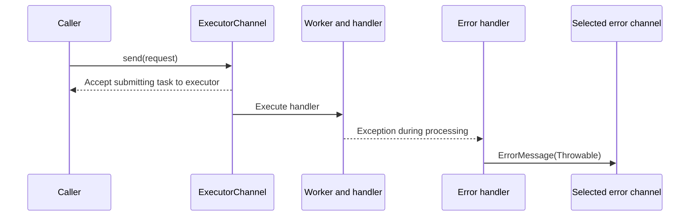

# Global Error Channel

## 1. Objectives and Context

In the **Configuration and Lifecycle** chapter of `SPRING_INTEGRATION_CORE`, the global error channel is the shared error-intake point for message flows that use Spring Integration's error-publishing mechanism. Understanding this intake point helps wire `Message`, `MessageChannel`, endpoints, gateways, and Java DSL properly when designing error-handling flows.

Suppose a system receives an order, transforms the data, and then sends a payment request. When processing occurs on a worker thread, the caller may have already moved on before the payment service fails. A `try/catch` block around the initial send operation is not enough to track that business outcome. The application needs a dedicated path for error information.

After this lesson, you will be able to:

- Distinguish exceptions propagated on the call stack from errors wrapped into an `ErrorMessage`.
- Explain the scope of the `errorChannel` bean and the precedence of the header of the same name.
- Attach consumers to the global error channel while still using the default configuration.
- Inspect the exception, failed message, and correlation data to investigate failures.
- Choose an error-handling approach based on lifecycle requirements, persistence capability, and caller feedback.
- Write tests with bounded waits for asynchronous error flows.

Examples use Java 17 and the Spring Integration 6.5 Java DSL API. With Spring Boot, you can use `spring-boot-starter-integration` with the Boot-managed version set; tests require JUnit Jupiter and Spring Test, typically supplied via `spring-boot-starter-test`. This is an illustrative in-memory configuration, without a broker or durable error store.

## 2. What Is the Global Error Channel?

The conventional bean name is **`errorChannel`**. When the framework's error-handling mechanism needs to publish an error and no specific channel applies, this is the shared destination. Spring Integration creates this channel automatically if the application has not declared one. The default type is `PublishSubscribeChannel`, pre-configured with a subscriber that logs at `ERROR` level. See [Spring Integration Error Handling](https://docs.spring.io/spring-integration/reference/6.5/error-handling.html).

The word "global" should be understood within the scope of Spring Integration infrastructure in the active application context. In a typical application with one main context, flows can share sending errors into this bean. It does not automatically collect errors from other processes or microservices.

Three concepts with similar names yet distinct roles:

| Component | Nature | Example |
|---|---|---|
| `errorChannel` bean | Shared error channel managed by the context | `IntegrationFlow.from("errorChannel")` |
| `errorChannel` header | Error destination directive attached to a message | `MessageHeaders.ERROR_CHANNEL` |
| Error handler | Component converting an exception into a message and sending it | `MessagePublishingErrorHandler` |

Declaring the bean does not send every exception in the JVM into that channel. The error must arise in an execution path that has a corresponding error-handling mechanism, or be explicitly converted into an error message by the application.

## 3. Execution Boundaries Determine the Error Path

### 3.1. Sending Directly on the Same Thread

With `DirectChannel`, the handler normally runs on the sender's thread:

```text
caller thread
  -> DirectChannel.send(message)
  -> transformer / service activator
  -> exception
  <- exception propagates back to caller
```

If calling `channel.send(message)` directly, adding an `errorChannel` header does not automatically create a catch block. You must know which component will catch the error and read that header.

A direct-send example still needs exception handling on the caller:

```java
try {
    inputChannel.send(message);
}
catch (org.springframework.messaging.MessagingException exception) {
    // Convert to an application error or response matching the calling contract.
}
```

### 3.2. Offloading Processing to an Executor

With an `ExecutorChannel` and a thread pool actually running on another thread, sending and business processing are separated. This API does not preserve transaction context from sender to handler. See [ExecutorChannel API](https://docs.spring.io/spring-integration/api/org/springframework/integration/channel/ExecutorChannel.html).



`send()` returning successfully only shows that sending was accepted per channel semantics. It does not prove the order was paid successfully. If the executor rejects the task right at send time, an exception can still surface at the caller; that is a different error moment from a business error occurring after a worker starts running.

### 3.3. Cases to Distinguish

| Scenario | What to Check |
|---|---|
| Calling `send()` through a `DirectChannel` chain | Exceptions usually return to the sender |
| Handler running after an `ExecutorChannel` | Execution infrastructure may publish an `ErrorMessage` |
| Consumer reading `QueueChannel` via a poller | The poller/scheduler's error handler determines the path |
| Calling via a messaging gateway | The gateway's error contract and `errorChannel` configuration |
| Code spawning threads or calling an executor outside the flow | Whether that code explicitly integrates error-publishing mechanisms |
| Filter discarding a message under normal conditions | No exception occurs, so no `ErrorMessage` is produced by default |

Do not choose handling solely based on endpoint type. The same transformer or service activator can run synchronously or behind an asynchronous boundary depending on channel structure.

## 4. Choosing the Error Channel: Header and Default Destination

`MessagePublishingErrorHandler` implements `ErrorHandler` to send an `ErrorMessage` to a `MessageChannel`; the default destination can be configured by channel instance or bean name. See [MessagePublishingErrorHandler API](https://docs.spring.io/spring-integration/api/org/springframework/integration/channel/MessagePublishingErrorHandler.html).

In the standard path, when a failed message provides context:

```text
Does request have a usable errorChannel header?
  Yes -> send error to the specified channel
  No  -> use default destination; typically the errorChannel bean
```

The header can contain a `MessageChannel` reference or a channel name for the infrastructure to resolve. The example below selects a bean named `orderErrors`:

```java
import org.springframework.messaging.Message;
import org.springframework.messaging.MessageHeaders;
import org.springframework.messaging.support.MessageBuilder;

Message<String> request = MessageBuilder.withPayload("ORDER-101")
        .setHeader(MessageHeaders.ERROR_CHANNEL, "orderErrors")
        .setHeader("traceId", "trace-101")
        .build();
```

This is an error-routing directive, not a complete flow configuration. The `orderErrors` bean and an appropriate consumer must still exist. A wrong name or a channel unable to accept the message is a configuration error to fix; do not rely on assuming errors will automatically fall back to the global channel.

Choosing a dedicated channel also does not mean both the dedicated channel and global channel receive a copy. If centralized collection is desired, configure an explicit bridge or forwarding step. `errorChannel` attributes set on gateways, pollers, or adapters must be read according to each component's own contract.

## 5. Inside an `ErrorMessage`

`ErrorMessage` is a `Message<Throwable>`. Its payload is an exception or throwable, commonly wrapped in a `MessagingException`. Besides payload and headers, it may carry `originalMessage`. Per [ErrorMessage API](https://docs.spring.io/spring-framework/docs/current/javadoc-api/org/springframework/messaging/support/ErrorMessage.html), `originalMessage` is the message present at the point the error message is constructed; the failed message inside the exception may have already undergone transformations.

```text
ErrorMessage
├── payload: Throwable
│   └── if MessagingException
│       ├── failedMessage: Message<?> or null
│       └── cause: underlying cause
├── headers: headers of the error message itself
└── originalMessage: Message<?> or null
```

`MessagingException.getFailedMessage()` retrieves the message associated with the failure, though the result may be `null`. The API structure is described in [MessagingException API](https://docs.spring.io/spring-framework/docs/current/javadoc-api/org/springframework/messaging/MessagingException.html).

When investigating, read in order:

1. The outer wrapper exception type to see which messaging layer failed.
2. The `cause` chain to identify root causes such as invalid data or an unavailable service.
3. `failedMessage` to see payload and headers at the failing step.
4. `originalMessage`, if present, for additional context.

Do not cast the error payload to a business object. For example, `(Order) errorMessage.getPayload()` is wrong because the payload here is a `Throwable`. Nor should you assume `errorMessage.getHeaders().get("orderId")` has data: business headers belong in the failed message or original message.

A transformer before the error point can make `failedMessage`'s payload differ in type from the input payload. Therefore, putting business keys and trace IDs in headers makes correlation less dependent on payload structure at individual steps.

## 6. Complete Example: Attaching a Consumer to the Global Channel

### 6.1. Flow Configuration

Place the following class in package `example.integration`. The flow receives `Order` via an `ExecutorChannel`; an invalid amount causes the handler to throw an exception. `globalErrorFlow` only registers an additional subscriber on the existing channel and does not declare a new `errorChannel` bean.

```java
package example.integration;

import org.slf4j.Logger;
import org.slf4j.LoggerFactory;
import org.springframework.beans.factory.annotation.Qualifier;
import org.springframework.context.annotation.Bean;
import org.springframework.context.annotation.Configuration;
import org.springframework.integration.channel.ExecutorChannel;
import org.springframework.integration.config.EnableIntegration;
import org.springframework.integration.dsl.IntegrationFlow;
import org.springframework.messaging.Message;
import org.springframework.messaging.MessageChannel;
import org.springframework.messaging.MessagingException;
import org.springframework.messaging.support.ErrorMessage;
import org.springframework.scheduling.concurrent.ThreadPoolTaskExecutor;

@Configuration
@EnableIntegration
public class GlobalErrorConfiguration {

    private static final Logger log =
            LoggerFactory.getLogger(GlobalErrorConfiguration.class);

    @Bean
    public ThreadPoolTaskExecutor orderExecutor() {
        ThreadPoolTaskExecutor executor = new ThreadPoolTaskExecutor();
        executor.setCorePoolSize(2);
        executor.setMaxPoolSize(2);
        executor.setQueueCapacity(100);
        executor.setThreadNamePrefix("orders-");
        return executor;
    }

    @Bean
    public MessageChannel orders(
            @Qualifier("orderExecutor") ThreadPoolTaskExecutor executor) {
        return new ExecutorChannel(executor);
    }

    @Bean
    public IntegrationFlow orderFlow() {
        return IntegrationFlow.from("orders")
                .handle(Order.class, (order, headers) -> {
                    if (order.amountVnd() <= 0) {
                        throw new IllegalArgumentException(
                                "Order amount must be positive");
                    }
                    log.info("Accepted orderId={}", order.id());
                    return null;
                })
                .get();
    }

    @Bean
    public IntegrationFlow globalErrorFlow() {
        return IntegrationFlow.from("errorChannel")
                .handle((Message<?> message) -> {
                    if (!(message instanceof ErrorMessage error)) {
                        log.error("Unexpected message on errorChannel: type={}",
                                message.getClass().getName());
                        return;
                    }

                    Throwable failure = error.getPayload();
                    Message<?> failed = null;
                    if (failure instanceof MessagingException exception) {
                        failed = exception.getFailedMessage();
                    }
                    if (failed == null) {
                        failed = error.getOriginalMessage();
                    }

                    Object orderId = failed == null
                            ? null : failed.getHeaders().get("orderId");
                    Object traceId = failed == null
                            ? null : failed.getHeaders().get("traceId");

                    log.error("Integration failure: orderId={}, traceId={}, type={}",
                            orderId, traceId, failure.getClass().getSimpleName());
                })
                .get();
    }

    public record Order(String id, long amountVnd) {
    }
}
```

Spring manages initializing and destroying `ThreadPoolTaskExecutor` because it is a bean. There is no need to call `initialize()` manually inside the example's bean factory method.

The error consumer uses the `.handle(MessageHandler)` variant that produces no reply. The business handler also returns `null` to end the one-way flow. If changing to a request–reply flow, design results and reply paths accordingly.

### 6.2. Sending a Test Message

The following snippet runs after the context has started and endpoints have subscribed:

```java
import example.integration.GlobalErrorConfiguration.Order;
import org.springframework.context.annotation.AnnotationConfigApplicationContext;
import org.springframework.messaging.MessageChannel;
import org.springframework.messaging.support.MessageBuilder;

// context is an AnnotationConfigApplicationContext that has loaded GlobalErrorConfiguration.
MessageChannel orders = context.getBean("orders", MessageChannel.class);

Order order = new Order("ORDER-101", -50_000);
orders.send(MessageBuilder.withPayload(order)
        .setHeader("orderId", order.id())
        .setHeader("traceId", "trace-101")
        .build());
```

Expected result to observe: the worker encounters `IllegalArgumentException`, the infrastructure routes the error to the global channel, and the consumer logs `orderId`, `traceId`, and the wrapper exception type. Another log entry may appear from the framework's default subscriber. Two log lines do not mean business logic executed twice.

To stay focused on the error flow, the example logs metadata only and does not persist operational records. In a real system, you can add an error store, metrics, or alerts, keeping each subscriber's responsibility clear.

## 7. Dedicated Error Channels and Global Forwarding

### 7.1. Choosing an Error Destination Per Message

With the configuration in section 6, you can select a `QueueChannel` as a dedicated error destination for observation in a test program:

```java
import org.springframework.integration.channel.QueueChannel;
import org.springframework.messaging.support.MessageBuilder;

QueueChannel localErrors = new QueueChannel(10);

orders.send(MessageBuilder
        .withPayload(new Order("ORDER-LOCAL", -1))
        .setHeader("orderId", "ORDER-LOCAL")
        .setErrorChannel(localErrors)
        .build());

org.springframework.messaging.Message<?> captured = localErrors.receive(3_000);
```

This snippet uses the channel instance directly, so no bean registration is needed for name resolution. `receive()` pulls the message from the queue and waits up to three seconds. In a long-running application, the queue must have an appropriate consumer or poller; this is solely a way to capture errors for illustration.

Once the error is sent to `localErrors`, `globalErrorFlow` does not automatically receive an additional copy. Therefore, flows configured with a dedicated error channel may fall outside metrics collected by a global collector.

### 7.2. Bridging Back to the Shared Destination

If you want to use a dedicated channel name at the flow boundary while still forwarding all errors to the global channel, add these two beans to the configuration:

```java
import org.springframework.context.annotation.Bean;
import org.springframework.integration.channel.DirectChannel;
import org.springframework.integration.dsl.IntegrationFlow;

@Bean
public DirectChannel orderErrors() {
    return new DirectChannel();
}

@Bean
public IntegrationFlow orderErrorsToGlobal() {
    return IntegrationFlow.from("orderErrors")
            .bridge()
            .channel("errorChannel")
            .get();
}
```

Then set the `errorChannel` header to the string `"orderErrors"`. The bridge forwards the error message; it does not re-execute the order. If adding custom processing before forwarding, clearly decide whether that step is strictly observational or has business side effects.

## 8. Should You Declare the `errorChannel` Bean Yourself?

Usually, simply adding a consumer as in the main example is enough. Declaring a bean with the same name yourself alters global infrastructure; the choice of channel type changes how errors are distributed.

| Choice | Intake Mechanism | Design Consequence |
|---|---|---|
| `PublishSubscribeChannel` | Broadcasts to subscribers | Suits cases where multiple observers must receive the same error |
| `DirectChannel` | Picks one consumer per dispatcher | Consumers do not all receive every error |
| `QueueChannel` | Buffers errors for consumers to pull | Needs a poller, queue bounds, and full-queue policy |

`PublishSubscribeChannel` without an executor invokes subscribers directly on the thread publishing the message. If that message is an error from a business worker, the error consumer can also occupy that worker's time. The API clearly distinguishes constructors with and without an executor in [PublishSubscribeChannel API](https://docs.spring.io/spring-integration/api/org/springframework/integration/channel/PublishSubscribeChannel.html).

An alternative configuration that makes two distribution choices explicit is:

```java
import org.springframework.context.annotation.Bean;
import org.springframework.integration.channel.PublishSubscribeChannel;

@Bean(name = "errorChannel")
public PublishSubscribeChannel applicationErrorChannel() {
    PublishSubscribeChannel channel = new PublishSubscribeChannel(true);
    channel.setIgnoreFailures(true);
    return channel;
}
```

This is an alternative replacing the default bean, not a required addition to section 6. Passing `true` to the constructor requires subscribers; `setIgnoreFailures(true)` allows the dispatcher to continue to other subscribers when one subscriber fails. Neither option proves an error record was persisted successfully.

Do not assume a user-declared bean automatically carries all subscribers and policies of the framework-created bean. Declare required consumers explicitly. In particular, adding your own logger must be weighed against any existing logger in the active configuration to avoid duplicate or missing logs.

If replacing it with `new QueueChannel(500)`, you have a bounded in-memory queue. It does not automatically become a durable dead-letter queue. Without a consumer, errors can pile up; when the process exits, in-memory data is not preserved. An error consumer reading the queue also needs its own policy if it fails itself, avoiding sending errors right back into the same failing queue.

## 9. Global Properties and Lifecycle

### 9.1. Two Properties Commonly Confused

Properties of the default global error channel include:

```properties
spring.integration.channels.error.requireSubscribers=true
spring.integration.channels.error.ignoreFailures=true
```

Per [Global Properties](https://docs.spring.io/spring-integration/reference/6.5/configuration/global-properties.html), `requireSubscribers` has existed since 5.4.3 and `ignoreFailures` since 5.5. These are defaults of the reference branch in use.

| Property | Question Answered |
|---|---|
| `requireSubscribers` | If there are no subscribers, should publishing an error be silently ignored? |
| `ignoreFailures` | If one subscriber fails, should delivery continue to other subscribers? |

A direct configuration mechanism in Spring Integration is the classpath resource `META-INF/spring.integration.properties`. For instance, the resource source path is typically `src/main/resources/META-INF/spring.integration.properties`. Do not assume every property of the same name placed in `application.yml` is applied automatically; verify the Spring Boot mapping mechanism in use.

For channels created by the application itself, configure needed behavior directly on those beans. Do not assume changing a global property modifies every custom channel.

### 9.2. Error Endpoints Must Be Active to Receive Errors

A channel and a consumer are two objects with distinct responsibilities. An endpoint connects a handler to a subscribable channel; a polling endpoint manages reading a pollable channel. This model is described in [Message Endpoints](https://docs.spring.io/spring-integration/reference/6.5/endpoint.html).

A channel bean can still exist while an error-receiving endpoint has not started, has stopped, or is set to `autoStartup=false`. With a channel requiring subscribers, having no remaining subscribers can raise `MessageDispatchingException`. With a custom channel allowing zero subscribers, the same situation may go unreported. Therefore, observe endpoint state rather than merely checking that the bean exists.

An operational sequence to design and verify is:

1. At startup, prepare error receivers and required consumers before opening message intake sources.
2. At shutdown, stop accepting new work at adapters or application boundaries.
3. Allow already-accepted tasks to finish within a chosen grace period.
4. Keep error-collection paths active while those tasks can still fail.
5. Shut down workers, consumers, and storage resources per shutdown policy.

This is an operational target, not a claim that every topology shares the same default shutdown order. Consider lifecycle phases, managed endpoints, thread pools, and specific message sources. Merely enabling task waiting on an executor does not guarantee error consumers stay alive long enough.

If using a custom scheduler for pollers, verify that an error-publishing mechanism is attached. `MessagePublishingErrorHandler` can be used to wire task exceptions into the messaging model; a custom scheduler that only logs exceptions will not automatically provide the same handling path.

## 10. Designing Error Consumers with Clear Responsibilities

### 10.1. Separating Observation from Business Decisions

An error flow often needs to perform several distinct tasks:

- **Observation:** logs, metrics, traces, and alerts.
- **Classification:** data errors, transient external system errors, configuration errors.
- **Termination:** persist errors, move to a quarantine queue, create an intervention ticket.
- **Recovery:** bounded retry or compensating business logic if the contract permits.

A subscriber that only logs does not make the order succeed. Likewise, sending an `ErrorMessage` does not automatically confirm rollback, acknowledgment, or broker redelivery. Those outcomes depend on transactions, adapters, and recovery mechanisms in use.

For example, a negative amount error should be classified for data correction; retrying as-is usually will not help. A payment connection failure may suit bounded retries, provided transaction state and idempotency are verified before resending a charge request.

### 10.2. Exception Classification and Using a Router

The outer exception typically carries messaging details, while the business cause sits in the `cause` chain. When branching by exception type, consider `ErrorMessageExceptionTypeRouter` instead of parsing error message strings. Test with the exact exception structure produced by your flow and always provide a route for unknown types.

Policy example for an order system:

| Error Group | Possible Action | What Must Be Recorded |
|---|---|---|
| Invalid data | Quarantine for data correction | Business key, invalid field, data version |
| Transient connection failure | Bounded retry then move to error store | Attempt count and final outcome |
| Misconfigured endpoint | Alert operations, throttle further intake | Endpoint, deployment config, trace ID |
| Unclassified | Persist for investigation | Exception chain and minimal context |

### 10.3. Avoiding Loops and Duplicate Side Effects

Do not wire an error flow unconditionally back into the business flow. If invalid data remains unchanged, every cycle merely generates another error. Also avoid cycles where an error in the error consumer gets routed back to that exact same consumer with no termination point.

One organization pattern is ending retries at a clearly owned error store, paired with a separate replay flow. Replay needs original message identity, execution count, replay reason, and a business-appropriate idempotency key.

If using multiple subscribers on the global channel, clarify which subscribers only observe and which are permitted to perform recovery. Letting two subscribers both resend a payment request can cause duplicate side effects even when each subscriber executes its own code correctly.

### 10.4. Metadata and Log Content

Useful fields typically include `orderId`, `traceId`, flow or endpoint name, exception type, failure timestamp, and attempt count. Some fields may be absent when errors occur before constructing a business message, so consumers must handle missing data.

The example in section 6 logs only select metadata. However, the framework's default logger may log additional exception and related message details. If the application has data-masking requirements, review all subscribers and logging configuration; modifying only a custom logger is not enough to control every log line.

## 11. Relationship with Gateways and Pollers

### 11.1. Gateways Have Their Own Response Contract

A messaging gateway can propagate exceptions back to the caller or use an error flow configured for it. An error flow can also transform an exception into an application response. This is a gateway-specific mechanism described in [Messaging Gateways — Error Handling](https://docs.spring.io/spring-integration/reference/6.5/gateway.html#error-handling).

If a gateway method returns `OrderResult`, the error consumer must honor that contract: return a valid failure result or let the caller receive an exception as designed. A one-way consumer that only logs produces no `OrderResult`. Without a reply, evaluate timeouts and gateway behavior; do not assume the caller receives a response merely because the global channel logged something.

For a gateway with a `void` method and configured `errorChannel`, the error header can be attached to the outbound message. Hence, when monitoring the global channel, check whether the gateway selects a dedicated channel. At the same time, do not assume every synchronous gateway uses the global channel: errors may return to the caller via the gateway's reply mechanism.

### 11.2. Pollers Are Another Error-Catching Point

`QueueChannel` stores messages; the poller is the component actively pulling and processing them. Exceptions when fetching data from a source can occur before a complete `failedMessage` exists. This is why error consumers must tolerate missing business context.

When investigating errors from a polling flow, check the poller, selected error channel, and active scheduler together. Input channel type alone is not enough to determine the entire error-handling path. Thread and channel configuration details are presented in [Configuring Message Channels](https://docs.spring.io/spring-integration/reference/6.5/channel/configuration.html).

## 12. Testing the Error Path

Asynchronous tests must wait for a meaningful signal. Do not use `Thread.sleep()` and guess that a worker has finished, and do not check only that `send()` returns `true`.

The following class uses the configuration from section 6. It registers a probe subscriber before each test and unregisters it afterward. `QueueChannel.receive(timeout)` both collects the result and bounds the wait. This is illustrative test code to run in a project with the stated dependencies.

```java
package example.integration;

import example.integration.GlobalErrorConfiguration.Order;
import org.junit.jupiter.api.AfterEach;
import org.junit.jupiter.api.BeforeEach;
import org.junit.jupiter.api.Test;
import org.springframework.beans.factory.annotation.Autowired;
import org.springframework.beans.factory.annotation.Qualifier;
import org.springframework.integration.channel.DirectChannel;
import org.springframework.integration.channel.QueueChannel;
import org.springframework.messaging.Message;
import org.springframework.messaging.MessageChannel;
import org.springframework.messaging.MessageHandler;
import org.springframework.messaging.MessagingException;
import org.springframework.messaging.SubscribableChannel;
import org.springframework.messaging.support.ErrorMessage;
import org.springframework.messaging.support.MessageBuilder;
import org.springframework.test.context.junit.jupiter.SpringJUnitConfig;

import static org.junit.jupiter.api.Assertions.*;

@SpringJUnitConfig(GlobalErrorConfiguration.class)
class GlobalErrorChannelTest {

    @Autowired
    @Qualifier("orders")
    MessageChannel orders;

    @Autowired
    @Qualifier("errorChannel")
    SubscribableChannel globalChannel;

    private QueueChannel observed;
    private MessageHandler probe;

    @BeforeEach
    void subscribeProbe() {
        observed = new QueueChannel(10);
        probe = message -> {
            if (!observed.send(message, 0)) {
                throw new IllegalStateException("Error probe is full");
            }
        };
        globalChannel.subscribe(probe);
    }

    @AfterEach
    void unsubscribeProbe() {
        globalChannel.unsubscribe(probe);
    }

    @Test
    void sendsAsyncFailureToGlobalChannel() {
        Message<Order> request = MessageBuilder
                .withPayload(new Order("ORDER-GLOBAL", -1))
                .setHeader("orderId", "ORDER-GLOBAL")
                .build();

        assertTrue(orders.send(request));

        ErrorMessage error = assertInstanceOf(
                ErrorMessage.class, observed.receive(3_000));
        MessagingException failure = assertInstanceOf(
                MessagingException.class, error.getPayload());

        assertInstanceOf(IllegalArgumentException.class,
                failure.getMostSpecificCause());
        assertNotNull(failure.getFailedMessage());
        assertEquals("ORDER-GLOBAL",
                failure.getFailedMessage().getHeaders().get("orderId"));
    }

    @Test
    void prefersMessageErrorChannelOverGlobalChannel() {
        QueueChannel localErrors = new QueueChannel(10);

        orders.send(MessageBuilder
                .withPayload(new Order("ORDER-LOCAL", -1))
                .setHeader("orderId", "ORDER-LOCAL")
                .setErrorChannel(localErrors)
                .build());

        assertInstanceOf(ErrorMessage.class, localErrors.receive(3_000));
        assertNull(observed.receive(200));
    }

    @Test
    void directSendStillThrowsEvenWhenErrorHeaderExists() {
        DirectChannel direct = new DirectChannel();
        direct.subscribe(message -> {
            throw new IllegalArgumentException("Synchronous failure");
        });

        Message<String> request = MessageBuilder.withPayload("bad-data")
                .setErrorChannel(globalChannel)
                .build();

        assertThrows(RuntimeException.class, () -> direct.send(request));
        assertNull(observed.receive(200));
    }
}
```

The three tests verify three distinct contracts: worker errors reaching the shared channel, header selecting a dedicated channel, and direct send still throwing exceptions. Wait timeouts are not guarantees of system processing latency; pick values suited to your test environment.

A global probe may receive errors from other flows if sharing one large context. In a real project, use a small context like the example or filter by trace ID. The "no message" assertions here rely on a finite, non-retrying flow; do not use a short wait to conclude that a system with delayed retries will never emit more errors.

Beyond the three cases above, include dedicated operational tests when changing infrastructure: stopping the error consumer while workers still run, unavailable error store, full queue, and exceptions without `failedMessage`. These scenarios help validate the chosen lifecycle and recovery policies.

## 13. Diagnosing Common Errors

| Symptom | Possibilities to Check | How to Verify |
|---|---|---|
| Exception occurred yet global flow did not run | Synchronous error, error outside integration infrastructure, or dedicated channel chosen | Trace call stack, headers, and gateway/poller configuration |
| Caller receives no exception even though worker failed | Processing occurred after an asynchronous boundary | Inspect error flow and response contract |
| Two log lines for the same error | Default logger plus application logger | Compare trace IDs, subscribers, and business execution count |
| Error missing `orderId` | Reading wrong headers or request not yet created | Check `failedMessage`, `originalMessage`, and metadata creation point |
| Multiple consumers yet each receives only part of errors | Using a single-consumer channel instead of broadcast | Check actual bean type of `errorChannel` |
| No-subscriber error during application shutdown | Error endpoint stopped before error-emitting task | Check lifecycle, shutdown timing, and `requireSubscribers` |
| Error flow progressively slows workers | Error consumer blocks long or queue not consumed | Measure processing time, queue depth, and error store capacity |
| Errors repeat continuously | Unbounded retry or cycle in the error flow | Redraw the path from error to termination point |

When designing a new flow, clearly define where exceptions are caught, which error channel is chosen, which consumer is responsible for termination, and what state callers or message sources observe. The global error channel is valuable when those responsibilities connect into an observable and testable handling path.
