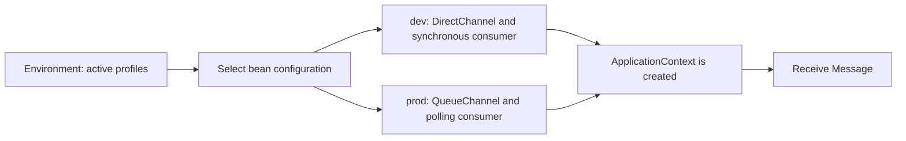

# Profile-Based Configuration

In the **SPRING_INTEGRATION_CORE** module, profile-based configuration lets an application keep a shared message contract while selecting integration components suited to each environment. For example, a development environment uses a synchronous flow for easy observation, while a deployment configuration uses a queue and polling consumer to decouple sending time from processing time.

This lesson belongs to the **Configuration and Lifecycle** chapter and focuses on the impact of profiles on `MessageChannel`, endpoints, and Java DSL. After this lesson, you will be able to organize configuration branches, activate profiles before creating the context, identify invalid combinations, and test flow behavior per profile.

Examples use Java 17+, the Spring Integration 6.5 API, and compatible Spring Framework. The `org.springframework.integration:spring-integration-core` dependency is required; tests use JUnit Jupiter and `junit-jupiter-params`. The Spring Boot section is presented separately for Boot applications. Code snippets are practice material, not claims that they have been executed in the current project.

## 1. Profiles Select Which Components Are Registered

A profile is a logical configuration name in Spring's `Environment`, such as `dev`, `prod`, or `test`. `@Profile` puts a condition on bean registration. This annotation can be used on configuration classes or `@Bean` methods; if a configuration class does not satisfy the condition, none of its beans are provided. See [`@Profile` API](https://docs.spring.io/spring-framework/docs/6.2.0/javadoc-api/org/springframework/context/annotation/Profile.html).

In an integration application, this decision can change the flow structure:



If a router selects a branch based on a `region` header, the decision is made per message. If a profile selects `QueueChannel`, the decision is made when constructing the context, before messages begin moving through the flow.

| Need | Suitable Tool | Example |
| --- | --- | --- |
| Select a group of beans per environment | `@Profile` | Real consumer vs. simulated consumer |
| Change parameters of the same flow structure | Property | Poll delay, capacity, timeout |
| Choose a branch per message | Router | Route by `orderType` |
| Temporarily pause an existing endpoint | Lifecycle | Stop consumer during maintenance |
| Enable a feature by property in Boot | `@ConditionalOnProperty` | Optionally enable a standalone flow |

Selecting infrastructure belongs to deployment configuration. Do not use a client-sent `prod` header to decide whether to access a live system. Business headers and environment profiles serve two different roles.

## 2. Profile Conditions and Valid Combinations

### 2.1. Single Profile, Multiple Profiles, and Expressions

```java
@Profile("dev")                      // Has dev profile.
@Profile({"dev", "test"})            // Has dev OR test.
@Profile("prod & audit")             // Has both prod AND audit.
@Profile("dev & !prod")              // Has dev and not prod.
@Profile("prod & (audit | metrics)") // prod combined with audit or metrics.
```

The operators `!`, `&`, `|` express negation, AND, and OR. Use parentheses when combining `&` with `|`. Elements in a `@Profile({ ... })` array are OR options. Refer to [Environment Abstraction](https://docs.spring.io/spring-framework/reference/core/beans/environment.html).

For two mutually alternative branches, this lesson adopts the policy:

- Development: `@Profile("dev & !prod")`.
- Deployment: `@Profile("prod & !dev")`.
- A shared flow strictly depends on a channel supplied by one of the two branches.

If `dev,prod` are activated together, both branches are excluded. The required dependency is missing and the application fails at startup. This is the example's policy; Spring does not forbid all multi-profile combinations by default.

### 2.2. Default Profile

When no active profile is specified, Spring uses default profiles; the initial default name is `default`. `@Profile("default")` can be used for a fallback configuration. Once active profiles are specified, default profiles are not automatically added as a fallback. The default list can be changed via `Environment` or `spring.profiles.default`. See [`Environment` API](https://docs.spring.io/spring-framework/docs/current/javadoc-api/org/springframework/core/env/Environment.html).

Spring does not automatically treat `dev` as the default. The main example has no `default` branch, so callers must explicitly choose `dev` or `prod`.

Nor should `@Profile("!prod")` be read as "dev only." That condition also holds when only `test` is enabled, only `metrics` is enabled, or no profile is enabled. When a bean is genuinely meant for development, `dev & !prod` expresses that intent more tightly.

### 2.3. Configurations Must Still Be Discovered

A class annotated with `@Profile("dev")` still must be registered, `@Import`ed, or discovered by component scanning. The annotation does not pull a class outside scan scope into the context on its own.

The example below uses `@Import` to gather both branches in one place. Shared beans receive dependencies via `@Bean` method parameters, fitting `@Configuration(proxyBeanMethods = false)`. Do not directly invoke another branch's bean factory method to bypass configuration conditions. See [Composing Java-based Configurations](https://docs.spring.io/spring-framework/reference/core/beans/java/composing-configuration-classes.html).

## 3. Example: One Input Contract, Two Message Delivery Mechanisms

### 3.1. Design

The application receives order code strings. Both environments normalize strings identically by trimming leading/trailing whitespace and converting to uppercase with `Locale.ROOT`.

```text
orders.input
    -> intakeFlow: normalize payload
    -> orders.transport: provided by profile
    -> orders.delivery: consumer provided by profile
    -> orders.processed: result collection point for the example
```

`orders.processed` is an in-memory queue for observing results. It does not represent database persistence or business transaction completion.

| Component | `dev` | `prod` in the Example |
| --- | --- | --- |
| `orders.input` | `DirectChannel` | `DirectChannel` |
| Payload normalization | Shared flow | Shared flow |
| `orders.transport` | `DirectChannel` | Bounded `QueueChannel` |
| `orders.delivery` | Event-driven consumer | Polling consumer |
| When sink executes | On the sending thread | When the poller pulls the message |
| Observation destination | `orders.processed` | `orders.processed` |

The name `prod` represents a configuration choice in this lesson. An in-memory queue does not provide data durability if the process crashes. Real systems must choose infrastructure according to data-loss, transaction, throughput, and recovery requirements.

### 3.2. Complete Configuration Class

When practicing, place the following in `ProfiledOrdersConfig.java` in the corresponding package:

```java
package example.integration.profiles;

import java.time.Duration;
import java.util.Locale;

import org.springframework.beans.factory.annotation.Qualifier;
import org.springframework.beans.factory.annotation.Value;
import org.springframework.context.annotation.Bean;
import org.springframework.context.annotation.Configuration;
import org.springframework.context.annotation.Import;
import org.springframework.context.annotation.Profile;
import org.springframework.integration.channel.DirectChannel;
import org.springframework.integration.channel.QueueChannel;
import org.springframework.integration.config.EnableIntegration;
import org.springframework.integration.dsl.IntegrationFlow;
import org.springframework.integration.dsl.Pollers;
import org.springframework.messaging.MessageChannel;
import org.springframework.messaging.MessageDeliveryException;
import org.springframework.messaging.MessageHandler;

@Configuration(proxyBeanMethods = false)
@EnableIntegration
@Import({
    ProfiledOrdersConfig.DevTransport.class,
    ProfiledOrdersConfig.ProdTransport.class
})
public class ProfiledOrdersConfig {

    @Bean("orders.input")
    public MessageChannel ordersInput() {
        return new DirectChannel();
    }

    @Bean("orders.processed")
    public QueueChannel processedOrders() {
        return new QueueChannel(100);
    }

    @Bean("orders.sink")
    public MessageHandler ordersSink(
            @Qualifier("orders.processed") QueueChannel processed) {
        return message -> {
            if (!processed.send(message, 1_000)) {
                throw new MessageDeliveryException(
                    message, "orders.processed is full");
            }
        };
    }

    @Bean
    public IntegrationFlow intakeFlow(
            @Qualifier("orders.input") MessageChannel input,
            @Qualifier("orders.transport") MessageChannel transport) {
        return IntegrationFlow.from(input)
            .transform(String.class,
                value -> value.trim().toUpperCase(Locale.ROOT))
            .channel(transport)
            .get();
    }

    @Configuration(proxyBeanMethods = false)
    @Profile("dev & !prod")
    public static class DevTransport {

        @Bean("orders.transport")
        public MessageChannel devTransport() {
            return new DirectChannel();
        }

        @Bean
        public IntegrationFlow devDeliveryFlow(
                @Qualifier("orders.transport") MessageChannel transport,
                @Qualifier("orders.sink") MessageHandler sink) {
            return IntegrationFlow.from(transport)
                .handle(sink, endpoint -> endpoint.id("orders.delivery"))
                .get();
        }
    }

    @Configuration(proxyBeanMethods = false)
    @Profile("prod & !dev")
    public static class ProdTransport {

        @Bean("orders.transport")
        public QueueChannel prodTransport(
                @Value("${orders.queue-capacity:100}") int capacity) {
            if (capacity <= 0) {
                throw new IllegalArgumentException(
                    "orders.queue-capacity must be positive");
            }
            return new QueueChannel(capacity);
        }

        @Bean
        public IntegrationFlow prodDeliveryFlow(
                @Qualifier("orders.transport") QueueChannel transport,
                @Qualifier("orders.sink") MessageHandler sink,
                @Value("${orders.poll-delay-ms:200}") long pollDelayMs,
                @Value("${orders.consumer-auto-startup:true}")
                boolean autoStartup) {
            if (pollDelayMs <= 0) {
                throw new IllegalArgumentException(
                    "orders.poll-delay-ms must be positive");
            }

            return IntegrationFlow.from(transport)
                .handle(sink, endpoint -> endpoint
                    .id("orders.delivery")
                    .autoStartup(autoStartup)
                    .poller(Pollers
                        .fixedDelay(Duration.ofMillis(pollDelayMs))
                        .receiveTimeout(0)
                        .maxMessagesPerPoll(10)))
                .get();
        }
    }
}
```

Java DSL creates channels and endpoints from the selected `IntegrationFlow` beans. `@EnableIntegration` provides Spring Integration infrastructure for plain Spring configuration. See [Spring Integration 6.5 Java DSL](https://docs.spring.io/spring-integration/reference/6.5/dsl.html).

Key design points:

1. `intakeFlow` directly requires the `orders.transport` bean. When no valid branch is active, the dependency is unsatisfied and the context fails at startup.
2. Both branches use the same bean name `orders.transport`, yet profile conditions prevent them from registering simultaneously. There is no need to enable bean overriding.
3. The Java methods `devTransport()` and `prodTransport()` have distinct names. Do not use overloaded `@Bean` methods to select profile variants.
4. `prodDeliveryFlow` is the flow bean name; `orders.delivery` is the consumer endpoint name for lifecycle control. The two names identify two distinct roles.
5. `orders.sink` is a one-way handler: it forwards the message to the result collection point without generating a reply back to the caller.

### 3.3. Why Is the Poller Only in the Queue Branch?

`DirectChannel` hands off to subscribers on the sending thread. `QueueChannel` holds messages for receivers to pull later. A bounded queue can block senders when full. Send, receive, and capacity behaviors are described in [Message Channel Implementations](https://docs.spring.io/spring-integration/reference/channel/implementations.html).

A consumer reading from a `QueueChannel` requires polling configuration; the `DirectChannel` consumer in the example uses an event-driven mechanism. Hence the poller is attached to `.handle(...)`'s endpoint in the `prod` branch. Switching only the channel type while keeping the old endpoint assumptions can lead to a missing poller or a poller configured in an unsuitable place. See [Message Endpoints](https://docs.spring.io/spring-integration/reference/endpoint.html).

`maxMessagesPerPoll(10)` caps messages per poll, rather than spawning ten parallel workers. `receiveTimeout(0)` keeps a poll from waiting when the queue is empty. This is a configuration for a small example; measure load before picking operational parameters. Refer to [`PollerSpec` API](https://docs.spring.io/spring-integration/docs/6.5.0/api/org/springframework/integration/dsl/PollerSpec.html).

There is no rule that `prod` must always use a queue or `dev` must always run synchronously. The lesson intentionally varies these two characteristics to observe their impact. Testing operational behavior still requires an asynchronous structure matching the actual deployment topology.

## 4. Activating Profiles Before Building the Context

### 4.1. Plain Spring with Java

The following program receives the profile from arguments. If no argument is passed, the program itself explicitly selects `dev`; this is not Spring's default profile.

```java
package example.integration.profiles;

import org.springframework.context.annotation.AnnotationConfigApplicationContext;
import org.springframework.integration.channel.QueueChannel;
import org.springframework.messaging.Message;
import org.springframework.messaging.MessageChannel;
import org.springframework.messaging.support.GenericMessage;

public class ProfileDemo {

    public static void main(String[] args) {
        String selected = args.length == 0 ? "dev" : args[0];

        try (var context = new AnnotationConfigApplicationContext()) {
            context.getEnvironment().setActiveProfiles(selected);
            context.register(ProfiledOrdersConfig.class);
            context.refresh();

            MessageChannel input = context.getBean(
                "orders.input", MessageChannel.class);
            QueueChannel processed = context.getBean(
                "orders.processed", QueueChannel.class);

            boolean accepted = input.send(
                new GenericMessage<>("  order-42  "), 1_000);
            if (!accepted) {
                throw new IllegalStateException("Input rejected the message");
            }

            Message<?> result = processed.receive(5_000);
            if (result == null) {
                throw new IllegalStateException("No processed message received");
            }
            System.out.println(result.getPayload()); // ORDER-42
        }
    }
}
```

Execution sequence: create an unrefreshed context → set profile → register configuration → `refresh()` → send message. The `new AnnotationConfigApplicationContext(ProfiledOrdersConfig.class)` constructor refreshes immediately, so setting the profile after that constructor is too late to select beans for the initialization that just happened.

To select multiple profiles in Java, use `setActiveProfiles("prod", "metrics")`. Do not pass `"prod,metrics"` as a single element in place of two arguments: the Java API accepts individual profile names.

### 4.2. JVM System Property

For entry points that do not call `setActiveProfiles()` explicitly, `Environment` can pick up a JVM system property:

```text
java -Dspring.profiles.active=prod -cp "<application-classpath>" example.integration.profiles.YourMain
```

`YourMain` is an entry point that creates the context without overriding profiles. Place `-D` before the main class name or before `-jar` when running a JAR with an appropriate manifest.

Specifically, `ProfileDemo` above explicitly selects the profile via `setActiveProfiles(selected)`, so pass the program argument `prod` to that example itself. If multiple configuration sources exist, clearly identify which source takes precedence.

### 4.3. Changing Profiles After Refresh Does Not Swap Flows

The following statement only changes `Environment` state; it does not destroy beans of the old branch and create beans for the new branch:

```java
context.getEnvironment().setActiveProfiles("prod");
```

Once the context has refreshed, the active profile list observed from `Environment` can differ from the actual set of beans already created. In this lesson's design, change profiles via a controlled fresh startup. When you need to pause a consumer temporarily, use lifecycle. When you need to choose routes per message, design a router.

## 5. When the Application Uses Spring Boot

### 5.1. Activating Profiles and Selecting Config Documents

Boot can receive active profiles via command-line arguments or environment variables:

```text
java -jar orders-app.jar --spring.profiles.active=prod
```

```powershell
$env:SPRING_PROFILES_ACTIVE = 'prod'
java -jar orders-app.jar
```

`spring.profiles.active` selects profile names. `spring.config.activate.on-profile` is the condition for Boot to load a configuration document. The two properties serve two different steps. See [Profiles in Spring Boot](https://docs.spring.io/spring-boot/reference/features/profiles.html).

Example multi-document content in `application.yml` of a Boot application:

```yaml
# Shared document, not dedicated to a specific profile.
spring:
  application:
    name: profiled-orders

orders:
  consumer-auto-startup: true

---
spring:
  config:
    activate:
      on-profile: "dev & !prod"

orders:
  poll-delay-ms: 500
  queue-capacity: 20

---
spring:
  config:
    activate:
      on-profile: "prod & !dev"

orders:
  poll-delay-ms: ${ORDERS_POLL_DELAY_MS:200}
  queue-capacity: ${ORDERS_QUEUE_CAPACITY:100}
```

When `prod` is selected, Boot loads the shared section and the `prod & !dev` conditional section. `@Value` parameters in Java configuration then read values from `Environment`.

When `dev` is selected, the two poll delay and capacity properties are still present, yet `DevTransport` does not use them. Having a property present does not automatically switch channel types or create a poller.

You can organize with `application-dev.yml` and `application-prod.yml` instead of multi-document files. Choose one suitable organization style rather than using both simultaneously to express the same settings. See [Externalized Configuration](https://docs.spring.io/spring-boot/reference/features/external-config.html).

Plain Spring does not automatically read `application.yml`, split documents by `---`, or apply `spring.config.activate.on-profile`. For plain Java examples, defaults in `@Value` are enough to run; you can add `PropertySource` or JVM properties when needed.

### 5.2. Profile Groups

In a larger Boot application, related choices can be grouped:

```yaml
spring:
  profiles:
    group:
      production:
        - prod
        - metrics
```

Activating `production` adds `prod` and `metrics`. In the lesson's Java example, `prod` selects `ProdTransport`; `metrics` has no separate beans yet.

Place `spring.profiles.active`, `spring.profiles.default`, `spring.profiles.include`, and `spring.profiles.group` in non-profile-specific documents. Do not place them inside a section activated by `spring.config.activate.on-profile` or inside profile-specific files. This rule is described in [Boot's profiles documentation](https://docs.spring.io/spring-boot/reference/features/profiles.html).

A profile should represent a meaningful group of choices. If you only want to change poll delay from 200 ms to 500 ms, using a property is easier to manage than creating an extra profile per value.

## 6. Message Contract, Completion Timing, and Errors

### 6.1. Successful Send vs. Successful Processing

Both branches keep string input, the same normalization rule, and the same result destination name. Nevertheless, they do not share the same processing completion timing.

In the `dev` branch, both `DirectChannel`s and the sink run on the sending thread. When the send returns without error, the example's sink has already been called.

In the `prod` branch, the initial send can finish right after the message enters `orders.transport`. The consumer has not necessarily run yet. Hence, `input.send(...) == true` does not prove the order has finished business processing.

If adding a messaging gateway returning `void`, describe a one-way contract. If the gateway returns a business result, both branches must have a reply path and appropriate timeout rules. The example's `orders.processed` queue does not automatically become the reply channel for a gateway.

### 6.2. Errors Before and After the Queue Boundary

If normalization fails, both branches are still running on the sending thread. If the sink fails, the `dev` branch can propagate the exception back to the caller. The `prod` branch runs the sink inside a polling task and therefore cannot throw an exception back to a caller whose invocation already returned earlier.

Spring Integration has a mechanism to represent asynchronous errors as an `ErrorMessage` and send them to an error channel. With the appropriate default mechanism, the message's `errorChannel` header is checked first, then the global `errorChannel` bean. See [Error Handling](https://docs.spring.io/spring-integration/reference/error-handling.html).

Design where poller errors are observed and handled. A log entry does not put the message back into the queue, does not create retries, and does not recover processing after a process crash. Those requirements need explicit policies for retry, durable state, and failed message handling.

### 6.3. Memory Limits and Per-Hop Timeouts

`QueueChannel(100)` limits waiting messages. If the consumer stops and the queue fills up, senders can block. The timeout in `input.send(message, 1_000)` is not an end-to-end deadline spanning all internal hops.

In the current configuration, the transformer forwards to transport using the handler's default configuration. The example sends only one message so it does not fill transport. Under real load, configure timeouts at potentially blocking hops, handle failures, and define caller responses. You can use a bridge with `sendTimeout(...)` at controlled boundaries, or configure the corresponding sending endpoint. Refer to [ConsumerEndpointSpec](https://docs.spring.io/spring-integration/docs/6.5.0/api/org/springframework/integration/dsl/ConsumerEndpointSpec.html).

Changing channel types per profile must be evaluated together with latency, error paths, and backpressure. Implementing the same `MessageChannel` interface does not give implementations identical operational characteristics.

## 7. Profiles and Lifecycle Act at Two Different Moments

| State | Does Endpoint Exist? | Does Consumer Process Messages? | How State Is Reached |
| --- | --- | --- | --- |
| Branch not selected | No endpoint from that branch | No | `@Profile` condition not met |
| Endpoint present but not running | Yes | Consumer not running yet | `autoStartup(false)` |
| Endpoint running | Yes | Can process when messages arrive | Auto-started or `start()` called |

In the `prod` branch, the `orders.consumer-auto-startup` property controls the initial state of `orders.delivery`. `autoStartup(false)` still allows creating queues, handlers, and flow beans. Refer to [GenericEndpointSpec](https://docs.spring.io/spring-integration/docs/6.5.0/api/org/springframework/integration/dsl/GenericEndpointSpec.html).

You can retrieve the right endpoint to control lifecycle:

```java
import org.springframework.context.SmartLifecycle;

SmartLifecycle delivery = context.getBean(
    "orders.delivery", SmartLifecycle.class);

delivery.stop();
boolean runningAfterStop = delivery.isRunning();
delivery.start();
```

In the queue branch, stopping the consumer does not automatically stop producers. New messages can still enter the queue and fill it up. In the direct branch, if the consumer is the sole subscriber and gets stopped, the next send may fail due to no subscriber rather than queuing up.

Stopping a consumer also does not prove all running tasks have completed or all in-memory data has been durably persisted. When deploying profile changes, design the order of stopping new intake, finishing remaining work, and closing resources according to application requirements.

## 8. Testing Configuration and Behavior per Profile

### 8.1. Expectation Matrix

This table assumes Spring's default profiles are unchanged and no external configuration adds extra active profiles:

| Active Profiles | Branch Selected | Expectation |
| --- | --- | --- |
| `dev` | `DevTransport` | Starts up; transport is `DirectChannel` |
| `prod` | `ProdTransport` | Starts up; transport is `QueueChannel` |
| `prod,metrics` | `ProdTransport` | Starts up; secondary profile does not select dev |
| `dev,prod` | No branch | Fails due to missing `orders.transport` |
| None specified | No branch | `default` provides no transport |
| `qa` | No branch | No transport configuration for qa yet |

The `dev,prod` combination fails because the lesson's expressions are mutually exclusive and the shared flow strictly requires transport. Do not interpret this as a Spring rule forbidding multiple profiles.

### 8.2. Checking Both Structure and Output

The following cases check the selected channel, verify the other flow is excluded, assert output, and reject conflicting combinations. Each case has its own context.

```java
package example.integration.profiles;

import java.util.Map;

import org.junit.jupiter.api.Test;
import org.junit.jupiter.params.ParameterizedTest;
import org.junit.jupiter.params.provider.ValueSource;
import org.springframework.beans.BeansException;
import org.springframework.context.SmartLifecycle;
import org.springframework.context.annotation.AnnotationConfigApplicationContext;
import org.springframework.core.env.MapPropertySource;
import org.springframework.integration.channel.DirectChannel;
import org.springframework.integration.channel.QueueChannel;
import org.springframework.messaging.Message;
import org.springframework.messaging.MessageChannel;
import org.springframework.messaging.support.GenericMessage;

import static org.junit.jupiter.api.Assertions.*;

class ProfiledOrdersConfigTest {

    @ParameterizedTest
    @ValueSource(strings = {"dev", "prod"})
    void selectsTransportAndProcessesPayload(String profile) {
        try (var context = new AnnotationConfigApplicationContext()) {
            context.getEnvironment().setActiveProfiles(profile);
            context.register(ProfiledOrdersConfig.class);
            context.refresh();

            Object transport = context.getBean("orders.transport");
            if (profile.equals("dev")) {
                assertInstanceOf(DirectChannel.class, transport);
                assertTrue(context.containsBean("devDeliveryFlow"));
                assertFalse(context.containsBean("prodDeliveryFlow"));
            }
            else {
                assertInstanceOf(QueueChannel.class, transport);
                assertTrue(context.containsBean("prodDeliveryFlow"));
                assertFalse(context.containsBean("devDeliveryFlow"));
            }

            MessageChannel input = context.getBean(
                "orders.input", MessageChannel.class);
            QueueChannel processed = context.getBean(
                "orders.processed", QueueChannel.class);

            assertTrue(input.send(new GenericMessage<>(" order-42 "), 1_000));
            Message<?> result = processed.receive(5_000);
            assertNotNull(result);
            assertEquals("ORDER-42", result.getPayload());
        }
    }

    @Test
    void rejectsDevAndProdTogether() {
        assertThrows(BeansException.class, () -> {
            try (var context = new AnnotationConfigApplicationContext()) {
                context.getEnvironment().setActiveProfiles("dev", "prod");
                context.register(ProfiledOrdersConfig.class);
                context.refresh();
            }
        });
    }

    @Test
    void prodCanStartConsumerAfterAcceptingAMessage() {
        try (var context = new AnnotationConfigApplicationContext()) {
            context.getEnvironment().setActiveProfiles("prod");
            context.getEnvironment().getPropertySources().addFirst(
                new MapPropertySource("test-settings", Map.of(
                    "orders.consumer-auto-startup", "false",
                    "orders.poll-delay-ms", "20")));
            context.register(ProfiledOrdersConfig.class);
            context.refresh();

            SmartLifecycle delivery = context.getBean(
                "orders.delivery", SmartLifecycle.class);
            MessageChannel input = context.getBean(
                "orders.input", MessageChannel.class);
            QueueChannel transport = context.getBean(
                "orders.transport", QueueChannel.class);
            QueueChannel processed = context.getBean(
                "orders.processed", QueueChannel.class);

            assertFalse(delivery.isRunning());
            assertTrue(input.send(new GenericMessage<>(" order-99 "), 1_000));
            assertEquals(1, transport.getQueueSize());
            assertNull(processed.receive(0));

            delivery.start();
            Message<?> result = processed.receive(5_000);
            assertNotNull(result);
            assertEquals("ORDER-99", result.getPayload());
        }
    }
}
```

The lifecycle case sets `autoStartup=false` before refresh so the consumer does not race with the queue assertion. After `start()`, `receive(5_000)` waits for the result with a bounded timeout instead of guessing a fixed `Thread.sleep()`.

You can extend this with a `qa` case, a no-profile case, a zero-capacity case, and a case where the sink throws an exception. For error cases, separate the synchronous error path from the polling task's `ErrorMessage` path. Do not wrap the send call in `assertThrows` to assert an error occurring later in an asynchronous consumer.

### 8.3. Using Spring TestContext

If the test suite includes `spring-test`, profiles can be selected with `@ActiveProfiles`:

```java
@ExtendWith(SpringExtension.class)
@ContextConfiguration(classes = ProfiledOrdersConfig.class)
@ActiveProfiles("dev")
class DevProfileContextTest {
    // Inject beans and add required @Test methods.
}
```

This is a configuration skeleton, not a complete test case. `ExtendWith` belongs to JUnit Jupiter; `SpringExtension`, `ContextConfiguration`, and `ActiveProfiles` belong to Spring Test. Spring can inherit active profiles from a parent test class. When needing to completely replace inherited profiles, check `inheritProfiles` in [Context Configuration with Environment Profiles](https://docs.spring.io/spring-framework/reference/testing/testcontext-framework/ctx-management/env-profiles.html).

## 9. Common Errors

| Symptom | Possible Cause | How to Check and Fix |
| --- | --- | --- |
| Missing `orders.transport` | Missing dev/prod, selected qa, or selected both dev and prod | Check active profile set before refresh and conditions on configurations |
| Bean present outside intended environment | Too-broad `!prod` or OR array when AND was needed | Write explicit conditions and test combinations |
| Annotation present yet no flow exists | Class was not imported, registered, or scanned | Check how the configuration is loaded into the context |
| Duplicate bean name or wrong implementation selected | Multiple alternative branches selected together | Fix exclusion conditions and qualifiers |
| Queue grows with no output | Consumer not running, wrong poller, or sink failing | Check lifecycle, polling configuration, and error channel |
| Poller error after switching channel | Endpoint keeps assumptions from old channel | Attach polling for consumers using `PollableChannel` |
| Changed profile yet flow stays the same | Modified `Environment` after beans were already created | Start a new context with the profile selected from the start |
| YAML has values yet defaults are still used | Running plain Spring or Boot document not activated | Verify loading mechanism and property sources |
| Added test profile yet prod branch still runs | Test profile does not negate `prod & !dev` | Pick the exact profile set; secondary profiles do not disable prod automatically |

`@Primary` helps select a dependency when multiple matching candidates exist; it does not prevent other beans from being created or other adapters from auto-starting. Therefore, this annotation does not replace conditions excluding an unintended branch.

When observing startup, record active profiles, default profiles if relevant, channel types, and critical endpoint states. The name `prod` is just a label: inspect actual beans to confirm which configuration is running.

## 10. Extended Practice

1. Run `ProfileDemo` with `dev` and then `prod`, confirming both produce `ORDER-42`.
2. Use the lifecycle case to observe the message sitting in transport before the consumer starts.
3. Add a `prod,metrics` case; explain why the prod branch is still selected.
4. Add a `qa` case and a no-profile case; verify they fail under the mandatory-transport policy.
5. Design a `test` branch with its own transport. Build a matrix first to decide whether `test` is allowed alongside `dev` or `prod`.
6. Make the sink throw an exception for `ORDER-ERROR`. Observe the caller in `dev` and the error channel in `prod`.
7. Keep the `prod` profile and change only the poll delay via property. Explain why there is no need to add a separate profile for each delay value.
