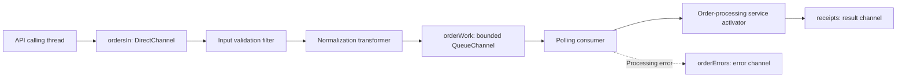

# Choose the channel before choosing the endpoint

In the **Flow Design** chapter of the `SPRING_INTEGRATION_CORE` module, the first decision when connecting two processing steps is the message delivery contract: who receives it, which thread it runs on, whether waiting is allowed, and whether the message needs to be retained. Based on that contract, we choose the `MessageChannel`, and only then place transformers, filters, routers, service activators, or aggregators in the appropriate positions.

The same order-processing method can run directly on the API calling thread, run through an executor, or be fetched from a queue by a poller. The business logic may remain unchanged, but the response timing, error path, and transaction boundary will differ. Therefore, reading a flow solely by its endpoint names is not enough to understand its behavior.

After this lesson, you will be able to:

- Choose between single-consumer distribution and broadcasting to multiple subscribers.
- Identify synchronous execution, executor, and polled-queue boundaries.
- Set capacity, timeouts, error paths, and ordering requirements before configuring endpoints.
- Interpret and test a Java DSL flow according to the exact semantics of message delivery.

## 1. Start from delivery requirements

Suppose an order intake system has three requirements:

1. Orders missing an ID or having an invalid amount must be rejected immediately.
2. Valid orders are placed into a bounded queue; downstream processing does not hold the API calling thread.
3. Processing results and post-intake errors must each have a dedicated destination.

If you only write "filter → transformer → service activator", the diagram does not yet capture the second and third requirements. We need to add the channels and the party responsible for receiving at each boundary:



This is a design for a learning example within a single application. The in-memory channels here do not yet satisfy a requirement to retain orders across a process shutdown. If the business requires "once accepted, it must be recoverable after a restart", a durable persistence mechanism must be designed right at the order acknowledgment point.

Before drawing each arrow, answer six questions:

| Question | What to decide | Order example |
| --- | --- | --- |
| How many handlers does a message need? | One consumer performing work or multiple subscribers receiving an event | One worker processes each order; multiple parties may care about the completion event |
| Does the sender wait for processing? | Time budget and the meaning of the response | Wait for validation, then only confirm that it has been placed into the queue |
| Does it need to absorb traffic bursts? | Buffering, capacity, and behavior when full | Queue of at most 100 messages in the example |
| What loss is acceptable on process shutdown? | In-memory or durable storage | Recovery cannot be promised with an in-memory queue |
| To what extent must ordering be preserved? | Dequeue, start, or completion order; global or per order ID | Updates for the same order may need their own ordering |
| Who receives errors after handoff? | Caller, error channel, retry mechanism, or business error storage | Input errors return immediately; worker errors take a separate path |

## 2. Messages, channels, and endpoints serve different roles

`Message<T>` is the unit of exchange, consisting of a payload and headers. The payload holds the data; headers carry context such as correlation/tracking IDs, business keys, or information used for replies and error handling. The payload contract must be clear at every segment: before a transformer it may be raw data, and after the transformer it is the type accepted by the business step.

`MessageChannel` provides the send operation. Its two key sub-interfaces are:

- `SubscribableChannel`: handlers register to receive; the channel dispatches when a send occurs.
- `PollableChannel`: consumers retrieve messages via `receive(...)`.

The send interface does not imply a single execution model. The `true`, `false`, and exception outcomes of `send(...)` must be interpreted according to the specific channel. See the contract in the [MessageChannel API](https://docs.spring.io/spring-framework/docs/current/javadoc-api/org/springframework/messaging/MessageChannel.html).

An endpoint connects a processing component to a channel and manages how that component is invoked. For standard consumers, Spring Integration chooses `EventDrivenConsumer` for a subscribable input and `PollingConsumer` for a pollable input. Because of this, the same transformer can be wrapped by two different consumer types depending on the input channel. See [Message Endpoints](https://docs.spring.io/spring-integration/reference/endpoint.html).

```text
Input channel               How it is triggered          Invoked logic
-----------------------     --------------------------   ----------------------
SubscribableChannel         Dispatched by the channel    Transformer or handler
PollableChannel             Poller calls receive()       Transformer or handler
```

A poller belongs to the consuming endpoint, not as a built-in background task inside every `QueueChannel`. When using a queue as an endpoint's input, an appropriate poller must be present, declared directly or via a default poller. In application code or tests, you can also explicitly call `receive(...)` instead of using an endpoint.

## 3. Choose the distribution model first, then the execution model

These two decisions are independent:

- **Distribution:** pick one consumer to process the work or broadcast to all subscribers?
- **Execution:** invoke directly, hand off to an executor, or store in a queue for a consumer to retrieve later?

For example, `ExecutorChannel` is still point-to-point even though it can offload work to another thread. `PublishSubscribeChannel`, by default, can invoke subscribers on the sending thread despite having publish-subscribe in its name.

| Channel | Distribution and reception | Buffer, execution thread | Best suited when |
| --- | --- | --- | --- |
| `DirectChannel` | Point-to-point; invokes one subscriber selected by the dispatcher | Runs on the sending thread; no queue for pending work | Short processing chains where the caller needs the result or error directly |
| `ExecutorChannel` | Point-to-point; dispatcher hands work to an executor | Execution behavior and queuing depend on the executor | Offloading tasks to an executor with explicit resource limits |
| `QueueChannel` | Point-to-point; consumer calls `receive(...)` | Has a queue; consuming endpoints usually run via a poller | Needing a bounded buffer and decoupling send rate from processing rate |
| `PublishSubscribeChannel` | Broadcasts messages to registered subscribers | Invokes on the sending thread by default; an executor can be configured | Multiple branches all need to receive the event |
| `RendezvousChannel` | Direct handoff to a waiting receiver | No buffering; sender waits for receiver up to a timeout | Coordinating handoffs between threads without holding a backlog |
| `PriorityChannel` | Consumer retrieves by priority | A pollable channel with a priority queue | Prioritizing work while having considered the risk of starving normal work |

The behavior of specialized channels is described in [Message Channel Implementations](https://docs.spring.io/spring-integration/reference/channel/implementations.html). The following sections apply those choices to flow design.

### 3.1. DirectChannel: loose coupling, shared call stack

With `DirectChannel`, the handler runs on the sending thread. If a segment consists of multiple endpoints connected only by direct channels, the duration of a send into that segment can include the entire downstream processing time.

If a handler throws an exception and nothing handles it, the exception can propagate back to the caller. A transaction bound to the thread can cover compatible downstream resource operations; the channel does not start a transaction on its own, nor does it automatically enlist every external system into that transaction.

Multiple subscribers registered to the same `DirectChannel` do not form an "A then B" pipeline. The dispatcher selects a handler according to its dispatching strategy; a failover configuration may even try another handler when an error occurs. If A and B must both run in sequence, connect A's output to B's input channel. See [DirectChannel API](https://docs.spring.io/spring-integration/api/org/springframework/integration/channel/DirectChannel.html).

```text
Two-step pipeline:
input → channelA → handlerA → channelB → handlerB

Two consumers on the same input:
                 ┌→ handlerA
shared channel ──┤  dispatcher selects consumer
                 └→ handlerB
```

For handlers with side effects such as sending a payment command, retrying another consumer after an error must be evaluated alongside idempotency. A call may have already caused an effect in an external system before reporting an error.

### 3.2. ExecutorChannel: the executor is part of the contract

When choosing `ExecutorChannel`, the design must specify which executor is used, thread limits, task queue capacity, and the saturation policy. Simply renaming a channel is not enough to lock down high-load behavior.

A standard executor breaks thread-bound transaction sharing between the sender and the handler. Failures when submitting a task to the executor and business errors inside the task occur at two different points in time; the caller may see a task rejection error, but cannot use a `try/catch` around the send call to catch an error that later occurs on a worker thread. See [ExecutorChannel API](https://docs.spring.io/spring-integration/api/org/springframework/integration/channel/ExecutorChannel.html).

Some policies such as `CallerRunsPolicy` can push processing back onto the sending thread when the executor saturates. Therefore, a requirement that "the API thread always returns quickly" must take the executor configuration into account. Thread-locals, security info, and tracing context also need an appropriate context-propagation mechanism when switching threads.

### 3.3. QueueChannel: a buffer needs a consumer and wait limits

`QueueChannel` places messages into a queue. When the queue is full, a send call may wait for space, time out and return `false`, or raise an exception in an upper calling layer depending on how the send is invoked. When the queue is empty, a consumer can also wait up to a receive timeout.

Declare capacity intentionally. The no-argument constructor creates a queue with a very large nominal capacity, so it is not a useful memory bound for most load scenarios. See [QueueChannel API](https://docs.spring.io/spring-integration/api/org/springframework/integration/channel/QueueChannel.html).

```java
QueueChannel work = new QueueChannel(100);

boolean accepted = work.send(message, 200); // Wait up to 200 ms for space.
Message<?> next = work.receive(500);        // Wait up to 500 ms for a message.
```

Here `message` is a previously created message. When receiving returns `null`, the caller must handle the case where no message arrived within the wait window.

### 3.4. PublishSubscribeChannel: each branch is a distinct responsibility

When the same event needs to update metrics and send a notification, publish-subscribe expresses the intent much better than attaching two endpoints to a `DirectChannel`. Every registered subscriber is a distribution target.

The default constructor invokes handlers on the sending thread. Attaching an executor changes execution behavior, but does not automatically create an event store for absent subscribers. With the default configuration, this channel should not be treated as an event store for subscribers to catch up from later. See [PublishSubscribeChannel API](https://docs.spring.io/spring-integration/api/org/springframework/integration/channel/PublishSubscribeChannel.html).

When splitting into branches, determine which branches are mandatory, which tolerate independent failures, and which have side effects. Broadcasting to multiple subscribers does not automatically provide rollback for effects that have already happened in earlier branches.

## 4. Mark transaction, result, and error boundaries

Write down the meaning of the response right at the handoff point:

| Boundary | What can the sender know? | What cannot be concluded yet |
| --- | --- | --- |
| Direct chain processes and returns normally | The synchronous call segment finished as configured | That every external side effect can be rolled back |
| Send to queue succeeds | The message was accepted by the queue | That the worker finished processing or that data was durably persisted |
| Executor accepts task | The work was accepted by the executor under its policy | That the business logic inside the task succeeded |
| One event-broadcast branch ran | That branch executed according to observable behavior | That all other branches succeeded or can be compensated automatically |

In a synchronous flow, handler errors typically propagate up the call stack. In asynchronous processing managed by Spring Integration, errors can be wrapped in an `ErrorMessage` and sent to an error channel. The standard mechanism checks the message's `errorChannel` header, then a configured error channel or the global error channel depending on the component raising the error. A poller also has its own error channel configuration. See [Error Handling](https://docs.spring.io/spring-integration/reference/error-handling.html).

Order example:

```text
Invalid input:
caller → DirectChannel → filter throws error → caller receives error

Valid input, but worker fails:
caller → DirectChannel → queue accepts order → caller is released
                                      ↓
                                poller → handler fails
                                      ↓
                              ErrorMessage → error handler destination
```

In the second case, the worker may start very early, even before the initial send call returns. The core point is that a failure in the worker does not return via the caller's call stack.

Error path design must answer three things: identify which order failed, decide whether it can be retried, and record state for operational tracking. Logging may be one action in that process; it is not by itself a mechanism for completing failed work.

## 5. Java DSL has implicit channels

A flow with multiple `.transform(...)`, `.filter(...)`, and `.handle(...)` calls still has channels connecting the endpoints. By default in the Java DSL, those implicitly created links are typically `DirectChannel`. Placing multiple endpoints in a single DSL chain does not automatically create parallel processing. See [Message Channels in Java DSL](https://docs.spring.io/spring-integration/reference/dsl/java-channels.html).

When reading or designing, write out the expanded diagram:

```text
ordersIn [Direct]
    → filter
    → implicit channel [Direct]
    → transformer
    → orderWork [Queue, capacity=100]
    → polling consumer
    → service activator
    → receipts [Queue]
```

Channels should be explicitly named wherever visibility is needed or the contract changes: entry points, work queues, event broadcast points, result paths, and error paths. There is no need to manually declare every direct channel between short operations if implicit channels already express the intent.

## 6. Complete example: synchronous validation, queued processing

The example below uses Java 17 or later because of `record`, and assumes the classpath already has Spring Context and `spring-integration-core` compatible with the application. This is a configuration meant to be placed into an existing application or test context; the lesson does not require changing build configuration.

The contract is chosen before writing endpoints:

| Channel | Type | Purpose |
| --- | --- | --- |
| `ordersIn` | `DirectChannel` | Keeps validation and normalization on the sending thread |
| `orderWork` | `QueueChannel(100)` | Bounds the number of messages waiting for a worker |
| `receipts` | `QueueChannel(100)` | Collects results for demo code or tests to actively receive |
| `orderErrors` | `QueueChannel(100)` | Collects poller errors for demo code or tests to inspect |

```java
import java.time.Duration;

import org.springframework.beans.factory.annotation.Qualifier;
import org.springframework.context.annotation.Bean;
import org.springframework.context.annotation.Configuration;
import org.springframework.integration.channel.DirectChannel;
import org.springframework.integration.channel.QueueChannel;
import org.springframework.integration.config.EnableIntegration;
import org.springframework.integration.dsl.IntegrationFlow;
import org.springframework.integration.dsl.Pollers;

@Configuration
@EnableIntegration
public class OrdersFlowConfig {

    public record Order(String id, long amountCents) {}

    public record Receipt(String orderId, String status) {}

    @Bean
    public DirectChannel ordersIn() {
        return new DirectChannel();
    }

    @Bean
    public QueueChannel orderWork() {
        return new QueueChannel(100);
    }

    @Bean
    public QueueChannel receipts() {
        return new QueueChannel(100);
    }

    @Bean
    public QueueChannel orderErrors() {
        return new QueueChannel(100);
    }

    @Bean
    public IntegrationFlow acceptOrders(
            @Qualifier("ordersIn") DirectChannel input,
            @Qualifier("orderWork") QueueChannel work) {

        return IntegrationFlow.from(input)
                .<Order>filter(
                        order -> order.id() != null
                                && !order.id().isBlank()
                                && order.amountCents() > 0,
                        endpoint -> endpoint
                                .id("validateOrder")
                                .throwExceptionOnRejection(true))
                .<Order, Order>transform(
                        order -> new Order(
                                order.id().trim(), order.amountCents()),
                        endpoint -> endpoint
                                .id("normalizeOrder")
                                .sendTimeout(200))
                .channel(work)
                .get();
    }

    @Bean
    public IntegrationFlow fulfillOrders(
            @Qualifier("orderWork") QueueChannel work,
            @Qualifier("receipts") QueueChannel output) {

        return IntegrationFlow.from(work)
                .handle(Order.class, (order, headers) -> {
                    // Simulated failure condition to observe the poller's error path.
                    if (order.amountCents() == 13_000) {
                        throw new IllegalStateException(
                                "Simulated failure: " + order.id());
                    }
                    return new Receipt(order.id(), "DONE");
                }, endpoint -> endpoint
                        .id("fulfillOrder")
                        .poller(Pollers.fixedDelay(Duration.ofMillis(100))
                                .receiveTimeout(0)
                                .maxMessagesPerPoll(5)
                                .errorChannel("orderErrors"))
                        .sendTimeout(200))
                .channel(output)
                .get();
    }
}
```

### 6.1. Channels determine how the two flow segments coordinate

In `acceptOrders`, the filter and transformer run in a synchronous chain. The filter explicitly throws an exception on invalid input, preventing a case where the caller thinks an order was accepted even though the message was dropped. The transformer creates a new payload with the trimmed order ID.

The transformer sends its output to `orderWork`. The `sendTimeout(200)` configuration sits on the endpoint sending the message into the queue, bounding how long that send waits for space. If it cannot send, the endpoint can raise a delivery exception instead of letting the caller mistakenly assume the order was accepted.

In `fulfillOrders`, the input is a `QueueChannel`, so the consuming endpoint has a poller. The parameters are chosen for demonstration purposes:

- `fixedDelay(100 ms)`: establishes a polling cadence based on fixed delay.
- `receiveTimeout(0)`: does not block the polling task when the queue is empty.
- `maxMessagesPerPoll(5)`: limits the number of receives per poll cycle.
- `errorChannel("orderErrors")`: designates the destination for poller errors in the example.

`maxMessagesPerPoll(5)` does not mean five parallel workers, nor does it guarantee a rate of 50 messages per second. Processing time, scheduling, and the poller's executor configuration also affect throughput. Refer to [Pollers in Java DSL](https://docs.spring.io/spring-integration/reference/dsl/java-pollers.html) and [PollerSpec API](https://docs.spring.io/spring-integration/api/org/springframework/integration/dsl/PollerSpec.html).

### 6.2. Send timeout has local scope

In this configuration, the two `sendTimeout(200)` settings serve two distinct handoffs: the transformer sending into the work queue and the service activator sending into the results queue. The corresponding configuration API is documented at [ConsumerEndpointSpec.sendTimeout](https://docs.spring.io/spring-integration/api/org/springframework/integration/dsl/ConsumerEndpointSpec.html#sendTimeout(long)).

You should not infer that `ordersIn.send(message, 200)` forces every downstream endpoint to finish within 200 ms. A timeout passed to the initial send call does not propagate as an end-to-end flow deadline; nor does a direct channel use that parameter to interrupt a slow handler.

Similarly, an endpoint's send timeout does not limit the execution time of logic inside the handler. If a handler makes an HTTP call or queries a database, timeouts for those operations must be configured on the corresponding client or resource layer.

### 6.3. Output queues must be consumed

`receipts` and `orderErrors` serve as collection points in the test example, so test code calls `receive(...)` on them. When bringing this pattern into a continuously running application, appropriate consumers are needed to handle results and errors. If they are not drained, the queues can fill up and introduce new errors or wait times.

In this flow, a failure while sending the receipt can also happen after the handler's business logic has already completed. Therefore, "did not receive a receipt" is not enough to conclude "the order was never processed". When adding retries, you must identify exactly which operation is being retried and use a business key to limit duplicate effects.

## 7. Testing the channel contract

Testing payload transformations alone does not prove that a flow has the right delivery contract. For the example above, we need to observe the sender's response, the data on the result channel, and the poller's error message.

The class below is demonstration code using JUnit 5, placed in the same package as `OrdersFlowConfig`. Each test creates its own context so it does not share leftover messages in queues.

```java
import org.junit.jupiter.api.Test;
import org.springframework.context.annotation.AnnotationConfigApplicationContext;
import org.springframework.integration.channel.QueueChannel;
import org.springframework.messaging.Message;
import org.springframework.messaging.MessageChannel;
import org.springframework.messaging.MessagingException;
import org.springframework.messaging.support.ErrorMessage;
import org.springframework.messaging.support.GenericMessage;

import static org.junit.jupiter.api.Assertions.*;

class OrdersFlowConfigTest {

    @Test
    void validOrderProducesReceipt() {
        try (var context = new AnnotationConfigApplicationContext(
                OrdersFlowConfig.class)) {
            var input = context.getBean("ordersIn", MessageChannel.class);
            var output = context.getBean("receipts", QueueChannel.class);

            boolean accepted = input.send(new GenericMessage<>(
                    new OrdersFlowConfig.Order(" ORD-1 ", 25_000)));

            assertTrue(accepted);
            Message<?> result = output.receive(2_000);
            assertNotNull(result);
            assertEquals(
                    new OrdersFlowConfig.Receipt("ORD-1", "DONE"),
                    result.getPayload());
        }
    }

    @Test
    void invalidOrderFailsOnSendingThread() {
        try (var context = new AnnotationConfigApplicationContext(
                OrdersFlowConfig.class)) {
            var input = context.getBean("ordersIn", MessageChannel.class);

            assertThrows(MessagingException.class, () -> input.send(
                    new GenericMessage<>(
                            new OrdersFlowConfig.Order("ORD-2", 0))));
        }
    }

    @Test
    void workerFailureIsReceivedOnErrorChannel() {
        try (var context = new AnnotationConfigApplicationContext(
                OrdersFlowConfig.class)) {
            var input = context.getBean("ordersIn", MessageChannel.class);
            var errors = context.getBean("orderErrors", QueueChannel.class);

            // Send succeeds even though the handler behind the queue will fail.
            assertTrue(input.send(new GenericMessage<>(
                    new OrdersFlowConfig.Order("ORD-3", 13_000))));

            Message<?> error = errors.receive(2_000);
            assertNotNull(error);
            assertInstanceOf(ErrorMessage.class, error);
            assertInstanceOf(Throwable.class, error.getPayload());
        }
    }

    @Test
    void fullQueueRejectsAnImmediateSend() {
        var queue = new QueueChannel(1);

        assertTrue(queue.send(new GenericMessage<>("first"), 0));
        assertFalse(queue.send(new GenericMessage<>("second"), 0));
    }
}
```

`receive(2_000)` is a wait bound in the test to synchronize with asynchronous processing; it does not promise a business SLA. Waiting this way ties directly to the condition being observed, avoiding choosing a `sleep` duration and guessing that the worker has run.

The full-queue test uses an isolated queue with no consumer, so it avoids racing with a poller draining messages. To test send timeouts within the full flow, you would need to explicitly stop or replace the consumer at that boundary. Spring Integration provides tools to support testing flows and mocking components, presented in [Testing support](https://docs.spring.io/spring-integration/reference/testing.html).

The code snippets above are for educational purposes; this article does not include build or test execution results in a workspace.

## 8. Calculating capacity from load and acceptable wait time

A bounded queue makes overload visible, but it does not make consumers process faster. Estimate backlog using measurable quantities:

```text
λ = incoming message rate
μ = total consumer processing rate

When λ > μ:
    Backlog growth rate ≈ λ - μ
    Backlog accumulated during burst duration T ≈ (λ - μ) × T
```

For example, suppose input reaches 400 messages/second, consumers process 250 messages/second, and the burst lasts 4 seconds. The backlog grows by roughly `150 × 4 = 600` messages if the queue starts empty. A queue capacity of 100 in the Java example only absorbs about `100 / 150 ≈ 0.67` seconds of the excess load, under this simple model.

This is an estimate for choosing a starting point for measurement. Bursty arrivals, uneven processing times, and downstream incidents can cause actual backlog to differ significantly from average values.

When choosing capacity, check all of the following together:

- Memory for payloads, headers, and referenced objects.
- Time a message waits before being processed.
- Ability to drain the backlog after a load spike.
- Sender behavior when the queue is full: bounded wait, explicit rejection, or routing to a designed durable store.

Monitor at a minimum queue depth, age of the oldest waiting message, number of failed sends, processing time, and worker error count. For an executor, also track queued task count and rejection count. A nearly empty queue while workers remain idle may reflect low traffic; a continuously growing queue indicates that intake exceeds consumption capacity or that consumers have stopped.

## 9. Ordering, transactions, and persistence are three separate requirements

### 9.1. FIFO does not guarantee completion order

With a regular FIFO queue, dequeue order does not equate to completion order when multiple consumers or processing steps run concurrently. For example, A is dequeued first but calls an external system more slowly than B; B's result may appear before A's.

If the update order for the same order matters, define the requirement by business key. You may need partitioning by key, limiting concurrency per key, or checking data versions. Do not impose global ordering if the business only requires ordering within each order.

### 9.2. A queue boundary needs a separate transaction on the consumer side

A transaction on the sending thread does not automatically follow the message to the poller. If the consumer needs a database transaction, configure transactions on the consumer side using the mechanism appropriate for the application.

The in-memory queue in the example does not become a queue capable of rolling back message dequeuing simply because the handler has `@Transactional`. When processing fails, there is also no reason to assume the message will automatically reappear in the queue. Retries, error persistence, or recovery mechanisms must be designed explicitly.

### 9.3. A buffer does not replace a durability guarantee

If the business requirement is never to lose an acknowledged order, that acknowledgment must be tied to a completed durable write operation. You may consider a channel backed by an appropriate message store or a durable messaging system; the choice also depends on transaction boundaries and the application's infrastructure. Configuring queues with a message store is introduced in [Configuring Message Channels](https://docs.spring.io/spring-integration/reference/channel/configuration.html).

Durability still needs to be paired with a recovery and deduplication strategy. For example, a consumer might successfully call an external system and then crash before recording completion status; a rerun must recognize the prior effect. Using `orderId` or a stable business operation key is usually more meaningful than using a new message ID generated on each resend.

## 10. After locking in channels, choose endpoints by role

| Processing need | Appropriate component | Channel decision required upfront |
| --- | --- | --- |
| Reshape or normalize payload | Transformer | Output data type, and whether it stays synchronous with the caller |
| Accept or drop messages | Filter | On rejection: throw an error, send to a discard channel, or silently drop under which contract |
| Select a branch by content or header | Router | Target channel for each branch, default path, and handling when no destination matches |
| Invoke business logic | Service activator | Processing duration, transaction boundary, and result or error path |
| Combine multiple related messages | Aggregator | Source of partial messages, correlation, release condition, and handling of incomplete groups |
| Expose a Java call to the messaging world | Gateway | One-way or request-reply interaction, timeouts, and reply path |

A router decides the destination; the target channel type decides how delivery happens. For instance, a router might send normal orders to a direct channel and orders requiring extra checks to a queue. Selecting a branch does not mean the receiver on that branch has finished processing.

An aggregator maintains its own state to hold messages within a group. The input queue and the aggregator's group store are two separate responsibilities; adding a queue does not by itself solve incomplete groups or group timeouts. You must define correlation, release conditions, and policies for incomplete groups. See [Aggregator](https://docs.spring.io/spring-integration/reference/aggregator.html).

A gateway hides the messaging API behind a Java interface. A synchronous request-reply method can still block the caller waiting for a result even if there is a queue inside the flow. You must budget for delivery time, queue wait time, processing, and receiving the reply. See [Messaging Gateways](https://docs.spring.io/spring-integration/reference/gateway.html).

In the `OrdersFlowConfig` example, results are sent explicitly to `receipts`. If you want to replace that with a gateway returning `Receipt`, you must redesign the corresponding reply path; merely changing the gateway method's return type will not make receipts return to the caller on their own.

## 11. Choices that commonly break the contract

| Choice | Common consequence | How to fix the design |
| --- | --- | --- |
| Two endpoints listening on one direct channel intending both to run | Work is distributed by the dispatcher | Chain sequentially if it is a pipeline; use publish-subscribe if branches should all receive |
| Switching direct to queue without configuring an appropriate consumer | Endpoint lacks a poller or messages are never drained | Define the consumer and poller at the queue boundary |
| Creating a huge queue to hide slow downstream processing | Higher memory usage and latency; failures surface late | Size capacity from measured load and the reject-or-wait contract |
| Setting a timeout only on the send to the first entry point | Sends at downstream endpoints can still wait too long | Set timeouts at each boundary where waiting is possible |
| Using publish-subscribe and assuming branches are error-isolated | One branch can affect dispatch progress depending on configuration | Lock down the execution model and error responsibility for each branch |
| Treating `send() == true` as order completion | Caller reports business success prematurely | Distinguish accepted status from completed processing |
| Adding retries without examining side effects | Duplicate commands sent or duplicate business records created | Scope retries precisely and use an idempotency key |
| Using an in-memory queue for a restart recovery promise | Acknowledged messages are lost on process shutdown | Place durable storage at the acknowledgment point |

## 12. Practice exercises

### Scenario A: quotes must return results immediately

A quote call needs to validate input, look up rules in memory, and return a price. All steps are short, and the caller needs immediate error feedback.

Design direction: start with a direct channel chain and a request-reply gateway. Measure processing time before adding an executor or queue. If a slow network call is introduced, re-evaluate the time budget at that step and the API's response contract.

### Scenario B: batch data ingestion

Input has multi-second load spikes; the consumer writing to the database has finite throughput. The system must reject clearly when capacity is exhausted.

Design direction: choose a bounded queue, bound the send timeout, configure a poller, and decide where errors are recorded. If accepted data must not be lost after a restart, add durable storage before using this pattern for that guarantee.

### Scenario C: notifying multiple parties on completion

A completed order needs to update metrics and send an email. Email may be slow, but it must not block metrics recording.

Design direction: use a mechanism that distributes to multiple branches, then choose an appropriate processing boundary for each branch. You can place a dedicated work queue for email, with its own consumer and error path. If emails must still be sent after an application shutdown, persist the send request durably.

### Design self-check

Expand your flow diagram so that every channel can answer:

1. Is the message sent to a single consumer or to multiple subscribers?
2. Which thread executes the next handler, and what happens when execution resources saturate?
3. Where do messages wait, what is the capacity, and who drains them?
4. What does a successful send prove to the caller?
5. Where are errors handled before and after the delivery boundary?
6. Which mechanisms satisfy ordering, transaction, and restart-recovery requirements?

Once these answers are clear, each endpoint has a concrete responsibility and an observable input/output contract. That provides the foundation for adding transformers, routers, filters, or aggregators while still understanding the entire behavior of the flow.
