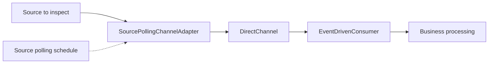
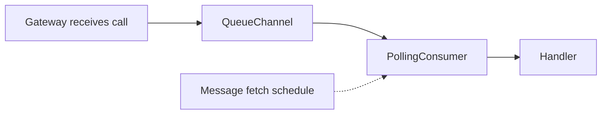

# Choose event-driven or polling

In the **Flow Design** chapter of the **SPRING_INTEGRATION_CORE** module, choosing between event-driven and polling determines when work starts, which thread executes it, and which side must wait. This decision must be tied to how Message, MessageChannel, endpoint, and gateway are used, rather than merely picking a periodic interval.

This lesson moves from the conceptual model to Java DSL to answer a practical question: which orders need immediate processing, which orders can wait in a buffer, and which data sources must be actively checked by the application.

## 1. Goals and prerequisites

After this lesson, you will be able to:

- Distinguish an event-driven consumer from a polling consumer within a flow.
- Separate fetching data from a source from transferring messages between endpoints.
- Choose DirectChannel, ExecutorChannel, or QueueChannel based on processing requirements.
- Place a poller on the right endpoint and explain its key parameters.
- Predict the impact of your choice on errors, transactions, backlog, and testing.

You need to know that a Message consists of a payload and headers, a channel transports messages, and an endpoint connects a channel to a processing component. Transformers, filters, routers, and aggregators describe business work; how an endpoint receives messages is a separate decision.

## 2. Two positions to distinguish

### 2.1. How does data enter the application?

At the system boundary, determine who initiates the exchange:

- **Proactively notifying source:** an HTTP request arrives at the application, a callback is invoked, or a listener receives data. The adapter/gateway injects data into the flow when that activity occurs.
- **Application actively checks the source:** periodically reading a directory, querying an API, or looking for pending records. A pollable source is represented by a MessageSource; SourcePollingChannelAdapter polls the source on a schedule.

Do not infer an adapter's mechanism solely from the protocol name. You must check whether a specific adapter provides a listener, polling, or both. How a library's listener communicates with a server is also distinct from whether a Spring Integration poller is configured.

### 2.2. How does an endpoint receive messages from a channel?

For standard consumer endpoints:

| Endpoint input | Reception mechanism | Endpoint type |
| --- | --- | --- |
| SubscribableChannel, such as DirectChannel | Invoked when the channel dispatches a message to a subscriber | EventDrivenConsumer |
| PollableChannel, such as QueueChannel | Poller calls receive() to fetch messages | PollingConsumer |

SourcePollingChannelAdapter polls a **source**, whereas PollingConsumer polls a **channel**. Both components can appear in the same flow with independent schedules. This distinction is documented in [Spring Integration Poller](https://docs.spring.io/spring-integration/reference/6.5/polling-consumer.html).

A problem can use a polling source while internal processing is event-driven:



In this flow, the handler does not wait for another polling cycle after DirectChannel. When the source returns a message, the channel immediately delivers it to the handler on the thread executing the poll cycle.

Another combination:



The gateway call places the message into a buffer; the downstream endpoint then retrieves messages via a poller. Therefore, "the whole system is event-driven" is usually too broad a description. Specify each source and each channel boundary explicitly.

## 3. Event-driven does not mean asynchronous

DirectChannel invokes the handler directly on the sender's thread. If the handler takes 300 ms, the send call must wait for that synchronous processing. ExecutorChannel delegates dispatching to an executor, so it normally introduces a thread boundary; you also need to inspect the executor's overload policy.

QueueChannel holds messages in memory by default. When space is available, sending to the channel only completes placing the message into the queue. That does not prove the business work has finished. These characteristics are described in [Message Channel Implementations](https://docs.spring.io/spring-integration/reference/6.5/channel/implementations.html).

| Choice | Processing cadence | Additional decisions needed |
| --- | --- | --- |
| DirectChannel | Driven by the message send call | How long the caller can wait |
| ExecutorChannel | Driven by incoming messages and executor capacity | Worker count, executor queue, rejection policy |
| QueueChannel and polling endpoint | Driven by poller schedule, queued message count, and processing time | Capacity, per-poll limit, timeouts, durable storage |

For example, processing directly on the HTTP thread is appropriate when the result must be available before returning the response and processing fits within the latency budget. Sending an email after accepting an order may require an asynchronous boundary. If the requirement is simply to switch threads, consider ExecutorChannel; if you need to actively pull work on a schedule and hold a backlog in the channel, evaluate QueueChannel with a poller.

A local QueueChannel and a durable broker solve different operational requirements. If the requirement is not to lose work when the JVM stops, you must design persistence, acknowledgments, and recovery appropriately; changing the endpoint type alone does not satisfy that requirement.

## 4. Choose according to the problem requirements

Answer five questions in order:

1. **Does the source notify reliably?** If there is only a read API or a directory to scan, the application must actively check it with an appropriate mechanism.
2. **Does the caller need the result immediately or just acceptance of the request?** This determines the gateway contract and when the response is returned.
3. **Do you need to control when work is fetched?** For instance, running only during a partner's allowed time window or batching a set amount of work per cycle.
4. **If input is faster than output, where does the work sit?** Define capacity, durable storage, and behavior when full.
5. **Who is responsible when processing fails?** Choose error reporting, retry, and reconciliation before crossing thread boundaries.

| Scenario | Design starting point | Reason |
| --- | --- | --- |
| Validate an order before returning a result to the caller | Gateway and DirectChannel | The caller needs the result in the same interaction |
| Partner only provides a status query API | MessageSource and source poller | The application must actively detect changes |
| Callback notifies about new orders | Inbound gateway/adapter receiving the callback | Leverage the available signal to start the flow |
| Many requests arrive together, delayed processing is allowed | Bounded buffer and appropriate consumer | Need to absorb bursts and observe backlog |
| Need asynchronous processing as soon as work arrives | Event-driven via executor or appropriate adapter | No requirement forcing a polling schedule |
| Work is only allowed to run during a specific time window | Poller using an appropriate trigger | Fetch timing is a business constraint |

These are initial design directions. For example, a callback from a partner can still be placed into a durable queue before processing if reliability requirements demand it.

## 5. Three Java DSL flows sharing one business operation

The example below uses **Java 17 or later and the Spring Integration 6.5 API** as a reference. The application needs compatible versions of Spring Context, Spring Messaging, and Spring Integration Core dependencies, or a dependency set managed consistently by Spring Boot.

The code uses AnnotationConfigApplicationContext directly and therefore declares EnableIntegration. The package and import declarations below form a single configuration class; no external protocol adapters are needed to follow the example.

### 5.1. Full configuration

```java
package example.flowdesign;

import java.time.Duration;
import java.util.Queue;
import java.util.concurrent.ConcurrentLinkedQueue;

import org.springframework.beans.factory.annotation.Qualifier;
import org.springframework.context.annotation.Bean;
import org.springframework.context.annotation.Configuration;
import org.springframework.context.annotation.Import;
import org.springframework.integration.annotation.Gateway;
import org.springframework.integration.annotation.MessagingGateway;
import org.springframework.integration.channel.DirectChannel;
import org.springframework.integration.channel.QueueChannel;
import org.springframework.integration.config.EnableIntegration;
import org.springframework.integration.core.MessageSource;
import org.springframework.integration.dsl.IntegrationFlow;
import org.springframework.integration.dsl.Pollers;
import org.springframework.messaging.Message;
import org.springframework.messaging.support.MessageBuilder;

@Configuration(proxyBeanMethods = false)
@EnableIntegration
@Import(FlowChoiceConfig.OrderIngress.class)
public class FlowChoiceConfig {

    public record Order(String id, int quantity) {
    }

    @MessagingGateway
    public interface OrderIngress {

        @Gateway(requestChannel = "ordersDirect")
        void processNow(Order order);

        @Gateway(
                requestChannel = "ordersBuffered",
                requestTimeout = "200")
        void enqueue(Order order);
    }

    public static class OrderService {

        public void process(Order order) {
            if (order.quantity() <= 0) {
                throw new IllegalArgumentException(
                        "quantity must be greater than 0");
            }

            System.out.printf(
                    "order=%s quantity=%d thread=%s%n",
                    order.id(),
                    order.quantity(),
                    Thread.currentThread().getName());
        }
    }

    // In-memory demo source, not a MessageChannel.
    public static class PendingOrderSource
            implements MessageSource<Order> {

        private final Queue<Order> pending =
                new ConcurrentLinkedQueue<>();

        public void add(Order order) {
            pending.add(order);
        }

        @Override
        public Message<Order> receive() {
            Order order = pending.poll();
            return order == null
                    ? null
                    : MessageBuilder.withPayload(order).build();
        }
    }

    @Bean
    public DirectChannel ordersDirect() {
        return new DirectChannel();
    }

    @Bean
    public QueueChannel ordersBuffered() {
        return new QueueChannel(100);
    }

    @Bean
    public OrderService orderService() {
        return new OrderService();
    }

    @Bean
    public PendingOrderSource pendingOrderSource() {
        return new PendingOrderSource();
    }

    @Bean
    public IntegrationFlow immediateOrders(
            @Qualifier("ordersDirect") DirectChannel input,
            OrderService service) {

        return IntegrationFlow.from(input)
                .handle(service, "process")
                .get();
    }

    @Bean
    public IntegrationFlow bufferedOrders(
            @Qualifier("ordersBuffered") QueueChannel input,
            OrderService service) {

        return IntegrationFlow.from(input)
                .handle(service, "process", endpoint -> endpoint
                        .id("bufferedOrderConsumer")
                        .poller(Pollers
                                .fixedDelay(Duration.ofMillis(200))
                                .maxMessagesPerPoll(10)
                                .receiveTimeout(0)))
                .get();
    }

    @Bean
    public IntegrationFlow polledOrders(
            PendingOrderSource source) {

        return IntegrationFlow.from(source, endpoint -> endpoint
                        .id("pendingOrderSourceAdapter")
                        .poller(Pollers
                                .fixedDelay(Duration.ofSeconds(2))
                                .maxMessagesPerPoll(5)))
                .channel("ordersDirect")
                .get();
    }
}
```

MessagingGateway hides the message-sending API behind a Java interface. Using Import to register a gateway interface has been supported since Spring Integration 6.0; IntegrationComponentScan can be used when scanning multiple gateways. See [Messaging Gateways](https://docs.spring.io/spring-integration/reference/gateway.html).

### 5.2. Immediate processing flow

```text
OrderIngress.processNow(order)
  -> ordersDirect
  -> EventDrivenConsumer
  -> OrderService.process(order)
```

There is no poller on the handler receiving from ordersDirect. The call returns only after synchronous processing finishes or an exception is propagated. Returning void does not change the threading behavior of DirectChannel.

In the demo, the thread name printed by OrderService matches the thread calling the gateway. This is a more reliable observation than guessing synchronicity from the method name.

### 5.3. Buffered message retrieval flow

```text
OrderIngress.enqueue(order)
  -> ordersBuffered, capacity 100
  -> PollingConsumer, fixed delay 200 ms
  -> OrderService.process(order)
```

The poller is configured on the handle endpoint because this endpoint receives from a QueueChannel. In each cycle, it fetches and processes at most 10 messages, ending early if receive(0) returns null or the cycle is interrupted by an error.

One message corresponds to one order in the example. maxMessagesPerPoll does not turn the payload into a list of 10 orders, nor does it create 10 workers.

requestTimeout = "200" limits how long sending into the channel waits when waiting for space. It does not bound how long the business logic runs. After enqueue returns, the caller only knows the send step completed under the gateway contract; a separate status or response mechanism is needed to know the final outcome.

### 5.4. Source polling flow

```text
Poller, fixed delay 2 seconds
  -> PendingOrderSource.receive()
  -> ordersDirect
  -> OrderService.process(order)
```

PendingOrderSource is a demo source that actively takes one element per receive() call. When no data is available, it returns null; the adapter does not send a message with a null payload. In one cycle, the adapter calls the source at most 5 times, stopping early when no more data remains.

The handler is still an event-driven consumer on ordersDirect, but the execution thread is now the thread running the source poller. There is no additional polling wait at the handler.

If you replace the demo source with reading database records or an external API, the read contract must add ways to claim work, mark completion, and handle failures. The demo source removes items from memory immediately, so it has no ability to recover an order if downstream fails.

Creating a flow from a MessageSource is described in [IntegrationFlow API](https://docs.spring.io/spring-integration/docs/6.5.0/api/org/springframework/integration/dsl/IntegrationFlow.html). Source invocation and null result handling are covered in [Channel Adapter](https://docs.spring.io/spring-integration/reference/6.5/channel-adapter.html).

## 6. Reading poller configuration accurately

A poller coordinates fetch cycles. It is not a throughput guarantee or a data recovery mechanism.

| Parameter | Meaning | Usage in this lesson |
| --- | --- | --- |
| fixedDelay | Sets the pause before the next cycle after the scheduled task finishes | 200 ms for the queue; 2 seconds for the source |
| fixedRate | Schedules at periodic start intervals | Requires evaluating execution duration and executor |
| cron or custom Trigger | Determines the schedule based on time conditions | Suitable for time-window requirements |
| maxMessagesPerPoll | Limits the number of messages processed in one cycle when positive | 10 messages from queue, 5 messages from source |
| receiveTimeout | Time to wait for a message when receiving from a PollableChannel, in ms | 0 to receive immediately or return null |
| taskExecutor | Executor running the polling task when configured | Omitted in the example to keep a sequential model |

Definitions of fixed delay and fixed rate are presented in [Pollers API](https://docs.spring.io/spring-integration/docs/6.5.0/api/org/springframework/integration/dsl/Pollers.html); timeouts and executors are in [PollerSpec API](https://docs.spring.io/spring-integration/docs/6.5.0/api/org/springframework/integration/dsl/PollerSpec.html).

### 6.1. Polling interval is not a guaranteed latency

A message placed into the queue right before the poller runs can be picked up very quickly. A message arriving right after a poll cycle stops may have to wait until the next cycle.

For the queue example, if arrivals are evenly distributed, there is no backlog, each prior cycle finishes quickly, and there is no scheduler contention, the average scheduling wait may be roughly 100 ms. This is an estimate from the 200 ms delay, not a p95 or p99 guarantee.

For the 2-second demo source, expecting change detection within a few milliseconds is unrealistic. You must measure from when data becomes ready at the source until the adapter detects it, then add downstream wait and processing time.

### 6.2. maxMessagesPerPoll is not throughput per second

Suppose a sequential consumer always has enough work, each order takes 15 ms, and fixed delay is 200 ms. Ignoring framework overhead, extra I/O, and contention:

```text
B = 10 messages/cycle
t = 0.015 seconds/message
D = 0.200 seconds

Cycle duration ≈ B × t + D
               ≈ 10 × 0.015 + 0.200
               ≈ 0.350 seconds

Processing capacity ≈ B / (B × t + D)
                    ≈ 10 / 0.350
                    ≈ 28.6 messages/second
```

Therefore, dividing 10 / 0.2 = 50 messages/second ignores processing time. When messages have variable execution times, actual results also depend on that time distribution.

If the arrival rate stays at 50 messages/second, the model above predicts the backlog grows by about 21.4 messages/second. A queue capacity of 100 only absorbs a short interval, roughly 4.7 seconds from empty in this simple model. Larger capacity extends the time before filling up; solving sustained overload requires increasing output capacity or reducing input.

### 6.3. Timeouts have specific scopes

receiveTimeout(0) does not make an HTTP call inside a source return immediately. MessageSource.receive() can make network calls and block for a long time if the network client has no timeout configured.

Similarly, a gateway's requestTimeout waits to send into the channel, while a reply timeout only applies to interactions with a response. You must separate send timeout, I/O timeout, business timeout, and job completion deadline.

### 6.4. Keep configuration local when flows have different requirements

The example places the poller directly on the endpoint so the reader can see each flow's cadence. A shared default poller can be useful, but modifying it affects every endpoint relying on that configuration.

If you extend the example with a taskExecutor, you must simultaneously re-evaluate concurrency limits, potential task overlap, and source safety. At that point, do not apply the single sequential consumer formula above verbatim. Nor does a polling schedule automatically act as a requests-per-second rate limit for an external API.

## 7. Errors and transactions must follow the same design decision

### 7.1. Who receives the error?

| Processing path | When OrderService throws an error | What the caller needs to understand |
| --- | --- | --- |
| processNow via DirectChannel | Error can propagate back through the gateway call under default config | Exceptions can be handled at the call boundary |
| enqueue via QueueChannel | Error occurs after the poller receives the message | Success on enqueue is not business completion |
| SourcePollingChannelAdapter via DirectChannel | Error occurs inside the source polling task | Error handling must exist for the background task |

With standard Spring Integration infrastructure configured, errors from a poller task are converted into an ErrorMessage. The destination is determined by the errorChannel header of the message being processed if present, or the configured default error channel. If the source fails before creating a message, it relies on the poller's error configuration.

DirectChannel by itself does not route all exceptions to errorChannel. When customizing a scheduler or execution mechanism, you must preserve an appropriate error handler if you want to keep using the ErrorMessage handling flow. See [Error Handling](https://docs.spring.io/spring-integration/reference/6.5/error-handling.html).

In an application accepting orders for background processing, explicitly define states such as accepted, processing, completed, and failed. The caller can receive a job ID and query status, rather than treating enqueueing as completion confirmation.

### 7.2. Polling does not automatically create retries

Suppose a message has been removed from an in-memory QueueChannel and the handler fails. The next poll cycle will not automatically rediscover the removed message just because the poller is still running.

With the demo source, pending.poll() also already removed the item from the queue before invoking the handler. Logging the error does not restore that item.

Recovery design must answer:

- Which errors are retried, how many times, and with what backoff?
- Where is the work held while waiting to retry?
- After retries are exhausted, where are the data and failure reason stored for follow-up?
- If the same work executes again, will side effects be duplicated?

For example, a payment recording operation needs a stable business key to detect duplicate requests. A new UUID generated on each retry cannot replace the transaction identifier needed for deduplication.

### 7.3. A thread boundary is a signal to re-examine transactions

A chain running synchronously through DirectChannel can continue a transaction bound to the calling thread, if Spring transactions and resources are properly configured. DirectChannel does not open a transaction on its own.

When handing work across a QueueChannel or to another worker, the transaction bound to the sending thread does not automatically become the processing thread's transaction. A poller can be configured with its own transaction; whether message dequeuing can roll back depends on the participating resources and transaction manager.

You cannot simply add a transaction to a poller and conclude that an in-memory queue gains database durability. See [Transaction Support](https://docs.spring.io/spring-integration/reference/6.5/transactions.html).

For a source fetching work from a database, one implementation approach that must be designed explicitly is claiming a record, processing it, writing the result, and releasing or recovering the claim on failure. When running multiple instances, these steps must prevent two instances from treating the same record as new work simultaneously.

## 8. Backlog, ordering, and EIP components

### 8.1. Define behavior under overload

In the example, the queue holds at most 100 messages and the gateway waits at most 200 ms when waiting for space. The application calling the gateway must handle intake rejection if the message cannot be enqueued in time.

To evaluate the choice, monitor at least:

| Metric | Design significance |
| --- | --- |
| Intake rate and completion rate | Detect when input exceeds processing capacity |
| Queued message count and oldest item age | Distinguish a short queue from stalled work |
| p95/p99 processing time | Spot tasks that drag out the entire poll cycle |
| Empty poll cycles | Assess polling overhead when the source rarely changes |
| Source errors, handler errors, and retries | Identify whether the bottleneck is in fetching or processing |
| Send failures due to full queue or executor rejection | Know when the system can no longer accept load |

Shortening the polling interval can reduce detection latency when idle, but increases the number of source checks. Set a latency target first, then measure the cost of achieving it. If changes only happen a few times per hour, checking an API every 10 ms can generate many calls that yield no new work.

### 8.2. Fetch order differs from completion order

In the demo there is only one sequential consumer for ordersBuffered, so observing order is straightforward. If multiple consumers or a parallel processing boundary are added later, completion times can invert order.

If updates to the same order must be applied sequentially, define ordering by order key, sharding strategy, and stale-version detection. A simple queue configuration alone does not express that requirement.

### 8.3. Transformers, filters, routers, and aggregators still need a reception choice

A transformer does not determine whether a flow is event-driven or polling. When replacing a handler with a transformer receiving from a QueueChannel, the receiving endpoint still needs a poller. Subsequent endpoints receiving over DirectChannel do not need an extra schedule just because there was a queue earlier.

Similarly, a router can run immediately when a message arrives or be triggered after a poller fetches a message. A filter must also be evaluated for its discard policy, especially when data comes from an external source. An aggregator also has group completion conditions and group state storage; choosing event-driven does not eliminate the wait time until a group is complete.

How processing components receive messages is explained in [Message Endpoints](https://docs.spring.io/spring-integration/reference/6.5/endpoint.html). When drawing a flow, label the channels and thread boundaries before reasoning about when a transformer, router, or aggregator runs.

## 9. Hands-on observation and testing

Register FlowChoiceConfig in a running ApplicationContext, retrieve the OrderIngress and PendingOrderSource beans, and perform the actions below. Keep the context running until background processing results have been observed.

### 9.1. Observing the three paths

```java
var gateway = context.getBean(
        FlowChoiceConfig.OrderIngress.class);

gateway.processNow(
        new FlowChoiceConfig.Order("D-001", 1));

gateway.enqueue(
        new FlowChoiceConfig.Order("Q-001", 2));

context.getBean(FlowChoiceConfig.PendingOrderSource.class)
        .add(new FlowChoiceConfig.Order("P-001", 3));
```

For D-001, compare the thread calling the gateway with the thread printed in OrderService. For Q-001 and P-001, observe the background processing logs and the elapsed time from sending/adding data to processing.

Do not assume the log order among the three paths is fixed: the pollers have already been scheduled since the context started. A new message might arrive right before an upcoming poll cycle.

### 9.2. Behaviors to verify

| Action | Expected result to verify |
| --- | --- |
| Call processNow with quantity 0 | Gateway reports a synchronous error under the current configuration |
| Send a valid order via enqueue | Processing happens after the endpoint receives from the queue; do not assume completion when the gateway returns |
| Send an invalid order via enqueue | Background error flow receives failure details; the caller does not receive the handler error on the original call stack |
| Leave the demo source empty | No business message is emitted for a null receive() result |
| Add an order to the demo source | Source poller detects the order and dispatches it through ordersDirect |
| Stop the ordersBuffered consumer and send past capacity | Sends exceeding capacity wait until timeout and then fail |
| Restart the consumer after building a backlog | Valid messages remaining in the queue are fetched according to the poller configuration |

To stop the exact queue-receiving endpoint in the demo, retrieve the bean by its assigned id:

```java
var consumer = context.getBean(
        "bufferedOrderConsumer",
        org.springframework.integration.endpoint.PollingConsumer.class);

consumer.stop();
// Send a controlled number of messages to observe the queue.
consumer.start();
```

Stopping the endpoint does not change the gateway contract. When practicing capacity limits, ensure the consumer is stopped and messages from any in-flight cycle are accounted for before checking counts.

### 9.3. Separate business tests from schedule tests

Business tests call OrderService directly to verify validation rules and side effects. Flow tests additionally verify that messages reach the right handler, errors follow the right route, and threads have the intended characteristics.

For background processing, use a bounded completion signal such as CountDownLatch or an output that supports receive(timeout). The timeout only lets the test exit if the system fails to complete; it does not prove a business SLA.

Avoid merely sleeping for 200 ms and asserting that the consumer ran. The test environment's scheduler may lag, while the first poll might run sooner than expected. For queue capacity tests, actively control the consumer lifecycle to establish stable conditions.

These practice steps describe how to verify behavior when implementing the example; they are not a report that the code has been run in a specific application.

## 10. Documenting the decision for a flow

A short design note should contain at least the following details:

```text
Input source:
  Gateway accepts orders from the application.

Return contract:
  Confirms acceptance; completion status is tracked separately.

Channel and consumer:
  Bounded QueueChannel, PollingConsumer running in the background.

Initial poller:
  fixed delay 200 ms; max 10 messages/cycle; receiveTimeout 0.

Overload:
  Gateway waits up to 200 ms to send; handle rejection explicitly.

Reliability:
  Demo uses memory. Production implementation must separately satisfy durability,
  retry, and deduplication using a business identifier.

Evaluation criteria:
  Measure completion latency, oldest work age, throughput, and errors.
```

Choose event-driven when message reception should happen upon incoming signals; choose polling when the application must actively check a source or pull messages from a PollableChannel. Then separately decide thread boundaries, where backlogs are held, and the failure-handling contract. A flow can combine both mechanisms, as long as each endpoint has a clear role and operational conditions.
