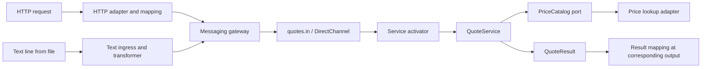

# Separate transport and business logic

## 1. Design goal

In the **Flow Design** chapter of the **SPRING_INTEGRATION_CORE** module, separating transport and business logic is how you keep business rules reusable when changing the intake source, delivery mechanism, or message format. Spring Integration handles connecting, transforming, and orchestrating messages; business objects express what the system needs to do.

After this lesson, you will be able to:

- Delineate responsibilities between protocol adapters, integration flows, and application services.
- Design a shared payload contract across multiple inputs.
- Use `Message`, `MessageChannel`, service activators, messaging gateways, and Java DSL to connect those parts.
- Place transformers, routers, filters, and aggregators in their proper roles.
- Design result paths, error paths, and tests at each boundary.

**Transport** here includes HTTP, files, JMS, and mechanisms that bring data into or out of the application. **Business logic** includes calculation rules, acceptance conditions, invariants, and use-case decisions. Between them sits **integration logic**: transforming messages, choosing routes, coordinating calls, and managing request–reply exchanges.

The running example calculates a price quote for an item. The same pricing rule must serve both an HTTP request and a text line read from a file. The lesson uses a single currency, VND, without taxes or discounts; the use case only looks up unit prices and computes totals, without creating orders or processing payments.

## 2. The problem when responsibilities are mixed

Suppose a handler reads HTTP headers, decodes JSON, computes the price, and returns an HTTP status code all at once:

```java
// Code illustrating a design with mixed responsibilities.
public ResponseEntity<?> quote(Message<String> message) {
    String path = (String) message.getHeaders().get("http_requestUrl");
    // Decode JSON, validate quantity, fetch price, compute total,
    // then choose the HTTP status right in the same method.
    return ResponseEntity.ok(path);
}
```

When adding file input, you have to fabricate fake HTTP headers or duplicate the pricing rules into another flow. Testing the maximum quantity ends up depending on how `Message` and the Spring context are constructed. Changing a JSON field name may force edits to the calculation service.

A practical criterion: **when adding a new input source, the new code should live primarily in the adapter and mapping; existing business rules continue to work**. That does not mean all operational behavior of HTTP and files is identical. They still differ in error reporting, retries, message acknowledgment, and completion timing.

## 3. Three responsibility layers and dependency direction



The diagram shows processing responsibilities; runtime call arrows are not the entire source-code dependency direction. `QuoteService` only knows the `PriceCatalog` interface; the price-lookup adapter depends on that interface and implements it. The service does not import JDBC, an HTTP client, or broker classes.

| Part | Responsibility | Example in this lesson |
| --- | --- | --- |
| Inbound/outbound adapter | Understands the protocol and external contract | Parse JSON, pick HTTP status, read file lines |
| Integration flow | Connects endpoints, adapts payload shapes, manages routing | `transform`, `handle`, invoking a subflow |
| Application/domain | Executes the use case and rules | Quantity from 1 to 100, look up price, and compute total |
| Business port | Describes a capability the use case requires | `PriceCatalog.findUnitPrice(sku)` |
| Infrastructure adapter | Implements the port with a concrete technology | Read prices from DB or partner API |

In this design, application code is plain Java. Integration code is allowed to use `Message`, channels, and DSL. Adapter code is allowed to know about HTTP or file formats. Instantiating a service with Spring `@Bean` does not force the service class to depend on Spring.

This is an intentional choice to reduce coupling. Projects may use `@Service` or `@Transactional` in the application layer according to their own conventions; the key is that pricing rules do not need to know URLs, queue names, or the `MessageChannel` API.

## 4. Internal contract: meaningful payloads, scoped headers

### 4.1. Normalize at the boundary

Do not pass `HttpServletRequest`, a raw JSON string, or a JMS object straight into the pricing service. Each ingress converts incoming data into the same command:

```text
HTTP JSON {"sku":"BOOK-01","quantity":2}
    -> QuoteCommand("BOOK-01", 2)

Text line BOOK-01;2
    -> QuoteCommand("BOOK-01", 2)
```

The internal contract does not need to be a massive enterprise-wide schema. It only needs to be clear and stable enough for the quote calculation use case. When an external party renames `quantity` to `count`, the adapter can change the mapping without changing the service signature.

### 4.2. Splitting payload and headers

| Data | Suggested location | Reason |
| --- | --- | --- |
| SKU, quantity | Command in payload | Inputs that determine the quote result |
| Currency code when supporting multiple currencies | Typed command/value object | Business data requiring explicit validation |
| Trace ID, intake timestamp | Internal header | For observability and operations |
| `replyChannel`, `errorChannel` | Messaging-managed headers | Control message exchange |
| File name, delivery tag, URL | Adapter/flow metadata | Meaningful within protocol handling |
| Customer ID, tenant ID affecting authorization or pricing | Typed command or context after authentication | Avoid letting rules depend on arbitrary header strings |

Headers are also a contract: specify their names, types, origin, and where they are allowed to be used. Do not trust a client-supplied tenant ID or user role directly. The adapter must authenticate and convert trusted information into an explicit context before invoking business logic.

`Message` has a payload and headers, yet that does not force every service to accept `Message<?>`. A service activator can extract the payload to invoke a POJO method and use the return value as the response payload. That invocation style fits keeping business signatures independent. [Service Activator Documentation](https://docs.spring.io/spring-integration/reference/service-activator.html).

When manually constructing a new `Message` inside a transformer, proactively preserve metadata needed by the rest of the flow. In particular, losing `replyChannel` in a request–reply exchange can break the return path. Do not serialize local channel objects into messages sent to another system.

## 5. Write the use case in standalone Java

The main code snippets below use the Spring Integration 6.x API or later; specifically, registering gateways with `@Import` has been available since 6.0. The business Java code uses records, so Java 17 is required when used with Spring Integration 6.x. If choosing a different Spring Integration version, use its compatible JDK and dependency set.

The examples are classes intended to be placed in a Java project with appropriate dependencies. Build scripts, web application bootstrap, and database adapters are omitted. Each `public` type goes in a Java file of the same name; filenames in code blocks merely illustrate organization.

### 5.1. Command, result, and port

```java
// QuoteCommand.java
package example.quote.application;

public record QuoteCommand(String sku, int quantity) {
}
```

```java
// QuoteResult.java
package example.quote.application;

import java.math.BigDecimal;

public record QuoteResult(String sku, int quantity, BigDecimal total) {
}
```

```java
// PriceCatalog.java
package example.quote.application;

import java.math.BigDecimal;
import java.util.Optional;

public interface PriceCatalog {
    Optional<BigDecimal> findUnitPrice(String sku);
}
```

The `PriceCatalog` contract specifies that `Optional.empty()` means there is no price for the requested SKU. Failures connecting to the price source must be reported as technical errors, not converted into `Optional.empty()`. Failing to distinguish the two cases can cause the system to report "product not found" when the price source is actually unreachable.

### 5.2. Rules belong to the service

```java
// QuoteRejectedException.java
package example.quote.application;

public class QuoteRejectedException extends RuntimeException {
    public QuoteRejectedException(String message) {
        super(message);
    }
}
```

```java
// QuoteService.java
package example.quote.application;

import java.math.BigDecimal;
import java.util.Objects;

public final class QuoteService {
    private final PriceCatalog catalog;

    public QuoteService(PriceCatalog catalog) {
        this.catalog = Objects.requireNonNull(catalog);
    }

    public QuoteResult quote(QuoteCommand command) {
        if (command == null || command.sku() == null
                || command.sku().isBlank()) {
            throw new QuoteRejectedException("SKU must not be blank");
        }
        if (command.quantity() < 1 || command.quantity() > 100) {
            throw new QuoteRejectedException("Quantity must be between 1 and 100");
        }

        BigDecimal unitPrice = catalog.findUnitPrice(command.sku())
                .orElseThrow(() -> new QuoteRejectedException(
                        "No price found for SKU: " + command.sku()));
        if (unitPrice.signum() < 0) {
            throw new IllegalStateException("Price catalog returned a negative unit price");
        }

        BigDecimal total = unitPrice.multiply(
                BigDecimal.valueOf(command.quantity()));
        return new QuoteResult(command.sku(), command.quantity(), total);
    }
}
```

The limit of 100 is a use-case rule and is therefore enforced in the service, even if an HTTP form validated it beforehand. A batch job calling the same service must obey this limit as well. Use `BigDecimal` to represent money; when adding taxes, currency conversion, or rounding, express that policy inside the business layer.

The service does not accept a unit price declared by the client. It looks up the price through a port controlled by the application. Nor does the service return `ResponseEntity`, send messages, or decide on retries.

## 6. Connect business logic into Spring Integration

### 6.1. Gateway for normalized payloads

```java
// QuoteMessagingGateway.java
package example.quote.integration;

import example.quote.application.QuoteCommand;
import example.quote.application.QuoteResult;
import org.springframework.integration.annotation.MessagingGateway;

@MessagingGateway(
        defaultRequestChannel = "quotes.in",
        defaultReplyTimeout = "3000")
public interface QuoteMessagingGateway {
    QuoteResult quote(QuoteCommand command);
}
```

The HTTP adapter can call `gateway.quote(command)` without building a `Message`, calling `send()`, and waiting on a reply channel itself. The annotation and channel name belong to the integration package; `QuoteService` does not depend on this gateway interface.

A gateway hides the messaging API behind an interface; a request–reply gateway also manages the reply channel for the call. The example registers the gateway explicitly with `@Import`, a capability supported since Spring Integration 6.0. [Messaging Gateways Documentation](https://docs.spring.io/spring-integration/reference/gateway.html).

### 6.2. Text ingress and transformer

To see a transformer at the right boundary, add a gateway that accepts **a text line that has already been read**. Opening, locking, moving, and acknowledging file processing belong in the file adapter in a real deployment.

```java
// TextQuoteGateway.java
package example.quote.integration;

import example.quote.application.QuoteResult;
import org.springframework.integration.annotation.MessagingGateway;

@MessagingGateway(
        defaultRequestChannel = "quotes.text.in",
        defaultReplyTimeout = "3000")
public interface TextQuoteGateway {
    QuoteResult quoteLine(String line);
}
```

```java
// QuoteLineMapper.java
package example.quote.integration;

import example.quote.application.QuoteCommand;

public final class QuoteLineMapper {
    private QuoteLineMapper() {
    }

    public static QuoteCommand toCommand(String line) {
        if (line == null) {
            throw new IllegalArgumentException("Input line must not be null");
        }
        String[] fields = line.split(";", -1);
        if (fields.length != 2) {
            throw new IllegalArgumentException("Required format: SKU;quantity");
        }
        return new QuoteCommand(
                fields[0].strip(), Integer.parseInt(fields[1].strip()));
    }
}
```

The example format only has two fields separated by a semicolon and does not support fields containing delimiters or CSV quoting rules. For real CSV files, use a proper parser in the adapter. The mapper validates syntax; the quantity limit is still enforced by the service.

### 6.3. Two flows, one business invocation point

```java
// QuoteFlowConfiguration.java
package example.quote.integration;

import example.quote.application.PriceCatalog;
import example.quote.application.QuoteService;
import org.springframework.context.annotation.Bean;
import org.springframework.context.annotation.Configuration;
import org.springframework.context.annotation.Import;
import org.springframework.integration.channel.DirectChannel;
import org.springframework.integration.config.EnableIntegration;
import org.springframework.integration.dsl.IntegrationFlow;
import org.springframework.messaging.MessageChannel;

@Configuration(proxyBeanMethods = false)
@EnableIntegration
@Import({QuoteMessagingGateway.class, TextQuoteGateway.class})
public class QuoteFlowConfiguration {
    @Bean(name = "quotes.in")
    public MessageChannel quoteInput() {
        return new DirectChannel();
    }

    @Bean
    public QuoteService quoteService(PriceCatalog catalog) {
        return new QuoteService(catalog);
    }

    @Bean
    public IntegrationFlow quoteFlow(QuoteService service) {
        return IntegrationFlow.from("quotes.in")
                .handle(service, "quote", endpoint -> endpoint
                        .requiresReply(true))
                .get();
    }

    @Bean
    public IntegrationFlow textQuoteFlow() {
        return IntegrationFlow.from("quotes.text.in")
                .transform(String.class, QuoteLineMapper::toCommand)
                .gateway("quotes.in")
                .get();
    }
}
```

The application must provide a `PriceCatalog` bean: a real implementation at runtime, or a stub lambda in the tests below. The `quotes.text.in` channel is created by the DSL when referenced by name as an input if not already declared. These flows use a synchronous processing path, with no executor or poller configured.

`quoteFlow` has a service activator calling `QuoteService.quote`. `textQuoteFlow` converts the string into a command and then uses `.gateway("quotes.in")` to invoke the shared flow as request–reply. The internal gateway receives the result from the subflow and returns that result back to the text ingress call.

Do not use `.channel("quotes.in")` expecting it to automatically perform a full subflow invocation and return to the current chain. When you need to continue processing after a request–reply call to another flow, `.gateway(...)` expresses the intent more clearly. For merely forwarding a message onward, a channel or bridge may suffice.

`requiresReply(true)` helps catch a service returning `null` when the contract expects a result. That setting does not force a blocked remote call to finish on time.

### 6.4. HTTP adapter mapping the external contract

This is an addition when the project already has Spring MVC, JSON message converters, and web configuration. Place the DTOs and controller in `example.quote.adapter.http`; register the controller via component scan or web application import.

```java
// QuoteHttpRequest.java
package example.quote.adapter.http;

public record QuoteHttpRequest(String sku, Integer quantity) {
}
```

```java
// QuoteHttpResponse.java
package example.quote.adapter.http;

import java.math.BigDecimal;

public record QuoteHttpResponse(
        String productCode, int count, BigDecimal amount, String currency) {
}
```

```java
// QuoteHttpController.java
package example.quote.adapter.http;

import example.quote.application.QuoteCommand;
import example.quote.application.QuoteResult;
import example.quote.integration.QuoteMessagingGateway;
import org.springframework.http.HttpStatus;
import org.springframework.web.bind.annotation.PostMapping;
import org.springframework.web.bind.annotation.RequestBody;
import org.springframework.web.bind.annotation.RestController;
import org.springframework.web.server.ResponseStatusException;

@RestController
public class QuoteHttpController {
    private final QuoteMessagingGateway gateway;

    public QuoteHttpController(QuoteMessagingGateway gateway) {
        this.gateway = gateway;
    }

    @PostMapping("/quotes")
    public QuoteHttpResponse quote(@RequestBody QuoteHttpRequest request) {
        if (request.sku() == null || request.quantity() == null) {
            throw new ResponseStatusException(
                    HttpStatus.BAD_REQUEST, "Missing sku or quantity");
        }
        QuoteCommand command = new QuoteCommand(
                request.sku().strip(), request.quantity());
        QuoteResult result = gateway.quote(command);
        if (result == null) {
            throw new ResponseStatusException(
                    HttpStatus.GATEWAY_TIMEOUT, "Quote response not received in time");
        }
        return new QuoteHttpResponse(
                result.sku(), result.quantity(), result.total(), "VND");
    }
}
```

With a unit price of `25000.00`, the request `{"sku":"BOOK-01","quantity":2}` produces a result with `productCode=BOOK-01`, `count=2`, `amount=50000.00`, `currency=VND`. The amount is calculated in the service; the response field names and currency label of the HTTP contract are formatted by the adapter.

The controller illustrates mapping and the missing-response case. An HTTP error policy for business errors or price-source failures should be added in a boundary error-handling layer, such as `@RestControllerAdvice`, as discussed next. If you want to use Spring Integration's HTTP inbound gateway instead of a controller, keep the command and shared flow unchanged; only replace the HTTP ingress and mapping.

## 7. Choosing where to put transformers, routers, filters, and aggregators

Do not classify rules by endpoint name alone. A lambda inside a transformer can still hold too much business logic; a router can still duplicate approval policies.

| Component | Belongs in the integration flow | Belongs in the business layer |
| --- | --- | --- |
| Transformer | Convert wire DTO or text line to command; convert result to output DTO | Calculate taxes, choose pricing, determine discount tier |
| Router | Select endpoint based on an already-determined classification result | Determine whether a customer qualifies for a promotion |
| Filter | Drop messages outside a subscription or block technically malformed data per an explicit policy | Ensure the use case always enforces the quantity limit |
| Splitter | Split a batch message into individual parts for processing | Decide whether an order can be processed partially or must remain atomic |
| Aggregator | Group by correlation key, manage groups, timeouts, and release | Determine the final outcome when one supplier declines or data is missing |
| Service activator | Connect endpoint to a service method | Execute rules inside the invoked method |

For example, a service returns `APPROVED`, `REJECTED`, or `REVIEW_REQUIRED`; the router uses that result to pick a channel. The flow can clearly show the branches without duplicating the formula that determines the outcome.

With an aggregator, having three replies arrive is the exchange completion condition; selecting the best valid price from the three replies is a business decision. You can encapsulate both parts in separate strategies or services, then wire them into the aggregator configuration.

A filter in a request–reply flow must be designed carefully. If a request is dropped without returning a result or throwing an error, the caller stays waiting for a response. Explicitly specify one of these behaviors: return a rejection result, throw a meaningful error, or route to a branch capable of completing the reply.

## 8. Separate business logic while keeping operational semantics clear

### 8.1. Channels determine execution behavior

`DirectChannel` dispatches messages to a subscriber on the sending thread. Therefore, switching from a direct Java call to a gateway and `DirectChannel` does not make processing asynchronous. Switching to `ExecutorChannel` or processing through a poller changes the execution boundary. An in-memory queue does not create durability on its own either. [Message Channel Implementations Documentation](https://docs.spring.io/spring-integration/reference/channel/implementations.html).

| Decision | Questions to answer when changing |
| --- | --- |
| Synchronous to asynchronous | Does the caller receive the result immediately or only an acceptance code? |
| Add a queue | Is the queue bounded, what happens when full, is durable storage needed? |
| Add an executor | Who manages the pool, how is load above capacity rejected? |
| Send to a broker | How is data serialized, who acknowledges, who retries? |
| Run multiple instances | Where do idempotency, correlation, and aggregation state live? |

Channel names should also express the processing contract. `quotes.in` says this is the quote-calculation input; a name like `http.quote.in` is only appropriate on a branch truly dedicated to HTTP. Good names help identify where a new ingress is allowed to attach.

### 8.2. Timeout does not mean canceling execution

`defaultReplyTimeout = "3000"` in the example defines how long the gateway waits for a reply. It does not interrupt a slow handler running on the same `DirectChannel` thread. For flow segments handed off to another thread, the caller can time out while processing continues. [Gateway Behavior When No Response Arrives](https://docs.spring.io/spring-integration/reference/gateway.html#gateway-no-response).

Therefore, an adapter calling a remote price source needs appropriate connect and read timeouts. If the use case is later extended to create orders, an HTTP timeout does not prove the order was not created; the design needs a business key to prevent duplicate processing and a way to re-query the outcome.

### 8.3. Transactions and side effects

Layer separation does not create transactions automatically. A chain keeping the same execution thread can participate in an already open and properly configured transaction; `DirectChannel` itself does not start a transaction. When switching threads via an executor or polling a queue, the transaction bound to the calling thread does not follow automatically. [Transaction Support Documentation](https://docs.spring.io/spring-integration/reference/transactions.html).

If extending from quoting to order creation:

1. Identify which write operations must be atomic, and place the transaction boundary on the use case or appropriate wrapper layer.
2. Define a business key to prevent duplicate creation when a client or broker redelivers; do not default to using the technical `Message` ID as that key.
3. When both writing to the DB and needing to emit a durable event, choose a coordination pattern such as transactional outbox suited to the requirements.
4. Distinguish "received", "persisted", and "completed" in each transport's contract.

These are decisions that must be preserved when swapping adapters. Never infer an exactly-once processing guarantee merely from using a gateway or channel.

## 9. Where do business errors and protocol errors meet?

The service reports errors in use-case terms; the adapter translates them into the appropriate response format. Never let the service choose HTTP status codes or call a broker's reject operation.

| Scenario | Primary detection point | Boundary handling, depending on contract |
| --- | --- | --- |
| Malformed JSON, missing required fields | HTTP adapter/converter | Return a request error, e.g., HTTP 400 |
| Text line does not have two fields or has invalid number | Text mapper | Report the bad line, record the reason to fix the data source |
| Quantity greater than 100 | `QuoteService` | HTTP may return 422; batch records a rejection result |
| Price source temporarily unreachable | `PriceCatalog` adapter implementation | Bounded retry if appropriate; report a technical error |
| No reply received in time | Calling gateway/adapter | Respond with a timeout and attach necessary reconciliation info |

In a synchronous flow, errors normally propagate back to the caller and may appear in the cause chain of a `MessagingException`. Do not assume every error flows automatically into the global `errorChannel`. For asynchronous tasks and pollers, Spring Integration provides a mechanism to publish an `ErrorMessage` through the corresponding error handler; the error path must be configured according to how the flow executes. [Error Handling Documentation](https://docs.spring.io/spring-integration/reference/error-handling.html).

When adding `@RestControllerAdvice`, classify both business errors appearing directly and errors wrapped in the cause chain. Map only explicitly identified types; technical errors must not be disguised as business rejections. Never include stack traces or internal connection details in client responses.

If configuring an error flow for a request–reply gateway, merely logging the error and ending does not produce a business response. An error flow must have an explicit exchange-completion behavior: either return a result compliant with the contract, or allow the error to propagate per the chosen policy.

Retries also belong in boundary design. A "quantity exceeds limit" error will not resolve by retrying the same data. For transient technical errors, cap retry counts and avoid stacked retries across the HTTP client, endpoint advice, and broker that multiply executions unexpectedly.

## 10. Tests that prove the boundary is worthwhile

The following test examples are written to sit in a project alongside the classes above. They illustrate how to verify behavior; no HTTP server or broker needs to be started to test pricing rules.

### 10.1. Testing business logic without starting Spring

```java
package example.quote.application;

import java.math.BigDecimal;
import java.util.Optional;
import org.junit.jupiter.api.Test;
import static org.junit.jupiter.api.Assertions.*;

class QuoteServiceTest {
    @Test
    void calculatesTotalFromCatalogPrice() {
        PriceCatalog catalog = sku -> Optional.of(new BigDecimal("25000.00"));
        QuoteService service = new QuoteService(catalog);

        QuoteResult result = service.quote(new QuoteCommand("BOOK-01", 2));

        assertEquals("BOOK-01", result.sku());
        assertEquals(2, result.quantity());
        assertEquals(0, new BigDecimal("50000.00").compareTo(result.total()));
    }

    @Test
    void rejectsExcessQuantityBeforeCallingCatalog() {
        PriceCatalog catalog = sku -> {
            throw new AssertionError("Price catalog must not be called");
        };
        QuoteService service = new QuoteService(catalog);

        assertThrows(QuoteRejectedException.class,
                () -> service.quote(new QuoteCommand("BOOK-01", 101)));
    }
}
```

The second test verifies that the limit is enforced before any access to the price source occurs. Other rules such as blank SKU, missing price, or rounding policy can also be tested at this layer without constructing HTTP headers.

### 10.2. Testing two ingresses sharing one business flow

```java
package example.quote.integration;

import example.quote.application.PriceCatalog;
import example.quote.application.QuoteCommand;
import example.quote.application.QuoteResult;
import java.math.BigDecimal;
import java.util.Optional;
import org.junit.jupiter.api.Test;
import org.springframework.beans.factory.annotation.Autowired;
import org.springframework.context.annotation.Bean;
import org.springframework.context.annotation.Configuration;
import org.springframework.test.context.junit.jupiter.SpringJUnitConfig;
import static org.junit.jupiter.api.Assertions.*;

@SpringJUnitConfig(classes = {
        QuoteFlowConfiguration.class, QuoteFlowTest.TestBeans.class})
class QuoteFlowTest {
    @Configuration(proxyBeanMethods = false)
    static class TestBeans {
        @Bean
        PriceCatalog catalog() {
            return sku -> Optional.of(new BigDecimal("25000.00"));
        }
    }

    @Autowired
    QuoteMessagingGateway commandGateway;

    @Autowired
    TextQuoteGateway textGateway;

    @Test
    void equivalentInputsProduceTheSameQuote() {
        QuoteResult fromCommand = commandGateway.quote(
                new QuoteCommand("BOOK-01", 2));
        QuoteResult fromText = textGateway.quoteLine("BOOK-01;2");

        assertNotNull(fromCommand);
        assertNotNull(fromText);
        assertEquals(fromCommand, fromText);
        assertEquals(0, new BigDecimal("50000.00")
                .compareTo(fromText.total()));
    }
}
```

The flow test requires Spring Test, JUnit Jupiter, and compatible Spring Integration dependencies. It verifies that the gateways are registered, the mapper is wired correctly, the service activator invokes the service, and responses return to both ingresses. It does not prove that file reading, JSON configuration, or HTTP error handling is correct.

### 10.3. Testing adapters and error contracts

| Scope | Behavior to verify |
| --- | --- |
| HTTP adapter | Valid JSON converts into the right command; invalid JSON gets the committed error code |
| Text mapper | Missing fields, extra fields, and invalid numbers are caught at the boundary |
| Error mapping | Wrapped business errors still produce the right response; technical errors are not turned into business errors |
| Request–reply | Router/filter branches end with a reply or an error per the contract |
| Price-source adapter | Missing SKU is distinguished from connection failure; timeouts are configured |
| Writes if added later | Retries do not create duplicate side effects; transaction scope is correct |

Spring Integration provides additional testing tools and endpoint mocking in the framework's test modules. Use them when you need to replace an endpoint or isolate a flow segment; for plain Java services, direct tests remain sufficient to verify rules. [Testing Support Documentation](https://docs.spring.io/spring-integration/reference/testing.html).

## 11. Migrating a flow with mixed responsibilities to this structure

A step-by-step migration approach:

1. **Pick a concrete use case.** For example, quote calculation, with observable inputs and outputs.
2. **Define the command and result.** Remove protocol objects from signatures; document which fields are required and which error types can occur.
3. **Extract rules into a service.** Keep rules in one place; test quantity, pricing, and rejection cases in plain Java.
4. **Place a port where external dependencies are needed.** Implement `PriceCatalog` to read a DB or call an API without bringing concrete clients into the service.
5. **Slim the flow down to mapping and orchestration.** Use transformers to normalize, service activators to call services, and gateways when hiding messaging or performing request–reply calls.
6. **Design termination paths for each branch.** Define replies, rejections, technical errors, retries, and timeouts per transport.
7. **Try adding a second ingress.** If you have to duplicate the pricing formula or construct fake HTTP metadata, the boundary is still unclear.

There is no need to create an interface for every class. Add an abstraction only when it represents a useful boundary: the price source is an external dependency, whereas a two-field mapper can just be a small function. Likewise, do not force a simple service call into a flow if the application has no corresponding integration or orchestration need.

## 12. Practice exercises

1. Add a new JSON contract version using `productCode` and `count`. Keep `QuoteCommand` and `QuoteService` unchanged; write the mapping in the adapter and verify results match the old version.
2. Write a `PriceCatalog` adapter simulating three states: price found, not found, and connection error. Indicate which state can be retried and which state requires changing input data.
3. Add a router to split quote results into a response branch and a branch requiring additional processing. Put the business condition in a testable service or policy, and ensure every request–reply always terminates cleanly.
4. Design on paper a flow fetching prices from three suppliers and aggregating the results. Separate the aggregator's correlation/release conditions from the quote-selection policy; specify behavior when one supplier does not respond.
5. Suppose a channel is switched to executor-based processing. Describe what the caller sees on timeout, where errors are routed, and which transactions remain active. Do not merely swap the channel type and assume operational semantics stay the same.

After completing these, the signs that the design meets its goal are: adding a new inbound/outbound contract does not duplicate rules; business tests run independently of transport; and decisions regarding replies, errors, and side effects remain explicitly stated in the corresponding flows and adapters.
