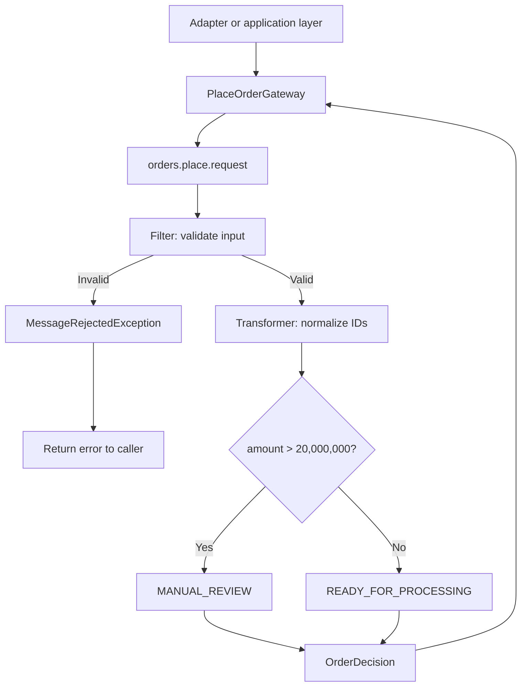

# Organize flows by use case

## 1. Purpose of this organization style

In the **Flow Design** chapter of **SPRING_INTEGRATION_CORE**, organizing flows by use case means taking a specific business goal as the organizing unit of a message flow. The flow name, input contract, output result, and failure handling together describe that goal.

For example, `placeOrderFlow` represents accepting an order placement request. When reading the flow, a developer should be able to answer: who calls it, what data is accepted, which branch is chosen, what the result means, and where errors are returned.

Core Spring Integration components work together within this scope:

- `Message` carries data and processing context.
- `MessageChannel` connects steps or exposes an integration point.
- Endpoints perform transformation, filtering, routing, or handler invocation.
- Gateways provide a contract for calling into the flow.
- Java DSL expresses the order and relationships among steps.

After this lesson, you will be able to define flow boundaries, organize source code by use case, choose connection points between flows, and design tests around business outcomes.

> The package names, bean names, channel names, and monetary thresholds in this lesson are illustrative conventions. Spring Integration does not mandate a specific package layout or a single flow per use case.

## 2. Identify the business unit before writing DSL

### 2.1. Express the goal with a verb and an object

A use case should state the action and outcome that the caller cares about:

| Goal | Possible flow name | Outcome to define |
| --- | --- | --- |
| Accept an order placement request | `placeOrderFlow` | Request ready for processing or requires review |
| Cancel an order | `cancelOrderFlow` | Canceled or rejected based on current state |
| Accept a refund request | `requestRefundFlow` | Accepted or ineligible |
| Reconcile a settlement period | `reconcileSettlementFlow` | Reconciliation outcome and discrepancies |
| Import a partner product catalog | `importPartnerCatalogFlow` | Import summary and rejected lines |

Names like `transformFlow`, `commonFlow`, or `processFlow` make it hard to tell the responsibility. A name like `httpFlow` only tells you the intake transport. They may fit a protocol-adaptation segment, but do not adequately describe a business flow.

A simple test: if you change the request source from HTTP to a message consumer, does the core of the goal remain the same? If yes, let the protocol-intake layer map data into a shared business contract.

### 2.2. Use outcomes and policies to recognize boundaries

Two operations that both touch orders do not necessarily belong in the same flow. Placing an order and canceling an order have different preconditions, outcomes, access permissions, and retry policies. Merging them into one flow that takes `Map<String, Object>` and branches on `action` easily makes the contract ambiguous.

Conversely, validating data and trimming whitespace are two steps of the same request-intake operation. Splitting each step into a public flow can create extra connection points without making the business logic any clearer.

You can rely on the following questions:

1. Does the caller request this operation independently?
2. Does the operation have its own outcome and success criteria?
3. Are timeout, retry, or persistence guarantees different?
4. Does it require separate authorization, operations, or deployment?
5. When changing this operation, which steps usually have to change together?

The answers help you choose among a single endpoint, a subflow, an independent flow, or a multi-flow process. Do not use DSL line count as the sole criterion.

### 2.3. One use case may require multiple physical flows

A catalog-import use case might consist of a file-intake flow, a per-item processing flow, and a result-publishing flow. They serve one goal but have different processing cadences and recovery capabilities.

What must be preserved is a clear model of responsibility: which flow ingests, which flow processes, what data connects them, and at what point success can be confirmed. A configuration class or an `IntegrationFlow` bean does not by itself create a transaction, service, or process boundary.

## 3. Draft a contract for the flow

Before choosing `filter()`, `route()`, or `handle()`, write a short specification for the use case.

The example in this lesson is **accepting and classifying an order placement request**:

| Property | Illustrative contract |
| --- | --- |
| Use case name | `place-order` |
| Caller | Application layer or inbound request adapter |
| Input | `PlaceOrderCommand(requestId, customerId, amount)` |
| Currency | VND per the example convention |
| Preconditions | Both IDs non-blank, amount greater than 0 |
| Normalization | Trim leading and trailing whitespace from both IDs |
| Classification rule | Above 20,000,000 VND requires review |
| Normal outcome | `READY_FOR_PROCESSING` |
| Review-needed outcome | `MANUAL_REVIEW` |
| Invalid data | Throw an error rejecting the message |
| Interaction model | Synchronous request–reply |
| Side effects in example | No database write, no inventory reservation, no review task creation yet |
| Deduplication guarantee | Not yet implemented in the example |

The "side effects" row is especially important. `READY_FOR_PROCESSING` is only a classification decision; it does not mean the order has been persisted. `MANUAL_REVIEW` also does not mean a staff member has received a task yet.

In a production system, if you want to return `ACCEPTED` meaning durably accepted, you must specify which storage operation has completed before returning the result.

### Payload, headers, and identifiers

Put the data needed to understand the business request into the payload. Attributes such as `sourceSystem`, `traceId`, or a use-case label can live in headers if they serve transport and observability.

In the example, `requestId` is in the payload so it becomes part of the contract with the caller. If you use it as an idempotency key in production, you must agree on its uniqueness scope, key retention duration, and behavior when the same key arrives with different content.

Distinguish three roles:

- **Message identifier**: identifies a specific message instance.
- **Business request identifier**: identifies one logical request per the contract.
- **Correlation key**: groups messages belonging to the same processing set.

These roles can share the same value if explicitly designed to do so, but they are not automatically identical. Resending the same request typically creates a new message; creating a new message does not mean side effects are allowed to execute again.

## 4. Sketch the flow before implementing



This diagram highlights an important result: both valid branches produce a reply. The invalid-input branch also intentionally terminates with an error.

From the diagram, you can choose integration patterns:

| Need in the use case | Appropriate component | What to clarify |
| --- | --- | --- |
| Invoke the flow through an interface | Messaging gateway | Input, output, and error types |
| Check condition to proceed | Filter | Behavior on rejection |
| Normalize data | Transformer | Contract before and after transformation |
| Choose processing policy | Router | Complete branches and behavior for unknown cases |
| Invoke business logic | Service activator via `handle()` | Return value and side effects |
| Split one request into parts | Splitter | Part identifiers and part count |
| Combine related results | Aggregator | Correlation key, completion condition, and expiry |

There is no need to force every integration pattern into one flow. In the current example, the router picks one of two branches; there is no collection of results to combine, so no aggregator is needed.

## 5. Organize source code and name connection points

### 5.1. Group parts that change together by use case

A usable structure:

```text
example/
  orders/
    inbound/
      http/
      messaging/
    place/
      PlaceOrderCommand.java
      OrderDecision.java
      PlaceOrderGateway.java
      PlaceOrderFlowConfiguration.java
    cancel/
      CancelOrderCommand.java
      CancelOrderGateway.java
      CancelOrderFlowConfiguration.java
    shared/
      pricing/
      customerlookup/
```

The `place` package groups the contract and orchestration for accepting order placement. Protocol adapters convert external data into `PlaceOrderCommand`. When adding an intake source with the same semantics, that source can call the same gateway.

The `shared` directory should only contain shared capabilities with a stable contract. If two new places share a few lines of normalization, a small Java function is usually enough; there is no need to create another message flow.

This structure does not forbid organizing by technical layers. It helps readers find the entire path of a use case without tracing through an uncontextualized list of transformers, routers, and handlers.

### 5.2. Name by responsibility and scope

| Element | Example | Meaning |
| --- | --- | --- |
| Flow bean | `placeOrderFlow` | Orchestrates the place-order use case |
| Input channel | `orders.place.request` | Receives order placement requests |
| Filter endpoint | `orders.place.validate` | Validates the input contract |
| Normalization endpoint | `orders.place.normalize` | Normalizes already-valid data |
| Routing endpoint | `orders.place.classify` | Selects classification |
| Error flow when needed | `placeOrderErrorFlow` | Handles errors belonging to the use case |

Bean and endpoint names must avoid collisions within the same application context. Using a business prefix makes logs and configuration easier to read.

Expose channels that are intentional integration points. There is no need to assign public names to every internal link created by the DSL. An external consumer depending on a channel between two steps can turn reordering steps or replacing a transformer into a breaking contract change.

## 6. Java DSL example: accepting an order placement request

The example uses **Java 17 and Spring Integration 6.5**, with `spring-integration-core` on the classpath. The tests below require JUnit Jupiter. When using Spring Boot, you can bring in dependencies via the Integration starter and let the application's dependency management align compatible versions.

The following Java files belong to the same `example.orders.place` package. They are sample code for the lesson; you do not need to create an HTTP adapter to observe the flow's behavior.

### 6.1. Declare the data contract

`PlaceOrderCommand.java`:

```java
package example.orders.place;

import java.math.BigDecimal;

public record PlaceOrderCommand(
        String requestId,
        String customerId,
        BigDecimal amount) {
}
```

`OrderDecision.java`:

```java
package example.orders.place;

public record OrderDecision(
        String requestId,
        Status status,
        String reason) {

    public enum Status {
        READY_FOR_PROCESSING,
        MANUAL_REVIEW
    }
}
```

The example fixes the currency to VND to focus on flow design. With a multi-currency contract, you need to represent currency type and rounding rules explicitly rather than inferring units from a bare number.

### 6.2. Expose the entry point via a gateway

`PlaceOrderGateway.java`:

```java
package example.orders.place;

import org.springframework.integration.annotation.MessagingGateway;

@MessagingGateway(
        defaultRequestChannel = "orders.place.request",
        defaultReplyTimeout = "1500")
public interface PlaceOrderGateway {

    OrderDecision place(PlaceOrderCommand command);
}
```

The caller receives a strongly typed interface. The gateway turns the call into a message and retrieves the returned result. This example uses `@Import` to register the gateway interface, a capability supported since Spring Integration 6.0. See [Messaging Gateways](https://docs.spring.io/spring-integration/reference/6.5/gateway.html).

There is no need to declare a public reply channel for the example: the gateway provides the return path via the `replyChannel` mechanism.

### 6.3. Define the flow in business order

`PlaceOrderFlowConfiguration.java`:

```java
package example.orders.place;

import java.math.BigDecimal;

import org.springframework.context.annotation.Bean;
import org.springframework.context.annotation.Configuration;
import org.springframework.context.annotation.Import;
import org.springframework.integration.channel.DirectChannel;
import org.springframework.integration.config.EnableIntegration;
import org.springframework.integration.dsl.IntegrationFlow;

@Configuration(proxyBeanMethods = false)
@EnableIntegration
@Import(PlaceOrderGateway.class)
public class PlaceOrderFlowConfiguration {

    private static final BigDecimal REVIEW_LIMIT =
            new BigDecimal("20000000");

    @Bean(name = "orders.place.request")
    public DirectChannel placeOrderRequest() {
        return new DirectChannel();
    }

    @Bean
    public IntegrationFlow placeOrderFlow() {
        return IntegrationFlow.from("orders.place.request")
                .enrichHeaders(headers ->
                        headers.header("useCase", "place-order"))
                .<PlaceOrderCommand>filter(
                        PlaceOrderFlowConfiguration::isValid,
                        endpoint -> endpoint
                                .id("orders.place.validate")
                                .throwExceptionOnRejection(true))
                .<PlaceOrderCommand, PlaceOrderCommand>transform(
                        command -> new PlaceOrderCommand(
                                command.requestId().strip(),
                                command.customerId().strip(),
                                command.amount()),
                        endpoint -> endpoint
                                .id("orders.place.normalize"))
                .<PlaceOrderCommand, Boolean>route(
                        command -> command.amount()
                                .compareTo(REVIEW_LIMIT) > 0,
                        router -> router
                                .id("orders.place.classify")
                                .subFlowMapping(true, branch -> branch
                                        .handle(PlaceOrderCommand.class,
                                                (command, headers) ->
                                                        new OrderDecision(
                                                                command.requestId(),
                                                                OrderDecision.Status
                                                                        .MANUAL_REVIEW,
                                                                "HIGH_VALUE")))
                                .subFlowMapping(false, branch -> branch
                                        .handle(PlaceOrderCommand.class,
                                                (command, headers) ->
                                                        new OrderDecision(
                                                                command.requestId(),
                                                                OrderDecision.Status
                                                                        .READY_FOR_PROCESSING,
                                                                "STANDARD_POLICY"))))
                .get();
    }

    private static boolean isValid(PlaceOrderCommand command) {
        return command.requestId() != null
                && !command.requestId().isBlank()
                && command.customerId() != null
                && !command.customerId().isBlank()
                && command.amount() != null
                && command.amount().signum() > 0;
    }
}
```

`PlaceOrderCommand` passed to the gateway must be a non-`null` object; the filter checks the object's fields. If external callers can send requests without a payload, the adapter must reject or map that error before calling the gateway.

Read the flow as a business sentence:

1. Receive an order placement request.
2. Tag with the use case for observability.
3. Reject inputs that violate the contract.
4. Normalize the identifiers.
5. Classify by monetary threshold.
6. Return exactly one `OrderDecision`.

The two branches are declared using `subFlowMapping` lambdas. The DSL handles wiring the subflows in this case. For an existing flow bean that needs to be called with a reply to continue processing, consider `.gateway(...)`; do not assume all ways of connecting subflows behave the same. See [Sub-flows support](https://docs.spring.io/spring-integration/reference/6.5/dsl/java-subflows.html).

### 6.4. Why not let the filter silently drop messages?

The gateway has a return type of `OrderDecision`. If the filter drops a message without a return or error path, the caller ends up waiting for a reply that is never produced. `throwExceptionOnRejection(true)` turns rejection into an explicit error in the example. See [Filter](https://docs.spring.io/spring-integration/reference/6.5/filter.html).

Deciding that a valid request needs review is a business outcome, so the router directs it to `MANUAL_REVIEW`. Do not treat "needs review" as invalid data.

In a real API, you might choose to return a `REJECTED` result for invalid input instead of throwing an exception. In that case, you must design a branch that produces the corresponding result and agree on how the adapter maps it; toggling the filter flag alone is not enough.

### 6.5. Separate complex rules from orchestration configuration

The monetary threshold in the example is small enough to express inline. If the rule requires customer history, membership tier, or promotion conditions, move the evaluation into a class such as `OrderAcceptancePolicy`.

The flow continues to express the sequence: validate, normalize, evaluate, route. The policy class computes the decision and can be tested independently. Avoid stuffing database queries, API calls, and lengthy calculations into a lambda simply because the DSL allows writing them there.

When adding persistence, also clarify where saving occurs relative to returning the result. A handler returning `OrderDecision` does not by itself provide durability or deduplication.

## 7. Choosing how to connect flows

### 7.1. Distinguish forwarding from calling and receiving a result

| Connection style | Design meaning | Usage example |
| --- | --- | --- |
| `.channel("...")` | Forward the message to a connection point | Hand off to the next processing step |
| `.gateway("...")` | Invoke an entry point and wait for a reply | Call a pricing capability and continue |
| `.route(...)` | Choose a processing path from a decision | Classify normal vs. review-needed orders |
| Subflow lambda | Express a short branch within the current flow | The two branches in the place-order example |
| Java method call | Execute a local calculation or rule | Normalize IDs, evaluate policy |

Using `.channel("orders.pricing.request")` alone does not create a nested call whose result returns to the next line. If the current flow needs the pricing result to continue, `.gateway(...)` expresses that relationship more clearly. This operator supports calling by channel name, channel object, or an `IntegrationFlow`. See [Operator gateway()](https://docs.spring.io/spring-integration/reference/dsl/java-gateway.html).

When defining a shared flow, specify what type it accepts and what type it returns. If transforming from `OrderContext` into a `PriceQuote`, you must design how to retain or restore the order context needed for subsequent steps.

### 7.2. When should you create a shared subflow?

A capability is a good candidate for sharing when it has:

- Input and output contracts that can be stated independently.
- Consistent semantics across callers.
- Publishable error and timeout policies.
- A reason to participate in the messaging model, such as connecting to an external system.

For example, "get shipping quote" can be a shared flow for both placing and exchanging orders. "Accept order" and "cancel order" should only share appropriate capabilities, without needing to pass through the same generic orchestrator.

If a shared flow has to take multiple flags like `calledFromCancel`, `skipPersist`, or `refundMode`, revisit the contract. Flags often indicate that different goals are being forced into a single processing path.

## 8. Designing the execution and failure model

### 8.1. Channel selection is part of the contract

In the example, `DirectChannel` invokes the handler on the sender's thread. `ExecutorChannel` can hand work off via an executor. `QueueChannel` stores messages for a consumer to pull; an endpoint reading a queue needs an appropriate polling mechanism. Queues store messages in memory by default, offering no persistence across process shutdowns. See [Message Channel Implementations](https://docs.spring.io/spring-integration/reference/channel/implementations.html).

Therefore, replacing a synchronous channel with a queue must be evaluated as a behavioral change:

- At which step does the caller receive acknowledgment?
- How is the final outcome retrieved?
- How is remaining work recovered if the application stops?
- Which transaction do the database operations rely on?

Keeping the same use-case name does not guarantee those answers stay the same after changing the execution model.

### 8.2. Timeouts must attach to the operation being bounded

`defaultReplyTimeout = "1500"` in the example is the gateway's reply wait time in milliseconds. It does not interrupt a handler running synchronously on the same thread. If the handler calls an external system, you must configure client timeouts and failure policies for that call. See the timeout behavior section in [Messaging Gateways](https://docs.spring.io/spring-integration/reference/6.5/gateway.html).

Designing to "respond within 1.5 seconds" requires accounting for total time across steps, resource wait times, and retry counts. Putting one number on the gateway is not enough to guarantee that target.

### 8.3. Error paths must reflect the execution model

With a synchronous path over `DirectChannel`, errors can propagate back to the caller. With framework-managed asynchronous tasks or pollers, errors can be emitted as an `ErrorMessage`; the error path must be configured and observed. The `errorChannel` header and global error channel participate in this mechanism. See [Error Handling](https://docs.spring.io/spring-integration/reference/error-handling.html).

Do not assume all exceptions automatically route to a global error flow. At the same time, an error flow that only logs does not fulfill a request–reply contract if the caller still expects a result.

For each use case, classify:

| Situation | Behavior to define |
| --- | --- |
| Invalid input | Reject with details, no retry |
| Business condition not met | Return the appropriate business decision |
| Transient connection error | Bounded retry if the operation allows it |
| Data or configuration error | Record, alert, and provide a remediation path |
| Unknown whether external operation succeeded | Query status or reconcile by business key |

### 8.4. Side effects need a deduplication policy

Suppose a step to create an order in an external system is added. That system creates the order successfully, but the connection drops before replying. If the entire flow is retried without a deduplication key, a duplicate order can be created.

A design must agree on:

1. A key identifying the same request, such as `(tenantId, requestId)`.
2. How in-progress and completed requests are recorded.
3. Behavior when two duplicates arrive concurrently.
4. How to handle the same key arriving with different content.
5. Ability to look up the outcome in the called system.

An in-memory key set can serve for demonstration, but does not solve recovery across process restarts or concurrent processing across multiple instances.

Similarly, if you both save an order to a database and publish an event, define how to avoid a "saved but not published" state. You may need an outbox design and a redelivery mechanism. Placing two steps next to each other in the DSL does not guarantee both systems commit together.

## 9. When a use case needs a splitter and aggregator

When accepting an order with multiple line items that must each be checked, one design could be:

```text
Order placement request
  -> split line items
  -> check each line
  -> produce one result per line
  -> gather results from the same check run
  -> decide order-level outcome
```

An aggregator holds state for message groups. It needs correlation, a release condition, and an expiration policy; defaults are typically based on correlation and sequence headers. See [Aggregator](https://docs.spring.io/spring-integration/reference/aggregator.html).

The use-case design must additionally answer:

- Does the group key distinguish two separate check runs for the same order?
- Does a rejected line produce a corresponding result?
- When one result is missing, do you return a partial result or report failure?
- How are duplicate or late messages handled?
- Does group state need durable storage and cleanup?

If a splitter creates ten parts but a filter drops two of them, an aggregator waiting for all ten results may never reach completion. Common remedies are having every part emit a structured success or failure result, or redesigning completion and expiration conditions per the contract.

Do not mechanically use `orderId` as the aggregation key. Two evaluations of the same order may need two independent groups, such as a key combining the order ID and evaluation run ID.

## 10. Testing from the use-case contract

### 10.1. Choose meaningful scenarios

Test cases should verify what the caller observes:

| Input or condition | Expectation |
| --- | --- |
| Valid request, amount below threshold | `READY_FOR_PROCESSING` |
| Amount exactly 20,000,000 | Still `READY_FOR_PROCESSING` |
| Amount greater than 20,000,000 | `MANUAL_REVIEW` |
| ID with leading/trailing whitespace | Result contains normalized ID |
| Zero or negative amount | Rejection error |
| Blank ID or missing required field | Rejection error |
| New branch added to router | Defined result or error produced |
| Duplicate with same key when persistence exists | No duplicate side effects per contract |
| External service fails after recording | Clear lookup, retry, or reconciliation behavior |

The last two rows apply when extending the example with side effects. They are not yet guaranteed by the current DSL snippet.

### 10.2. Gateway testing example

The test below creates a Spring context directly without starting Spring Boot or a broker. Each test goes through the real gateway and the flow's endpoints.

```java
package example.orders.place;

import java.math.BigDecimal;

import org.junit.jupiter.api.AfterEach;
import org.junit.jupiter.api.BeforeEach;
import org.junit.jupiter.api.Test;
import org.springframework.context.annotation.AnnotationConfigApplicationContext;
import org.springframework.integration.MessageRejectedException;

import static org.junit.jupiter.api.Assertions.assertEquals;
import static org.junit.jupiter.api.Assertions.assertThrows;

class PlaceOrderFlowTest {

    private AnnotationConfigApplicationContext context;
    private PlaceOrderGateway gateway;

    @BeforeEach
    void setUp() {
        context = new AnnotationConfigApplicationContext(
                PlaceOrderFlowConfiguration.class);
        gateway = context.getBean(PlaceOrderGateway.class);
    }

    @AfterEach
    void tearDown() {
        context.close();
    }

    @Test
    void returnsReadyAtTheBoundaryAndNormalizesRequestId() {
        OrderDecision result = gateway.place(new PlaceOrderCommand(
                " req-101 ",
                " customer-01 ",
                new BigDecimal("20000000")));

        assertEquals("req-101", result.requestId());
        assertEquals(
                OrderDecision.Status.READY_FOR_PROCESSING,
                result.status());
    }

    @Test
    void returnsManualReviewAboveTheBoundary() {
        OrderDecision result = gateway.place(new PlaceOrderCommand(
                "req-102",
                "customer-01",
                new BigDecimal("20000001")));

        assertEquals(OrderDecision.Status.MANUAL_REVIEW, result.status());
        assertEquals("HIGH_VALUE", result.reason());
    }

    @Test
    void rejectsInvalidInputInsteadOfWaitingForAReply() {
        assertThrows(MessageRejectedException.class,
                () -> gateway.place(new PlaceOrderCommand(
                        "req-103",
                        "customer-01",
                        BigDecimal.ZERO)));
    }
}
```

These tests illustrate three core behaviors; they do not replace the full scenario table. When external systems are added, you can substitute the external call points to test the flow within a defined scope. Spring Integration provides modules for mocking and integration test configuration. See [Testing support](https://docs.spring.io/spring-integration/reference/testing.html).

For asynchronous flows, wait for a bounded result or status signal. Avoid using a fixed `sleep` duration to guess that work has finished.

### 10.3. Observability around the same use case

Operational logs and metrics should answer: how many requests entered, how many required review, at which step errors occurred, and how long it took to reach an outcome.

You can use low-cardinality labels like `useCase=place-order`, `outcome=manual-review`. Unique IDs like `requestId` belong in logs or traces; putting them into metric labels usually creates too many metric time series.

When an erroneous request is discovered, operators need to trace the same business identifier across related flows. Clearly scoped endpoint names support this, whereas a single `commonHandler` name usually lacks sufficient context.

## 11. Evolving and splitting flows as requirements change

Suppose the new requirement is: orders requiring review must be recorded as a task and return a tracking ID.

You can proceed in order:

1. **Update the result contract.** Define when a task ID is returned and where that ID can be queried.
2. **Design persistence.** Decide which data must exist before acknowledging intake.
3. **Keep the classification branch.** The router still selects the normal path or the review-needed path.
4. **Add processing on the review branch.** Record the task or hand it off via a mechanism with appropriate guarantees.
5. **Split the flow if needed.** If review work has a long lifecycle, use a separate processing flow with a handoff contract.
6. **Add tests.** Test duplicate sends, storage failures, recovery, and task state.

A process lasting hours generally requires persistent state and a continuation mechanism. Do not keep a synchronous gateway call open just waiting for human approval.

Similarly, when two intake sources share the same business contract, their adapters can share a gateway. If a partner source has different currency semantics, validation rules, or acceptance outcomes, map and design the contract explicitly before merging them.

## 12. Signs you should revisit the design

| Sign | Common consequence | Direction to adjust |
| --- | --- | --- |
| One flow handles every operation via an `action` field | Inputs and outputs are hard to keep consistent | Separate goals that have different contracts |
| Every transformer becomes a public flow | Many channels, hard to follow the path | Keep local steps inline in a flow or Java function |
| Same use case duplicated across multiple adapters | Rules drift inconsistently | Map to a shared business contract where appropriate |
| Filter drops requests when the gateway needs a result | Caller waits until timeout | Return an intentional result or error |
| A router branch only logs | Missing outcome on one path | Define the terminal behavior of each branch |
| Using a queue and returning "processing completed" | Premature confirmation | Distinguish handed off from completed |
| Retry wraps multiple side effects | Can create duplicate records or transactions | Scope retries and use a deduplication key |
| Shared flow has many caller-specific flags | Reuse lacks shared semantics | Split contracts or keep orchestration per use case |
| Deeply nesting subflows just to shorten code | Hard to read, hard to trace error paths | Extract capabilities with explicit contracts |

Before finalizing a flow, make sure you can explain its goal, contract, outcome of every branch, error path, and the exact point where side effects are confirmed. A well-organized flow lets readers map each Spring Integration component to a concrete step of the use case.
