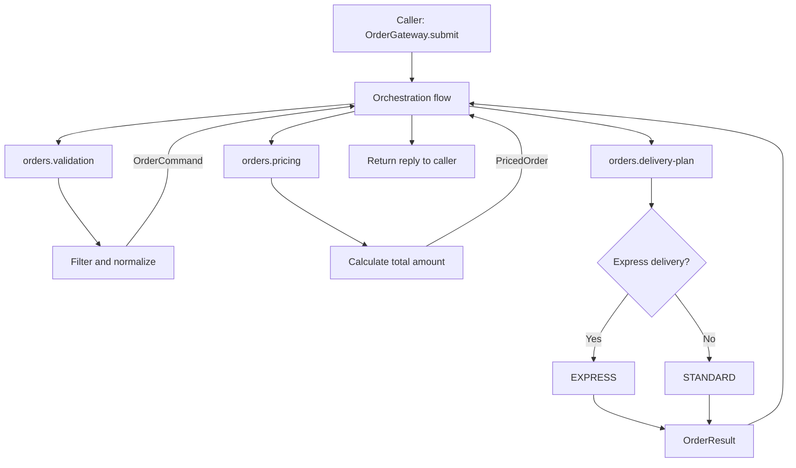

# Avoid overly long flows

## 1. Lesson goal

In the **Flow Design** chapter of the **SPRING_INTEGRATION_CORE** module, this lesson addresses a common problem: an `IntegrationFlow` that starts out readable gradually absorbs all intake, validation, transformation, routing, service invocation, result aggregation, and error handling.

After this lesson, you will be able to:

- Recognize when a flow is taking on too many responsibilities.
- Choose split points based on message contracts and business behavior.
- Distinguish forwarding through a channel from calling a subflow to get a result.
- Keep reply paths, error policies, and execution boundaries clear after splitting.
- Plan tests for integration points rather than only reading each flow in isolation.

The core Spring Integration concepts—Message, MessageChannel, endpoint, gateway, and Java DSL—remain the foundation. Transformers, filters, and routers appear in the main example; splitters and aggregators are examined when choosing boundaries for multi-item processes.

## 2. "Too long" is a comprehensibility problem

There is no maximum endpoint count that applies to every application. A chain of many pure transformations can be easier to understand than a short flow with nested branches, shared mutable state, and calls to multiple external systems.

Instead of merely counting lines, try answering:

1. What does the flow receive and what outcome does it end with?
2. What type does the payload have at each point?
3. How many success, rejection, and error outcomes exist?
4. Which components have side effects?
5. If rerun, which steps might execute twice?
6. Does the caller receive a result or only an intake acknowledgment?

If you have to open several lambdas and trace headers backward just to answer these, the flow already needs review.

| Sign | Difficulty that arises | Direction to consider |
|---|---|---|
| One flow both normalizes input and decides shipping | Changing one rule ripples through many code regions | Split by business stage |
| Router has multiple nested levels of branches | Hard to enumerate all termination paths | Extract large branches into named flows |
| Long lambda containing calculations and repository calls | Configuration obscures business logic | Move logic into a named service or transformer |
| Same group of steps copied across flows | Copies easily drift differently | Create a reusable flow with its own contract |
| One retry policy wraps multiple side effects | Rerun can duplicate actions | Scope retry to the operation that needs recovery |
| Payload is a constantly mutated `Map<String, Object>` | Contract between steps is hidden | Use data types representing processing state |
| Tests can only stand up the entire process | Hard to pinpoint where a failure occurred | Test individual contracts and connection points |

The purpose of splitting is to help readers predict behavior. If someone has to hop through multiple channels named `step1`, `step2`, `step3` just to follow a simple normalization, the new design has missed that purpose.

## 3. Choose boundaries before editing Java DSL

### 3.1. Split by business question

Suppose an application accepts a request to order a single item. The process needs to:

- Validate the request shape and normalize the SKU.
- Calculate the total amount from a price catalog.
- Select standard or express delivery.
- Return the result to the caller.

Three stages can be described:

| Stage | Question the stage resolves | Input | Output |
|---|---|---|---|
| Validation and normalization | Does the request have valid data to process? | `OrderCommand` | Normalized `OrderCommand` |
| Pricing | What is the order's total amount? | `OrderCommand` | `PricedOrder` |
| Delivery planning | Which delivery plan will the order follow? | `PricedOrder` | `OrderResult` |

This is a design choice for the example, not a framework requirement. In another application, validation and normalization could be two separate stages if they have different reasons to change.

### 3.2. Document the contract at each connection point

A named channel only gives an address. The connection point's contract should additionally explain:

| Property | Example for the pricing stage |
|---|---|
| Request channel | `orders.pricing` |
| Input payload | `OrderCommand` with normalized SKU |
| Business headers to preserve | `tenantId`, `traceId` if used by the system |
| Success outcome | Exactly one `PricedOrder` |
| Missing data case | Unpriced SKU produces an error |
| Side effects | None in this example |
| Invocation style | Request–reply via gateway |
| Execution | Synchronous over `DirectChannel` |
| Recovery policy | Do not automatically retry missing-price errors |

Explicitly stating "exactly one result" prevents a common design flaw: the caller waits for a reply while a subflow has a path ending in `void`, `null`, or dropping the message.

### 3.3. Extract a service or extract a flow?

Not every long block of code needs a new `IntegrationFlow`.

- If the block only computes over an object, consider a plain Java method or service.
- If the block coordinates filters, routers, adapters, or multiple endpoints, a separate flow can help.
- If you only need a clear name for a few repeated configuration steps, you can extract a method returning an `IntegrationFlow`.
- If you need a stable entry point used by multiple flows, expose a channel and its contract.

A service such as `PriceCalculator` does not need to know about `MessageChannel`. The flow is responsible for wiring, while the service is responsible for pricing. Consequently, you can test pricing rules without standing up messaging infrastructure.

## 4. Choose the right way to connect

### 4.1. Forwarding with a channel

```java
@Bean
IntegrationFlow intakeFlow() {
    return IntegrationFlow.from("orders.in")
            .channel("orders.validation")
            .get();
}
```

Here the message is forwarded to `orders.validation`. This example does not create a subflow call with a return point in `intakeFlow`. Downstream handling is determined by that channel's consumer.

If the entire pipeline simply moves forward toward one destination, such forwarding may suffice. An external caller can still receive a reply if the final processing path preserves the reply mechanism; `.channel(...)` itself does not build a nested request–reply round trip.

### 4.2. Calling a subflow with gateway

```java
@Bean
IntegrationFlow orchestrationFlow() {
    return IntegrationFlow.from("orders.in")
            .gateway("orders.validation")
            .gateway("orders.pricing")
            .gateway("orders.delivery-plan")
            .get();
}
```

The `.gateway(...)` operator sends a request to another flow's entry point, receives the reply, and resumes in the calling flow. This approach fits when a stage produces a result needed by the next stage. Spring Integration supports calling by channel name, channel object, or `IntegrationFlow` reference. [Operator gateway() Documentation](https://docs.spring.io/spring-integration/reference/dsl/java-gateway.html).

There is no need to add a gateway at every channel. Only use it when a call–reply relationship accurately expresses the contract.

### 4.3. Keep small branches inline, extract large branches

A short two-branch router can live right inside the flow:

```java
.route(PricedOrder.class, p -> p.order().express(), mapping -> mapping
        .subFlowMapping(true, branch -> branch
                .handle(PricedOrder.class,
                        (p, headers) -> plan(p, "EXPRESS")))
        .subFlowMapping(false, branch -> branch
                .handle(PricedOrder.class,
                        (p, headers) -> plan(p, "STANDARD"))))
```

If each branch grows into multiple steps, you can keep the router as a decision map:

```java
.route(PricedOrder.class, p -> p.order().express(), mapping -> mapping
        .subFlowMapping(true, branch -> branch
                .gateway("orders.express-plan"))
        .subFlowMapping(false, branch -> branch
                .gateway("orders.standard-plan")))
```

The snippets above are alternatives at the router position; they are not configurations that run together. In the second option, both target channels need processing flows that return an `OrderResult`.

A subflow declared inline via a lambda is wired by the DSL so its result returns to the next part of the flow. When referencing an existing flow and needing to continue with its reply, use an appropriate gateway. Do not assume every router `channelMapping` automatically returns. Spring documentation also advises against nesting subflows too deeply. [Sub-flows support documentation](https://docs.spring.io/spring-integration/reference/dsl/java-subflows.html).

## 5. Complete example: splitting a process into three stages

### 5.1. Assumptions and diagram

The example uses Java 17 or later and Spring Integration 6.x Java DSL syntax. It requires a compatible version of `org.springframework.integration:spring-integration-core` in the project. No broker, database, or HTTP server is required.

The price catalog is kept in memory to focus on how flows are split. "Delivery planning" only constructs response data without calling a carrier or persisting an order.



The arrows returning to the orchestration flow represent call–reply relationships. This is not a retry loop over the order.

### 5.2. Java configuration

Save the following example code into `OrderFlowConfig.java` in a practice project:

```java
import java.math.BigDecimal;
import java.util.Locale;
import java.util.Map;

import org.springframework.context.annotation.AnnotationConfigApplicationContext;
import org.springframework.context.annotation.Bean;
import org.springframework.context.annotation.Configuration;
import org.springframework.integration.channel.DirectChannel;
import org.springframework.integration.config.EnableIntegration;
import org.springframework.integration.dsl.IntegrationFlow;
import org.springframework.messaging.MessageChannel;

@Configuration(proxyBeanMethods = false)
@EnableIntegration
public class OrderFlowConfig {

    private static final String VALIDATION = "orders.validation";
    private static final String PRICING = "orders.pricing";
    private static final String DELIVERY_PLAN = "orders.delivery-plan";

    private static final Map<String, BigDecimal> PRICES = Map.of(
            "BOOK", new BigDecimal("120000"),
            "PEN", new BigDecimal("15000"));

    public record OrderCommand(
            String orderId,
            String sku,
            int quantity,
            boolean express) {
    }

    public record PricedOrder(OrderCommand order, BigDecimal total) {
    }

    public record OrderResult(
            String orderId,
            BigDecimal total,
            String deliveryMethod) {
    }

    public interface OrderGateway {
        OrderResult submit(OrderCommand command);
    }

    @Bean(name = VALIDATION)
    MessageChannel validationChannel() {
        return new DirectChannel();
    }

    @Bean(name = PRICING)
    MessageChannel pricingChannel() {
        return new DirectChannel();
    }

    @Bean(name = DELIVERY_PLAN)
    MessageChannel deliveryPlanChannel() {
        return new DirectChannel();
    }

    @Bean
    IntegrationFlow orderFlow() {
        return IntegrationFlow
                .from(OrderGateway.class, proxy -> proxy
                        .beanName("orderGateway")
                        .replyTimeout(3000))
                .gateway(VALIDATION, endpoint -> endpoint
                        .id("orders.call-validation")
                        .replyTimeout(1000L)
                        .requiresReply(true))
                .gateway(PRICING, endpoint -> endpoint
                        .id("orders.call-pricing")
                        .replyTimeout(1000L)
                        .requiresReply(true))
                .gateway(DELIVERY_PLAN, endpoint -> endpoint
                        .id("orders.call-delivery-plan")
                        .replyTimeout(1000L)
                        .requiresReply(true))
                .get();
    }

    @Bean
    IntegrationFlow validationFlow() {
        return IntegrationFlow.from(VALIDATION)
                .filter(OrderCommand.class, OrderFlowConfig::valid,
                        endpoint -> endpoint
                                .id("orders.validate")
                                .throwExceptionOnRejection(true))
                .transform(OrderCommand.class, OrderFlowConfig::normalize,
                        endpoint -> endpoint.id("orders.normalize"))
                .get();
    }

    @Bean
    IntegrationFlow pricingFlow() {
        return IntegrationFlow.from(PRICING)
                .transform(OrderCommand.class, OrderFlowConfig::price,
                        endpoint -> endpoint.id("orders.calculate-total"))
                .get();
    }

    @Bean
    IntegrationFlow deliveryPlanFlow() {
        return IntegrationFlow.from(DELIVERY_PLAN)
                .route(PricedOrder.class, p -> p.order().express(),
                        mapping -> mapping
                                .subFlowMapping(true, branch -> branch
                                        .handle(PricedOrder.class,
                                                (p, headers) -> plan(p, "EXPRESS"),
                                                endpoint -> endpoint
                                                        .id("orders.express-plan")
                                                        .requiresReply(true)))
                                .subFlowMapping(false, branch -> branch
                                        .handle(PricedOrder.class,
                                                (p, headers) -> plan(p, "STANDARD"),
                                                endpoint -> endpoint
                                                        .id("orders.standard-plan")
                                                        .requiresReply(true))))
                .bridge()
                .get();
    }

    private static boolean valid(OrderCommand command) {
        return command.orderId() != null
                && !command.orderId().isBlank()
                && command.sku() != null
                && !command.sku().isBlank()
                && command.quantity() > 0;
    }

    private static OrderCommand normalize(OrderCommand command) {
        return new OrderCommand(
                command.orderId().strip(),
                command.sku().strip().toUpperCase(Locale.ROOT),
                command.quantity(),
                command.express());
    }

    private static PricedOrder price(OrderCommand command) {
        BigDecimal unitPrice = PRICES.get(command.sku());
        if (unitPrice == null) {
            throw new IllegalArgumentException(
                    "No price configured for SKU: " + command.sku());
        }
        BigDecimal total = unitPrice.multiply(
                BigDecimal.valueOf(command.quantity()));
        return new PricedOrder(command, total);
    }

    private static OrderResult plan(PricedOrder priced, String method) {
        return new OrderResult(
                priced.order().orderId(),
                priced.total(),
                method);
    }

    public static void main(String[] args) {
        try (var context =
                     new AnnotationConfigApplicationContext(OrderFlowConfig.class)) {
            OrderGateway gateway = context.getBean(OrderGateway.class);
            OrderResult result = gateway.submit(
                    new OrderCommand(" O-100 ", " book ", 2, true));
            System.out.println(result);
        }
    }
}
```

### 5.3. Reading the example by contract

`IntegrationFlow.from(OrderGateway.class, ...)` registers a gateway proxy named `orderGateway` and creates the entry point for the orchestration flow. This example uses DSL-based registration, so there is no need to simultaneously declare another `@MessagingGateway` for the same interface. The `replyTimeout` option on `GatewayProxySpec` is in milliseconds. [GatewayProxySpec API](https://docs.spring.io/spring-integration/api/org/springframework/integration/dsl/GatewayProxySpec.html).

The orchestration flow only expresses business order. It does not need to know where the price table is stored or how the express delivery branch computes its plan.

`validationFlow` receives `OrderCommand`, rejects malformed requests, and normalizes valid ones. The filter is configured with `throwExceptionOnRejection(true)` so rejection produces an observable error. Simply dropping the message in a process awaiting a reply can leave the caller waiting until timeout. [Filter Documentation](https://docs.spring.io/spring-integration/reference/filter.html).

`pricingFlow` converts `OrderCommand` into `PricedOrder`. Changing the payload type helps express that the pricing stage has completed.

`deliveryPlanFlow` picks a branch, produces an `OrderResult`, and then forwards the result through the bridge at the end of the flow along the reply path. A service activator returning a result can use the `replyChannel` header when no output channel is specified. [Service Activator Documentation](https://docs.spring.io/spring-integration/reference/service-activator.html).

The sample call produces the following data result:

```text
orderId = O-100
total = 240000
deliveryMethod = EXPRESS
```

### 5.4. Shorter flows that preserve the same process

Before splitting, all steps might sit in a single chain:

```text
receive request → validate → normalize → price → choose branch → build reply
```

After splitting, the same work still exists. The helpful change is that each stage has a name, input type, output type, and clear termination path. You can replace the pricing logic without reading through the entire router.

`requiresReply(true)` on the gateway is a guard that detects when the gateway fails to produce a result to pass onward. It does not synthesize a reply on behalf of a subflow. Handlers required to produce a result must still avoid returning `null` or be configured to require a reply on the handler itself. [GatewayEndpointSpec API](https://docs.spring.io/spring-integration/api/org/springframework/integration/dsl/GatewayEndpointSpec.html).

## 6. Splitting flows does not automatically create new operational boundaries

### 6.1. Channels determine delivery semantics

| Connection | Execution characteristics to understand |
|---|---|
| `DirectChannel` | Invokes consumer on the sending thread |
| `ExecutorChannel` | Offloads dispatching to an executor; same thread is not guaranteed |
| `QueueChannel` | Buffers messages; endpoints reading the queue need a poller |
| `PublishSubscribeChannel` | Broadcasts messages to subscribers; an executor is a separate option |

Queues hold messages in memory by default. A channel with multiple subscribers also does not automatically act as a sequence of steps running one after another. [MessageChannel Implementations Documentation](https://docs.spring.io/spring-integration/reference/channel/implementations.html).

In the example, all three channels are `DirectChannel`. Splitting into four `IntegrationFlow` beans organizes the code, but does not turn the stages into parallel tasks.

If you later replace the pricing channel with a queue, treat that as a behavioral change requiring its own design. You must answer: who polls, what happens when the queue is full, must messages be durable, who receives errors, and does the caller still wait for the price in the initial request?

### 6.2. Reply timeout is not an execution interruption mechanism

The `replyTimeout` values in the example are wait budgets at the gateway, not enforced execution limits for the entire process.

In a synchronous chain, a slow handler still holds the calling thread. Reply timeout does not interrupt that handler. When handing off across threads, reply wait time takes on a distinct role; late replies still need to be handled according to the design. [Messaging Gateway Timeout Behavior](https://docs.spring.io/spring-integration/reference/gateway.html#gateway-behavior-no-response).

Therefore, when replacing the in-memory price table with an HTTP client, set timeouts on the HTTP client. If using JDBC, configure appropriate timeouts at the data-access layer. Summing the three gateway timeout values is not enough to prove total processing time will stay under three seconds.

### 6.3. Splitting beans does not automatically create transactions

The example declares no transactions. The price map and records need no transaction.

In a real workflow, explicitly map data-write operations and where transactions begin before splitting. Running on the same thread may be a prerequisite for thread-bound transaction mechanisms, but proper transaction configuration and participating resources are still required.

If you want to place a queue between "save order" and "send shipping request", design an intermediate state. For instance, the order can be saved with status `PENDING_DISPATCH` and then forwarded via a mechanism with appropriate guarantees. Adding a channel does not by itself guarantee both operations succeed together.

## 7. Preserve the Message contract when changing payloads

An understandable flow clearly conveys both business data and processing metadata.

In the example:

- `OrderCommand` holds the caller's request data.
- `PricedOrder` represents the pricing result.
- `OrderResult` is the externally returned result.

In a multi-tenant application, `tenantId` may be a required header at every stage. In a workflow requiring tracing, a stable business request ID links processing attempts together.

`Message` consists of a payload and headers; the headers structure is read-only. When manually building a new message, proactively retain needed metadata. The following snippet illustrates changing the payload and copying headers with `MessageBuilder`. [Message Documentation](https://docs.spring.io/spring-integration/reference/message.html).

```java
import org.springframework.messaging.Message;
import org.springframework.messaging.support.MessageBuilder;

// Used in a scope where OrderCommand and normalize() are available.
private static Message<OrderCommand> normalizeMessage(
        Message<OrderCommand> input) {

    return MessageBuilder
            .withPayload(normalize(input.getPayload()))
            .copyHeaders(input.getHeaders())
            .build();
}
```

This snippet is an extra illustration for constructing a `Message` manually; it does not need to be inserted into the main configuration, which simply returns the payload from a transformer.

Document headers belonging to the business contract separately, such as `tenantId` or `requestId`. At the same time, do not arbitrarily strip control metadata like `replyChannel`, `errorChannel`, or grouping metadata in splitter–aggregator flows.

Do not use `MessageHeaders.ID` as a business deduplication key. Choose an application-managed key, such as `orderId` combined with operation type, with explicit uniqueness rules.

When messages cross a broker or an out-of-process protocol, redesign header mapping and serialization. Do not treat an in-memory channel object as a reply address that can be passed verbatim to another application.

## 8. Keep error paths clear after splitting

### 8.1. Each stage needs explicit failure behavior

In the example, scenarios are designed as follows:

| Situation | Detection point | Expected behavior |
|---|---|---|
| `quantity <= 0` | Validation filter | Reject with an exception |
| Null or blank SKU | Validation filter | Reject before normalization |
| Unpriced SKU | Pricing transformer | Produce an error; do not build a delivery plan |
| Valid order | Processing stages | Return exactly one `OrderResult` |
| Handler requiring a reply returns null | Corresponding endpoint or calling gateway | Report a reply contract violation per configuration |

Exceptions may be wrapped by the framework in a messaging exception. When writing tests, distinguish the outermost exception from the underlying business cause rather than assuming the caller always receives the exact exception class thrown by the pricing method verbatim.

An alternative for invalid data is returning `RejectedOrder` as a business result. If you choose that approach, update the gateway contract and subsequent stages to distinguish accepted results from rejections. You cannot simply switch the filter to "drop" and keep assuming every request will produce an `OrderResult`.

### 8.2. Do not assume all errors flow to a shared errorChannel

Errors from a synchronous handler on the sending thread typically propagate back to the caller. When the framework executes asynchronous tasks or pollers, the `ErrorMessage` publishing mechanism plays a different role; the `errorChannel` header and default error channel participate in routing as configured. [Error Handling Documentation](https://docs.spring.io/spring-integration/reference/7.0/error-handling.html).

Thus, naming a flow `pricingFlow` does not create a dedicated error channel for it. If you want a gateway error channel to turn errors into results, the error-handling flow must produce a reply of a type the caller accepts.

If an error flow only logs, make it explicit whether the caller receives an exception, no reply, or another business outcome. Silence from a logging handler is not equivalent to the original request succeeding.

### 8.3. Scope retries by operation, not flow length

Suppose the process later adds:

```text
hold funds → record order → create shipment → send notification
```

If "send notification" fails and the entire process reruns, earlier steps can repeat. Splitting into multiple flows makes steps visible, but does not automatically eliminate that risk.

A design should record:

| Operation | Question before retrying |
|---|---|
| Fetch price from external service | Transient failure or nonexistent SKU? |
| Hold funds | Does the payment provider support an idempotency key? |
| Record order | Is there a unique constraint on request ID? |
| Create shipment | Can you query an already-created request before resending? |
| Send notification | Does the system tolerate duplicate sends or need deduplication? |

In the current example, "no price configured for SKU" is a data or catalog configuration error. Retrying repeatedly will not make the SKU appear. This is why recovery policy must be tied to specific failure causes.

## 9. Choosing boundaries for splitter and aggregator

A flow processing a list often grows long in a different way:

```text
receive multi-line order
→ split into line items
→ validate and price each line
→ aggregate into order result
→ plan delivery
```

When splitting this flow, keep the unit of work clear. "One line item" and "one order" are two distinct contracts.

You can organize it as:

```text
orderFlow
    split
    call linePricingFlow for each line
    aggregate
    plan delivery

linePricingFlow
    validate one line
    price one line
    return one line result
```

This is a design sketch, not complete DSL code. You must configure correlation, release conditions, timeouts, and incomplete-group handling suited to the business rules.

Keeping the splitter and aggregator in the same orchestration flow usually helps readers see the group scope. If they must live in separate flows, state explicitly:

- Which metadata links items belonging to the same order.
- When a group is considered complete.
- Whether a rejected line produces a line-level failure result or cancels the whole order.
- Whether partial results are acceptable.
- Who is responsible for cleaning up state for incomplete groups.

Do not add an aggregator just to "rejoin" split flows. A request–reply chain processing a single message, such as the single-item order example, needs no aggregation step.

## 10. Testing contracts and connection points

This section describes how to test the design in a practice project. Having example code and expected outcomes in an article does not mean the code has been run in your environment.

### 10.1. Three test levels with distinct goals

| Level | Target | Evidence to obtain |
|---|---|---|
| Pure logic | Normalization, pricing, plan selection | Data rules produce correct outputs |
| Single-stage flow | Validation, pricing, delivery plan | Correct message types and error behavior |
| Full workflow | `OrderGateway.submit` | Connection points and reply path work together |

Pure-logic tests do not catch miswired channels. Passing individual flow tests also does not prove the orchestration flow consumes the previous stage's output correctly.

### 10.2. Recommended test cases

| Input or condition | Expectation |
|---|---|
| `O-100, " book ", 2, true` | `O-100, 240000, EXPRESS` |
| `O-101, "PEN", 3, false` | `O-101, 45000, STANDARD` |
| Quantity 0 | Rejected at validation |
| Whitespace-only SKU | Rejected before pricing |
| SKU `UNKNOWN` | Unpriced SKU error; no delivery result created |
| Call pricing with normalized command | Receive `PricedOrder` with correct total |
| Subflow requires reply but produces none | Contract violation detected per timeout/requiresReply config |
| Business header passed in | Header remains present wherever required by the contract |

For monetary calculations, tests should compare `BigDecimal` values according to the system's scale policy. In this example, the price table uses whole VND amounts.

### 10.3. Calling a flow entry point directly

You can test the pricing flow in isolation by sending a message with a reply channel. The snippet below goes inside a scope with an application context and the types of `OrderFlowConfig`:

```java
import org.springframework.integration.channel.QueueChannel;
import org.springframework.messaging.Message;
import org.springframework.messaging.MessageChannel;
import org.springframework.messaging.support.MessageBuilder;

// context is an initialized AnnotationConfigApplicationContext.
MessageChannel pricing = context.getBean(
        "orders.pricing", MessageChannel.class);

QueueChannel replies = new QueueChannel(1);

var command = new OrderFlowConfig.OrderCommand(
        "O-200", "BOOK", 2, false);

Message<?> request = MessageBuilder
        .withPayload(command)
        .setReplyChannel(replies)
        .build();

boolean sent = pricing.send(request, 1000);
if (!sent) {
    throw new AssertionError("Failed to send pricing request");
}

Message<?> reply = replies.receive(1000);
if (reply == null) {
    throw new AssertionError("Did not receive pricing reply");
}

if (!(reply.getPayload() instanceof OrderFlowConfig.PricedOrder priced)) {
    throw new AssertionError("Unexpected payload type");
}

if (priced.total().compareTo(new BigDecimal("240000")) != 0) {
    throw new AssertionError("Unexpected total amount");
}
```

`QueueChannel` here is solely where the test receives the reply. It does not turn the `orders.pricing` channel in the main configuration into a queue. Because the request channel is still a `DirectChannel`, the timeout parameter on `send` does not bound how long the pricing method runs.

When adding queues or executors to production configuration, add tests for asynchronous handoffs, errors, and late replies. Never use a fixed `Thread.sleep` to prove a message has been processed; wait for a concrete result or state with a bounded timeout.

## 11. How to split an existing flow while preserving behavior

### Step 1: Enumerate termination paths

List current outcomes: success, rejected data, external service failure, and timeout. Identify what the caller receives in each case.

For long flows, this step also uncovers branches that accidentally terminate without a reply.

### Step 2: Track payloads and side effects

Mark the payload type after each transformer. Separately list database writes, payment calls, shipment creation, or event publications.

If a lambda both transforms data and calls an external system, clarify its contract before moving it to another flow.

### Step 3: Pick a stage with an easy-to-define contract

A group of pure operations like normalization followed by pricing is an easy starting candidate. Document inputs, outputs, headers, and errors this stage can emit.

Do not start by dividing evenly by line count.

### Step 4: Create a named entry point

For example, choose `orders.pricing` instead of `flow.part2`. Verify the name is not used for another function and has an appropriate consumer.

Channel names should express the work type or message type. Endpoint names can describe concrete actions such as `orders.calculate-total`.

### Step 5: Choose forwarding or gateway

If the process only hands off and ends in the current flow, forwarding via a channel may suffice.

If you need the result to continue processing in the calling flow, use an explicit request–reply relationship. Do not replace `.gateway(...)` with `.channel(...)` just because both accept a channel name.

### Step 6: Verify observable behavior

Compare results and errors at the public entry point before and after splitting. For operations with side effects, verify execution count and rerun behavior.

Keep flow-organization changes separate from changes to algorithms, pricing, or protocols to make evaluation easier.

### Step 7: Review the whole after each split

Read the orchestration flow like a business description. Then read the extracted flow on its own and check whether it can be explained in one clear sentence.

Only keep creating new flows when a meaningful boundary emerges. The goal is not to make all beans the same length.

## 12. "Shortcuts" that increase confusion

### 12.1. Hiding the entire process inside one handler

```java
.handle(orderProcessor, "processEverything")
```

The DSL line is very short, yet it may hide routing, retries, HTTP calls, and data writes inside one huge method. This approach only helps if that service genuinely has one clear responsibility and coordination logic is well-managed inside.

Evaluate the explainability and testability of the whole design, not just the shape of the DSL chain.

### 12.2. Creating a channel for every assignment

A chain like `trim.in → uppercase.in → defaults.in → rename.in` can force readers to jump across many beans for a single normalization operation.

If transformations always travel together and share a reason to change, a well-named transformer or service is easier to follow.

### 12.3. Splitting branches while still sharing mutable state

Two short flows mutating the same large object can depend on an implicit ordering. When parallel processing is added, this design becomes even harder to control.

Prefer objects that represent explicit output states. The records in the example hold simple values and are not mutated after creation.

### 12.4. Creating call cycles between flows

```text
orderFlow → pricingFlow → orderFlow
```

Without clear termination conditions and a state model, this cycle can cause recursion or message loops. Giving a flow a new name does not make circular dependencies safe.

An orchestration flow should call stages with distinct responsibilities; a stage should not loop back to the original entry point just to reuse a few steps.

### 12.5. Switching to asynchronous just to make the flow look tidy

Queues and executors are useful when buffering, throttling, or decoupling execution time is needed. They also require decisions about errors, throughput capacity, and responses.

If the current need is simply easier-to-read and maintainable code, split synchronous `IntegrationFlow`s first. Add asynchrony when a concrete operational requirement calls for it.

## 13. When should you keep a single flow intact?

A flow should remain contiguous if:

- Every step serves a single, easily stated responsibility.
- Success and failure paths are both clear.
- Logic in each endpoint is small enough or already placed in an appropriate service.
- The payload contract is easy to follow.
- There is no need yet for reuse or separate execution policies.
- Splitting further only creates intermediate addresses without clarifying business logic.

For example, a flow that "receives string → drops blank strings → normalizes → returns string" does not necessarily need four beans.

For the ordering process in this lesson, a useful measure is: a maintainer reads the orchestration flow to learn the business sequence, reads each subflow to learn that stage's contract, and tests through the gateway to prove the connection points work properly.
