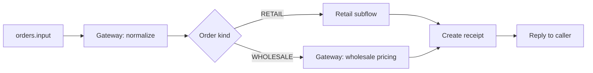

# Split flows with subflows

In the **Flow Design** chapter of the **SPRING_INTEGRATION_CORE** module, splitting a flow with subflows is a way to organize a message flow into parts with clear responsibilities. The parent flow expresses the business processing sequence; a subflow executes one branch or a shared capability such as data normalization, pricing, or handling discarded messages.

The key to grasp is **the Message path and the reply path**. Moving a few lines of Java DSL into another method only helps code layout. For the parent flow to continue properly, you must determine what payload the subflow receives, what payload it returns, whether it may end without replying, and who handles errors.

The examples below use **Java 17 and Spring Integration 6.2**, with `IntegrationFlow` in `org.springframework.integration.dsl`. The configuration needs `spring-integration-core`; the test example additionally needs JUnit Jupiter. Dependency versions are managed by your study project. Code blocks explicitly state that they are snippets to place in the corresponding configuration.

After this lesson, learners will be able to:

- Choose subflow boundaries based on responsibilities and message contracts.
- Distinguish an inline router subflow from a shared flow invoked via `gateway()`.
- Preserve the reply path when combining transformers, routers, and filters.
- Recognize the impact of channels, timeouts, errors, and aggregators on the parent flow's ability to continue.
- Test a subflow independently and test end-to-end flow behavior through `MessageChannel`.

## 1. A subflow is part of the message processing graph

An `IntegrationFlow` describes endpoints and channels that Spring registers and wires in the application context. Java DSL lambdas are used to build configuration; they are not re-invoked like a Java function per message. At runtime, Messages flow among the configured components. See the model in [IntegrationFlow API](https://docs.spring.io/spring-integration/docs/6.2.6/api/org/springframework/integration/dsl/IntegrationFlow.html).

For an order problem, you can organize it as:



The diagram depicts the logical path. The two branches entering the receipt creation step are **two alternatives**, not two tasks running concurrently and waiting for each other. Each valid order goes through only one branch.

There are two common contracts:

| Contract | Meaning | Example |
| --- | --- | --- |
| Request–reply | Send a request, receive a result, and continue | Order normalization, pricing |
| One-way | Deliver the message to a destination and end that path | Recording rejection events, sending notifications |

Calling something a subflow does not by itself decide its contract. A router branch, a discard branch, and a flow called via a gateway can each have different termination semantics.

## 2. Choose the right splitting approach

| Design need | Organization style | What to specify |
| --- | --- | --- |
| Short branch relevant only at a single router | `subFlowMapping(key, sf -> ...)` | Payload type returned to the step after the router |
| Capability used by multiple flows | `IntegrationFlow` bean with its own input channel, invoked via `gateway()` | Request–reply contract and timeouts |
| Long configuration segment used in only one flow | Private method returning `IntegrationFlow`, composed via appropriate operator | Whether a public input channel is needed |
| Hand off to an independent processing destination | `channelMapping()` or send to a channel | Who owns subsequent processing |
| Handle messages rejected by a filter | `discardFlow()` or `discardChannel()` | Whether to intentionally terminate or produce a rejection result |
| Broadcast the same event to multiple parties | `publishSubscribeChannel()` and subscribers | Number of receiving branches and how results are collected if needed |

An inline `subFlowMapping()` lets a branch's output rejoin the flow after the router. When reusing an `IntegrationFlow` bean inside a branch and needing its reply to continue, invoke that bean via `gateway()`. This mechanism is described in [Sub-flows support](https://docs.spring.io/spring-integration/reference/6.2/dsl/java-subflows.html).

Do not extract every transformer into its own flow. If a transformation is one line long and used only in one place, keeping it in the parent flow is usually easier to read. Good boundaries typically have a business name, a distinct contract, or a clear reuse need.

## 3. Write the contract before writing Java DSL

Suppose the system accepts retail and wholesale orders, with the following conventions for the example:

- `orderId` and `customerId` must be non-blank; after normalization they are trimmed and uppercased.
- `kind` accepts only `RETAIL` or `WHOLESALE`.
- `amount` is a whole-number VND amount and must be greater than 0.
- Retail fee is 30,000 VND; wholesale fee is 0 VND.
- Valid orders return exactly one receipt; invalid data raises an error.

Component contracts:

| Processing part | Input payload | Output payload | Headers to preserve | On failure |
| --- | --- | --- | --- | --- |
| Normalization | `OrderRequest` | Normalized `OrderRequest` | `requestId`, reply/error context | Throw validation error |
| Retail branch | `OrderRequest` | `PricedOrder` | `requestId` | Propagate calculation error |
| Wholesale flow | Validated `OrderRequest` | `PricedOrder` | `requestId`, reply/error context | Propagate calculation error |
| Receipt creation | `PricedOrder` | `OrderReceipt` | `requestId` | Fail if total overflows `long` |

Both branches return `PricedOrder`, so the step after the router needs only a single conversion to `OrderReceipt`. If one branch returned `String` and the other returned `OrderRequest`, the parent flow would have to know branch-specific details and would easily run into type errors.

`order.wholesale.input` in the example is an internal entry point intended for already-normalized data. If you want to expose this input to other callers, add validation right at that boundary or move validation into a shared component.

## 4. Complete example: one parent flow, two subflows, and a shared caller

Place the configuration below in `OrderFlows.java` under package `example.subflow` in a project with the dependencies listed at the beginning. The example uses plain Spring configuration to clearly show the core components without depending on Spring Boot auto-configuration.

```java
package example.subflow;

import java.util.Locale;

import org.springframework.context.annotation.Bean;
import org.springframework.context.annotation.Configuration;
import org.springframework.integration.config.EnableIntegration;
import org.springframework.integration.dsl.IntegrationFlow;

@Configuration(proxyBeanMethods = false)
@EnableIntegration
public class OrderFlows {

    public enum OrderKind {
        RETAIL, WHOLESALE
    }

    public record OrderRequest(
            String orderId,
            String customerId,
            OrderKind kind,
            long amount) {
    }

    public record PricedOrder(
            String orderId,
            String customerId,
            OrderKind kind,
            long amount,
            long fee) {
    }

    public record OrderReceipt(
            String orderId,
            long total,
            String status) {
    }

    @Bean
    public IntegrationFlow normalizeOrderFlow() {
        return IntegrationFlow.from("order.normalize.input")
                .<OrderRequest>handle(
                        (order, headers) -> normalize(order),
                        endpoint -> endpoint.requiresReply(true))
                .get();
    }

    @Bean
    public IntegrationFlow wholesalePricingFlow() {
        return IntegrationFlow.from("order.wholesale.input")
                .<OrderRequest, PricedOrder>transform(
                        order -> price(order, 0L))
                .get();
    }

    @Bean
    public IntegrationFlow orderProcessingFlow() {
        return IntegrationFlow.from("orders.input")
                .gateway("order.normalize.input", gateway -> gateway
                        .requestTimeout(500L)
                        .replyTimeout(1_000L)
                        .errorOnTimeout(true))
                .<OrderRequest, OrderKind>route(OrderRequest::kind,
                        router -> router
                                .channelKeyFallback(false)
                                .subFlowMapping(OrderKind.RETAIL,
                                        retail -> retail
                                                .<OrderRequest, PricedOrder>
                                                        transform(order ->
                                                                price(order, 30_000L)))
                                .subFlowMapping(OrderKind.WHOLESALE,
                                        wholesale -> wholesale
                                                .gateway("order.wholesale.input",
                                                        gateway -> gateway
                                                                .requestTimeout(500L)
                                                                .replyTimeout(1_000L)
                                                                .errorOnTimeout(true))))
                .<PricedOrder, OrderReceipt>transform(order ->
                        new OrderReceipt(
                                order.orderId(),
                                Math.addExact(order.amount(), order.fee()),
                                "ACCEPTED"))
                .get();
    }

    @Bean
    public IntegrationFlow orderLabelFlow() {
        return IntegrationFlow.from("orders.labels.input")
                .gateway("order.normalize.input", gateway -> gateway
                        .requestTimeout(500L)
                        .replyTimeout(1_000L)
                        .errorOnTimeout(true))
                .<OrderRequest, String>transform(order ->
                        order.orderId() + " / " + order.customerId())
                .get();
    }

    private static OrderRequest normalize(OrderRequest order) {
        if (order.kind() == null || order.amount() <= 0) {
            throw new IllegalArgumentException(
                    "Order kind is required and amount must be positive");
        }

        return new OrderRequest(
                normalizeId(order.orderId(), "orderId"),
                normalizeId(order.customerId(), "customerId"),
                order.kind(),
                order.amount());
    }

    private static String normalizeId(String value, String field) {
        if (value == null || value.isBlank()) {
            throw new IllegalArgumentException(field + " is required");
        }
        return value.trim().toUpperCase(Locale.ROOT);
    }

    private static PricedOrder price(OrderRequest order, long fee) {
        return new PricedOrder(
                order.orderId(),
                order.customerId(),
                order.kind(),
                order.amount(),
                fee);
    }
}
```

### 4.1. Where do the channels come from?

In this usage, `IntegrationFlow.from("channel.name")` creates a named input; if no corresponding channel bean exists yet, the DSL registers a `DirectChannel`. Both flows calling `order.normalize.input` send to the same entry point of `normalizeOrderFlow`. The flow initialization API is presented in [IntegrationFlow.from(String)](https://docs.spring.io/spring-integration/docs/6.2.6/api/org/springframework/integration/dsl/IntegrationFlow.html#from(java.lang.String)).

Both callers share one **processing capability**, rather than creating two copies of the normalization flow. Each request must still keep its own context and data isolated. The methods in the example do not store per-request state in shared fields.

### 4.2. Tracing a retail order

With payload `OrderRequest(" o-1 ", " c-1 ", RETAIL, 100_000L)`:

1. `orders.input` receives a Message whose payload is `OrderRequest`.
2. The gateway invokes `order.normalize.input`; the result has order ID `O-1` and customer ID `C-1`.
3. The router picks the retail subflow based on `OrderRequest::kind`.
4. The branch's transformer returns `PricedOrder` with a fee of `30_000L`.
5. The Message continues at the transformer after the router, creating `OrderReceipt("O-1", 130_000L, "ACCEPTED")`.
6. The receipt returns to the caller via the original request's reply context.

For a wholesale order, step 4 is replaced by a gateway to `order.wholesale.input`. That branch also returns `PricedOrder`, with a fee of 0, so the receipt creation step is shared.

`channelKeyFallback(false)` prevents an unmapped key from being treated as a channel name. The example validates `kind` and maps both branches; when extending the enum, expand the mapping accordingly. Router mapping configuration is covered in [Message Routers in Java DSL](https://docs.spring.io/spring-integration/reference/6.2/dsl/java-routers.html).

### 4.3. Why don't subflows declare a fixed output channel?

The normalization flow and pricing flow end at the endpoint that produces the result. When called by a gateway, the reply is sent back along that call's reply path. They do not need to know whether the parent flow's next step is creating a receipt or building a label.

If the normalization flow always sent its output to `orders.receipts`, the label-creating caller would become coupled to a destination meant solely for order processing. Reusability is lost right at the output.

## 5. Gateways create a request–reply boundary

The DSL supports `gateway()` accepting a channel name, a `MessageChannel` object, or an `IntegrationFlow`. This operator sends a request to the target input, receives the reply, and supplies the result to the next step of the current flow. Overloads and flow composition are described in [Operator gateway()](https://docs.spring.io/spring-integration/reference/6.2/dsl/java-gateway.html).

The example below obtains a registered flow via dependency injection; this is an alternative to invoking normalization by channel name in the main example:

```java
@Bean
public IntegrationFlow normalizedOrderIdFlow(
        @Qualifier("normalizeOrderFlow") IntegrationFlow normalizeFlow) {

    return IntegrationFlow.from("orders.normalized-id.input")
            .gateway(normalizeFlow, gateway -> gateway
                    .replyTimeout(1_000L)
                    .errorOnTimeout(true))
            .<OrderRequest, String>transform(OrderRequest::orderId)
            .get();
}
```

Place this snippet in `OrderFlows` and import `org.springframework.beans.factory.annotation.Qualifier`. Passing the bean as a parameter still works with `@Configuration(proxyBeanMethods = false)`; do not rely on calling another `@Bean` method directly in Java to obtain the managed bean.

### 5.1. Splitting configuration with a private method

When you only need to organize code within a single configuration class, you can build a flow fragment with a helper. Here is an alternative way to invoke normalization on a separate input:

```java
@Bean
public IntegrationFlow localNormalizationFlow() {
    return IntegrationFlow.from("orders.local.input")
            .gateway(normalizationSteps(), gateway -> gateway
                    .replyTimeout(1_000L)
                    .errorOnTimeout(true))
            .<OrderRequest, String>transform(OrderRequest::orderId)
            .get();
}

private IntegrationFlow normalizationSteps() {
    return flow -> flow
            .<OrderRequest>handle(
                    (order, headers) -> normalize(order),
                    endpoint -> endpoint.requiresReply(true));
}
```

This helper creates a subflow specification at the composition site. It is not the shared `normalizeOrderFlow` bean from the previous section. If you call the helper to compose it multiple times, treat each site as its own separate processing configuration; avoid assigning the same fixed endpoint ID across those composed instances.

Choose a helper when the goal is cleaner code readability; choose a bean with its own input channel when you want multiple callers to share one processing, observability, and management point.

### 5.2. `gateway()` and `@MessagingGateway` serve two different positions

In this lesson, `.gateway()` connects two parts of the processing graph. `@MessagingGateway` is typically used to create a Java interface for application code to send requests into the messaging system. Both relate to a request–reply contract, yet a DSL operator does not require an annotated Java interface alongside it.

A gateway uses each request's reply context to deliver the result back to the caller. When constructing a new Message manually, preserve the required application and infrastructure headers rather than building a payload-only message. The reply channel mechanism is explained in [Messaging Gateways](https://docs.spring.io/spring-integration/reference/6.2/gateway.html#gateway-default-reply-channel).

## 6. `channelMapping()` and `channel()` do not replace a gateway contract

The following router snippet expresses handing processing off to two channels:

```java
.<OrderRequest, OrderKind>route(OrderRequest::kind, router -> router
        .channelKeyFallback(false)
        .channelMapping(OrderKind.RETAIL, "retail.commands")
        .channelMapping(OrderKind.WHOLESALE, "wholesale.commands"))
```

The consumers of `retail.commands` and `wholesale.commands` own subsequent processing. Do not read this snippet as two functions that always return results to the statement after the router. If you need to continue processing in the parent flow, explicitly design inline branches or call via a gateway.

Similarly, `.channel("order.normalize.input")` is a channel-connection operation. It does not automatically create a request–reply boundary like a gateway. A Message can still carry `replyChannel` and be replied to by a consumer; that is different from the DSL establishing a return path back to the next step of the flow being composed.

A common layout mistake is:

```java
// Snippet to avoid if shared.input already has its own business consumer.
return IntegrationFlow.from("caller.input")
        .channel("shared.input")
        .transform("payload.toString()")
        .get();
```

The trailing transformer becomes a consumer of `shared.input`. If that channel is a `DirectChannel` that already has another consumer, the handlers do not form a sequential chain by default; each message is dispatched to one handler per channel configuration. This can send requests down the wrong branch. Point-to-point channel semantics are described in [Message Channel Implementations](https://docs.spring.io/spring-integration/reference/6.2/channel/implementations.html#channel-implementations-directchannel).

When needing to invoke shared processing and continue, a clearer way to express the contract is:

```java
return IntegrationFlow.from("caller.input")
        .gateway("shared.input", gateway -> gateway
                .replyTimeout(1_000L)
                .errorOnTimeout(true))
        .transform("payload.toString()")
        .get();
```

## 7. Filters with a discard subflow: make the termination point explicit

`discardFlow()` represents the processing path for messages rejected by a filter. It does not mean that after finishing the discard branch, the message automatically returns to the accepted path.

The example below is **an independent one-way entry point**, accepting requests to sort into two queues. The sender uses `send()` and does not wait for a receipt from this entry point. Place the beans in a managed configuration and import `org.springframework.integration.channel.QueueChannel`; the `OrderRequest` type is reused from the main example.

```java
@Bean(name = "orders.rejected")
public QueueChannel rejectedOrders() {
    return new QueueChannel(100);
}

@Bean(name = "orders.accepted")
public QueueChannel acceptedOrders() {
    return new QueueChannel(100);
}

@Bean
public IntegrationFlow classifyOrderFlow() {
    return IntegrationFlow.from("orders.classify.input")
            .filter(OrderRequest.class,
                    order -> order.amount() > 0,
                    filter -> filter.discardFlow(discard -> discard
                            .<OrderRequest, String>transform(order ->
                                    "REJECTED:" + order.orderId())
                            .channel("orders.rejected")))
            .channel("orders.accepted")
            .get();
}
```

When `amount <= 0`, only the `orders.rejected` queue receives a result. When `amount > 0`, the `orders.accepted` queue receives the `OrderRequest`. This is only an amount check to illustrate the discard branch, not a full replacement for the normalization contract in the main example. How filters accept and discard messages is covered in [Filter](https://docs.spring.io/spring-integration/docs/6.1.x/reference/html/filter.html).

The queues here serve as observation points in the lesson; a real application must have consumers draining them. Bounded queues also need a full-queue policy and an appropriate send timeout.

If you place a filter that can drop messages inside a request–reply subflow, choose the behavior for rejected requests:

- Throw a rejection exception so the caller knows the request failed.
- Return a strongly typed rejection result if the contract requires always returning a business response.
- Intentionally terminate without a reply and configure the caller to allow that.

Do not accidentally pick the last option just because a handler fails to return a value. When both acceptance and rejection must produce a receipt, a router with two branches returning the same result type usually expresses the contract more clearly.

## 8. Publish–subscribe and aggregators have their own semantics

Subflows are also used to arrange subscribers, such as one branch writing an audit log and one branch publishing an event. This is fan-out: the same message is sent to multiple receivers. The router in the main example selects only one branch by order kind.

Do not infer that DSL code appearing after `publishSubscribeChannel()` waits for all subscribers to finish and automatically merges results. If the business logic needs to collect multiple replies to make one decision, you must design a separate result-collection mechanism.

When combining a splitter, branches, and an aggregator, define the expected number of results. An aggregator uses correlation to identify groups and a release strategy to decide when to emit the result. This behavior is explained in [Aggregator](https://docs.spring.io/spring-integration/docs/6.1.3/reference/html/aggregator.html).

For instance, a splitter creates 3 parts with sequence info, yet a subflow filter drops 1 part. If the aggregator still waits for all 3, the group may never be released under the initial condition. The solution must come from the business contract: emit a rejection result to keep the part count complete, intentionally change the release strategy, or define a timeout and incomplete-group handling. Adding an aggregator merely to "rejoin subflows" introduces group state and lifecycle management into a problem that may only need request–reply.

## 9. Splitting configuration does not create asynchrony or new transactions

In the main example, channels connect endpoints synchronously. Moving pricing into another `IntegrationFlow` bean does not spawn a new thread.

| Boundary | Impacts to consider |
| --- | --- |
| `DirectChannel` | Handler runs on the sending thread; errors can propagate back up the call path |
| `ExecutorChannel` | Can offload processing to an executor; must design load admission and error path |
| `QueueChannel` | Has a buffer; consumers need an appropriate polling mechanism |
| Broker or message store | Must consider serialization, durability, redelivery, and request–reply correlation |

Threading and transaction propagation depend on the channels and actual transaction configuration. A synchronous subflow can join an already-open transaction; splitting a flow does not itself start a transaction. Across an executor or poller, do not assume the sender thread's transaction transfers to the consumer. See [DirectChannel and ExecutorChannel](https://docs.spring.io/spring-integration/reference/6.2/channel/implementations.html).

For shared subflows, also avoid storing `currentOrder`, `lastReply`, or per-request mutable state in a singleton. Using immutable payloads such as records reduces the risk of concurrent branches or requests mutating a shared object.

## 10. Timeouts, errors, and contracts without a reply

### 10.1. Distinguish three time limits

| Limit | Question it resolves |
| --- | --- |
| `requestTimeout` | How long to wait to send the request when the channel supports timed sends? |
| `replyTimeout` | How long the gateway waits for a reply? |
| Business or I/O operation timeout | How long an HTTP, JDBC, or external service call is allowed to run? |

The example sets `requestTimeout(500L)`, `replyTimeout(1_000L)`, and `errorOnTimeout(true)` to express expecting a response and raising an error if waiting for a reply expires. `errorOnTimeout` has been available since Spring Integration 6.2; configuration options are listed in [GatewayEndpointSpec](https://docs.spring.io/spring-integration/docs/6.2.6/api/org/springframework/integration/dsl/GatewayEndpointSpec.html).

In a synchronous chain on the same thread, the gateway cannot use `replyTimeout` to interrupt a still-running handler. If a subflow calls a slow service, timeouts must be configured on the client or I/O task. Across threads, timing out also does not automatically cancel the task or undo side effects. These scenarios are analyzed in [Gateway Behavior When No response Arrives](https://docs.spring.io/spring-integration/reference/6.2/gateway.html#gateway-timeouts).

### 10.2. Synchronous errors vs. errors across a thread boundary

In the main example, `normalize()` throws `IllegalArgumentException` for invalid data. Callers invoking the flow through the messaging API should expect a messaging exception wrapping the root cause; do not assume the exact Java function's exception class is always received directly.

When processing moves to an executor or poller, configure and verify the `ErrorMessage` emission path. Spring Integration's error handling mechanism can use the `errorChannel` header or the global error channel depending on the component and context; do not assume all synchronous exceptions are automatically published to the global error channel. See [Error Handling](https://docs.spring.io/spring-integration/docs/6.1.x/reference/html/error-handling.html).

If you configure a gateway to send errors to an error-handling flow while the caller still needs a reply, that error flow must return an appropriate result or have an explicit termination policy. A branch that only logs does not produce a substitute receipt.

### 10.3. Place retries where re-execution is safe

In the order problem, retrying the entire parent flow could re-run inventory reservation or payment recording if those steps are added later. Therefore, clearly identify which operations are safe to repeat, which need a deduplication key, and which business key identifies the same request.

For instance, string normalization can be repeated with no side effects. A payment-calling step needs an idempotency contract with the target system; extracting it into a subflow does not by itself prevent duplicate transactions.

## 11. Testing by the flow's contract

Testing a `price()` function only verifies arithmetic. To verify that flow splitting is wired correctly, send Messages through channels and observe the reply or target output. Properties to check include payload type, selected branch, normalized data, application headers, and error behavior.

The example below goes in `OrderFlowsTest.java`, in the same `example.subflow` package. Each test creates a fresh context without needing Spring Boot or a broker. This is sample test code for learners to run in a project.

```java
package example.subflow;

import org.junit.jupiter.api.AfterEach;
import org.junit.jupiter.api.BeforeEach;
import org.junit.jupiter.api.Test;
import org.springframework.context.annotation.AnnotationConfigApplicationContext;
import org.springframework.integration.core.MessagingTemplate;
import org.springframework.messaging.Message;
import org.springframework.messaging.MessageChannel;
import org.springframework.messaging.MessagingException;
import org.springframework.messaging.support.MessageBuilder;

import static example.subflow.OrderFlows.OrderKind.RETAIL;
import static example.subflow.OrderFlows.OrderKind.WHOLESALE;
import static org.junit.jupiter.api.Assertions.assertEquals;
import static org.junit.jupiter.api.Assertions.assertInstanceOf;
import static org.junit.jupiter.api.Assertions.assertNotNull;
import static org.junit.jupiter.api.Assertions.assertThrows;
import static org.junit.jupiter.api.Assertions.assertTrue;

class OrderFlowsTest {

    private AnnotationConfigApplicationContext context;
    private MessagingTemplate messaging;

    @BeforeEach
    void openContext() {
        context = new AnnotationConfigApplicationContext(OrderFlows.class);
        messaging = new MessagingTemplate();
        messaging.setSendTimeout(500L);
        messaging.setReceiveTimeout(1_500L);
    }

    @AfterEach
    void closeContext() {
        if (context != null) {
            context.close();
        }
    }

    @Test
    void retailBranchReturnsToCommonReceiptStep() {
        Message<?> reply = request("orders.input",
                new OrderFlows.OrderRequest(
                        " o-1 ", " c-1 ", RETAIL, 100_000L));

        var receipt = assertInstanceOf(
                OrderFlows.OrderReceipt.class, reply.getPayload());

        assertEquals("O-1", receipt.orderId());
        assertEquals(130_000L, receipt.total());
        assertEquals("ACCEPTED", receipt.status());
    }

    @Test
    void wholesaleGatewayReturnsToCommonReceiptStep() {
        Message<?> reply = request("orders.input",
                new OrderFlows.OrderRequest(
                        "o-2", "c-2", WHOLESALE, 100_000L));

        var receipt = assertInstanceOf(
                OrderFlows.OrderReceipt.class, reply.getPayload());

        assertEquals("O-2", receipt.orderId());
        assertEquals(100_000L, receipt.total());
        assertEquals("req-42", reply.getHeaders().get("requestId"));
    }

    @Test
    void normalizationSubflowCanBeTestedIndependently() {
        Message<?> reply = request("order.normalize.input",
                new OrderFlows.OrderRequest(
                        " o-3 ", " c-3 ", RETAIL, 50_000L));

        var normalized = assertInstanceOf(
                OrderFlows.OrderRequest.class, reply.getPayload());

        assertEquals("O-3", normalized.orderId());
        assertEquals("C-3", normalized.customerId());
        assertEquals(50_000L, normalized.amount());
        assertEquals("req-42", reply.getHeaders().get("requestId"));
    }

    @Test
    void anotherCallerReusesNormalizationWithItsOwnContinuation() {
        Message<?> reply = request("orders.labels.input",
                new OrderFlows.OrderRequest(
                        " o-4 ", " c-4 ", RETAIL, 20_000L));

        assertEquals("O-4 / C-4", reply.getPayload());
        assertEquals("req-42", reply.getHeaders().get("requestId"));
    }

    @Test
    void invalidOrderFailsBeforePricing() {
        var invalid = new OrderFlows.OrderRequest(
                "o-5", "c-5", RETAIL, 0L);

        MessagingException error = assertThrows(
                MessagingException.class,
                () -> request("orders.input", invalid));

        Throwable cause = error;
        while (cause.getCause() != null) {
            cause = cause.getCause();
        }
        assertTrue(cause instanceof IllegalArgumentException);
    }

    private Message<?> request(
            String inputChannel,
            OrderFlows.OrderRequest order) {

        MessageChannel input = context.getBean(
                inputChannel, MessageChannel.class);

        Message<?> reply = messaging.sendAndReceive(
                input,
                MessageBuilder.withPayload(order)
                        .setHeader("requestId", "req-42")
                        .build());

        assertNotNull(reply, "Flow must return a reply for a valid request");
        return reply;
    }
}
```

The two order-kind tests prove something beyond arithmetic: if a branch simply sent to another destination without returning to the parent flow, the expected `OrderReceipt` would not be received. The label-creation test verifies that the normalization flow is not hard-wired to the receipt-creation path. The header assertion verifies that request-tracking data survives across subflow boundaries.

When adding the variants from earlier sections, expand tests for the corresponding behaviors:

| Change | Observation needed |
| --- | --- |
| Add a discard branch | Use `send()`; verify the rejected queue has a message and the accepted queue has none for the same request |
| Add a new order kind | Verify the new mapping and behavior for an unmapped key |
| Add a subflow that may not reply | Verify timeout expiration or rejection result matches the contract |
| Switch to an executor | Verify replies, error paths, executor shutdown, and appropriate load levels |
| Add splitter–aggregator | Verify complete groups, incomplete groups, timeouts, and group cleanup |
| Add retry on an operation with side effects | Verify invocation count and deduplication effectiveness |

Do not use `Thread.sleep()` to guess when a message arrives in a queue. Use bounded `receive(timeout)` and explicitly assert the case where no message is received. `MessagingTemplate` timeout in a test also does not replace the timeout of a synchronously executing I/O handler.

## 12. How to refactor a long flow

Start from the existing business path and record expected outputs before changing configuration:

1. Mark segments that have a single responsibility: normalization, branching, pricing, result construction.
2. Record payload types and required headers at each segment boundary.
3. Move shared segments into beans with their own input channels; move layout-only segments into helpers if needed.
4. For calls that need a result, wire them with a gateway and define behavior when a reply is missing.
5. For routers, unify the output type of branches that return to a common step.
6. Verify with real Messages through channels, covering both success and failure paths of extracted parts.

Flow, channel, and endpoint names should make responsibilities recognizable when reading logs or monitoring the system, such as `order.normalize.input` and `order.wholesale.input`. Avoid positional names like `subflow1` and avoid nesting lambdas so deeply that it becomes hard to tell where processing resumes. Monitoring duration and error counts at business boundaries helps spot a shared subflow slowing down multiple callers.

A design that meets the requirements for this problem has: a parent flow showing **normalize → choose pricing strategy → create receipt**; subflows with contracts clear enough to be called and tested independently; and one-way paths kept distinct from paths requiring a reply. When reading the Java DSL, a maintainer should be able to tell where a message continues after every branch without guessing from indentation.
