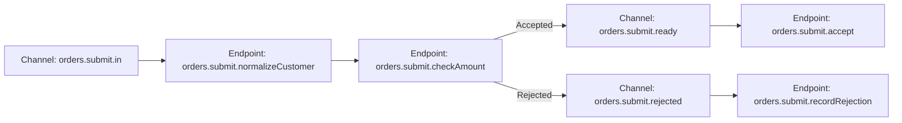

# Naming channels and endpoints

In the **Flow Design** chapter of the **SPRING_INTEGRATION_CORE** module, naming is part of the design: readers need to recognize which boundary a message is at, which component processes it, and which names other flows reference.

This lesson focuses on `MessageChannel`, endpoints, handlers, and bean names in the Java DSL. The examples use an order submission flow to illustrate transformers, filters, and terminal handlers; conventions are then extended to routers, aggregators, gateways, and error branches.

## 1. Goals and prerequisites

After this lesson, you will be able to:

- Distinguish channel names, endpoint IDs, handler bean names, and flow names.
- Choose names based on message contracts and business responsibilities.
- Declare explicit names using `@Bean`, `@Qualifier`, Java DSL, and `@EndpointId`.
- Spot naming conflicts, broken references, and reliance on auto-generated names.
- Keep connection points stable when changing internal flow structure.

You should know that `Message<T>` consists of a payload and headers, channels transport messages between components, and endpoints connect processing operations with message reception mechanisms. The main Java example uses Java 17 or later and the Spring Integration 6.x/7.x `IntegrationFlow` API; Spring libraries must be managed by a compatible dependency set in your project.

## 2. A message passes through multiple types of identifiers

Consider the order flow:



The diagram only draws explicitly named channels. Between the transformer and filter, the DSL still needs a channel connecting the endpoints; that channel may be created by the framework.

| Identifier type | Question it answers | Example |
| --- | --- | --- |
| Flow bean name | Which workflow does this configuration represent? | `orders.submit.flow` |
| Channel bean name | To which connection point is the message sent? | `orders.submit.in` |
| Endpoint ID | Which component receives and coordinates processing? | `orders.submit.checkAmount` |
| Handler bean name | Which processing object is invoked by the endpoint? | `orders.submit.checkAmount.handler`, if configured or generated by the corresponding convention |
| `MessageHeaders.ID` | Which specific message instance is this? | A UUID in headers |
| Business correlation key | Which messages belong to the same order or group? | `orderId` or an application-defined correlation header |
| External destination | To which transport resource does data go? | Kafka topic, RabbitMQ queue, or directory |

Channel and endpoint names belong to application configuration. Message IDs and correlation keys belong to runtime per-execution data. Nor does a channel bean name automatically create a queue or topic on a broker.

For consuming endpoints, distinguish the consumer endpoint from the `MessageHandler` it invokes; the two roles may correspond to two separate beans. Exact names depend on how they are declared. [Spring Integration — Endpoint Bean Names](https://docs.spring.io/spring-integration/reference/overview.html#endpoint-bean-names).

### 2.1. Channels express connection points; endpoints express actions

A readable naming style:

- Channel: `orders.submit.ready` — the message is eligible to proceed in the submission use case.
- Endpoint: `orders.submit.normalizeCustomer` — normalize the customer code.
- Endpoint: `orders.submit.checkAmount` — check the amount condition.

A name like `orders.submit.validateChannel` mixes up a handoff point with a validation action. A name like `orders.submit.processor` is too broad: an on-call operator cannot tell what that processor does.

You do not need to cram the entire design into the name. A channel's contract also includes payload, required headers, preconditions to send, and delivery behavior; those details belong in documentation or source code.

## 3. Recommended naming convention

The convention below is a design choice for this lesson, not mandatory Spring Integration syntax:

```text
Channel:  <domain>.<useCase>.<roleOrState>
Endpoint: <domain>.<useCase>.<action>
Flow:     <domain>.<useCase>.flow
Gateway:  <domain>.<useCase>.gateway
```

Example:

```text
orders.submit.in
orders.submit.ready
orders.submit.rejected

orders.submit.normalizeCustomer
orders.submit.checkAmount
orders.submit.accept

orders.submit.flow
orders.submit.gateway
```

Three meaningful segments:

1. **Domain** scopes the business area, such as `orders`, `payments`, `inventory`.
2. **Use case** distinguishes flows within the same domain, such as `submit`, `cancel`, `reconcile`.
3. **Role, state, or action** states the meaning at the point under consideration.

Using English terms in code keeps names consistent with class and API names; business explanations can be written in the team's language. A team using camelCase like `orderSubmissionInput` can still design well if applied consistently.

### 3.1. Channel names must reflect actual guarantees

| Name | Meaning that should be promised | What to avoid |
| --- | --- | --- |
| `orders.submit.in` | Entry point of the order submission use case | Each producer interpreting the payload differently |
| `orders.submit.ready` | Passed the documented conditions | Interpreting it as "passed every business check" |
| `orders.submit.rejected` | Orders rejected by this flow's condition | Mixing with uncontracted technical exceptions |
| `orders.submit.errors` | Error destination explicitly wired into error handling | Assuming a name ending in `errors` enables error handling automatically |
| `orders.submit.retry` | Re-entry point under a defined retry policy | Assuming this name creates retries or guarantees idempotency |
| `orders.submit.reply` | Reply point if architecture requires a fixed channel | Creating one merely because every gateway must have a named reply channel |

The name `validated` is quite a strong promise. If the flow only checks `total > 0`, state the validation scope clearly, or choose a narrower name such as `positiveAmount` when it is a shared boundary.

### 3.2. Endpoint names should state a concrete action

| Responsibility | Suggested name |
| --- | --- |
| Normalize customer code | `orders.submit.normalizeCustomer` |
| Filter checking amount | `orders.submit.checkAmount` |
| Router choosing fulfillment warehouse | `orders.fulfill.routeByWarehouse` |
| Transformer converting to payment message | `orders.submit.toPaymentRequest` |
| Aggregator gathering inventory check results | `orders.fulfill.aggregateStockChecks` |
| Call payment service | `payments.authorize.callProvider` |
| Record rejected order | `orders.submit.recordRejection` |

The verb `validate` does not tell whether violations throw an exception or go to a discard channel. When that behavior affects callers, document it next to the configuration; the endpoint name is only the starting point for understanding responsibility.

### 3.3. Names should be stable and bounded

Prefer `orders.submit.accept` over `orders.submit.step4`. Inserting a new transformer should not force every downstream endpoint to rename.

Never embed `orderId`, timestamps, UUIDs, or customer names into bean names of a static flow. Per-message details belong in payload, headers, or observability context. Stable component identities allow comparing logs and metrics across runs; trace IDs and business keys locate a specific execution.

The name `directOrdersInput` couples the name to an implementation type. If you decide to switch to `ExecutorChannel`, that name becomes misleading. Use the business role as the primary name; separately document changes to threading, backpressure, transactions, and errors.

## 4. Ways to assign names in Spring

### 4.1. Bean names and Java method names can differ

```java
@Bean("orders.submit.in")
public MessageChannel submissionInput() {
    return new DirectChannel();
}
```

In this configuration:

- The bean name is `orders.submit.in`.
- The Java method name is `submissionInput`.
- `@Qualifier("orders.submit.in")` selects the bean by its published name.

Using `@Bean` without specifying a name defaults to the method name. In that case, renaming the method can break connection points referenced by other configuration.

Dots in the illustrative names are part of the bean name string, not Java package hierarchy. In expression syntaxes with special rules, reference them using the proper syntax; do not assume every tool treats a dotted name as a property path.

### 4.2. Endpoint IDs in the DSL live in the endpoint configurer

```java
.transform(
    Order.class,
    order -> normalize(order),
    endpoint -> endpoint.id("orders.submit.normalizeCustomer")
)
```

The third parameter configures the endpoint created for the transform step; `.id(...)` here chooses the endpoint bean name. It does not name the input channel or rename the `IntegrationFlow`. [Spring Integration — DSL and Endpoint Configuration](https://docs.spring.io/spring-integration/reference/dsl/java-endpoints.html).

The flow name is declared separately:

```java
@Bean("orders.submit.flow")
public IntegrationFlow submissionFlow(/* dependencies */) {
    // ...
}
```

This snippet only shows where the name is declared. The full example is in the next section.

### 4.3. Referencing channels by string requires care

The DSL supports `IntegrationFlow.from("orders.submit.in")` and `.channel("orders.submit.ready")`. Some of these string references create a channel if no matching bean exists yet. Thus, a typo can silently create a different channel rather than a missing-bean error. [Spring Integration — Message Channels](https://docs.spring.io/spring-integration/reference/dsl/java-channels.html).

Example to watch out for:

```java
.channel("orders.submit.raedy") // Misspelled compared to the "ready" contract.
```

When a channel is a critical connection point, a clear option is to declare a `@Bean`, inject the object with `@Qualifier`, and pass that object into the DSL. This catches missing dependencies right at context startup.

Constants also reduce repeated string typos. However, a constant holding the wrong string is still the wrong name, and two differently named constants can still hold the same value. Verify both wiring configuration and message behavior.

## 5. Complete example: order submission flow

The example uses memory to record accepted or rejected orders, letting you observe behavior without a database. The goal is to see how each component name maps to a responsibility.

Assumptions:

- `id`, `customerCode`, and `total` are non-null; the record enforces this on construction.
- Customer codes are trimmed at both ends and uppercased.
- Orders with `total > 0` continue; remaining orders go to the `rejected` branch.
- Both endpoints return `null` to terminate processing without requiring a reply.

### 5.1. Java configuration

```java
import java.math.BigDecimal;
import java.util.List;
import java.util.Locale;
import java.util.Objects;
import java.util.concurrent.CopyOnWriteArrayList;

import org.springframework.beans.factory.annotation.Qualifier;
import org.springframework.context.annotation.Bean;
import org.springframework.context.annotation.Configuration;
import org.springframework.integration.channel.DirectChannel;
import org.springframework.integration.config.EnableIntegration;
import org.springframework.integration.dsl.IntegrationFlow;
import org.springframework.messaging.MessageChannel;

@Configuration
@EnableIntegration
public class OrderSubmissionConfiguration {

    public static final String INPUT = "orders.submit.in";
    public static final String READY = "orders.submit.ready";
    public static final String REJECTED = "orders.submit.rejected";

    @Bean(INPUT)
    public MessageChannel submissionInput() {
        return new DirectChannel();
    }

    @Bean(READY)
    public MessageChannel acceptedOrders() {
        return new DirectChannel();
    }

    @Bean(REJECTED)
    public MessageChannel rejectedOrders() {
        return new DirectChannel();
    }

    @Bean("orders.submit.sink")
    public OrderSink orderSink() {
        return new OrderSink();
    }

    @Bean("orders.submit.flow")
    public IntegrationFlow submissionFlow(
            @Qualifier(INPUT) MessageChannel input,
            @Qualifier(READY) MessageChannel ready,
            @Qualifier(REJECTED) MessageChannel rejected,
            OrderSink sink) {

        return IntegrationFlow.from(input)
                .transform(
                        Order.class,
                        order -> new Order(
                                order.id(),
                                order.customerCode()
                                        .strip()
                                        .toUpperCase(Locale.ROOT),
                                order.total()),
                        endpoint -> endpoint
                                .id("orders.submit.normalizeCustomer"))
                .filter(
                        Order.class,
                        order -> order.total().signum() > 0,
                        endpoint -> endpoint
                                .id("orders.submit.checkAmount")
                                .discardChannel(rejected))
                .channel(ready)
                .handle(
                        Order.class,
                        (order, headers) -> {
                            sink.accept(order);
                            return null;
                        },
                        endpoint -> endpoint.id("orders.submit.accept"))
                .get();
    }

    @Bean("orders.submit.rejectionFlow")
    public IntegrationFlow rejectionFlow(
            @Qualifier(REJECTED) MessageChannel rejected,
            OrderSink sink) {

        return IntegrationFlow.from(rejected)
                .handle(
                        Order.class,
                        (order, headers) -> {
                            sink.recordRejection(order);
                            return null;
                        },
                        endpoint -> endpoint
                                .id("orders.submit.recordRejection"))
                .get();
    }

    public record Order(
            String id,
            String customerCode,
            BigDecimal total) {

        public Order {
            Objects.requireNonNull(id, "id");
            Objects.requireNonNull(customerCode, "customerCode");
            Objects.requireNonNull(total, "total");
        }
    }

    public static final class OrderSink {

        private final List<Order> accepted = new CopyOnWriteArrayList<>();
        private final List<Order> rejected = new CopyOnWriteArrayList<>();

        public void accept(Order order) {
            accepted.add(order);
        }

        public void recordRejection(Order order) {
            rejected.add(order);
        }

        public List<Order> acceptedOrders() {
            return List.copyOf(accepted);
        }

        public List<Order> rejectedOrders() {
            return List.copyOf(rejected);
        }
    }
}
```

Place this code in `OrderSubmissionConfiguration.java` of a test application. The configuration can be registered directly with `AnnotationConfigApplicationContext` as shown in the test section below. If using Spring Boot, include the class in the configuration scope loaded by the application.

### 5.2. Reading the design back through names

`orders.submit.in` is the public entry point for producers. Producers do not need to know whether the first step is a transformer or a filter.

`orders.submit.normalizeCustomer` is a processing endpoint. It produces a new payload with a normalized customer code; this name is not an address for sending messages directly.

`orders.submit.checkAmount` decides between two branches. When the predicate returns false, the filter sends the message to the configured discard channel. This behavior is declared with `discardChannel(rejected)`; the name `rejected` merely helps readers understand the intent. [Spring Integration — FilterEndpointSpec](https://docs.spring.io/spring-integration/api/org/springframework/integration/dsl/FilterEndpointSpec.html).

`orders.submit.ready` sits after the amount check. In the example, the payload here is a normalized `Order` with a positive amount, with no guarantee yet regarding inventory or payment.

`orders.submit.accept` and `orders.submit.recordRejection` are terminal endpoints. Both record into memory and produce no reply. The name `orders.submit.sink` is a supporting bean in the example; it does not become an endpoint simply by being called from a lambda.

### 5.3. Channel names do not determine the delivery model

All three explicit channels in the example are `DirectChannel`. Being named `ready` does not make messages durable, and being named `rejected` does not create a dead-letter queue.

When changing channel types, re-evaluate the delivery contract. For example, adding a queue entails a corresponding consumer/poller requirement; adding an executor changes execution context. Keeping a business name stable is only valid if the change still satisfies the contract accepted by all parties using that connection point.

In particular, never attach a secondary consumer to "eavesdrop" on a `DirectChannel` assuming both primary and secondary consumers receive the same message. If you need an observation copy, design an appropriate wire tap or publish-subscribe channel; preserve the main flow's delivery semantics.

## 6. Annotation-based declaration: a method name is not necessarily the endpoint ID

For a POJO handler method, you can publish an explicit ID with `@EndpointId`:

```java
import org.springframework.integration.annotation.EndpointId;
import org.springframework.integration.annotation.ServiceActivator;
import org.springframework.stereotype.Component;

@Component
public class RejectedOrderHandler {

    @EndpointId("orders.submit.recordRejection")
    @ServiceActivator(inputChannel = "orders.submit.rejected")
    public void record(
            OrderSubmissionConfiguration.Order order) {
        // Record audit according to application requirements.
    }
}
```

This is an **alternative** to the example's `rejectionFlow` and must be loaded via component scan. Do not enable both alternatives with the same endpoint ID simultaneously.

For a POJO method without `@Bean` as above, `@EndpointId` sets the consumer name; the framework applies the corresponding handler naming convention. For a method with both `@Bean` and an EIP annotation, the handler name is determined by `@Bean`. [Spring Integration — EndpointId API](https://docs.spring.io/spring-integration/api/org/springframework/integration/annotation/EndpointId.html).

If you need to separate names explicitly when the handler is a bean:

```java
@Bean("orders.submit.recordRejection.handler")
@EndpointId("orders.submit.recordRejection")
@ServiceActivator(inputChannel = "orders.submit.rejected")
public MessageHandler rejectedOrderHandler() {
    return message -> {
        // Process rejected message.
    };
}
```

Place this snippet in a configuration class, importing `org.springframework.messaging.MessageHandler` and the corresponding annotations. It is also an alternative.

Read each naming site accurately:

- `@Bean("...handler")` names the handler bean.
- `@EndpointId("...recordRejection")` names the message-receiving endpoint.
- `inputChannel = "...rejected"` references the input channel.

Do not replace every name with one shared string. Explicit names must be distinct within the same bean namespace; an endpoint and its handler should not compete for the same name.

## 7. Gateways, routers, and aggregators need the same naming language

### 7.1. A gateway is an API-level entry point

You can add an interface so callers do not use `MessageChannel` directly:

```java
import org.springframework.integration.annotation.MessagingGateway;

@MessagingGateway(
        name = "orders.submit.gateway",
        defaultRequestChannel = "orders.submit.in")
public interface OrdersGateway {

    void submit(OrderSubmissionConfiguration.Order order);
}
```

Register the interface via gateway scanning, such as adding `@IntegrationComponentScan(basePackageClasses = OrdersGateway.class)` to an appropriate configuration and importing the annotation from `org.springframework.integration.annotation`. The gateway name and target channel are two separate identifiers. [Spring Integration — MessagingGateway API](https://docs.spring.io/spring-integration/api/org/springframework/integration/annotation/MessagingGateway.html).

A `void` method matches the two non-replying terminal endpoints in the example. If you change it to return a result, you must design the reply path as well.

A request-reply gateway can use a temporary reply channel; there is no need to create a fixed channel merely to satisfy a naming convention. [Spring Integration — Messaging Gateways](https://docs.spring.io/spring-integration/reference/gateway.html).

### 7.2. Router: distinguish the decision step from target branches

Design example:

```text
Endpoint: orders.fulfill.routeByWarehouse

Channels:
orders.fulfill.warehouseNorth
orders.fulfill.warehouseSouth
orders.fulfill.unroutable
```

The endpoint name states the routing criterion. Channel names state the business destinations. Routing values such as `NORTH` or `SOUTH` should be explicitly mapped to channels; do not force every business code to simultaneously be a bean name.

When a third branch is added, `routeByWarehouse` stays accurate. A name like `routeToNorthOrSouth` would have to change even though the core responsibility has not.

### 7.3. Aggregator: distinguish the component from message groups

Design example:

```text
Input channel:  orders.fulfill.stockResults
Endpoint:       orders.fulfill.aggregateStockChecks
Output channel: orders.fulfill.stockDecision
Discard path:   orders.fulfill.expiredStockChecks
```

The endpoint name is the identity of the aggregator itself. The correlation key identifies messages belonging to the same group and is runtime data; do not create a new endpoint for each `orderId`.

The name `expiredStockChecks` is only meaningful if timeout, release, and discard settings actually deliver that kind of message there. If discarded messages have a different schema from aggregated results, document the contracts of both branches clearly.

## 8. Naming error and rejection branches

Distinguish them in the design:

| Branch | Example cause | Expected data |
| --- | --- | --- |
| `orders.submit.rejected` | Non-positive amount, per filter predicate | Rejected `Order` in the example |
| `orders.submit.errors` | Exception calling a service or processing a message | `ErrorMessage` when emitted by the error mechanism |
| `orders.submit.retry` | Re-execution request under a policy | Application-defined retry message contract |

A custom name `orders.submit.errors` does not receive exceptions on its own. It must be wired via a gateway, an `errorChannel` header, or an appropriate error-publishing mechanism. Synchronous errors when sending directly over `DirectChannel` normally throw back to the caller. Asynchronous error mechanisms can emit an `ErrorMessage` to the channel in the header or the global `errorChannel`. [Spring Integration — Error Handling](https://docs.spring.io/spring-integration/reference/error-handling.html).

In the example, the filter rejecting orders with non-positive amounts is an intentional business outcome. There is no need to turn that outcome into an exception just so every branch carries the same payload.

When opening a retry branch, also document retry count, backoff delay, stop conditions, and how duplicate side effects are prevented. A clear name does not substitute for an execution policy.

## 9. When to name explicitly, when to let names be auto-generated?

Points that should be named intentionally:

- Channels referenced by producers, gateways, or other flows.
- Channels used as router branches, discard paths, or intentional observation points.
- Endpoints needing visibility in logs, lifecycle management, or replacement in tests.
- Endpoints with significant business meaning even if currently inside one flow.

A channel that merely connects two internal steps, has no external usage contract, and needs no separate reference can keep an auto-generated name.

Auto-generated DSL channel names may include the flow name and an index such as `orders.submit.flow.channel#0`. The index reflects the generated structure; it should not be treated as a stable API for external configuration.

### 9.1. Published boundaries matter more than name count

Naming every link can bloat configuration without helping readers. Naming only a few key points while leaving endpoints named `handler1`, `handler2` also hurts operations.

The balanced approach is:

1. Pick boundaries where another party needs to connect or observe.
2. Document the message contract at that boundary.
3. Assign a stable name.
4. Allow internal implementation details to evolve.

A good naming convention reflects existing design decisions. It cannot make up for a flow whose payloads, step order, and error behavior are undefined.

### 9.2. Dynamically registered flows need their own namespace

For flows instantiated multiple times at runtime, internal IDs can collide across instances. `IntegrationFlowContext` supports registering with a specific ID and `useFlowIdAsPrefix()` to prepend the flow ID to component names under its mechanism; this option requires a flow ID. [Spring Integration — Dynamic and Runtime Integration Flows](https://docs.spring.io/spring-integration/reference/dsl/java-runtime-flows.html).

This configuration is for dynamic registration. Do not assume naming a static `IntegrationFlow @Bean` automatically namespaces every explicit internal ID inside it. For static flows, choose non-colliding endpoint names directly in the design.

## 10. Using names for observability and diagnostics

An error message mentioning `orders.submit.checkAmount` helps readers identify responsibility faster than `handler#7`. When multiple teams operate together, the `orders.submit` prefix also scopes ownership.

To trace paths, you can enable Message History for an appropriate group of components:

```java
import org.springframework.context.annotation.Configuration;
import org.springframework.integration.config.EnableMessageHistory;

@Configuration
@EnableMessageHistory("orders.submit.*")
public class OrderHistoryConfiguration {
}
```

Load this configuration alongside the flow configuration when needed. Message History records tracked components in the `history` header; it can be scoped with name patterns. [Spring Integration — Message History](https://docs.spring.io/spring-integration/reference/message-history.html).

History, logs, metrics, and traces are complementary tools. To locate a specific message, also use `orderId` or trace context; never put those values into component names.

When troubleshooting a branch "not receiving messages", check in order:

1. Which exact bean name does the sender reference?
2. Does that name point to the same channel instance the consumer uses?
3. Was the receiving endpoint created and is it running?
4. Is a filter or router sending the message to a different branch?
5. Does the channel type have the delivery semantics assumed?

Starting solely by changing log levels can miss a miswired channel right in the configuration.

## 11. Testing names together with wiring behavior

Checking `containsBean("orders.submit.ready")` alone is insufficient. The bean may exist while the producer sends elsewhere, or the endpoint on that branch is not connected.

The JUnit 5 snippet below illustrates verifying published names and both behavioral branches of the Section 5 configuration:

```java
import java.math.BigDecimal;
import java.util.List;

import org.junit.jupiter.api.Test;
import org.springframework.context.annotation.AnnotationConfigApplicationContext;
import org.springframework.integration.dsl.IntegrationFlow;
import org.springframework.integration.endpoint.AbstractEndpoint;
import org.springframework.messaging.MessageChannel;
import org.springframework.messaging.support.MessageBuilder;

import static org.junit.jupiter.api.Assertions.assertEquals;
import static org.junit.jupiter.api.Assertions.assertTrue;

class OrderSubmissionNamingTest {

    @Test
    void exposesStableNamesAndConnectsBothBranches() {
        try (var context = new AnnotationConfigApplicationContext(
                OrderSubmissionConfiguration.class)) {

            var input = context.getBean(
                    OrderSubmissionConfiguration.INPUT,
                    MessageChannel.class);

            context.getBean(
                    OrderSubmissionConfiguration.READY,
                    MessageChannel.class);
            context.getBean(
                    OrderSubmissionConfiguration.REJECTED,
                    MessageChannel.class);
            context.getBean("orders.submit.flow", IntegrationFlow.class);

            for (String endpointId : List.of(
                    "orders.submit.normalizeCustomer",
                    "orders.submit.checkAmount",
                    "orders.submit.accept",
                    "orders.submit.recordRejection")) {
                var endpoint = context.getBean(
                        endpointId,
                        AbstractEndpoint.class);
                assertTrue(endpoint.isRunning(), endpointId);
            }

            var valid = new OrderSubmissionConfiguration.Order(
                    "O-101", "  c01  ", new BigDecimal("250.00"));
            var invalid = new OrderSubmissionConfiguration.Order(
                    "O-102", "  c02  ", BigDecimal.ZERO);

            assertTrue(input.send(MessageBuilder.withPayload(valid).build()));
            assertTrue(input.send(MessageBuilder.withPayload(invalid).build()));

            var sink = context.getBean(
                    OrderSubmissionConfiguration.OrderSink.class);

            assertEquals(
                    List.of(new OrderSubmissionConfiguration.Order(
                            "O-101", "C01", new BigDecimal("250.00"))),
                    sink.acceptedOrders());
            assertEquals(
                    List.of(new OrderSubmissionConfiguration.Order(
                            "O-102", "C02", BigDecimal.ZERO)),
                    sink.rejectedOrders());
        }
    }
}
```

Place the test in the same package as the configuration and provide the JUnit Jupiter dependency in the sample project. Asserting right after `send` relies on the synchronous channels in the example; if replaced with asynchronous processing, an appropriate timeout-bounded wait strategy is needed.

The test protects three things: published channel names exist with the right types, key endpoints are running, and messages take the right branch with normalized payloads. Do not couple tests to auto-generated channel indices.

The return value of `send` also does not prove that all business side effects succeeded in every architecture. Therefore, the example also inspects the actual contents at both terminal sinks.

## 12. Refactoring names and resolving collisions

### 12.1. One ApplicationContext shares a single bean namespace

Two differently named flows can still declare endpoints both named `validate`. Use meaningful prefixes such as `orders.submit.checkAmount` and `payments.authorize.checkAmount`.

Also avoid endpoint names colliding with channel names or supporting beans. Enabling bean overriding to hide collisions can cause the application to load the wrong configuration; identify which component truly owns that name.

For shared channels, pick one place to declare the bean and pass that same bean to consuming flows. Never create two separate channel instances expecting them to be one just because they share an intended name.

### 12.2. Renaming is a contract change once references exist

Before renaming `orderInput` to `orders.submit.in`, identify all referencing parties:

- `@Qualifier` and `ApplicationContext.getBean(...)`.
- `inputChannel`, `outputChannel`, channel mappings, and gateways.
- Test configurations, lifecycle controls, and observability tools.
- Operational docs or external configs using that name string.

If temporary compatibility is required, the bean can expose an alias:

```java
@Bean(name = {"orders.submit.in", "orderInput"})
public MessageChannel submissionInput() {
    return new DirectChannel();
}
```

This is a way to **replace the existing input channel declaration**, not add a second channel to the configuration. Both names point to the same bean.

Aliases support lookup by the old name; do not assume all logs, history, or observability labels will automatically display both names. Audit all name dependents and set a deadline to remove the alias after callers have migrated.

### 12.3. Only add versioning when contracts must diverge

A name like `orders.submit.v2.in` is helpful when two different payload contracts must coexist. Do not bump channel name versions every time an internal transformer is added.

Conversely, keeping the same name while changing `String` to `Order` before producers are updated can break the contract even though the application still starts. Evaluate changes against actual exchanged messages.

## 13. Common mistakes and fixes

| Symptom | Possible cause | How to fix |
| --- | --- | --- |
| Cannot inject `MessageChannel` | Multiple channels exist without specifying which bean | Use `@Qualifier` on the corresponding dependency |
| Message goes to a point with no consumer | Typo in name; DSL may have created another channel | Cross-check published names; prefer bean references at key boundaries |
| Startup reports duplicate bean name | Endpoint, handler, or channel competing for same bean name | Add namespaces and separate each role clearly |
| Adding a step breaks tests referencing `channel#N` | Tests depended on auto-generated structure | Test published boundaries or assign explicit names |
| Renaming a config method breaks another flow | Default bean name was being treated as a contract | Publish the name via `@Bean` when stability is needed |
| `orders.submit.errors` exists but receives no errors | Not wired into the error mechanism | Configure actual error producers and target channel |
| `validated` holds orders without stock checks | Name promises more than prior endpoint scope | Rename or clearly document guaranteed conditions |
| Logging with a secondary consumer starves main processing | Misunderstood channel delivery model | Design a proper observation point instead of just adding a subscriber |
| Renaming causes dashboard to lose history | Observability tool depends on component names | Coordinate observability config updates during migration |

## 14. Naming design exercise

You are given a flow:

```text
input -> handler1 -> channel2 -> handler2
                    |
                    +-> errorInput
```

Context: the flow accepts payment requests, normalizes currency, rejects non-positive amounts, and calls a provider. Rejected requests and provider exceptions need two separate paths.

Tasks:

1. Name the entry point, post-check channel, rejected branch, and error branch.
2. Name the normalization, validation, and provider-calling endpoints.
3. Document expected payloads and entry conditions for each channel.
4. Indicate which names callers or other flows will reference.
5. Pick one name that must remain stable if another transformer is inserted.
6. Describe how to verify the flow is wired properly, beyond checking that beans exist.

One solution:

```text
Channels:
payments.authorize.in
payments.authorize.ready
payments.authorize.rejected
payments.authorize.errors

Endpoints:
payments.authorize.normalizeCurrency
payments.authorize.checkAmount
payments.authorize.callProvider

Flow:
payments.authorize.flow
```

A complete solution must also specify that `rejected` receives rejected payment requests, `errors` receives error messages from the configured error mechanism, and `ready` only guarantees conditions actually checked by prior steps. If provider results must be forwarded onward, add a channel whose name expresses that result contract.

## 15. Self-check when designing a flow

- Are flow, channel, endpoint, and handler bean names clearly distinguished?
- Do channel names accurately convey the message's state or role?
- Do endpoint names indicate the business action?
- Is every explicit name unique within the context?
- Do shared boundaries have stable names and contracts?
- Do names avoid step indices, per-request data, or volatile implementation details?
- Are rejection and error branches properly wired?
- Do tests send messages through the key branches?
- When renaming, have all references and observability tools been reviewed?

The core point of this lesson's convention is using channel names to identify delivery contracts, endpoint names to identify processing responsibilities, and protecting those boundaries with clear configuration and behavioral tests.
