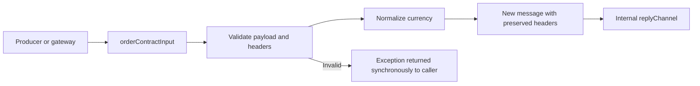

# Preserve the message contract

## 1. Goals and context

In the **Flow Design** chapter of the **SPRING_INTEGRATION_CORE** module, preserving the message contract means ensuring each component receives messages with the agreed-upon structure, semantics, and interaction model. This is the foundation for composing Message, MessageChannel, endpoints, gateways, and Java DSL into an integration flow that can evolve and be tested.

For example, a flow receives an order-submitted event, normalizes the currency code, selects a processing branch, and records the result. If a transformer keeps the amount intact but drops `tenantId`, the consumer may process the wrong customer. If all business data is preserved but the reply path is lost, the gateway may wait until timeout. Both are contract violations.

After this lesson, you will be able to:

- Describe the contract of a message and of each boundary in a flow.
- Classify headers that must be preserved, recomputed, or dropped.
- Write a transformer that preserves business context and internal reply paths.
- Identify contract changes across routers, filters, splitters, aggregators, and gateways.
- Design tests that catch missing headers, version mismatches, semantic errors, and missing replies.

## 2. What makes up a message contract?

Spring defines `Message<T>` in terms of a payload and headers. Headers can hold business metadata or message-processing metadata. That is the technical structure; a contract builds on that structure to make concrete guarantees. [Message Documentation](https://docs.spring.io/spring-integration/reference/message.html).

An application's contract can be described in four groups:

| Group | What to define | Example |
| --- | --- | --- |
| Payload | Type, required fields, value bounds, units | `amount` is `BigDecimal`, greater than 0, paired with `currency` |
| Headers | Name, Java type, source, lifetime scope | `tenantId` is `String`, `schemaVersion` is `Integer` |
| Semantics | Event vs. command, identity, business invariants | `OrderSubmitted` means the order has been submitted |
| Interaction | Output count, reply, errors, ordering, timeout, duplicates | One valid input produces one normalized reply |

A message can have the right Java type yet still violate the contract. For instance, `amount = 100` is type-valid when the producer means 100 VND and the consumer thinks 100 cents. Likewise, `schemaVersion = "1"` and `schemaVersion = 1` have different types even though they look identical in logs.

### 2.1. Preserving does not mean everything is immutable

A normalizing transformer can convert `" vnd "` into `"VND"` if the input contract allows that representation and the output contract requires canonical form. It still preserves the event's meaning.

Conversely, changing `OrderSubmitted` into `PaymentCaptured` creates a new event with a different meaning. In that case, you must design a new contract, including event type, data, event ID, and a link to what caused it.

Design rule:

> Every endpoint must state its input preconditions, output guarantees, and permitted transformations.

If endpoint A's output does not satisfy endpoint B's input, an explicit conversion step is needed between them. Connecting two endpoints via the same channel name does not automatically make them compatible.

### 2.2. A channel's contract is a shared agreement

The name `ordersNormalized` should express a commitment that every sending producer and every receiving consumer interprets the same way. If one producer sends a POJO, another sends JSON, and the consumer has to guess the data format, that channel is carrying multiple undistinguished contracts.

A datatype channel can check the payload type, or attempt type conversion when configured with a conversion service. It does not replace verifying headers, values, and business meaning. [Configuring a datatype channel](https://docs.spring.io/spring-integration/reference/channel/configuration.html#channel-datatype-channel).

## 3. Defining a concrete order contract

This lesson uses the `OrderSubmitted` event, version 1, within an in-JVM flow. The producer is responsible for identifying the tenant accurately and issuing the event ID before calling the flow.

| Component | Rule |
| --- | --- |
| Payload | `OrderSubmittedV1(orderId, amount, currency)` |
| `orderId` | Non-blank `String`; do not alter the order's identity |
| `amount` | `BigDecimal`, greater than 0; do not convert units or round automatically |
| Input `currency` | One of VND, USD, EUR; leading/trailing whitespace and lowercase allowed |
| Output `currency` | VND, USD, or EUR, uppercase with no outer whitespace |
| `eventType` | `String`, equal to `OrderSubmitted` |
| `schemaVersion` | `Integer`, equal to `1` |
| `tenantId` | Non-blank `String`, preserved unchanged across normalization |
| `businessEventId` | Non-blank `String`, preserved because it remains the same event |
| Additional business headers | Forwarded within this internal flow unless governed by a specific removal policy |
| Reply | Each valid input produces one message containing the normalized payload |
| Invalid input | Throw a contract error; produce no success reply |
| Repeated input | Normalization step has no side effects; deduplication not yet implemented |

`tenantId` in the table is context already authenticated at the system boundary. Checking that it is a non-blank string inside the flow is only a structural check; the adapter receiving HTTP or broker traffic must still verify that the sender is authorized for that tenant.

Illustrative flow:



This is a contract choice for the example, not a mandatory header set every Spring Integration application must adopt.

## 4. Managing headers by role

### 4.1. Distinguish message identity from business identity

Never use a single ID for every purpose:

| Identifier data | Represents | Policy in the example |
| --- | --- | --- |
| `MessageHeaders.ID` | A framework message instance | Do not use as a business deduplication key |
| `businessEventId` | A business event that occurred | Preserve across normalization and retries of the same event |
| `orderId` | The order | Can appear across many different events |
| Business correlation ID, if any | A conversation or workflow | Follows the application's tracing conventions |
| Aggregator `correlationId` | A group of messages to combine | Follows the aggregator's correlation strategy |

Spring may assign a new ID and timestamp when creating a transformed message. Therefore, do not require them to stay unchanged like `businessEventId`. [Message ID generation](https://docs.spring.io/spring-integration/reference/message.html#message-id-generation).

An order may have order-submitted, order-confirmed, and payment events. All three share `orderId` yet need distinct event IDs. When retrying delivery of an order-submitted event, keep the old event ID so consumers have a basis to recognize the redelivery.

Having a stable ID does not create idempotency by itself. A consumer with side effects still needs a mechanism to record processed keys and coordinate with transactions or business state.

### 4.2. Control headers must live for the right scope

In an internal request–reply flow, `replyChannel` lets the result return to the waiting caller. `errorChannel` may be used by error-handling components to choose where to send errors. Correlation and sequence headers used for grouping must be kept until the corresponding step finishes using them.

Do not strip headers wholesale simply because they do not appear in a DTO. Each step should have a clear policy:

| Header group | Within the same internal flow | Across an external boundary |
| --- | --- | --- |
| `tenantId`, `businessEventId` | Preserve if the contract requires them | Map via an allowlist and verify trusted origin |
| `eventType`, `schemaVersion` | Preserve while still under the same contract | Cross-check against published schema |
| `replyChannel`, `errorChannel` | Preserve while still needed for interaction | Design transport-specific request–reply mechanism |
| `correlationId`, `sequenceNumber`, `sequenceSize` | Preserve per splitter/aggregator pattern | Redefine representation and meaning if transmitted externally |
| Adapter headers | Keep up to the point of use | Select per specific adapter and header mapper |
| Sensitive or local-only data | Keep within allowed scope | Do not automatically export everything externally |

Gateways often put a temporary reply channel in headers to receive responses. Thus, the return path is part of the interaction design, even though the business service does not see it. [Messaging Gateways](https://docs.spring.io/spring-integration/reference/gateway.html#gateway-default-reply-channel).

### 4.3. Build new messages and preserve headers intentionally

This lesson uses `org.springframework.messaging.support.MessageBuilder`.

When keeping the payload and only adding a header:

```java
Message<?> enriched = MessageBuilder.fromMessage(input)
        .setHeader("validatedBy", "order-contract")
        .build();
```

When replacing the payload:

```java
Message<?> output = MessageBuilder.withPayload(normalizedPayload)
        .copyHeaders(input.getHeaders())
        .build();
```

`copyHeaders` overwrites headers with matching names; `copyHeadersIfAbsent` only fills in missing headers. Neither overwrites the new message's generated ID and timestamp. [MessageBuilder API](https://docs.spring.io/spring-framework/docs/current/javadoc-api/org/springframework/messaging/support/MessageBuilder.html#copyHeaders(java.util.Map)).

For example, during a version migration, the following order lets the target header win over the old header:

```java
Message<?> converted = MessageBuilder.withPayload(targetPayload)
        .copyHeaders(input.getHeaders())
        .setHeader("schemaVersion", 2)
        .build();
```

This snippet only illustrates builder ordering. A full version conversion also requires transforming data, checking semantics, and updating related metadata; changing only the header does not make the payload a new version.

Do not construct a payload-only message and assume every endpoint will restore all headers. The framework's header propagation varies by handler type and configuration. When explicitly returning `Message<?>`, build the output header set according to the contract and test it through the real flow.

### 4.4. Envelope immutability is not deep immutability

Headers prevent direct map mutation, yet the payload or header values can still be mutable objects. Sending a message to another branch does not deep-copy those objects. [Message headers and mutability](https://docs.spring.io/spring-integration/reference/message.html#message-headers).

Unsafe example in a multi-branch flow:

```java
// Two consumers both hold a reference to a mutable Order.
Order order = (Order) message.getPayload();
order.getItems().clear();
```

Prefer immutable values or copy as needed. A Java `record` only makes field references final; a record containing a `List` still needs copying or an unmodifiable list wrapper. The record in the example below contains only `String` and `BigDecimal`.

## 5. Writing a validating and normalizing transformer

The practice snippets use Java 17 or later and the `IntegrationFlow.from(...)` Java DSL API. They require Spring Integration Core, Spring Context, and JUnit Jupiter for tests; library versions are managed consistently in the project.

The example intentionally accepts `Message<?>` so it can inspect both payload and headers. It only normalizes currency representations permitted by the contract, without executing order-placement business logic.

### 5.1. Model and transformation function

Place the following class in `OrderContract.java` in a practice project:

```java
import java.math.BigDecimal;
import java.util.Locale;
import java.util.Set;

import org.springframework.messaging.Message;
import org.springframework.messaging.support.MessageBuilder;

public final class OrderContract {

    public static final String EVENT_TYPE = "eventType";
    public static final String SCHEMA_VERSION = "schemaVersion";
    public static final String TENANT_ID = "tenantId";
    public static final String BUSINESS_EVENT_ID = "businessEventId";

    private static final Set<String> CURRENCIES =
            Set.of("VND", "USD", "EUR");

    private OrderContract() {
    }

    public record OrderSubmittedV1(
            String orderId,
            BigDecimal amount,
            String currency) {
    }

    public static final class ContractViolation extends RuntimeException {
        public ContractViolation(String message) {
            super(message);
        }
    }

    public static Message<?> normalize(Message<?> input) {
        if (!(input.getPayload() instanceof OrderSubmittedV1 order)) {
            throw invalid("Payload must be OrderSubmittedV1");
        }

        String eventType = requiredString(input, EVENT_TYPE);
        if (!"OrderSubmitted".equals(eventType)) {
            throw invalid("Unsupported eventType");
        }

        Object version = input.getHeaders().get(SCHEMA_VERSION);
        if (!(version instanceof Integer number) || number != 1) {
            throw invalid("schemaVersion must be Integer 1");
        }

        requiredString(input, TENANT_ID);
        requiredString(input, BUSINESS_EVENT_ID);

        if (order.orderId() == null || order.orderId().isBlank()) {
            throw invalid("orderId is required");
        }

        if (order.amount() == null || order.amount().signum() <= 0) {
            throw invalid("amount must be greater than 0");
        }

        if (order.currency() == null) {
            throw invalid("currency is required");
        }

        String currency = order.currency()
                .strip()
                .toUpperCase(Locale.ROOT);

        if (!CURRENCIES.contains(currency)) {
            throw invalid("Unsupported currency");
        }

        OrderSubmittedV1 normalized = new OrderSubmittedV1(
                order.orderId(),
                order.amount(),
                currency);

        return MessageBuilder.withPayload(normalized)
                .copyHeaders(input.getHeaders())
                .build();
    }

    private static String requiredString(Message<?> input, String name) {
        Object value = input.getHeaders().get(name);
        if (!(value instanceof String text) || text.isBlank()) {
            throw invalid("Header " + name + " must be a non-blank String");
        }
        return text;
    }

    private static ContractViolation invalid(String reason) {
        return new ContractViolation(reason);
    }
}
```

Decisions to note:

- Validate event type and version before processing business data.
- Never default `tenantId`, event ID, or currency when they are missing.
- Do not coerce the string `"1"` into the number `1` inside this flow. If a transport needs type conversion, the adapter must do it at the designated boundary.
- Do not mutate `orderId`, `amount`, or the input message.
- Keep input headers within this example's internal scope; no outbound transport export policy is applied yet.

In a real system, the set of currencies and amount rules must follow business rules. This example only checks for a positive amount; if the contract requires decimal-place limits or a maximum cap, add the corresponding checks.

### 5.2. Wiring the transformer into Java DSL

Place the following configuration in `OrderContractFlowConfig.java`:

```java
import org.springframework.context.annotation.Bean;
import org.springframework.context.annotation.Configuration;
import org.springframework.integration.channel.DirectChannel;
import org.springframework.integration.config.EnableIntegration;
import org.springframework.integration.dsl.IntegrationFlow;
import org.springframework.integration.transformer.Transformer;
import org.springframework.messaging.MessageChannel;

@Configuration
@EnableIntegration
public class OrderContractFlowConfig {

    @Bean
    public MessageChannel orderContractInput() {
        return new DirectChannel();
    }

    @Bean
    public IntegrationFlow orderContractFlow() {
        Transformer normalizer = OrderContract::normalize;

        return IntegrationFlow.from(orderContractInput())
                .transform(normalizer)
                .get();
    }
}
```

The `Transformer` variable makes clear that the function accepts and returns a message, avoiding confusion with a payload-only lambda. The Java DSL supports passing a `Transformer` instance to `.transform(...)`. [Java DSL Transformers](https://docs.spring.io/spring-integration/reference/dsl/java-transformers.html).

The flow does not set a fixed output channel. The final result returns to the request's `replyChannel`. Callers sending messages manually must provide a suitable reply path; a request–reply gateway normally sets this up.

A transformer must produce a valid result or signal an error. Never use `return null` to filter out invalid events; transformers do not accept null results. [Transformer and return value rules](https://docs.spring.io/spring-integration/reference/transformer.html).

## 6. Testing the contract through the flow

Tests that only invoke `normalize()` verify pure logic, but do not prove the flow preserves the reply path. The test below creates a minimal Spring context, sends through the real channel, and receives results from a `QueueChannel` acting as the reply channel.

Place this in `OrderContractFlowTest.java`, in the same package as the two classes above:

```java
import java.math.BigDecimal;

import org.junit.jupiter.api.Test;
import org.springframework.context.annotation.AnnotationConfigApplicationContext;
import org.springframework.integration.channel.QueueChannel;
import org.springframework.messaging.Message;
import org.springframework.messaging.MessageChannel;
import org.springframework.messaging.MessageHeaders;
import org.springframework.messaging.MessagingException;
import org.springframework.messaging.support.MessageBuilder;

import static org.junit.jupiter.api.Assertions.*;

class OrderContractFlowTest {

    @Test
    void preservesBusinessHeadersAndReplyRoute() {
        try (var context = new AnnotationConfigApplicationContext(
                OrderContractFlowConfig.class)) {

            MessageChannel input = context.getBean(
                    "orderContractInput", MessageChannel.class);
            QueueChannel replies = new QueueChannel(10);
            QueueChannel errors = new QueueChannel(10);
            Message<?> request = validRequest(replies, errors);

            assertTrue(input.send(request));

            Message<?> response = replies.receive(0);
            assertNotNull(response);
            assertInstanceOf(OrderContract.OrderSubmittedV1.class,
                    response.getPayload());

            var result =
                    (OrderContract.OrderSubmittedV1) response.getPayload();
            assertEquals("ORD-101", result.orderId());
            assertEquals(new BigDecimal("150000"), result.amount());
            assertEquals("VND", result.currency());

            assertEquals("tenant-a",
                    response.getHeaders().get(OrderContract.TENANT_ID));
            assertEquals("evt-101",
                    response.getHeaders().get(OrderContract.BUSINESS_EVENT_ID));
            assertEquals("OrderSubmitted",
                    response.getHeaders().get(OrderContract.EVENT_TYPE));
            assertEquals(1,
                    response.getHeaders().get(OrderContract.SCHEMA_VERSION));
            assertEquals("web",
                    response.getHeaders().get("sourceSystem"));

            assertSame(replies,
                    response.getHeaders().get(MessageHeaders.REPLY_CHANNEL));
            assertSame(errors,
                    response.getHeaders().get(MessageHeaders.ERROR_CHANNEL));

            var original =
                    (OrderContract.OrderSubmittedV1) request.getPayload();
            assertEquals(" vnd ", original.currency());

            assertNull(replies.receive(0));
            assertNull(errors.receive(0));
        }
    }

    @Test
    void rejectsMissingTenantWithoutSuccessfulReply() {
        try (var context = new AnnotationConfigApplicationContext(
                OrderContractFlowConfig.class)) {

            MessageChannel input = context.getBean(
                    "orderContractInput", MessageChannel.class);
            QueueChannel replies = new QueueChannel(10);
            QueueChannel errors = new QueueChannel(10);
            Message<?> bad = MessageBuilder.fromMessage(
                            validRequest(replies, errors))
                    .removeHeader(OrderContract.TENANT_ID)
                    .build();

            MessagingException failure = assertThrows(
                    MessagingException.class, () -> input.send(bad));

            assertInstanceOf(OrderContract.ContractViolation.class,
                    rootCause(failure));
            assertNull(replies.receive(0));
            assertNull(errors.receive(0));
        }
    }

    @Test
    void rejectsStringVersionInsteadOfGuessingItsType() {
        QueueChannel replies = new QueueChannel(10);
        QueueChannel errors = new QueueChannel(10);
        Message<?> bad = MessageBuilder.fromMessage(
                        validRequest(replies, errors))
                .setHeader(OrderContract.SCHEMA_VERSION, "1")
                .build();

        assertThrows(OrderContract.ContractViolation.class,
                () -> OrderContract.normalize(bad));
    }

    private static Message<?> validRequest(
            QueueChannel replies, QueueChannel errors) {

        var payload = new OrderContract.OrderSubmittedV1(
                "ORD-101", new BigDecimal("150000"), " vnd ");

        return MessageBuilder.withPayload(payload)
                .setHeader(OrderContract.EVENT_TYPE, "OrderSubmitted")
                .setHeader(OrderContract.SCHEMA_VERSION, 1)
                .setHeader(OrderContract.TENANT_ID, "tenant-a")
                .setHeader(OrderContract.BUSINESS_EVENT_ID, "evt-101")
                .setHeader("sourceSystem", "web")
                .setReplyChannel(replies)
                .setErrorChannel(errors)
                .build();
    }

    private static Throwable rootCause(Throwable failure) {
        Throwable current = failure;
        while (current.getCause() != null) {
            current = current.getCause();
        }
        return current;
    }
}
```

`receive(0)` is appropriate because all processing prior to sending the reply runs synchronously on `DirectChannel`. In tests of flows with an executor or poller, use a bounded wait matching the flow's behavior.

The failure test intentionally verifies that `errors` remains empty: sending directly into a synchronous flow returns the exception to the caller. Merely setting the `errorChannel` header does not automatically route every exception there. Error-handling behavior also depends on execution boundaries and gateway or adapter configuration. [Error Handling](https://docs.spring.io/spring-integration/reference/error-handling.html).

Do not compare the entire headers map with `assertEquals`: the contract allows framework metadata to change. Compare the exact committed headers, their data types, and the reply path that must be preserved.

## 7. How do contracts change across endpoints?

### 7.1. Transformer: controlled representation conversion

In the example, the transformer converts an input contract allowing unnormalized currency into an output contract with canonical currency. Every subsequent step must know it is receiving the normalized output.

When converting a POJO to JSON, also specify field names, numeric types, timestamp formats, charset, and content type. When transforming partner-system data into an internal model, state which fields are mapped and which values cannot be converted.

Do not assume a technically successful conversion preserves meaning. Shifting time zones, rounding monetary amounts, or filling default values can alter the event's meaning.

### 7.2. Router: each branch needs an input contract

A router selects a branch by header or payload. Selecting a branch does not replace validating data for that branch. For example, version 1 and version 2 branches must receive the right corresponding payloads, not just the right version number.

Specify what happens when no mapping matches: raise an error or route to a quarantine branch with an assigned owner. Routers have settings for channel resolution and default destinations; choose explicitly rather than guessing. [Router implementations](https://docs.spring.io/spring-integration/reference/router/implementations.html).

For external data, map business values to a predefined list of channels. Never let an untrusted header freely dictate internal channel names.

### 7.3. Filter: being discarded is also an outcome

A filter decides whether a message proceeds or is discarded. It can be configured with a discard channel or throw an exception on rejection. [Filter](https://docs.spring.io/spring-integration/reference/filter.html).

Distinguish among:

- Schema-valid events outside processing scope: can be dropped per published rules.
- Events missing required fields: usually a contract error requiring feedback or quarantine.
- Requests waiting for a result: if the filter only drops them, the caller may wait until timeout.

For request–reply, the rejection branch should emit a properly typed rejection result or follow the agreed exception policy. For one-way event flows, dropping messages needs clear criteria and observability.

### 7.4. Splitter and aggregator: cardinality and correlation

After a splitter, one order can produce multiple line-item messages. The new contract must clarify which item each message represents, which group it belongs to, and how group completion is detected.

An aggregator uses the `correlationId` header for grouping and a sequence-size release strategy by default. Both can be customized. When aggregating headers, conflicting values may be dropped under the default strategy. [Aggregator](https://docs.spring.io/spring-integration/reference/aggregator.html).

Therefore, when designing order grouping:

- Preserve correlation and sequence headers across the entire segment being aggregated.
- Do not reuse one broad business correlation value across unrelated subgroups.
- If choosing `orderId` manually as the key, include `tenantId` and execution run when values can overlap.
- Decide explicitly how to handle duplicate items, expired groups, and incomplete results.
- Verify tenant and version consistency across the whole group before emitting the result.
- Publish the payload type and headers of the aggregated message.

The aggregated result is its own output contract. Do not expect an aggregator to retain every header from every item when their values can conflict.

### 7.5. Gateway: turning a contract into a calling interface

A gateway returning a result sets stronger expectations than a one-way event channel. The calling interface must define request type, reply type, rejection errors, timeout, and the no-result case.

When placing the normalization example behind a gateway:

1. The gateway places the data and required business headers into the request.
2. The flow validates and normalizes.
3. The terminal endpoint returns one result on the reply path.
4. The gateway converts the result to the declared return type.

If a fixed channel is later appended at the end, check how results return to the gateway. Redirecting the output destination can break the interaction without changing the Java method signature.

Timeouts must also be interpreted accurately: a caller stopping its wait does not prove downstream has not executed the work. If the caller retries an operation with side effects, stable IDs and idempotency policies must be part of the contract.

## 8. Asynchronous boundaries and error contracts

The following table outlines policies to design for the application:

| Situation | What to commit to |
| --- | --- |
| Schema violation or missing tenant | Classify as a contract error; do not infinitely retry bad data |
| Dependent service temporarily unavailable | Retry conditions, limits, and action when retries exhaust |
| Processing succeeded but caller timed out | How to query the result or retry safely |
| Message group missing items | Group timeout and meaning of partial/incomplete results |
| Unable to send reply | How to record, alert, or recover the interaction |

In the synchronous part of the example, errors are returned via exceptions. When adding an executor, poller, or transport, the caller may no longer be on the execution stack. At that point, you need an error-handling path fitting the new model; Spring Integration can represent errors as an `ErrorMessage` in the framework's asynchronous error mechanisms. [Error Handling Mechanism](https://docs.spring.io/spring-integration/reference/error-handling.html).

Never put a `Throwable` into a success payload while keeping `eventType = OrderSubmitted`. If you need to publish errors to another system, define an error contract, for example:

```json
{
  "errorType": "ContractRejected",
  "errorCode": "UNSUPPORTED_SCHEMA_VERSION",
  "rejectedEventId": "evt-101",
  "tenantId": "tenant-a",
  "retryable": false
}
```

This is an application-designed error schema, not the default structure of `ErrorMessage`. Include only verifiable data that is permitted to be published; if a failed message lacks a valid tenant or ID, do not fabricate them.

## 9. Crossing transport boundaries: contract mapping is required

Copying headers inside a JVM and transmitting a contract over HTTP, JMS, AMQP, or Kafka are two different jobs.

At out-of-process boundaries, agree on:

| Aspect | Concrete decision |
| --- | --- |
| Payload | JSON, XML, or other format; schema and encoding |
| Headers | External names, representations, allowlist permitted for transit |
| Version | Placed in envelope, headers, or both; conflict resolution |
| Identity | Stable event ID and issuing source |
| Tenant | Authentication source and mapping rules |
| Reply | Destination, correlation, wait time, and late arrivals |
| Errors | Retries, rejection, quarantine, and lookup mechanism |

An internal `MessageChannel` object is not a reply address usable on another machine. If a transport needs request–reply, design destinations and correlation according to that transport or its gateway.

When decoding external headers into Java, decide explicitly whether the version number becomes an `Integer` or another type. The example flow requires `Integer`; if an adapter produces `String`, fix the mapping at the boundary or intentionally change the contract.

This lesson does not configure a concrete adapter. Actual header policies must be implemented with a header mapper or the chosen adapter's mechanism, then tested round-trip over that exact transport.

## 10. Contract evolution and compatibility

Whether a change is compatible depends on real consumers and published terms.

| Change | What to examine |
| --- | --- |
| Add optional field | Do older consumers ignore unknown fields? What does absence mean? |
| Add required field | Can older producers supply it? Is a new version needed? |
| Rename or change field type | How will older consumers read it? Is there a converter? |
| Change monetary unit | Semantics change even if data type stays the same |
| Change `schemaVersion` type | Will it break routers or validators checking types? |
| Remove or redefine `tenantId` | Does it break tenant data isolation? |
| Change request–reply to one-way | Does the caller still get the committed result? |
| Change output order or count | Do aggregators and consumers still interpret it right? |

One approach to rolling out a version change:

1. Keep the active v1 contract running.
2. Publish v2 with its data and semantic changes.
3. Add an explicit converter from v1 to v2 where conversion is valid.
4. Reject values that cannot be mapped accurately.
5. Test v1 producers against the new consumer through the converter.
6. Monitor traffic per version before retiring v1.

Do not invent fake values for required v2 fields just to pass validation. If v1 does not supply enough information, enrich it from an authoritative source or reject the conversion.

Normalizing the same event normally preserves `businessEventId`. Emitting a new business event normally needs a new ID and a causal link. That decision is based on business meaning, not solely on whether a new Java object was instantiated.

## 11. Common design mistakes

| Symptom | Where the contract broke | How to fix |
| --- | --- | --- |
| Gateway hangs even though payload appears in logs | Reply path lost or misrouted | Check reply channel and terminal endpoint |
| Router fails to pick version branch | Header lost, wrong value, or wrong type | Check boundary mapping and validation |
| Tenant replaced with a default value | Uncontrolled context origin | Require authentication and reject missing tenant |
| Retries cause duplicate business processing | Missing ID or idempotency design | Keep ID per event and guard side effects |
| Aggregator never releases | Correlation or sequence no longer intact | Inspect all messages in the group |
| Audit branch sees mutated payload | Shared mutable object | Use immutable values or proper copies |
| Invalid messages vanish | Filter drops without a published outcome | Design a rejection or error branch |
| JSON conversion runs but amounts are wrong | Units or rounding rules shifted | Document semantics and test boundary values |
| Required headers lost across broker | Missing transport mapping policy | Add header mapping and test send–receive |

When diagnosing, capture the message on both sides of the suspected boundary and compare contract fields and headers. Logging payloads alone rarely explains lost context or altered interaction.

## 12. Practice exercises

### Exercise 1: Catch missing-header errors

Starting from the sample test suite, add cases for missing `businessEventId`, wrong `eventType`, and `schemaVersion` as `Long`.

Expected result: all are rejected under the current contract; no success reply is produced and missing data is not defaulted.

### Exercise 2: Expand currency rules

Specify that USD and EUR allow at most two decimal places, while VND has no fractional digits. Add valid and invalid test cases.

Expected result: the validator detects invalid values; it does not round automatically unless the contract permits it.

### Exercise 3: Add a filter after normalization

Accept only VND orders for processing in one branch. Decide explicitly whether USD requests receive a rejection result or an exception.

Expected result: the caller gets deterministic behavior instead of waiting for a timeout simply because the message was dropped.

### Exercise 4: Split and aggregate line items

Design a line-item contract with a group key distinguishing tenant, order, and processing attempt. Describe how a redelivered or never-arriving line item is handled.

Expected result: groups never mix tenants, never release prematurely on duplicates, and have an expiration policy.

### Exercise 5: Version migration

Create a v2 contract grouping monetary amount and currency code into a `Money` object. Write a v1-to-v2 mapping table, specify which IDs remain intact, and add compatibility tests.

Expected result: payload and metadata both express the right version; every required field has a valid data source.

## 13. Design completion criteria

A flow has adequately documented its message contract when implementers can answer:

- Which payload, version, and headers does each channel accept?
- What is each endpoint allowed to modify, required to preserve, and permitted to remove?
- Which fields carry units or business semantics that must be protected?
- What does the caller receive on success, rejection, error, or timeout?
- When a message is redelivered, how are identity and side effects handled?
- When splitting, aggregating, or running in parallel, what cardinality and ordering guarantees apply?
- When crossing transports, where are headers mapped and authenticated?
- Which tests prove those commitments across the exact execution boundaries?

In the order example, concrete evidence is that the payload is normalized according to the rules, business headers remain intact, the reply path continues to function, and invalid data is rejected according to the published policy.
