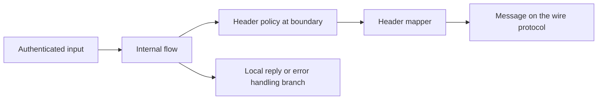

# Controlling header propagation

In the **Flow Design** chapter of the **SPRING_INTEGRATION_CORE** module, controlling header propagation means deciding which metadata is preserved, replaced, or removed as a message traverses Spring Integration components. This lesson uses Message, MessageChannel, endpoints, and Java DSL to design flows with explicit header contracts while preserving gateway, error-handling, and splitter–aggregator mechanics.

A flow can transform the payload accurately and still fail because it drops the reply address, leaks credentials to another system, or reuses metadata belonging to an inbound protocol.

After this lesson, you will be able to:

- Predict output headers when an endpoint returns a payload vs. a complete Message.
- Distinguish adding headers, filtering headers, suppressing header copying, and mapping headers to a protocol.
- Design an allowlist of headers permitted across a processing boundary.
- Keep coordination metadata alive until the right moment and test both required headers and headers that must be absent.

The examples use Java 17 and the Spring Integration 6.4.x Java DSL API. This is an API baseline for reading the examples, not a requirement to upgrade an existing project's version. Required foundational libraries are `spring-integration-core` and Spring Context; the test section uses JUnit Jupiter.

## 1. Start with a header contract

Suppose an order service receives the following message:

```text
payload = " ord-42 "

headers:
  requestId       = "req-42"
  tenantId        = "tenant-a"
  sourceSystem    = "caller-supplied"
  Authorization   = "<credential>"
  internal_debug  = "pricing-path-v2"
  replyChannel    = <local channel>
  errorChannel    = <local channel>
  id              = <UUID>
  timestamp       = <creation time>
```

The service normalizes the order ID and then creates a message exported to an independent flow. The outbound contract only needs `requestId`, `tenantId`, `sourceSystem`, and `contentType`. Authentication credentials, internal debug notes, and the initial call's channel addresses do not belong in this contract.

Before writing DSL, record the decisions:

| Header | Owning authority | Expected lifecycle | Decision at export boundary |
| --- | --- | --- | --- |
| `requestId` | Normalized intake layer | Track one business request | Keep after format validation |
| `tenantId` | Authentication/authorization layer | Data scope of the request | Keep verified value |
| `sourceSystem` | Service emitting the message | Inter-system contract | Set from trusted configuration |
| `Authorization` | Inbound protocol/auth layer | Until authentication completes | Remove per example contract |
| `internal_*` | Internal processing steps | Within one flow segment | Remove |
| `replyChannel`, `errorChannel` | Local coordination mechanism | While the call still needs replies or error routing | Keep in request–reply flow; omit from independent export contract |
| `id`, `timestamp` | Framework | Message identity and timestamp | Leave managed by the framework |

This is a design policy for the example. Another integration might require credentials for the destination; in that case, obtain destination-specific credentials from a managed source rather than blindly forwarding inbound credentials.

Validating the format of `tenantId` does not prove the caller has permission to access that tenant. Authorization must be established before injecting the message into the business flow.

## 2. How are headers propagated?

### 2.1. A new Message does not mean an entirely new payload

A `Message<T>` contains a payload and `MessageHeaders`. With common immutable implementations, the application builds a new Message when changing headers; never call `put()` or `remove()` on `message.getHeaders()`. Header values can still reference mutable objects, so copying headers is not a deep copy. [Message Reference](https://docs.spring.io/spring-integration/reference/message.html#message-headers).

```java
import org.springframework.integration.support.MessageBuilder;
import org.springframework.messaging.Message;

Message<String> changed = MessageBuilder
        .fromMessage(original)
        .setHeader("processingStage", "validated")
        .removeHeader("internal_debug")
        .build();
```

This snippet keeps the payload and copyable headers, sets `processingStage`, removes `internal_debug`, and creates the result via the builder. It does not mutate the source Message.

Never place a shared `ArrayList` in a header and mutate that list across parallel processing branches. When metadata needs multiple values, prefer immutable values or copies with clear ownership.

### 2.2. An endpoint's return type determines how headers are merged

Practical rules when reading a flow:

| Component / return value | Behavior to expect |
| --- | --- |
| Service activator returns a payload | Framework creates a result message and copies eligible input headers |
| Service activator returns a Message | Headers already on the returned message take precedence; missing input headers may still be copied over |
| Transformer returns a payload | Input headers are normally propagated |
| Transformer returns a Message | The returned Message is the complete result; transformer code controls headers |
| Router or bridge forwards a message | No result-payload creation step where service-activator-style header suppression applies |

In particular, removing a header from a Message returned by a service activator may not suffice: the handler's header-merging step may copy the input header back in. A transformer returning a Message is an important distinction. [Header Propagation Rules](https://docs.spring.io/spring-integration/reference/message.html#message-header-propagation).

For example, these two steps have different semantics:

```java
// Creates only a new payload: does not establish a new header contract.
.transform(String.class, String::trim)

// Calls a method returning a complete Message: explicitly decides output headers.
.transform(boundaryPolicy, "forExport")
```

The `forExport` method will be implemented in full in Section 6. A POJO transformer can take a Message and return a Message; never return `null` to drop a message, as that is the job of a message filter. [Transformer Contract](https://docs.spring.io/spring-integration/reference/transformer.html).

### 2.3. Do not use id to trace across business workflows

`MessageHeaders.ID` and `MessageHeaders.TIMESTAMP` are framework-managed headers. When creating a new Message via standard builders, these values can be regenerated; they are not stable business identifiers across an entire flow.

Use `requestId`, `orderId`, or an application-defined event ID for business correlation. Do not try to preserve `id` with a header enricher, and do not put `id` and `timestamp` on a removal list to "clean" a message.

### 2.4. Changing channels does not create a header policy

Passing a message through `DirectChannel`, `QueueChannel`, or `ExecutorChannel` does not automatically reduce it to a minimal metadata contract. If you need to strip headers before a processing segment, place a header filter or transformer at an explicit location.

Headers inside a Message and thread-bound context are two separate concepts. A Message carrying `requestId` does not mean MDC, `SecurityContext`, or tracing context automatically crosses asynchronous boundaries.

## 3. Choose the right control mechanism

| Need | Suitable mechanism | Scope |
| --- | --- | --- |
| Add missing headers or replace values | Header enricher | Header values on the resulting message |
| Remove existing headers | Header filter | A specific point in the flow |
| Prevent a handler from copying certain input headers | `notPropagatedHeaders(...)` | That handler's output creation step |
| Keep only a defined set of headers | Transformer building a Message from payload | A contract boundary |
| Decide which headers go out over HTTP, AMQP, or JMS | Adapter/gateway header mapper | Protocol boundary |
| Define headers skipped broadly by default builders | Read-only header configuration | Components using the corresponding builder factory |

A denylist fits when you know a few temporary headers that must be stripped. An allowlist fits when a message enters a new contract: unknown headers will not slip through accidentally.

### 3.1. Header enricher: choose whether to overwrite

```java
.enrichHeaders(h -> h
        .header("sourceSystem", "order-service", true)
        .header("processingStage", "received", false))
```

The `true` argument permits overwriting an existing `sourceSystem`; `false` preserves an existing `processingStage` if present. Do not look at `header(...)` alone and conclude the input value was overwritten. [HeaderEnricherSpec API](https://docs.spring.io/spring-integration/docs/6.4.x/api/org/springframework/integration/dsl/HeaderEnricherSpec.html).

In the example, the message emitter owns `sourceSystem`, so overwriting is intentional. For `tenantId`, the authoritative source must be authentication; overwriting it with an arbitrary constant corrupts data scoping.

### 3.2. Header filter: remove metadata while keeping the message

Remove by exact name:

```java
.headerFilter("internal_debug", "Authorization", "authorization")
```

Remove by pattern group, with pattern matching explicitly enabled:

```java
.headerFilter(h -> h
        .headersToRemove("internal_*", "Authorization", "authorization")
        .patternMatch(true))
```

`HeaderFilterSpec` provides both `headersToRemove(...)` and `patternMatch(...)`. [HeaderFilterSpec API](https://docs.spring.io/spring-integration/docs/6.4.x/api/org/springframework/integration/dsl/HeaderFilterSpec.html).

For ordinary application headers, `Authorization` and `authorization` are two distinct keys in the map. HTTP's case-insensitive header rules do not automatically make every key in `MessageHeaders` case-insensitive. Normalize names on intake and test the exact names produced by mappers.

Distinguish these two endpoints:

```java
// Removes a header; the message still continues.
.headerFilter("internal_debug")

// Decides whether the message may continue.
.filter(String.class, payload -> !payload.isBlank())
```

A message filter evaluates a condition on the whole message; it does not replace a header filter. [Filter Reference](https://docs.spring.io/spring-integration/reference/filter.html).

## 4. Suppress copying with notPropagatedHeaders

The following configuration applies at a service activator returning a payload:

```java
@Bean
IntegrationFlow normalizeWithoutPrivateHeaders() {
    return IntegrationFlow.from("normalizeInput")
            .handle(String.class,
                    (payload, headers) ->
                            payload.trim().toUpperCase(Locale.ROOT),
                    endpoint -> endpoint.notPropagatedHeaders(
                            "internal_*",
                            "Authorization",
                            "authorization"))
            .channel("normalizeOutput")
            .get();
}
```

This is an illustrative bean method; place it in a `@EnableIntegration` configuration, import `IntegrationFlow`, `Bean`, and `Locale`, and provide the output channel per your application.

If the input has `requestId=req-42`, `internal_debug=debug`, and `Authorization=<credential>`, the output still keeps `requestId`, while suppressed headers are not copied by the handler from the input.

Patterns here are simple wildcards like `internal_*`, not regular expressions. A pattern `"*"` suppresses all input header copying. [ConsumerEndpointSpec.notPropagatedHeaders API](https://docs.spring.io/spring-integration/docs/6.4.x/api/org/springframework/integration/dsl/ConsumerEndpointSpec.html#notPropagatedHeaders(java.lang.String...)).

### 4.1. Suppressing copying does not remove values created on the result

Consider a handler that explicitly creates an internal header again:

```java
.handle(String.class,
        (payload, headers) -> MessageBuilder
                .withPayload(payload.trim())
                .setHeader("internal_debug", "created-by-handler")
                .build(),
        endpoint -> endpoint.notPropagatedHeaders("internal_*"))
```

`internal_debug` still appears because the handler code itself placed it on the result Message. The setting only suppresses copying matching headers from the input.

If the requirement is "the output must absolutely not contain this header", place a header filter after the handler or use a transformer that builds the output contract right before the boundary being protected. Also prevent downstream steps from re-adding a just-removed header.

### 4.2. Be careful with the wildcard all-star

```java
.handle(String.class,
        (payload, headers) -> payload.trim(),
        endpoint -> endpoint.notPropagatedHeaders("*"))
```

This configuration can strip `replyChannel`, `errorChannel`, and essential correlation IDs. Having an explicit output channel only resolves the destination at the current step; it does not guarantee the final stage can still reply to a gateway.

Also do not expect `notPropagatedHeaders` on a router or bridge to sanitize forwarded Messages. Place a dedicated header-transformation step instead.

## 5. Keep coordination metadata alive for its full lifecycle

### 5.1. replyChannel and errorChannel

A request–reply gateway needs a path to receive responses. If you strip `replyChannel` before the flow completes, the final stage may fail to locate the reply target when it relies on that header. Depending on configuration, an error may surface immediately or the caller waits until timeout. [Messaging Gateways](https://docs.spring.io/spring-integration/reference/gateway.html).

Do not treat `errorChannel` as a mechanism that turns every exception into an error message. In synchronous flows over `DirectChannel`, exceptions typically propagate back up the call stack; asynchronous mechanisms may publish an `ErrorMessage` to the corresponding error channel. [Error Handling](https://docs.spring.io/spring-integration/reference/error-handling.html).

When an error flow logs or exports errors externally, check `failedMessage` inside the exception too. Filtering headers on the outer `ErrorMessage` may not strip sensitive metadata from the failed message referenced inside its payload.

### 5.2. correlationId and sequence information

In splitter–aggregator flows, one message can be split into parts. The headers `correlationId`, `sequenceNumber`, and `sequenceSize` can participate in identifying groups and completion conditions.

Suitable policy:

| Location | Handling |
| --- | --- |
| After splitter, before aggregator | Preserve metadata used by correlation/release strategies |
| On each item-processing branch | Avoid overwriting `correlationId` with `requestId` merely for logging convenience |
| When aggregator builds result | Define header-merging rules for the group |
| After completing an aggregation level | Remove only metadata whose role has ended; watch out for nested split–aggregate levels |

A group has no single input Message to "copy everything" from. With `DefaultAggregateHeadersFunction`, headers with conflicting values across items are omitted from the merged header set; a missing header on one item is not treated as a conflict. Do not assume the first item's value always wins. [Aggregator and header merging](https://docs.spring.io/spring-integration/reference/aggregator.html).

For example, two items with `tenantId=tenant-a` and `tenantId=tenant-b` should be detected as a data-boundary violation. Dropping the conflicting header from the aggregated output does not substitute for validating group consistency.

## 6. Complete example: building a Message via an allowlist

The flow below simulates an independent export task ending at a `QueueChannel`. It is not a gateway request–reply flow, so the exported Message does not need to carry the original caller's reply address.

The input has passed an authentication layer; the flow still checks the types and formats of two required headers to protect the data contract. The configuration keeps two policies separate:

1. The service activator suppresses copying known private headers while normalizing the payload.
2. The transformer constructs a new Message containing only headers in the export contract.

Place the following class in a Java file inside your application package:

```java
import java.util.Locale;

import org.springframework.context.annotation.Bean;
import org.springframework.context.annotation.Configuration;
import org.springframework.integration.channel.DirectChannel;
import org.springframework.integration.channel.QueueChannel;
import org.springframework.integration.config.EnableIntegration;
import org.springframework.integration.dsl.IntegrationFlow;
import org.springframework.integration.support.MessageBuilder;
import org.springframework.messaging.Message;
import org.springframework.messaging.MessageChannel;
import org.springframework.messaging.MessageHeaders;

@Configuration
@EnableIntegration
public class HeaderPolicyConfig {

    @Bean
    public MessageChannel headersInput() {
        return new DirectChannel();
    }

    @Bean
    public QueueChannel headersOutput() {
        return new QueueChannel();
    }

    @Bean
    public BoundaryPolicy boundaryPolicy() {
        return new BoundaryPolicy();
    }

    @Bean
    public IntegrationFlow exportFlow(BoundaryPolicy policy) {
        return IntegrationFlow.from("headersInput")
                .enrichHeaders(h -> h
                        .header("sourceSystem", "order-service", true))
                .handle(String.class,
                        (payload, headers) ->
                                payload.trim().toUpperCase(Locale.ROOT),
                        endpoint -> endpoint.notPropagatedHeaders(
                                "internal_*",
                                "Authorization",
                                "authorization"))
                .transform(policy, "forExport")
                .channel("headersOutput")
                .get();
    }

    public static final class BoundaryPolicy {

        public Message<String> forExport(Message<String> input) {
            String requestId = requireIdentifier(input, "requestId");
            String tenantId = requireIdentifier(input, "tenantId");
            String sourceSystem =
                    input.getHeaders().get("sourceSystem", String.class);

            return MessageBuilder.withPayload(input.getPayload())
                    .setHeader("requestId", requestId)
                    .setHeader("tenantId", tenantId)
                    .setHeader("sourceSystem", sourceSystem)
                    .setHeader(MessageHeaders.CONTENT_TYPE, "text/plain")
                    .build();
        }

        private static String requireIdentifier(
                Message<?> message, String name) {

            Object value = message.getHeaders().get(name);
            if (!(value instanceof String text)
                    || !text.matches("[A-Za-z0-9._:-]{1,80}")) {
                throw new IllegalArgumentException(
                        "Missing or invalid header: " + name);
            }
            return text;
        }
    }
}
```

The decisive point is `MessageBuilder.withPayload(...)`: the builder starts from the payload, not from `fromMessage(input)`, and never calls `copyHeaders(input.getHeaders())`. As a result, an unknown header like `future_private_note` cannot leak into the output either.

The method is registered with `.transform(policy, "forExport")`. Changing it to `.handle(policy, "forExport")` while keeping the service activator's default header-merging behavior can alter the output contract. [transform(Object, String) API](https://docs.spring.io/spring-integration/docs/6.4.x/api/org/springframework/integration/dsl/BaseIntegrationFlowDefinition.html#transform(java.lang.Object,java.lang.String)).

With the input from Section 1, the expected result is:

```text
payload = "ORD-42"

application headers:
  requestId    = "req-42"
  tenantId     = "tenant-a"
  sourceSystem = "order-service"
  contentType  = "text/plain"

framework headers:
  id           = <UUID of output Message>
  timestamp    = <output Message creation time>
```

Local coordination headers are absent from the exported Message. The output destination is explicitly designated as `headersOutput`.

To reuse this policy in a request–reply flow, design a variant that retains necessary coordination headers, or split the export branch into a separate contract while the main branch preserves the reply path. Never drop this export policy verbatim into the middle of every flow.

## 7. Testing header contracts

Checking only `payload == "ORD-42"` misses the most important part of this lesson. A contract test should verify:

- Required headers have the expected values and types.
- Forbidden and unknown headers do not appear.
- Inbound `sourceSystem` does not override the application-assigned source.
- The source Message is not mutated.
- Missing required metadata leads to an explicit failure.

The two tests below use the Section 6 configuration directly, making no network calls and needing no Spring Boot:

```java
import java.util.Set;

import org.junit.jupiter.api.Test;
import org.springframework.context.annotation.AnnotationConfigApplicationContext;
import org.springframework.integration.channel.QueueChannel;
import org.springframework.integration.support.MessageBuilder;
import org.springframework.messaging.Message;
import org.springframework.messaging.MessageChannel;
import org.springframework.messaging.MessageHeaders;
import org.springframework.messaging.MessagingException;

import static org.junit.jupiter.api.Assertions.*;

class HeaderPolicyConfigTest {

    @Test
    void exportsOnlyHeadersDefinedByTheContract() {
        try (var context = new AnnotationConfigApplicationContext(
                HeaderPolicyConfig.class)) {

            MessageChannel input =
                    context.getBean("headersInput", MessageChannel.class);
            QueueChannel output =
                    context.getBean("headersOutput", QueueChannel.class);
            QueueChannel originalReplyChannel = new QueueChannel();

            Message<String> source = MessageBuilder
                    .withPayload(" ord-42 ")
                    .setHeader("requestId", "req-42")
                    .setHeader("tenantId", "tenant-a")
                    .setHeader("sourceSystem", "caller-supplied")
                    .setHeader("Authorization", "test-credential")
                    .setHeader("authorization", "another-test-credential")
                    .setHeader("internal_debug", "pricing-path-v2")
                    .setHeader("future_private_note", "do-not-export")
                    .setHeader(
                            MessageHeaders.REPLY_CHANNEL,
                            originalReplyChannel)
                    .setHeader(
                            MessageHeaders.ERROR_CHANNEL,
                            new QueueChannel())
                    .build();

            assertTrue(input.send(source));

            Message<?> exported = output.receive(1000);
            assertNotNull(exported);
            assertEquals("ORD-42", exported.getPayload());
            assertEquals("req-42", exported.getHeaders()
                    .get("requestId", String.class));
            assertEquals("tenant-a", exported.getHeaders()
                    .get("tenantId", String.class));
            assertEquals("order-service", exported.getHeaders()
                    .get("sourceSystem", String.class));
            assertEquals("text/plain", exported.getHeaders()
                    .get(MessageHeaders.CONTENT_TYPE));

            assertEquals(
                    Set.of(
                            "requestId",
                            "tenantId",
                            "sourceSystem",
                            MessageHeaders.CONTENT_TYPE,
                            MessageHeaders.ID,
                            MessageHeaders.TIMESTAMP),
                    exported.getHeaders().keySet());

            assertNotEquals(
                    source.getHeaders().getId(),
                    exported.getHeaders().getId());

            assertEquals(" ord-42 ", source.getPayload());
            assertEquals("caller-supplied",
                    source.getHeaders().get("sourceSystem"));
            assertTrue(source.getHeaders().containsKey("internal_debug"));
            assertSame(originalReplyChannel, source.getHeaders()
                    .get(MessageHeaders.REPLY_CHANNEL));
        }
    }

    @Test
    void rejectsInputWithoutRequiredTenantMetadata() {
        try (var context = new AnnotationConfigApplicationContext(
                HeaderPolicyConfig.class)) {

            MessageChannel input =
                    context.getBean("headersInput", MessageChannel.class);
            QueueChannel output =
                    context.getBean("headersOutput", QueueChannel.class);

            Message<String> source = MessageBuilder
                    .withPayload("ord-42")
                    .setHeader("requestId", "req-42")
                    .build();

            assertThrows(
                    MessagingException.class,
                    () -> input.send(source));

            assertNull(output.receive(0));
        }
    }
}
```

Comparing the full set of header names in the first test enforces the allowlist contract: if a new step accidentally emits an out-of-contract header, the test fails. This is intentional for the minimal export flow in the example; do not apply this exact key set mechanically to every flow with complex tracing or coordination.

The second test relies on the synchronous flow using `DirectChannel`. If switched to a polled `QueueChannel` or `ExecutorChannel`, change how failure is observed: wait on a result/error channel with a bounded timeout instead of expecting `send()` to always throw immediately.

For a real flow with multiple integration patterns, add the following meaningful test cases:

| Scenario | What to assert |
| --- | --- |
| Handler re-adds `internal_debug` | Post-handler policy still strips the header from the protected output |
| Request–reply gateway | Reply arrives within timeout after applying header policy |
| Item after splitter passes through transformer | Grouping headers remain intact before aggregator |
| Items have different `tenantId` values | Flow detects or rejects the invalid group |
| Error before sanitization step | Error flow does not leak credentials into logs or error records |
| Adapter sends to external system | Headers on the actual wire protocol match the mapper contract |

The illustrative tests here are code for learners to add to a project; they do not prove every adapter or every channel type behaves identically.

## 8. Header propagation and header mapping are two different layers

Keeping a header in a Message does not guarantee that header appears on an HTTP request or broker message. Conversely, configuring a mapper to restrict outbound headers does not delete headers still stored in the internal Message.



For HTTP, adapters/gateways support configuring separate header mappers for request and response mapping. Custom name/pattern lists affect the default header set; also declare standard headers the integration still needs. [HTTP Header Mappings](https://docs.spring.io/spring-integration/reference/http/header-mapping.html).

For example, the internal contract may keep `requestId`, while the HTTP contract requires `X-Request-Id`. An explicitly designed mapping/renaming step is needed; having both mean "request ID" does not make them automatically equivalent.

At protocol boundaries, check three things:

1. **Name:** does the application header match the receiver's contract name?
2. **Type:** can the value be represented in a type supported by the protocol/converter?
3. **Ownership:** is this header managed by the application, framework, or adapter?

A channel object in `replyChannel` is not a usable reply address in another process. With the Header Channel Registry mechanism, converting channel references to strings solves certain storage/transit needs within that registry's scope; that string does not by itself create cross-process request–reply. [Header Channel Registry](https://docs.spring.io/spring-integration/reference/content-enrichment.html#header-channel-registry).

If request–reply across a broker is needed, use the corresponding integration's reply destination and correlation mechanism. Never export the entire local header map expecting the receiver to invoke objects inside that map.

## 9. When to use read-only header configuration?

Spring Integration has a global property in `META-INF/spring.integration.properties`:

```properties
spring.integration.readOnly.headers=internal_debug
```

This is only illustrative configuration content; you do not need to create this resource to run the Section 6 example. Property names are listed in [Global Properties](https://docs.spring.io/spring-integration/reference/configuration/global-properties.html).

Components using the corresponding `DefaultMessageBuilderFactory` treat declared headers as read-only when building messages. "Read-only" here does not mean the application sets a value once and the framework locks it like a business field; it relates to builders skipping those headers when writing/copying.

Prefer a policy at a specific endpoint or boundary when only one flow segment needs to drop metadata. Global configuration can cause multiple flows to lose a header still needed for processing.

Also do not treat this property as an absolute filter over every Message built by custom code, every builder type, every router, or every adapter. It does not replace contract tests at the export point.

## 10. Diagnosing header-related bugs

| Symptom | Hypothesis to check | Fix direction |
| --- | --- | --- |
| Header removed in method reappears | Service activator copies missing headers from input | Check endpoint type; use suppression or post-handler filter |
| Gateway times out after header change | `replyChannel` lost or reply path altered | Inspect headers before final endpoint and output/reply channel config |
| Aggregator fails to complete group | Grouping metadata lost or release condition no longer met | Observe correlation/sequence before adding items to group |
| Tenant header disappears after aggregation | Conflicting values or unexpected merge policy | Verify item consistency and header merge function |
| Credential still leaks outward | Handler re-adds header, wrong case/spelling, or mapper allows it | Check after final handler and on the actual wire protocol |
| Unexpected new header appears at output | Relying only on a finite denylist | Build Message via allowlist at the boundary |
| `requestId` is right but logs lack trace ID | Thread logging context not propagated properly | Inspect context propagation across async boundaries separately |
| `ErrorMessage` filtered yet logs still hold old data | Error payload contains `failedMessage` or cause with original metadata | Build a minimal error record from permitted fields |

An effective investigation technique is placing observation points right before and right after the suspected endpoint, comparing **header names, value types, and appropriately masked values**. Never log the entire Message to hunt propagation bugs if inputs may contain credentials or personal data.

For missing-header bugs, trace back to the first endpoint that altered the header set. For leaked-header bugs, inspect all the way to the last endpoint before the export boundary, because a downstream step may have re-added metadata stripped earlier.

## 11. Applying this to your flow

Pick a flow with at least one transformer and one handler, then work through these steps in order:

1. List the headers present at input; identify the authoritative source for each critical header.
2. Document separate contracts for business output, reply path, and error path.
3. Mark which endpoints return a payload and which return a complete Message.
4. Keep gateway and splitter–aggregator metadata until those mechanisms complete.
5. Build an allowlist policy at a defined export boundary.
6. Inject an unknown header to prove it cannot accidentally cross the boundary.
7. Test both a success case and an error case, including data written to logs or error flows.

The goal is an explainable flow: a header is present because a designated component created or kept it; a header disappears because its lifecycle ended or it does not belong in the next contract.
