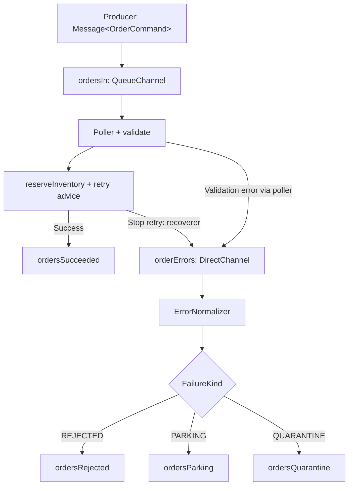

# Designing retries and error flows

## 1. Problem and design goals

In the **Flow Design** chapter of **SPRING_INTEGRATION_CORE**, retries and error flows are two halves of the same design: when a processing step fails, the system must decide whether to retry, which step to retry, and where to route the message if it cannot complete.

The running example throughout this lesson is an inventory reservation flow:

1. Receive a `Message<OrderCommand>`.
2. Validate the input data.
3. Call the inventory service to reserve stock.
4. Forward the successful result to the next channel.
5. For errors, classify into business rejection, deferred retry, or quarantine for investigation.

Suppose the inventory service briefly loses connectivity: retrying can help. If the order quantity is negative, calling three times is still invalid data. If the inventory service already reserved stock but the response was lost, retrying without idempotency can reserve stock twice.

After this lesson, learners should be able to:

- Distinguish exceptions propagating on the call stack from `ErrorMessage` sent over a channel.
- Select which errors are retried, and bound invocation counts and total processing time.
- Attach retries to the right endpoint using Java DSL.
- Preserve sufficient context when routing errors to a separate flow.
- Design recovery, replay, and tests without equating "message received" with "business work completed".

### Version scope

The main example uses **Java 17+, Spring Integration 7.0.x, and Spring Framework 7.0.x**. Use a compatible dependency set managed by your project or BOM; the lesson does not require changing an existing project's version.

Starting with Spring Integration 7.0, retry moved from the Spring Retry library to APIs in Spring Framework. Therefore, imports and configuration from 6.x examples cannot be dropped directly into 7.x examples. [Source: Spring Integration 7.0 changes](https://docs.spring.io/spring-integration/reference/7.0/whats-new.html).

| Item | Spring Integration 6.5.x | Spring Integration 7.0.x in this lesson |
|---|---|---|
| Underlying retry API | `org.springframework.retry.*` | `org.springframework.core.retry.*` |
| Advice configuration | Pass Spring Retry `RetryTemplate` via `setRetryTemplate(...)` | Pass Framework `RetryPolicy` via `setRetryPolicy(...)` |
| Limit equivalent to three calls | `maxAttempts = 3`, including the first call | `maxRetries = 2`, plus the first call equals three |
| Recovery callback | Type from Spring Retry | Type from Spring Integration |

Compare the older API in [Retry Advice 6.5](https://docs.spring.io/spring-integration/reference/6.5/handler-advice/classes.html). In 7.0, the call count formula is:

```text
totalAttempts = 1 + maxRetries

maxRetries = 0  -> at most 1 call
maxRetries = 2  -> at most 3 calls
```

The meaning of `maxRetries` is defined in [Spring Framework 7.0 RetryPolicy.Builder](https://docs.spring.io/spring-framework/docs/7.0.0/javadoc-api/org/springframework/core/retry/RetryPolicy.Builder.html#maxRetries(long)). Always declare explicit limits so outcomes do not depend on defaults.

## 2. Separate four decisions that are often conflated

A reliable flow must answer four separate questions:

| Decision | Question to answer | Inventory service example |
|---|---|---|
| Error classification | Is the error likely transient? | Temporary connection loss can be retried; out-of-stock is rejected |
| Retry | Which unit of work repeats, and how many times? | Repeat only the reservation call, at most three calls |
| Recovery | When retries stop, what is that step's output? | Emit an error message, return a valid fallback result, or throw |
| Re-intake | Who is allowed to put work back into the flow? | Retry queue consumer, broker, or controlled operational action |

**Retry** repeats work under a policy. **Recovery** is the action taken when the policy disallows continuing, including when the error is not retryable. **Redelivery** is the source resending the message. **Replay** is reprocessing work that was previously stored or stopped.

These four concepts can work together, but do not replace each other. An application with three handler retries and a broker delivering up to five times can call an external system up to `3 × 5 = 15` times for one job. If an internal HTTP client also makes two total attempts per call, the ceiling becomes `3 × 5 × 2 = 30`.

The multiplications above assume every layer hits its limit; the purpose is to compute the load ceiling. When writing real configuration, determine whether each parameter counts **total attempts** or **retry attempts** before doing the math.

## 3. Where errors go depends on the execution boundary

### 3.1. DirectChannel: errors usually return to the caller

With `DirectChannel`, the handler normally runs on the thread sending the message. If the handler throws an exception and nothing handles it, the exception travels back up the call stack toward `send(...)`, `MessagingTemplate`, or the gateway.

```text
caller thread:
send(message) -> DirectChannel -> handler -> exception
      ^                                     |
      +-------------- call stack -----------+
```

Putting an `errorChannel` header on a message does not turn every `DirectChannel` exception into an error event. Something must actually catch the error and emit an `ErrorMessage`, such as a recovery callback or a gateway configured with error handling.

### 3.2. QueueChannel and ExecutorChannel: the caller is no longer on the same call stack

With `QueueChannel`, the producer sends messages to a queue; a polling consumer reads and processes later. With `ExecutorChannel`, work is handed to an executor according to its execution policy.

When an error occurs beyond an asynchronous boundary, the original caller has usually moved on. Error handling must operate on the consumer/task side. With a Spring Integration poller, polling task errors can be published as an `ErrorMessage` through the error handler mechanism. A dedicated error channel configured on the poller is an explicit routing point to consider.

If using a header-aware strategy, the channel in `MessageHeaders.ERROR_CHANNEL` takes precedence over the global `errorChannel`. Check the specific error-emitting component; a recoverer passed an explicit target channel has its own send path. See [Error Handling](https://docs.spring.io/spring-integration/reference/7.0/error-handling.html).

| Call point | What does a successful `send(...)` usually prove? | Where are business errors observed? |
|---|---|---|
| DirectChannel | Synchronous subscriber finished without throwing an unhandled error | Caller, or configured recovery/error flow |
| QueueChannel | Message was placed in the queue | Poller, error flow, or business state |
| ExecutorChannel | Work was accepted for execution per the executor | The task's error handler mechanism |
| Request–reply gateway | Depends on whether a valid reply was received | Gateway exception or gateway error flow |

Even on `DirectChannel`, "no exception thrown" may simply mean a recoverer swallowed the error. Callers need an explicit business contract to interpret outcomes.

## 4. Contract of an error flow

### 4.1. ErrorMessage carries an error, not the command directly

In terms of data types:

```text
Message<OrderCommand>
    payload = OrderCommand
    headers = businessCorrelationId, ...

ErrorMessage
    payload = Throwable
    originalMessage = Message<?> or absent
```

The `Throwable` may be a `MessagingException` containing `failedMessage`. It may also be wrapped by a retry exception or an adapter exception.

Therefore, an error flow should perform these steps:

1. Receive the full `ErrorMessage`.
2. Locate `failedMessage` in the cause chain; if absent, inspect `originalMessage`.
3. Classify by exception and business context.
4. Convert into an error structure that can be observed, persisted, and routed.
5. Send to a terminal destination or a bounded delayed-retry mechanism.

Do not simply cast `error.getPayload()` to the command. An error message's payload is an exception. Also do not assume every error has an original message: startup, polling, or infrastructure errors may not map to any order.

### 4.2. Three error branches with different meanings

This lesson uses three branches:

| Branch | Meaning | Example | Next action |
|---|---|---|---|
| `REJECTED` | Request cannot be fulfilled under data/business rules | Invalid quantity, out of stock | Record rejection result; notify per contract |
| `PARKING` | Retryable error that exhausted the current retry budget | Inventory remains unreachable | Persist work for scheduled retry or reconciliation |
| `QUARANTINE` | Insufficient basis for safe automatic retry | Programming bug, unexpected schema | Isolate, investigate, and fix root cause |

`PARKING` does not resend messages on its own. A consumer, schedule, or operational workflow must pick up this branch. `QUARANTINE` also needs an owner (person or tool), a handling SLA, and diagnostic data.

A channel name like `deadLetterChannel` is just a bean name. To become a durable dead-letter destination, you need persistence, operational policy, and handling for when writing the error fails.

### 4.3. Error data must suffice for reprocessing

A production error record typically needs:

- `failureId`: identifier for the failure record to prevent duplicate writes.
- `businessKey`, `correlationId`: link the error to the original work.
- `failedComponent`, `operation`: the failing step.
- `errorCode`, exception type, sanitized description with sensitive data removed.
- Business payload or a safe reference to the payload.
- Schema version and failure timestamp.
- Attempt counts per layer, total replay count, and processing deadline.
- `nextAttemptAt`, processing status, and history of operational decisions.

Do not serialize a raw `ErrorMessage` across a broker by default: headers may hold `MessageChannel` objects, temporary reply channels, or in-process-only components. Normalize business data and metadata to match the system's storage contract.

## 5. Build a retry policy from business requirements

### 5.1. Retryable errors must be an intentional allowlist

| Situation | Suggested decision | Accompanying conditions |
|---|---|---|
| Transient failure to open connection | Short retry with backoff | Within deadline and operation is safe to repeat |
| Read timeout after sending a mutating request | Reconcile or retry with idempotency key | Uncertain whether the external system executed it |
| HTTP 429 | Retry when permitted | Respect `Retry-After`, quota, and deadline |
| HTTP 5xx | Inspect API contract and specific status code | Not every 5xx is worth retrying |
| Missing/malformed data | Reject or quarantine | Fix data before resending |
| Out of stock, ineligible account | Business rejection | Do not turn into a connectivity incident |
| Bad credentials/configuration | Stop and fix root cause | Rapid retries rarely help |
| Unclassified programming bug | Quarantine and alert | Keep out of the default retry list |

Adapters/clients should translate recognized technical errors into integration-domain exceptions, such as `TemporaryInventoryException`. Convert an error to a transient type only after checking its semantics.

If a handler catches an exception and returns `null` or `false`, the retry advice cannot tell on its own that work failed. For a handler returning a boolean, `false` can still be a normal outcome. Exception-based policies require handlers to throw the right exception type, or require a separate result-checking step.

### 5.2. Attempt limits must pair with backoff

With exponential backoff without jitter, you can plan using:

```text
delay(k) = min(maxDelay, initialDelay × multiplier^(k - 1))

k = 1 is the wait interval before the second call.
```

Suppose at most four calls, each capped at 500 ms, with waits of 100, 200, and 400 ms:

```text
T_handler_max ≈ 4 × 500 + 100 + 200 + 400
              = 2,700 ms
```

This estimate assumes each call actually blocks for 500 ms. Add queue wait time, connection setup, payload preparation, result processing, and error emission to estimate end-to-end time. If the client lacks an appropriate timeout, capping retry count does not create an execution-time ceiling.

Jitter staggers retry times across instances, reducing thundering herds hitting a dependency after an outage. With `RetryPolicy.Builder` you can configure `delay`, `multiplier`, `maxDelay`, and `jitter`; check the exact meaning of jitter in the API you use, because not every library implements full jitter. [Source: RetryPolicy.Builder 7.0](https://docs.spring.io/spring-framework/docs/7.0.0/javadoc-api/org/springframework/core/retry/RetryPolicy.Builder.html).

### 5.3. Choose in-place retry vs. delayed retry

| Criterion | Short in-handler retry | Delayed retry via storage/broker |
|---|---|---|
| Typical wait interval | Tens to hundreds of milliseconds, within system budget | Seconds, minutes, or longer |
| Execution thread | May be held during backoff | Can be released between attempts |
| Restart recovery | In-memory retries in progress can be lost | Depends on store and metadata durability |
| Deadline management | Inside current execution | Must carry deadline across deliveries |
| Complexity | Fewer components | Requires scheduler, replay cap, deduplication, and observability |

Do not use long `Thread.sleep` calls inside a handler to act as a scheduler. For example, with 20 threads and each job holding a thread for 2.7 seconds, ideal throughput is only about `20 / 2.7 ≈ 7.4` jobs/second before counting any other overhead.

Long retries also affect ordering: a failing message can stall a poller or allow later messages with the same business key to overtake it. You must trade off preserving order, isolating bad messages, and maintaining throughput.

## 6. Scope retries precisely

Consider the flow:

```text
validate -> reserveInventory -> saveOrder -> notifyCustomer
```

If `notifyCustomer` fails, repeating the entire flow could reserve inventory and save the order again. The unit of retry should be the smallest unit that can be safely repeated, with understood state and side effects.

For standard reply-producing handlers, a request-handler advice is designed to wrap the handler's request processing. Do not assume an advice attached to `reserveInventory` will retry downstream endpoints too. When wrapping gateways or custom advices, inspect the scope invoked inside. [Source: Adding Behavior to Endpoints](https://docs.spring.io/spring-integration/reference/7.0/handler-advice.html).

Step-by-step design:

- Validation: check once; return a rejection result if invalid.
- Inventory reservation: short retry on transient errors; use the same idempotency key.
- Order persistence: separate transaction and retries only for truly eligible errors.
- Notification: split into a separate job if it does not need to block order completion.

If reservation succeeded but saving the order failed, reconciliation or a compensating action to release inventory is needed depending on business requirements. Retries do not undo side effects that already happened in an external system.

With `filter`, a message sent to a discard channel without throwing an exception does not trigger exception-based retry. With splitter/aggregator, an error in one branch does not automatically cancel other branches or complete the message group; separate timeout, partial-result, and group-handling policies are required.

## 7. Java DSL example: inventory reservation and error routing

### 7.1. Processing diagram



The terminal channels in the example are in-memory queues for easy learning and testing. They are not yet a durable error-storage system. The flow does not automatically read `ordersParking` and resend to `ordersIn`.

The example uses the `org.springframework.integration:spring-integration-core` dependency from the compatible version set noted at the start. Java DSL is included in core; do not add a separate Java DSL artifact. The test section uses JUnit Jupiter.

### 7.2. Complete configuration

The code below can be placed in a single `RetryErrorFlowConfig.java` file. The simulated client lets you reproduce errors intentionally without making real network calls.

```java
package example.integration;

import java.time.Duration;
import java.util.concurrent.ConcurrentHashMap;
import java.util.concurrent.atomic.AtomicInteger;

import org.springframework.beans.factory.annotation.Qualifier;
import org.springframework.context.annotation.Bean;
import org.springframework.context.annotation.Configuration;
import org.springframework.core.retry.RetryPolicy;
import org.springframework.integration.channel.DirectChannel;
import org.springframework.integration.channel.QueueChannel;
import org.springframework.integration.config.EnableIntegration;
import org.springframework.integration.dsl.IntegrationFlow;
import org.springframework.integration.dsl.Pollers;
import org.springframework.integration.handler.advice.ErrorMessageSendingRecoverer;
import org.springframework.integration.handler.advice.RequestHandlerRetryAdvice;
import org.springframework.messaging.Message;
import org.springframework.messaging.MessageChannel;
import org.springframework.messaging.MessagingException;
import org.springframework.messaging.support.ErrorMessage;

@Configuration(proxyBeanMethods = false)
@EnableIntegration
public class RetryErrorFlowConfig {

    public record OrderCommand(String orderId, String sku, int quantity) {
    }

    public record Reservation(String orderId, String reservationId) {
    }

    public enum FailureKind {
        REJECTED, PARKING, QUARANTINE
    }

    public record FailureRecord(
            String orderId,
            String correlationId,
            FailureKind kind,
            String exceptionType,
            String reason,
            Object businessPayload) {
    }

    public static class InvalidOrderException extends RuntimeException {
        public InvalidOrderException(String message) {
            super(message);
        }
    }

    public static class OutOfStockException extends RuntimeException {
        public OutOfStockException(String message) {
            super(message);
        }
    }

    public static class TemporaryInventoryException extends RuntimeException {
        public TemporaryInventoryException(String message) {
            super(message);
        }

        public TemporaryInventoryException(String message, Throwable cause) {
            super(message, cause);
        }
    }

    public interface InventoryClient {
        Reservation reserve(OrderCommand command);
    }

    public static class DemoInventoryClient implements InventoryClient {

        private final ConcurrentHashMap<String, AtomicInteger> counts =
                new ConcurrentHashMap<>();

        @Override
        public Reservation reserve(OrderCommand command) {
            int attempt = counts
                    .computeIfAbsent(command.orderId(), key -> new AtomicInteger())
                    .incrementAndGet();

            if ("FLAKY".equals(command.sku()) && attempt <= 2) {
                throw new TemporaryInventoryException("Inventory temporarily unreachable");
            }
            if ("DOWN".equals(command.sku())) {
                throw new TemporaryInventoryException("Inventory still unavailable");
            }
            if ("SOLD_OUT".equals(command.sku())) {
                throw new OutOfStockException("Insufficient stock");
            }
            if ("BUG".equals(command.sku())) {
                throw new IllegalStateException("Unexpected inventory state");
            }

            return new Reservation(
                    command.orderId(), "reservation-" + command.orderId());
        }

        public int attempts(String orderId) {
            AtomicInteger count = counts.get(orderId);
            return count == null ? 0 : count.get();
        }
    }

    @Bean
    QueueChannel ordersIn() {
        return new QueueChannel(100);
    }

    @Bean
    QueueChannel ordersSucceeded() {
        return new QueueChannel(100);
    }

    @Bean
    MessageChannel orderErrors() {
        return new DirectChannel();
    }

    @Bean
    QueueChannel ordersRejected() {
        return new QueueChannel(100);
    }

    @Bean
    QueueChannel ordersParking() {
        return new QueueChannel(100);
    }

    @Bean
    QueueChannel ordersQuarantine() {
        return new QueueChannel(100);
    }

    @Bean
    DemoInventoryClient inventoryClient() {
        return new DemoInventoryClient();
    }

    @Bean
    RequestHandlerRetryAdvice inventoryRetry(
            @Qualifier("orderErrors") MessageChannel errors) {

        RetryPolicy policy = RetryPolicy.builder()
                .includes(TemporaryInventoryException.class)
                .maxRetries(2)
                .delay(Duration.ofMillis(100))
                .multiplier(2.0)
                .maxDelay(Duration.ofMillis(500))
                .build();

        ErrorMessageSendingRecoverer recoverer =
                new ErrorMessageSendingRecoverer(errors);
        recoverer.setSendTimeout(200);

        RequestHandlerRetryAdvice advice = new RequestHandlerRetryAdvice();
        advice.setRetryPolicy(policy);
        advice.setRecoveryCallback(recoverer);
        return advice;
    }

    @Bean
    IntegrationFlow orderProcessing(
            InventoryClient inventoryClient,
            RequestHandlerRetryAdvice inventoryRetry) {

        return IntegrationFlow.from("ordersIn")
                .transform(
                        OrderCommand.class,
                        RetryErrorFlowConfig::validate,
                        endpoint -> endpoint
                                .id("validateOrder")
                                .poller(Pollers
                                        .fixedDelay(Duration.ofMillis(100))
                                        .maxMessagesPerPoll(1)
                                        .errorChannel("orderErrors")))
                .handle(
                        OrderCommand.class,
                        (command, headers) -> inventoryClient.reserve(command),
                        endpoint -> endpoint
                                .id("reserveInventory")
                                .advice(inventoryRetry))
                .channel("ordersSucceeded")
                .get();
    }

    @Bean
    IntegrationFlow orderFailureRouting() {
        return IntegrationFlow.from("orderErrors")
                .transform(new ErrorNormalizer(), "normalize")
                .route(
                        FailureRecord.class,
                        failure -> failure.kind().name(),
                        router -> router
                                .channelMapping("REJECTED", "ordersRejected")
                                .channelMapping("PARKING", "ordersParking")
                                .channelMapping("QUARANTINE", "ordersQuarantine"))
                .get();
    }

    private static OrderCommand validate(OrderCommand command) {
        if (command.orderId() == null || command.orderId().isBlank()) {
            throw new InvalidOrderException("orderId must not be blank");
        }
        if (command.sku() == null || command.sku().isBlank()) {
            throw new InvalidOrderException("sku must not be blank");
        }
        if (command.quantity() <= 0) {
            throw new InvalidOrderException("quantity must be greater than 0");
        }
        return command;
    }

    public static class ErrorNormalizer {

        public FailureRecord normalize(ErrorMessage error) {
            Message<?> failed = findFailedMessage(error);
            Object payload = failed == null ? null : failed.getPayload();
            String correlationId = failed == null ? null
                    : failed.getHeaders().get(
                            "businessCorrelationId", String.class);

            String orderId = "unknown";
            if (payload instanceof OrderCommand command) {
                orderId = command.orderId();
            }
            else if (payload instanceof Reservation reservation) {
                orderId = reservation.orderId();
            }

            Throwable root = deepestCause(error.getPayload());
            return new FailureRecord(
                    orderId,
                    correlationId,
                    classify(error.getPayload()),
                    root.getClass().getName(),
                    root.getMessage(),
                    payload);
        }

        private static Message<?> findFailedMessage(ErrorMessage error) {
            Throwable current = error.getPayload();
            for (int depth = 0; current != null && depth < 32; depth++) {
                if (current instanceof MessagingException messaging
                        && messaging.getFailedMessage() != null) {
                    return messaging.getFailedMessage();
                }
                current = current.getCause();
            }
            return error.getOriginalMessage();
        }

        private static FailureKind classify(Throwable error) {
            FailureKind result = FailureKind.QUARANTINE;
            Throwable current = error;
            for (int depth = 0; current != null && depth < 32; depth++) {
                if (current instanceof InvalidOrderException
                        || current instanceof OutOfStockException) {
                    return FailureKind.REJECTED;
                }
                if (current instanceof TemporaryInventoryException) {
                    result = FailureKind.PARKING;
                }
                current = current.getCause();
            }
            return result;
        }

        private static Throwable deepestCause(Throwable error) {
            Throwable current = error;
            for (int depth = 0;
                    current.getCause() != null && depth < 32;
                    depth++) {
                current = current.getCause();
            }
            return current;
        }
    }
}
```

### 7.3. How the components coordinate

`ordersIn` is a `QueueChannel`, so the first endpoint consuming it requires a poller. In the example, the poller is configured on the validation transformer. Downstream endpoints connect through internal channels; they run in the execution thread initiated by the poller for this message. Declaring pollers in DSL is described in [Pollers](https://docs.spring.io/spring-integration/reference/7.0/dsl/java-pollers.html).

The advice is attached only to `reserveInventory`. Therefore, an invalid quantity never causes the inventory client to be called. For SKU `FLAKY`, the client throws twice and returns `Reservation` on the third attempt. For SKU `DOWN`, all three attempts fail.

The policy includes `TemporaryInventoryException`; business errors or unexpected exceptions are not in the retry list. Framework retry exception filters inspect the cause chain, so wrapping an integration-domain exception does not necessarily lose classification. [Source: programmatic retry support](https://docs.spring.io/spring-framework/reference/core/resilience.html#resilience-programmatic).

When retries do not continue, `ErrorMessageSendingRecoverer` emits the error to the supplied channel. In the 7.0 implementation, this recoverer returns `null` after sending, so that branch produces no `Reservation` to proceed to `ordersSucceeded`. This is the right contract for the asynchronous work-processing example. [Source: ErrorMessageSendingRecoverer 7.0.0](https://github.com/spring-projects/spring-integration/blob/v7.0.0/spring-integration-core/src/main/java/org/springframework/integration/handler/advice/ErrorMessageSendingRecoverer.java).

Do not enable `requiresReply` on the handler while keeping a recovery returning `null` without redesigning the output contract. If an endpoint requires a reply, a null recovery result can trigger another missing-reply error.

The normalizer uses a POJO method accepting `ErrorMessage` to read the whole envelope. If replaced with `.handle(Throwable.class, ...)`, the lambda receives the exception payload; it will not automatically receive the envelope's `originalMessage`. When writing DSL lambdas, clearly distinguish payload from full message. [Source: Service Activators and handle](https://docs.spring.io/spring-integration/reference/7.0/dsl/java-handle.html).

The 32-level depth cap in the traversal loops is a defensive guard for the example. In a real system, also consider adapter-specific exceptions, composite errors, and suppressed exceptions if they carry essential information.

### 7.4. Intentional limitations of the example

The simulated client only counts calls. Returning the same reservation ID string does not prove a real client or inventory service is idempotent. When replacing it with a real HTTP/gRPC client, implement idempotency on the side performing side effects.

Queues have capacity 100 to avoid unbounded memory growth. The example assumes output queues have space; add send timeouts and saturation handling for long-running use. `recoverer.setSendTimeout(200)` is the timeout for the recoverer's send operation, not a 200 ms deadline for the entire error flow.

In particular, `orderErrors` is a `DirectChannel`: the normalizer and router run synchronously inside the error send call. A slow subscriber can block the thread performing recovery. Send timeout does not forcibly abort a synchronous subscriber's execution.

`FailureRecord` in the example uses an in-memory payload and simple exception message for ease of learning. Durable persistence needs an explicit schema, data policy, and mechanism to confirm successful storage as outlined in Section 4.

## 8. Gateway: specify clearly what the caller receives

A gateway hides the messaging API yet still needs an error contract. For a request–reply gateway, three choices are common:

1. **Propagate error to caller:** let exceptions flow back to the gateway per configuration.
2. **Return a typed failure result:** for example, `OrderResult(status=REJECTED, reason=...)`.
3. **Switch to a job-intake model:** return an intake token, then let the caller query business status.

If configuring an error channel for a request–reply gateway, the error flow can produce a substitute reply. If the error flow merely logs and ends, the caller may fail to receive the expected reply and wait until the gateway timeout expires.

The Section 7 example uses an input queue and output queues without providing a request–reply gateway. You cannot simply put a synchronous gateway at the input and expect `ordersSucceeded` to automatically send results back to a temporary reply channel: results are currently routed to a specific channel for another consumer to pull.

Distinguish three kinds of timeouts:

| Timeout | What duration does it measure? | Does it automatically cancel in-flight side effects? |
|---|---|---|
| Send/request timeout | Waiting to send/enqueue a request per channel type | No |
| Reply timeout | Waiting for a gateway response | Not by default |
| Remote client timeout | Waiting for connection/response on one external call | Client-dependent; does not prove remote side did not process |

In a synchronous chain on the caller thread, reply timeout is also not a mechanism that forcibly interrupts a blocked handler. Deadlines must be propagated and enforced right where I/O happens. Refer to gateway behavior in [Messaging Gateways](https://docs.spring.io/spring-integration/reference/7.0/gateway.html).

## 9. Testing flow behavior

### 9.1. Scenario matrix

Each scenario below uses a distinct `orderId` so simulated call counts do not interfere with each other.

| Data / scenario | Expected inventory call count | Final outcome |
|---|---|---|
| Normal SKU, valid quantity | 1 | One `Reservation` in `ordersSucceeded` |
| SKU `FLAKY` | 3 | Succeeds after two transient errors |
| SKU `DOWN` | 3 | One `FailureRecord(PARKING)` |
| SKU `SOLD_OUT` | 1 | One `FailureRecord(REJECTED)` |
| Quantity 0 | 0 | One `FailureRecord(REJECTED)` from validation error |
| SKU `BUG` | 1 | One `FailureRecord(QUARANTINE)` |

In addition to the target channel, verify that the success branch and error branches do not both receive an output for the same execution. A properly working error flow must never mask a failed order with a fake success result.

### 9.2. Testing retry exhaustion across the full flow

The following test uses a real Spring context without mocking the retry advice. Assertions verify both business output and client call counts.

```java
package example.integration;

import org.junit.jupiter.api.Test;
import org.springframework.context.annotation.AnnotationConfigApplicationContext;
import org.springframework.integration.channel.QueueChannel;
import org.springframework.messaging.Message;
import org.springframework.messaging.support.MessageBuilder;

import static example.integration.RetryErrorFlowConfig.*;
import static org.junit.jupiter.api.Assertions.*;

class RetryErrorFlowTest {

    @Test
    void exhaustedTemporaryFailureGoesToParkingWithContext() {
        try (var context =
                     new AnnotationConfigApplicationContext(
                             RetryErrorFlowConfig.class)) {

            QueueChannel input =
                    context.getBean("ordersIn", QueueChannel.class);
            QueueChannel parking =
                    context.getBean("ordersParking", QueueChannel.class);
            QueueChannel succeeded =
                    context.getBean("ordersSucceeded", QueueChannel.class);
            QueueChannel rejected =
                    context.getBean("ordersRejected", QueueChannel.class);
            QueueChannel quarantine =
                    context.getBean("ordersQuarantine", QueueChannel.class);
            DemoInventoryClient client =
                    context.getBean(DemoInventoryClient.class);

            OrderCommand command = new OrderCommand("order-down", "DOWN", 2);
            Message<OrderCommand> request = MessageBuilder
                    .withPayload(command)
                    .setHeader("businessCorrelationId", "corr-down")
                    .build();

            assertTrue(input.send(request, 100));

            Message<?> parked = parking.receive(3_000);
            assertNotNull(parked);
            FailureRecord failure =
                    assertInstanceOf(FailureRecord.class, parked.getPayload());

            assertEquals(3, client.attempts("order-down"));
            assertEquals(FailureKind.PARKING, failure.kind());
            assertEquals("order-down", failure.orderId());
            assertEquals("corr-down", failure.correlationId());
            assertEquals(command, failure.businessPayload());
            assertNull(succeeded.receive(0));
            assertNull(rejected.receive(0));
            assertNull(quarantine.receive(0));
        }
    }
}
```

`receive(3_000)` waits with a bounded timeout for a result, avoiding `Thread.sleep` guesses about whether the poller finished. Three seconds is the test's wait bound, not a production latency guarantee.

To verify exact backoff intervals, test the policy with a controllable clock/backoff or timestamp recorder. Avoid tight millisecond assertions on CI machines. For outcome tests, you can use a test policy with short delays while keeping the same attempt limits and classification rules.

### 9.3. Additional scenarios to verify

- Integration-domain exceptions wrapped inside `MessagingException` are still classified properly.
- Error messages without an original/failed message still go to quarantine with missing metadata represented clearly.
- Non-retryable errors invoke the client once and proceed to the appropriate terminal branch.
- Reservation succeeded but response was lost: retrying with the same key does not reserve stock a second time.
- Error destination fails to persist: business work is not marked durably accepted.
- Deadline expires before the next attempt: dependency is no longer called.
- Crash after saving the error record but before ACK: redelivery does not create duplicate error records or side effects.
- When replacing in-memory queues with durable storage, work survives restarts.

Scenarios involving brokers, transactions, or databases must be tested against the real components or corresponding integration environment; in-memory queue tests do not prove those guarantees.

## 10. Stateless retry, stateful retry, and redelivery sources

### 10.1. Stateless retry

The main example uses stateless retry: a single handler invocation executes the entire retry cycle in place. The advice manages attempts and backoff within that execution.

Here "stateless" does not mean there are no counters during the cycle. It means external redeliveries are not linked to retry state keyed by business key as in the stateful mechanism.

Stateless retry is suitable when:

- Wait intervals are short and fit inside the processing budget.
- The handler can be safely repeated.
- Callers/consumers tolerate holding the thread during the cycle.
- No external message redelivery is needed between attempts.

### 10.2. Stateful retry

Stateful retry needs to recognize a redelivered message as work already attempted earlier. With Spring Integration 7.0, supply a `stateKeyFunction` to `RequestHandlerRetryAdvice` to enable this mode.

For instance, a key might represent `tenant + operation + orderId + commandVersion`. Do not use `MessageHeaders.ID` as the key if the source can generate a new message ID for the same job on redelivery.

The external source remains responsible for redelivering the message. Simply enabling stateful retry and sending into a flow with no resubmission mechanism leaves nothing guaranteeing the next attempt will happen. The advice's state cache is also not a durable store to preserve attempt counts across restarts or synchronize across instances. [Source: RequestHandlerRetryAdvice](https://docs.spring.io/spring-integration/api/org/springframework/integration/handler/advice/RequestHandlerRetryAdvice.html).

Stateful retry does not mean all backoff waits are offloaded to a separate scheduler. Check your version's implementation and how redelivery works; do not treat it as a guarantee that consumers never wait.

### 10.3. Assign one owner for each kind of retry

One workable division of responsibility:

| Scope | Owner | Purpose |
|---|---|---|
| Brief glitches within a call | Handler advice | A few quick retries |
| Prolonged outages | Retry destination or broker | Wait longer with bounded redelivery |
| Invalid business data | Rejected branch | Wait for corrected data or a new valid request |
| Unknown errors | Quarantine and operations | Investigate before reprocessing |

Do not enable multiple layers with default values simultaneously and hope total call counts stay small. The total budget must account for client, advice, broker, and replay actions.

## 11. Transactions and idempotency determine whether retries are safe

### 11.1. Retries do not create new transactions automatically

These two structures behave differently:

```text
A. retry
     -> new transaction per attempt
          -> database operation

B. one outer transaction
     -> retry multiple attempts inside the same transaction
          -> database operation
```

In structure A, each failure can roll back before the next attempt. In structure B, the transaction may already be marked rollback-only on the first failure; retrying inside the same transaction cannot guarantee a commit.

When using transaction advice in an integration flow, inspect the scope of pollers, gateways, handlers, and advice ordering. When adding transactions to the example, draw the actual wrapping structure and test what commits/rolls back on each branch. Advice order affects execution semantics. [Source: Ordering Advices within Advice Chain](https://docs.spring.io/spring-integration/reference/7.0/handler-advice/order.html).

Specifically, a recovery callback that consumes the error and returns normally can prevent upstream components from seeing an exception to roll back or reject the message. Exact ACK/commit behavior depends on the inbound adapter, transaction manager, and broker config. Actively choose one contract: succeeded, durably handed off to errors, or failed so the source redelivers.

### 11.2. Idempotency is tied to side effects

Consider the scenario:

```text
Application sends reserve(order-42, key=reserve:order-42:v1)
Inventory reserves stock successfully
Response is lost on the return trip
Application sees a timeout
Application retries with the same key
```

The inventory service must recognize that the same action already occurred and return the corresponding result, or the application must be able to query the outcome before deciding to retry.

A "message seen" record in the application is insufficient if written after the side effect. The process could crash after inventory reserved stock but before the application marked completion.

The design must establish:

- A key representing one exact business action, including tenant and version when needed.
- Atomic persistence of the key and outcome alongside the protected action.
- Behavior when the same key arrives with a different payload.
- Key retention longer than the supported redelivery/replay window.
- A way to reconcile unknown status after timeouts or restarts.

Retries do not provide exactly-once guarantees for side effects over a network. Only combining redelivery with idempotency and reconciliation handles uncertain outcomes.

### 11.3. Side effects across multiple systems

If you save order state in a database and then need to publish an event, consider a transactional outbox so the state change and publish intent are committed in the same local transaction. Downstream consumers still need deduplication because publishers can redeliver.

If an already-succeeded action in an external system must be undone, define a compensating action and a separate retry policy for compensation. An `ErrorMessage` does not turn a reservation call into a distributed transaction with automatic rollback.

## 12. Error flows must have a reliable completion path

### 12.1. Logging is not handing off responsibility

The default global `errorChannel` serves general error handling and has a logging subscriber. When a problem requires never losing orders, logging is not enough to preserve payloads, processing state, and work ownership.

In production, sending to an error channel must end with an explicit guarantee, such as:

- Error record committed in a database.
- Error message acknowledged by the target storage system under durable configuration.
- Business status transitioned to rejected or needing intervention, queryable by callers/ops.

Do not treat a successful `send(...)` to an in-memory queue as durable error persistence across restarts.

### 12.2. When the error flow itself fails

Example: the handler exhausts retries, the recoverer sends to `orderErrors`, yet the error store is unreachable. If the error handler simply catches the second failure and ignores it, the job can lose its final path.

Design explicitly for this situation:

1. Select which storage errors are retried, with a dedicated limit.
2. Preserve the exception so the source can redeliver when the source contract permits.
3. Or fall back to a secondary store with appropriate guarantees.
4. Alert that the error path cannot accept work.
5. Use an identifier to prevent duplicate error writes upon source redelivery.

Avoid routing every error from an error handler right back to the failing channel with no stop condition. Nested cause chains or unbounded forwarding loops can obscure the root cause and overload the system.

In the example, the error channel is a `DirectChannel`, so exceptions from the normalizer/router can propagate back to the error sender. This behavior must be tested when replacing the illustrative queues with real storage systems.

### 12.3. The gap between saving an error and ACKing

If the error is persisted successfully but the process crashes before ACKing the source message, the source can redeliver the same work. If ACK happens before the error is durably saved and then the process crashes, the job may disappear with nowhere left to process it.

This is a handoff problem between two systems. Choose an appropriate transaction when components support it, or accept redelivery paired with deduplication. Never infer atomicity simply because two operations sit next to each other in the Java DSL.

## 13. Design bounded replays

A record in parking or quarantine should not be shoved back into input unconditionally. Replay is also a business flow with budgets and ownership.

Recommended procedure:

1. Read eligible records while claiming ownership so multiple workers do not replay concurrently.
2. Verify the root cause is resolved, the schema is still understood, and the deadline has not expired.
3. Check current state: the work may already have completed in the external system.
4. Reconstruct the business message from the normalized payload.
5. Keep the action's idempotency key intact; increment replay count with a controlled update.
6. Route to the appropriate flow; record the result or schedule the next attempt.
7. Transition to a terminal state when attempt limits or message age limits are reached.

A reconstructed message may get a new `MessageHeaders.ID`, but the `businessKey` for the same action must remain stable. Old temporary `replyChannel` and `errorChannel` headers from a previous process should not be blindly reinserted.

An example replay metadata structure:

```json
{
  "failureId": "failure-2026-001",
  "operation": "reserveInventory",
  "businessKey": "tenant-a:reserve:order-42:v1",
  "correlationId": "corr-42",
  "schemaVersion": 1,
  "replayCount": 2,
  "maxReplayCount": 5,
  "nextAttemptAt": "2026-11-20T03:15:00Z",
  "deadline": "2026-11-20T04:00:00Z",
  "status": "WAITING"
}
```

The timestamps and limits above are merely a data-contract example. The system must agree on storage, clock source, record claiming, and deadline calculation per business requirements.

For external operations with uncertain outcomes, prioritize reconciliation before replay. Never change the idempotency key just to bypass deduplication: doing so turns the replay into a brand-new action that can cause a second side effect.

## 14. Observe the flow via business state

Error message counts alone do not tell whether the system is recovering or stuck. Track at a minimum:

| Metric | What to detect |
|---|---|
| Jobs accepted and completed | Whether work is backing up or getting lost |
| Attempts per operation | How much retries are amplifying load |
| Success rate after retry | Whether retries are actually helping |
| Exhausted retries by error group | Which failures need handling at another layer |
| Depth and max message age in parking/quarantine | Whether work is being abandoned |
| Error-message send/save failures | Whether the error path itself is still healthy |
| Queue wait, dependency latency, backoff time | Where latency is spent |
| Deduplication hit count | Whether sources redeliver or replay too aggressively |

Use low-cardinality values like `operation`, `component`, and `errorCode` as metric tags. Put order ID, failure ID, and correlation ID into logs/traces instead of very high-cardinality metric labels.

Separate statuses such as `RECEIVED`, `PROCESSING`, `SUCCEEDED`, `REJECTED`, `WAITING_RETRY`, and `QUARANTINED`. An "accepted" status tells callers the system owns the work; it must not be presented as a successful stock reservation.

Circuit breakers and concurrency limits can complement retries during widespread dependency outages. Retry decides whether to try a single job again; a circuit breaker throttles calls to a dependency deemed unhealthy. When combining multiple advices, check ordering because a breaker wrapping the whole retry cycle counts differently from a breaker observing individual attempts.

## 15. Common design mistakes

| Design mistake | Consequence | Adjustment |
|---|---|---|
| Retrying every `Exception` | Retries data errors and bugs alike | Filter exceptions/predicates per contract |
| Only setting `errorChannel` header on DirectChannel | Caller still gets unhandled exceptions | Add an actual error catcher/emitter |
| Wrapping retry around a chain with multiple side effects | Already-succeeded steps rerun | Narrow scope and add idempotency |
| Stacking client, advice, and broker retries | Call count explodes unexpectedly | Compute total ceiling and assign one owning layer |
| Returning `null` from recovery on an API requiring a reply | Missing reply or confusing timeouts | Define result type or propagate exception |
| Logging an error and considering work done | No data left to recover | Persist state/errors per durable contract |
| Calling an in-memory queue a durable DLQ | Errors lost on process stop | Use storage with appropriate guarantees |
| Wiring parking back to input with no attempt count or deadline | Infinite retry loop | Store metadata, limits, and schedule |
| Holding a transaction open across long backoffs | Holds locks/resources too long | Shrink transactions; use delayed retry when needed |
| Expecting reply timeout to cancel in-flight I/O | Side effects continue after caller gives up | Configure client timeouts/cancellation and reconcile |

## 16. Applying to a new flow

Before locking in retries and error flows for an operation, write down these decisions in the design:

1. **Result contract:** does the caller need a reply, an intake token, or asynchronous final status?
2. **Unit of retry:** which endpoint repeats and which side effects sit inside it?
3. **Error classification:** which errors may recover on their own, which reject, and which quarantine?
4. **Budget:** what are total calls, delays, deadline, and concurrency limits?
5. **Safety:** if the same work is redelivered, what protects side effects?
6. **Error destination:** where are records stored, and when is error handoff considered complete?
7. **Secondary failures:** if the error destination cannot accept work, who retains responsibility?
8. **Replay:** who triggers it, with what key, up to how many attempts, and when does it stop?
9. **Verification:** can you observe exact outcomes, call counts, and post-restart state?

For the reservation flow in this lesson, the initial answers are: accept work asynchronously; do not retry validation; retry only inventory calls for transient errors; at most three calls per processing cycle; on exhaustion emit an error and branch by cause. To take this design to production, complete inventory-service idempotency, durable error storage, and replay/reconciliation aligned with system requirements.
