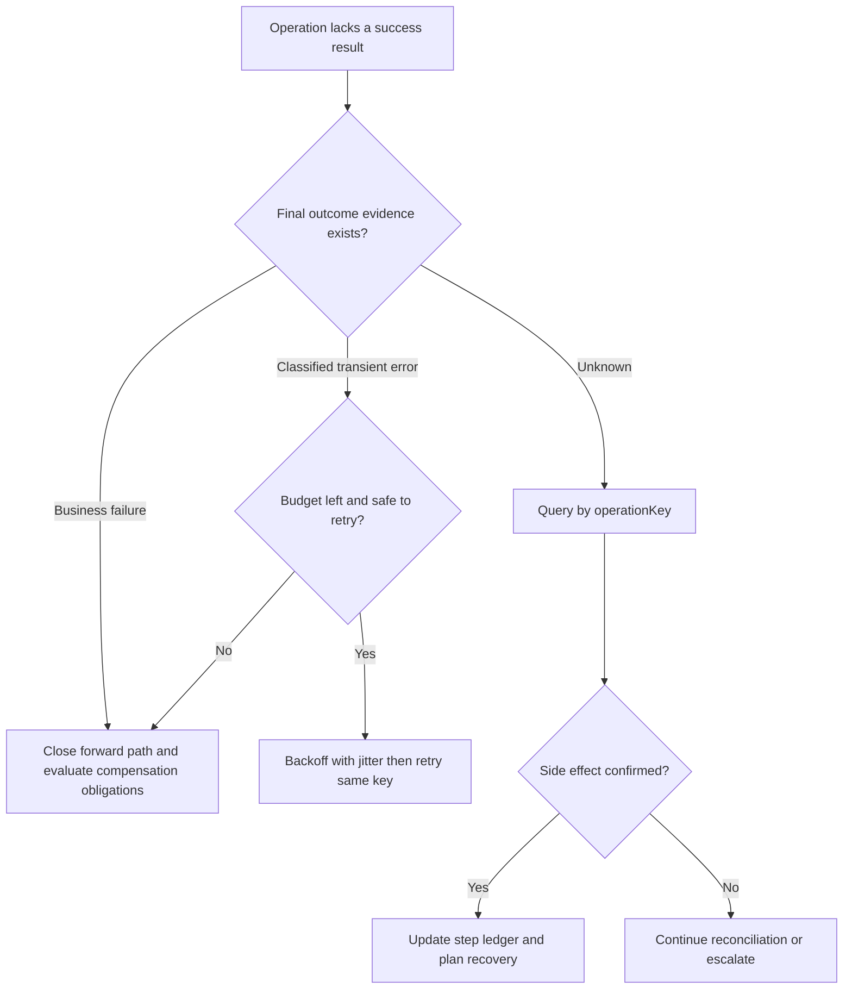

# Designing timeouts and compensation

In the **Flow Design** chapter of **SPRING_INTEGRATION_CORE**, timeouts and compensation give a message flow an explicit termination path when a component runs slowly, a response is lost, or one step modifies data and a later step fails. This lesson combines `Message`, `MessageChannel`, endpoints, gateways, routers, aggregators, and Java DSL to design that behavior.

The starting point is a crucial distinction: **timing out only means the waiting party did not receive a result within the allotted window**. It does not prove the operation on the other side failed, produced no side effects, or was canceled. Compensation is a business action to deal with side effects that have already occurred; it requires its own state, evidence, and policy.

After this lesson, you will be able to:

- Distinguish send timeouts, reply timeouts, external service timeouts, group timeouts, and business deadlines.
- Allocate a time budget across a flow, propagate deadlines through messages, and bound retries.
- Design paths for timeouts, technical errors, late replies, and unknown outcomes.
- Build a compensation plan with idempotency, progress persistence, and restart recovery.
- Propose tests for timeout-versus-success race conditions, rather than testing only the happy path.

The illustrative configuration snippets use Java 17 or later and the Spring Integration 6.5 API. They are building blocks to explain the design, not a complete application. Business classes and persistence ports are stated explicitly in each example. Timeout values are configured explicitly rather than relying on defaults across versions.

## 1. How can an order flow fail?

Consider a sequential flow:

```text
Receive request
  -> reserve inventory
  -> authorize payment
  -> book shipment
  -> confirm order
```

Suppose inventory was reserved, but the payment service does not reply within the allowed time. There are at least three possibilities:

1. The payment request never reached the target service.
2. The target service is processing and will reply late.
3. The target service authorized payment successfully, but the response was lost.

If you immediately resend using a new operation key, the system may create two authorizations. If you release inventory and ignore all late replies, the system may hold an authorization with no corresponding order.

Therefore, the design must answer two independent questions:

| Question | Mechanism needed |
|---|---|
| When do we stop waiting or stop starting new work? | Timeouts, deadlines, queue bounds, and resource limits |
| How do we handle side effects that occurred or may have occurred? | Step ledger, reconciliation, idempotency, and compensation |

A timeout error may lead to reconciliation before compensating. A definitive business failure, such as insufficient stock before any reservation succeeds, can finish without any compensation.

## 2. Identify what each timeout protects

### 2.1. Timeout layers

| Layer | Meaning | What must not be inferred |
|---|---|---|
| Gateway `requestTimeout` | Bounds sending into a potentially blocking channel, e.g. a full bounded `QueueChannel` | Does not bound execution time of a synchronous handler |
| Gateway `replyTimeout` | Bounds how long the gateway waits for a reply after the send call returns control | Does not automatically cancel dispatched work |
| HTTP client or other client timeout | Bounds a phase such as pool acquisition, connect, or reading a response | Does not guarantee the remote service did not commit data |
| Poller receive timeout | Bounds one wait to receive from a source or pollable channel | Is not a full-message processing deadline |
| Aggregator group timeout | Schedules forcing an existing group to be evaluated for completion or discard | Does not track requests that never created a group |
| Business deadline | Timestamp after which the flow must no longer complete on the success path per policy | Does not create thread interruption or data rollback by itself |
| Compensation task timeout | Bounds one compensation call or one recovery phase | Cannot reuse the already-expired original work deadline |

With a gateway, `requestTimeout` only bounds send waiting when the channel can actually block. `replyTimeout` and remote client timeouts protect different segments. Specifically, timeout properties on an outbound gateway must be read per concrete adapter; having "reply" in a property name is not enough to conclude it is a socket read timeout. See [Gateway Timeouts](https://docs.spring.io/spring-integration/reference/6.5/gateway.html#gateway-timeouts) and [HTTP Timeout Handling](https://docs.spring.io/spring-integration/reference/http/timeout.html).

### 2.2. Synchronous boundaries determine whether a timeout takes effect

```text
Caller -> Gateway -> DirectChannel -> Handler blocking for 10 seconds
```

`DirectChannel` invokes the subscriber on the sending thread. While the handler has not returned, the caller is still inside the send call. Setting `replyTimeout = 1000` does not turn that handler call into work interrupted after one second. Channel threading characteristics are described in [Message Channel Implementations](https://docs.spring.io/spring-integration/reference/channel/implementations.html).

With an asynchronous boundary:

```text
Caller -> Gateway -> QueueChannel -> Poller -> Handler
                  <- wait for reply
```

The caller can stop waiting while the poller or handler continues. This makes wait limits more useful, yet simultaneously introduces requirements for handling late replies and pending backlogs. Switching to `ExecutorChannel` must also account for the executor, queue capacity, and rejection policy; do not assume every call is decoupled from the sending thread under every configuration.

A safe timeout must be paired with bounding active concurrent tasks. Merely returning timeouts to callers while admitting unbounded work can still exhaust threads, connections, or memory.

## 3. Design the time budget from the outside in

### 3.1. Start from the business contract

Suppose an order request has a two-second deadline from the moment the system accepts it. An initial design budget could be:

| Item | Illustrative budget |
|---|---:|
| Initial orchestration wait | 100 ms |
| Reserve inventory | 400 ms |
| Authorize payment, including eligible retries | 650 ms |
| Book shipment | 350 ms |
| Record and finalize result | 150 ms |
| Reserve for orchestration and jitter | 350 ms |
| Total | 2,000 ms |

These are exercise assumptions that must be tuned to latency metrics, load, and contracts of the real system. For parallel branches, time along the critical path governs total latency; branch count still affects resource consumption and side effects to manage.

A step's budget includes all relevant components:

```text
resource wait time
  + sum of attempt durations
  + sum of backoffs
  + orchestration/recording time
  <= step budget
```

For example, two payment attempts capped at 250 ms each plus one 50 ms backoff consume up to 550 ms before recording. A step must not continue retrying merely because retry attempts remain if the overall deadline no longer leaves enough time.

### 3.2. Propagate an absolute deadline

A message contract can use application-defined headers:

| Header | Purpose |
|---|---|
| `sagaId` | Identifies one business flow execution instance |
| `deadlineEpochMs` | Absolute deadline in epoch milliseconds |
| `operationKey` | Idempotency key for a specific operation |
| `attempt` | Attempt number for observability, not used as a deduplication key |
| `causationId` | Links the event or command that caused the current message |

`MessageHeaders.ID` identifies the framework message, not a stable business key across retries. Redeliveries of the same operation must still carry the same `operationKey`.

At the entry point, validate and clamp client-supplied deadlines under server policy. At broker or HTTP boundaries, explicitly map headers that must cross into supported properties or fields. Do not assume every Java header serializes automatically.

Example function computing timeout before a call:

```java
import java.time.Clock;
import java.time.Duration;
import java.util.concurrent.TimeoutException;

public final class DeadlineBudget {
    private DeadlineBudget() {
    }

    public static Duration nextAttemptTimeout(
            long deadlineEpochMs,
            Duration perAttemptLimit,
            Duration reserveAfterCall,
            Clock clock) throws TimeoutException {

        long capMs = perAttemptLimit.toMillis();
        long reserveMs = reserveAfterCall.toMillis();
        if (capMs <= 0 || reserveMs < 0) {
            throw new IllegalArgumentException("Invalid timeout budget");
        }

        long usableMs = deadlineEpochMs - clock.millis() - reserveMs;
        if (usableMs <= 0) {
            throw new TimeoutException("No time left for another attempt");
        }

        return Duration.ofMillis(Math.min(capMs, usableMs));
    }
}
```

This example assumes input epoch and durations were range-checked at ingress. `reserveAfterCall` reserves time for recording and remaining steps per orchestration policy, rather than being a constant across all steps.

The returned value must be applied to the client's appropriate timeout API. If a client has separate timeouts for pool acquisition, connect, and read, setting each one to the entire remaining budget can let total duration exceed the limit. You need an overall call limit or per-phase allocation, plus a deadline check after the call returns.

Never convert negative remaining time into `0` and pass it to a library without checking its semantics: in some APIs, `0` means an infinite wait.

Absolute deadlines across machines require synchronized clocks and skew margin. Measuring elapsed time within a single process can use a monotonic clock like `System.nanoTime()`; never send that value to another machine as an absolute timestamp.

### 3.3. Do not grant a fresh deadline at every endpoint

If every handler resets `deadline = now + 2 seconds`, a message can live far longer than the original promise. Preserve the original job's deadline across transformers, routers, and retries; recompute remaining budget right before a new call.

Checking the deadline at the start of a step avoids starting already-expired work. Checking when recording results prevents a late response from succeeding against policy. The two checks serve two different purposes.

Once recovery is needed, create compensation commands with their own deadlines and retry schedules, while keeping `originalDeadlineEpochMs` for traceability. A customer-facing deadline must not prevent the system from releasing resources still held.

## 4. Gateway: limit how long the caller waits

### 4.1. A configuration with an asynchronous boundary

The example below uses a bounded `QueueChannel`. `OrderWorker` is a business port implemented by the application; `execute` must persist business results before returning a reply.

```java
import java.util.Map;
import org.springframework.messaging.Message;

public record PlaceOrder(String orderId, int quantity) {
}

public record OrderReply(String orderId, String status) {
}

public interface OrderWorker {
    OrderReply execute(PlaceOrder command, Map<String, Object> headers);
}
```

Place `public` types in separate Java files when implementing. The gateway accepts a `Message` so the caller can supply business headers:

```java
import org.springframework.integration.annotation.MessagingGateway;
import org.springframework.messaging.Message;

@MessagingGateway(
    defaultRequestChannel = "orderRequests",
    defaultRequestTimeout = "50",
    defaultReplyTimeout = "1000"
)
public interface OrderGateway {
    Message<OrderReply> place(Message<PlaceOrder> request);
}
```

Java DSL configuration:

```java
import org.springframework.context.annotation.Bean;
import org.springframework.context.annotation.Configuration;
import org.springframework.integration.channel.QueueChannel;
import org.springframework.integration.config.EnableIntegration;
import org.springframework.integration.annotation.IntegrationComponentScan;
import org.springframework.integration.dsl.IntegrationFlow;
import org.springframework.integration.dsl.Pollers;

@Configuration
@EnableIntegration
@IntegrationComponentScan(basePackageClasses = OrderGateway.class)
public class OrderFlowConfiguration {

    @Bean
    QueueChannel orderRequests() {
        return new QueueChannel(100);
    }

    @Bean
    IntegrationFlow orderFlow(
            QueueChannel orderRequests,
            OrderWorker worker) {

        return IntegrationFlow.from(orderRequests)
            .handle(PlaceOrder.class,
                (command, headers) -> worker.execute(command, headers),
                endpoint -> endpoint
                    .requiresReply(true)
                    .poller(Pollers.fixedDelay(10)
                        .maxMessagesPerPoll(10)))
            .get();
    }
}
```

In the example, `50` ms is the send wait when the queue is full; `1000` ms is the caller's reply wait. These two intervals are not a combined guarantee of exactly one second. `requiresReply(true)` detects handlers returning `null` out of contract; it does not turn a gateway timeout into a business event or cancel running tasks.

Illustrative call:

```java
Message<PlaceOrder> request = MessageBuilder
    .withPayload(new PlaceOrder("ORDER-42", 2))
    .setHeader("sagaId", sagaId)
    .setHeader("deadlineEpochMs", clock.millis() + 2_000L)
    .setHeader("operationKey", "ORDER-42:create:v1")
    .build();

Message<OrderReply> reply = orderGateway.place(request);

if (reply == null) {
    // No reply received within the wait window.
    // Query durable state by sagaId/orderId before concluding the outcome.
}
```

The call snippet uses `MessageBuilder` from `org.springframework.messaging.support`; `clock`, `sagaId`, and `orderGateway` are supplied by the calling layer. With this gateway contract, reply timeout can return `null`; send failures or processing errors can travel via exceptions. Do not lump all cases into "the order was definitely not created".

Rules for when reply waiting begins and the impact of synchronous flows are explained in [Messaging Gateways](https://docs.spring.io/spring-integration/reference/6.5/gateway.html).

### 4.2. Caller timeout differs from business deadline

When a caller waits one second while the business deadline is two seconds, the flow can validly finish in the second second. The API can return a processing status with a lookup ID if the product contract supports it. Trigger cancellation upon caller timeout only when the business explicitly defines that policy and cancellation requests are reliably recorded.

Business results must be persisted before sending the reply back to the gateway. A temporary reply channel serves the active wait session, not long-term result storage. If a late reply has no receiver left or encounters a delivery error, the order information and created resources must still exist in the state store.

`QueueChannel(100)` above uses an in-memory queue per the demo configuration. When an "accepted" acknowledgment must survive restarts, proper persistence must happen before confirming acceptance, such as a job record and outbox in the same local transaction. Never infer durability solely from a successful send into a channel.

## 5. Model state before writing compensation handlers

### 5.1. Flow state and step state

A reference model:

```mermaid
stateDiagram-v2
    [*] --> RUNNING
    RUNNING --> SUCCEEDED: all steps done, within deadline, atomic commit
    RUNNING --> RECONCILING: deadline expired with unknown step outcome
    RUNNING --> COMPENSATING: terminal failure, resources to compensate known
    RECONCILING --> COMPENSATING: side effects identified
    RECONCILING --> MANUAL_REVIEW: unable to determine within reconciliation window
    COMPENSATING --> COMPENSATED: all compensation obligations done, no unknown steps
    COMPENSATING --> MANUAL_REVIEW: error requiring intervention
    MANUAL_REVIEW --> RECONCILING: resume reconciliation
    MANUAL_REVIEW --> COMPENSATING: resume approved plan
```



These are application states, not a built-in Spring Integration enum. Add a failure path with no side effects if the domain requires it, rather than forcing every error through compensation.

Per-step state should express at least:

```text
NOT_STARTED
REQUESTED
CONFIRMED_SUCCESS
CONFIRMED_FAILURE
OUTCOME_UNKNOWN
COMPENSATION_PENDING
COMPENSATED
```

A step experiencing a read timeout after sending a request usually must be treated as `OUTCOME_UNKNOWN`. Record `CONFIRMED_FAILURE` only with evidence matching the target's contract. Also record `operationKey`, target resource identifier, timestamp, attempt count, and record version.

### 5.2. Timeout and completion can race

Two threads can both observe `RUNNING`: thread A receives the final result while thread B processes the deadline event. If both execute downstream effects based solely on stale reads, the system could both confirm and cancel the order.

Decision authority must be arbitrated by an atomic operation on durable state. Illustrative SQL for the timeout branch:

```sql
BEGIN;

UPDATE saga_instance
SET state = 'RECONCILING', version = version + 1
WHERE saga_id = :saga_id
  AND state = 'RUNNING'
  AND version = :expected_version
  AND deadline_epoch_ms <= :decision_time_ms;

-- Only when UPDATE modifies exactly one row:
-- INSERT a reconciliation command into the outbox using a stable deduplication key.

COMMIT;
```

`:decision_time_ms` must come from the time source chosen for arbitration. The success branch must likewise use version/state conditions, verify all required steps, and check the deadline under the same policy. Do not rely solely on a timer firing on schedule: schedulers can drift.

If zero rows are updated, reload and act on the current state. Another thread may have won or the version changed due to a new step event; that does not automatically mean the work completed. Re-evaluate the decision and retry conditional state transition when needed.

### 5.3. Never discard evidence from late replies

A late reply for a step must be recorded in the ledger with a deduplication mechanism before being blocked from the success path. Reference policy:

| Current state | Receiving a late step success |
|---|---|
| `RUNNING`, within deadline | Record step, evaluate overall success condition |
| `RUNNING`, past deadline | Record side effect and trigger expiration decision |
| `RECONCILING` | Add evidence, determine compensation obligations |
| `COMPENSATING` | Add or update compensation plan for the newly confirmed resource |
| `COMPENSATED` | Check invariants; if a newly discovered resource was uncompensated, reopen recovery per policy |
| `SUCCEEDED` | Deduplicate; if an unexpected extra resource appears, route to anomaly handling |

A filter can block expired messages from reaching the confirmation endpoint. However, placing that filter before persisting side-effect evidence can lose the exact information needed for compensation. The safe order is **record evidence → read/arbitrate state → choose path**.

## 6. Compensation is a business action with its own contract

### 6.1. Distinguish from local transaction rollback

Rollback fits changes within the same managed transaction. A call to another service that already committed is not undone automatically when the current application's transaction rolls back. When a flow switches threads via a queue or executor, do not assume the original thread's transaction continues covering downstream processing either. See [Transaction Support and Transaction Boundaries](https://docs.spring.io/spring-integration/reference/transactions.html).

Compensation is a new operation to bring the business back to an acceptable state. It may not recreate the exact initial data snapshot. For example:

| Succeeded step | Evidence to persist | Reference compensating action |
|---|---|---|
| Reserve inventory | `reservationId`, quantity, operation key | Release that exact reservation |
| Authorize payment, not captured | `authorizationId`, provider status | Void/cancel authorization via provider API |
| Captured payment | `captureId`, amount and recorded status | Refund workflow per business policy |
| Create shipping booking | `shipmentId`, shipment stage | Cancel if still allowed, or route to appropriate handling |
| Send confirmation notification | Notification ID and context | Send correction notice if needed; cannot un-read a delivered notice |

These rows are a technical model, not a substitute for each service's real contract. In particular, never treat void and refund as interchangeable operations.

### 6.2. Compensate by resource, not by restoring old values

Suppose inventory was 10 before ordering, became 8 after reservation, and another order then reserved 3 more. Compensation for the first order must not overwrite inventory back to 10: that would wipe out the second order's reservation. Release the first order's specific reservation so the inventory service adjusts stock under its own rules.

Similarly, never compensate by deleting all records sharing `orderId` if different executions or resources have not been distinguished. `sagaId`, `operationKey`, and target resource IDs must identify the exact obligation.

### 6.3. Compensation order depends on business relationships

Reversing the order of completed steps is an intuitive starting point. However, a real plan may prioritize releasing a scarce resource first, or compensating independent resources in parallel. Express those constraints in the plan rather than always executing a fixed reverse list.

Compensation can also fail, requiring progress persistence and retry capability. Each action should be idempotent per the target's contract; cases that cannot self-recover must retain enough context for follow-up. These characteristics are described in the [Compensating Transaction pattern](https://learn.microsoft.com/en-us/azure/architecture/patterns/compensating-transaction).

### 6.4. Design idempotency in both directions

Example key convention:

```text
Forward path:      saga-42:authorize-payment:v1
Compensation path: saga-42:void-authorization:AUTH-9:v1
```

Retries of the same operation keep the exact same key. A new business retry needs a new execution identifier, controlled relative to the prior attempt. `attempt=2` helps observability, but must not generate a new operation key.

Idempotency must atomically tie the key to side effects and outcomes where execution occurs. A deduplication cache in the coordinator cannot by itself ensure an external service executes only once if that service lacks a matching contract.

When compensating a resource that may still be in flight, pay special attention to the "cancel before create" race. A "reservation not found" reply is not enough to prove the reservation will not appear moments later. Remedies include reconciling until the original operation has a deterministic outcome, or using a cancel-by-operation-key contract capable of blocking late creation. Never mark `COMPENSATED` while side effects remain undetermined.

## 7. Persist plans and dispatch compensation commands reliably

### 7.1. Minimal data model

A reference storage model includes:

| Table/entity | Primary contents |
|---|---|
| `saga_instance` | Flow state, deadline, version, termination policy |
| `saga_step` | Step key, confirmed/unknown outcome, resource ID |
| `compensation_task` | Compensation action key, dependencies, state, `nextAttemptAt`, attempt count |
| `event_inbox` | Processed event keys to guard against redelivery |
| `outbox_event` | Commands/events waiting to be published after a committed decision |

Upon receiving an event, a local transaction can check the inbox, record evidence, conditionally transition state, and insert outbox entries. Unique constraints on event keys and action keys prevent redeliveries from creating duplicate compensation obligations.

Table names are a model proposed by this lesson, not a mandatory Spring Integration schema.

### 7.2. Failure windows to close

```text
Write COMPENSATING successfully
  -> process crashes
  -> release-inventory command never sent
```

With two separate uncoordinated calls, resources can remain locked forever. Writing state changes and outbox commands in the same local transaction lets a publisher resume sending after a restart.

An outbox publisher can send successfully and crash before marking sent, so consumers must still tolerate redelivery. Similarly, a compensation worker might release a resource and crash before writing `COMPENSATED`; re-invoking with the same key must yield a safe result or be reconciled.

An outbox cannot close every cross-service failure window. When a remote call executed but the response never returned, you still must query by `operationKey`, listen for confirmation events, or use a protocol provided by the target service.

### 7.3. Timers need recovery too

Do not rely on an in-memory `schedule()` task as the sole source for critical deadlines. On restart, the coordinator must scan or recover active sagas and due compensation tasks. Multiple instances detecting the same deadline must go through the same state arbitration mechanism.

The deadline-handling path should only arbitrate and write brief commands. Never let scheduler threads directly execute long chains of compensating network calls, delaying deadlines for other sagas.

### 7.4. Use a router to dispatch compensation actions

Example command contract:

```java
public enum CompensationAction {
    RELEASE_INVENTORY,
    VOID_PAYMENT,
    CANCEL_SHIPMENT
}

public record CompensationCommand(
    String sagaId,
    String taskId,
    CompensationAction action,
    String resourceId,
    String operationKey,
    long compensationDeadlineEpochMs
) {
}
```

A Java DSL router can classify commands loaded by the publisher from the outbox:

```java
@Bean
IntegrationFlow compensationRouter() {
    return IntegrationFlow.from("compensationCommands")
        .route(CompensationCommand.class,
            command -> command.action().name(),
            routes -> routes
                .channelMapping("RELEASE_INVENTORY", "inventoryCompensation")
                .channelMapping("VOID_PAYMENT", "paymentCompensation")
                .channelMapping("CANCEL_SHIPMENT", "shipmentCompensation"))
        .get();
}
```

The application must provide consumers for the three target channels and a mechanism to load/republish commands. This router only selects the route; it does not create an outbox, transaction, retry, or state store. Each consumer must conditionally claim task ownership, call the service with a stable key, and persist the outcome or retry schedule.

Do not simply pull a command from an in-memory queue and treat it as done. If the process dies during execution, the unfinished task record must suffice for redelivery. Choosing durable adapters or message stores belongs to the application's deployment design.

## 8. Aggregator timeouts in multi-branch flows

### 8.1. A message group is not the entire business state

Suppose a flow runs three branches and waits for replies from `INVENTORY`, `PAYMENT`, and `SHIPMENT`. Do not use a condition like "three messages arrived" if one branch could be delivered twice. Detect all three distinct branch replies and inspect the business status of each branch before confirming success.

Example payload:

```java
public enum Branch {
    INVENTORY, PAYMENT, SHIPMENT
}

public record BranchReply(Branch branch, String resourceId, boolean success) {
}
```

The illustrative flow below assumes every message has been validated, recorded in the inbox/step ledger, and carries valid `sagaId` and `deadlineEpochMs` headers before entering `branchReplies`:

```java
import java.util.Date;
import java.util.Set;
import java.util.stream.Collectors;

@Bean
IntegrationFlow branchAggregation() {
    Set<Branch> expected = Set.of(
        Branch.INVENTORY, Branch.PAYMENT, Branch.SHIPMENT);

    return IntegrationFlow.from("branchReplies")
        .aggregate(spec -> spec
            .correlationStrategy(message ->
                message.getHeaders().get("sagaId"))
            .releaseStrategy(group -> group.getMessages().stream()
                .map(message -> ((BranchReply) message.getPayload()).branch())
                .collect(Collectors.toSet())
                .containsAll(expected))
            .groupTimeout(group -> new Date(
                group.getMessages().stream()
                    .mapToLong(message -> (Long) message.getHeaders()
                        .get("deadlineEpochMs"))
                    .min()
                    .orElseThrow()))
            .sendPartialResultOnExpiry(false)
            .expireGroupsUponCompletion(true)
            .expireGroupsUponTimeout(true)
            .discardChannel("expiredBranchReplies"))
        .channel("completeBranchGroups")
        .get();
}
```

`groupTimeout(Function<MessageGroup, ?>)` accepts a `Date` result in the API used here. Returning an absolute timestamp avoids granting a fresh full wait interval on each arriving message. These options are described in [CorrelationHandlerSpec 6.5](https://docs.spring.io/spring-integration/docs/6.5.0/api/org/springframework/integration/dsl/CorrelationHandlerSpec.html).

`completeBranchGroups` means **all branch reply types are present**, not yet that every step succeeded. The consumer must inspect payloads, the deadline, and durable saga state before transitioning to `SUCCEEDED`. An explicit failure reply can also be routed to an early decision path without waiting for every branch before starting recovery.

### 8.2. Understand exact group-expiry behavior

Group timeout schedules forced evaluation. At expiry, the release strategy is re-checked; if still unmet, configuration decides whether to emit a partial result or route messages to discard. Relative timeouts recalculate on incoming messages, whereas an expression returning `Date` specifies an absolute timestamp. See [Aggregator and Group Timeout](https://docs.spring.io/spring-integration/reference/6.5/aggregator.html#agg-and-group-to).

In the example:

- Incomplete groups are not emitted as normal successful results.
- `expiredBranchReplies` needs a consumer turning expiry evidence into a saga evaluation request; do not assume each discarded message represents a different saga.
- With per-message discarding, multiple messages from the same group can trigger evaluation simultaneously. Conditional state transitions must prevent creating duplicate compensation plans.
- Both `expireGroupsUpon...` options are set to `true` to remove the group after completion/timeout. Late replies can start a new group; the business state layer and inbox must guard against that.

A group may be processed by the scheduler slightly after the deadline. A final message arriving after the deadline but before the timer task fires can still satisfy the release strategy. Therefore, deadlines must be checked at the business decision point, not only in scheduler configuration.

### 8.3. When no replies arrive at all

If all three branches stay silent, the aggregator has no messages, no group, and no corresponding group timeout to rescue the flow. The coordinator must still track the saga's deadline from the moment work is accepted, independently of whether a first reply ever arrives.

Another option is designing a dedicated group-opening message, but then you must redefine the release strategy and output processor so control messages are not counted as business results. Never insert a dummy message and keep using an old count-based condition.

The default aggregator in the example does not configure a persistent group store. When groups must survive restarts, choose a `MessageGroupStore`, locking across instances, and an appropriate expiry schedule recovery mechanism. The saga state ledger still holds the final decision role.

## 9. Error paths and timeout paths need distinct meanings

### 9.1. Do not collapse all errors onto a single cancel channel

Distinguish at least these groups:

| Event type | Example | Handling direction |
|---|---|---|
| Definitive business error | Insufficient stock, nothing reserved | Terminate per contract or compensate other succeeded steps |
| Transient error | Connection not established, safe to retry | Retry if budget remains and idempotency holds |
| Unknown outcome | Read timeout after request was sent | Reconcile by operation key |
| Business deadline | Forward path may no longer start/complete | Arbitrate state and plan recovery |
| Caller stopped waiting | Gateway has no reply after 1 second | Return appropriate status; query durable outcome |
| Compensation failure | Reservation-release service temporarily down | Persist progress, retry separately, or escalate |

A caller wait timeout does not necessarily produce an exception on `errorChannel`. Likewise, an aggregator routing messages to discard per configuration is not automatically an exception.

### 9.2. ErrorMessage supplies the cause, not the policy

In synchronous flows, exceptions can return to the caller. In framework-managed asynchronous processing, errors are often represented as `ErrorMessage` and sent to an appropriate error channel. Scope depends on the endpoint, scheduler, and error handler config; do not assume every custom executor publishes errors automatically. See [Error Handling](https://docs.spring.io/spring-integration/reference/error-handling.html).

When turning a technical error into a business event:

1. Identify the exception and failed message if present.
2. Extract correlation keys from the original message or stored context.
3. Classify known vs. unknown outcomes, not just by exception class name.
4. Record the event with a deduplication key.
5. Let the coordinator read state and decide retry, reconciliation, or compensation.

Never cast every `Throwable` to `MessagingException`, and never assume `getFailedMessage()` is always non-`null`. If correlation keys are missing, route to an uncorrelated error path for root-cause inspection instead of firing cancellation commands with guessed identifiers.

Errors from compensation itself go to the compensation task management mechanism. Feeding them back into an error flow that always creates a new compensation plan can create an endless recovery loop.

## 10. How do retry, reconciliation, and cancellation coordinate?

### 10.1. A reference decision tree



A "not found" lookup result only proves non-execution when the target API has a consistent read contract and appropriate observation timing. For systems with eventual consistency, continue reconciling per policy rather than immediately re-issuing the operation with a new key.

### 10.2. Cancellation is a cooperative request

Canceling a `Future`, setting a cancellation flag, or closing a connection can reduce ongoing work if the target component supports it. Those actions do not prove the remote side did not commit. When the business requires guaranteed cancellation, use an application-level cancel protocol, confirmation responses, and race-resolution rules against completion.

Designing checkpoints before each next step helps workers cooperate with cancellation requests. Steps that already caused side effects must still emit their known outcomes so the coordinator can record them and decide compensation.

### 10.3. Compensation has its own retry policy

A plan may choose short timeouts per release call, exponential backoff with jitter, and a recovery window longer than the original deadline. `nextAttemptAt` is persisted durably so another process can resume after a restart.

Never mark a task done merely because a command was sent. Complete it only upon sufficiently reliable confirmation or reconciliation per contract. When automatic retries are exhausted, keep the obligation open, store the reason, and transition to `MANUAL_REVIEW`; never mark `COMPENSATED` just to clear a queue.

## 11. Testing the design invariants

Tests should focus on business outcomes and recoverability. Use fake clients, a controllable `Clock`, latches/barriers, and a test state store to construct exact conditions. Changing the application's `Clock` does not automatically drive real schedulers; integration tests must separately control or trigger deadline event sources.

| Scenario | What to verify |
|---|---|
| All steps reply before deadline | Exactly one success decision; no compensation tasks created |
| Queue full | Send wait is bounded; caller contract distinguishes unknown/unaccepted by evidence |
| Synchronous handler runs slowly | Do not claim `replyTimeout` interrupts it; client/resource limits work properly |
| Gateway times out while flow still within deadline | Worker can finish validly and outcome is queryable from durable store |
| Remote succeeds but response is lost | Action not duplicated; reconciliation locates resource ID |
| No branch replies | Coordinator deadline still triggers recovery even without an aggregator group |
| One branch replies twice | Not counted as two branches; never compensated twice semantically |
| Final success races with deadline | Atomic state transition lets only one decision close the forward path |
| Success reply arrives during compensation | Resource recorded and matched with corresponding compensation obligation |
| Compensation times out after remote already compensated | Retry same key or reconcile; do not release/refund a second time |
| Crash after state commit and before publish | Outbox still publishes the command after restart |
| Crash after remote success and before recording | Recovers via operation key rather than relying on process memory |
| Two instances process the same deadline/task | No duplicate plans generated; redelivery does not amplify business effects |
| A compensation task fails permanently | Progress and escalation reason preserved; not reported as compensated |

For timing tests, use bounded waits and explicit outcome conditions. Avoid a chain of `Thread.sleep()` calls that infer thread ordering from sleep durations. For races, synchronize both sides at the decision point and inspect state/outbox after both calls.

Three particularly useful invariants:

```text
SUCCEEDED => every required step confirmed success under deadline policy

COMPENSATED => every compensation obligation completed and no step remains unknown

Redelivering same event/command => no extra business effects for the same key
```

You do not need to require "HTTP called strictly once" if the mechanism permits redelivery. What must be proven is that a business action is never applied multiple times and the system can resume cleanly after failure points.

## 12. Observability and design exercise

### 12.1. Metrics to collect

Track caller wait time, time from acceptance to closing the forward path, and time until all compensation obligations resolve separately. Measuring only gateway return latency can make the system look fast while many resources sit waiting for reconciliation.

Useful metric groups include:

- Timeouts by layer and processing step.
- Actual latency vs. deadline, including scheduler lag and queue wait time.
- Count of `OUTCOME_UNKNOWN`/`RECONCILING` sagas and age of the oldest record.
- Pending compensation task count, retry counts, outbox lag, and resource hold duration.
- Late replies, duplicate events, and cases needing manual intervention.

`OUTCOME_UNKNOWN` in this lesson's model is a step state; metrics should label clearly so it is not confused with saga state. Attach `sagaId` and `operationKey` to logs/traces for lookup, avoiding near-unique identifiers as high-cardinality metric labels.

### 12.2. Practice exercise

Design an order flow with a two-second deadline, a one-second caller wait, and three sequential steps: reserve stock, authorize payment, and book shipment. The payment service supports lookup by operation key; the inventory service supports release by reservation ID.

Complete the following deliverables:

1. Draw the success, deadline, reconciliation, and compensation paths; mark where threads switch.
2. Choose per-step budgets, max retry counts, and the condition stopping retries based on remaining time.
3. Define headers to propagate, saga/step states, and deduplication keys.
4. Describe the transaction persisting state and outbox together, post-restart deadline recovery, and conditional task claiming.
5. Handle the case where payment reports success after the caller timed out and inventory is already being released.
6. Select at least four scenarios from the test matrix, including one race condition and one process crash point.

A design that meets requirements must tell which resources were created, which remain unknown, and who is responsible for continuing recovery. Configuring a few timeout properties alone does not answer those questions.

When implementing with Spring Integration, use channels and endpoints to express paths, gateways to uphold call contracts, aggregators to collect replies, and routers to classify actions. Deadlines, state arbitration, and compensation obligations belong to the flow's business contract; they must be explicitly persisted and arbitrated so those components coordinate safely.
