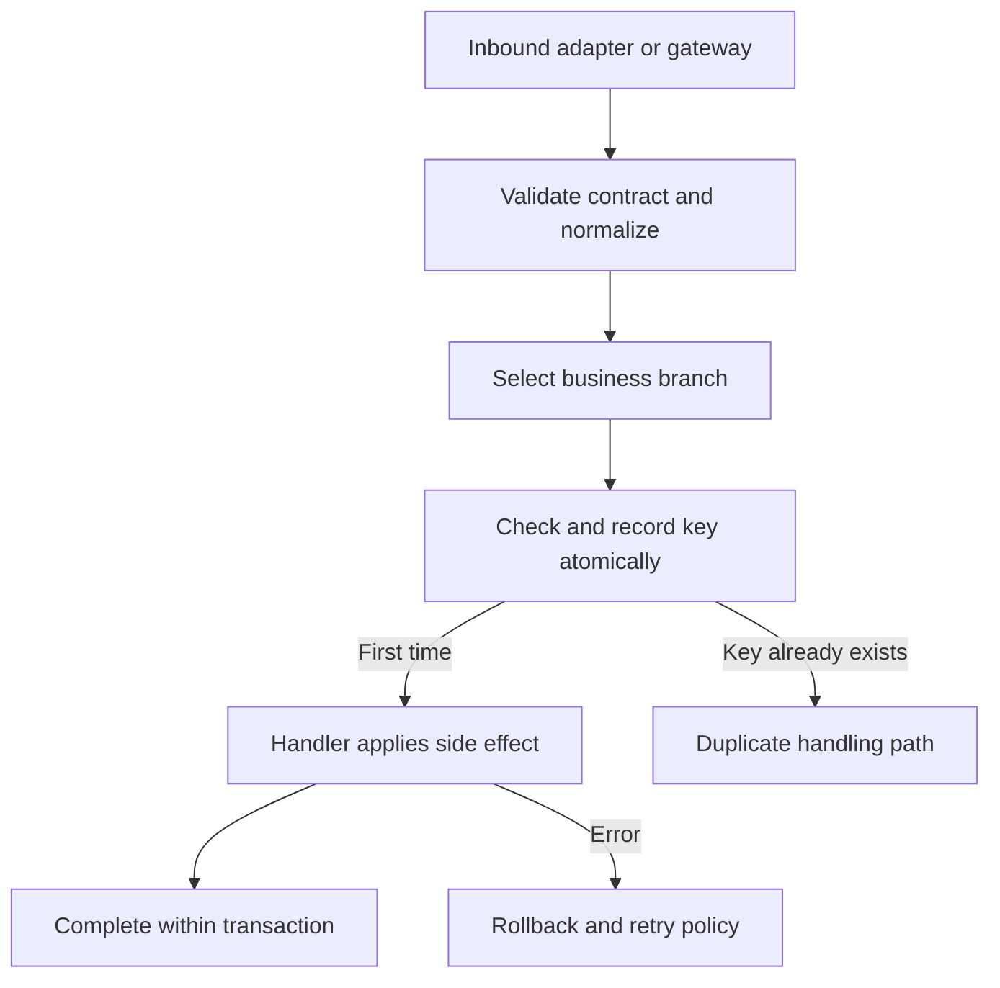

# Designing idempotent handlers

In the **Flow Design** chapter of the **SPRING_INTEGRATION_CORE** module, a handler does not just need to process one message correctly. It must also preserve the right business outcome when the same request is redelivered due to retries, dropped connections, application restarts, or multiple concurrent consumers.

This lesson connects `Message`, `MessageChannel`, endpoints, gateways, and Java DSL to build an idempotent handler. The running scenario is receiving an account-credit event: event `evt-731` crediting 150,000 VND, even if delivered multiple times, must increase the balance only once. Monetary amounts in the example are integers in the agreed minor unit of each currency.

## 1. Goals and prerequisites

After this lesson, you will be able to:

- Distinguish a redelivered message from a brand-new business request.
- Choose a stable idempotency key scoped by tenant and operation.
- Attach `IdempotentReceiverInterceptor` to an endpoint using Java DSL.
- Explain why atomic key recording alone is not enough to protect the entire business action.
- Define transactions, retry mechanisms, duplicate-message handling, and key retention duration.
- Design tests based on how many times the business effect occurs.

You should know how to use service activators, gateways, `DirectChannel`, `MessageBuilder`, Java beans, and Spring transactions. Examples using `record` assume Java 17 or later; Spring Integration and Spring JDBC dependencies must be managed by a BOM compatible with your application. This lesson does not require a specific Spring Boot version.

## 2. Idempotency is defined by business side effects

Let `H(S, C)` be the state after the handler processes command `C` on initial state `S`. Idempotency for that command can be expressed as:

```text
H(H(S, C), C) = H(S, C)
```

What is protected is the outcome the system commits to its consumers. The handler may be invoked multiple times, write multiple log lines, or increment a received-message counter; the amount credited to the account must still equal a single processing run.

| Operation | When repeating the same request | Design concern |
| --- | --- | --- |
| Set order status to `PAID` | May preserve the same state | Accompanying emails and emitted events may still repeat |
| Add 150,000 to the balance | Increases balance a second time | Must control the identity of each credit operation |
| Insert record with unique business key | Next attempt may hit a key conflict | Must distinguish valid duplicate from conflicting data |
| Send confirmation email | May send multiple emails | Needs a dedicated mechanism for email side effects |

Two distinct events both crediting 150,000 to an account are two valid business operations. They must not be collapsed merely because their payloads look similar. Conversely, the same event wrapped in two different `Message` instances must still be recognized as one business operation.

Idempotency also does not solve all concurrency issues. Two valid events concurrently updating the balance still need an atomic update statement or suitable locking to prevent lost updates.

## 3. Why do messages reappear?

Consider a consumer processing a message and then acknowledging to a broker:

```text
Receive message → apply business update → commit database → acknowledge broker
```

If the consumer crashes after commit but before acknowledgment, the broker can redeliver the message. The producer can also resend because it does not know whether the previous send was accepted. These redelivery mechanisms enable work recovery, yet create the need to guard against duplicate side effects.

| Failure timing | Observable state | What to do on redelivery? |
| --- | --- | --- |
| Before starting transaction | No business change yet | Process normally |
| Inside transaction, and transaction rolls back | No committed changes | Allow reprocessing |
| After commit, before acknowledge | Business work already completed | Detect duplicate and avoid repeating side effects |
| After HTTP call, before receiving response | Target system may have executed it | Query or retry with a key supported by the target system |

In this lesson, the goal is to protect business effects under at-least-once delivery. Adding an interceptor alone is not enough to claim the system achieves end-to-end exactly-once guarantees across databases, brokers, and external APIs.

## 4. Designing the idempotency key

### 4.1. Choose a stable business identity

For the credit event, use the key:

```text
account-credit:v1|tenant-a|evt-731
└──── operation ───┘ └ tenant ┘ └ eventId ┘
```

`eventId` must be generated once for the original event and kept unchanged across all retries. The namespace separates crediting from consumers performing other actions. Tenant prevents two customers with the same `eventId` string from colliding.

Do not use `MessageHeaders.ID` as a default business key. Rebuilding a message or resending at a producer can assign a new ID. `correlationId` can also represent an entire group of messages, so it does not automatically identify a single operation.

| Candidate key | Problem |
| --- | --- |
| `accountId` | Blocks all subsequent valid credits to the same account |
| `orderId` | May conflate payment, refund, and multiple payments for one order |
| Fresh UUID generated on each retry | Every retry is treated as a new request |
| Hash of raw JSON | Changing field order or whitespace can change the hash |
| Namespace + tenant + stable `eventId` | Fits when the contract specifies an immutable `eventId` per business action |

In the example, `v1` is the identity contract version. Do not bump it on every application deployment: changing the namespace lets old events be reprocessed.

### 4.2. Avoid ambiguous keys and blank keys

If joining strings with `|`, forbid that character inside each component or use an unambiguous encoding. Never turn `null` into a placeholder string and continue; multiple bad events could collapse onto the same key.

Keys need length limits and a trusted data source. A client-supplied header should only be used after authenticating the tenant and validating the event contract. Placing the key in a header makes the flow convenient, but does not replace those checks.

### 4.3. Same key, different payload

The two requests below share an identity yet conflict in content:

```text
tenant-a, evt-731, account-09, amount=150000, currency=VND
tenant-a, evt-731, account-09, amount=250000, currency=VND
```

Three outcomes must be distinguished:

1. Key does not exist yet: candidate for first-time processing.
2. Key exists, business content matches: valid duplicate message.
3. Key exists, business content differs: contract violation, must report an error or route for inspection.

A filter that checks only key existence cannot distinguish cases 2 and 3. When conflict detection is required, also store a fingerprint of normalized business fields, or store the fields directly for comparison. The fingerprint should exclude transport timestamps, trace IDs, and headers that can vary across retries.

## 5. Place deduplication in the right position in the flow



Transformers can normalize data types before building the key; routers direct requests to the right business action; deduplication must sit immediately before the side effect it protects. A filter checking `store.get(key) == null` and then calling `store.put(key, value)` can let two consumers pass through together.

Race condition example:

```text
Consumer A: reads key → absent
Consumer B: reads key → absent
Consumer A: credits account
Consumer B: credits account
```

Therefore, checking and claiming processing ownership must be atomic. When a flow has multiple branches performing different effects, scope keys per effect. A shared namespace before a publish-subscribe split does not prove every branch finished after one run.

## 6. Relevant Spring Integration components

| Component | Role |
| --- | --- |
| `IdempotentReceiverInterceptor` | Advice deciding duplicate handling at a handler |
| `MessageSelector` | Contract accepting or rejecting a message |
| `MetadataStoreSelector` | Generates keys and uses a metadata store to decide acceptance |
| `ConcurrentMetadataStore` | Provides atomic metadata update operations |
| `SimpleMetadataStore` | In-memory store for single-process testing |
| `JdbcMetadataStore` | Shared JDBC store capable of persisting state across restarts |

The interceptor attaches to an existing endpoint; Spring Integration does not create a separate idempotent endpoint type. You can wire it in Java DSL via `e.advice(...)`. [Idempotent Receiver Documentation](https://docs.spring.io/spring-integration/reference/handler-advice/idempotent-receiver.html).

### 6.1. Behavior for duplicate messages

By default, the interceptor can mark `duplicateMessage=true` and still let the handler run. To block the side effect, explicitly choose how to handle it:

| Configuration | Result for a message rejected by the selector |
| --- | --- |
| No discard channel, exception disabled | Handler is still invoked with the duplicate flag set |
| `discardChannel` set | Routes message to that channel, skipping the protected handler |
| Discard to `nullChannel` | Drops the duplicate message |
| `throwExceptionOnRejection=true` | Raises `MessageRejectedException` |

If both a discard channel and exception throwing are configured, the exception can still be thrown after sending the message to the discard channel. Enabling exceptions can push duplicates into retry; choose according to the message reception contract. [IdempotentReceiverInterceptor Javadoc](https://www.springframework.org/spring-integration/api/org/springframework/integration/handler/advice/IdempotentReceiverInterceptor.html).

### 6.2. Selector records the key before business logic runs

With standard existence-checking configuration, you can picture `MetadataStoreSelector` as:

```text
key = keyStrategy(message)
previous = store.putIfAbsent(key, value)
accepted = previous == null
```

When the selector accepts, the key has been written into the store under that store's transaction semantics; the selector does not yet know whether the handler will succeed or fail. [MetadataStoreSelector Javadoc](https://docs.spring.io/spring-integration/api/org/springframework/integration/selector/MetadataStoreSelector.html).

If the store persists the key immediately while the handler throws an exception, redeliveries can be dropped even though the business effect never happened. The atomicity of `putIfAbsent` guards claiming ownership of a key, while the commit boundary determines whether the key reflects a completed business operation.

## 7. Java DSL example: crediting inside the same transaction as the key

### 7.1. Example assumptions

The example uses Spring Integration Core, Spring Integration JDBC, and Spring JDBC. The application already has a `DataSource`; classes reside in the same example package and are scanned by Spring. Place each public class or interface in its own Java file when bringing this into a practice project.

The input contract guarantees that identical `tenantId` and `eventId` always carry the same business payload. This interceptor example deduplicates by key without implementing same-key-different-payload detection; Section 10 presents an inbox design for that requirement.

Conditions for the example to protect the credit effect:

- Metadata and balance data use the same `DataSource` and participate in the same transaction manager.
- The transaction starts before the gateway sends the message to the selector.
- `DirectChannel` keeps the processing chain synchronous on the same execution thread.
- Business errors propagate outward so the transaction rolls back.
- The intake source acknowledges only after the transactional call completes successfully.

### 7.2. Data type and key

```java
public record CreditCommand(
        String tenantId,
        String eventId,
        String accountId,
        long amountMinor,
        String currency) {

    public CreditCommand {
        requireToken(tenantId, "tenantId");
        requireToken(eventId, "eventId");
        requireToken(accountId, "accountId");
        if (amountMinor <= 0) {
            throw new IllegalArgumentException("amountMinor must be positive");
        }
        if (currency == null || !currency.matches("[A-Z]{3}")) {
            throw new IllegalArgumentException("Invalid currency");
        }
    }

    private static void requireToken(String value, String field) {
        if (value == null || !value.matches("[A-Za-z0-9._-]{1,64}")) {
            throw new IllegalArgumentException("Invalid " + field);
        }
    }

    public String idempotencyKey() {
        return "account-credit:v1|" + tenantId + "|" + eventId;
    }
}
```

Token rules forbid delimiter characters from appearing in any component. Do not include `amountMinor` in the key: an `eventId` arriving with a changed amount must be detected as a conflict rather than becoming a brand-new operation.

### 7.3. Configuring channels, metadata store, and advice

```java
import javax.sql.DataSource;

import org.springframework.context.annotation.Bean;
import org.springframework.context.annotation.Configuration;
import org.springframework.integration.annotation.IntegrationComponentScan;
import org.springframework.integration.channel.DirectChannel;
import org.springframework.integration.config.EnableIntegration;
import org.springframework.integration.dsl.IntegrationFlow;
import org.springframework.integration.handler.advice.IdempotentReceiverInterceptor;
import org.springframework.integration.jdbc.metadata.JdbcMetadataStore;
import org.springframework.integration.metadata.ConcurrentMetadataStore;
import org.springframework.integration.selector.MetadataStoreSelector;
import org.springframework.jdbc.datasource.DataSourceTransactionManager;
import org.springframework.messaging.MessageChannel;
import org.springframework.transaction.PlatformTransactionManager;
import org.springframework.transaction.annotation.EnableTransactionManagement;

@Configuration
@EnableIntegration
@EnableTransactionManagement
@IntegrationComponentScan(basePackageClasses = CreditGateway.class)
public class CreditFlowConfiguration {

    @Bean
    public PlatformTransactionManager integrationTxManager(DataSource dataSource) {
        return new DataSourceTransactionManager(dataSource);
    }

    @Bean
    public MessageChannel creditInput() {
        return new DirectChannel();
    }

    @Bean
    public ConcurrentMetadataStore creditMetadataStore(DataSource dataSource) {
        return new JdbcMetadataStore(dataSource);
    }

    @Bean
    public IdempotentReceiverInterceptor creditIdempotency(
            ConcurrentMetadataStore creditMetadataStore) {

        MetadataStoreSelector selector = new MetadataStoreSelector(
                message -> ((CreditCommand) message.getPayload()).idempotencyKey(),
                creditMetadataStore);

        IdempotentReceiverInterceptor interceptor =
                new IdempotentReceiverInterceptor(selector);
        interceptor.setDiscardChannelName("nullChannel");
        return interceptor;
    }

    @Bean
    public IntegrationFlow creditFlow(
            CreditHandler creditHandler,
            IdempotentReceiverInterceptor creditIdempotency) {

        return IntegrationFlow.from("creditInput")
                .handle(creditHandler, "apply",
                        endpoint -> endpoint.advice(creditIdempotency))
                .get();
    }
}
```

`nullChannel` is a special channel provided by Spring Integration infrastructure. Deduplicating here counts as success under a one-way contract: no extra credit is applied and the receiver can finish the redelivery.

`JdbcMetadataStore` requires a metadata table created from the database-appropriate schema in the Spring Integration JDBC dependency. Use migrations to create the table before startup; do not assume declaring the bean creates the schema automatically. The JDBC store persists committed state across restarts and shares it across instances. [JDBC Metadata Store](https://docs.spring.io/spring-integration/reference/jdbc/metadata-store.html).

### 7.4. Gateway and transaction wrapping the flow

The gateway turns a Java call into a message entering `creditInput`:

```java
import org.springframework.integration.annotation.MessagingGateway;
import org.springframework.messaging.Message;

@MessagingGateway(defaultRequestChannel = "creditInput")
public interface CreditGateway {
    void credit(Message<CreditCommand> message);
}
```

A service starts the transaction before calling the gateway:

```java
import org.springframework.messaging.support.MessageBuilder;
import org.springframework.stereotype.Service;
import org.springframework.transaction.annotation.Transactional;

@Service
public class TransactionalCreditIngress {

    private final CreditGateway gateway;

    public TransactionalCreditIngress(CreditGateway gateway) {
        this.gateway = gateway;
    }

    @Transactional(
            transactionManager = "integrationTxManager",
            rollbackFor = Exception.class)
    public void accept(CreditCommand command) {
        gateway.credit(MessageBuilder.withPayload(command).build());
    }
}
```

Callers invoke `accept()` through the Spring-managed bean. Never instantiate `new TransactionalCreditIngress(...)` directly or rely on a self-invocation on the same object to trigger the transaction proxy. Nor should another consumer send straight to `creditInput` bypassing the designed transaction boundary.

### 7.5. Handler and business data

Illustrative business schema:

```sql
CREATE TABLE account_balance (
    tenant_id     VARCHAR(64) NOT NULL,
    account_id    VARCHAR(64) NOT NULL,
    currency      CHAR(3) NOT NULL,
    balance_minor BIGINT NOT NULL,
    PRIMARY KEY (tenant_id, account_id)
);

CREATE TABLE account_credit_ledger (
    tenant_id    VARCHAR(64) NOT NULL,
    event_id     VARCHAR(64) NOT NULL,
    account_id   VARCHAR(64) NOT NULL,
    amount_minor BIGINT NOT NULL CHECK (amount_minor > 0),
    currency     CHAR(3) NOT NULL,
    PRIMARY KEY (tenant_id, event_id)
);
```

The ledger has a unique constraint per credit event within each tenant. This is an additional data guardrail; duplicate-handling policy in the flow still needs explicit definition.

```java
import javax.sql.DataSource;

import org.springframework.jdbc.core.JdbcTemplate;
import org.springframework.stereotype.Service;

@Service
public class CreditHandler {

    private final JdbcTemplate jdbc;

    public CreditHandler(DataSource dataSource) {
        this.jdbc = new JdbcTemplate(dataSource);
    }

    public void apply(CreditCommand command) {
        jdbc.update("""
                INSERT INTO account_credit_ledger
                    (tenant_id, event_id, account_id, amount_minor, currency)
                VALUES (?, ?, ?, ?, ?)
                """,
                command.tenantId(), command.eventId(), command.accountId(),
                command.amountMinor(), command.currency());

        int changed = jdbc.update("""
                UPDATE account_balance
                SET balance_minor = balance_minor + ?
                WHERE tenant_id = ? AND account_id = ? AND currency = ?
                """,
                command.amountMinor(), command.tenantId(),
                command.accountId(), command.currency());

        if (changed != 1) {
            throw new IllegalStateException(
                    "Account not found or currency mismatch");
        }
    }
}
```

The statement `balance_minor = balance_minor + ?` lets the database update the balance, instead of reading the balance into Java and overwriting with a value computed from stale data. It solves lost updates across distinct events; the idempotency key solves redeliveries of the same event.

### 7.6. Expected execution

Suppose initial balance is 100,000 VND and the command has `eventId=evt-731`, `amountMinor=150000`:

```text
First delivery:
  BEGIN
  write metadata key
  insert ledger
  balance: 100000 → 250000
  COMMIT

Redelivery:
  BEGIN
  selector sees key already exists
  route message to nullChannel
  skip CreditHandler
  COMMIT
```

If the handler fails before commit, the outer transaction must roll back the key, the ledger entry, and the balance update. The next redelivery can then claim the key and retry processing. This relies on all JDBC operations actually participating in the same transaction; placing two tables on the same database server alone is not enough.

If two instances receive `evt-731` simultaneously, the shared metadata store must arbitrate atomically. One instance may wait on a database lock; on lock timeout or deadlock, treat it as a transient transaction failure and retry per policy. Never interpret a store-access failure as a successful duplicate.

## 8. Transaction boundaries that are easy to misdesign

### 8.1. Putting `@Transactional` only on the handler

```text
selector writes key and finishes its own transaction
    → handler opens business transaction
    → handler fails and rolls back
    → key stays committed
```

If the transaction only begins upon entering the business method, the selector can run outside it. This lesson places the transaction on the service calling the gateway so both selector and handler execute inside an already-open boundary.

Do not infer execution order solely from element order in `advice(...)`. `IdempotentReceiverInterceptor` is a `HandleMessageAdvice`; on reply-producing handlers, this advice can apply around `handleMessage()` while other advices wrap internal request handling. [Handling Message Advice](https://docs.spring.io/spring-integration/reference/handler-advice/handle-message.html).

### 8.2. Switching from `DirectChannel` to asynchronous processing

Standard JDBC transactions are bound to the execution thread. Replacing the channel with `ExecutorChannel` or passing work through `QueueChannel` can make the handler run on a different thread after the sender's transaction has already ended.

If asynchrony is needed, open the transaction on the consumer that actually processes the message and ensure the selector executes inside that transaction. Poller or listener transactions must be designed according to the adapter in use; never copy synchronous gateway configuration and assume it preserves the same guarantees.

An in-memory `QueueChannel` also provides no durability for queued work on process death. Idempotency and message durability are two separate requirements to verify.

### 8.3. Catching errors and returning normally

```java
try {
    applyBusinessChange();
}
catch (RuntimeException ex) {
    logFailure(ex);
    // If returning normally, the outer transaction may commit the key.
}
```

When catching errors, define both the transaction outcome and the message-reception outcome. If rollback is desired, propagate an appropriate exception outward or mark rollback per design. An error flow that logs successfully does not mean the original business operation succeeded.

### 8.4. Acknowledging too early

Expected order for sources with manual acknowledgment:

```text
call TransactionalCreditIngress.accept(command)
    → call returns after successful commit
    → acknowledge source message
```

If a failure occurs before completion, apply the redelivery policy or route the failed message according to the source's mechanism. Exact acknowledge calls depend on the adapter; there is no single universal acknowledge command across every `MessageChannel`.

## 9. Retries, error channels, and external side effects

### 9.1. Classify outcomes before deciding to retry

| Situation | Handling direction |
| --- | --- |
| Valid duplicate, business logic committed | Finish under duplicate contract; do not retry infinitely |
| Metadata store unreachable | Report transient failure; do not acknowledge as success |
| Deadlock or recoverable transaction failure | Roll back and retry with limits and backoff |
| Missing `eventId` or invalid tenant | Reject data; route to inspection per policy |
| Same key, different content | Report conflict; investigate contract or producer |
| External system call timed out | Treat outcome as unknown; use target system's idempotency mechanism |

Retries only help if the next attempt is still permitted to execute the unfinished part. If the key already committed separately before business failure, a retry may simply be deduplicated and give the illusion of completion.

A retry advice inside an endpoint can also stay inside the failing transaction. For errors needing a fresh transaction, prefer wrapping retry outside the transaction boundary or letting the source redeliver, rather than assuming every retry opens a clean transaction.

### 9.2. Error messages and business messages

When designing `errorChannel`, keep the business key along with original message details for tracing. Do not blindly feed `ErrorMessage` back into an endpoint casting payload to `CreditCommand`. The error flow must classify the error and explicitly reconstruct the business call when policy allows.

Never delete the key blindly in every error branch. If another execution already completed, deleting the key can re-open permission to apply the side effect. With a shared transaction, let rollback restore state. With an explicit processing-state design, use conditional updates by owner or version.

### 9.3. Database and HTTP do not commit together

Suppose the handler updates the ledger and also calls a money-transfer API:

```text
Target API executes the transfer
    → connection drops before response
    → consumer database transaction rolls back
    → message is redelivered
```

Local rollback does not undo effects in the remote API. You can coordinate in two ways:

- Send the same idempotency key to the target API if it supports storing and matching keys; query the outcome when the response is unclear.
- Inside the business transaction, write an outbox record. A separate publisher sends requests or events from the outbox and retries when needed. Receivers still need deduplication because the publisher can resend after failures.

Never call HTTP and database together and treat `@Transactional` as proof they are atomic with each other. For long-lived or non-reversible effects, design explicit business processes and reconciliation.

## 10. When you need an inbox instead of simple key existence

A dedicated inbox fits when you must detect conflicting payloads, return cached results to a gateway, or track state of long-running jobs. This is an application-layer design; `MetadataStoreSelector` does not automatically provide all the columns and state transitions below.

Illustrative PostgreSQL schema:

```sql
CREATE TABLE processed_command (
    consumer_name VARCHAR(80) NOT NULL,
    tenant_id     VARCHAR(64) NOT NULL,
    event_id      VARCHAR(64) NOT NULL,
    payload_hash  VARCHAR(64) NOT NULL,
    result_json   TEXT,
    processed_at  TIMESTAMP WITH TIME ZONE NOT NULL DEFAULT CURRENT_TIMESTAMP,
    PRIMARY KEY (consumer_name, tenant_id, event_id)
);
```

For short, synchronous database updates, the algorithm inside the same transaction can be:

1. Compute a fingerprint from normalized business fields.
2. Attempt to insert an inbox row atomically.
3. If inserted, perform the business update and store the result in the inbox row.
4. If the row already exists, read the committed fingerprint and result. Matching fingerprint returns the stored result; differing fingerprint signals a conflict.
5. Commit after all required changes succeed. If business logic fails, roll back the new inbox row too.

Example key-claiming statement in PostgreSQL:

```sql
INSERT INTO processed_command
    (consumer_name, tenant_id, event_id, payload_hash)
VALUES (?, ?, ?, ?)
ON CONFLICT (consumer_name, tenant_id, event_id) DO NOTHING;
```

With an appropriate JDBC call, the affected row count tells whether this insert created a new row. The duplicate branch must read committed data according to the database's isolation and retry rules. Do not implement this by catching every `DataIntegrityViolationException` and assuming duplicate: the error could come from a different constraint, and some databases leave the current transaction aborted after an SQL error.

In this design, the new inbox row can be created before the business update yet only commits together with it. There is no need to commit a separate `PROCESSING` state when all operations live in one short transaction.

If work is long-running and ownership must be committed upfront, an explicit state model is needed:

```text
ABSENT → PROCESSING → SUCCEEDED
             ↓
     FAILED_RETRYABLE or awaiting recovery
```

You must then add an owner token, lease expiration, renewal rules, recovery mechanics, and conditional updates. An expired lease does not prove the old worker stopped causing effects; target systems need fencing tokens or matching deduplication. Never check a timestamp and delete an in-progress row as a generic recovery trick.

### Gateway expecting a reply

The earlier example used a `void` gateway, so discarding duplicates to `nullChannel` matched the one-way contract. With a request-reply gateway, dropping messages the same way can leave the caller without a reply and waiting until timeout.

Choose an explicit contract: return the stored success result, return a structured duplicate status, or return a conflict error when content differs. If responses must be replayed, store the business result needed to return it; the `duplicateMessage` header is not a response cache.

## 11. Store limits and key retention duration

### 11.1. In-memory testing

`SimpleMetadataStore` is convenient for examples or single-process tests. Separate objects in two instances do not share keys, and restarting the application loses in-memory state. [Metadata Store](https://docs.spring.io/spring-integration/reference/meta-data-store.html).

In-memory stores also do not roll back with JDBC transactions. Replacing `JdbcMetadataStore` with `SimpleMetadataStore` in a production-like example changes failure guarantees when handlers throw, even though a quick back-to-back send test may still pass.

### 11.2. Define the replay window

Key retention must cover the entire window during which old events can return: automatic retries, broker retention, error queues, backup restores, and manual replays. This is a business and operational decision, not merely cache sizing.

For example, if events can be replayed for 30 days while keys are purged after 24 hours, the system can reprocess already-completed work. For financial ledgers, business identity constraints usually must outlive integration-layer deduplication caches.

Do not assume every `ConcurrentMetadataStore` has automatic TTL or the same cleanup policy. Define cleanup according to the actual implementation, purge only eligible state, and account for the impact of deletion on replays.

In the unique-ledger example, if metadata keys are purged while the ledger remains, an old event will hit a ledger conflict rather than crediting twice. You need a ledger reconciliation branch and outcome classification; endlessly retrying a unique-constraint error will not restore the desired state.

## 12. Distinguish deduplication from ordering

Two events `evt-731` and `evt-732` can both be valid even if they arrive out of order. Event-ID deduplication allows both; correctness under ordering depends on business rules.

If every message is a full snapshot and only the latest state matters, the application can use a version number to reject older snapshots. Conversely, if messages are individual credits, you must not discard version 11 just because version 12 arrived first: dropping a different event means losing money that should be credited.

`MetadataStoreSelector` supports comparing values via `compareValues`, yet monotonic version checks only suit contracts that allow dropping stale data. It does not by itself provide resequencing, gap detection, or proof that all earlier events completed. [compareValues Configuration](https://docs.spring.io/spring-integration/reference/handler-advice/idempotent-receiver.html).

In flows with splitters or aggregators, define identities for both each item and the aggregated result. Never treat a newly generated aggregated message ID as proof that the final side effect has not happened before.

## 13. Testing by side effects and failure points

### 13.1. Small unit test for the key strategy

The following JUnit 5 snippet shows two `Message` instances with different IDs still converging on the same business identity:

```java
import org.junit.jupiter.api.Test;
import org.springframework.integration.metadata.SimpleMetadataStore;
import org.springframework.integration.selector.MetadataStoreSelector;
import org.springframework.messaging.Message;
import org.springframework.messaging.support.MessageBuilder;

import static org.junit.jupiter.api.Assertions.*;

class CreditKeyTest {

    @Test
    void detectsSameEventInDifferentMessageEnvelopes() {
        MetadataStoreSelector selector = new MetadataStoreSelector(
                message -> ((CreditCommand) message.getPayload()).idempotencyKey(),
                new SimpleMetadataStore());

        CreditCommand command = new CreditCommand(
                "tenant-a", "evt-731", "account-09", 150000L, "VND");
        Message<CreditCommand> first = MessageBuilder.withPayload(command).build();
        Message<CreditCommand> again = MessageBuilder.withPayload(command).build();

        assertNotEquals(first.getHeaders().getId(), again.getHeaders().getId());
        assertTrue(selector.accept(first));
        assertFalse(selector.accept(again));
    }
}
```

This test checks the key strategy and selector in memory. It does not test advice wiring, handler invocation counts, rollbacks, database locking, or multiple instances.

### 13.2. Integration test matrix

Use the same database engine as your target environment for tests depending on transactions and lock contention. Measure both the ledger and the balance; checking logs for a duplicate message line is not enough.

| Scenario | Outcome to verify |
| --- | --- |
| Send same tenant and `eventId` twice | One ledger row; balance increases only once |
| Same payload, different `eventId` | Two ledger rows; balance increases twice |
| Same `eventId`, different tenant | Two independent business operations |
| Two concurrent consumers process the same key | Only one effect commits; the other deduplicates or retries after transient error |
| Handler fails after ledger insert, before commit | Metadata, ledger, and balance all roll back |
| Redelivery after rollback | Business operation is permitted and commits |
| Lost acknowledge after commit | Redelivery creates no extra side effects |
| Application restart | Committed keys still prevent duplicates |
| Two application contexts sharing a database | Deduplication still works across instances |
| Same key, different amount or account | Inbox design detects conflict; simple selector example does not cover this test |
| Metadata store unreachable | Does not report fake success and does not silently drop message |
| Request-reply receives duplicate | Returns contract-compliant result; does not hang waiting for reply |
| Key purged then old event replayed | Outcome aligns with retention policy and ledger guardrail |

For concurrency testing, use a latch or barrier so two tasks start close together and wait for both to finish before reading committed data. Do not use a few `sleep` calls to infer contention occurred. For rollback tests, the simulated failure must occur inside the transaction, not before the flow starts.

### 13.3. Practicing with the credit example

Prepare an account with a balance of 100,000 VND, then call the `TransactionalCreditIngress` bean twice with the same command. Post-commit results must be 250,000 VND and one ledger row. Next send a new `eventId` with the same amount: balance must become 400,000 VND.

Next, inject a controlled failure inside the handler before the test environment's transaction finishes. After rollback, confirm no new metadata key or ledger row was committed; disable the failure and redeliver the event to confirm subsequent processing succeeds. Finally, run two instances sharing the database to test shared-store assumptions.

The tests above are hands-on guidance, not a report that the lesson or a sample application was executed during authoring.

## 14. Observability and operations

Separately track messages received, business commits, duplicates, conflicts, metadata store errors, and retries. Rising duplicates may reflect aggressive producer retries or slow acknowledgments, not necessarily a handler bug.

Logs should include tenant, operation name, `eventId`, processing outcome, and trace ID per data policy. If keys contain sensitive data, mask or hash them before logging. Never put high-cardinality `eventId` values into metric labels.

When investigating a suspected lost event, cross-check metadata state, ledger, transaction, and acknowledge history. A key existing with no business effect can point to a split transaction or a swallowed error. When investigating duplicate effects, check `eventId` stability, namespace, retention, and whether instances truly share the same store.

An idempotent handler design must explicitly define business identity, scope of side effects, where state is recorded, commit boundaries, and duplicate return values. Those decisions turn message filtering into a verifiable guarantee of an integration flow.
